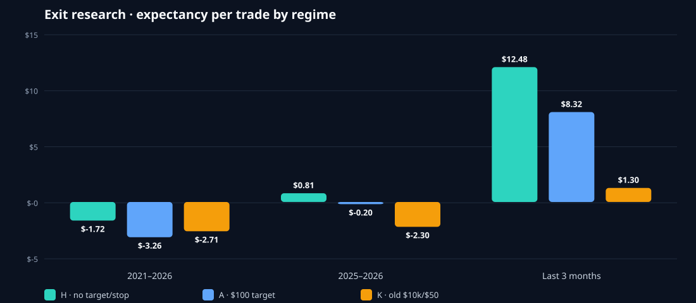
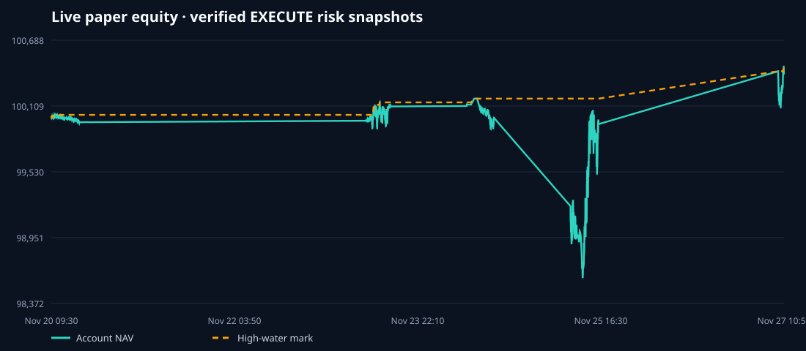
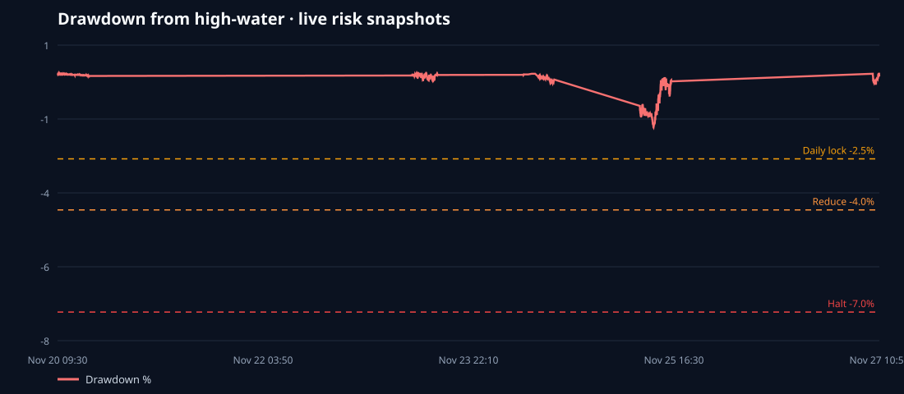

# Moo-Moo: Adaptive Two-Vote ETF Agent

**Moomoo × Qoder AI Trading Agent Challenge — submission draft**

**Generated with Qoder Desktop · competition paper account · USD 100,000 initial assets**

**Draft v0.3 · 27 November 2026, 15:52 SGT · pending the 27 November half-day final-session refresh**

> This working submission draft separates broker-reconciled results from hypothetical research and records failures as well as successes. The current trading source is committed and public; final-session results, deck and package refresh remain.

**Live presentation:** https://moo-moo-competition-7amelju7q1y.qoder.website

**Draft deliverables:** [hosting-ready HTML report](moomoo-dual-strategy/reports/competition/Moo-Moo-Submission-Report-Hosted.html) · [standalone HTML report](moomoo-dual-strategy/reports/competition/Moo-Moo-Submission-Report.html) · [editable PowerPoint](moomoo-dual-strategy/reports/competition/Moo-Moo-Submission-Draft.pptx) · [rendered PDF](moomoo-dual-strategy/reports/competition/Moo-Moo-Submission-Draft.pdf) · [submission cover note](moomoo-dual-strategy/reports/competition/SUBMISSION_COVER_NOTE.md) · [form manifest](moomoo-dual-strategy/reports/competition/submission_assets/submission_form_manifest.json) · draft runnable package (submitted separately) · [package manifest](moomoo-dual-strategy/reports/competition/Moo-Moo-Submission-Draft-Package-Manifest.json) · [package checksum](moomoo-dual-strategy/reports/competition/Moo-Moo-Submission-Draft-Package.sha256) · [redacted peer-evidence manifest](moomoo-dual-strategy/reports/competition/submission_assets/peer_evidence_manifest.json)

---

## Executive summary

Moo-Moo is a deterministic, event-driven paper-trading agent for SPY and QQQ. Ten technical rules vote on each completed five-minute bar (Noise-area is SPY-only); the agent acts only when at least two rules agree and fewer than two disagree. The indicators are correlated, so the threshold is a consensus filter—not ten independent alpha sources. Every order passes account, attribution, quote-freshness, exposure, cash, loss-limit and reconciliation gates before it can reach Moomoo's competition paper account.

The strategy evolved during the competition from a five-sleeve portfolio into a focused Two-vote book:

- **20 Nov:** H ETF opened XLV and XLP; both later closed for **+$12.38 gross realized**.
- **23 Nov:** Two-vote execution went live; a broker partial-fill/cancellation anomaly forced a safe halt and manual reconciliation.
- **24 Nov:** losing long lots were deliberately carried instead of being sold at a loss; an exit backtest removed profit targets and tight stops.
- **25 Nov:** $20,000 lots, add/re-entry, doubled loss limits, twin-ETF shorts and the per-lot “never sell a long at a loss” guard were activated.
- **26 Nov:** H ETF was retired after producing no new plan; its $20,000 moved to the Two-vote book, now **$100,000**. The short-cash NAV correction is implemented, tested and committed.

### Broker-reconciled snapshot

| Measure | Current value |
|---|---:|
| Initial account NAV | $100,000.00 |
| Current account NAV | **$99,958.28** |
| Net account change | **−$41.72 (−0.0417%)** |
| High-water mark | $100,174.35 |
| Drawdown from high-water | **−0.2157%** |
| 25 Nov day-start NAV | $99,228.13 |
| Change from 25 Nov day start | +0.7358% |
| Cash | $71,623.28 |
| Open market value | $28,335.00 |
| Open positions | SPY 13 · QQQ 30 |
| Open unrealized gross, identified-lot basis | **−$187.91** |
| Realized gross, 13 closed trades | **+$176.04** |
| Implied fees and other broker cash flows | −$29.85 |
| Broker orders | 30 total · 29 filled · 1 reconciled cancellation |
| Unresolved orders / attribution errors / halts / daily locks | **0 / 0 / 0 / 0** |

The account is slightly below its starting balance while remaining far inside every risk threshold. The 27 November 13:00 ET close is not yet included; final competition settlement uses that session's regular-market closing prices.

---

## 1. Strategy thesis and exact rules

### 1.1 Edge hypothesis

When several distinct, well-known technical rules agree on the same completed five-minute bar, short-term directional persistence is more likely than when a single rule fires. The agent therefore trades **agreement**, not any one indicator. The rules are correlated; the hypothesis is that consensus filters noise, not that each rule contributes independent alpha.

The hypothesis is explicitly regime-dependent. A 5.9-year replay loses money after conservative costs over 2021–2026, loses less in 2025–2026, and is profitable in the most recent three-month regime. The submission does not claim a proven all-weather edge.

### 1.2 The ten votes

Each rule is defined for shorts and mirrored for longs. A vote switches on at its first entry signal from the 09:55 ET bar onward and remains active until its own exit condition, giving at most one window per rule, direction and session.

| # | Rule | Short entry | Rule exit |
|---|---|---|---|
| 1 | Donchian | Close below prior 20-bar low | Close above prior 10-bar high |
| 2 | Keltner | Close below EMA20 − 2×ATR10 | Close above EMA20 |
| 3 | RSI(2) | RSI(2) > 90 while close < SMA200 | Close below SMA5 |
| 4 | MACD (12, 26, 9) | MACD crosses below signal below zero | MACD crosses back above |
| 5 | DMI/ADX (14) | −DI crosses above +DI with ADX ≥ 25 | +DI back above −DI |
| 6 | Stochastic (14, 3) | %K crosses below %D from ≥ 80 | %K ≤ 20 |
| 7 | Chandelier (22, 3×ATR) | Close below 22-bar high − 3×ATR | Close above 22-bar low + 3×ATR |
| 8 | Turtle Soup | False breakout above 20-bar high, confirmed next bar | Close back at breakout high or 20-bar mid-range |
| 9 | NR7 | After narrowest range of seven days, close below first 15-minute low | Close at/above first 15-minute high |
| 10 | Noise-area, SPY only | At 10:30/11:30/13:30/14:30 ET, close below band and VWAP | Next decision time or close |

**Signal:** buy when ≥2 rules vote long and <2 vote short; sell is the mirror image.

### 1.3 Entries and sizing

- **Book:** $100,000 fixed sizing book after H's retirement. Realized gains are banked outside the entry budget; losses reduce it.
- **Lot:** $20,000 per entry, halved when the drawdown-reduction state is active.
- **Stacking:** no fixed lot count. Additional lots may be added on each completed bar while agreement persists and room remains.
- **Minimum top-up:** $5,000; smaller residual capacity is left unused rather than creating dust.
- **Single-name cap:** the lower of **$40,000** and **39.5% of live NAV**, summed across all sleeves by absolute exposure. This sits inside the official 40% limit.
- **Cash:** no leverage. New exposure must fit available cash after existing gross positions.
- **Entry window:** 10:00–14:30 ET.
- **No same-bar reversal re-entry:** the agent does not re-enter on the bar where an opposite agreement closed the symbol, nor while an earlier exit is still working.

### 1.4 Exits and position mechanics

- **Opposite agreement:** cover all short lots; sell each long lot only if that lot would net a profit after fees at its worst-case limit fill.
- **Scheduled flatten:** 15:55 ET, or 12:55 ET on the 27 November half-day. Shorts are always covered; profitable longs are sold; losing longs carry.
- **Long-sale guard:** every long sale is checked twice—when planned and immediately before submission. The check uses the individual lot's entry price, the sell limit, the $0.99 order fee and the $0.000166/share activity fee.
- **No profit target and no stop-loss:** the exit backtest found that targets capped winners and tight stops monetized noise. This is a deliberate risk trade-off, not a claim that losses are impossible.
- **Twin-ETF shorts:** Moomoo nets one position per ticker. If SPY or QQQ is already long and two rules vote short, the short is opened in **IVV** or **QQQM**, respectively. The long lots remain untouched; the twin short has its own cap and is covered on a two-vote buy agreement, flatten, lock or halt.
- **H ETF:** retired on 26 November. It holds nothing, makes no nightly plan and sends no orders. Its historical XLV/XLP fills remain in the audit and performance record.

### 1.5 Invalidation criteria

1. Pause new Two-vote entries if live expectancy becomes negative over at least 20 closed trades.
2. Pause if the drawdown halt fires.
3. Pause if independently recomputed votes stop matching the runner's recorded votes.
4. Pause if broker ownership, order history or cash cannot be reconciled.
5. Pause on missing/stale market data, stale account observations or ambiguous order acknowledgements.

---

## 2. Evolution and key decisions

| Date | Decision | Evidence and rationale |
|---|---|---|
| 20 Nov | H ETF entries in XLV/XLP | First authenticated competition fills; later realized +$12.38 gross. |
| 23 Nov | Two-vote execution enabled | Donchian/RSI and other agreements produced real paper fills. A partial-fill anomaly triggered the fail-closed path. |
| 24 Nov | Carry losing longs; remove targets/stops | A −$76.20 QQQ short loss prompted a 1,477-session exit study. Letting winners run had the best expectancy in every tested period. |
| 25 Nov | $20k lots, add/re-entry, $40k cap, doubled loss limits | User-approved sizing and risk changes; deterministic planner and tests updated together. |
| 25 Nov | Twin-ETF shorts | Broker cannot short a ticker while holding it long; IVV/QQQM preserve the intended index expression without netting away the long. |
| 25 Nov | Never sell a long at a loss | Per-lot profit guard prevents votes, flatten, lock, halt or manual flatten from realizing a long loss. |
| 26 Nov | Retire H; move $20k to Two-vote | H produced no entry on 23–25 Nov; capital was concentrated in the active strategy. |
| 26 Nov | Correct short-cash NAV | Sim `balance` withholds 160% of short market value. The runner now derives cash only when the broker identity reconciles within $1; otherwise entries remain blocked. |

---

## 3. Risk management and official-rule compliance

| Official requirement / control | Moo-Moo implementation | Current evidence |
|---|---|---|
| U.S.-listed stocks/ETFs only | SPY, QQQ, IVV, QQQM; historical H sector ETFs | All eligible, liquid U.S. ETFs. |
| No stock below $1 or company below $500m | Large, liquid ETFs only | No eligibility edge cases. |
| ≤40% of total initial account assets in one stock/ETF | Lower of $40k and 39.5% of live NAV, absolute exposure across sleeves | Open SPY 9.32% of NAV; QQQ 19.03% of NAV. |
| ≤200 executed orders/day | `max_orders_per_day=200`; entries stop early to reserve exit capacity | Maximum observed day: 11 orders. |
| ≤100 positions | Two primary tickers plus at most two twin shorts | Far below limit. |
| Long/short margin and interest | No-leverage cash gate; shorts covered at close/lock/halt; broker charges remain in NAV | Account NAV is broker truth. |
| $0.99/order + $0.000166/share sold, cap $8.30 | Same fee functions drive planning, guard and reconciliation | Included in every long-sale floor and backtest. |
| Partial fills possible | Persist intent first; poll order history and positions; reconcile before retry | 23 Nov anomaly safely halted and reconciled. |
| No reset/revival | State is append-only and persistent; no reset path | Initial NAV, high-water and halts preserved. |
| Final settlement at final regular close | 27 Nov 13:00 ET session; final report refresh scheduled | Pending final session. |
| Missing data/account/heartbeat blocks entries | Quote age ≤15s; broker/account/attribution checks; ambiguous acknowledgements halt | Fail-closed tests and live decision log. |

### Internal risk ladder

| State | Trigger | Action |
|---|---|---|
| Normal | Above all thresholds | $20k lots within caps. |
| Reduced | NAV ≤96% of high-water | Half-size entries until NAV recovers above 96.5%. |
| Daily lock | NAV ≤97.5% of day-start NAV | Cover shorts, sell profitable longs, no new entries that day. |
| Terminal halt | NAV ≤93% of high-water | Same exits; entries blocked until explicit human review. |
| Order-error halt | Ambiguous/invalid broker outcome or three order errors | No blind retry; reconcile positions, cash and history first. |

---

## 4. Architecture and Qoder usage

### 4.1 Runtime architecture

```text
systemd timer, 60s
  └─ scheduler, 09:00–09:25 ET authorized start window
       └─ read-only preflight
            └─ deterministic Python runner, one process
                 ├─ Moomoo CLI: quotes, five-minute bars, sim funds/positions/orders
                 ├─ risk marks every 30s
                 ├─ stop/target/monitor checks every 10s
                 ├─ Two-vote evaluation each completed five-minute bar
                 └─ private append-only evidence
                      ├─ outbox: intent → acknowledgement → outcome
                      ├─ audit: account, state, config, decision, provenance
                      └─ state: NAV, high-water, day-start, halt/lock, sleeve ownership

read-only dashboard service
  └─ votes · positions · fills · risk · startup · audit · broker observation
```

### 4.2 Safety boundaries

- The competition account is allowlisted by title, account type and market; live accounts are not addressable by the runner.
- Default transport is disabled; execution requires the config gate, private account confirmation and `--execute`.
- LLM agents may explain or veto, but cannot override deterministic rejection, sizing, calendar or risk gates.
- Every runner records exact config and source SHA-256 provenance before its first decision.
- Only one execution host is authorized. Linux is the sole runner; the Mac was passively cut over on 23 November.

### 4.3 Qoder Desktop contribution

Qoder Desktop was used to:

- build and refactor the strategy, risk, broker, ledger and scheduler packages;
- create the local dashboard and browser QA;
- implement and run the test suite, replay and backtest;
- reconcile live broker evidence and produce this submission report/deck;
- coordinate read-only evidence collection from the Windows and Mac sessions.

### 4.4 Qoder Cloud Agents contribution and limits

Three read-only Cloud Agent deployments were created on 17 November:

| Role | Tooling | Verified use |
|---|---|---|
| Reporter | Read/Glob/Grep only | One bounded manual run verified. |
| Auditor | Read/Glob/Grep only | Deployed; zero runs. |
| Watchdog | Read/Glob/Grep only | Deployed; zero runs. |

They have no network, Moomoo tools, credentials or trading authority. The verified 17 November evidence shows no Cloud schedule and no Moomoo OAuth Vault. On 27 November, two additional one-time Cloud automations were created for 06:10 UTC: **Moo-Moo Rubric Auditor** (`ca_DQX2IB2YMQTANCHT3UMXWJUMHH`) and **Moo-Moo Evidence Watchdog** (`ca_3ZAAPYHV6L3IV5BB5WAFBDHU5Y`). Both are read-only, use independent Cloud conversations, and have no tools, credentials, files, accounts or trading authority. Their outputs are not exposed to the local agent and are not claimed as completed evidence. Two independent Qoder audits did complete: the Windows/Fox Rubric Auditor at 06:25 UTC and the local Evidence Watchdog at 06:28 UTC. Their reports are [independent_audit_windows.md](moomoo-dual-strategy/reports/competition/submission_assets/independent_audit_windows.md) and [independent_watchdog_local.md](moomoo-dual-strategy/reports/competition/submission_assets/independent_watchdog_local.md). The watchdog’s fixable findings were applied: broker-order IDs and reconciliation proof are now in the trade log/results, and peer/private-path metadata was redacted. Native local automation supplies continuous execution; deterministic Python supplies the safety boundary that an LLM executor cannot override.

### 4.5 Cross-device evidence

The user's Windows and retired Mac Qoder sessions were asked for read-only supporting evidence. Neither peer ran a trading runner, scheduler, broker/order command, service or test, and neither changed code or private state.

- **Windows / Fox:** clean `main` at `21cefb5`, one commit behind `origin/main` at observation. It supplied a 1,479-session live-vs-reference parity report with **0 mismatches** and **575,010 slot checks**, plus historical 842-test, browser-QA, Cloud-reporter and ordinary-practice lifecycle evidence. Windows never sent a competition order.
- **Mac / portBrains-Mini:** passive since the 23 November 23:06 SGT cutover. The launchd job is persistently unloaded, the scheduler log was proven frozen across 70 seconds, and the migrated state archive was hash-verified before deletion. The Mac holds the first EXECUTE-session logs, 711 historical audit JSON files and the earlier strategy/research lineage; it has no Two-vote code.
- **Linux:** sole execution host and source of current broker reconciliation, live results, final report, deck and package.

The full redacted inventory is in [peer_evidence_manifest.json](moomoo-dual-strategy/reports/competition/submission_assets/peer_evidence_manifest.json).

---

## 5. Validation

### 5.1 Historical exit research

Source: `moomoo-dual-strategy/reports/competition/exit_backtest/`.

- SPY/QQQ five-minute bars, January 2021–20 November 2026.
- 1,477 sessions.
- $20,000 lots, add/re-entry, vote-flip exit and scheduled close.
- Conservative research costs: 1 bp slippage + 0.12 bp half-spread per side + per-order fees; fees-only sensitivity also provided.
- This is **hypothetical replay**, not broker performance.

| Variant | 2021–2026 expectancy | 2025–2026 expectancy | Last 3 months expectancy |
|---|---:|---:|---:|
| **H: no target, no stop** | **−$1.72** | **+$0.81** | **+$12.48** |
| A: $100 target | −$3.26 | −$0.20 | +$8.32 |
| K: old $10k/$50 rules | −$2.71 | −$2.30 | +$1.30 |

The correct conclusion is not “the strategy is proven.” It is: **the signal is regime-dependent, exits cannot manufacture an edge the entries lack, and the selected exit preserves the most upside in the recent regime.**



### 5.2 Independent signal verification

All ten rules were independently re-implemented without importing the live strategy's signal code. On identical Moomoo input bars, the independent implementation matched the live signal code on **264/264 bar-symbol checks** and **2,508/2,508 rule checks** with zero implementation mismatches.

A separate replay against Moomoo's current historical bars reproduced **189/264** recorded live rows. The remaining **75** rows differ because the provider revised historical bars after the live sessions: 29 SPY Chandelier rows and one QQQ Turtle Soup row on 23 Nov, plus 45 QQQ rows on 24 Nov. The original live-time check reported zero mismatches on the bars then available; the public artifact now preserves both the exact implementation parity and the provider-revision limitation. See [audit JSON](moomoo-dual-strategy/reports/competition/submission_assets/independent_live_vote_audit.json), [row-level CSV](moomoo-dual-strategy/reports/competition/submission_assets/independent_live_vote_audit.csv), and [replay script](moomoo-dual-strategy/reports/competition/independent_live_vote_audit.py).

### 5.3 Tests and browser QA

The current full suite on 27 November, including Claude's final short-cash/twin-short changes, reported:

- **1,248 passed**
- **2 skipped**
- **1 failed**: the competition DOM regression requires `node`, which is absent from PATH.
- **59 subtests passed**
- Four pandas deprecation warnings, no functional failures.

Manual browser verification of the current competition dashboard found no console errors. A fresh screenshot is included in the evidence assets. The final rerun will either use an available Node runtime or retain this explicit environment limitation.

### 5.4 Claim-to-evidence audit

Fifty-one material report/deck claims are mapped in the [claim matrix](moomoo-dual-strategy/reports/competition/submission_assets/claim_evidence_matrix.csv) and [machine-readable summary](moomoo-dual-strategy/reports/competition/submission_assets/claim_evidence_matrix.json): 43 verified directly, one verified manually, one verified historically, two peer-attested, two verified with disclosed gaps, and two unresolved/partial (final session, Cloud orchestration).

### 5.5 Broker reconciliation

- All **30** broker order IDs match the runner's execution evidence.
- Every order is terminal: 29 filled, one reconciled cancellation with partial-fill evidence.
- Broker positions equal sleeve attribution: SPY 13 and QQQ 30.
- No working orders, unresolved intents, attribution errors, order-error halt or daily lock.
- Current NAV from Moomoo: $99,958.28; runner's last saved mark: $99,949.85; difference $8.43, well inside the 1% NAV check.

---

## 6. Live paper results

### 6.1 Equity and drawdown

The evidence package contains **2,601 EXECUTE risk snapshots** across the competition sessions.

| Session | Last runner NAV | Session return | End drawdown |
|---|---:|---:|---:|
| 20 Nov | $99,966.67 | −0.0333% | −0.0648% |
| 23 Nov | $100,105.43 | +0.1388% | −0.0357% |
| 24 Nov | $100,005.70 | −0.0996% | −0.1684% |
| 25 Nov | $99,949.85 | −0.0559% | −0.2241% |

The maximum observed drawdown in the archived risk snapshots was **−1.5754%**. Across 2,761 risk snapshots, the agent was exposed **93.65%** of observed time; duration-weighted average gross exposure was **27.24% of NAV** and peak gross exposure was **82.42% ($81,263.60)**. The worst current open lot is the 15-share QQQ lot at $639.784, marked $633.93, for **−$87.81 gross**. Four completed session returns produce an annualized Sharpe of **−1.90**, but that figure is not statistically meaningful and is not used as a strategy claim. The current broker NAV of $99,958.28 is $8.43 above the last runner mark, consistent with normal mark-to-market drift. See [session_performance.json](moomoo-dual-strategy/reports/competition/submission_assets/session_performance.json).





### 6.2 Performance decomposition

| Component | USD |
|---|---:|
| Realized gross, 13 closed trades | +$176.04 |
| Open unrealized gross, identified entry lots | −$187.91 |
| Gross total | −$11.87 |
| Implied fees and other broker cash flows | −$29.85 |
| **Account net change** | **−$41.72** |

Open-lot cost basis comes from the runner's identified lots, not Moomoo's cumulative position `cost_price`/`profit` fields, which can reflect realized P&L adjustments.

### 6.3 Trade and decision evidence

- `submission_trade_log.csv`: 30 verified broker fills/cancellations with time, sleeve, symbol, side, quantity, price, reason, rules and audit ID.
- `submission_decision_log.csv`: intents, held-long decisions, blocked/skipped steps, errors and reconciliation events.
- `submission_results.json`: redacted current account, risk, performance and configuration snapshot.
- `submission_equity.csv`: raw equity/drawdown points behind the charts.
- `dashboard-current.png`: current local dashboard capture.

Account IDs, OAuth tokens, private account files and credentials are excluded.

---

## 7. What worked, what failed, and why

### What worked

1. **Deterministic agreement signals** matched the live signal code on 264/264 identical-input checks and 2,508/2,508 rule checks.
2. **Fail-closed reconciliation** prevented a broker partial-fill/cancellation anomaly from becoming a duplicate or oversized order.
3. **Per-lot accounting** allowed old $10k and new $20k lots to coexist and be judged independently.
4. **Long-sale guard** enforced the user's “never sell a long at a loss” rule across votes, flatten, lock, halt and manual paths.
5. **Twin-ETF shorts** preserved a bearish expression when the primary ticker was already long.
6. **Risk state persisted** through restarts, shutdowns and the Mac→Linux migration.
7. **Dashboard and exports** made votes, positions, fills, startup and audit evidence inspectable without giving the UI order authority.

### What failed

1. **23 Nov partial-fill/cancellation anomaly:** Moomoo reported a 20-share partial fill as a cancellation with zero fills. The runner halted; positions were manually closed and reconciled. The fix added per-lot share tracking and position/cash cross-checks.
2. **24 Nov QQQ short loss:** a −$76.20 vote-flip exit showed that a $50 target was not the main problem. The exit backtest led to no target/no stop and winners-run exits.
3. **24–25 Nov short-cash NAV mismatch:** with a short open, sim `balance` withheld 160% of short market value. The audit contains **148 mismatched short-open risk records on 24 Nov and 12 on 25 Nov**; entries were blocked and loss-lock/halt evaluation was suppressed. Claude's current `account_cash` correction derives cash only when the broker identity reconciles within $1; otherwise it fails closed.
4. **25 Nov process-supervision inconsistency — reconciled with disclosed gaps:** the native scheduler recorded `unexpected_exit` (−15) at 10:57 ET. Provenance proves the runner restarted twice after source edits, with **48.8 s** and **40.7 s** audit-telemetry gaps. No outbox event or broker order occurred in either gap; all 11 session fills reconcile and the daily report completed. The restart initiator is not recorded, so the report does not claim gap-free unattended supervision. See the [reconciliation](moomoo-dual-strategy/reports/competition/submission_assets/scheduler_reconciliation_2026-11-25.md).
5. **Test environment gap:** Node is absent from PATH, so one DOM regression cannot run. The browser itself renders cleanly.
6. **Cloud output gap:** two one-time read-only Cloud automations were created, but their execution outputs are not exposed to the local agent; no completed Cloud output is claimed. Independent Windows and local Qoder audits did complete and are included.

---

## 8. Reusability and reproduction

### 8.1 One-command local start

```bash
unzip Moo-Moo-Runnable-Package.zip -d Moo-Moo
cd Moo-Moo
python3 start.py
```

The public lightweight package is self-contained; the source repository is private and is not required for judging.

The launcher builds/reuses the Python environment and opens the read-only dashboard at `http://127.0.0.1:8876/`.

### 8.2 Tests and research

```bash
cd moomoo-dual-strategy
.venv/bin/python -m pytest
PYTHONPATH=src .venv/bin/python scripts/competition_exit_backtest.py /tmp/exit_backtest.json
PYTHONPATH=src .venv/bin/python scripts/competition_vote_replay.py
```

The full DOM regression additionally requires Node.js on PATH. The public lightweight package was extracted into a clean temporary directory and reproduced the local suite exactly: **1,248 passed, 2 skipped, one Node-environment failure and 59 subtests passed**.

### 8.3 Reusable components

- Config-driven strategy and risk parameters.
- Deterministic vote rules shared by runner and dashboard.
- Reusable broker transport with account allowlisting and normalized responses.
- Append-only outbox/audit/provenance store.
- Native scheduler with read-only preflight.
- Read-only dashboard and redacted CSV/JSON exports.
- `refresh_submission_assets.py` regenerates results, trade/decision logs, equity CSV and SVG charts from broker/dashboard snapshots.
- `AGENTS.md` safety contract and independent verification prompt.

### 8.4 Package contents

The draft runnable package (submitted separately) contains source, config, tests, README, `AGENTS.md`, HTML/PPTX/PDF reports, redacted logs, relevant research outputs, cached bars and evidence. It excludes `.venv`, caches, `private/`, account files, tokens, credentials and unrelated heavy research outputs. The [manifest](moomoo-dual-strategy/reports/competition/Moo-Moo-Submission-Draft-Package-Manifest.json) is included inside the zip and records every payload file's size and SHA-256; the separate [package checksum](moomoo-dual-strategy/reports/competition/Moo-Moo-Submission-Draft-Package.sha256) records the zip hash without a circular dependency. An **approximately 27 MB lightweight public package** is linked directly from the hosted report; it includes the source, tests, deck/PDF, redacted evidence and the cache fixtures required to reproduce the local suite. The largest historical cache remains in GitHub and the full evidence package. The package will be refreshed after the 27 Nov results.

---

## 9. Rubric coverage scorecard

| Rubric category | Weight | Coverage | Strongest evidence | Remaining gap before final |
|---|---:|---|---|---|
| Risk-adjusted return | 25% | **Partial** | Broker NAV, high-water/drawdown, 30 reconciled orders, low observed drawdown, honest backtest regime split | 27 Nov final close; still a very short live sample. |
| Qoder & Cloud Agent usage | 30% | **Partial** | Qoder Desktop built code/dashboard/report; native automation; 3 read-only Cloud deployments; 1 verified reporter run; 2 one-time Cloud automations created | Cloud run outputs are not exposed and no Vault is attached; multi-agent orchestration is not live. |
| Strategy & risk design | 30% | **Strong** | Exact ten-rule thesis, invalidation, sizing formula, 39.5% cap, loss ladder, kill switch, fail-closed reconciliation, per-lot guard | 27 Nov behavior; Node DOM environment test remains disclosed. |
| Reusability & documentation | 15% | **Strong, package pending** | Runnable repo, config, tests, dashboard, redacted logs, charts, report/deck, safety contract | Final-session package/deck refresh. |

No numeric “100/100” claim is made before the final session and package audit. The scorecard is used to drive the remaining work. The latest independent Windows follow-up verified commit `dbdaa26`, all public downloads, 463/463 package payload hashes, the scheduler reconciliation, replay parity, correlated-rule wording and exposure metrics. It scored the submission **6.4/10** (5.0 risk-adjusted return, 5.0 Qoder/Cloud usage, 8.5 strategy/risk design, 7.5 reusability/documentation), up from 6.2/10; the full report is [independent_audit_windows_final.md](moomoo-dual-strategy/reports/competition/submission_assets/independent_audit_windows_final.md).

---

## 10. Finalization checklist

- [x] Commit and push the code/tests/backtest/submission assets, merge `main` to the verified commit, and re-verify every matrix locator against the pushed commit.
- [x] Publish the presentation and verify the public URL: https://moo-moo-competition-7amelju7q1y.qoder.website
- [x] Complete independent Windows rubric audit and local evidence watchdog; incorporate fixable findings.
- [x] Incorporate Claude's final source/report diff without overwriting unrelated work; commit `6b3ffa7` is public and `main` is aligned.
- [x] Correct `COMPETITION.md` stale test count, replay evidence, Cloud wording and short-cash dates; the final live-results refresh remains pending.
- [x] Re-run the full suite and record the exact count: 1,248 passed, 2 skipped, 1 Node-environment failure, 59 subtests passed; the DOM limitation remains explicitly disclosed.
- [x] Reconcile the 25 Nov scheduler/process-history inconsistency; retain the two disclosed audit gaps and unknown restart initiator.
- [ ] Run and reconcile the 27 Nov 13:00 ET final session.
- [ ] Refresh NAV, positions, P&L, equity curve, trade log and deck from final regular-market closes.
- [x] Fold in the redacted Windows and Mac evidence manifests; Linux remains the sole execution host.
- [x] Build and visually inspect the current 13-slide PowerPoint and rendered PDF; final-session numbers remain pending.
- [ ] Refresh the draft runnable package zip and SHA-256 manifest after final changes; verify no private material is included.
- [ ] Submit through the official Luma link before **30 Nov 2026, 23:59 SGT**.

---

## 11. Sources and evidence index

### Official sources

- [Participant handbook](https://moomoo-qoder-challenge-rgkelnyuzbm.qoder.website/)
- [Luma event and submission page](https://luma.com/oezyv35j)
- [Official submission form](https://survey.alibabacloud.com/uone/sg/survey/Zd8GZRUDs?utm_source=luma)

### Repository evidence

- `COMPETITION.md` — current competition narrative, corrected for the verified test count, replay evidence, Cloud limits, broker snapshot and short-cash incident dates.
- `moomoo-dual-strategy/config/competition.yaml` — frozen parameters and risk gates.
- `moomoo-dual-strategy/scripts/run_competition.py` — deterministic execution loop and send guard.
- `moomoo-dual-strategy/scripts/schedule_competition.py` — native startup and preflight.
- `moomoo-dual-strategy/src/dual_strategy/competition/planner.py` — signals, sizing, risk and long-sale logic.
- `moomoo-dual-strategy/src/dual_strategy/competition/broker.py` — account guard, short-cash correction and reconciliation.
- `moomoo-dual-strategy/src/dual_strategy/competition/store.py` — append-only evidence and identified lots.
- `moomoo-dual-strategy/reports/competition/exit_backtest/` — hypothetical exit research.
- `moomoo-dual-strategy/reports/competition/submission_assets/` — redacted logs, results, charts and dashboard capture.
- `moomoo-dual-strategy/evidence/cloud-reporter-run.json` — Cloud deployment/run evidence and limits.
- `moomoo-dual-strategy/reports/competition/submission_assets/independent_audit_windows.md` — completed independent Windows rubric audit.
- `moomoo-dual-strategy/reports/competition/submission_assets/independent_audit_windows_final.md` — latest independent Windows follow-up at `dbdaa26`, weighted score 6.4/10.
- `moomoo-dual-strategy/reports/competition/submission_assets/independent_watchdog_local.md` — completed local evidence watchdog and remediation record.

### Evidence boundaries

- Paper-trading performance does not predict live returns.
- Historical replay is hypothetical and uses cached bars; it is not a broker fill record.
- Live results are broker-reconciled but still a short, regime-specific sample.
- The Mac is passive and must not run trading automation.
- Windows evidence is used for audit/test/supporting artifacts only; Linux remains the sole execution host.
