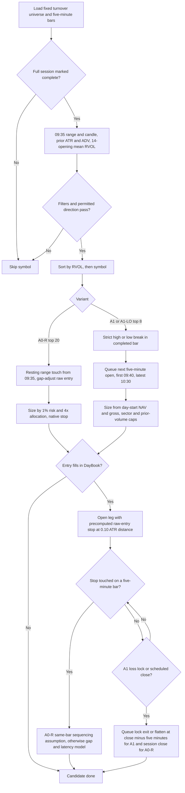
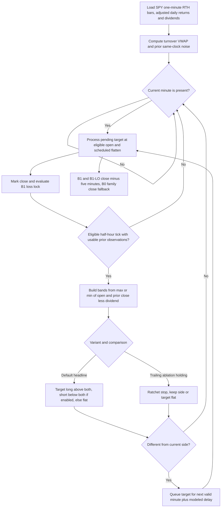
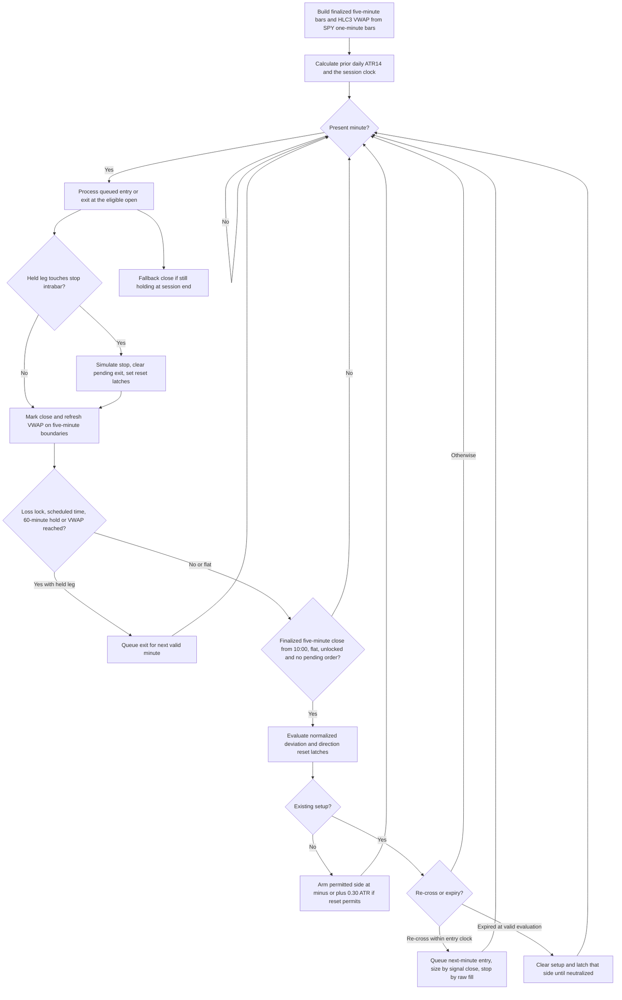
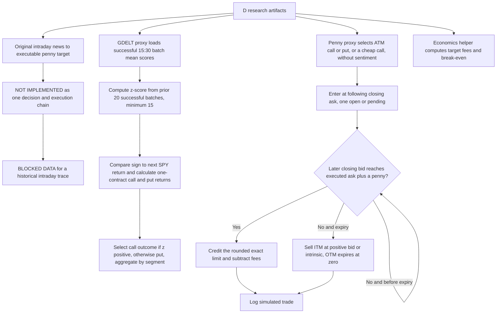
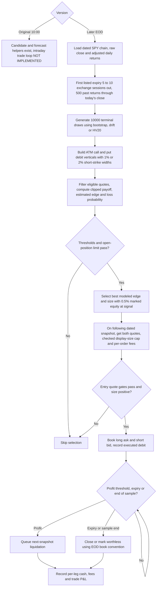
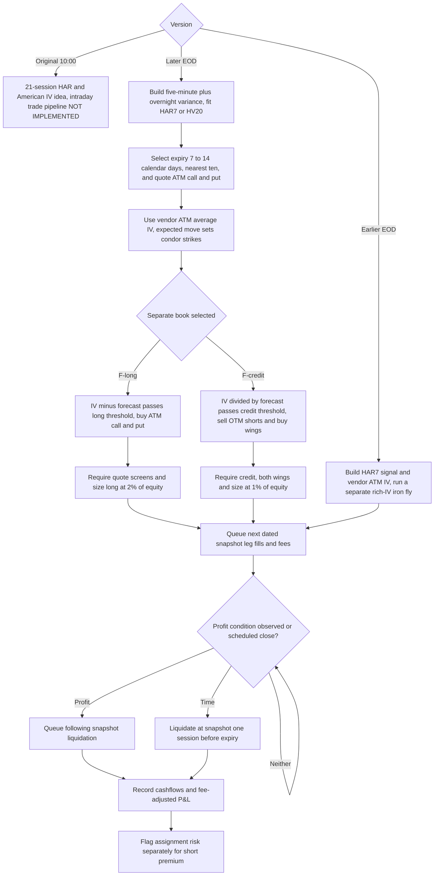

# Moo-Moo documentation archive

Consolidated on 23 November 2026 (UTC+8). This snapshot preserves the previous Markdown files as source text, including their original dates, commands, and relative links. Use [the porting guide](README.md) for current setup and [the project safety contract](moomoo-dual-strategy/AGENTS.md) for active repository instructions.

Dates below are the last Git change to each source file, shown in UTC+8. The original-file links open the rendered documents at the same [repository snapshot](https://github.com/justcode1234/Moo-Moo/tree/181c9f60420cea189ad364eb4f0e1f663282b954), where their original links and attachments are still available.

## Index

- 2026-11-23 · [`moomoo-dual-strategy/CLAUDE.md`](#archive-moomoo-dual-strategy-claude-md)
- 2026-11-23 · [`moomoo-dual-strategy/PROMPT.md`](#archive-moomoo-dual-strategy-prompt-md)
- 2026-11-23 · [`moomoo-dual-strategy/QODER_FIVE_STRATEGIES.md`](#archive-moomoo-dual-strategy-qoder-five-strategies-md)
- 2026-11-23 · [`moomoo-dual-strategy/reports/strategy-review/moomoo_qoder_strategy_review.md`](#archive-moomoo-dual-strategy-reports-strategy-review-moomoo-qoder-strategy-review-md)
- 2026-11-23 · [`moomoo-dual-strategy/reports/strategy-review/moomoo_qoder_strategy_second_opinion.md`](#archive-moomoo-dual-strategy-reports-strategy-review-moomoo-qoder-strategy-second-opinion-md)
- 2026-11-23 · [`moomoo-dual-strategy/reports/strategy-review/moomoo_qoder_strategy_second_opinion_v2.md`](#archive-moomoo-dual-strategy-reports-strategy-review-moomoo-qoder-strategy-second-opinion-v2-md)
- 2026-11-23 · [`moomoo-dual-strategy/reports/strategy-review/moomoo_qoder_strategy_validation_response.md`](#archive-moomoo-dual-strategy-reports-strategy-review-moomoo-qoder-strategy-validation-response-md)
- 2026-11-23 · [`moomoo-dual-strategy/SETUP_AND_RUN.md`](#archive-moomoo-dual-strategy-setup-and-run-md)
- 2026-11-23 · [`moomoo-dual-strategy/spec/prompt.md`](#archive-moomoo-dual-strategy-spec-prompt-md)
- 2026-11-21 · [`moomoo-dual-strategy/reports/claude_regime/RESULTS.md`](#archive-moomoo-dual-strategy-reports-claude-regime-results-md)
- 2026-11-21 · [`moomoo-dual-strategy/reports/claude_regime/results/summary.md`](#archive-moomoo-dual-strategy-reports-claude-regime-results-summary-md)
- 2026-11-20 · [`moomoo-dual-strategy/AGENTS.md`](#archive-moomoo-dual-strategy-agents-md)
- 2026-11-20 · [`moomoo-dual-strategy/NEXT_SESSION_PROMPT.md`](#archive-moomoo-dual-strategy-next-session-prompt-md)
- 2026-11-20 · [`moomoo-dual-strategy/QODER_COMPETITION.md`](#archive-moomoo-dual-strategy-qoder-competition-md)
- 2026-11-20 · [`moomoo-dual-strategy/README.md`](#archive-moomoo-dual-strategy-readme-md)
- 2026-11-20 · [`moomoo-dual-strategy/reports/actual_strategy_flow_audit.md`](#archive-moomoo-dual-strategy-reports-actual-strategy-flow-audit-md)
- 2026-11-20 · [`moomoo-dual-strategy/reports/B0_B1_B2_trade_reconciliation.md`](#archive-moomoo-dual-strategy-reports-b0-b1-b2-trade-reconciliation-md)
- 2026-11-20 · [`moomoo-dual-strategy/reports/backtest_v2/ablations.md`](#archive-moomoo-dual-strategy-reports-backtest-v2-ablations-md)
- 2026-11-20 · [`moomoo-dual-strategy/reports/backtest_v2/backtest_breakdowns.md`](#archive-moomoo-dual-strategy-reports-backtest-v2-backtest-breakdowns-md)
- 2026-11-20 · [`moomoo-dual-strategy/reports/backtest_v2/data_inventory.md`](#archive-moomoo-dual-strategy-reports-backtest-v2-data-inventory-md)
- 2026-11-20 · [`moomoo-dual-strategy/reports/backtest_v2/final_backtest_audit.md`](#archive-moomoo-dual-strategy-reports-backtest-v2-final-backtest-audit-md)
- 2026-11-20 · [`moomoo-dual-strategy/reports/backtest_v2/walk_forward_results.md`](#archive-moomoo-dual-strategy-reports-backtest-v2-walk-forward-results-md)
- 2026-11-20 · [`moomoo-dual-strategy/reports/backtest_v3/ablations.md`](#archive-moomoo-dual-strategy-reports-backtest-v3-ablations-md)
- 2026-11-20 · [`moomoo-dual-strategy/reports/backtest_v3/backtest_breakdowns.md`](#archive-moomoo-dual-strategy-reports-backtest-v3-backtest-breakdowns-md)
- 2026-11-20 · [`moomoo-dual-strategy/reports/backtest_v3/data_inventory.md`](#archive-moomoo-dual-strategy-reports-backtest-v3-data-inventory-md)
- 2026-11-20 · [`moomoo-dual-strategy/reports/backtest_v3/final_backtest_audit.md`](#archive-moomoo-dual-strategy-reports-backtest-v3-final-backtest-audit-md)
- 2026-11-20 · [`moomoo-dual-strategy/reports/backtest_v3/walk_forward_results.md`](#archive-moomoo-dual-strategy-reports-backtest-v3-walk-forward-results-md)
- 2026-11-20 · [`moomoo-dual-strategy/reports/codex_independent_audit/ablation_B0_vs_B1.md`](#archive-moomoo-dual-strategy-reports-codex-independent-audit-ablation-b0-vs-b1-md)
- 2026-11-20 · [`moomoo-dual-strategy/reports/codex_independent_audit/black_scholes_and_spreads_F.md`](#archive-moomoo-dual-strategy-reports-codex-independent-audit-black-scholes-and-spreads-f-md)
- 2026-11-20 · [`moomoo-dual-strategy/reports/codex_independent_audit/bugs_found.md`](#archive-moomoo-dual-strategy-reports-codex-independent-audit-bugs-found-md)
- 2026-11-20 · [`moomoo-dual-strategy/reports/codex_independent_audit/claim_by_claim_check.md`](#archive-moomoo-dual-strategy-reports-codex-independent-audit-claim-by-claim-check-md)
- 2026-11-20 · [`moomoo-dual-strategy/reports/codex_independent_audit/model_calibration_E.md`](#archive-moomoo-dual-strategy-reports-codex-independent-audit-model-calibration-e-md)
- 2026-11-20 · [`moomoo-dual-strategy/reports/codex_independent_audit/monte_carlo_risk.md`](#archive-moomoo-dual-strategy-reports-codex-independent-audit-monte-carlo-risk-md)
- 2026-11-20 · [`moomoo-dual-strategy/reports/codex_independent_audit/options_data_quality.md`](#archive-moomoo-dual-strategy-reports-codex-independent-audit-options-data-quality-md)
- 2026-11-20 · [`moomoo-dual-strategy/reports/codex_independent_audit/README.md`](#archive-moomoo-dual-strategy-reports-codex-independent-audit-readme-md)
- 2026-11-20 · [`moomoo-dual-strategy/reports/codex_independent_audit/reproduction/backtest_v3/ablations.md`](#archive-moomoo-dual-strategy-reports-codex-independent-audit-reproduction-backtest-v3-ablations-md)
- 2026-11-20 · [`moomoo-dual-strategy/reports/codex_independent_audit/reproduction/backtest_v3/backtest_breakdowns.md`](#archive-moomoo-dual-strategy-reports-codex-independent-audit-reproduction-backtest-v3-backtest-breakdowns-md)
- 2026-11-20 · [`moomoo-dual-strategy/reports/codex_independent_audit/reproduction/backtest_v3/data_inventory.md`](#archive-moomoo-dual-strategy-reports-codex-independent-audit-reproduction-backtest-v3-data-inventory-md)
- 2026-11-20 · [`moomoo-dual-strategy/reports/codex_independent_audit/reproduction/backtest_v3/final_backtest_audit.md`](#archive-moomoo-dual-strategy-reports-codex-independent-audit-reproduction-backtest-v3-final-backtest-audit-md)
- 2026-11-20 · [`moomoo-dual-strategy/reports/codex_independent_audit/reproduction/backtest_v3/walk_forward_results.md`](#archive-moomoo-dual-strategy-reports-codex-independent-audit-reproduction-backtest-v3-walk-forward-results-md)
- 2026-11-20 · [`moomoo-dual-strategy/reports/codex_independent_audit/sentiment_D.md`](#archive-moomoo-dual-strategy-reports-codex-independent-audit-sentiment-d-md)
- 2026-11-20 · [`moomoo-dual-strategy/reports/codex_independent_audit/six_strategy_audit_formulas_and_parameters.md`](#archive-moomoo-dual-strategy-reports-codex-independent-audit-six-strategy-audit-formulas-and-parameters-md)
- 2026-11-20 · [`moomoo-dual-strategy/reports/codex_independent_audit/six_strategy_verdict.md`](#archive-moomoo-dual-strategy-reports-codex-independent-audit-six-strategy-verdict-md)
- 2026-11-20 · [`moomoo-dual-strategy/reports/data_coverage_and_bias_audit.md`](#archive-moomoo-dual-strategy-reports-data-coverage-and-bias-audit-md)
- 2026-11-20 · [`moomoo-dual-strategy/reports/final_six_strategy_verdict.md`](#archive-moomoo-dual-strategy-reports-final-six-strategy-verdict-md)
- 2026-11-20 · [`moomoo-dual-strategy/reports/independent_validation_checks.md`](#archive-moomoo-dual-strategy-reports-independent-validation-checks-md)
- 2026-11-20 · [`moomoo-dual-strategy/reports/options_data_access_and_provenance.md`](#archive-moomoo-dual-strategy-reports-options-data-access-and-provenance-md)
- 2026-11-20 · [`moomoo-dual-strategy/reports/options_ef_backtest_results.md`](#archive-moomoo-dual-strategy-reports-options-ef-backtest-results-md)
- 2026-11-20 · [`moomoo-dual-strategy/reports/options_ef_methodology.md`](#archive-moomoo-dual-strategy-reports-options-ef-methodology-md)
- 2026-11-20 · [`moomoo-dual-strategy/reports/options_eod_backtest.md`](#archive-moomoo-dual-strategy-reports-options-eod-backtest-md)
- 2026-11-20 · [`moomoo-dual-strategy/reports/options_fee_and_strategy_D_feasibility.md`](#archive-moomoo-dual-strategy-reports-options-fee-and-strategy-d-feasibility-md)
- 2026-11-20 · [`moomoo-dual-strategy/reports/options_release_verdict.md`](#archive-moomoo-dual-strategy-reports-options-release-verdict-md)
- 2026-11-20 · [`moomoo-dual-strategy/reports/options_risk_monte_carlo.md`](#archive-moomoo-dual-strategy-reports-options-risk-monte-carlo-md)
- 2026-11-20 · [`moomoo-dual-strategy/reports/strategy_specs_A_to_F.md`](#archive-moomoo-dual-strategy-reports-strategy-specs-a-to-f-md)
- 2026-11-19 · [`moomoo-dual-strategy/reports/ablations.md`](#archive-moomoo-dual-strategy-reports-ablations-md)
- 2026-11-19 · [`moomoo-dual-strategy/reports/account_capability_report.md`](#archive-moomoo-dual-strategy-reports-account-capability-report-md)
- 2026-11-19 · [`moomoo-dual-strategy/reports/backtest_breakdowns.md`](#archive-moomoo-dual-strategy-reports-backtest-breakdowns-md)
- 2026-11-19 · [`moomoo-dual-strategy/reports/backtest_methodology.md`](#archive-moomoo-dual-strategy-reports-backtest-methodology-md)
- 2026-11-19 · [`moomoo-dual-strategy/reports/cloud_setup.md`](#archive-moomoo-dual-strategy-reports-cloud-setup-md)
- 2026-11-19 · [`moomoo-dual-strategy/reports/data_inventory.md`](#archive-moomoo-dual-strategy-reports-data-inventory-md)
- 2026-11-19 · [`moomoo-dual-strategy/reports/final_audit.md`](#archive-moomoo-dual-strategy-reports-final-audit-md)
- 2026-11-19 · [`moomoo-dual-strategy/reports/final_backtest_audit.md`](#archive-moomoo-dual-strategy-reports-final-backtest-audit-md)
- 2026-11-19 · [`moomoo-dual-strategy/reports/presentation_outline.md`](#archive-moomoo-dual-strategy-reports-presentation-outline-md)
- 2026-11-19 · [`moomoo-dual-strategy/reports/release_gates.md`](#archive-moomoo-dual-strategy-reports-release-gates-md)
- 2026-11-19 · [`moomoo-dual-strategy/reports/strategy_spec_A.md`](#archive-moomoo-dual-strategy-reports-strategy-spec-a-md)
- 2026-11-19 · [`moomoo-dual-strategy/reports/strategy_spec_B.md`](#archive-moomoo-dual-strategy-reports-strategy-spec-b-md)
- 2026-11-19 · [`moomoo-dual-strategy/reports/strategy_spec_C.md`](#archive-moomoo-dual-strategy-reports-strategy-spec-c-md)
- 2026-11-19 · [`moomoo-dual-strategy/reports/supervised_trading_authorization.md`](#archive-moomoo-dual-strategy-reports-supervised-trading-authorization-md)
- 2026-11-19 · [`moomoo-dual-strategy/reports/walk_forward_results.md`](#archive-moomoo-dual-strategy-reports-walk-forward-results-md)

<a name="archive-moomoo-dual-strategy-claude-md"></a>

## 2026-11-23 · `moomoo-dual-strategy/CLAUDE.md`

[Original file](https://github.com/justcode1234/Moo-Moo/blob/181c9f60420cea189ad364eb4f0e1f663282b954/moomoo-dual-strategy/CLAUDE.md) · Last change `c4b12aa`

<details>
<summary>Original Markdown source</summary>

`````
# Claude Code workspace handoff

Read the [project's repository instructions](AGENTS.md).

## Current task — review of the Mac competition runner

Claude stopped after the user asked to pull the Mac changes and double-check them. Codex fetched `origin/competition-b3-h` and verified that the checkout matched it at `6a89baa`. Review covered B3, H, Noise-area momentum, VWAP trend continuation and ORB breakout/breakdown. Each sleeve starts with 20% of verified initial NAV, or $20,000 on $100,000. The [five-strategy spec](QODER_FIVE_STRATEGIES.md) contains the corrected strategy selection.

The offline review reproduced three execution defects with synthetic account data and a fake broker. Treat them as blockers to certifying the runner for paper execution.

1. [Shared-account flatten and sleeve closes](src/dual_strategy/competition/planner.py) use sleeve quantities even when the broker nets opposite positions. Seed B3 long 10 SPY and Noise short 20. With broker net short 10, `plan_flatten` issues BUY 20 first, crossing to net long 10. A failed second leg can leave the account exposed. `plan_close` can also increase exposure from net flat. [Broker transport](src/dual_strategy/competition/broker.py) submits an ordinary LIMIT and omits the internal `close_only` field. Cover mixed long/short attribution, the broker net before and after each fill, and second-leg failure in regression tests.
2. [Noise reversals](src/dual_strategy/competition/planner.py) bypass `entry_block` when the sleeve holds shares. A held long of 20 SPY produced a short-opening SELL 40 under each of an order-error halt, a daily loss lock, stale quotes, position mismatch and reserved order budget. [Runner.send](scripts/run_competition.py) sent the opening order even when the prior close was cancelled with zero fill. The reproduced sleeve finished short 20 versus a target short of 40. Require the close to reconcile before planning the opening order from a fresh account and risk check.
3. [Runner._close](scripts/run_competition.py) marks an ORB half exit complete when the close order fills zero shares. Seed a long of 10 shares, entry 500, stop 495 and target 510. Cancel the five-share sale with zero fills. The runner still holds ten shares, sets `half_done` and moves the stop to 500. Track confirmed cumulative quantity before switching exit rules. Include partial fills and one-share positions in the regression.

[Dashboard JavaScript](src/dual_strategy/dashboard/competition.js) defines `renderResearch` twice. The preview function shadows the new regime table renderer. Chrome at 1,366 px and 390 px rendered five cards and the historical preview. The regime table displayed zero Noise-area/VWAP/ORB rows when the response contained three. The HTTP 503 and stale snapshot warnings preserved the prior display at both widths. Give the renderers separate names and assert that both tables populate.

The checked-in [AGENTS.md](AGENTS.md) names ORB's 0.10 daily ATR and no target as current. [Competition YAML](config/competition.yaml) and the five-strategy spec use 0.35 ATR and a 2R half exit. Resolve which rule the user wants before changing ORB strategy parameters. Runner audit provenance also omits the new `intraday.py` strategy source.

Verification on Windows at `6a89baa`

- `.venv/Scripts/python.exe -m pytest -q -p no:cacheprovider tests/test_competition_five.py tests/test_competition.py tests/test_dashboard.py` passed 151 tests, including the mocked after-close report test.
- The full suite reported 1,069 passes, six failures in POSIX process-list parsing fixtures with Windows paths, and 61 scheduler setup errors because `fcntl` is unavailable on Windows. The same dashboard process parser misses an unquoted macOS checkout path containing spaces in a synthetic listing. Run native scheduler and notification verification on macOS with suitable fixtures.
- `scripts/competition_parity_regime.py` reproduced the archived results in memory across 1,479 local sessions and 575,010 incremental VWAP/ORB slot checks with zero mismatches. The harness exercises research signal and fill logic. Runner order behavior needs its own tests.

All verification was offline and the sole workspace edit was this handoff. If the user asks for implementation next, begin with regression tests for the three order defects, then fix the dashboard renderer and verify on macOS before considering activation.

## Earlier A–J research

Open the sibling [Moo Moo - Codex Research worktree](<../../Moo Moo - Codex Research/moomoo-dual-strategy>) on branch **research/codex-a-j-2026-11-20**. Its [AGENT.md](<../../Moo Moo - Codex Research/moomoo-dual-strategy/AGENT.md>) records the checkpoint and reproduction commands for that task.
`````

</details>

<a name="archive-moomoo-dual-strategy-prompt-md"></a>

## 2026-11-23 · `moomoo-dual-strategy/PROMPT.md`

[Original file](https://github.com/justcode1234/Moo-Moo/blob/181c9f60420cea189ad364eb4f0e1f663282b954/moomoo-dual-strategy/PROMPT.md) · Last change `692e116`

<details>
<summary>Original Markdown source</summary>

`````
# Restore Moo Moo competition startup on Linux

Moo Moo has moved to Linux. The Mac is retired. Work from GitHub `main` and make Linux the sole competition paper runner. The previous check reported that Moomoo CLI login, competition account lookup, market data, and the opening-plan dry run passed. Read [AGENTS.md](AGENTS.md) and the [Linux migration guide](SETUP_AND_RUN.md#linux-migration) before changing the runner.

1. Inspect the Linux scheduler, runner, and `private/competition/` state. Identify the exact check blocking startup. Update Linux instructions or dashboard messages that assume the Mac is still available.
2. Search the Linux checkout and available backups for the latest trustworthy competition state. Restore it privately and preserve initial NAV, day-start NAV, high-water NAV, halts, sleeve ownership, and order history.
3. Use the authenticated Moomoo CLI for read-only checks on the exact named competition paper account. Reconcile current positions, cash, working orders, and fills against the saved state. If the state is missing, determine what can be recovered from broker history and existing audit records. Keep execution blocked if ownership, prior risk state, or order outcomes cannot be verified. Report the specific evidence needed.
4. Confirm Linux will be the only execution host. If the retired Mac's scheduler could still launch and you cannot verify that it is disabled, ask me for that specific confirmation. Keep the Linux timer inactive during recovery.
5. Add and run regression tests for missing state, mismatched positions, unresolved orders, and duplicate startup. Run the read-only Linux preflight. Report whether Linux is ready, the evidence supporting the result, and any remaining blocker. Ask before arming the timer or submitting paper orders. Keep credentials and account identifiers out of Git and your response.
`````

</details>

<a name="archive-moomoo-dual-strategy-qoder-five-strategies-md"></a>

## 2026-11-23 · `moomoo-dual-strategy/QODER_FIVE_STRATEGIES.md`

[Original file](https://github.com/justcode1234/Moo-Moo/blob/181c9f60420cea189ad364eb4f0e1f663282b954/moomoo-dual-strategy/QODER_FIVE_STRATEGIES.md) · Last change `2a94956`

<details>
<summary>Original Markdown source</summary>

`````
# Build spec: five-strategy competition runner, $20,000 each

Read [QODER_COMPETITION.md](QODER_COMPETITION.md) and [AGENTS.md](AGENTS.md) in the `moomoo-dual-strategy` folder before working on `main`. All existing rules still apply:

- The deterministic runner decides, sizes and sends orders. You build, test, launch and monitor it.
- Never place or edit orders by hand.
- The 3.5% account halt is permanent until the user clears it.

> **Correction (2026-11-21):** the earlier version of this file named the wrong three strategies (failed-breakdown reversal and ETF pairs). The user's picks are **Noise-area momentum, VWAP trend continuation and ORB breakout/breakdown**. Build only these. Strategies are referred to by **name**, never by number, to avoid that confusion again.

## User decisions (2026-11-21)

1. Add three strategies from the regime study ([reports/claude_regime/RESULTS.md](reports/claude_regime/RESULTS.md)) to the existing **B3** and **H**:
   - **Noise-area momentum** (sleeve `noise`);
   - **VWAP trend continuation** (sleeve `vwap`);
   - **ORB breakout/breakdown** (sleeve `orb`).
2. **$20,000 per strategy.** Five sleeves at `allocation: 0.20` each of the starting account NAV. Each sleeve's capital then changes only with its own P&L, as the runner already does for B3 and H.
3. **The dashboard shows five strategy cards instead of two.**

Backtest evidence for the new three, at the settings below. Report it truthfully; do not tune it away. Weekly P&L on a $100,000 book:

| Strategy | 2025–26 | VIX ≥ 30 weeks | Last week, 16–20 Nov |
|---|---:|---:|---:|
| Noise-area | −$24/wk | +$217/wk | +$888 (on 40% of $100k in SPY; about half that on a $20k sleeve) |
| VWAP | −$42/wk | +$13/wk | +$248 |
| ORB | +$4/wk | +$24/wk | −$50 |

All three were trend-followers that did better in last week's selloff than over 2025–26 as a whole. Noise-area works much like B3 (SPY noise band plus VWAP), so the account becomes more concentrated in SPY momentum.

## 1. Strategy rules

The reference implementation is [reports/claude_regime/rstrats.py](reports/claude_regime/rstrats.py): `s10_noise`, `s2_vwap` and `s1_orb` (universe `etf`). Data is in [reports/claude_regime/rdata.py](reports/claude_regime/rdata.py). Port the logic into `src/dual_strategy/competition/signals.py` as pure functions, and prove parity (section 6).

The settings below are the ones selected on 2021–24 data.

**Common to all three:**
- 5-minute bars are *completed* bars (Moomoo CLI ktype 6). A bar ending at T is usable only after T.
- VWAP = cumulative turnover / cumulative volume from 09:30.
- ATR14 = mean true range of the 14 prior daily bars.

### Noise-area momentum (`noise`)

- **Symbol:** US.SPY.
- **Decisions:** at the completed bars ending **10:30, 11:30, 13:30 and 14:30** ET.
  - The reference uses 1-minute closes at those minutes. 5-minute bars ending there give identical inputs: the same close and the same cumulative turnover and volume.
- **Noise:** mean of |close at that time / 09:30 open − 1| over the **14** most recent prior sessions that have a bar at that time (skip half-days), × band **1.0**.
- **Bands:** upper = max(today's 09:30 open, prior close) × (1 + noise); lower = min(open, prior close) × (1 − noise).
- **Target:**
  - **long** if close > upper and close > VWAP;
  - **short** if close < lower and close < VWAP (needs section 3);
  - otherwise **flat**.
- **Orders:** act only when the target changes; execute at the next minute's open as marketable LIMITs. Reuse B3's `b3_decision` machinery and add the lower band.
- **Size:** 100% of the sleeve's capital ($20,000) at each entry, divided by max(price, 09:30 open). The report's own "allocation 20%" is the same amount.
- **Flatten:** 15:55 ET (on half-days, 5 minutes before the close).

### VWAP trend continuation (`vwap`)

- **Symbols:** US.SPY, US.QQQ.
- **When:** each completed bar from the one ending 10:10 to the one ending 15:35.
- **Side:** long if close > VWAP; short if close < VWAP. Shorts need section 3.
- **Filters:**
  - VWAP slope over the last 3 bars has the same sign as the side.
  - Fewer than 3 crossings of close versus VWAP in the last 12 bars.
  - Structure (long): high > previous high and low > previous low. Shorts mirror this.
  - Pullback (long): bar low − VWAP ≤ **0.10 × ATR14** and close > VWAP. Shorts mirror this.
- **Entry:** a stop trigger at the setup bar's high (long) or low (short), valid only during the next bar. When price trades through it, send a marketable LIMIT; if it doesn't trigger, cancel.
- **Stop:** VWAP at the setup bar − **0.25 × ATR14** (long), mirrored for shorts.
- **Target:** entry + **3 ×** the stop distance.
- **Flatten:** 15:45 ET (on half-days, 15 minutes before the close).
- **Limits:** at most 3 trades per symbol per day; at most 2 open positions.
- **Size:** risk 0.15% of account NAV per trade, never more notional than the sleeve's capital or the remaining per-symbol cap.

### ORB breakout/breakdown (`orb`)

- **Symbols:** US.SPY, US.QQQ, US.IWM (ETFs only).
- **Opening range:** the first **15 minutes** (three 5-minute bars).
- **Skip the symbol for the day if either:**
  - the range is wider than **1.25 × ATR14**; or
  - first-15-minute volume is below **2.0 ×** the average first-15-minute volume of the prior 20 sessions.
- **Trigger:** the first completed bar, from the one ending 09:50, that closes above the range high *and* above VWAP (long), or below the range low *and* below VWAP (short). Shorts need section 3.
  - Enter at the next bar's open. No new entries in the last 30 minutes (after 15:30, or 12:30 on half-days).
- **Stop:** distance = min(entry − breakout bar's low, **0.35 × ATR14**) for longs, mirrored for shorts.
- **Exits:**
  - half at **2 ×** the stop distance;
  - the other half: move its stop to breakeven, then exit at the next open when a 5-minute bar closes below the previous bar's low (longs; mirrored for shorts);
  - flatten at 15:55 ET.
- **Limits:** one entry per symbol per day; at most 3 open.
- **Size:** risk 0.15% of account NAV; notional ≤ $10,000 per trade (the reference's 10% cap) and ≤ the remaining per-symbol cap.

## 2. Capital and sizing

- `config/competition.yaml`:
  - `allocation: {b3: 0.20, h_etf: 0.20, noise: 0.20, vwap: 0.20, orb: 0.20}`;
  - new `noise:`, `vwap:` and `orb:` sections holding the parameters above;
  - B3 keeps `position_fraction_of_sleeve: 1.0`, which now means $20,000 of SPY.
- `planner.SLEEVES` becomes all five. Extend `capital_limits`, `apply_fill`, `attribution_errors`, `plan_flatten`, `sleeve_performance` and the report to every sleeve.
- **Per-symbol cap.** SPY can now be held by B3, H, Noise-area, VWAP and ORB together, so `risk.name_cap_usd` ($40,000) applies to the *sum* across sleeves, longs and shorts by absolute value. If B3 and Noise-area both want SPY, the cap is shared first-come; the later sleeve gets the remainder or skips.
- **Existing holdings.** The H positions (XLV and XLP) stay owned by `h_etf`. Do not reset or re-attribute anything in `private/competition/live/`.

## 3. Short selling (needed by all three new strategies' short side)

- **Today the runner is long-only.** `risk.long_only: true`, and the broker gate refuses any sell that isn't close-only.
- **Verify before enabling shorts.** First check, with the Moomoo MCP/CLI and read-only calls, that the competition account allows short sales of SPY, QQQ and IWM, and what the borrow terms are.
- **If shorting is allowed,** enable it only for the `noise`, `vwap` and `orb` sleeves:
  - a SELL opens a short only when its intent is marked `opens_short`; the cover is a close-only BUY;
  - reserve short collateral in cash checks;
  - every halt, lock and scheduled flatten covers shorts;
  - attribution holds negative quantities per sleeve;
  - never carry a short overnight.
- **If shorting is not allowed:** run all three long-only and tell the user. Their backtests used both directions, so long-only results will differ.

## 4. Execution and schedule

- **Intraday exits.** The transport supports LIMIT orders only, so VWAP and ORB stops, targets and trails must be monitored by the runner. Poll quotes for open positions every ~10 s and act on completed 5-minute bars for the ORB trail. Keep the 30-second account risk loop.
- **Market data cost per 5 minutes.** One 5-minute kline call each for SPY, QQQ and IWM, plus quotes for open positions only. Keep the existing pacing and retry.
- **Additions to the loop:**
  - every completed 5-minute bar: ORB (from the bar ending 09:50), VWAP (from 10:10), Noise-area (at 10:30, 11:30, 13:30 and 14:30);
  - 15:45: VWAP flatten;
  - 15:55: ORB, Noise-area and B3 flatten;
  - H is unchanged.
- **Errors.** Every step runs through `guarded()`. Every order goes through the existing audit, outbox, order-error budget and halt path.
- **Wednesday 25 November.** PCE and GDP are released before the open. Per the report, no new Noise-area, VWAP or ORB entries before 10:30 ET that day. Make this a dated config item.
- **Friday 27 November closes at 13:00.** VWAP flattens at 12:45. ORB and Noise-area flatten at 12:55. No new entries after 12:00.

## 5. Dashboard

On the `/competition` page, show **five strategy cards**: B3, H, Noise-area, VWAP and ORB. Each card shows:

- a $20,000 allocation and current capital (allocation + own P&L);
- holdings, longs and shorts;
- today's decisions or blocked reasons;
- open stops, targets and trails;
- realized and unrealized P&L.

Also:
- the risk strip (high-water mark, 3.5% halt level, daily lock) stays account-wide;
- the intents table gets a sleeve filter;
- the research section lists each strategy's backtest from [reports/claude_regime/results/summary.csv](reports/claude_regime/results/summary.csv) (rows `10 Noise-area momentum`, `2 VWAP trend continuation`, `1 ORB breakout/breakdown`), labeled by name, with the evidence caveat above;
- verify the page in a browser at desktop and narrow widths, including the failed and stale states.

## 6. Tests and parity (all required before any live run)

- **Signal parity.** For every session from 2021-01-04 to 2026-11-20, the live Noise-area, VWAP and ORB signal functions must produce the same entries, sides, stops, targets and exits as `s10_noise`, `s2_vwap` and `s1_orb` (`universe: etf`) on the same bars (`data-cache/regime_extra` + `data-cache/history`). Report mismatches with dates. Missing-data days may block (fail closed) where the reference trades nothing.
- **Unit tests:**
  - $20,000 caps;
  - the shared per-symbol cap across five sleeves;
  - shorts gating, collateral and covers;
  - the VWAP/ORB stop, target and trail monitor;
  - Noise-area target changes, long ↔ short;
  - halts and locks flattening every sleeve, shorts included;
  - attribution with negative quantities.
- **Full suite** green, then report the exact count.

## 7. Rollout

1. PLAN dry runs with `--ephemeral`, replaying 16–20 November. On a $100,000 book at the reference sizes, P&L should match the backtest: Noise-area +$888 (40% allocation), VWAP +$248, ORB −$50.
2. `status --execute` before 09:30 ET. Confirm five sleeves at $20,000 initial capital, existing H holdings attributed, and no attribution errors.
3. Restart the single loop before 09:30 ET Monday 23 November. Remaining sessions: 23, 24, 25 and 27 November.
4. Commit and push your changes, never `private/`, and report the commit, test count, parity results, the short-selling finding and the first-day P&L per sleeve.
5. If anything fails, diagnose and retry once. If it fails again, stop and ask the user.
`````

</details>

<a name="archive-moomoo-dual-strategy-reports-strategy-review-moomoo-qoder-strategy-review-md"></a>

## 2026-11-23 · `moomoo-dual-strategy/reports/strategy-review/moomoo_qoder_strategy_review.md`

[Original file](https://github.com/justcode1234/Moo-Moo/blob/181c9f60420cea189ad364eb4f0e1f663282b954/moomoo-dual-strategy/reports/strategy-review/moomoo_qoder_strategy_review.md) · Last change `c4b12aa`

<details>
<summary>Original Markdown source</summary>

`````
# Moomoo × Qoder AI Paper Trading Challenge — Independent Strategy Review

**Date:** 17 November 2026  
**Scope:** U.S.-listed stocks, ETFs and options; competition paper account only; no live-money trading.  
**Bottom line:** The evidence supports the ORB *family*, not the exact provisional settings. Keep the 5-minute opening range and RVOL idea, replace the 2R target with a trailing exit, replace the 5-minute ATR stop with a daily ATR stop, cut size in the current risk-off regime, cap single-name exposure at 15%, and treat the eight sessions as a risk-controlled demonstration.

---

## 1. Verdict

**Trade a regime-gated, bidirectional 5-minute opening-range breakout on the 5–8 most liquid U.S. “stocks in play”:** RVOL ≥ 1.5, price > $5, market cap > $1B, breakout confirmed by a 5-minute close beyond the range and on the correct side of VWAP; risk 0.25–0.5% of equity per trade; stop 1× daily ATR(14) beyond the range; trail winners and exit by the close—**do not cap them at 2R**. The edge is the opening auction/attention imbalance that persists intraday. The stock-ORB paper reports 2.81 in-sample; the related SPY strategy fell from 1.33 to **0.39 out-of-sample**, so size for survival. It beats mean reversion (negative skew), rotation (too slow), pairs (too few events), options (fees/assignment), and RL/ML (unvalidatable in eight sessions).

---

## 2. Ranked comparison

| Rank | Strategy | Net expectancy evidence | 8-session profit potential | Downside / tail risk | Implementation | Judging strength | Score /10 |
|---|---|---|---|---|---|---|---|
| 1 | **Regime-gated, bidirectional 5-min ORB on stocks in play** | 2.81 Sharpe, >1,600% net 2016–2023, top-20 RVOL (author-reported, in-sample); no independent OOS for this exact stock version | High: 1–3 trades/day, multi-R winners on catalyst days | High: replication shows ~17% win rate, fat-tail dependent; halt/gap/slippage; short squeezes | Medium-high: 5-min bars, RVOL, ATR, software stops, partial fills | Very strong: clear edge, invalidation, risk gate, audit trail | **8.5** |
| 2 | Plain 5-min ORB, no regime/portfolio layer | Same in-sample evidence; QuantConnect 2016 replication 2.40 Sharpe, but other years questioned by users | High | Very high: correlated signals, full-size losses, no regime brake | Medium | Strong, but looks overfit without OOS | 7.5 |
| 3 | SPY/QQQ intraday momentum (30-min noise-area + VWAP) | 1.33 Sharpe in-sample 2007–2024; **0.39 OOS 2024–2026**, underperforms SPY, p<0.001 | Medium: low vol, leverage-dependent | Medium: many small losses, OOS decay | High: one ETF, very liquid | Medium: honest OOS story is a cautionary tale | 6 |
| 4 | Pairs / statistical arbitrage (ETF and large-cap) | Long-run literature exists but has decayed; **not independently established** for an 8-day window | Low-medium: few convergence events | Low-medium: borrow, crowding, leg risk | Low: data, hedging, short borrow | Strong sophistication, weak short-window proof | 5.5 |
| 5 | Mean reversion (RSI-2 / VWAP bands on liquid ETFs) | **Not independently established**; weak after costs | Medium: many trades | High: negative skew, trending-market drawdowns | High | Medium-low: crowded retail narrative | 5 |
| 6 | ETF/sector momentum + daily trend following | Robust monthly/long-horizon evidence; not 8 days | Low: 1–3 signals in 8 days | Medium: overnight gaps, whipsaw | High | Low for this brief | 4 |
| 7 | ML-filtered ORB / RL execution | ML cross-sectional evidence, not intraday; RL is execution alpha, not signal alpha | Unknown; overfit risk | Medium-high: model risk, complexity | Low | High on Qoder usage, weak on edge | 4 |
| 8 | Options directional / volatility | No robust directional edge; short-vol tail risk; historical options data still developing | High variance, not high expectancy | Very high: gamma/vega/assignment, fees | Low: multi-leg, margin, exercise | Medium: looks sophisticated, risks score | 3.5 |

**Evidence notes.** The ORB paper’s 2.81 Sharpe and 1,600% return are **in-sample 2016–2023**; the QuantConnect replication only tested 2016 and users report weak other years. The strongest OOS evidence for the *family* is the SPY strategy: 19.6% annualized and 1.33 Sharpe in-sample, but 4.8% annualized, 0.39 Sharpe and 18.5% max drawdown OOS (May 2024–March 2026), underperforming buy-and-hold. Do not treat 2.81 as an expectation; treat it as an upper bound. For mean reversion, pairs, rotation, options, ML and RL, exact 8-day net expectancy is **not independently established**.

---

## 3. Recommended parameter sheet

| Area | Preliminary setting | Rationale |
|---|---|---|
| Account / venue | Competition paper account; US stocks/ETFs only; `market_id=100`; only `sim_trade_*` tools; never live `trading_*` | Paper-only rule; US margin account required for shorts |
| Sessions | Regular session 09:30–16:00 ET; entries 09:35–10:30; flat by 15:55; Nov 27 flat by 12:55; closed Nov 26 | Opening imbalance decays; final-day after-hours excluded; half-day close |
| Universe | Price ≥ $5; market cap ≥ $1B; 20-day ADV ≥ $50M; 20-day average 5-min dollar volume ≥ $2M; exclude halts/pending news | Competition floors are $1/$500M; buffers improve liquidity and borrow |
| Screener | `quote_stock_screen` for US price/mcap/turnover; then 5-min bars for RVOL | Dynamic “stocks in play” universe, not a static watchlist |
| ORB | High/low of 09:30–09:35 regular-session bars | 5-min is the best-documented window; test 15/30/60 as alternatives |
| RVOL | Today’s first-5-min volume ÷ median first-5-min volume of prior 14 sessions; ≥1.5; rank top 5–8 | Paper uses >1 and top 20; ≥1.5 avoids low-quality names |
| Confirmation | 5-min close beyond OR high/low; price on correct side of session VWAP; SPY above/below its OR/VWAP for longs/shorts | Avoids wick breakouts and fighting the tape; VWAP is a heuristic to test |
| Stop basis | 1.0 × **daily ATR(14)** beyond the breakout level; floor 0.35%, cap 2.5% of entry; skip if >2.5% | **Do not use 5-min ATR(14)**: it is too tight and will be noise-stopped. The paper uses daily ATR |
| Entry order | Marketable limit at breakout ±5 bps; 30-second validity; no chase >0.25×ATR; max 2 attempts/symbol/day | No native stop orders; limit controls slippage |
| Exit | Move stop to breakeven at +1R; trail at 1.5×ATR(5m) after +1.5R; time-stop at 12:00 if <+0.5R; exit all 15:55 | **No fixed 2R target**: ORB’s edge is the fat tail; a 2R cap truncates it |
| Risk/trade | 0.50% risk-on; 0.35% neutral; 0.25% risk-off; current regime = **risk-off** | Current SPY is 2.34% below its 20-day SMA with 22.9% annualized 20-day vol |
| Sizing | `qty = floor(min(risk$ / stop_distance, 0.15 × equity / entry, 0.05 × avg_5min_volume))`; ETFs 25% cap | Risk-based size can exceed the official 40% cap; always take the minimum |
| Portfolio caps | Max 5 positions; gross ≤100%; net beta ±30%; sector ≤30%; single stock ≤15%; single ETF ≤25% | 40% is a ceiling, not a target; correlation is the real risk |
| Daily limits | Max 3–5 new trades; ≤10 orders/day; daily loss 2% → flatten/halt; 3 consecutive stops → halve risk; 5 → halt | 200 orders/day is the official cap, not a goal |
| Drawdown | 6% from peak → flatten and halt; no reset | 8-session sprint; a 6% hole is hard to recover |
| Overnight | None; flat by the close every day | Avoids gap risk, financing, and final-day after-hours exclusion |
| Execution | Software stop checked every 5 seconds and on 1-min closes; log slippage; reconcile fills before retry | No native stop; stops do not guarantee a max loss |
| Regime | Risk-on: SPY > 20d SMA and vol < 20%; Neutral: mixed; Risk-off: SPY < 20d SMA and vol 20–30%; Crisis: vol > 30% or gap > 2% → 0.15% or stand aside | Current: risk-off; reduces size and trade count |
| Verification | `sim_trade_account_list` at start; confirm paper account, market ID, cash, positions; place a 1-share test order before session 1 | FAQ wording on OAuth permissions is ambiguous; verify sim trading works |

**Formulas.**

- `RVOL = V(09:30–09:35 today) / median[V(09:30–09:35, prior 14 sessions)]`.
- `TR = max(high − low, |high − prior close|, |low − prior close|)`; `ATR(14) = mean(last 14 daily TRs)`.
- `stop_distance = min(max(1.0 × ATR14, 0.0035 × entry), 0.025 × entry)`.
- `qty = floor(min(risk$ / stop_distance, 0.15 × equity / entry, 0.05 × avg_5min_volume))`.
- `risk$ = equity × risk_pct`; verify `qty × stop_distance ≤ 1.05 × risk$`.
- `E = p·avgWin − (1−p)·avgLoss − avgCost`; in R terms: `E_R = p·avgWin_R − (1−p)·avgLoss_R − cost_R`.
- `profit factor = (p·avgWin) / ((1−p)·avgLoss)`.

---

## 4. Risk manager specification

**Hard pre-trade gates (deterministic code, not LLM judgment):**

| Gate | Trigger | Action |
|---|---|---|
| Account | Not the competition paper account; `market_id ≠ 100`; equity < $95k; live tool selected | Reject all orders; alert |
| Time | Outside 09:35–10:30 entries; after 15:55; Nov 27 after 12:55; Nov 26 | Reject |
| Data | Last 5-min bar > 2 minutes old; SPY/QQQ data missing; quote stale | Reject; pause schedule |
| Universe | Price < $5; mcap < $1B; ADV < $50M; halted; pending news; short not borrowable | Reject |
| Signal | No 5-min close beyond OR; wrong side of VWAP; SPY filter fails; stop distance outside 0.35–2.5% | Reject |
| Portfolio | >5 positions; single stock >15%; single ETF >25%; gross >100%; net beta outside ±30%; sector >30% | Reject or resize |
| Order budget | >10 orders/day (self-imposed); duplicate decision ID; >200 official executed orders | Reject |
| Loss | Daily realized + unrealized ≤ −2% ($2,000); total drawdown ≤ −6% ($6,000) | Flatten; halt |
| Streak | 3 consecutive stop-outs | Halve risk for the day |
| Streak | 5 consecutive stop-outs; 5 rejected orders; API error rate >20% | Flatten; halt |
| Reconciliation | Cash/positions mismatch >1% vs expected | Halt; investigate |
| Manual | Operator presses kill switch | Flatten; halt |

**Sizing on a $100,000 account.**

- Risk-off: 0.25% = **$250** risk per trade.
- Entry $100; daily ATR $2.00; stop distance $2.00 (2.0%); qty = 125 shares; position $12,500 (12.5%); max loss ≈ $250 before slippage.
- If stop distance is $1.00 (1.0%), qty = 250 shares ($25,000, 25%) but the 15% single-stock cap binds → 150 shares ($15,000), max loss ≈ $150.
- If stop distance is $3.00 (3.0%) > 2.5% cap → **skip the trade**.

**Correlated exposure.**

- Net beta = Σ(position weight × 60-day beta vs SPY), capped at ±30%.
- Sector exposure ≤ 30%; semis/megacap-tech cluster ≤ 30%.
- If all signals are short, cap net short beta at −30%; do not let a single market-direction bet consume the portfolio.
- If two names are >0.8 correlated, treat them as one position for the 15%/30% caps.

**Kill switch.** Cancel all open orders; flatten with marketable limits; pause the cloud schedule; write an incident log with timestamp, trigger, positions, P&L, fills, and screenshots; notify Slack; require human review before resuming. The competition account cannot be reset, so the kill switch must trigger **before** the 6% drawdown becomes unrecoverable.

**Account-verification guardrails.**

- Call `sim_trade_account_list`; confirm the paper account and `market_id=100`.
- Compare `sim_trade_cash_info` and `sim_trade_position_list` to expected values.
- Place a 1-share limit order far from the market, confirm it appears in `sim_trade_history_order_list`, then cancel it.
- Use `sim_trade_max_buy_sell` before shorts to confirm sellable quantity.
- Never call `trading_*` or live `account_*` tools. All orders use `sim_trade_input_order`.
- OAuth caveat: the handbook setup lists Market Data + Watchlists (+ Accounts & Orders, Trade Execution), while the FAQ warns not to select live trading execution. This wording is ambiguous; verify the sim order path with the 1-share test before relying on automation. Do not enable live trading.

---

## 5. Evidence & validation plan

**What the evidence actually says.**

- Stock ORB: 7,000+ U.S. stocks, 2016–2023, top-20 RVOL, >1,600% net, 2.81 Sharpe, 36% annualized alpha (author-reported, in-sample). QuantConnect’s 2016-only replication reports 2.396 Sharpe and beta −0.042, but users report weak other years, a ~17% win rate, and material cost sensitivity.
- SPY intraday momentum: 1.33 Sharpe in-sample 2007–2024; **0.39 OOS 2024–2026**, 4.8% annualized, 18.5% max drawdown, underperforming SPY; the decline is statistically significant (p<0.001). This is a different strategy but the same intraday-momentum family. Treat it as a warning, not a direct refutation.
- Current regime (16 Nov 2026 close, Moomoo MCP): SPY 739.95 (−1.91% on the day), 2.34% below its 20-day SMA, 20-day realized vol 22.9% annualized, −4.0% over 22 sessions; QQQ 661.75 (−2.67%), 4.46% below its 20-day SMA, −8.75% from its 21 Oct close. 5 Nov was −4.41% for SPY and −6.49% for QQQ. This is a high-vol, risk-off tape: bidirectional ORB is appropriate; long-only breakouts are not.

**Five falsifiable tests.**

1. **OOS expectancy:** on 2024–2026 5-min data, net `E_R > 0.10` after costs. If ≤ 0, abandon the strategy.
2. **Profit factor / win rate:** ≥ 200 trades, PF ≥ 1.3, win rate ≥ 30%. If PF < 1.2, abandon. Do not require a 50% win rate; ORB is designed to win small often and lose small often, with a few large winners.
3. **Tail dependence:** top 5 trades ≤ 50% of net P&L. If > 80%, the result is a lottery; reduce size or abandon.
4. **Regime filter value:** walk-forward Sharpe and max drawdown better than plain ORB. If not, remove the filter; simpler is better.
5. **Execution reality:** live paper slippage ≤ 2× backtest assumption and fill rate ≥ 90%. If not, halve size or stop.

Add a **placebo test**: random entries with the same stop/exit must produce at least 0.2R lower expectancy. If the strategy cannot beat random entries, there is no edge.

**Data and method.**

- 5-min bars 2019–2026, 60-name universe, regular session only; 14-day RVOL/ATR; daily SPY regime.
- Costs: $0.99/order + $0.000166/share sold (cap $8.30) + 5–15 bps slippage per side; stop fills at next bar open ±10 bps; partial fills at 20× volume.
- Walk-forward: 12-month train, 3-month test, roll; final holdout 2024–2026; no parameter changes on the holdout.
- No look-ahead: use closed bars only; signal at the 09:35 close, fill at the next bar; never use the same bar’s high/low to trigger and fill; point-in-time universe; include delisted names if possible.
- Benchmarks: SPY buy-and-hold, random-entry, plain ORB, equal-weight stocks in play.

**How many trades are needed?** `n ≈ p(1−p)/SE²`. For `p=0.4`: SE 0.10 → 24 trades; SE 0.05 → 96; SE 0.03 → 267. Eight sessions at 1–3 trades/day gives 8–24 trades, so the 95% confidence interval on win rate is roughly ±20–30 percentage points. **The contest sample cannot validate the edge**; use 200+ historical trades and treat the eight sessions as a live demonstration, not proof. Report bootstrap confidence intervals and a deflated Sharpe ratio for multiple testing.

---

## 6. Judging strategy

| Weight | Category | What to submit | Official requirement vs recommendation |
|---|---|---|---|
| 30% | Strategy & risk design | One-page spec: edge hypothesis, exact rules, invalidation criteria, sizing formula, exposure caps, drawdown response, kill switch, failure modes; rejected-order log; post-mortem; pre-registered parameters; OOS test | **Official:** clear edge, invalidation, sizing, exposure/drawdown control, kill switch. **Recommendation:** show the 2.81 in-sample vs 0.39 OOS honestly; state that stops do not guarantee a maximum loss |
| 30% | Qoder + Cloud Agent usage | Architecture diagram: local Qoder for research/backtest/dashboard; Cloud coordinator + researcher + risk auditor + executor + reporter; schedule API; Vault; Channels; `AGENTS.md`; versioned skills; logs; screenshots; metrics | **Official:** use both local Qoder and Cloud Agents. **Recommendation:** a coordinator on a schedule, not every agent; pin skill versions; export the agent config with timestamp, Agent ID and QCA version |
| 25% | Risk-adjusted return | Net return, daily equity curve, Sharpe/Sortino, max drawdown, profit factor, expectancy, win rate, average win/loss, exposure, turnover, costs; compare to SPY/QQQ and random-entry; state confidence intervals | **Official:** risk-adjusted return. **Recommendation:** report process and statistical uncertainty; do not overclaim an eight-session result |
| 15% | Reusability & documentation | GitHub repo, README, `AGENTS.md`, skill zip, config, tests, backtest notebook, daily reports, deck; one-command reproduction; lessons learned | **Official:** runnable package + report. **Recommendation:** versioned skill + reproducibility + what worked/failed/why |

**Evidence to collect during the eight sessions:** daily signal/rejection/fill/slippage/P&L logs; 100% automated trade count; agent run count, decision count, rejection count; dashboard screenshots; Slack alert screenshots; schedule run history; pre/post-market reports; a final post-mortem. The 30% agent-usage score is won by **visible orchestration**, not by claiming the agent was smart.

---

## 7. Sources and uncertainty

**Primary sources checked.**

- Official challenge handbook: [moomoo-qoder-challenge-rgkelnyuzbm.qoder.website](https://moomoo-qoder-challenge-rgkelnyuzbm.qoder.website/)
- Moomoo Agent Hub: [github.com/MoomooOpen/moomoo-agent-hub](https://github.com/MoomooOpen/moomoo-agent-hub)
- Qoder Cloud: [qoder.com/cloud](https://qoder.com/cloud)
- Stock ORB paper: [SSRN 4729284](https://papers.ssrn.com/sol3/papers.cfm?abstract_id=4729284)
- SPY intraday momentum paper: [SSRN 4824172](https://papers.ssrn.com/sol3/papers.cfm?abstract_id=4824172)
- Independent OOS replication: [github.com/PazSheimy/spy-intraday-momentum-oos](https://github.com/PazSheimy/spy-intraday-momentum-oos)
- Serpa OOS paper: [SSRN 7290621](https://papers.ssrn.com/sol3/papers.cfm?abstract_id=7290621) (403 when fetched; figures taken from the GitHub README and Swedroe summary)
- QuantConnect ORB replication: [quantconnect.com/research/18444](https://www.quantconnect.com/research/18444/opening-range-breakout-for-stocks-in-play/)
- Gao, Han, Li & Zhou, “Market intraday momentum”: [ScienceDirect](https://www.sciencedirect.com/science/article/abs/pii/S0304405X18301351)

**Inaccessible or non-text sources.**

- Qoder competition kickoff slides: response exceeded 10 MB; not processed.
- Moomoo strategy briefing: client-side slide renderer; no text content extracted.
- SSRN 7290621: 403 Forbidden; used the public GitHub replication and Swedroe’s summary instead.
- Historical options data: official FAQ says still in development; no options backtest was attempted.

**Assumptions and unknowns.**

- Moomoo 5-min bars are reliable and sufficient for RVOL/ATR; no tick-level queue position is modeled.
- Paper fills follow the published volume × 20 model; partial fills are possible.
- Short borrow is available for selected names; verify with `sim_trade_max_buy_sell`.
- The stock ORB edge may not survive 2024–2026 OOS; the $500M market-cap floor and borrow constraints may remove the small-cap component that drives the paper’s returns.
- The sim OAuth/order permission path is unverified; the handbook and FAQ conflict. Test with a 1-share order before session 1.
- Cloud Agent scheduling latency (5-minute interval) may be too slow for 5-minute ORB in fast markets; test the end-to-end signal-to-fill time.
- The 40% single-stock cap may be computed on total account assets including margin; use 15% to stay well inside it.
- The eight-session calendar assumes standard U.S. holidays; verify with `quote_trade_days`.

**No strategy can guarantee a win or a positive short-term return.** This plan maximizes the probability of a good risk-adjusted result and a strong rubric score, not certainty.
`````

</details>

<a name="archive-moomoo-dual-strategy-reports-strategy-review-moomoo-qoder-strategy-second-opinion-md"></a>

## 2026-11-23 · `moomoo-dual-strategy/reports/strategy-review/moomoo_qoder_strategy_second_opinion.md`

[Original file](https://github.com/justcode1234/Moo-Moo/blob/181c9f60420cea189ad364eb4f0e1f663282b954/moomoo-dual-strategy/reports/strategy-review/moomoo_qoder_strategy_second_opinion.md) · Last change `c4b12aa`

<details>
<summary>Original Markdown source</summary>

`````
# Second Opinion: Strategy for the Moomoo × Qoder AI Paper Trading Agent Challenge

**Prepared:** 17 Nov 2026, the first trading session of the window.
**Scope:** Competition paper account only. Nothing here proposes or supports live-money trading.
**Evidence labels used throughout:**
- **[Doc]**: stated in an official rule, a paper or a platform document.
- **[Author]**: reported by a strategy's own authors; in-sample unless stated otherwise.
- **[Calc]**: my own arithmetic on published figures.
- **[Assume]**: a working assumption.
- **[Unverified]**: could not be confirmed.

---

## 1. Verdict

**Winner: cross-asset intraday momentum ("Noise-Area breakout") on SPY and QQQ (full weight) and TLT and GLD (half weight).** Decide only at :00 and :30 from 10:00 to 15:30 ET, trail exits at max(band, VWAP), and be flat by 15:55 ET. **Edge:** once price leaves its normal intraday range, dealer gamma hedging and late-informed flow keep it moving into the close, an effect published in the JFE across 60+ futures markets. **Why not ORB:** its 2.81 Sharpe assumes resting stops, 4x leverage and zero slippage. This account offers market and limit DAY orders, about 2x margin, and agents on ≥1-minute schedules. This strategy's published test already uses half-hour decisions and slippage, and has post-publication results.

**On your provisional ORB settings, in short:**
- The evidence supports ORB only in its published form:
  - a broad universe of "stocks in play" (top-20 relative volume across about 7,000 stocks, not mega-caps);
  - a stop at 10% of the *daily* ATR;
  - **an exit at the close with no profit target.**
- Your settings change three of these load-bearing choices:
  - the universe: highly liquid names with RVOL ≥ 2;
  - the exit: a 2R cap;
  - an added VWAP filter.
- None of those three changes has a documented test.
- If the trade-level win rate of about 17% that a replication user reported is right [Unverified], a 2R cap breaks even only if the win rate roughly doubles to at least 33.3% before costs.

**Honest expectation:** over 8 sessions, even a genuine Sharpe-1 to Sharpe-2 edge gives only about a 55–65% chance of finishing positive [Calc: 8-day Sharpe = annual Sharpe × √(8/252) ≈ 0.18–0.36]. The return component (25%) is mostly luck for any honest strategy. The other 75% of the score is won through design, automation and evidence, and the choice above is the one this execution stack can implement faithfully.

---

## 2. What the official sources say (and what remains open)

| Item | Finding | Status |
|---|---|---|
| Sessions | Nov 17, 18, 19, 20, 23, 24, 25 (full days) and **Nov 27 (closes 13:00 ET)**; Nov 26 is closed. That makes **7 full sessions plus 1 half session**. RTH is 22:30–05:00 SGT; the Nov 27 close is 02:00 SGT on Nov 28. | [Doc] NYSE calendar |
| Final valuation | Regular-market closing prices on the final competition day; after-hours trades that day are excluded. A weekly snapshot is taken Friday at 10 PM ET. | [Doc] handbook (model-summarised section) |
| Submission | 30 Nov, 23:59 SGT: a **Qoder-generated deck plus a runnable trading-agent package**. It must cover strategy, risk limits, the decision log, fills and results, and a demo of what worked, what failed and why. The top 10 present on 8 Dec. | [Doc] Luma + handbook |
| Margin | Longs: 50% initial / 40% maintenance. Shorts: 60% / 50%. Interest is charged daily after the close: 4.8% a year on margin and 6.0% a year on shorts. **That is about 2x buying power, not 4x.** | [Doc] handbook (model-summarised) |
| Limits | No more than 40% of assets in a single stock (breaches caused only by price moves are exempt). At most 100 positions and 200 executed orders a day (cancels don't count). No stocks under $1 or companies under $500M. **Whether the 40% cap applies to ETFs is not stated.** | [Doc] / ETF scope [Unverified] |
| Stock fees | $0.99 per order, plus $0.000166 per share sold (capped at $8.30). No commission. | [Doc] |
| Option fees | $0.65 per contract (premium above $0.10), $1.99 minimum per order, $0.30 per contract platform fee, plus regulatory and activity fees. ITM options are auto-exercised. | [Doc] |
| **Paper order types** | **Market and limit only. DAY validity only. No query of today's or historical deals (fills). No fee query.** Modify and cancel are supported. Extended hours work only on US margin paper accounts. | [Doc] Moomoo OpenAPI trade FAQ + `moomoo sim` CLI reference |
| Fill model | Partial fills happen when order quantity exceeds roughly 20× the market volume (exact wording uncertain). | [Doc], wording [Unverified] |
| Reset | No reset. Reset cards, revival features or equivalents mean disqualification. | [Doc] |
| Cloud Agents | Each task runs in its own container with no local OpenD. Moomoo MCP connects through a **Vault (MCP OAuth)**, and a session without the vault silently gets no Moomoo tools. Schedules support cron (5-field, **1-minute minimum**), interval and once, in an IANA time zone that **defaults to Asia/Shanghai** if not set. Each attempt **times out after 5 minutes by default**. Sessions are bounded turns, not daemons. Billing is by credits. | [Doc] handbook + docs.qoder.com |
| Credits | Free 1-month Pro plan (2,000 credits a month) plus 1,500 bonus credits. A typical complex tool-using turn costs about 20–50 credits. | [Doc] Luma + Qoder billing docs |
| Slack channel | The handbook says channel delivery "counts towards the 'automation' half of the usage score". | [Doc] |
| Risk-adjusted return | "Trading performance relative to risks taken." **No formula is given.** | [Unverified] |
| MCP tool list | The endpoint returns 401 without authentication, so the tool names and which order types the MCP exposes are **unknown until you list them in Qoder**. | [Unverified] |
| OAuth scope | The handbook pre-selects Market Data and Watchlists. A FAQ line, seen only in summarised text, reportedly says to grant Market Data only. That leaves open how cloud agents get trade permission. | Conflict [Unverified] |
| Briefing and kickoff slides | Both decks failed to load: one is JavaScript-only, the other exceeds 10 MB. **Their contents were not reviewed.** | Not read |

**Practical consequence:** any strategy that needs resting stop orders, sub-minute monitoring, or more than 2x gross exposure will be implemented differently from how it was tested. That fact drives the verdict.

---

## 3. Ranked comparison

The suitability score (1–10) is my judgement for *this* contest. It is not a backtested probability.

| # | Strategy | Net expectancy evidence | 8-session profit potential | Downside / tail | Feasibility on this stack | Judging strength | Score |
|---|---|---|---|---|---|---|---|
| **1** | **Noise-Area intraday momentum, 4-ETF basket** (winner) | SPY, 2007–Apr 2024: Sharpe **1.33** net of commission and $0.001/share slippage; MDD 25%; daily hit ratio 43%; trade hit ratio 37%; 1.8 trades a day [Author]. Sharpe **1.17** under the I-Star impact model [Author]. **Post-publication, May 2024–Aug 2025: +18%**, Sharpe ≈ 0.9 raw or ≈ 0.6 over cash [Calc on the author's monthly table]. Losing years: 2016 (−12.8%), 2017 (−6.9%), and a weak May–Aug 2025. Futures analogue: 33 markets, average Sharpe 0.60, diversified 1.65 [Author]. Underlying effect is peer-reviewed (Gao et al. 2018; Baltussen et al. 2021) | Low to moderate. Plausible range about ±1–2% of NAV; expected roughly +0.2–0.6% [Assume] | **Low**: intraday only, in the most liquid instruments. The main tail is a shock between half-hour checks | **High**: 12 decision ticks a day suits cron; market or limit orders suffice; about 120 cloud runs in total | **Strong**: one-line thesis, visual band chart, rules that can be shown wrong, few parameters | **8.5** |
| 2 | 5-min ORB on stocks in play, as published | 2016–2023: Sharpe **2.81**, IRR 41.6%, vol 14.8%, MDD 12%, worst day −1.61% [Author, in-sample]. Assumes **commission only ($0.0035/share), no slippage, 4x leverage**. Average +0.08R per trade when RVOL > 1, rising to +0.38R above 30x [Author]. QuantConnect replication: 2016 only, Sharpe 2.40, no costs. A forum user reports about a 17% trade win rate [Unverified]. No post-publication update found | Moderate to high (many bets a day) | Medium: single-name halts, squeezes, LULD pauses. Stops at 10% of ATR are only about 0.3–0.5% of price, so any monitoring lag turns −1R into −2R or −3R | **Low–medium**: no stop orders in paper, so it needs a local process watching every second plus a market-wide RVOL scan at 9:35 | Strong story, but judges can spot that the live version differs from the tested one | 6.5 |
| 3 | Your provisional ORB (liquid names, RVOL ≥ 2, VWAP confirm, 5-min ATR stop, 2R, 0.5% risk) | **Not established.** It drops the edge driver (letting winners run to the close) and the universe logic (raising the price filter above $50 "degraded performance" per a replication commenter [Unverified]) | Moderate | Medium | Same problems as #2 | Moderate: reads as hand-tuned | 4.5 |
| 4 | Regime-switching hybrid (momentum ↔ mean reversion by VIX/RSI) | No documented combined system. The switching rule would be fitted on a few regime episodes | Moderate | Medium | Medium | Good narrative, obvious overfit risk | 5.0 |
| 5 | Intraday mean reversion (RSI / VWAP fade) | Reversal profits net of costs are documented mostly at daily-to-weekly horizons and are cost-sensitive (de Groot–Huij–Zhou; Medhat–Schmeling). **No peer-reviewed net-of-cost intraday large-cap evidence found** | Moderate: high win rate, small wins | **High**: negative skew on trend days. The current regime is prone to trend days (VIX spike on 5 Nov) | High | Moderate | 4.5 |
| 6 | ETF / sector momentum rotation | Evidence sits at monthly horizons. 8 sessions give only 1–2 rebalances, so the edge has no room to show | Low | Medium: overnight gaps, 4.8–6% financing | High | Weak in this window | 4.0 |
| 7 | Pairs / stat-arb | Gatev–Goetzmann–Rouwenhorst: about 11% a year (1962–2002), then decaying from 0.86% to 0.37% a month (Do & Faff 2010). Convergence usually takes weeks | Low | Medium: divergence plus short costs | Medium | Moderate | 3.5 |
| 8 | Options, directional or volatility | No relevant net evidence for this window. Fees run about $0.97 per contract per side plus a $1.99 minimum. Spreads, IV crush and auto-exercise all apply, and historical options data via the MCP is unverified | High variance | **High** (premium decay or short-vol tails) | Medium–low | Weak: the FAQ says excessively risky strategies score lower | 3.0 |

**Excluded:**
- **15-, 30- and 60-minute ORB.** The same paper reports Sharpe 1.43, **0.21** (MDD 35%) and 0.40 [Author]. Such a steep drop with timeframe argues against treating ORB as robust to parameters.
- **ML signal filter and RL execution.** Neither can be validated in this window. RL execution adds nothing at a $25–40k ETF order size.
- **Last-30-minute market momentum (Gao et al.).** Not a separate entry: the winner already holds positions through the last half hour, which captures it.

---

## 4. Parameter sheet for the winner

All settings are **frozen before the first live trade**. Settings taken from the paper are [Author]; settings marked "heuristic" are mine and untuned.

| Parameter | Setting | Rationale / status |
|---|---|---|
| Universe | **SPY, QQQ** at full risk weight; **TLT, GLD** at half weight | SPY and Nasdaq are documented directly (futures analogues: Sharpe 1.32 / 1.23). Bonds and gold rest on analogue evidence (Baltussen; the authors' commodity futures), hence half weight. IWM is excluded (Russell analogue Sharpe 0.45). No leveraged ETFs |
| Session | RTH only. No pre-market, after-hours or overnight trading | Avoids gap risk and the 4.8% / 6% overnight financing |
| History | 30-minute RTH bars, **14-day lookback** | Paper default [Author]. The authors say 90 days and a volatility multiplier of 1.5 did better in-sample, which is exactly why the defaults are kept |
| Normal move | σ(HH:MM) = mean over the prior 14 days of \|Close(d, HH:MM) / Open(d, 9:30) − 1\| | [Author] formula. Prior days only, so no look-ahead |
| Bands | UB = max(Open_t, Close_t−1) × (1 + VM·σ); LB = min(Open_t, Close_t−1) × (1 − VM·σ); **VM = 1.0** | Gap-adjusted bands [Author] |
| VWAP | Cumulative RTH VWAP from 9:30, computed from 1- or 5-minute bars | [Author]: market-hours data only |
| Decision clock | **10:00, 10:30, …, 15:30 ET** (12 ticks). Cron `0,30 10-15 * * 1-5` with time zone **America/New_York** | [Author]: decisions only at HH:00 and HH:30. Set the time zone explicitly, because the default is Asia/Shanghai |
| Target position at each tick | Long if P > UB **and** P > VWAP; short if P < LB **and** P < VWAP; otherwise flat. Act on the change from the current position | Stateless form of the paper's rule (entry beyond the band, trailing stop at max/min(band, VWAP)). **Documented deviation:** it skips entries where price is beyond the band but on the wrong side of VWAP. Test both forms in T1 |
| Reversal | Crossing to the opposite band flips the position at the next tick | [Author] |
| Flatten | 15:55 ET with marketable limit orders, then market orders. A watchdog checks at 15:57 and 15:59 | Small departure from the paper's 16:00 exit, to absorb agent latency |
| Half day (Nov 27) | Ticks 10:00–12:30; flatten at 12:55; watchdog at 12:58 | The 13:00 close is also the final valuation |
| Base sizing | notional_i = NAV × m × min(40%, RB_i / σ_i,14d) | Scaled-down version of the paper's volatility targeting. σ_i,14d = standard deviation of the last 14 daily returns [Author definition] |
| Risk budget RB_i | SPY 0.40%, QQQ 0.40%, TLT 0.20%, GLD 0.20% of NAV per 1-σ daily move | Heuristic. Targets roughly 0.5% NAV daily strategy volatility |
| Regime tilt m | **m = 0.5** if SPY RSI(5) on daily closes > 80, **or** VIX < 13 (fallback: SPY σ14 × √252 < 13%). Otherwise m = 1.0 | Heuristic, but its direction is supported: the authors find returns fall as 5-day RSI rises (p = 0.001) and Sharpe rises with VIX [Author]. **Do not filter shorts by VIX or trend**: the authors found both filters hurt [Author] |
| Orders | Marketable limit at ask × 1.0005 (buys) or bid × 0.9995 (sells). If not filled within 45 s, cancel and replace once, then use a market order. DAY only | Paper supports market and limit only [Doc]; the marketable limit caps slippage |
| Trade cap | At most 6 entries per instrument per day; **no more than 40 orders a day in total** (rule limit is 200) | The paper averages 1.8 trades a day per instrument [Author] |
| Stand aside (no new entries; exits still allowed) | Last bar more than 2 minutes old; 14-day history incomplete; spread > 5 bps (SPY/QQQ) or > 10 bps (TLT/GLD); halt or LULD pause; market-wide circuit breaker; tick processed more than 5 minutes late; account check fails; NAV differs from the internal ledger by more than 0.25%; daily or drawdown lock active | Fail closed |
| Events | **Do not** stand aside for macro or earnings days (e.g. the NVDA report, 17 Nov per one source [Unverified]) | Intraday momentum is *stronger* on news and high-volume days (Gao et al.). Overnight gaps are already absorbed by the gap-adjusted bands |
| Overnight | Never | — |

**Shadow challenger (optional, not traded).** Log published-spec ORB-SIP signals daily (top-20 RVOL, 10% daily ATR stop, exit at close) with hypothetical fills from 1-minute bars. This makes "we compared it with ORB" a measured result rather than an opinion.

---

## 5. Risk manager specification

The risk gate is deterministic code that fails closed. A separate LLM risk auditor can only **veto**; it never creates orders. Every rejection is logged with a reason code.

| Gate | Rule (US$100,000 start) |
|---|---|
| G0: Account | `env == SIMULATE`. `account_id` equals the **pinned competition paper account ID**, and the account name contains "Moomoo x Qoder AI Paper Trading Agent Challenge". `market == US`. Only allowlisted commands or tools may run (e.g. `moomoo sim order …`); **any live-order tool or `moomoo order …` is rejected outright.** All checks run before every order, not once per session |
| G1: Instrument | Symbol in {SPY, QQQ, TLT, GLD}, not halted, spread within limits (see Section 4) |
| G2: Time | Entries only at scheduled ticks. Tick lag must be ≤ 5 minutes. No extended hours. Flatten at 15:55 (12:55 on Nov 27) |
| G3: Exposure | Per ETF ≤ 40% of NAV (cap applied to ETFs as the conservative reading). **SPY + QQQ on the same side ≤ 60% of NAV**, scaled down pro rata. Gross ≤ 120% of NAV. Net ≤ 80%. Margin used ≤ 50% of buying power |
| G4: Loss estimate | est_loss_i = notional_i × (\|P − stop_i\| / P + 2·σ_i,14d / √13). Each est_loss_i ≤ **0.50% of NAV ($500)**. Sum of open est_loss ≤ **1.0% of NAV ($1,000)**. If exceeded, scale down; never skip the check |
| G5: Daily loss | Mark-to-market P&L for the day ≤ **−1.25% of NAV (−$1,250)**: flatten everything and lock new entries until the next session |
| G6: Drawdown ladder | Measured from the high-water NAV. **−2.0% (−$2,000):** all risk budgets × 0.5. **−3.5% (−$3,500): kill switch.** Flatten, disable the executor and open an incident report. Re-enable only next session at 0.5×, after auditor review and a logged human sign-off. **−5.0% (−$5,000):** stop trading for the rest of the contest; signals continue in shadow mode only |
| G7: Orders | One working order per symbol. Idempotency key = date + tick + symbol. Cancel stale orders after 45 s. At most 40 orders a day |
| G8: State | Paper has **no fills query**, so reconcile through order status and positions at every tick. A mismatch blocks entries |
| G9: Overnight | Watchdog at 15:57 and 15:59. If any position remains at 16:01, open an incident and close with an extended-hours limit order if available. Never carry a position knowingly |
| G10: Change control | Parameters live in a versioned config, and its hash is logged with every decision. A change takes effect **next session only**, with a written reason. No intraday tuning |

**Sizing example.** Assume illustrative volatilities: SPY σ14 = 1.1%, QQQ 1.5%, TLT 0.8%, GLD 1.6%, with m = 1.

| ETF | Raw notional | Cluster cap applied | Est. loss (stop distance + 2σ₃₀ₘ) |
|---|---|---|---|
| SPY | 0.40 / 1.1 = 36.4% | 34.6% → $34.6k | (0.25% + 0.61%) × 34.6k ≈ **$298** |
| QQQ | 0.40 / 1.5 = 26.7% | 25.4% → $25.4k | (0.30% + 0.83%) × 25.4k ≈ **$287** |
| TLT | 0.20 / 0.8 = 25.0% | — → $25.0k | (0.15% + 0.44%) × 25.0k ≈ **$148** |
| GLD | 0.20 / 1.6 = 12.5% | — → $12.5k | (0.30% + 0.89%) × 12.5k ≈ **$149** |

- Gross if all four are active: 97.5%.
- Total estimated loss: $882 (0.88% of NAV), which passes G4.
- Round-trip fees for SPY: 2 × $0.99 plus about $0.01 activity fee ≈ $2, or about 0.6 bp of notional.

**Stops do not guarantee a maximum loss.** Exits are checked only at half-hour ticks and executed with agent latency. A fast market move between ticks can produce a larger loss than estimated, and so can a halt, a rejected order or a failed schedule run. G4 sizes for a 2σ half-hour adverse move, and G5/G6 bound the damage to the account.

---

## 6. Evidence and validation plan

### Expectancy definitions (use the same code in backtest and live)

**Per trade j:**
- Net P&L: PnL_j = side × q × (exit − entry) − fees_j, where fees_j = 0.99 × orders + 0.000166 × shares sold (capped at $8.30).
- R-multiple: R_j = PnL_j / est_loss_j, using est_loss from G4.

**Realised expectancy:**
- E = p·W̄ − (1 − p)·L̄, which equals the mean of PnL_j.
- Profit factor = ΣW / Σ|L|.
- Payoff ratio = W̄ / L̄.
- Break-even win rate p* = L̄ / (W̄ + L̄).

**Prospective expectancy:** the mean net R from the out-of-sample backtest (T1) after adding T3's lag and cost stress. Get confidence intervals with a **day-block bootstrap**, because trades within a day are correlated.

**Daily metrics:**
- Sharpe = mean(r_d) / sd(r_d) × √252, plus Sortino, return / MaxDD, and exposure-adjusted return.
- Report trade-level win rate separately from the share of days that were profitable. The paper's 43% "hit ratio" is a *daily* figure; its trade hit ratio is 37%.

### How many trades make a number meaningful

**Win rate:** n ≈ 1.96² · p(1 − p) / h², where h is the margin of error you want.
- With p ≈ 0.37, **±10 pp needs about 90 trades**.
- **±5 pp needs about 360 trades**.

**Expectancy:** n ≈ (1.96 · σ_R / μ_R)².
- With μ ≈ 0.1R and σ ≈ 1.5R [Assume], that is **about 860 trades**.

**Implication:** this contest will produce roughly 30–50 trades. That is enough to catch implementation failures, but **not enough to prove or disprove the edge.** Edge validation has to come from T1–T3 on historical data.

### Falsifiable tests: run T1–T3 before any full-size trading (Nov 17–18)

| Test | Method and minimum data | Abandon / modify rule |
|---|---|---|
| **T1: Out-of-sample replication** | Run the frozen rules (14-day lookback, VM 1.0, both target-rule variants) on **30-minute RTH bars for SPY, QQQ, TLT and GLD from 1 Sep 2025 to 16 Nov 2026**. That period comes after the authors' last published update, so it is true OOS. Fees as in Section 2, plus 2 bps per side slippage. **Benchmark:** SPY buy-and-hold at the same average gross exposure | If the basket's net Sharpe ≤ 0, or MDD exceeds 8% at contest sizing: **do not trade at full size.** Run at 25% size as a demonstration, and promote ORB-SIP only if it passes the same test with slippage |
| **T2: Does direction carry information?** | Same OOS period: keep timing and stops identical but randomise direction, 1,000 permutations | If the real strategy does not beat the 80th percentile of the permutations, the profit comes from volatility timing rather than direction. Modify or demote |
| **T3: Cost and lag stress** | Re-run T1 with a 3-minute execution delay and 3 bps per side | If Sharpe falls below half of T1's: move execution to a local `moomoo sim` process, or reduce to hourly ticks |
| **T4: Live fidelity** (during the contest) | At every tick, recompute the decision from the logged inputs and compare it with what was executed. Measure fill price against the price at the tick | If more than 5% of ticks mismatch, or mean adverse fill exceeds 3 bps: halt entries and fix before the next session |
| **T5: Live invalidation** | Daily P&L, drawdown, and whipsaw count (stop-outs within one tick of entry) | G5/G6 trigger automatically. If ≥ 3 consecutive sessions each have ≥ 3 whipsaws per instrument, run the next session at m = 0.5. **No parameter re-fitting** |

**Look-ahead hygiene:**
- Bands use only prior-day data.
- VWAP and price at tick t use only bars closed by t.
- Fills are simulated at the first price after t + lag, never at the tick close.
- Test a scenario with 50% partial fills, even though it is unlikely for ETFs at this size.

---

## 7. Agent architecture (Qoder Desktop + Cloud Agents)

```
                 ┌────────── Forward Schedules (America/New_York) ──────────┐
 08:45 premarket  │ 0,30 10-15 ticks │ 15:55 flatten │ 15:57/59 watchdog │ 16:10 EOD │
                 └─────────────────────────────┬────────────────────────────┘
                                   Coordinator (Cloud Agent)
       ┌───────────────┬──────────────┬────────┴─────┬──────────────────┬──────────────┐
  Research agent   Signal engine   Risk gate      Risk auditor       Executor        Reporter
  (MD-only vault)  (deterministic  (deterministic (LLM, read-only,   (only agent     (EOD metrics,
  σ14, bands, RSI, Python skill)   Python skill)  veto-only)         with trade      dashboard JSON,
  VIX, calendar                                                      scope, pinned   Slack, Git commit)
                                                                     paper account)
                     All decisions/rejections/orders → append-only JSONL in GitHub
```

- **Deterministic core, LLM orchestration.**
  - Signals and risk run as versioned Python skills: `noise-area-signal`, `risk-gate`, `paper-executor`, `eod-reporter`, `orb-shadow`.
  - Each is packaged per the handbook: one zip per skill, a top-level folder named after the SKILL.md `name`, under 50 MB, and the version recorded in the frontmatter.
  - LLMs fetch data, call skills, explain decisions and write reports. **LLMs never compute size or override a gate.**
- **Two vaults.**
  - `moomoo-md` (Market Data only) goes to the research, signal and auditor agents.
  - Trade scope goes only to the executor.
  - **Day-1 check:** list the MCP tools and confirm the trade tools can reach the *competition paper* account and nothing else.
  - If that can't be confirmed, run the executor locally through a Qoder Desktop automation using `moomoo sim order …`, which is a paper-only command group. Cloud agents keep the other roles.
- **Target-position ticks.**
  - Each tick reconciles actual positions to target positions, so a missed or timed-out run is fixed at the next tick.
  - Each run must finish well inside the 5-minute default timeout.
  - Sizing data such as σ14 and band coefficients is precomputed once pre-market, so each tick needs only one snapshot or bar call.
- **Budget.**
  - About 15 runs a day × 8 days ≈ 120 runs. At 10–20 credits each, that is about 1,200–2,400 credits, inside the roughly 3,500 available.
  - Add a credit monitor to the EOD report.
- **Holiday handling.** Cron won't skip Thanksgiving, so pause the schedule for Nov 26. Use once-triggers for the 12:55 and 12:58 runs on Nov 27.
- **Logs.**
  - One JSONL line per tick per symbol, holding: inputs hash, bands, VWAP, target, gate results with reason codes, auditor verdict, order IDs, reconciled position, NAV and config hash.
  - Rejections are logged too.
  - Commit to GitHub at EOD and keep the history (no force-pushes).
- **Dashboard.**
  - A local page following handbook §7: equity curve against SPY, intraday band chart per ETF, exposure gauges against the caps, gate-rejection counts, drawdown ladder state, credit burn.
  - Call the Cloud Agents API only from server-side code, with the token in a gitignored `.env`.

---

## 8. Failure scenarios and mitigations

| Scenario | Effect | Mitigation |
|---|---|---|
| Choppy, low-volume Thanksgiving week | Repeated small whipsaw losses; the 37% trade hit ratio feels worse over a short window | Regime tilt; daily lock; T5 rule; accept that this is the strategy's known weak regime (2016–17, May–Aug 2025) |
| Agent run fails or times out | Missed entry or exit | Stateless target reconciliation; watchdog flattens; retries capped at one |
| MCP trades the wrong account, or a live one | Trades don't count, or real money is at risk | G0 pinned ID plus env assertion before every order; tool allowlist; Market Data-only vault for non-executors; no live trade permission granted |
| No fills endpoint in paper | Ledger drifts from reality | Reconcile from order status and positions every tick; mismatch blocks entries |
| Fast move between ticks | Loss larger than estimated | Size to a 2σ half-hour move (G4); daily and drawdown locks; optional local 60-second catastrophe check that only flattens |
| Mid-contest tinkering | Overfitting; loses credibility with judges | G10 freeze; changes next session only, logged |
| 40% cap enforced differently on ETFs | Orders rejected or a rule breach | Already capped at 40% per ETF and 60% for the SPY+QQQ cluster |
| Credits run out | Schedules stop | Credit monitor; local Desktop automation fallback. Buying credits is your decision |
| Final-day timing | A position caught at the 13:00 close on Nov 27 | Half-day schedule; watchdog at 12:58 |
| Wrong time zone | Ticks fire at Shanghai times | Set America/New_York explicitly on every schedule; check run history on day 1 |

---

## 9. Judging strategy

| Weight | Official expectation [Doc] | How to show it (recommendations) |
|---|---|---|
| **30% Strategy & risk** | A clear thesis and edge, conditions that invalidate it, position limits, drawdown responses and kill switches. Excessive risk scores lower | A one-slide thesis with mechanism and citations. The evidence table from Section 3, showing in-sample and post-publication results separately. T1–T3 results with benchmark and permutation charts. Gates G0–G10 shown as code, plus a **kill-switch demo in a separate practice paper account** (the handbook advises practising outside the competition account). The ORB shadow comparison |
| **30% Qoder usage** | Multi-agent orchestration, automation, dashboards, reports, reusable skills. Slack counts toward automation | Coordinator plus role agents on Forward Schedules; run-history screenshots; vault separation; versioned skills in the Skill Center; Slack alerts for fills, gate rejections and kill events; AGENTS.md; the GitHub commit trail |
| **25% Risk-adjusted return** | "Performance relative to risks taken"; no formula given | Report several metrics, since the formula is unknown: Sharpe, Sortino, return/MaxDD, max intraday drawdown, exposure-adjusted return. Compare against SPY buy-and-hold and the ORB shadow over the same sessions. State plainly how much of an 8-day result is luck |
| **15% Reusability & docs** | Qoder-generated deck (required), runnable package, strategy explanation, risk limits, decision log, fills and results, demo of what worked and what failed | `README` quick start; `config/` with hash; `tests/` (signal unit tests against hand-computed bands, gate tests including a live-account rejection); skills zip; JSONL logs; an honest "what failed" section |

**Timeline:**
- **Nov 17 (today):** list the MCP tools; pin the account ID; confirm order types in the competition account; run T1–T3; build the signal and risk skills. No competition-account trades until the pipeline passes a dry run in the practice account.
- **Nov 18:** go live at 0.5× size.
- **Nov 19 onward:** move to 1.0× once T4 is clean.
- **Nov 27:** half-day schedule.
- **Nov 28–30:** deck and package. Submit early.

---

## 10. Where this differs from `moomoo_qoder_strategy_review.md`

I read only that file's header and verdict lines, to keep this review independent.

- **It recommends a regime-gated stock ORB. I recommend against trading ORB here.** The disagreement isn't about ORB's historical evidence. It is that this account cannot execute ORB as it was tested:
  - no stop orders;
  - about 2x margin;
  - agents on schedules of one minute or longer;
  - an edge of only 0.08R or more per trade, where R is about 0.3–0.5% of price, which friction can plausibly absorb.
- **On its claim that the SPY strategy "fell from 1.33 to 0.39 out-of-sample":** I could not find a source for that figure. The authors' own post-publication monthly table (May 2024–Aug 2025) gives about +18% and a Sharpe of roughly 0.9 raw or 0.6 over cash [Calc]. That is weaker than in-sample but positive. Either way, T1 tests the period after Aug 2025 directly.
- **We agree on:** a 2R cap is wrong for ORB, daily ATR is better than 5-minute ATR, size should be smaller than the paper's, and the risk gate should be independent.

---

## 11. Sources and uncertainty

**Official / platform**
- [Participant handbook, FAQ, T&Cs](https://moomoo-qoder-challenge-rgkelnyuzbm.qoder.website/). The setup sections were read verbatim. Rules, fees, limits and judging came through as summarised extraction, so re-check exact figures on the page.
- [Luma event and submission page](https://luma.com/oezyv35j): dates, deliverables, judging weights.
- [Moomoo Agent Hub](https://github.com/MoomooOpen/moomoo-agent-hub), including the `moomoo-sim-trading` and `moomoo-quote` references: sim commands, order types, K-line intervals.
- [Moomoo OpenAPI trade FAQ](https://openapi.futunn.com/futu-api-doc/en/qa/trade.html): paper supports market and limit orders only, DAY only, with no deal queries.
- Qoder docs: [Cloud Agents overview](https://docs.qoder.com/cloud-agents/overview), [schedules API](https://docs.qoder.com/cloud-agents/api/forward/schedules/create), [billing](https://docs.qoder.com/cloud-agents/billing), [pricing](https://docs.qoder.com/account/pricing).
- [NYSE holidays and hours](https://www.nyse.com/markets/hours-calendars).
- **Not readable:**
  - [strategy briefing](https://moomoo-strategy-briefing-j692pppjg7l.qoder.website/) (JavaScript only);
  - [kickoff slides](https://ngynckpj.qwenwork.page/) (over 10 MB);
  - [Moomoo MCP](https://mcp.moomoo.com/mcp) (returns 401).
  - No video recordings were opened.

**Research**
- Zarattini, Barbon, Aziz (2024), [A Profitable Day Trading Strategy for the U.S. Equity Market](https://concretumgroup.com/a-profitable-day-trading-strategy-for-the-u-s-equity-market/) (SSRN 4729284). Read in full: Tables 1–3, rules, costs.
- Zarattini, Aziz, Barbon (2024, revised Sep 2025), [Beat the Market: An Effective Intraday Momentum Strategy for SPY](https://concretumgroup.com/beat-the-market-an-effective-intraday-momentum-strategy-for-sp500-etf-spy/) (SSRN 4824172). Read in full: Tables 1–6 and FAQ Q12–Q24, including the post-publication table.
- [QuantConnect ORB replication thread](https://www.quantconnect.com/forum/discussion/18444/opening-range-breakout-for-stocks-in-play/): 2016 only, no costs; community comments are unverified.
- Gao, Han, Li, Zhou (2018), [Market Intraday Momentum, JFE 129](https://econpapers.repec.org/RePEc:eee:jfinec:v:129:y:2018:i:2:p:394-414).
- Baltussen, Da, Lammers, Martens (2021), [Hedging Demand and Market Intraday Momentum, JFE 142](https://econpapers.repec.org/RePEc:eee:jfinec:v:142:y:2021:i:1:p:377-403).
- Barber, Lee, Liu, Odean (2014), [The Cross-Section of Speculator Skill, JFM 18](https://econpapers.repec.org/RePEc:eee:finmar:v:18:y:2014:i:c:p:1-24): fewer than 1% of day traders are predictably profitable.
- Do & Faff (2010), [Does Simple Pairs Trading Still Work?, FAJ](https://econpapers.repec.org/RePEc:taf:ufajxx:v:66:y:2010:i:4:p:83-95).
- de Groot, Huij, Zhou, [Another Look at Trading Costs and Short-Term Reversal Profits](https://www.erim.eur.nl/research/events/detail/1992/).
- Market context (secondary sources; verify on live data): [Cboe, week of 11/9/2026](https://www.cboe.com/insights/posts/week-of-11-9-2026-no-contagion-yet-equity-vol-spikes-macro-vol-fades) and [weekly recap, 2–6 Nov 2026](https://tapeboard.com/blog/weekly-recap-2026-11-06). VIX went from 16.6 to 28.2 on 5 Nov and was about 19.9 by 9 Nov; the S&P 500 closed at 7,561.67 on 13 Nov.

**Key unknowns, to resolve on day 1:**
1. The MCP tool list, and whether its trade tools reach the competition paper account.
2. Whether the 40% cap applies to ETFs.
3. The risk-adjusted-return formula.
4. Whether short-selling ETFs works in the competition account.
5. Which OAuth scope the FAQ actually requires.
6. Quotas on historical K-line data (T1 needs about 300 sessions of 30-minute bars).
7. The exact NVDA report date.

**Caveat on the evidence:** every strategy performance figure here is author-reported or a backtest. **No strategy can guarantee a win or a positive return over 8 sessions.**
`````

</details>

<a name="archive-moomoo-dual-strategy-reports-strategy-review-moomoo-qoder-strategy-second-opinion-v2-md"></a>

## 2026-11-23 · `moomoo-dual-strategy/reports/strategy-review/moomoo_qoder_strategy_second_opinion_v2.md`

[Original file](https://github.com/justcode1234/Moo-Moo/blob/181c9f60420cea189ad364eb4f0e1f663282b954/moomoo-dual-strategy/reports/strategy-review/moomoo_qoder_strategy_second_opinion_v2.md) · Last change `c4b12aa`

<details>
<summary>Original Markdown source</summary>

`````
# Second Opinion v2: Revised After Review

**Prepared:** 18 Nov 2026.
**Supersedes:** the recommendations in `moomoo_qoder_strategy_second_opinion.md` (v1). v1 is left unchanged because other documents cite it.
**Responds to:** `claude_moomoo_strategy_independent_review.md`. It also draws on `moomoo_qoder_strategy_validation_response.md` (Qoder).
**Scope:** The competition paper account only. Nothing here authorises live-money trading.
**Labels:** [Doc] official or primary source · [Author] reported by the strategy's own authors · [Indep] independent replication · [Calc] my own arithmetic · [Design] a risk-design choice I made, not a validated parameter.

---

## 1. Revised verdict

**Primary strategy: Noise-Area intraday momentum on SPY only.**
- It uses the published rules.
- Sizing is static: 1.0× NAV, or 0.4× if the 40% cap applies to ETFs.
- It decides only at :00 and :30 from 10:00 to 15:30 ET and holds nothing overnight.
- Risk overlays: a local sentinel that only ever closes positions, a drawdown state machine, and a daily lock.

**Trading at full size depends on passing tests A1, A2 and A4 (Section 6).**
- **QQQ** can be added only if the A3 ablation shows it helps in both out-of-sample windows.
- **TLT, GLD** and Qoder's published-baseline ORB run as logged **shadow** strategies: they are not funded.
- **If A2 fails,** the account runs at demonstration size. Its job is then to show the pipeline and risk controls, not to make a return.

**What changed from v1, and why:**
- **The out-of-sample evidence is weaker than v1 said.** An independent replication finds Sharpe **0.39** from May 2024 to Mar 2026, against **0.91** for buying and holding SPY.
- **The edge now rests on in-sample evidence only.** The most recent months available were negative. "Clear edge" therefore becomes "plausible but unproven in the recent period."
- **The execution argument still holds.** It is why this strategy stays ahead of stock ORB, which has no out-of-sample evidence at all.
- **The other review's critiques are accepted.**
  - The ETF basket is narrowed to SPY.
  - The drawdown restart logic is fixed.
  - The forecast return is removed.
  - Protection between half-hour ticks is added.
- **Untested heuristics are dropped:** the RSI/VIX regime tilt and the per-ETF volatility budgets.

**Honest expectation.** How much the result can swing is measurable; whether it is positive is not. At static 1×, the strategy's documented volatility is about 7.6% a year [Author]. Over 7–8 sessions that is a 1-σ range of about **±1.3% of NAV** [Calc]. If the true Sharpe lies between the out-of-sample 0.39 and the in-sample 1.23, the chance of finishing positive is about **53–59%** [Calc: Φ(SR·√(8/252))]. That is a conditional illustration, not a forecast. Test A2 replaces it with a bootstrap distribution.

---

## 2. Reconciling the out-of-sample evidence (the critique's top issue)

The 0.39 figure comes from [PazSheimy/spy-intraday-momentum-oos](https://github.com/PazSheimy/spy-intraday-momentum-oos) (S. Paz Serpa, June 2026). The replication's setup:
- 1-minute IQFeed SPY data.
- The published Noise-Area rules: 14-day lookback, gap-adjusted bands, VM = 1.0, decisions every 30 minutes, entry one bar after the signal.
- Sizing at 2% vol target with a 4× cap.
- Costs of $0.0035 + $0.001 per share and a $0.35 minimum per order.
- **No risk-free rate subtracted**; Sharpe annualised with √252 [Indep].

| Source | Period | Result |
|---|---|---|
| Authors, paper FAQ Q24 (dynamic sizing) | May 2024–Aug 2025 | About **+18%**; Sharpe ≈ 0.9 raw [Author table, Calc] |
| Independent replication, in-sample | Jan 2015–Apr 2024 | Sharpe **1.34** (paper: 1.33), MDD 26.2% [Indep]. **This validates the replication's code** |
| Independent replication, out-of-sample | May 2024–Mar 2026 (480 days) | **+9.4%** total, 4.8% a year, vol 14.7%, **Sharpe 0.39**, MDD 18.5%. SPY buy-and-hold over the same period: +29.5%, Sharpe 0.91 [Indep] |
| Overlap check | 2024 calendar year | Authors 32.2% vs replication 30.1%. Replication May–Dec 2024 ≈ +16.0% vs authors +16.9% [Calc] |
| By year, replication | 2025: **−2.7%** (Sharpe −0.10). 2026 Jan–Mar: **−3.1%** (SPY −4.6%) | [Indep] |
| **Implied gap** | **Sep 2025–Mar 2026** | About **−7%** [Calc; indicative only, mixes two implementations] |

**What follows:**
1. **The two sources don't conflict.** They agree where they overlap. The 0.39 reflects seven extra months (Sep 2025–Mar 2026) that were poor for the strategy. v1 was wrong to set the 0.39 aside.
2. **The recent data neither confirm nor rule out the edge.**
   - The out-of-sample mean daily return is not significantly above zero (t = 0.54, p = 0.59) [Indep].
   - The fall from in-sample is not significant either. The replication reports p < 0.001, but that test appears to use the *daily* observation count with an *annualised* Sharpe.
   - Lo's (2002) standard error, SE ≈ √((1 + SR²/2)/T_years), gives z = (1.34 − 0.39) / √(0.205 + 0.565) ≈ **1.08, p ≈ 0.28** [Calc].
   - The cross-check above is my arithmetic from the replication's published figures. I have not re-run its code.
3. **Neither study covers Apr–Nov 2026.** That untouched window is what test A2 is for.
4. **ORB on stocks in play has no out-of-sample evidence at all** (2016–2023 in-sample only, commission-only costs). The SPY strategy is weakly supported; ORB's recent performance is unknown, and it has the larger execution gap on this stack. The ranking holds, but by a smaller margin.

**Score revisions** (subjective suitability scores, not probabilities):

| Strategy | Score change | Reason |
|---|---|---|
| Noise-Area | 8.5 → **7.0** | Recent out-of-sample is weak |
| ORB on stocks in play | 6.5 → **6.0** | Qoder's own validation confirms the MCP order tool supports `order_type` 1 or 3 only (Limit, Market) and withdraws its 5-second stop claim |
| Other candidates | Unchanged | — |

---

## 3. Response to each critique point

| Critique | Response | Change in v2 |
|---|---|---|
| **Critical:** out-of-sample not reconciled | **Accept** | Section 2: source found, overlap checked, significance re-derived. The evidence label is downgraded |
| **Critical:** no protection between 30-minute checks | **Accept** | A local, deterministic **sentinel** that can only close positions, plus a cloud watchdog. Both send heartbeats and both fail closed. Remaining risk stated (Section 5) |
| **High:** four-ETF basket not validated | **Accept** | SPY only. QQQ only through the A3 ablation, at no extra exposure. TLT and GLD are shadow only |
| **High:** drawdown restart re-triggers | **Accept (a real bug in v1)** | Explicit state machine with a re-arm floor and a terminal stop (Section 5.2) |
| **High:** +0.2–0.6% forecast is an assumption | **Accept** | Removed. Replaced with a block bootstrap of 8-session returns from A2 |
| **High:** stateless signal ≠ published rule | **Partly accept** | The independent replication uses exactly this combined condition (long if P > UB and P > VWAP; short if P < LB and P < VWAP; flat otherwise) and reproduces the paper's in-sample Sharpe (1.34 vs 1.33). It stays primary because it has independent evidence. The literal stateful wording runs as an A3 ablation |
| **Medium:** agent stack assumed to work | **Accept** | A4 lifecycle tests in a **separate practice paper account** before any competition order |
| **Medium:** thresholds are heuristic | **Accept** | Dropped: RSI(5)/VIX tilt and per-ETF volatility budgets. Sizing reverts to the paper's documented **static 100% row** (Sharpe 1.24, vol 7.7%, MDD 12%, 2007–Apr 2024 [Author]). The remaining limits are labelled [Design] and tested on synthetic equity paths, not fitted |

**Corrections that also apply to the Qoder documents:**
- **The ORB paper's 48.4% "Hit Ratio" is a daily figure.** Qoder calls it undefined, but in Tables 1–3 the same column gives **54.9% for S&P 500 buy-and-hold**. A buy-and-hold position has no trades, so the column can only mean the share of positive days [inference from the table]. v1's argument built on a 17% trade win rate is also withdrawn.
- **The window has 8 sessions, not about 9.** They are Nov 17, 18, 19, 20, 23, 24 and 25, plus Nov 27 (closes 13:00 ET) [Doc: NYSE].

---

## 4. Parameter sheet (frozen before the first competition order)

| Parameter | Setting | Status |
|---|---|---|
| Instrument | **SPY** | [Author] direct evidence |
| Bands | σ(HH:MM) = mean over the prior 14 days of \|Close(d, HH:MM) / Open(d, 9:30) − 1\|. UB = max(Open_t, Close_t−1)·(1 + σ). LB = min(Open_t, Close_t−1)·(1 − σ) | [Author] / [Indep] same form |
| VWAP | Cumulative from 9:30, RTH only, typical price × volume | [Author] / [Indep] |
| Decision ticks | 10:00, 10:30, …, 15:30 ET. Cron `0,30 10-15 * * 1-5`, time zone **America/New_York** (the default is Asia/Shanghai) | [Author] |
| Signal | Target = +1 if P > UB and P > VWAP; −1 if P < LB and P < VWAP; otherwise 0 | [Indep] form; stateful ablation in A3 |
| Execution | Reconcile actual position to the target. Marketable limit (±0.05%). If unfilled after 45 s, cancel and replace once, then market. DAY only. **After any timeout, query today's orders before resubmitting** (the order tool is not idempotent [Doc: Qoder MCP schema notes]) | [Design] |
| End of day | Flatten at 15:55 ET; watchdog at 15:57 and 15:59. On Nov 27: last tick 12:30, flatten 12:55, watchdog 12:58. No ticks on Nov 26 (pause the schedule) | [Design]; the paper exits at 16:00, so 15:55 vs 16:00 is an A3 ablation |
| Sizing | Notional = NAV × L × m. **L = 1.0** (paper's static 100% row), or **0.4** if organisers confirm the 40% cap covers ETFs. m comes from the state machine (1.0 or 0.5) | [Author] row; m is [Design] |
| QQQ (only if promoted by A3) | SPY and QQQ split L 50/50. Combined same-side exposure ≤ L. It adds diversification across instruments, not extra exposure | [Design] |
| Overnight / extended hours | Never | [Design] |
| Stand aside (no entries; exits allowed) | Expected bar missing or wrongly stamped; last quote > 60 s old; spread > 5 bps; halt or LULD; market-wide circuit breaker; tick processed > 5 minutes late; sentinel heartbeat missing; any lock active | [Design]. Staleness is measured against the *expected* bar close, per Qoder's P9 fix |
| Change control | Config hash logged with every decision. Changes take effect next session only, with a written reason | [Design] |

---

## 5. Risk controls

### 5.1 Two independent monitors

**Local sentinel (Qoder Desktop, deterministic Python, not an LLM)**
- **What it can do:** cancel orders and flatten positions. It can never open or add to a position.
- **Polling:** positions, SPY quote and NAV every 15–30 seconds. Set the interval after A4 measures rate limits.
- **It flattens when any of these occur:**
  1. A state-machine HALT or STOP threshold (Section 5.2).
  2. The daily lock: mark-to-market P&L ≤ **−1.25% of session-open NAV**.
  3. A single position's unrealised loss reaches **1.0% of NAV**. At 1× SPY that is about a 3σ half-hour move, so this is a catastrophe cap, not the strategy's exit.
  4. The coordinator's heartbeat is more than 35 minutes old while a position is open.
  5. The time is 15:57 ET (12:57 on Nov 27) and a position is still open.
  6. Its own quotes have been stale for more than 2 minutes with a position open. It flattens at the first fresh quote and raises an alert.
- **Afterwards:** it writes a lock flag that the coordinator must read before acting, and it alerts Slack.

**Cloud watchdog (separate Cloud Agent schedule)**
- Runs at 15:57 and 15:59 (12:58 on Nov 27).
- Checks the sentinel's heartbeat at every tick, and blocks new entries if the heartbeat is missing.
- This covers a failure of the local machine.

**Remaining risk, stated plainly**
- If the local machine and a cloud run fail at the same time, a position can go unmanaged until the next successful run.
- Paper fills come from Moomoo's simulator. The paper accounts offer no stop orders [Doc].
- At 1× sizing, the paper's worst single day was **−4.8%** [Author, Table A1, 2007–Apr 2024].
- **No mechanism here guarantees a maximum loss.**

### 5.2 Drawdown state machine (replaces v1's ladder)

**How NAV and the high-water mark are measured**
- NAV is mark-to-market, including unrealised P&L, as sampled by the sentinel.
- The high-water mark (HWM) is the highest sampled NAV.
- The **contest floor** is the tighter of 0.95 × HWM and $95,000.

| State | Size m | New entries | Transition |
|---|---|---|---|
| **ACTIVE** | 1.0 | Yes | → REDUCED when NAV ≤ 0.98·HWM |
| **REDUCED** | 0.5 | Yes | → ACTIVE when NAV ≥ 0.99·HWM (hysteresis); → HALTED when NAV ≤ 0.965·HWM |
| **HALTED** | 0 (flatten) | No | Also entered on a sentinel catastrophe, a reconciliation failure or an account-check failure. → REVIEWED once a post-mortem, the auditor's verdict and a human sign-off are logged, and not before the next session opens |
| **REVIEWED** | 0 | No | At the next session open: → REARMED only if NAV ≥ floor / 0.99. Otherwise → STOPPED |
| **REARMED** | 0.5 | Yes | Sets **rearm_floor = 0.99 × NAV at re-arm**, which replaces the 0.965·HWM trigger. → ACTIVE when NAV ≥ 0.99·HWM; → **STOPPED** when NAV ≤ rearm_floor (a second halt) |
| **STOPPED** (terminal) | 0 | No | Entered on NAV ≤ contest floor from any state, or on a second halt. Signals keep running in shadow mode only |

**Daily lock.** This is a separate flag: P&L ≤ −1.25% of session-open NAV flattens everything and blocks entries until the next session. It changes the state machine only through NAV.

**Why the old re-trigger loop can't happen.** REARMED never uses the 0.965·HWM trigger again. Re-arming is allowed only when the rearm_floor sits above the contest floor.

**Worked example on $100,000.**
1. NAV falls to $97,900 (−2.1%): **REDUCED**, size 0.5.
2. NAV falls to $96,400: **HALTED**, flatten.
3. Next session: REVIEWED → REARMED, since 96,400 ≥ 95,000 / 0.99 = 95,960. rearm_floor = $95,436.
4. NAV falls to $95,400: **STOPPED**.
5. If NAV had instead recovered to $99,000, the state would have returned to ACTIVE.

---

## 6. Acceptance tests (run in order; A1, A2 and A4 must pass before full size)

| Test | Method | Pass rule | If it fails |
|---|---|---|---|
| **A1: Code validation** | Re-run on May 2024–Mar 2026 with the replication's sizing and costs: 1-minute SPY bars, or 30-minute bars with a documented VWAP approximation | Sharpe within ±0.15 of 0.39 and total return within ±3 pp of 9.4% | The code or data isn't comparable. Demonstration size only |
| **A2: Fresh holdout** | **1 Apr–17 Nov 2026** (about 160 sessions), frozen rules, **competition fees** ($0.99 per order plus $0.000166 per share sold), 2 bps per side, 1-bar and 3-minute lag variants, 1× static sizing. Report net expectancy, profit factor, Sharpe, MDD, trade count, trade-level win rate, and a **block bootstrap of 8-session returns** | Full size if the net mean daily return is ≥ 0 **and** MDD ≤ 6% at 1× | Demonstration size: L × 0.25 |
| **A3: Ablations** | Same data and costs: SPY vs SPY+QQQ (50/50 within L) vs four ETFs; combined vs stateful signal; 15:55 vs 16:00 exit | Promote QQQ only if SPY+QQQ improves **both** Sharpe and MDD in **both** May 2024–Mar 2026 and the A2 window | Keep QQQ in shadow |
| **A4: Execution lifecycle** (separate practice paper account) | Account discovery and name check; 1-share limit away from the market, then cancel; 1-share marketable fill; close; 1-share short and cover; timeout followed by order-query reconciliation; schedule→quote→order→ack→fill p50/p95 over ≥ 20 cycles; **sentinel kill drill** (synthetic breach); heartbeat-loss drill; confirm no live-order tool is available | Kill drill flattens within 60 s; p95 tick-to-fill ≤ 3 minutes; zero duplicate orders | Fix before any competition order. If shorting fails, run long-only and disclose it |
| **A5: State machine** | Synthetic NAV paths: steady decline, V-shaped recovery, decline–recover–decline, a gap through two thresholds at once, stale data | Every transition matches Section 5.2; no re-trigger loop | Fix the code |

**Limits of A2.** About 160 sessions give an annualised-Sharpe standard error of roughly 1.26 [Calc]. A2 can catch a clear failure, but it **cannot confirm an edge**. The pass rule is deliberately set to "not clearly broken" instead of a Sharpe target that would only measure noise.

**Benchmarks to report alongside every result:**
- SPY buy-and-hold at the same average exposure, which beat the strategy out-of-sample from May 2024 to Mar 2026.
- A random-direction version with the same ticks and exits (1,000 permutations), to check that the signal's direction carries information.

---

## 7. Architecture and judging (changes from v1 only)

- **Both tools are used, as the handbook FAQ requires ("you must use both").**
  - **Qoder Desktop** runs the local sentinel and the dashboard.
  - **Cloud Agents** run the scheduled pipeline: pre-market research, then the coordinator at each tick, which calls the signal skill, the risk gate, the veto-only LLM auditor and the executor. An end-of-day reporter, the watchdog and Slack alerts complete it.
  - Credit use falls to about 15 runs a day.
- **Permissions:** grant Market Data scope only, as the handbook advises. Use the `sim_trade_*` tools: `sim_trade_account_list`, and `sim_trade_input_order` with `order_type` 1 or 3. Find the account ID at the start of every session and match the account name. **Reject any live-order tool.**
- **Shadow book:** log QQQ, TLT and GLD Noise-Area signals and Qoder's ORB baseline B0 with hypothetical fills. The deck then compares measured results instead of opinions.
- **Judging evidence that v2 strengthens:**
  - The out-of-sample reconciliation and the downgraded claim (30% strategy and risk).
  - The sentinel kill drill and state-machine tests (30% strategy and risk, and 30% Qoder).
  - Honest benchmark comparisons (25% return).
  - Frozen configs, logged rejections, and a what-failed section (15% documentation).

**Timeline**
- **18 Nov:** A1–A5, built in parallel with the skills. No competition orders.
- **19 Nov:** go live at m = 0.5 if A1, A2 and A4 pass.
- **20 Nov onward:** move to m = 1.0 once live fills match the modelled fills (ticks within 3 bps).
- **28–30 Nov:** write up and submit early.

---

## 8. Sources

**Replication and papers**
- [Independent out-of-sample replication: PazSheimy/spy-intraday-momentum-oos](https://github.com/PazSheimy/spy-intraday-momentum-oos), covering its README, the code in `src/` and the paper source. Data is licensed and not included, so the numbers could not be reproduced here.
- Zarattini, Aziz & Barbon, [Beat the Market: An Effective Intraday Momentum Strategy for SPY](https://concretumgroup.com/beat-the-market-an-effective-intraday-momentum-strategy-for-sp500-etf-spy/) (Sep 2025 version: Tables 2–4, A1, FAQ Q22–Q24).
- Zarattini, Barbon & Aziz, [A Profitable Day Trading Strategy for the U.S. Equity Market](https://concretumgroup.com/wp-content/uploads/2026/02/A-Profitable-Day-Trading-Strategy-For-The-U.S.-Equity-Market.pdf) (Tables 1–3).
- Lo (2002), "The Statistics of Sharpe Ratios," *Financial Analysts Journal* 58(4), the standard-error formula used in Section 2. Not re-read this session.

**Competition and platform**
- [Official handbook and FAQ](https://moomoo-qoder-challenge-rgkelnyuzbm.qoder.website/).
- [Moomoo OpenAPI trade FAQ](https://openapi.futunn.com/futu-api-doc/en/qa/trade.html): paper accounts allow market and limit orders only, DAY only.
- [NYSE hours](https://www.nyse.com/markets/hours-calendars).
- `moomoo_qoder_strategy_validation_response.md`: MCP tool schema notes and the handbook FAQ quote.

**Still unverified**
- Whether the 40% cap covers ETFs.
- The formula for risk-adjusted return.
- Whether the `sim_trade_*` tools work under Market Data-only OAuth.
- The sentinel's achievable polling rate.
- Strategy performance from Apr to Nov 2026, which is what A2 tests.
`````

</details>

<a name="archive-moomoo-dual-strategy-reports-strategy-review-moomoo-qoder-strategy-validation-response-md"></a>

## 2026-11-23 · `moomoo-dual-strategy/reports/strategy-review/moomoo_qoder_strategy_validation_response.md`

[Original file](https://github.com/justcode1234/Moo-Moo/blob/181c9f60420cea189ad364eb4f0e1f663282b954/moomoo-dual-strategy/reports/strategy-review/moomoo_qoder_strategy_validation_response.md) · Last change `c4b12aa`

<details>
<summary>Original Markdown source</summary>

`````
# Moomoo × Qoder — Strategy Review: Validation Response

**Response to:** `qoder_strategy_validation_challenges.md`
**Reviewed report:** `moomoo_qoder_strategy_review.md` (17 November 2026)
**Primary source verified directly:** Zarattini, Barbon & Aziz, *A Profitable Day Trading Strategy for the U.S. Equity Market* ([PDF](https://concretumgroup.com/wp-content/uploads/2026/02/A-Profitable-Day-Trading-Strategy-For-The-U.S.-Equity-Market.pdf); [SSRN 4729284](https://papers.ssrn.com/sol3/papers.cfm?abstract_id=4729284))

## Bottom line

Two **critical errors** in the earlier review are confirmed: the tested stop is **0.10 × ATR(14) from the executed entry**, not **1.0 × daily ATR beyond the breakout**, and the stop rule must **reject** an over-wide stop, not clamp it. The 17% win rate and 30% win-rate gate are also withdrawn: the 17% is a reader comment, while the paper reports a 48.4% “Hit Ratio” that it does not define.

No orders were placed, no permissions were changed, and no cloud agents were modified. The 2.81 Sharpe and 1,637% return remain attributes of the **paper’s original configuration**, not of the competition variant.

---

## 1. Correction table

| Issue | Your verdict | Exact primary-source evidence with URL/page/code | Corrected rule | Backtest or runtime test needed |
|---|---|---|---|---|
| **P1. ATR stop multiplier** | **Confirmed error** | [Paper §2.1, p.9](https://concretumgroup.com/wp-content/uploads/2026/02/A-Profitable-Day-Trading-Strategy-For-The-U.S.-Equity-Market.pdf#page=9): “we placed a stop loss order at a 10% ATR distance from the executed entry price.” [Fig. 2, p.8](https://concretumgroup.com/wp-content/uploads/2026/02/A-Profitable-Day-Trading-Strategy-For-The-U.S.-Equity-Market.pdf#page=8): “a stop is added at 10%ATR from the entry.” [QC 18444](https://www.quantconnect.com/research/18444/opening-range-breakout-for-stocks-in-play/): `_stopLossAtrDistance = 0.1m`; `PlaceTrade(OpeningBar.High, OpeningBar.High - _stopLossAtrDistance * ATR)`. QC therefore anchors the stop at the **OR boundary**, not the fill; the paper anchors it at the **executed entry**. | Use `stop_distance = 0.10 × ATR(14)`; reference price = **actual fill**. If mimicking QC, reference = OR boundary and disclose the slippage difference. My `1.0×` was a **10× multiplier change** and is not paper-tested. | Ablate `0.10 / 0.25 / 0.50 / 1.0 × ATR`; entry-anchored vs OR-anchored; same data, costs, and fills; report `E_R`, PF, MDD, stop-hit rate, and slippage. |
| **P2. Clamp vs skip** | **Confirmed error** | My formula `min(max(1.0×ATR14, 0.0035×entry), 0.025×entry)` clamps; the prose says skip. The paper has **no 2.5% cap** and **no 0.0035×entry stop floor**; `$0.0035` is the **per-share commission** ([Paper p.10](https://concretumgroup.com/wp-content/uploads/2026/02/A-Profitable-Day-Trading-Strategy-For-The-U.S.-Equity-Market.pdf#page=10)). | Compute `raw_stop = k × ATR14` first. Reject the trade if `raw_stop / fill > 0.025` or `raw_stop < 1 tick`. Do **not** clamp. Unit tests: fill `$100`, ATR `$3`, `k=0.10` → `$0.30` (0.30%) accept; `k=1.0` → `$3.00` (3.0%) reject. Remove `0.0035×entry` entirely. | Unit tests for the `$100 / $3` cases; backtest the rejection rate and confirm sizing always uses the validated raw stop. |
| **P3. RVOL denominator, threshold, count** | **Confirmed error** | [Paper p.14](https://concretumgroup.com/wp-content/uploads/2026/02/A-Profitable-Day-Trading-Strategy-For-The-U.S.-Equity-Market.pdf#page=14): `RVOL_{t,j} = ORVolume_{t,j} / ((1/14) Σ_{i=1}^{14} ORVolume_{t-i,j})` — the **mean** of the prior 14 sessions. [p.15](https://concretumgroup.com/wp-content/uploads/2026/02/A-Profitable-Day-Trading-Strategy-For-The-U.S.-Equity-Market.pdf#page=15): “Relative Volume was at least 100%” and “top 20.” [QC](https://www.quantconnect.com/research/18444/opening-range-breakout-for-stocks-in-play/): `s.RelativeVolume > 1`, `MaxPositions = 20`, `_universeSize = 1000`. | Baseline: **mean**, `≥ 1.0`, **top 20**. Competition variant: mean, `≥ 1.0`, **top 8–10** for position caps. Median, `1.5`, and top 5–8 are **experiments**, not paper parameters. | Mean vs median; thresholds `1.0 / 1.5 / 2.0`; counts `5 / 8 / 10 / 20`; report candidate counts, fill rates, and `E_R`. |
| **P4. Entry confirmation** | **Defensible but untested** | [Paper p.9](https://concretumgroup.com/wp-content/uploads/2026/02/A-Profitable-Day-Trading-Strategy-For-The-U.S.-Equity-Market.pdf#page=9): after the first five minutes, place a **stop order at the OR high/low** in the direction of the opening bar; no closed-candle confirmation, VWAP, or SPY filter. [QC](https://www.quantconnect.com/research/18444/opening-range-breakout-for-stocks-in-play/) decides at 09:35 from `OpeningBar`. | Baseline: **09:35 stop order** at OR high/low. Variant: **09:40 five-minute close confirmation**. VWAP/SPY are separate experiments. State explicitly that the confirmation is **not** the paper’s tested rule. | Trigger entry vs closed-candle entry; timestamps 09:35 / 09:36 / 09:40; realistic fills; report missed trades, delay, and `E_R`. |
| **P5. Trailing exits** | **Defensible but untested** | [Paper p.9](https://concretumgroup.com/wp-content/uploads/2026/02/A-Profitable-Day-Trading-Strategy-For-The-U.S.-Equity-Market.pdf#page=9): exit at the stop or “at the end of the trading session (i.e., 4:00 pm ET).” [Fig. 2, p.8](https://concretumgroup.com/wp-content/uploads/2026/02/A-Profitable-Day-Trading-Strategy-For-The-U.S.-Equity-Market.pdf#page=8): “A profit target is set at the EOD.” No breakeven, trailing stop, noon exit, or 2R target. | Baseline: **stop or EOD close**. Treat breakeven/trail/noon as an experiment; do not claim superiority without net `E_R`, PF, MDD, and tail-dependence results. | Baseline vs fixed 2R vs BE at +1R + 1.5× five-minute ATR trail + noon stop; same entries and costs; report tail dependence and profit factor. |
| **P6. “5-second software stop”** | **Confirmed error** | Moomoo schema: `sim_trade_input_order.order_type` enum is **[1 = Limit, 3 = Market]** only — **no native stop**. A Cloud Agent **schedule is periodic**, not an always-running five-second monitor; no observed cadence, heartbeat, or latency was supplied. | Withdraw the 5-second claim unless demonstrated. Baseline: **one-minute close-based software exit**, with disclosed gap risk. Optional: a local always-on 5-second watchdog only after measured p95 latency and heartbeat recovery. No max-loss guarantee. | Measure quote→decision→order→ack→fill p50/p95; kill/restart; missed heartbeat; duplicate-order reconciliation; assert no unprotected interval beyond the stated bound. |
| **P7. 17% win rate / 30% gate** | **Confirmed error** | The 17% figure is a **reader comment** on [QC 18444](https://www.quantconnect.com/research/18444/opening-range-breakout-for-stocks-in-play/), not a reported result. [Paper Table 3, p.19](https://concretumgroup.com/wp-content/uploads/2026/02/A-Profitable-Day-Trading-Strategy-For-The-U.S.-Equity-Market.pdf#page=19) reports **48.4% “Hit Ratio”**, but the text does not define whether it is trade-level or daily. | Delete the 17% attribution and the arbitrary 30% gate. Use **trade-level wins/trades from our own fills**, plus net `E_R > 0`, PF ≥ 1.3, average win/loss, and bootstrap CI. Report the paper’s 48.4% only as “reported Hit Ratio, definition not stated.” | Compute trade-level stats from our fills; if only a portfolio hit ratio exists, do not call it a win rate. |
| **P8. No OOS for this variant** | **Confirmed error** | [Paper Table 3, p.19](https://concretumgroup.com/wp-content/uploads/2026/02/A-Profitable-Day-Trading-Strategy-For-The-U.S.-Equity-Market.pdf#page=19): 1,637%, 2.81 Sharpe, 12% MDD for **5m-ORB + Rel Vol, 2016–2023**. [QC 18444](https://www.quantconnect.com/research/18444/opening-range-breakout-for-stocks-in-play/) shows a **2016-only** backtest. The 0.39 Sharpe SPY study is a **different strategy**. | Attribute 2.81 / 1,637% only to the paper baseline. Run the **unchanged baseline** and the **full variant** on the same untouched OOS/walk-forward period; report separately. | Walk-forward 2016–2023; OOS 2024–2026 if data permits; 17–28 Nov paper window; no attribution across models. |
| **P9. “Bar >2 minutes old”** | **Confirmed error** | A five-minute bar covering 09:30–09:35 is **60 seconds old at 09:36**; that is normal bar formation, not staleness. The paper has no such rejection rule. My rule conflated **bar age** with **data latency**. | Define `age = now − expected_bar_close`. At 09:35:05 the 09:30–09:35 bar is complete. Reject only if the expected bar is missing, its timestamp is wrong, or the last quote is older than 60 seconds. Test 09:36, 09:39, 09:41. | Synthetic timestamp tests; assert no false rejection at 09:36/09:39/09:41; verify missing-bar detection. |
| **P10. “Current regime = risk-off”** | **Confirmed error** | A 16 Nov 2026 close is a **point-in-time snapshot**, not a persistent fact. The handbook does not prescribe a regime. | Recompute each session from **prior close**: SPY close vs 20-day SMA; optional 20-day realized vol for sizing. If data is missing, default to **risk-off / no new entries**. Never hard-code the regime. | Replay daily; data-outage test; confirm the same rule produces the 16 Nov label without storing it. |
| **P11. Official vs recommended** | **Not an issue for dual tooling; confirmed error for labeling** | [Handbook FAQ](https://moomoo-qoder-challenge-rgkelnyuzbm.qoder.website/): “Must I use both local Qoder and Cloud Agents?” — **“Yes, you must use both of them.”** [Judging criteria](https://moomoo-qoder-challenge-rgkelnyuzbm.qoder.website/): Risk-adjusted return 25%, Qoder/Cloud Agent usage 30%, Strategy & risk 30%, Reusability & documentation 15%. | The **mandatory** items are both tools, the dedicated competition paper account, paper-only trading, and submission. Subagent orchestration, a 15-minute schedule, dashboards, and all our risk limits are **recommended or self-imposed**, not official rules. | Documentation audit: label every “official” claim with a handbook quote; relabel the rest. |
| **P12. MCP / paper-account permissions** | **Confirmed error** | `sim_trade_account_list` discovers accounts; `sim_trade_input_order` requires `acc_id`, `market`, `symbol`, `order_type`, `order_side`, `qty`; `order_type` is **1/3 only**; the tool is **non-idempotent** — after a timeout, check today’s orders before resubmitting. `market_id=100` is documented for U.S. margin/short accounts. [Handbook](https://moomoo-qoder-challenge-rgkelnyuzbm.qoder.website/): select **Market Data**; do **not** select live trading execution or account-order permissions; use a **separate paper account** for tests; the competition account **cannot be reset**. | Discover `acc_id`/`market` every session; never hard-code the account ID. Confirm the dedicated competition account against the moomoo Papertrade section. Test submission, fill, cancel, exit, and short separately. Never enable live permissions. | Account-list snapshot; 1-share non-marketable order + cancel; 1-share marketable fill; close; short 1 share; log latencies and rejects. |
| **A1. Risk budget consistency** | **Confirmed error (ambiguous)** | My `$95k` halt (5% from initial) and `6% peak-to-trough` drawdown can trigger in either order: after a run-up, a 6% trailing drawdown can occur **above** `$95k`, so the trailing limit fires first; from initial capital, 5% fires first. Unrealized P&L treatment was unspecified. | Use **one ruler**: mark-to-market equity including unrealized P&L, measured from **initial $100k**. At `$95k` (−5%): stop new entries, cancel working orders. At `$94k` (−6%): flatten and stop for the day. If a trailing-peak limit is added, define it separately and use the **tighter** of the two. | Equity-path simulation; verify trigger order; gap scenario; confirm unrealized P&L is included. |
| **A2. “No chase >0.25×ATR”** | **Confirmed error (ambiguous)** | My review did not state **daily vs five-minute ATR** or the reference price. | Use **daily ATR(14) through the prior close**. For longs, reject if fill > `OR_high + 0.10 × ATR_daily`; inverse for shorts. The `0.10×` cap keeps entry within roughly 1R of the breakout when the stop is entry-anchored. Label untested. | Ablate caps `0 / 0.10 / 0.25 × ATR`; measure missed trades and `E_R`. |
| **A3. Portfolio exposure** | **Defensible but untested** | Self-imposed; the paper has **no** 15% per stock, 30% per sector, gross 100%, or beta ±30% constraints. | With 5–8 names, 15% per name and gross ≤100% is feasible but tight: 7 names × 15% = 105%, so the gross cap binds. Compute ex-ante beta from **prior 60 daily returns**; if net beta ±30% is infeasible, **cut gross**, do not force a hedge. Sector cap 30% means at most 2 names per sector. | Candidate-set feasibility; beta/correlation using prior data only; stress test. |
| **A4. Short selling** | **Unverified** | The paper trades both long and short ([p.9](https://concretumgroup.com/wp-content/uploads/2026/02/A-Profitable-Day-Trading-Strategy-For-The-U.S.-Equity-Market.pdf#page=9)); the API has `order_side=2` (Sell), but borrow eligibility, locate, fees, and sell-before-buy semantics were not verified. | Verify the account is a U.S. margin/short account; verify the stock is shortable; test a 1-share short in a **separate paper account**; confirm the position goes negative and can be covered. If not verified, run **long-only**. | Short 1 share; confirm position, borrow fee, cover; record rejects. |
| **A5. Tail-dependence metric** | **Confirmed error** | “Top five trades ≤ 50% of net P&L” is unstable when net P&L is near zero: a small denominator makes the ratio explode. | Use **top-five share of gross absolute P&L**: `Σ top 5 |PnL_i| / Σ all |PnL_i|`, plus **net P&L excluding the top five winners**. Report fees and slippage explicitly. | Simulated trade logs with near-zero net; compare metrics; bootstrap. |
| **A6. Research comparability** | **Confirmed error (attribution)** | Paper: `$25,000`, 4× max leverage, ~7,000 stocks, top 20, `$0.0035/share`, no explicit slippage or borrow model ([pp.9–10](https://concretumgroup.com/wp-content/uploads/2026/02/A-Profitable-Day-Trading-Strategy-For-The-U.S.-Equity-Market.pdf#page=10)). Competition: `$100,000`, 5–8 names, 15%/30%/gross caps. | Do not carry 2.81 or 1,637% into the competition. Run the **constrained baseline** and the variant separately; publish an attribution table. | Constrained baseline vs paper; cost/slippage sensitivity; state all differences. |
| **A7. No-look-ahead** | **Confirmed error (needs specification)** | Paper uses the **finalized 09:30–09:35 bar** and **prior 14 completed sessions** ([pp.9, 14](https://concretumgroup.com/wp-content/uploads/2026/02/A-Profitable-Day-Trading-Strategy-For-The-U.S.-Equity-Market.pdf#page=9)). My 09:40 confirmation necessarily uses the **09:35–09:40 bar**, which is later information. | At 09:35: use the finalized 09:30–09:35 bar; RVOL denominator = prior 14 completed sessions; ATR = prior 14 daily bars through the prior close; SPY regime = prior close. If using 09:40 confirmation, entry is earliest **09:40:00** and the rule is a labeled deviation. | Replay with timestamps; assert no data after the decision time; audit 09:35 and 09:40 decisions. |

---

## 2. Faithful published-ORB baseline

| Element | Published baseline | Source |
|---|---|---|
| Universe | U.S. NYSE/Nasdaq stocks, ~7,000 names; opening price > $5; average daily volume over prior 14 days ≥ 1,000,000 shares; ATR(14) > $0.50 | [Paper p.9](https://concretumgroup.com/wp-content/uploads/2026/02/A-Profitable-Day-Trading-Strategy-For-The-U.S.-Equity-Market.pdf#page=9) |
| Opening range | 09:30–09:35 ET, five minutes | [Paper p.9](https://concretumgroup.com/wp-content/uploads/2026/02/A-Profitable-Day-Trading-Strategy-For-The-U.S.-Equity-Market.pdf#page=9) |
| Direction | Green opening bar → long only; red opening bar → short only; doji → no order | [Paper p.9](https://concretumgroup.com/wp-content/uploads/2026/02/A-Profitable-Day-Trading-Strategy-For-The-U.S.-Equity-Market.pdf#page=9) |
| Entry | Stop order at the OR high (long) or OR low (short), placed after 09:35; triggered on a subsequent breakout | [Paper p.9](https://concretumgroup.com/wp-content/uploads/2026/02/A-Profitable-Day-Trading-Strategy-For-The-U.S.-Equity-Market.pdf#page=9) |
| Stop | **0.10 × ATR(14) from the executed entry price** | [Paper p.9](https://concretumgroup.com/wp-content/uploads/2026/02/A-Profitable-Day-Trading-Strategy-For-The-U.S.-Equity-Market.pdf#page=9) |
| QC implementation | `_stopLossAtrDistance = 0.1m`; stop at `OpeningBar.High − 0.1 × ATR` (long) / `OpeningBar.Low + 0.1 × ATR` (short) — anchored at the **OR boundary**, not the fill | [QC 18444](https://www.quantconnect.com/research/18444/opening-range-breakout-for-stocks-in-play/) |
| Exit | Stop loss, otherwise close at **16:00 ET**; no fixed profit target, trailing stop, or noon exit | [Paper p.9](https://concretumgroup.com/wp-content/uploads/2026/02/A-Profitable-Day-Trading-Strategy-For-The-U.S.-Equity-Market.pdf#page=9) |
| Sizing / leverage | Loss if stopped = **1% of capital deployed** per position; maximum **4× leverage**; starting capital **$25,000** | [Paper p.10](https://concretumgroup.com/wp-content/uploads/2026/02/A-Profitable-Day-Trading-Strategy-For-The-U.S.-Equity-Market.pdf#page=10) |
| Selection | RVOL ≥ **100%** of the mean prior-14-session opening-range volume; take the **top 20** by RVOL | [Paper pp.14–15](https://concretumgroup.com/wp-content/uploads/2026/02/A-Profitable-Day-Trading-Strategy-For-The-U.S.-Equity-Market.pdf#page=14) |
| RVOL formula | `RVOL_{t,j} = ORVolume_{t,j} / ((1/14) × Σ_{i=1}^{14} ORVolume_{t-i,j})` | [Paper p.14](https://concretumgroup.com/wp-content/uploads/2026/02/A-Profitable-Day-Trading-Strategy-For-The-U.S.-Equity-Market.pdf#page=14) |
| Costs | `$0.0035` per share; **no explicit slippage or borrow-cost model** in the reviewed text | [Paper p.10](https://concretumgroup.com/wp-content/uploads/2026/02/A-Profitable-Day-Trading-Strategy-For-The-U.S.-Equity-Market.pdf#page=10) |
| Reported results | 1,637% total, 41.6% IRR, 14.8% volatility, **2.81 Sharpe**, 48.4% Hit Ratio, 12% MDD, 35.8% alpha, beta 0.00; 2016–2023 | [Paper Table 3, p.19](https://concretumgroup.com/wp-content/uploads/2026/02/A-Profitable-Day-Trading-Strategy-For-The-U.S.-Equity-Market.pdf#page=19) |
| Not tested | VWAP, SPY regime, 09:40 close confirmation, 2.5% stop cap, breakeven/trailing/noon exits, 5-second software stops, 15%/30%/beta caps, 5–8 names, $100k, 5%/6% halts | Paper, reviewed text |

**Correction to the earlier review:** the paper’s stop is **not** “1.0 × daily ATR beyond the range.” It is **0.10 × ATR(14) from the executed entry**. The `0.0035` in the old formula was almost certainly the per-share commission, not a stop floor.

---

## 3. Competition-specific variant

Every row below that is not “paper-tested” is a **competition modification**, not a result attributable to the paper.

| Element | Competition variant | Status vs paper |
|---|---|---|
| Universe | U.S. stocks/ETFs; price > $5; prior-14-day average volume ≥ 1M; ATR(14) > $0.50; liquidity/dollar-volume screen | Mostly paper-tested; ETF inclusion is a deviation |
| Opening range | 09:30–09:35 ET, five minutes | Paper-tested |
| Direction | Green → long; red → short; doji → no trade | Paper-tested |
| Entry | **09:35 stop order** at OR high/low | Paper-tested |
| Entry experiment | **09:40 five-minute close** beyond the OR level | Not paper-tested |
| Stop | `0.10 × ATR(14)` from actual fill; reject if stop > 2.5% of fill or < 1 tick | Paper-tested distance; rejection rule is a competition risk control |
| Stop experiments | `0.25 / 0.50 × ATR`; OR-anchored vs entry-anchored | Not paper-tested |
| Exit | Stop or **16:00 ET** close; **13:00 ET** on the Thanksgiving half-day | Paper-tested concept; half-day handling is operational |
| Exit experiments | Fixed 2R; breakeven + trailing; noon time stop | Not paper-tested |
| Selection | RVOL **mean**, `≥ 1.0`, **top 8–10**; sector and per-name caps | Paper-tested formula; count/caps are deviations |
| Sizing | Risk **0.25% of equity** per trade in risk-off, **0.50%** in risk-on; max 8 positions; 15% per name; gross ≤ 100% | Not paper-tested; paper risks 1% of deployed capital with 4× leverage |
| Regime | `risk_on = SPY prior close > 20-day SMA`; risk-off halves risk or blocks new entries; missing data → risk-off | Not paper-tested |
| Portfolio | Sector ≤ 30%; net beta ±30% only if feasible from prior 60-day betas; otherwise cut gross | Not paper-tested |
| Execution | **One-minute close-based software exit** as the conservative baseline; optional local 5-second watchdog only after measured latency and heartbeat proof | Not paper-tested; API has no native stop |
| Costs | `$0.0035/share` + **5 bps/side slippage** base case; test 0/5/10 bps | Paper reports commission only; slippage is a competition assumption |
| Shorting | Only after a 1-share short test confirms borrow/eligibility; otherwise **long-only** | Unverified |
| Account | Dedicated competition paper account; discovered via `sim_trade_account_list`; no live permissions | Official requirement |
| Window | 17–28 Nov 2026; no overnight positions; submission 30 Nov 2026 11:59 PM SGT | Official timeline |

### Risk hierarchy on $100k

- Equity = cash + mark-to-market positions, including unrealized P&L; sample at least every minute, preferably every 5 seconds by the local watchdog.
- Per-trade risk: **$250** risk-off, **$500** risk-on; `qty = floor(risk_$ / stop_distance)`; cap by `15% × equity / price`; round down.
- Position limits: max 8 open; 15% per name; 30% per sector; gross ≤ 100%; net beta ±30% only if feasible.
- Daily controls measured from **initial $100k**: at **$98,000** (−2%) stop new entries; at **$95,000** (−5%) cancel working orders and flatten; at **$94,000** (−6%) hard kill and stop for the day.
- Time controls: no new entries after **15:55 ET**; flatten by **15:58 ET**; on 2026-11-26 (Thanksgiving) no trading; on 2026-11-27 (early close) no new entries after **12:55 ET**, flatten by **12:58 ET**.
- Data outage: if the quote is older than 60 seconds, no new entries; if a position is open and data is stale for more than 5 minutes, flatten when data resumes and alert.
- Order reconciliation: after a timeout, query today’s orders before resubmitting; the API is non-idempotent.
- No averaging down, no overnight, no live permissions.

---

## 4. Minimal ablation/backtest matrix

All rows must use the **same minute-bar dataset**, same universe filters, same commission (`$0.0035/share`), same base slippage (`5 bps/side`), same fill assumptions, and the same walk-forward/OOS split. “Paper” means the exact published rule; “variant” means the competition modification.

| ID | Variant | RVOL | Selection | Stop | Entry | Filters | Exit | What it isolates |
|---|---|---|---|---|---|---|---|---|
| **B0** | Paper baseline | Mean, ≥ 1.0 | Top 20 | 0.10× ATR from fill | 09:35 stop order | None | Stop or EOD | Faithful replication |
| **B1** | Baseline + competition caps | Mean, ≥ 1.0 | Top 8 | 0.10× ATR from fill | 09:35 stop order | None | Stop or EOD | Cost of position caps |
| **R1** | RVOL median | Median, ≥ 1.0 | Top 8 | 0.10× ATR | 09:35 | None | Stop or EOD | Mean vs median |
| **R2** | RVOL ≥ 1.5 | Mean, ≥ 1.5 | Top 8 | 0.10× ATR | 09:35 | None | Stop or EOD | Threshold effect |
| **R3** | Top 5 / top 10 / top 20 | Mean, ≥ 1.0 | Varies | 0.10× ATR | 09:35 | None | Stop or EOD | Selection breadth |
| **S1** | Stop 0.25× ATR | Mean, ≥ 1.0 | Top 8 | 0.25× ATR from fill | 09:35 | None | Stop or EOD | Stop width |
| **S2** | Stop 0.50× ATR | Mean, ≥ 1.0 | Top 8 | 0.50× ATR from fill | 09:35 | None | Stop or EOD | Stop width |
| **S3** | Stop 1.0× ATR | Mean, ≥ 1.0 | Top 8 | 1.0× ATR from fill | 09:35 | None | Stop or EOD | Tests the old review’s claim |
| **S4** | OR-anchored stop | Mean, ≥ 1.0 | Top 8 | 0.10× ATR from OR boundary | 09:35 | None | Stop or EOD | Paper vs QC anchoring |
| **E1** | Closed-candle entry | Mean, ≥ 1.0 | Top 8 | 0.10× ATR | 09:40 close | None | Stop or EOD | Confirmation delay |
| **F1** | VWAP filter | Mean, ≥ 1.0 | Top 8 | 0.10× ATR | 09:35 | Long above VWAP; short below | Stop or EOD | VWAP hypothesis |
| **F2** | SPY regime | Mean, ≥ 1.0 | Top 8 | 0.10× ATR | 09:35 | Risk-on only | Stop or EOD | Regime hypothesis |
| **X1** | Trailing/BE/noon | Mean, ≥ 1.0 | Top 8 | 0.10× ATR | 09:35 | None | BE + trail + noon | Exit hypothesis |
| **C1** | Cost sensitivity | Mean, ≥ 1.0 | Top 8 | 0.10× ATR | 09:35 | None | Stop or EOD | 0/5/10 bps slippage |
| **C2** | Long-only | Mean, ≥ 1.0 | Top 8 | 0.10× ATR | 09:35 | None | Stop or EOD | Short-leg contribution |

Report for every row: number of trades, trade-level win rate, average win/loss, `E_R`, profit factor, Sharpe, max drawdown, stop-hit rate, average slippage, fees, and bootstrap 5th-percentile `E_R`. Do **not** compare rows run on different data or cost assumptions.

---

## 5. Go/no-go conclusion

| Gate | Pass condition | Fail action |
|---|---|---|
| **G1. Baseline replication** | The paper-rule baseline, run on our data, has **positive net `E_R` after costs** and a plausible PF; results are directionally consistent with the paper, not necessarily 2.81 Sharpe | Stop; the data or implementation is not comparable |
| **G2. Variant OOS** | The full variant has **net `E_R > 0`**, PF ≥ 1.3, bootstrap 5th-percentile `E_R > 0`, and max drawdown ≤ 6% on an untouched OOS/walk-forward period | No-go, or reduce risk and retest |
| **G3. Execution** | Every open position is covered by a documented exit process; if using the 5-second watchdog, p95 quote→fill latency is measured and heartbeat recovery is tested; otherwise use one-minute exits and disclose the gap risk | If 5 seconds cannot be demonstrated, **remove the 5-second claim**; do not imply a guaranteed max loss |
| **G4. Account/shorting** | The dedicated competition paper account is identified; a 1-share short test succeeds; sim tools are available without live permissions | Long-only variant, or no-go for the short leg |
| **G5. Data/look-ahead** | The 09:35 decision uses only the finalized 09:30–09:35 bar, prior-14-session RVOL, prior-14-day ATR, and prior-close SPY data; timestamp audit passes | No-go until the audit passes |

### What would falsify the proposal

- The faithful baseline has **negative net `E_R`** after realistic costs on our data.
- The competition variant has **negative OOS `E_R`**, PF < 1.1, or a 5th-percentile `E_R` ≤ 0.
- Max drawdown exceeds **6%**, or a single gap produces a loss **> 1.5R** after slippage.
- The 5-second stop cannot be demonstrated, and one-minute exits produce unacceptable tail losses.
- The top RVOL names are not shortable, not fillable under the 15% cap, or the data has look-ahead.
- Any live trading permission is enabled, or the competition account is used for experiments.

### What remains unverified

- The paper’s exact fill, slippage, borrow, halt, and delisting assumptions; it reports commission but no explicit slippage/borrow model.
- The competition variant’s OOS performance; no result exists yet for this exact configuration.
- The actual competition account permissions and whether `sim_trade_*` is available under the permitted authentication.
- Shortability, borrow fees, and sell-before-buy semantics for the candidate universe.
- The 5-second watchdog’s real latency, coverage, restart behavior, and fill reconciliation.
- Cloud Agent schedule reliability and heartbeat recovery.
- Minute-bar data coverage, corporate actions, and delisted-name survivorship.
- Half-day and market-halt handling.
- A verified **trade-level** win rate for our variant; the paper’s 48.4% “Hit Ratio” is undefined, and the 17% figure is only a reader comment.

### Statistical reality of the competition window

17–28 Nov 2026 contains roughly **9 trading sessions** (26 Nov closed; 27 Nov early close). At ≤ 8 trades/day, that is **≤ 72 trades**. A 95% confidence interval around a 48% win rate is roughly **±12–15 percentage points**. The two-week window can test execution, reconciliation, and process discipline; it **cannot** statistically prove a 30% win-rate gate or a 0.1R edge. Use the backtest for the edge and the paper window for operational validation.

### Verdict

**Go** on paper-testing the faithful baseline with conservative competition caps. **No-go** on the earlier 1.0× ATR stop, the clamp, the 17% attribution, the 30% gate, the unqualified 5-second stop, and any claim that the paper’s 2.81 Sharpe or 1,637% return belongs to this variant. The variant is **not validated** until the ablation matrix is run on identical data and costs.

---

## Sources

- [Zarattini, Barbon & Aziz — A Profitable Day Trading Strategy for the U.S. Equity Market (PDF)](https://concretumgroup.com/wp-content/uploads/2026/02/A-Profitable-Day-Trading-Strategy-For-The-U.S.-Equity-Market.pdf)
- [SSRN 4729284](https://papers.ssrn.com/sol3/papers.cfm?abstract_id=4729284)
- [Authors' research summary (Concretum)](https://concretumgroup.substack.com/p/a-profitable-day-trading-strategy)
- [QuantConnect: Opening Range Breakout for Stocks in Play](https://www.quantconnect.com/research/18444/opening-range-breakout-for-stocks-in-play/)
- [CXO Advisory methodological summary](https://www.cxoadvisory.com/individual-investing/intraday-trading-of-overactive-stocks-via-opening-range-breakout/)
- [Official Moomoo × Qoder participant handbook](https://moomoo-qoder-challenge-rgkelnyuzbm.qoder.website/)
- Moomoo MCP tool schemas: `sim_trade_input_order`, `sim_trade_account_list`
`````

</details>

<a name="archive-moomoo-dual-strategy-setup-and-run-md"></a>

## 2026-11-23 · `moomoo-dual-strategy/SETUP_AND_RUN.md`

[Original file](https://github.com/justcode1234/Moo-Moo/blob/181c9f60420cea189ad364eb4f0e1f663282b954/moomoo-dual-strategy/SETUP_AND_RUN.md) · Last change `414afd3`

<details>
<summary>Original Markdown source</summary>

`````
# Setup and run

## Competition launcher

Install Python 3.12 or later, then run the launcher from the repository root. On Debian and Ubuntu, install the matching `python3-venv` package if Python's `venv` support is missing.

| Platform | Command |
| --- | --- |
| Linux | `python3 start.py` |
| Windows | `py start.py` |
| macOS | `python3 start.py` |

On first launch, the app creates a local `.venv`, installs the locked dependencies, and opens the H ETF and Two-vote dashboard in your browser. The first setup needs internet access. Later launches reuse the local environment and any running dashboard from the same checkout. Logs are in `private/launcher/` inside the project.

Each checkout can open the dashboard independently. To show broker positions and current market signals on a device, install the [official Moomoo CLI](https://github.com/MoomooOpen/moomoo-cli#install) and sign in on that device. The Two-vote sleeve publishes signals. For a headless launch, add `--no-browser` to print the loopback URL. The ordinary launcher starts the dashboard only on every platform.

For a console-free Windows launch, run `py start.py --install-shortcut` once. Open **Moo Moo Dashboard** from the desktop afterward. The shortcut uses the project’s `pythonw.exe`, and errors are recorded in `private/launcher/launcher.log`.

### Always-on dashboard on Linux

Run `python3 start.py --enable-background --no-browser` to install and start the `moomoo-dashboard.service` systemd user service. The service uses `http://127.0.0.1:8876/` and restarts the dashboard and its vote monitor if either exits unexpectedly. If a manually started dashboard already uses that port, stop it before installing the service. User lingering keeps the service running after logout and starts it at boot.

Use `systemctl --user status moomoo-dashboard.service` to inspect it and `journalctl --user -u moomoo-dashboard.service` for logs. To stop it and remove it from automatic startup, use `systemctl --user disable --now moomoo-dashboard.service`. The dashboard displays account data and signals. Paper execution has its own scheduler and preflight below.

## Linux migration

The Linux dashboard requires only the launcher setup above. When resuming an existing competition paper runner on Linux, preserve its saved execution state and let a single machine run that account.

```bash
git clone --depth 1 --branch main https://github.com/justcode1234/Moo-Moo.git
cd Moo-Moo
python3 start.py
```

Install the [official Moomoo CLI for Linux](https://github.com/MoomooOpen/moomoo-cli#install) and complete `moomoo auth login` as the Linux user that will run the service. A fresh checkout can serve the dashboard before sign-in. For paper execution, make the machine switch outside the trading session.

1. Disable scheduling on the old host and verify the trading loop has finished. Only one host may run the competition account.
2. Back up `private/` before pulling this branch into an existing checkout because older revisions tracked some local files. Privately copy `moomoo-dual-strategy/private/competition/account.json`, `live/`, and any existing `scheduler/YYYY-MM-DD.json` decisions from the old host. Preserve the state, outbox, audit history, and halts. Use owner-only permissions. The shallow clone above excludes the older revisions, and the Linux user creates their own OAuth session.
3. From `moomoo-dual-strategy/`, run `.venv/bin/python scripts/run_competition.py status --execute` as a read-only check. Verify the broker holdings match the saved sleeves and review any unresolved orders or halts before arming the timer.
4. From the repository root, run `moomoo-dual-strategy/.venv/bin/python start.py --enable-paper --no-browser`. This registers the `moomoo-competition-start.timer` user timer and reuses the scheduler’s authorized session dates, startup window, and broker reconciliation. Keep the Linux machine powered on and awake, with its systemd user manager running.

Inspect the timer with `systemctl --user list-timers moomoo-competition-start.timer`. Review startup with `journalctl --user -u moomoo-competition-start.service`. Disable future launches with `systemctl --user disable --now moomoo-competition-start.timer` and verify any active run has finished before switching hosts again.

## Practice research

**Scope:** Windows Git Bash or macOS, local research/dashboard only. Both portfolios are `SHADOW`; paper execution is disabled. The ordinary practice account is authorized, but broker lifecycle, independent supervision, historical release validation and Cloud deployment remain blocked. Read [AGENTS.md](AGENTS.md) first. Never address live or competition accounts, reset balances, or overwrite private state.

## 1. Environment

All commands below run from:

```bash
cd "C:<user>/Documents/Life/Coding/github/Moo Moo/moomoo-dual-strategy"
```

The existing `.venv` uses **Python 3.14.7**; reuse it. `pyproject.toml` declares Python ≥3.11, but the locked environment should be reproduced with the recorded Python version. Node.js is used by dashboard behavior tests, not by the dashboard server itself.

For a **fresh checkout only**, with Python 3.14.7 available as `python`:

```bash
python -m venv .venv
.venv/Scripts/python.exe -m pip install -r requirements.lock
.venv/Scripts/python.exe -m pip install --no-deps -e .
mkdir -p private reports data-cache
```

**macOS fresh checkout** (Python 3.14 as `python3`). Everywhere below, use `.venv/bin/python` instead of `.venv/Scripts/python.exe`:

```bash
cd moomoo-dual-strategy
python3 -m venv .venv
.venv/bin/python -m pip install -r requirements.lock
.venv/bin/python -m pip install --no-deps -e .
mkdir -p private reports
.venv/bin/python -m pytest -q
```

Install the macOS Moomoo CLI from the official repository and sign in on that machine (`moomoo auth status --format json` to verify); OAuth tokens do not transfer between machines. `private/` (account mapping, ledgers, sentinel state) is gitignored: copy it from the original machine out-of-band (never via Git) to preserve NAV/high-water/halt state. `data-cache/normalized/` (backtest inputs) is committed. Never run a trading runner on two machines at once.

`requirements.lock` pins runtime/test dependencies; editable installation uses `pyproject.toml`'s setuptools build backend. Record Python/build-tool versions as well when reproducing results; this is not a hash-locked offline build. Do not replace an existing environment or regenerate the lock merely to hide a failure. Installation was not rerun for this documentation update.

No virtual-environment activation is needed with `.venv/Scripts/python.exe`. `.env.example` is a checklist, not an implemented dotenv loader: the CLI does not read `DUAL_STRATEGY_DB` or enable trading from that file. Use `--db` for a database override; setting an execution environment variable is not activation.

## 2. Inspect or initialize local state

**This workspace is already initialized.** Start with the read-only commands, not a new database:

```bash
.venv/Scripts/python.exe -m dual_strategy.cli --help
.venv/Scripts/python.exe -m dual_strategy.cli status
.venv/Scripts/python.exe -m dual_strategy.cli audit
```

Defaults resolve to this source project and `private/ledger.sqlite3`. Global options go **before** the subcommand:

```bash
.venv/Scripts/python.exe -m dual_strategy.cli --project . --db private/ledger.sqlite3 status
```

Only for a new, deliberately selected experiment database with its parent directory already present:

```bash
.venv/Scripts/python.exe -m dual_strategy.cli init
```

`init` creates missing local $50,000 allocations and SHADOW states; it neither creates broker accounts nor enables orders. Existing initial capital/state is preserved. It is **not a reset or recovery command**. Never delete/replace the ledger to remove losses, uncertain orders or terminal locks.

Verified on 2026-11-17 UTC: each ledger NAV $50,000, P&L $0, no positions, no orders/fills, execution disabled, sentinel `NOT_RUNNING`, feed `NOT_CONNECTED`, Cloud `READ_ONLY_ROLES_DEPLOYED` (read-only roles only; orchestration pipelines not deployed). `audit` returned valid event/observation checks and no errors. An empty-order audit is **not** a broker lifecycle test. `status` and `audit` read local evidence; they do not refresh the broker account.

## 3. Dashboard and reports

```bash
.venv/Scripts/python.exe -m dual_strategy.cli serve --port 8876
```

Verified browser URL: **http://127.0.0.1:8876/**. Use this explicit port; do not interfere with unrelated local applications.

This starts only the loopback dashboard, not a signal runner, sentinel or order executor. Per-strategy Start is disabled and server-side blocked by the release boundary, with explanatory blockers; no resume/start activation endpoint exists. Stop persists an idempotent manual `RISK_HALTED` lock for the selected strategy, without resetting state or clearing terminal halts. It **does not send broker cancels/closes or kill the dashboard**. No independently connected sentinel exists. Controls require a same-origin `Origin`, a per-server CSRF token and small, exact JSON. Ctrl+C stops the dashboard process but does not flatten anything.

Available read-only routes:

- `/api/status` — current local snapshot.
- `/export/status.json` — JSON comparison export.
- `/export/audit.csv` — event export.
- `/export/equity.csv` — strategy equity export.

Generate a local report explicitly:

```bash
.venv/Scripts/python.exe -m dual_strategy.cli report
```

Writes/updates `reports/daily-<UTC-date>.json`, `reports/orb-equity.csv` and `reports/noise_area-equity.csv`. The filename uses the command's **UTC date**, not a selectable exchange session; there is no `report --date`. Preserve reports before rerunning if a prior snapshot must remain unchanged. Reporting is not proof of Cloud scheduling or broker reconciliation.

Verified browser QA: two $50k cards, disabled Start and usable Stop; successful Stop produced a scoped durable lock with one audit event on an isolated QA database. A synthetic failed POST produced an unconfirmed warning after one attempt, with no automatic retry; recovery worked. The forward database was untouched: both strategies remain `SHADOW`, $50,000 each, $0 P&L and 0 orders/fills.

**`evidence/dashboard.png` and `evidence/dashboard-mobile.png` are genuine desktop and 390px-viewport captures**, taken with isolated headless Edge and visually inspected. The mobile viewport was measured through browser device emulation: no document-level horizontal overflow; the audit table scrolls within its container. Browser exports, filters and stale/error recovery were checked; automated tests verify export redaction. Never modify the forward ledger to simulate UI failures, expose the server publicly, or include raw account IDs, credentials or private observations in screenshots/exports.

## 4. Calendar, holiday and early close

```bash
.venv/Scripts/python.exe -m dual_strategy.cli calendar --date 2026-11-17
.venv/Scripts/python.exe -m dual_strategy.cli calendar --date 2026-11-26
.venv/Scripts/python.exe -m dual_strategy.cli calendar --date 2026-11-27
```

These commands were checked. Expected results:

| Date | Session close | Flatten time | B decisions |
|---|---|---|---|
| Nov 17 | 16:00 ET | 15:55 ET | 10:00–15:30, half-hourly |
| Nov 26 | Closed; null bounds | None | Empty |
| Nov 27 | 13:00 ET | 12:55 ET | 10:00–12:30, half-hourly |

Use XNYS and `America/New_York`, never weekday-only cron or a fixed Malaysia/Singapore offset. Challenge-window sessions are Nov 17, 18, 19, 20, 23, 24, 25 and 27. Calendar output is a schedule calculation, **not an order or automatic flatten service**.

## 5. Research and tests

Offline research entry point:

```bash
.venv/Scripts/python.exe -m dual_strategy.cli backtest
```

It reads `config/backtest.yaml`, `data-cache/normalized/intraday_5m.csv` and `data-cache/normalized/daily.csv`. The data covers 33 full sessions: 14 warmup and 19 usable across predeclared in-sample (8), walk-forward (5) and holdout (6) partitions. The configured comparison dates span Oct 21–Nov 16, 2026. Parameters must not be tuned on the holdout.

The runner writes content-addressed `reports/backtest_<digest>/comparison.json`, per-run JSON files and `data-cache/backtest-<digest>.sqlite`, **separate from `private/ledger.sqlite3`**, and publishes `reports/backtest_comparison.json` for the dashboard. Content-addressed artifacts cannot be replaced with conflicting content. Independent full-code, read-only/Decimal review verified **29 real-data hypothetical runs, 100,595 events and 591 fills**, including report/hash/SQLite/source/raw-data consistency. `reports/backtest_b85841adb51f96b7/comparison.json` is byte-identical to the published dashboard comparison.

| Research comparison | Hypothetical P&L | Completed trades |
|---|---|---|
| Technical AAPL/NVDA | +$89.892463 | 7 |
| B40 | −$270.858452 | 13 |
| SPY | −$2,029.295168 | 1 |
| Strict ORB | Blocked | 0 |

These results do not approve release or establish a winner.

Strict historical ORB is blocked by missing point-in-time universe, sector/market-cap/tradability/delisting evidence and verified corporate actions. The AAPL/NVDA technical diagnostic is not that baseline. Authentic five-minute data still cannot verify executable spreads, tick paths or stop latency; executable tick stops are unavailable and SPY corporate-action treatment is also unverified. All research fills are hypothetical. See [README.md](README.md) for modeled fees, limits and sample-size restrictions. Predetermined stresses cover delays, partial fills, missed ticks, stale data, disconnection, sentinel failure and deliberately failed overnight/holiday protection; they are not observed broker failures or live safety tests.

Full local suite:

```bash
.venv/Scripts/python.exe -m pytest
```

Focused checks (existing test modules):

```bash
.venv/Scripts/python.exe -m pytest -q tests/test_signals.py tests/test_risk.py tests/test_sentinel.py
.venv/Scripts/python.exe -m pytest -q tests/test_ledger.py tests/test_execution.py tests/test_audit.py
.venv/Scripts/python.exe -m pytest -q tests/test_backtest.py tests/test_dividends.py
.venv/Scripts/python.exe -m pytest -q tests/test_calendar.py tests/test_cloud_specs.py
.venv/Scripts/python.exe -m pytest -q tests/test_dashboard.py tests/test_reporting.py
```

To suppress bytecode/cache artifacts, prefix with `PYTHONDONTWRITEBYTECODE=1`, add Python `-B`, and pytest `-p no:cacheprovider`. Tests use synthetic/temporary evidence where applicable; the dashboard tests include a Node DOM harness, which does not replace real-browser QA. **Full combined suite verified on 2026-11-17 UTC: 842 passed, 55 subtests passed, 4 dependency deprecation warnings.** No tests failed or were skipped. The warnings originate in exchange_calendars/pandas timezone conversion; passing tests do not certify broker transport, actual lifecycle or stop latency.

## 6. Account checks and credentials

No credentials are needed for local status/dashboard/research. Existing Desktop MCP authorization is **not** an independently authenticated Python service or Cloud Vault.

Before any future broker-connected release:

1. Inspect the current authenticated **paper-only** tool schemas. Read `sim_trade_account_list`; listing does not create accounts. Match the ordinary U.S. practice selection and explicit user authorization in `private/accounts.json`; deny live and competition accounts. Current source evidence is the simulated endpoint, Paper Trading title, market ID 100 and account type 1; it does not contain a literal broker `SIMULATE` field. The executor's SIMULATE guard must be backed by verified provenance, not a guessed value.
2. Refresh only that practice account with `sim_trade_cash_info`, `sim_trade_position_list` and `sim_trade_history_order_list`, using schema-required arguments. Retain timestamped raw responses privately. Reconcile exact mapping, working orders, cumulative fills, positions and available cash; do not infer freshness from the old report.
3. Keep $50k strategy budgets distinct from the last observed $1m broker balance and shared margin/netting. No balance changes, reset cards or duplicate identities. Additional same-market account creation remains unverified; ask Moomoo support rather than invent an app flow.
4. Verify supported market/limit types, a real smallest-valid practice submit/cancel/fill/position/exit lifecycle, and adverse stop/restart behavior before release. No native paper stop or dedicated paper fill/fee endpoint was exposed. Shorts remain disabled without a separate verified short/cover lifecycle.
5. Obtain a separately supervised, authenticated **practice-only** transport and continuous close-only service. Restrict secret material to private storage/server environment/Vault. Never place credentials in source, browser code, reports or logs. No such running service exists now.

The local executor persists intent before submission; ambiguous acknowledgement stays `UNKNOWN`. Applicable reserves remain held for `SUBMITTING`, `UNKNOWN`, `WORKING`, `PARTIAL` and `CANCEL_PENDING`; cancellation response alone is not final cancellation. Poll/reconcile before any retry, preserving the original identity. Broker order notes are not idempotency keys. Never blindly resend or release a reserve to make a discrepancy disappear.

## 7. Start, pause, kill and recovery

**Unavailable:** there is no trading `start`, `resume`, `rearm` or `PAPER_ACTIVE` activation CLI command, nor a resume/start activation endpoint. Dashboard Start remains disabled with server-side release blockers. State-machine APIs are not an operational activation procedure. `serve` cannot activate trading; do not edit YAML/state or fabricate gate evidence to bypass this boundary.

Dashboard Stop is a per-strategy, idempotent manual `RISK_HALTED` lock, not a broker stop or process shutdown. It preserves terminal locks and never resets state. Manual controls below also **change durable local risk state**; do not run them as harmless smoke tests:

```bash
.venv/Scripts/python.exe -m dual_strategy.cli pause --strategy all
```

`pause` sets a local `RISK_HALTED` lock (an existing terminal lock stays terminal). For an intentional terminal stop:

```bash
.venv/Scripts/python.exe -m dual_strategy.cli kill --strategy all
```

`kill` sets `TERMINATED`; the current state machine cannot rearm it. Either command accepts `orb`, `noise_area` or `all`. Both **lock local entries only**: neither sends broker cancels nor closes positions. `flat_verified` refers only to local positions/working orders; `broker_flat_verified` remains false.

Recovery checklist:

- Block entries and preserve SQLite state, raw observations, unresolved intents and configuration hashes. For backup, use a consistent SQLite backup or a quiesced database with its required journal/WAL files, not an arbitrary copy during writes.
- Run `status` and `audit`; a missing/corrupt database or hash mismatch requires investigation, not `init`, deletion, reset or automatic re-pinning.
- Refresh/reconcile authorized practice orders and positions before retrying anything. Unknown submission/cancel outcomes remain blocked with reserves retained.
- If actual practice exposure is discovered while supervision is unavailable, verify the selected ordinary practice account in the authorized app and arrange cancel/close-only handling; confirm broker-flat status separately. Do not claim these CLI controls handled it, and never touch the competition account.
- Preserve initial/day-start/high-water NAV and terminal state across restarts. Nonterminal recovery requires explicit next-session approval, recovery hysteresis and complete release evidence; no CLI rearm is available. Terminal stop overrides recovery and cannot be cleared by restarting.
- Revalidate fresh data/account/sentinel state, adverse stop latency, lifecycle reconciliation and early-close protection before considering activation. Restarting the dashboard restores views/local controls only; it neither clears locks nor activates execution.

The append-only hash chain/raw-observation checks provide application-level integrity checks, **not cryptographic tamper-proofing against the database owner**. Keep private evidence access-controlled and redact exports before publishing.

## 8. Cloud setup — READ-ONLY ROLES DEPLOYED (on-demand)

**Done 2026-11-17 (fresh session):** QCA tools verified callable; read-only reporter/auditor/watchdog agents (version 1, Read/Glob/Grep only, model `efficient`), environment `env_00vsofk17gyypde68qh5` and three manual-only deployments created in personal workspace `ws_00vnsoy7hph4w8q5g6op`; one manual reporter run verified (≈28 s active, 0.23 credits, truthful SHADOW output). Real IDs and run evidence: [reports/cloud_setup.md](reports/cloud_setup.md), [evidence/cloud-reporter-run.json](evidence/cloud-reporter-run.json). No schedules, no Vault, no Moomoo/trading tools in Cloud. Local YAML remains a project-owned schema, not a deployment payload; orchestration pipelines are NOT deployed.

Trigger a read-only run from a QCA-connected Qoder session (MCP tool, not a local CLI): `mcp__qca__run_deployment` with `deployment_id` `dep_00vsohxz2pds0rlsfz9m` (reporter), `dep_00vsohy62x1j4nhmbtt8` (auditor) or `dep_00vsohycvn3eo0rgykf0` (watchdog); then read `list_deployment_runs` / `list_session_events` (`agent.message`). Runs are bounded and read-only; they cannot trade.

A Moomoo OAuth Vault is required only for future broker-connected Cloud roles: Forward Mode → Vault → Create → Add custom MCP → MCP OAuth, URL `https://mcp.moomoo.com/mcp`; leave token/client credentials empty, complete OAuth and explicitly attach the Vault. Desktop login/plugin installation alone is insufficient. Not performed. Any future schedule needs explicit authorization and XNYS review (Nov 26 closed; Nov 27 closes 13:00 ET). See [reports/cloud_setup.md](reports/cloud_setup.md) for official text references and API-family distinctions.

Inspect local contracts without creating Cloud resources:

```bash
.venv/Scripts/python.exe -m dual_strategy.agents.specs
.venv/Scripts/python.exe -m dual_strategy.agents.specs --preview 2026-11-27
```

Future schedule specifications, all **disabled**, use XNYS / `America/New_York`:

| Purpose | Regular session | Nov 27 early close |
|---|---|---|
| Research | 09:00 | 09:00 |
| A proposals | 09:35–10:29, closed minutes | Same |
| B proposals | 10:00–15:30, closed half-hours | 10:00–12:30 |
| Risk audit / watchdog | Every 5 / 1 minute in-session | Truncated before 13:00 |
| Flatten / independent close verification | 15:55 / 15:58 | 12:55 / 12:58 |
| Read-only report | 16:10 | 13:10 |

Cloud startup/stop latency and cost are unmeasured. Runs are bounded to 60 seconds in the local spec, with one automatic attempt and expired-tick skipping; never catch up missed orders. Missing local heartbeat blocks entries. Cloud watchdogs cannot substitute for continuous local supervision. Model/platform/data fees and quotas must be checked before deployment; no zero-cost or latency guarantee is implied. Configuration hash drift requires review, not automatic acceptance.

## 9. Isolated decision-only forward runner

`dual_strategy.forward` is a bounded **decision journal**, not a paper executor, backtest, continuous feed or additional funded portfolio. It never imports broker execution, places orders or creates hypothetical fills. Its separate $50k reference balances do not alter the actual experiment allocations. Do not point it at `private/ledger.sqlite3`; existing unrelated ledgers are rejected rather than adopted.

```bash
.venv/Scripts/python.exe -m dual_strategy.forward --journal data-cache/shadow-decisions.sqlite3 init
.venv/Scripts/python.exe -m dual_strategy.forward --journal data-cache/shadow-decisions.sqlite3 import-bars --help
.venv/Scripts/python.exe -m dual_strategy.forward --journal data-cache/shadow-decisions.sqlite3 tick --help
```

Imports require canonical UTF-8 CSV columns `symbol,end,open,high,low,close,volume`, optionally `turnover`, at most 5 MiB. Supply explicit price/turnover/volume divisors, 1- or 5-minute interval, start/end timestamp semantics, adjustment policy, source identifier and `RECORDED` or `SYNTHETIC` provenance. Prefer aware ISO timestamps; naive timestamps require an explicit source timezone. The research CSV's epoch timestamps and extra `minutes` column must be explicitly converted, not passed off as this canonical schema. Imported bytes, raw/normalized hashes and conventions are immutable ledger events. Neither provenance label authenticates provider origin.

Use `tick --strategy noise_area --tick <aware-ISO-closed-tick> --observation <hash>` with one `--observation` per nonoverlapping prior-history/current-prefix import. The process uses its actual reception time, requires causal data, expires new ticks after 60 seconds and will not catch up missed orders. B uses the existing 14-completed-session, closed-half-hour, genuine-turnover VWAP engine. Its bar-close quantity is **diagnostic only**: corporate actions remain unverified, the zero-dividend assumption is explicit, approved quantity is always zero, and no shared broker buying power has been checked. Strict A records a rejection until point-in-time universe and metadata inputs are implemented and verified; stock candles alone cannot manufacture eligibility.

MARK, signal, risk rejection and the immutable decision/restart cursor commit atomically. Identical retries return the persisted decision, never another action; changed input references for the same tick, backwards ticks, fabricated evidence, state corruption and version drift fail closed. Source/configuration/locked-dependency hashes pin each journal. Unsupported parameter changes are rejected, not silently interpreted. Preserve journals after code changes rather than re-pinning or resetting them. No automatic rearm exists.

Read a decision journal with `dual_strategy.cli --db <journal> status` or `serve --port <unused-loopback-port>`. Existing local `pause`/`kill` controls use its pinned decision configuration and preserve terminal state; they still do not send broker operations. Trading `init` refuses decision journals. Raw CSV bodies are omitted from public dashboard/export audit rows; proof hashes and provenance remain visible.

The [current K-line documentation](https://open.moomoo.com/api/quote/realtime/cur-kline.md), checked 2026-11-17, explicitly says the latest candle's close uses the **current price** and does not specify start/end timestamp semantics. A successful current-candle request is therefore not closed-bar proof. No current-candle poller or authenticated streaming feed is claimed. Fresh synthetic observations show `SYNTHETIC`, recorded observations show `RECORDED_UNVERIFIED`, stale valid data shows `STALE`, and bad/missing proof shows `UNVERIFIED`; none is labeled a connected live feed.

`init` builds and verifies the journal in a temporary sibling file, then publishes it with a same-directory hard link that never replaces an existing file; an interrupted initialization leaves no destination and can be retried. The digest refuses to describe a project root other than the loaded package source. Verified exercises, none of them provider evidence or trades:

- `evidence/forward-recorded-qa.json`: recorded-history CLI run on an isolated journal. A rejected (`strict_orb_point_in_time_universe_and_metadata_unavailable`), B `not_decision_tick`; 14 events, 0 orders/fills, both $50,000 / $0 P&L; identical retries; actual forward ledger unchanged.
- `evidence/forward-browser-qa.json`: isolated synthetic browser QA showing `SYNTHETIC`, `RECORDED_UNVERIFIED`, `STALE` and `UNVERIFIED` badges, decision-only provenance label, redacted exports, scoped Stop (16→17 events), Start HTTP 409 without mutation.

## Supervised practice-order lifecycle (agent-relayed)

`scripts/supervised_lifecycle.py` drives one 1-share US.SPY round trip through the real `PaperExecutor` on the isolated `private/lifecycle/validation.sqlite3` ledger. It writes `private/lifecycle/relay/NN-request.json`; the supervising Qoder session calls exactly that paper-only Moomoo MCP tool and writes `NN-response.json` (240 s expiry; an expired request is never executed). It refuses a non-empty relay directory, so each run needs a fresh directory and ledger.

Verified 2026-11-17 ([evidence/practice-lifecycle.json](evidence/practice-lifecycle.json)): BUY limit 732.67 filled 1 @ 731.04, close-only SELL limit 729.66 filled 1 @ 731.11, both reconciled from stored history observations; broker SPY qty 0 afterwards; 9 hashed observations, chain/consistency/lifecycle audit OK. Gross +$0.07, common challenge fee model $1.980166, validation-ledger realized −$1.910166; the sim tools reported no broker fees. Provider origin is not independently authenticated, and partial/reject/cancel/UNKNOWN paths were not exercised against the broker. The strategy comparison ledger still has 0 orders/fills.

## Release gates still blocking autonomous paper execution

- Release-quality historical validation for each precise variant, including action-aware data; strict ORB PIT universe evidence.
- Long-only supervised practice lifecycle (fill round trip) and one WORKING→CANCELLED broker cancel are verified (agent-relayed; `scripts/supervised_lifecycle.py --cancel` uses `private/lifecycle-cancel/`); still required: authenticated-transport lifecycle, partial-fill/reject/UNKNOWN broker evidence and, if ever enabled, verified short/cover lifecycle.
- Independently authenticated transport, supervised close-only sentinel, measured adverse stop/heartbeat/restart/timeout behavior.
- Current hand-calculated signal, risk/drawdown/terminal, partial-fill and duplicate-prevention test evidence tied to configuration hashes.
- Verified Cloud IDs/Vault/run history and functioning holiday, early-close flatten/verification and reporting integration.
- End-to-end authenticated execution/dashboard reconciliation remains unverified. Local full-suite, desktop/mobile layout, outage recovery, export redaction and isolated Stop success/failure/recovery checks are verified; they are not broker lifecycle or stop-latency evidence.

Account authorization and the two verified initial ledgers resolve only those prerequisites. They do not satisfy the remaining gates. Use text notes, transcripts, slides and public documentation only; never process original workshop videos.

**2026-11-17 session assessment:** no remaining broker-side gate was closed this session. Authenticated Python transport and the continuous close-only sentinel are blocked on practice-scoped Moomoo credentials; the exact single action needed is to complete Moomoo OAuth (or run OpenD locally) and place the practice-scoped token only in private storage/server environment, never in source or reports. Partial-fill/reject/UNKNOWN broker evidence was not obtained and is not obtainable through the current supervised machinery without code changes: the executor fails closed locally on invalid price/qty/symbol-prefix and cash exhaustion, and reconciliation only supports instruments {US.AAPL, US.SPY} (`execution/broker_history.py`, `read_history_order`), so a deliberate broker-side reject requires a reviewed extension of the reconciliation allowlist plus UNKNOWN→REJECTED handling and adverse-path tests — not a probe order that bypasses guards. Short-side probes remain prohibited. Forward shadow runner integration is unchanged; its existing isolated QA evidence stands. Cloud read-only deployment/run evidence was added (section 8); orchestration, Vault and schedules remain absent. No gate was marked passed without evidence.

**2026-11-18 update (supersedes the transport blocker above):** authenticated practice-only transport is established via the official Moomoo CLI (v0.5.0, signed installer; **quote-only** OAuth — sim order placement/cancellation were verified to need no live `trade:write`). `execution/moomoo_cli.py` (`CliTransport`) and `scripts/supervised_lifecycle_cli.py` produced an authenticated, broker-reconciled 1-share SPY round trip (BUY @732.15 → close-only SELL @732.09 → flat) and a submit→WORKING→CANCELLED lifecycle on isolated ledgers (`evidence/practice-lifecycle-cli.json`); the practice account was left flat after every run. Two broker-data quirks were fixed and regression-tested: whole-second timestamp granularity grace at request/observation boundaries (strict sub-second ordering preserved), and indicative `avg_fill_price` normalized to 0 when `cum_qty=0`. A continuous close-only sentinel service (`risk/sentinel_service.py`) is built and unit-tested but not yet running against the broker. **Activation remains blocked** by release-quality historical validation (point-in-time data), a running authenticated sentinel with measured stop latency, and broker partial-fill/reject/UNKNOWN evidence. Full map: `reports/release_gates.md`. The competition account was never addressed; no gate was marked passed without evidence.

## 10. Supervised practice trading (tool-driven, user-authorized)

Under the documented user authorization (`reports/supervised_trading_authorization.md`), the **deterministic
tool** trades Portfolio B (SPY Noise-Area) on an isolated supervised ledger; the agent only supervises. This is
**not** a `PAPER_ACTIVE` transition of the main comparison ledger, which remains gated and untouched.

```bash
# Dry-run (prints decisions, places no orders):
.venv/Scripts/python.exe scripts/run_supervised_b.py --ticks 1 --work-dir private/supervised-b-dry
# Live supervised execution, bounded by ticks or duration:
.venv/Scripts/python.exe scripts/run_supervised_b.py --execute --ticks 40 --work-dir private/supervised-b
.venv/Scripts/python.exe scripts/run_supervised_b.py --execute --minutes 60 --work-dir private/supervised-b
# Watch the supervised ledger:
.venv/Scripts/python.exe -m dual_strategy.cli --db private/supervised-b/supervised.sqlite3 serve --port 8877
```

The runner computes the baseline Noise-Area signal (5-minute bars, 14 prior sessions + today's closed bars,
turnover VWAP), applies deterministic gates (40% instrument cap, ≤100% gross exposure, 1.25% daily-loss lock,
2/3.5/5% drawdown ladder), executes via the guarded `PaperExecutor` + authenticated `CliTransport`, reconciles
fills from broker history, and runs the close-only `SentinelService` backstop. It enters only on a genuine
band + VWAP breakout and flattens before close. The signal is flat most ticks; no trade is forced.

Caveats: the CLI sentinel backstop runs at the loop cadence (~30 s heartbeat; ~4 s processing/tick), suitable for
B's half-hour cadence but **not** sub-second stop protection; A (tight 0.10×ATR stops) remains deferred until a
faster transport exists. Sim fills are actual paper fills in the shared practice account, not competition ranking.
The historical-validation release gate is relaxed by user decision for supervised practice only; full autonomous
activation still requires point-in-time historical data and the remaining gates in `reports/release_gates.md`.
`````

</details>

<a name="archive-moomoo-dual-strategy-spec-prompt-md"></a>

## 2026-11-23 · `moomoo-dual-strategy/spec/prompt.md`

[Original file](https://github.com/justcode1234/Moo-Moo/blob/181c9f60420cea189ad364eb4f0e1f663282b954/moomoo-dual-strategy/spec/prompt.md) · Last change `c4b12aa`

<details>
<summary>Original Markdown source</summary>

`````
# Qoder Implementation Prompt — Two Competing Paper-Trading Agents ($50,000 Each)

## Role and objective

Act as a **senior quantitative researcher, algorithmic-trading engineer, and Qoder Cloud Agents architect**. **Implement and run** a controlled, side-by-side comparison of two strategies using Moomoo paper trading, rather than merely writing another strategy proposal.

**Goal:** Give me **two genuinely comparable portfolios, each with a virtual budget of USD 50,000**, trading simultaneously where possible, so I can inspect **actual paper-order fills, realized/unrealized P&L, drawdowns, and risk-adjusted returns**. Build a working dashboard and retain all evidence for the **Moomoo × Qoder AI Paper Trading Agent Challenge**.

I want both candidates tested, not another debate about which strategy sounds better:

1. **Portfolio A — 5-minute Opening Range Breakout (ORB), stocks in play.** Based on Zarattini, Barbon & Aziz's published U.S. stock ORB method and Qoder's corrected validation response.
2. **Portfolio B — SPY Noise-Area Intraday Momentum.** Based on Zarattini, Aziz & Barbon's SPY intraday momentum method and Claude's revised v2 second opinion.

**Use Qoder Desktop for implementation, tests, monitoring and dashboard; use Qoder Cloud Agents for documented orchestration, schedules, decisions and reporting.** Financial signal computations and risk limits must be deterministic code, not LLM guesses.

Proceed with all non-destructive implementation work without repeatedly asking for permission. If a step genuinely requires an action in my Moomoo app, account authorization, or unavailable credentials, tell me **the exact single action needed**, while completing everything else you can.

---

## 1. Hard constraints: simulation only, account isolation and capital

### Account provisioning — verify capability; do not invent it

**First, try to set up TWO NEW, DISTINCT Moomoo U.S. practice paper-trading accounts under my existing authorized Moomoo user profile, if the platform legitimately supports this.** Do **not** create extra Moomoo user identities or attempt to circumvent eligibility/account limits.

- Proposed labels: `ORB_PRACTICE_50K` and `NOISE_AREA_PRACTICE_50K`.
- Desired initial economic capital: **$50,000 each**. If the paper broker forces a different starting balance, do **not** claim to have changed it. Instead enforce a **separately audited $50,000 strategy-level starting virtual NAV and buying-power budget**, and show the broker balance and strategy NAV as different figures.
- Discover the **actual account-creation capability** in the current Moomoo app/API/MCP. `sim_trade_account_list` / `get_acc_list` **lists** accounts; it is **not** evidence of a create-account API.
- Prove each account is `SIMULATE`/paper, U.S.-market enabled, and genuinely independent. Save its actual account identifier and environment in a secure, gitignored mapping. Never guess an ID.
- **Do not touch, reset, revive, or trade the official competition account as part of this experiment.** Its results are distinct from these practice accounts and it cannot be reset under competition rules. Do not assume two practice accounts equal two competition entries.

**If two new distinct practice accounts cannot legitimately be created:**

1. Report the real limitation and any short manual setup steps available in Moomoo.
2. Preferred fallback: use **one authorized, separate, noncompetition practice paper account** with **two segregated $50,000 internal sub-ledgers**, unique strategy/order tags, independently tracked cash/NAV/risk, and separate trade attribution. Keep Portfolio B in SPY and Portfolio A in **individual stocks only** to avoid instruments overlapping. Trades in this fallback can be described as **actual paper fills in one shared practice account**, **not** fills from two distinct broker accounts; account-level margin and netting remain shared.
3. If no suitable authorized paper account can accept orders, implement **two shadow-execution portfolios** using recorded market data and documented simulated fill assumptions. Label all such results **hypothetical, not actual Moomoo fills**. Do not manufacture broker confirmations.
4. In all cases, finish the source code, data ingest, backtests, risk gates, dashboard, tests, and ready-to-run schedules; surface the account-provisioning blocker plainly.

**Absolute prohibitions:** no real-money trading, no live order tools, no real account permissions, no funds transfer, no reset cards, no leverage by default, no bypassing Moomoo rules, and no secret/token disclosure. Account authorization must be limited to the paper-trading functions that are genuinely required. If safe simulated order access cannot be verified, fail closed.

### Equal-budget comparison

- Portfolio A initial NAV = **$50,000**; Portfolio B initial NAV = **$50,000**.
- Calculate every position limit and risk cap using its own portfolio's **current strategy NAV**, not the full broker account or the other portfolio's assets.
- Both run on the **same market dates, market calendar, price timestamp convention, cost model, and reporting convention**.
- Report **both raw dollar profit and percentage return**, because their entry patterns and number of positions differ.
- Do not allow A to spend B's virtual cash or vice versa. If a shared paper account lacks enough genuine buying power for both, reject or reduce orders rather than silently treating the portfolios as independent.

---

## 2. Strategy A — 5-minute ORB on U.S. stocks

Implement a **faithful research baseline**, adapted only where required by paper-trading API constraints and the $50k risk budget. Log every deviation from the published paper. Do **not** silently reintroduce the earlier mistaken 1.0×ATR stop or a fixed 2R take-profit.

| Setting | Starting specification |
|---|---|
| Asset class | **U.S.-listed individual stocks only** (no SPY, QQQ, or other ETFs in A) |
| Price/liquidity universe | Opening price **> $5**, prior-14-session average daily volume **≥ 1,000,000 shares**, daily ATR(14) **> $0.50**, market cap **≥ $1B**, tradable and liquid |
| Opening range | First **5 minutes** of regular session: **09:30–09:35 America/New_York** |
| Direction | Opening candle green → **long breakout only**; red → **short breakout only**; doji → no order |
| Entry | After 09:35, trigger on a move beyond the opening-range high (long) / low (short). Use supported **paper market/limit orders** and log the difference from the research paper's resting-stop entry |
| Relative volume | Current first-five-minute volume divided by **mean** first-five-minute volume over the **previous 14 completed trading sessions**; **RVOL ≥ 1.0** |
| Selection | Rank eligible names by RVOL; trade up to **8 top-ranked** names, with sector/position/risk limits. Record that the original paper used top 20 |
| Stop distance | **0.10 × daily ATR(14)**, anchored to **actual executed entry**; use only prior completed daily bars for ATR |
| Exit | Stop-loss or scheduled end-of-day exit; **no fixed 2R target**, no automatic trailing stop in the baseline |
| Overnight | Flat before market closes; no overnight holding |
| Shorting | Only if account and symbol borrow/short eligibility are actually verified in practice paper trading; otherwise run a clearly labeled **long-only variant** and backtest it independently |

**Crucial execution constraint:** Moomoo paper trading may not offer a native stop order. Verify the **actual** order types exposed through the connected MCP or paper API. If there is no native stop order, implement and test a **local deterministic emergency exit monitor** that can only cancel/close positions, with measured quote-to-order latency, heartbeat/restart handling, and realistic simulated gap/slippage in backtests. Never claim a 0.10×ATR stop guarantees a maximum loss. **Do not enable ORB paper auto-execution unless its monitored stop process passes the acceptance tests.**

For A, start with **0.25% of A's NAV risk per trade** ($125 initially), max **15% of A's NAV per individual stock** ($7,500 initially), max 4 concurrent A positions, gross exposure ≤ 100% of A's NAV, sector concentration ≤ 30%, daily drawdown lock 1.25%, and terminal strategy drawdown halt 5%. Treat these as **competition design controls**, not published alpha parameters. Size as:

`qty = floor(min(risk_dollars / abs(entry - stop), 0.15 * strategy_NAV / entry, liquidity_cap))`

Use actual entry/stop direction for longs versus shorts. Reject the order if stop distance is invalid, too small relative to the executable spread, the order is stale, liquidity is insufficient, or the monitored exit cannot operate safely. Do not clamp an overly wide stop to a tighter number without retesting.

---

## 3. Strategy B — SPY Noise-Area Intraday Momentum

Implement the strategy's **published baseline** as closely as possible, using Claude's v2 as the implementation starting point, while clearly separating corrections, original research settings, and conservative paper-account adaptations.

| Setting | Starting specification |
|---|---|
| Instrument | **SPY ETF only** |
| Market session | Regular U.S. trading hours only |
| Lookback | **14 prior completed sessions** |
| Decision times | **10:00, 10:30, 11:00, …, 15:30 ET**, each at a closed-bar timestamp |
| Intraday noise | For each time slot, mean absolute return from 09:30 open to that slot over the prior 14 sessions |
| Upper band | `max(today_open, previous_close) × (1 + sigma_slot)` |
| Lower band | `min(today_open, previous_close) × (1 - sigma_slot)` |
| VWAP | Cumulative regular-session VWAP; use genuine intraday price/volume data (preferably 1-minute bars) |
| Target exposure | Long when price > upper band **and** above VWAP; short when price < lower band **and** below VWAP; otherwise flat — compare with the literal stateful/trailing-exit interpretation in an ablation test |
| Position sizing | Start with a **conservative 40% of B's NAV notional** ($20,000 initially), pending confirmation that larger SPY ETF exposure is permitted. Do not assume ETFs are exempt from the single-security restriction |
| Exits | Signal-driven/reconciliation exits at decision ticks; **independent emergency liquidation monitor** between ticks; flatten ahead of close |
| Overnight | None |
| Shorts | Enable only after verified paper shortability and a successful separate-practice-account test; otherwise use a separately backtested long-only variant |

Use the 14-day default and `VM = 1.0`; do not add unvalidated VIX/RSI filtering or a four-ETF basket to the live comparison. QQQ, TLT and GLD can be optional **shadow-only** research candidates, not part of the B portfolio's realized comparison.

For B, start with the same **1.25% of B's day-start NAV daily loss lock** and **5% peak-to-trough terminal drawdown halt**. Its local catastrophe monitor must close, never add, and must use its own B-only positions, NAV and account mapping. Half-hour scheduled checks alone are **not sufficient** to guarantee loss protection.

---

## 4. Shared controls and honest execution

Implement a **deterministic shared risk library** with separated per-portfolio state, checked before every simulated order and continually while positions are held:

1. **Account guard:** paper environment, exact allowlisted practice account ID, U.S. market, strategy ID; reject all live tools and mismatches.
2. **Capital guard:** independent $50k virtual budgets; no cross-subsidy; portfolio gross exposure ≤ 100%; no margin/leverage initially.
3. **Concentration guard:** enforce portfolio-specific limits plus any stricter actual Moomoo limits (official competition limit is up to 40% in one stock; apply a conservative 40% instrument limit to both strategies pending ETF clarification).
4. **Time guard:** only regular session; U.S. exchange holiday/early-close calendar; entry deadlines and pre-close liquidation.
5. **Freshness guard:** expected completed bar availability, correct timestamp, fresh quotes and account state; fail closed if missing.
6. **Daily loss:** mark-to-market NAV change from **each session's opening strategy NAV**, inclusive of unrealized P&L; at **−1.25%** cancel pending orders, flatten, and lock new entries for that day.
7. **Maximum drawdown:** calculate from each strategy's **own high-water NAV**; reduce exposure at −2%, halt/flatten at −3.5%, terminal disable at −5%. Implement a tested **state machine with hysteresis/re-arming**, so a next-day restart cannot immediately retrigger or bypass the terminal rule. Document whether terminal stop overrides all recovery states.
8. **Execution protection:** independent, deterministic local sentinel (close-only) with heartbeat and restart recovery; cloud watchdog must detect absence of sentinel and block entries; measure actual frequency and latency instead of promising 5-second stops.
9. **Order handling:** unique strategy+date+symbol+signal ID, one live working order per symbol per account where applicable, partial-fill support, poll order/position status after any timeout **before retrying**; avoid duplicate non-idempotent simulated orders.
10. **Short selling:** verify support, borrow/eligibility, costs, correct negative positions, and covering behavior in a practice account. If not verified, fail closed on short signals.
11. **No reset:** never reset, revive, or reinitialize the official competition account; never create duplicate competition identities.
12. **Log every decision:** signal, no-trade, risk rejection, order request, acknowledgement, partial fill, final fill, cancellation, stop, emergency exit, realized P&L, fee and slippage; attach timestamps and config hashes.

**Trading hours:** use `America/New_York`, not a fixed Malaysia/Singapore clock offset. Competition window is **17–28 Nov 2026**: eight U.S. trading sessions (17, 18, 19, 20, 23, 24, 25, and half-day 27). **Nov 26 Thanksgiving is closed; Nov 27 closes at 13:00 ET.** Use an exchange calendar, not just weekday cron. Flatten before 16:00 ET normally and before 13:00 ET on Nov 27; build an independent close-verification schedule. Do not trade after the simulated close.

**Fees:** use the **actual published challenge paper fee model** for both comparison ledgers: **$0.99 per stock/ETF order**, plus **$0.000166 per share sold (maximum $8.30 per trade)**; add modeled spread, slippage and partial-fill effects separately. If actual practice-account fees differ, show **broker-recorded** versus **competition-adjusted** P&L as separate columns; never mix them silently.

---

## 5. Historical validation before activating paper orders

Build repeatable backtests for **both strategies** using realistic historical U.S. intraday bars, look-ahead-safe indicator computation, proper U.S. market calendars, corporate-action-aware data, transaction costs, entry delays and conservative execution assumptions.

**Do not represent any published Sharpe ratio as our own result.** The published ORB in-sample Sharpe (2.81) and published SPY Noise-Area in-sample Sharpe (~1.33) belong to different research configurations. SPY Noise-Area's independent out-of-sample replication reported materially weaker results (~0.39 Sharpe); the exact competition variants of both strategies remain unproven.

Backtests must produce:

- Net P&L, return %, annualized Sharpe/Sortino where sample duration supports them, maximum drawdown, daily worst loss, trade-level win rate, average win/loss, expectancy in dollars and R, profit factor, time in market, gross/net exposure, order count, costs and slippage.
- Separate historical **in-sample / walk-forward / untouched holdout** reports. Use only completed historical bars available at each decision time; do not tune parameters on the holdout.
- Cost scenarios with normal and stressed slippage, delayed orders, partial fills, missed schedule ticks, stale market data, disconnections, overnight/holiday gaps and local-sentinel failures.
- For A: baseline published ORB versus constrained $50k implementation; optional 0.10/0.25/0.50×daily-ATR stop sensitivity, but do not silently select the best in-sample variant.
- For B: published baseline versus the precise target-position/VWAP implementation; long-only and short-enabled versions if necessary.
- **An identical, clearly labeled comparison period** for A and B and a simple SPY buy-and-hold benchmark. Report any unequal data coverage or exposure explicitly.

If historical data are missing or the results fail sensible safety/edge checks, **do not pretend the test passed**. Leave that portfolio in shadow mode, explain the blocker, and continue developing the other independent pipeline.

---

## 6. Qoder architecture — build, not just describe

Create a version-controlled working project, preferably Python for deterministic quant/risk execution, with separate configurations and strategy states:

```text
moomoo-dual-strategy/
  README.md
  AGENTS.md
  pyproject.toml
  .env.example                  # never store secrets in Git
  config/
    accounts.example.yaml
    orb.yaml
    noise_area.yaml
    risk.yaml
  src/
    data/                       # Moomoo feed, cache, market calendar
    strategies/orb.py
    strategies/noise_area.py
    risk/gate.py
    risk/state_machine.py
    risk/sentinel.py
    execution/moomoo_paper.py
    execution/reconciliation.py
    portfolio/ledger.py
    agents/                     # Cloud coordinator / researcher / auditor / executor / reporter
    backtest/
    reporting/
    dashboard/
  tests/
  logs/
    orb/
    noise_area/
  reports/
  evidence/
```

Implement these agent roles:

- **Coordinator (Cloud):** schedules the two pipelines and maintains per-portfolio state without mixing accounts.
- **Market-data/research agent:** pulls intraday prices, volume, calendars, history; explains detected setups.
- **Signal engines (deterministic skills):** evaluate ORB and Noise-Area independently.
- **Risk gates (deterministic skills):** approve/reject per-account orders using hard caps.
- **Read-only Risk Auditor agent:** reviews and can veto but never place or increase orders.
- **Paper Executor:** can only access the approved practice paper account(s) and simulated order tools.
- **Local sentinel and Cloud watchdog:** monitor risk independently; **close-only** permissions for emergency path.
- **Reporter:** daily P&L/reconciliation, strategy comparison, dashboard data export, and notification summaries.

Configure Qoder Cloud schedules explicitly for `America/New_York`; account for cloud-session startup and tool-call latency. Treat scheduled runs as bounded executions, **not continuous sub-second daemons**. Where the stop mechanism needs faster monitoring, use a supervised local deterministic service with tested recovery, and disable strategy A if its risk protection cannot be maintained.

---

## 7. Dashboard: let me see actual results side by side

Produce a usable local browser dashboard, with automatically refreshing **read-only** strategy views and at least the following:

| Metric | ORB ($50k) | Noise-Area SPY ($50k) |
|---|---|---|
| Initial strategy capital | $50,000 | $50,000 |
| Current marked-to-market strategy NAV | Live from independent ledger | Live from independent ledger |
| Net realized P&L | Actual paper fills if available | Actual paper fills if available |
| Unrealized P&L | Account-position reconciled | Account-position reconciled |
| Total return % | Calculated | Calculated |
| Maximum drawdown % | Calculated | Calculated |
| Daily loss / risk limits remaining | Calculated | Calculated |
| Trades and fill ratio | Measured | Measured |
| Win rate / expectancy / profit factor | Measured, with sample size | Measured, with sample size |
| Sharpe / Sortino | Show only when meaningful | Show only when meaningful |
| Gross exposure / cash available | Isolated | Isolated |
| Risk rejections / emergency stops | Logged | Logged |
| Agent, sentinel and data-feed status | Health check | Health check |

Also provide **overlaid normalized equity curves starting at $50,000**, drawdown curves, comparison against SPY buy-and-hold, a detailed per-trade/order audit table, timestamps for every event, raw export to CSV/JSON, and a daily comparison report.

**Every portfolio must be visibly labeled:**

- `REAL MOOMOO PRACTICE PAPER FILLS` only after actual supported paper orders are placed and reconciled;
- `SHARED PRACTICE ACCOUNT — TWO VIRTUAL $50K SUB-LEDGERS` when using the shared-account fallback;
- `SHADOW / HYPOTHETICAL FILLS` when no actual broker paper orders occurred.

The dashboard must **never label a shadow backtest as actual executed results**.

---

## 8. Required acceptance tests and release gates

Before autonomous paper execution, demonstrate and record:

- [ ] Actual paper account IDs and environments verified; **no live account can be addressed by the executor**.
- [ ] Correct $50,000 beginning ledger for each strategy, independently recalculated from events.
- [ ] Both strategy engines match hand-calculated example signals and timestamps.
- [ ] Historical backtests complete, with transaction costs and clearly disclosed limitations.
- [ ] Unsupported trade order types are not used; ORB stop implementation tested under adverse movement.
- [ ] One-share or smallest-valid **practice-only** order lifecycle verified: submit, cancel, actual fill, position, exit, and reconciliation.
- [ ] If shorting is used, practice short entry, negative position verification, and buy-to-cover tested.
- [ ] Partial fills, order timeouts, duplicate retry prevention, stale data, restart recovery and missing heartbeat tests pass.
- [ ] Daily loss, drawdown ladder and terminal stop tested on synthetic NAV sequences; terminal stop cannot re-arm without explicit new authorization.
- [ ] Cloud schedule, local sentinel, market-close flatten and early-close handling tested; an EOD report appears.
- [ ] Dashboard figures reconcile to broker practice orders **or** are clearly labeled as virtual/hypothetical.

Use an explicit per-portfolio runtime state: `BLOCKED_SETUP`, `SHADOW`, `PAPER_READY`, `PAPER_ACTIVE`, `RISK_HALTED`, `TERMINATED`. **No transition to `PAPER_ACTIVE` unless all relevant tests pass.** If tests fail, report the failure instead of enabling execution.

---

## 9. What you must deliver

Create these **actual files and working outputs**, not just prose:

1. A repository/project with runnable Python code, reproducible dependencies, modular strategy/risk/execution packages, unit/integration tests, and clear configuration.
2. Moomoo paper-account capability report: two distinct practice accounts if truly supported; otherwise the verified fallback and precise limitations.
3. A **$50k ORB strategy** and a **$50k SPY Noise-Area strategy** built and tested independently.
4. Historical backtest reports and a same-period, same-fee comparison. Include an explicit statement of what is *not* validated.
5. Qoder Desktop + Cloud Agent workflow with scheduled research, risk audit, simulated execution and reporting; versioned agent/skill configurations.
6. Local read-only comparison dashboard with equity curves, actual-vs-shadow labels, audit trail and CSV/JSON exports.
7. A working paper-order execution log **if safe authorized practice trading is possible**, otherwise a truthful explanation and shadow trade log.
8. Daily reports and a final reproducible comparison: **which strategy earned more net dollars, which produced better returns per unit risk, which had fewer execution failures, and which should be considered for the one official competition account**.
9. A `SETUP_AND_RUN.md` containing exact local commands, Cloud schedule setup, account-check procedure, start/pause/kill controls, credentials checklist and recovery steps.
10. A concise Qoder-generated presentation outline plus screenshots/evidence suitable for the challenge's **25% risk-adjusted return, 30% Qoder usage, 30% strategy/risk design and 15% reusability/documentation** rubric.

**Execution priority:** Account discovery & safety → implementation of BOTH engines → backtesting → account isolation → order lifecycle/risk tests → enable genuine practice-paper trading if verified → dashboard and daily measurement. Work on both strategies in parallel where feasible. Do not postpone one strategy until the other becomes profitable.

At the end, provide a factual table stating **CREATED / VERIFIED / BLOCKED**, actual paper account count, the two initial $50k allocations, which mode each portfolio uses (distinct paper account / shared practice account / shadow), tests passed or failed, current portfolio NAV/P&L, and the exact files and URLs for the running dashboard and agents. **Do not invent completed tests, accounts, actual trades, or performance.**

---

## Reference sources

**Official competition, rules and platform:**
- Participant handbook: https://moomoo-qoder-challenge-rgkelnyuzbm.qoder.website/
- Moomoo strategy slides: https://moomoo-strategy-briefing-j692pppjg7l.qoder.website/#s=1
- Qoder kickoff: https://ngynckpj.qwenwork.page/
- Moomoo Agent Hub: https://github.com/MoomooOpen/moomoo-agent-hub
- Moomoo API — paper trading: https://open.moomoo.com/cli/sim
- Moomoo API — list accounts: https://openapi.moomoo.com/moomoo-api-doc/en/trade/get-acc-list.html

**Primary research:**
- ORB study: https://concretumgroup.com/wp-content/uploads/2026/02/A-Profitable-Day-Trading-Strategy-For-The-U.S.-Equity-Market.pdf
- ORB replication: https://www.quantconnect.com/research/18444/opening-range-breakout-for-stocks-in-play/
- SPY Noise-Area research: https://concretumgroup.com/beat-the-market-an-effective-intraday-momentum-strategy-for-sp500-etf-spy/
- Independent SPY out-of-sample replication: https://github.com/PazSheimy/spy-intraday-momentum-oos

**Existing context documents, if available in this Qoder project:**
- [Qoder's initial ORB recommendation](../reports/strategy-review/moomoo_qoder_strategy_review.md).
- [Qoder's corrected ORB research baseline](../reports/strategy-review/moomoo_qoder_strategy_validation_response.md).
- [Claude's initial alternative](../reports/strategy-review/moomoo_qoder_strategy_second_opinion.md).
- [Claude's revised SPY-only alternative](../reports/strategy-review/moomoo_qoder_strategy_second_opinion_v2.md).

**Source constraint:** Do **not** open, download, transcribe or process any original workshop videos. Use only prepared notes, transcripts, slides and public text documentation. Verify current official rules and tool schemas; the handbook takes precedence when documents disagree.
`````

</details>

<a name="archive-moomoo-dual-strategy-reports-claude-regime-results-md"></a>

## 2026-11-21 · `moomoo-dual-strategy/reports/claude_regime/RESULTS.md`

[Original file](https://github.com/justcode1234/Moo-Moo/blob/181c9f60420cea189ad364eb4f0e1f663282b954/moomoo-dual-strategy/reports/claude_regime/RESULTS.md) · Last change `00b95ea`

<details>
<summary>Original Markdown source</summary>

`````
# Ten current-regime strategies: weekly profit backtest

21 November 2026. The strategies come from *deep-research-report (8).md*. Each one is a separate USD 100,000 book that is **not compounded**, so every figure is **dollars per week on $100,000**. The data is local Moomoo bars from 4 January 2021 to Friday 20 November 2026: 307 weeks, of which 39 started with VIX ≥ 25 and 13 with VIX ≥ 30. VIX closed at 35.9 on 20 November.

## Bottom line

**With the report's own sizing, none of the ten makes meaningful money in a normal week.** That sizing risks $100–150 per trade with 10–20% notional caps.

- **2025–26 out of sample.** The best setting chosen on 2021–24 earns between −$42 and +$24 a week in 2025–26.
- **High-volatility weeks.** These are the closest match to the current regime, and here three strategies were positive under *every* parameter setting tried:
  - **Volume-conditioned gap reversal:** median +$173 a week when VIX ≥ 30.
  - **Noise-area momentum:** median +$103.
  - **VWAP continuation:** median +$42.
- **Small sample.** Those high-volatility figures rest on 13 weeks, so they are noisy.
- **Last week (16–20 November).**
  - **Trend strategies made money:**
    - VWAP continuation: median +$614 across its settings.
    - ORB: median +$227.
    - Noise-area: median +$108.
  - **Reversal strategies lost:**
    - Failed breakdown: median −$580.
    - ETF pairs: median −$316.

## Results

### Picked settings

Each strategy's setting is chosen on 2021–24 weekly P&L only, then shown on 2025–26, which played no part in the choice.

| Strategy | Settings tried | % profitable over the full period | Picked: 2021–24 $/wk | **2025–26 $/wk** | Worst week 2025–26 | VIX ≥ 25 weeks $/wk | VIX ≥ 30 weeks $/wk | Last week |
|---|---:|---:|---:|---:|---:|---:|---:|---:|
| 7 ETF RSI-2 exhaustion | 24 | 62% | +12 | **+24** | −242 | +100 | +218 | −78 |
| 1 ORB breakout/breakdown | 216 | 3% | +1 | **+4** | −96 | +11 | +24 | −50 |
| 3 Failed-breakdown reversal | 18 | 0% | −5 | **+0** | −306 | −14 | −6 | −161 |
| 9 ETF pairs reversion | 9 | 0% | −7 | **−1** | −141 | −12 | +8 | −141 |
| 8 Last-hour momentum | 24 | 0% | −2 | **−7** | −344 | +2 | +13 | −8 |
| 5 Gap-and-go | 36 | 28% | +27 | **−10** | −649 | −21 | +35 | −247 |
| 4 Sector relative strength | 27 | 15% | +10 | **−15** | −624 | +68 | +156 | +42 |
| 10 Noise-area momentum | 36 | 100% | +48 | **−24** | −699 | +152 | +217 | +888 |
| 6 Volume gap reversal | 18 | 0% | +3 | **−38** | −575 | +39 | +184 | −2 |
| 2 VWAP trend continuation | 54 | 7% | +20 | **−42** | −898 | +9 | +13 | +248 |

### Across every setting tried

This is more robust than a single picked setting. Figures are medians in $/wk; percentages are the share of settings that were profitable.

| Strategy | Full period | 2025–26 | VIX ≥ 25 | VIX ≥ 30 | Last week |
|---|---:|---:|---:|---:|---:|
| 6 Volume gap reversal | −16 | −23 (6%) | +20 (100%) | **+173 (100%)** | +6 (61%) |
| 10 Noise-area momentum | +14 | −9 (19%) | **+63 (100%)** | **+103 (100%)** | +108 (50%) |
| 2 VWAP trend continuation | −10 | −42 (0%) | −54 (9%) | +42 (74%) | **+614 (100%)** |
| 7 ETF RSI-2 exhaustion | +4 | **+11 (96%)** | +13 (50%) | +35 (50%) | −78 (0%) |
| 8 Last-hour momentum | −13 | −15 (0%) | −2 (38%) | +20 (62%) | −85 (4%) |
| 5 Gap-and-go | −3 | −17 (3%) | −31 (6%) | +15 (75%) | −143 (6%) |
| 4 Sector relative strength | −6 | −25 (0%) | −3 (48%) | +5 (59%) | +27 (89%) |
| 9 ETF pairs reversion | −13 | −9 (0%) | −19 (0%) | +0 (56%) | −316 (0%) |
| 1 ORB breakout/breakdown | −27 | −29 (12%) | −36 (5%) | −12 (33%) | +227 (81%) |
| 3 Failed-breakdown reversal | −21 | −26 (6%) | −58 (0%) | −58 (6%) | −580 (0%) |

Picked settings, chosen on 2021–24:

| Strategy | Setting | Trades per week |
|---|---|---:|
| ORB | 15-minute range, RVOL ≥ 2, 0.35 ATR stop, 2R target, both directions, ETFs only | 0.5 |
| VWAP continuation | pullback 0.10 ATR, stop 0.25 ATR, 3R target | 9.2 |
| Failed breakdown | 1.5% drop, VWAP confirmation, VWAP target | 0.6 |
| Sector RS | top 3 sectors, 0.75 ATR stop, 5-day relative strength only | 6.8 |
| Gap-and-go | gap 1.5%, RVOL 1.5, 5-minute range, hold to the close | 4.1 |
| Gap reversal | gap 1.25%, RVOL 1.75, exit 12:00 | 4.7 |
| RSI-2 | RSI-2 ≤ 5, ≥ 1 ATR below the 5-day high, 15-minute-high break, 2R target | 0.5 |
| Last-hour momentum | 60-minute window, top and bottom 10%, RVOL 1.5, long/short | 1.1 |
| Pairs | 90-day fit, enter at \|z\| ≥ 2.75 | 1.8 |
| Noise-area | band 1.0, decisions at 10:30, 11:30, 13:30 and 14:30, 40% allocation, long/short | 2.6 |

## How to read the dollar figures

- **Small by design.** The report risks 0.10–0.15% of equity per trade and caps notional at 10–20%. A $150 planned loss on a trade cannot produce more than a few hundred dollars in a typical week.
- **P&L scales linearly with size.** Doubling risk doubles both the averages and the worst weeks.
- **"Winning weeks" counts weeks with a profit.** Weeks with no trade count as non-winning, so strategies that trade rarely, such as ORB at about one trade every two weeks, show low percentages.

## Method and data limits

| Item | Detail |
|---|---|
| Fills | Next bar open. Stops and targets fill at their price when touched; if both are touched in one bar, the stop is assumed first. |
| Costs | 1 bp slippage + 0.12 bp half-spread per side; $0.99 per order + $0.000166/share on sells; at most 1% of the prior bar's volume |
| Bars | SPY 1-minute; QQQ, IWM and 40 stocks 5-minute; sector ETFs 60-minute; VIX daily. Triggers use 5-minute closes rather than the report's 1-minute closes. |
| Strategy 4 | Ranked at 10:30 on 60-minute bars (the report says 10:00) |
| Strategy 9 | Daily bars (enter at the next open, exit at that session's close) |
| Not modeled | No pre-market volume or news catalysts (gap-and-go uses opening volume instead), no breadth (failed breakdown and sector RS), no spreads |
| Stocks | Strategies 1 (with stocks), 5, 6 and 8 trade the 40-name research universe chosen in 2026, which inflates long results through survivorship |
| Risk gates | No portfolio risk gates; each book is pure strategy P&L |
| Sample | The VIX ≥ 30 sample is 13 weeks, and last week is a single week |

## Reproduce

From the research worktree's `moomoo-dual-strategy` folder:

```bash
python reports/claude_regime/fetch_extra.py           # read-only Moomoo bars to 2026-11-20 into data-cache/regime_extra
python reports/claude_regime/run_grid.py 1            # likewise "2 3 7", "4 9 10", "5 6 8"; writes results/grid_*.csv
python reports/claude_regime/summarize.py             # results/summary.csv and summary.md
```
`````

</details>

<a name="archive-moomoo-dual-strategy-reports-claude-regime-results-summary-md"></a>

## 2026-11-21 · `moomoo-dual-strategy/reports/claude_regime/results/summary.md`

[Original file](https://github.com/justcode1234/Moo-Moo/blob/181c9f60420cea189ad364eb4f0e1f663282b954/moomoo-dual-strategy/reports/claude_regime/results/summary.md) · Last change `00b95ea`

<details>
<summary>Original Markdown source</summary>

`````
| Strategy | Settings tried | % settings profitable | Typical setting $/wk | Picked on 2021-24: $/wk then | → 2025-26 $/wk | 2025-26 winning weeks | Worst week 2025-26 | VIX≥25 weeks $/wk | VIX≥30 weeks $/wk | Last week (Nov 16-20) |
|---|---:|---:|---:|---:|---:|---:|---:|---:|---:|---:|
| 7 ETF RSI-2 exhaustion | 24 | 62% | +4 | +12 | **+24** | 15% | -242 | +100 (39 wks) | +218 (13 wks) | -78 |
| 1 ORB breakout/breakdown | 216 | 3% | -27 | +1 | **+4** | 4% | -96 | +11 (39 wks) | +24 (13 wks) | -50 |
| 3 Failed breakdown reversal | 18 | 0% | -21 | -5 | **+0** | 15% | -306 | -14 (39 wks) | -6 (13 wks) | -161 |
| 9 ETF pairs reversion | 9 | 0% | -13 | -7 | **-1** | 13% | -141 | -12 (39 wks) | +8 (13 wks) | -141 |
| 8 Last-hour momentum | 24 | 0% | -13 | -2 | **-7** | 12% | -344 | +2 (39 wks) | +13 (13 wks) | -8 |
| 5 Gap-and-go momentum | 36 | 28% | -3 | +27 | **-10** | 47% | -649 | -21 (39 wks) | +35 (13 wks) | -247 |
| 4 Sector relative strength | 27 | 15% | -6 | +10 | **-15** | 49% | -624 | +68 (39 wks) | +156 (13 wks) | +42 |
| 10 Noise-area momentum | 36 | 100% | +14 | +48 | **-24** | 37% | -699 | +152 (39 wks) | +217 (13 wks) | +888 |
| 6 Volume gap reversal | 18 | 0% | -16 | +3 | **-38** | 36% | -575 | +39 (39 wks) | +184 (13 wks) | -2 |
| 2 VWAP trend continuation | 54 | 7% | -10 | +20 | **-42** | 47% | -898 | +9 (39 wks) | +13 (13 wks) | +248 |

Picked settings (chosen on 2021-24 weekly P&L only):
- 1 ORB breakout/breakdown: {'or_min': 15, 'rvol': 2.0, 'stop_atr': 0.35, 'target_r': 2.0, 'dir': 'both', 'universe': 'etf'} | 0.48 trades/week
- 4 Sector relative strength: {'top': 3, 'stop_atr': 0.75, 'weights': [0.0, 1.0, 0.0]} | 6.82 trades/week
- 9 ETF pairs reversion: {'lookback': 90, 'entry': 2.75, 'exit': 0.75} | 1.8 trades/week
- 10 Noise-area momentum: {'band': 1.0, 'times': 'report', 'alloc': 0.4, 'shorts': True} | 2.63 trades/week
- 2 VWAP trend continuation: {'pullback_atr': 0.1, 'stop_atr': 0.25, 'target_r': 3.0, 'need_struct': True} | 9.24 trades/week
- 3 Failed breakdown reversal: {'drop': 0.015, 'confirm': 'vwap', 'target': 'vwap'} | 0.56 trades/week
- 7 ETF RSI-2 exhaustion: {'rsi': 5, 'atr_below': 1.0, 'trigger': 'orh', 'target_r': 2.0, 'risk_size': False} | 0.52 trades/week
- 5 Gap-and-go momentum: {'gap': 0.015, 'rvol': 1.5, 'or_min': 5, 'target': 'eod'} | 4.14 trades/week
- 6 Volume gap reversal: {'gap': 0.0125, 'rvol': 1.75, 'exit': '12:00'} | 4.73 trades/week
- 8 Last-hour momentum: {'window': 60, 'tail': 0.1, 'rvol': 1.5, 'shorts': True} | 1.14 trades/week
`````

</details>

<a name="archive-moomoo-dual-strategy-agents-md"></a>

## 2026-11-20 · `moomoo-dual-strategy/AGENTS.md`

[Original file](https://github.com/justcode1234/Moo-Moo/blob/181c9f60420cea189ad364eb4f0e1f663282b954/moomoo-dual-strategy/AGENTS.md) · Last change `75b1da6`

<details>
<summary>Original Markdown source</summary>

`````
# Dual strategy safety contract

The competition paper account is authorized by the user on 2026-11-20 for scripts/run_competition.py only; reset/revive cards and live accounts remain forbidden. Existing strategy-review documents describe older settings; the current configuration uses ORB 0.10 daily ATR, no profit target, and SPY-only Noise-Area.

Use independent USD 50,000 event-ledgers. Broker cash is not strategy capital. Never mix hypothetical data or fills with broker-reconciled results. Account IDs and credentials belong only in gitignored private storage; redact exported evidence. Do not commit or publish without the user's request.

All financial decisions, sizing, calendar checks and risk gates are deterministic Python. LLM agents may explain or veto, never override a rejection. Before paper activation require verified practice selection, historical validation, real paper lifecycle reconciliation and independently supervised close-only monitoring. Default transport is disabled. Missing data, heartbeat, account state or ambiguous order acknowledgements must block entries. Reconcile before any retry.

Cloud roles and schedules are deployment specifications until actual returned Cloud IDs, versions, run histories and OAuth Vault attachment have been verified. A Desktop session or local process is not a Cloud Agent. Schedules are bounded executions, never a substitute for continuous local risk supervision.

Preserve initial capital, day-start NAV, high-water NAV and terminal halts across restarts. Do not reset state to make a test pass. Keep research datasets, test fixtures and forward execution ledgers separate. Never fetch or process original workshop videos.

Run tests with `.venv/Scripts/python.exe -m pytest` on Windows or `.venv/bin/python -m pytest` on macOS. Only one machine may run a trading runner against the practice account at a time. Verify the browser dashboard and failed/stale states before calling a UI change complete. Treat short samples as demonstrations, not established alpha.

Communication: be concise. Lead with a direct yes/no or the result, then at most a few lines of context. No long reports or repeated status walls; the user wants brief answers.
`````

</details>

<a name="archive-moomoo-dual-strategy-next-session-prompt-md"></a>

## 2026-11-20 · `moomoo-dual-strategy/NEXT_SESSION_PROMPT.md`

[Original file](https://github.com/justcode1234/Moo-Moo/blob/181c9f60420cea189ad364eb4f0e1f663282b954/moomoo-dual-strategy/NEXT_SESSION_PROMPT.md) · Last change `75b1da6`

<details>
<summary>Original Markdown source</summary>

`````
# Next-session prompt — continue the dual-strategy paper-trading goal

Paste everything below the line into a new Qoder chat opened in the `moomoo-dual-strategy` folder (Windows PC or the Mac mini).

---

Continue this project. The authoritative specification is `spec/prompt.md` ("Qoder Implementation Prompt — Two Competing Paper-Trading Agents ($50,000 Each)"); the current official challenge handbook takes precedence when documents disagree. Answer the user concisely: yes/no or the result first, a few lines at most.

## Read first (current state lives in the repo, not in chat history)

- `AGENTS.md`, `README.md`, `SETUP_AND_RUN.md` (section 1 has macOS setup)
- `reports/final_audit.md`, `reports/release_gates.md`, `reports/supervised_trading_authorization.md`, `reports/cloud_setup.md`
- `evidence/practice-lifecycle-cli.json`, `evidence/sentinel-cli-run.json`, `evidence/broker-reject-probe.json`, `evidence/supervised-b-decisions.json`

Python: `.venv/Scripts/python.exe` (Windows) or `.venv/bin/python` (macOS). Full suite: `python -m pytest -q -p no:cacheprovider` — last result 2026-11-18: **861 passed, 55 subtests, 4 dependency warnings**.

## Verified state as of 2026-11-18 ~17:15 UTC

- **Strategies:** A = 5-minute stock ORB, 0.10×prior-daily-ATR stop, no fixed target. B = SPY Noise-Area, 14-session lookback, VWAP, 40% exposure. Independent $50,000 sub-ledgers. Main ledger `private/ledger.sqlite3` is still **SHADOW** ($50k each, $0 P&L, 0 orders); PAPER_ACTIVE has never been enabled.
- **Account:** 1 authorized shared ordinary U.S. practice account (SIMULATE, market 100, account_type 1). Its ID is only in gitignored `private/accounts.json`.
- **Transport:** authenticated Moomoo CLI v0.5.0 (`src/dual_strategy/execution/moomoo_cli.py`, quote-only OAuth is enough for `sim` orders). OAuth must be redone on each machine.
- **PoC (2 paper trades), done:** `evidence/practice-lifecycle-cli.json` — BUY 1 SPY → close-only SELL, broker flat, both fills reconciled; plus a WORKING→CANCELLED path.
- **Sentinel:** `src/dual_strategy/risk/sentinel_service.py`, run against the broker: ~4.2 s/tick via CLI polling — fine for B, too slow for ORB's tight stops.
- **Backtest (research only, hypothetical fills):** `reports/backtest_comparison.json`, 19 usable sessions (2026-10-21 to 2026-11-16), A on AAPL/NVDA, B on SPY. B −0.54%, A-technical +0.18% (7 trades), SPY buy-hold −4.06%. `release_validated: false`; too short to prove alpha. Inputs are committed in `data-cache/normalized/`.
- **Supervised B paper trading:** authorized by the user 2026-11-18 (`reports/supervised_trading_authorization.md`). The tool trades, not the agent: `scripts/run_supervised_b.py --execute` on isolated `private/supervised-b/supervised.sqlite3`; dashboard `python -m dual_strategy.cli --db private/supervised-b/supervised.sqlite3 serve --port 8877`.
- **Cloud:** read-only roles (reporter, auditor, watchdog) deployed on-demand; pipelines not deployed (`reports/cloud_setup.md`).
- **External blockers:** strict-A/release validation needs point-in-time universe, market cap, sector and survivorship data, verified corporate actions and ≥60 sessions.

## Next actions

1. On a new machine: follow `SETUP_AND_RUN.md` section 1, sign in to the Moomoo CLI, and run the full suite. `private/` does not come via Git; copy it out-of-band to keep ledger state, never reset it.
2. Never run a trading runner on two machines at once.
3. Continue supervised tool-driven B paper trading within the authorization; keep the main ledger gated.
4. Keep docs, evidence and dashboard labels truthful; re-run the suite after changes.

## Hard constraints (do not relax)

- Paper only:
  - no real money, live-order tools or real-account permissions
  - no funds transfers, reset/revive cards or leverage
  - no duplicate identities and no bypassing Moomoo rules
- **The competition paper account is authorized by the user on 2026-11-20 for scripts/run_competition.py only; reset/revive cards and live accounts remain forbidden**.
- Never guess account IDs. Never reveal secrets/tokens or the practice account ID in public artifacts. Secrets belong only in Vault or server environment.
- A must never spend B's virtual cash or vice versa. If shared broker buying power is short, reject or reduce orders.
- Never reintroduce a 1.0×ATR stop or a fixed 2R target. Never claim the 0.10×ATR stop guarantees a maximum loss.
- Gating:
  - No ORB paper auto-execution unless its monitored stop process passes acceptance tests.
  - **No PAPER_ACTIVE transition unless all relevant account, historical-validation, order-lifecycle and safety gates demonstrably pass.** If tests fail, report the failure.
- The dashboard must never label shadow/backtest/validation results as actual strategy executions.
- Do not open, download, transcribe or process workshop videos; use text sources only.
- **Do not invent tests, accounts, deployed agents, schedules, fills or performance.**
- Proceed autonomously with non-destructive work. If a step needs a Moomoo app action, account authorization or unavailable credentials, state the exact single action required and continue everything else.
- Do not mark the goal complete until a full completion audit verifies every requirement.
`````

</details>

<a name="archive-moomoo-dual-strategy-qoder-competition-md"></a>

## 2026-11-20 · `moomoo-dual-strategy/QODER_COMPETITION.md`

[Original file](https://github.com/justcode1234/Moo-Moo/blob/181c9f60420cea189ad364eb4f0e1f663282b954/moomoo-dual-strategy/QODER_COMPETITION.md) · Last change `61c37a5`

<details>
<summary>Original Markdown source</summary>

`````
# Qoder hand-off: B3 80% + H 20% competition runner

Paste this file into Qoder, opened in the `moomoo-dual-strategy` folder. The deterministic runner (`scripts/run_competition.py`) decides, sizes, gates and sends orders. You launch it, monitor it and stop it. **Never place, size or edit orders yourself**, and never override a rejection.

## 0. One decision belongs to the user, not to you

[AGENTS.md](AGENTS.md) and [NEXT_SESSION_PROMPT.md](NEXT_SESSION_PROMPT.md) still say *never touch the competition account*. Do not run anything with `--execute` until the user has done both of these:

- edited those two files to authorize the competition account;
- set `execution_enabled: true` in [config/competition.yaml](config/competition.yaml).

Until then, use PLAN mode only. PLAN sends nothing.

## 1. What is ready

| Part | Where | Status |
|---|---|---|
| Rules and parameters | [config/competition.yaml](config/competition.yaml) | B3 80% / H 20% of account NAV. B3 targets its whole sleeve (80% of NAV) but is capped at the $40,000 per-symbol purchase cap, so about 40% of a $100k account. 3.5% account halt. Ships with `execution_enabled: false`. |
| Signals | [src/dual_strategy/competition/signals.py](src/dual_strategy/competition/signals.py) | B3 matches the research engine on all 7,421 hourly decisions from 2021 to 2025. H's universe and entries match on all 1,243 sessions. |
| Risk and sizing | [src/dual_strategy/competition/planner.py](src/dual_strategy/competition/planner.py) | Account halt (permanent), daily lock, half size, sleeve ownership of shares, $40k per-name cap, no leverage, long-only |
| Broker gate | [src/dual_strategy/competition/broker.py](src/dual_strategy/competition/broker.py) | Refuses unless all 3 locks are open (section 3); allowlists exactly one account; LIMIT orders only; reconciles every order from broker history |
| Runner | [scripts/run_competition.py](scripts/run_competition.py) | `status`, `plan-h`, `h-open`, `b3`, `flatten`, `loop`; PLAN by default |
| Dashboard | `python -m dual_strategy.cli serve --port 8876`, then http://127.0.0.1:8876/competition | Read-only: sleeves, halt level, intents and outcomes, research preview |
| Tests | `.venv/Scripts/python.exe -m pytest -q -p no:cacheprovider` | 947 passed on 2026-11-20, including 13 in `tests/test_competition.py` |

The research preview, built from hypothetical fills, is in [reports/competition/backtest_preview.json](reports/competition/backtest_preview.json). It was computed with B3 at 32% of NAV; the capped live size of about 40% scales B3's gains, losses and cost sensitivity by roughly 1.25×.

- 2021–2025: +7.54%, max drawdown −1.47%, halt never hit.
- 2024–25: +0.04%.
- At 5 bp per side, 2021–2025 falls to −2.62%.
- Next 5 sessions: median about 0%, 5th–95th percentile −0.23% to +0.36%.

## 2. Pre-flight (PLAN only, safe at any time)

```bash
.venv/Scripts/python.exe -m pytest -q -p no:cacheprovider tests/test_competition.py
moomoo auth status --format json            # must say "logged in"
.venv/Scripts/python.exe scripts/run_competition.py plan-h                 # H plan from the last completed close
.venv/Scripts/python.exe scripts/run_competition.py b3 --day 2026-11-19 --at 10:00   # replay a past B3 decision
.venv/Scripts/python.exe scripts/run_competition.py status
```

## 3. The three locks (all required for orders)

1. `execution_enabled: true` in `config/competition.yaml`. **The user sets this.**
2. `private/competition/account.json`, which is gitignored and must never be committed. Create it **with the user**, from `moomoo sim account list --format json`, choosing the account the user confirms is the competition account:
   ```json
   {"account_id": "<competition account id>", "account_type": 2, "market_id": 100, "confirmed_competition_account": true}
   ```
   The runner re-checks that the broker lists this ID exactly once, as `account_type` 2. Never guess an ID.
3. `--execute` on the command line.

PLAN and EXECUTE keep separate state: `private/competition/plan/` and `private/competition/live/`. The live high-water mark, halt and share ownership persist across restarts. Never delete or reset them.

## 4. Running a session (America/New_York)

Remaining challenge sessions: Fri 20 (if ready before 09:30 ET), Mon 23, Tue 24, Wed 25 and Fri 27 November. Friday 27 November closes at 13:00, so B3 decides at 10:00–12:00 and flattens at 12:55. Start before 09:30 on one machine only:

```bash
.venv/Scripts/python.exe scripts/run_competition.py loop --execute
```

The loop does the following (if the live state has no H plan for the previous close, it builds one before the open):

| Time | Action |
|---|---|
| 09:30:10 | **H open:** sells planned exits, then buys planned entries (10% of the H sleeve per ETF, 30% in total) |
| 10:00–15:00, hourly, about 15 s after each bar closes | **B3:** goes long its whole sleeve (80% of NAV, capped at $40,000 of SPY across both sleeves) if the bar closes above the noise band and VWAP; otherwise sells what B3 owns |
| 15:55 (12:55 on half-days) | **B3 flatten** |
| Every 30 s | **Risk check** from broker NAV, computed as cash + quantity × quote. Breaching the 3.5% halt or the 1.25% daily lock closes everything owned. |
| About 16:15 | **H plan** for the next open, from today's close |

Orders are marketable LIMIT orders at the quote ± 5 bp. Any order not filled within 30 s is cancelled and reconciled.

## 5. Stopping and failures

- **Stop the runner:** Ctrl+C. This **does not** close positions.
- **Close everything:**
  ```bash
  .venv/Scripts/python.exe scripts/run_competition.py flatten --sleeve all --execute
  ```
- **The halt is permanent by design.** Only the user may clear it, by setting `"halted": null` in `private/competition/live/state.json` after reviewing why it fired.
- **Order errors.** On any order error or ambiguous acknowledgement, the runner records a halt and stops. Reconcile with broker order history. Make `sleeves` in the state file match the broker position, but only with the user. Do not retry blindly.
- **Missing or stale data, quotes or bar gaps** block entries automatically. That is expected, not a bug to work around.

## 6. Known limits (tell the user, do not paper over)

- **Unverified broker fields.** Funds, position and order-history field names come from the practice-account transport. On the first `--execute` start, check that `status` shows a sensible NAV before 09:30.
- **H data source.** H uses Moomoo daily bars (adjusted with autype 1). The backtest used Yahoo adjusted closes; those agree within 0.1 bp for SPY and QQQ, but the sector ETFs were not cross-checked.
- **Costs.** B3 is cost-sensitive: the 2021–2025 gain disappears beyond about 3–5 bp per side.
- **Sample.** B3's 2024–25 result was −0.88%; the mix's edge rests mainly on H. These are research results, not a promise.
`````

</details>

<a name="archive-moomoo-dual-strategy-readme-md"></a>

## 2026-11-20 · `moomoo-dual-strategy/README.md`

[Original file](https://github.com/justcode1234/Moo-Moo/blob/181c9f60420cea189ad364eb4f0e1f663282b954/moomoo-dual-strategy/README.md) · Last change `0be729f`

<details>
<summary>Original Markdown source</summary>

`````
# Moomoo dual-strategy practice experiment

A deterministic Python comparison of **A: stock-only five-minute Opening Range Breakout (ORB)** and **B: SPY Noise-Area intraday momentum**, with independent **$50,000 virtual allocations**. This is a practice-paper research project, not an official competition-account executor or evidence of profitable trading.

## Current status

Snapshot checked using local `status` and `audit` on **2026-11-17 UTC**. Account discovery evidence is in [the capability report](reports/account_capability_report.md).

| Item | Status | Evidence / limitation |
|---|---|---|
| New broker accounts | **BLOCKED — 0 created** | No account-creation operation exposed; a second same-profile U.S. practice account is unverified. Listing is not creation. |
| Ordinary U.S. practice account | **VERIFIED — 1**, explicitly authorized | Competition account excluded; exact mapping stays private. |
| Independent strategy ledgers | **CREATED / VERIFIED** | Two event-ledgers in `private/ledger.sqlite3`; initial capital independently replayed. |
| Engines, risk, execution/sentinel libraries, reporting | **CREATED** | Local code is not proof of a running broker-connected system. |
| Historical release validation | **BLOCKED** | Independent review verified 29 real-data hypothetical research runs; strict ORB still lacks point-in-time universe/metadata and verified corporate actions. Research is not release approval. |
| Supervised practice-order lifecycle | **VERIFIED — agent-relayed + authenticated** | 2026-11-17 (agent-relayed): BUY 1 US.SPY @731.04, close-only SELL @731.11, broker flat; plus BUY LIMIT 700 WORKING→CANCELLED (0 fills): [evidence/practice-lifecycle.json](evidence/practice-lifecycle.json). 2026-11-18 (**authenticated CLI**): BUY 1 US.SPY @732.15 → close-only SELL @732.09 → broker flat, 2 fills reconciled, `broker_lifecycle: true`; plus submit→WORKING→CANCELLED: [evidence/practice-lifecycle-cli.json](evidence/practice-lifecycle-cli.json). Isolated validation ledgers only, not strategy performance. Provider origin not independently authenticated. |
| Autonomous paper execution / stop latency | **BLOCKED (activation)** | Authenticated practice-only transport now exists (Moomoo CLI v0.5.0, quote-only OAuth; sim orders need no live trade scope). Continuous close-only sentinel service built + unit-tested (`risk/sentinel_service.py`) but **not running**; real stop latency unmeasured; broker partial/reject/UNKNOWN evidence pending. Full gate map: [reports/release_gates.md](reports/release_gates.md). |
| Cloud roles and schedules | **READ-ONLY ROLES DEPLOYED — 1 RUN VERIFIED; orchestration NOT DEPLOYED** | Real Cloud IDs and one verified manual reporter run: [cloud_setup.md](reports/cloud_setup.md), [evidence/cloud-reporter-run.json](evidence/cloud-reporter-run.json). On-demand only: no schedules, no Vault, no trading tools. Local orchestration specs remain inactive. |
| Dashboard | **DESKTOP / MOBILE CONTROL QA VERIFIED** | `http://127.0.0.1:8876/`; genuine `evidence/dashboard.png` captured and visually inspected. Start is blocked; Stop locks local entries only. |

| Portfolio | Runtime | Initial / current NAV | Realized / unrealized / total P&L | Experiment orders / fills |
|---|---|---|---|---|
| A — ORB | `SHADOW` | $50,000 / $50,000 | $0 / $0 / $0 | 0 / 0 |
| B — SPY Noise-Area | `SHADOW` | $50,000 / $50,000 | $0 / $0 / $0 | 0 / 0 |

**All execution is disabled.** The forward database was untouched by QA/research; there are also zero hypothetical fills in these forward ledgers. The label `SHADOW / HYPOTHETICAL FILLS` describes provenance/mode, not evidence that trades occurred. Initial capital and 0% return are not strategy performance; no winner or competition recommendation is established.

Separate research: independent full-code, read-only/Decimal review verified **29 real-data hypothetical runs, 100,595 events and 591 fills**, with report/hash/SQLite/source/raw-data consistency. There are 33 full sessions, 14 warmup and 19 usable (IS 8 / walk-forward 5 / holdout 6). Hypothetical P&L / completed trades: technical AAPL/NVDA **+$89.892463 / 7**, B40 **−$270.858452 / 13**, SPY **−$2,029.295168 / 1**; strict ORB **blocked / 0 trades**. `reports/backtest_b85841adb51f96b7/comparison.json` is byte-identical to published `reports/backtest_comparison.json`; the runner publishes the dashboard summary. Strict PIT metadata, verified corporate actions and executable tick stops remain unavailable; **no release approval or winner**.

The authorized fallback is **SHARED PRACTICE ACCOUNT — TWO VIRTUAL $50K SUB-LEDGERS**, not two broker accounts. Broker cash/NAV was **$1,000,000** before the supervised lifecycle validation and **$999,999.36** total assets mid-cycle (broker position profit +$0.07 after the round trip); it is **not strategy capital**. Broker cash, margin and netting remain shared. A cannot spend B's allocation; A uses individual stocks, B only SPY. Broker-reconciled paper-fill labeling is permitted only after actual supported orders and reconciliation.

## Strategy and risk design

| Control | A — ORB | B — Noise-Area |
|---|---|---|
| Signal | 09:30–09:35 ET range; green candle long breakout, red short only if verified; doji skips | Prior 14-session mean absolute open-to-slot move; bands anchored to today's open / previous close, VWAP confirmation |
| History / selection | Prior 14 completed sessions; open > $5, ADV ≥ 1m, ATR > $0.50, cap ≥ $1B, RVOL ≥ 1; top 8 rather than published top 20 | SPY only, VM 1.0; closed half-hour decisions 10:00–15:30 ET, truncated before early close |
| Current variant | Long-only; entries before 10:30 ET | Long-only target-position/VWAP interpretation, not a claim of exact published reproduction |
| Sizing | 0.25% own NAV risk ($125 initially); ≤15% per stock, ≤4 concurrent positions, ≤30% per sector | 40% own NAV notional ($20,000 initially); no assumed ETF exemption |
| Exit | 0.10 × prior daily ATR from executed entry; no fixed profit target or automatic trailing stop | Signal exits plus required independent catastrophe supervision |

Shared controls: own-NAV gross exposure ≤100%, no leverage, daily loss lock at 1.25% of own day-start NAV ($625 initially); halve exposure at 2% drawdown, halt at 3.5%, terminal stop at 5% of own high-water NAV. Reduced exposure has 1.5% recovery hysteresis; nonterminal rearming requires explicit next-session approval and release evidence. Terminal state cannot rearm. These are code/configuration controls, **not proven live protection**.

Only paper market/limit types were exposed; the executor currently constructs limit orders. No native paper stop was exposed. A 0.10×ATR stop does not guarantee a maximum loss. Five-second freshness thresholds and dashboard refresh are not measured stop latency. Short selling remains disabled pending separate short/cover verification.

**Costs:** comparison model charges $0.99 per order plus $0.000166 per share sold, capped at $8.30 per sell order. Model spread/slippage separately. Research config uses 1 bp spread and 1 bp normal / 10 bp stressed slippage, next-bar-open execution and a 1% closed-bar-volume participation proxy. These are assumptions, not executable quotes. Broker fees are unavailable where not observed; never substitute modeled fees for broker-recorded charges or silently mix the two P&L bases. No Cloud/data-service cost has been measured.

## Local use

Run from this project root in **Windows Git Bash**, using the existing virtual environment:

```bash
.venv/Scripts/python.exe -m dual_strategy.cli status
.venv/Scripts/python.exe -m dual_strategy.cli audit
.venv/Scripts/python.exe -m dual_strategy.cli serve --port 8876
```

**Backtest A/B/C (offline, SIMULATED):** `PYTHONUTF8=1 .venv/Scripts/python.exe -m dual_strategy.research.run` (~7 min) rebuilds `reports/backtest_v3/` from the committed `data-cache/history/` bars; view it at **http://127.0.0.1:8876/backtest**. Six-strategy study (A–F, Monte Carlo, B reconciliation, D/E/F options blockers): `PYTHONUTF8=1 .venv/Scripts/python.exe -m dual_strategy.research.six`, verdict in `reports/final_six_strategy_verdict.md`. Costs: competition fees + 1 bp/side for SPY, 3 bp/side for stocks, with a 0–15 bp sweep and break-even slippage per strategy.

Open the verified **http://127.0.0.1:8876/**. This loopback-only command starts a dashboard, **not trading**. Per-strategy **Start is disabled and server-side blocked by the release boundary**, with explanatory blockers; there is no resume/start activation endpoint. **Stop persists an idempotent manual `RISK_HALTED` lock**, without resetting state or clearing terminal halts. It neither sends broker cancels/closes nor kills the dashboard; no independently connected sentinel exists. Controls require a same-origin `Origin`, a per-server CSRF token and small, exact JSON. Status views and CSV/JSON exports remain read-only.

Browser QA verified two $50k cards, disabled Start, usable Stop, a scoped durable lock with one audit event on an isolated QA database, and a synthetic failed POST showing an unconfirmed warning after one attempt/no automatic retry; recovery worked. The genuine desktop screenshot `evidence/dashboard.png` was captured with isolated headless Edge and visually inspected. `evidence/dashboard-mobile.png` is a verified 390px-viewport capture; 320/390/768/1440px layouts passed browser measurements without document-level horizontal overflow. `evidence/dashboard-full.png` includes charts and the audit table. **The full combined suite passed: 842 tests and 55 subtests, with 4 dependency deprecation warnings.**

The UI refreshes every five seconds and displays independent NAV, provenance, health, audit events and available metrics; unsupported/sample-insufficient values remain unavailable. Equity is indexed to initial NAV = 100, corresponding to $50,000 each. No forward SPY benchmark is currently supplied.

See [SETUP_AND_RUN.md](SETUP_AND_RUN.md) for locked dependencies, exact CLI commands, tests, calendar, account checks and recovery. **There is no `start` command or `PAPER_ACTIVE` activation command.** `pause` and `kill` lock local entries only; they do not cancel or close broker positions.

## Architecture and evidence boundaries

- `src/dual_strategy/data/`, `strategies/`, `risk/`: deterministic data/calendar checks, signals, sizing and risk states; agents cannot override rejections.
- `forward.py`, `data/evidence.py`: separate, version-pinned decision-only journals with immutable CSV input evidence, atomic signals/risk/restart cursors and no order or fill creation. B computes diagnostic long-only targets; strict A logs missing PIT prerequisites. Neither recorded nor synthetic evidence authenticates a live feed. Initialization publishes atomically without replacing files. Isolated recorded-history and browser-label exercises are in `evidence/forward-recorded-qa.json` and `evidence/forward-browser-qa.json` (0 orders/fills). See the forward-runner section in [SETUP_AND_RUN.md](SETUP_AND_RUN.md).
- `execution/`, `portfolio/`: guarded paper-executor boundary, reconciliation, independent balances and durable order intents. `SUBMITTING` / `UNKNOWN` / `CANCEL_PENDING` retain applicable cash reservations; **reconcile before retrying**, never blindly resubmit a non-idempotent order.
- `backtest/`, `config/backtest.yaml`: isolated offline research; no writes to the forward ledger. Five-minute bars cannot verify tick paths, actual stop latency or corporate-action correctness. The short sample cannot establish alpha; annualized Sharpe/Sortino are suppressed below 60 observed sessions.
- `agents/roles.yaml`, `config/cloud_workflows.yaml`: **inactive local contracts**, not API-ready payloads or deployed agents. [Cloud setup](reports/cloud_setup.md) records the boundary and future requirements.
- `reporting/`, `dashboard/`: read-only ledger views and CSV/JSON exports, plus guarded local Stop controls. `reports/daily-2026-11-17.json` is a zero-trade snapshot, not an execution-success report.

SQLite events and raw broker observations use append-only triggers and SHA-256 checks. This detects inconsistency under the application contract; it is **not cryptographically tamper-proof against the file owner**, who can replace the database or recompute hashes. A successful empty-order audit proves local consistency, not a broker lifecycle. Raw observations and exact account mapping stay in gitignored private storage; inspect/redact exports before sharing. Never reset/reinitialize state to remove losses, unresolved orders or terminal halts.

## Challenge materials and sources

[Presentation outline](reports/presentation_outline.md) maps evidence to the 25% risk-adjusted return / 30% Qoder usage / 30% strategy-risk design / 15% reusability rubric. All performance and deployment gaps remain visible.

Cloud status: the Qoder Cloud Agents plugin is installed and QCA tools were verified callable in the 2026-11-17 fresh session; read-only reporter/auditor/watchdog deployments were created (on-demand, no schedules) and one manual reporter run was verified. A Moomoo OAuth Vault is still **not** attached; it is a prerequisite only for future broker-connected Cloud roles, not for these read-only roles. Installation is not Cloud/Vault authentication.

Use text documentation, prepared notes/transcripts and slides only; never fetch or process original workshop videos. The [official handbook](https://moomoo-qoder-challenge-rgkelnyuzbm.qoder.website/) takes precedence for challenge rules. Research references: [ORB paper](https://concretumgroup.com/wp-content/uploads/2026/02/A-Profitable-Day-Trading-Strategy-For-The-U.S.-Equity-Market.pdf), [SPY Noise-Area paper](https://concretumgroup.com/beat-the-market-an-effective-intraday-momentum-strategy-for-sp500-etf-spy/), [independent SPY replication](https://github.com/PazSheimy/spy-intraday-momentum-oos). Published statistics are not this project's results. Practice results do not count toward official competition ranking; that account remains out of scope.
`````

</details>

<a name="archive-moomoo-dual-strategy-reports-actual-strategy-flow-audit-md"></a>

## 2026-11-20 · `moomoo-dual-strategy/reports/actual_strategy_flow_audit.md`

[Original file](https://github.com/justcode1234/Moo-Moo/blob/181c9f60420cea189ad364eb4f0e1f663282b954/moomoo-dual-strategy/reports/actual_strategy_flow_audit.md) · Last change `0be729f`

<details>
<summary>Original Markdown source</summary>

`````
# Actual strategy flow audit and findings prompt

**The conceptual diagrams leave out the boundaries that determine what the backtests can establish.** A selects stocks retrospectively and screens them using their full session’s completeness. The A–C multi-year runner never executes the high-water drawdown ladder. D’s news and penny-target tests are separate proxies. E/F execute closing snapshots, and some fills exceed planned risk. F-long and F-credit are separate simulations using vendor IV and a volatility forecast.

## Six-strategy verdict

| Strategy | Intended purpose | What runs | Matching status | Main deviation | Reproducibility and validation |
|---|---|---|---|---|---|
| A | Break out of a stock’s first five-minute range in its opening direction | A0-R resting stop, A1 completed-bar trigger, and A1-LO | **PARTIAL** | Present-day 40-name universe, whole-session data screen, and variant-dependent fill timing | Historical simulation reproduced. A0 faithful published test **BLOCKED (DATA)**. A1 **−38.25%**, exploratory. |
| B | Follow SPY momentum relative to time-of-day noise and VWAP | B0, B0-100, B2, B1, B1-LO stateless targets. Separate trailing ablation. | **PARTIAL** | Actual history, holding rules and sizing differ across variants. Reversal and spill can share a bar. | Local B0 **+33.03%** and B0-100 **+9.36%** with paper costs. B1 **−3.17%**, B1-LO **−1.77%**. Academic replication and execution fidelity remain unverified. |
| C | Enter on a re-cross toward session VWAP | C0, C1 and C1-LO with a single armed setup, next-open entry and prioritized exits | **PARTIAL** | Diagram omits state reset, six-slot expiry behavior, cutoffs and pending exits. | Reproduced C1 **−9.33%**, C1-LO **−6.36%** and C0 **−6.07%**. Development gate failed. |
| D | Buy a news-directed option, then sell at +$0.01 with no stop | GDELT closing-snapshot direction study, separate no-news penny-target simulator and fee calculator | **NOT IMPLEMENTED** as one strategy | No wired intraday news-to-order-to-exit path | Original **BLOCKED (DATA)** and missing rules. EOD results establish proxy behavior and fee arithmetic. |
| E | Select a positive-expected-value SPY debit vertical from simulated terminal prices | EOD bootstrap, drift and HV strategies plus benchmarks. Intraday candidate helper only. | **PARTIAL** for EOD | One-session price lag, provisional cost and risk, no intraday order path | EOD bootstrap **−10.20%**. Original intraday **NOT IMPLEMENTED** end to end and **BLOCKED (DATA)** for validation. |
| F | Buy cheap volatility or sell rich volatility in a spread | Later EOD straddle and condor in separate books. Earlier EOD iron fly. | **PARTIAL** for EOD | Uses vendor IV and HAR7/HV20, with Black–Scholes only in the separate IV sensitivity. | F-long HAR **−0.37%** on 39 trades. Frozen HAR condor had zero trades, so its P&L performance is undetermined. Original intraday **NOT IMPLEMENTED** end to end. |

## Scope and entrypoints

This was an offline audit of the working-tree code and local caches. Dates and times below are Eastern. The audited A–C results are the multi-year research results through **2026-11-17**. The option results use daily quote rows through **2025-12-12**, with no observed quote clock time. The earlier options run and the later E/F run had overlapping, previously reviewed holdout data. Ledger line numbers are physical CSV lines, counting headers and comments. Report figures are secondary to source, cached inputs and trace calculations.

| Entry path | Actual boundary | Source |
|---|---|---|
| Multi-year A–C | Main constructs variants and C’s frozen parameters, runs separate development, validation, holdout and full books, then generates reports. | [research/run.py](../src/dual_strategy/research/run.py) Engine and freeze L65–127, variants L130–227, main L262–291. [research/portfolio.py](../src/dual_strategy/research/portfolio.py) simulate L26–48. |
| Six-strategy summary program | Runs headline A–C ledgers, B attribution, return resampling, D economics and E/F forecast or proxy studies. EOD E/F trade runs are separate entrypoints. | [research/six.py](../src/dual_strategy/research/six.py) run_headline L58–66, studies L147–240, main L286–348. |
| Options | Earlier E/D/F EOD engine, later E/F study and separate sentiment proxy. The timestamped chain helper is detached from these EOD paths. | [eod_backtest.py](../src/dual_strategy/research/options/eod_backtest.py) build_near L42–61, main L479–583. [ef_study.py](../src/dual_strategy/research/options/ef_study.py) main L341–494. [d_sentiment.py](../src/dual_strategy/research/options/d_sentiment.py) main L31–87. [chain.py](../src/dual_strategy/research/options/chain.py) load_chains and snapshot L47–66. |
| Older simulated A/B | Backtest entrypoint invokes a different runner, trade book and research risk state. Its controls and older short sample do not describe the multi-year results. | [backtest/__main__.py](../src/dual_strategy/backtest/__main__.py) main L5–16. [backtest/runner.py](../src/dual_strategy/backtest/runner.py) run_comparison L109–155. [backtest/simulation.py](../src/dual_strategy/backtest/simulation.py) simulate L69–323. |
| Shadow and supervised practice | The shadow CLI journals decisions. Separate supervised practice and broker adapters implement gates and reconciliation. Public configuration and code were inspected. Current private account selection and broker behavior are **UNVERIFIED**. | [forward.py](../src/dual_strategy/forward.py) verify_journal L62–93, run_tick L168–257. [run_supervised_b.py](../scripts/run_supervised_b.py) main L52–125. [moomoo_paper.py](../src/dual_strategy/execution/moomoo_paper.py) PracticeAccount.verify L32–42 and PaperExecutor.submit L71–132. |

**Arrow key.** A–K labels in the difference tables are the nodes in the supplied conceptual diagrams, within each strategy. MATCH confirms the stated transition. PARTIAL identifies a real transition with a missing condition. DIFFERENT changes a material transition. NOT IMPLEMENTED marks an absent path. UNVERIFIED marks an assumption unsupported by available data. CRITICAL prevents faithful validation of an intended strategy. HIGH can materially alter fills, exposure or risk. MEDIUM affects attribution, edge cases or reporting. LOW is chiefly descriptive.

## A · Stock opening-range breakout



The headline ORB uses five-minute range data, split-normalized prior daily features and raw fills. A1’s 0.25% risk and 15% per-name limits combine with four open positions, 30% per sector, 100% gross and 1% prior-bar volume. A1’s stop uses a five-basis-point software-latency proxy and three-basis-point price slippage per side. A0-R has its own sizing, native stop and $0.0035/share fee. The range-anchored stop and optimistic sequencing are explicit ablations. [strat_a.py](../src/dual_strategy/research/strat_a.py) AConfig L25–48, candidates L75–90, _stop_for and _size L93–114, run_day L117–251. [run.py](../src/dual_strategy/research/run.py) variants L130–160. [features.py](../src/dual_strategy/research/features.py) stock_daily_features and opening_rvol L30–58. [execution.py](../src/dual_strategy/research/execution.py) L42–50 and L75–105.

| Strategy | ChatGPT flow step | Actual behavior | Severity | Code file and lines | Correct flow or evidence needed |
|---|---|---|---|---|---|
| A | A→B screen to opening features | **DIFFERENT.** Engine uses the 2026-11-18 turnover list and future whole-session completeness at 09:35. Its opening filter is >$5, ADV ≥1m, ATR >$0.50, RVOL ≥1. It has no historical market-cap or short-borrow gate. | CRITICAL | [research_universe.json](../config/research_universe.json) L1–6. [run.py](../src/dual_strategy/research/run.py) Engine L65–81. [strat_a.py](../src/dual_strategy/research/strat_a.py) L64–88. [data.py](../src/dual_strategy/research/data.py) Intraday.complete L74–82. | Label A0-R and A1 exploratory. Faithful A requires historic constituents, delistings, eligibility, borrow and causal data screens. |
| A | B→C and C→D/E/F range to direction | **MATCH** for green, red and doji. **PARTIAL** for selection. RVOL uses a split-consistent mean over the 14 preceding openings. A1-LO removes shorts before ranking. Ties sort by ticker. | MEDIUM | [features.py](../src/dual_strategy/research/features.py) opening_rvol L51–58. [strat_a.py](../src/dual_strategy/research/strat_a.py) candidates L75–90. [run.py](../src/dual_strategy/research/run.py) L133–140. | Apply the direction filter in the variant before taking 20 or 8 names. A1-LO can admit replacement names. |
| A | D→G and E→H breakout to fill | **PARTIAL.** Resting A0-R accepts a touch from 09:35. A1 uses the completed high/low strictly through the range, even if the bar closes inside it. A1 stamps the next bar opening at the same clock boundary as the signal. It drops a pending attempt on a missing intended open or failed entry. | HIGH | [strat_a.py](../src/dual_strategy/research/strat_a.py) run_day L145–204, L232–244. [book.py](../src/dual_strategy/research/book.py) L54–58, L72–93. | Draw the model’s entry timing and failed-order branch per variant. A1’s regular-session first and last possible fills are 09:40 and 10:30. |
| A | G/H→I sizing and stop | **PARTIAL.** Caps and quantity are evaluated before entry. All headline stops anchor to the **raw** entry, then the fee/slippage-adjusted fill changes actual risk. Same-bar stop sequencing is an explicit assumption only for intrabar entries. | HIGH | [strat_a.py](../src/dual_strategy/research/strat_a.py) _stop_for/_size L93–114, run_day L145–161, L192–219. [book.py](../src/dual_strategy/research/book.py) L85–91. | Show sizing before execution and distinguish raw stop distance from realized loss. The −88.32%/ +176.61% A0-R sensitivity depends on that sequencing. |
| A | I→J exit at stop or close | **PARTIAL.** A1 day loss lock can cancel pending entries and queue a close. Native and software stops take the gap/open into account. Capacity spill can reach the final close. A0-R uses session close, A1 schedules five minutes earlier. | HIGH | [strat_a.py](../src/dual_strategy/research/strat_a.py) L117–143, L164–171, L205–250. [execution.py](../src/dual_strategy/research/execution.py) stop_price L89–99. | Include lock, half-day relative close and fallback paths. Exact intrabar stop timestamps are unverified. |

### A worked traces

Raw five-minute inputs are from [AMD 2024 bars](../data-cache/history/k6/US.AMD/2024.csv.gz) and [MSTR 2024 bars](../data-cache/history/k6/US.MSTR/2024.csv.gz). The archived [stock ledger](trade_level_ledger_A_to_F.csv) records these transitions as separate rows.

| Variant and record | Signal input and sizing on 2024-01-02 | Entry and exit | USD gross / fees / price slippage / net |
|---|---|---|---:|
| A0-R, ledger L3 | AMD rank 6. 09:35 open 144.28, close 142.5078, range 142.38–144.40, RVOL 1.0531 and ATR 4.4349. Raw-level allocation of $10,000 caps size at 70. | Short 70 at 142.38 during the bar beginning 09:35. That bar reaches 142.2237 low and 143.1709 high. The model resolves both touches as entry followed by stop at 142.8235. | −31.04 / 0.49 / 0.00 / **−31.53** |
| A1 and A1-LO, ledger L6853 and L10294 | MSTR rank 1 in both. The 09:35 candle closes green at 708.47, opening range high 708.62. The next completed bar’s high is 727.77. RVOL 3.837 and ATR 33.1568. The $7,500 name cap permits 10 shares at the next raw open. | Scheduled 09:40 signal enters the 09:40–09:45 bar at raw 723.19, simulated 723.4070. Its 715.11 low passes stop 719.8743. The report stamps 09:40 for the software-stop exit, simulated 719.2985. | −36.76 / 1.98 / 4.33 / **−43.07** each |

The A1 MSTR recorded stop risk is $35.33 between simulated entry and the raw stop. The loss was $43.07 including the modeled stop exit and fees. This trace shows why a planned 0.25% sizing limit is distinct from a stop-loss guarantee. [book.py](../src/dual_strategy/research/book.py) enter and exit L72–136.

## B · SPY Noise-Area momentum



Noise is the mean of the absolute same-clock close/open moves over 14 prior observations. Bands use max(open, previous close minus dividend) × (1 + noise) and min(open, previous close minus dividend) × (1 − noise). Default VWAP is cumulative turnover divided by cumulative volume. The optional HLC3 VWAP uses bar typical price. [features.py](../src/dual_strategy/research/features.py) session_vwap and noise_sigma L61–105. [etf.py](../src/dual_strategy/research/etf.py) decision slots and inputs L14–56. [strat_b.py](../src/dual_strategy/research/strat_b.py) run_day L42–123.

| Variant | Size rule | History, exit and costs |
|---|---|---|
| B0 | min(4, 2% ÷ prior 14-day volatility) × day-start equity | Last 14 available observations for the clock slot. Exchange close, no loss lock. $0.0035/share fees plus $0.001/share slippage per side. |
| B0-100 | 100% | Shares B0 history, time exit and costs. |
| B2 | 40% | Shares B0 history and time exit. Uses $0.99/order plus capped sell fee and 1 bp/side. |
| B1 | 40% | Requires the last 14 exchange sessions at that slot. Flattens five minutes before close with −1.25% daily lock. B2 costs. |
| B1-LO | 40% | B1 rules with shorts disabled. A downside signal can flatten an existing long. |

All quantities are truncated to whole shares with max(session open, fill-bar open) in the denominator. The 30-minute decisions are bar ends from 10:00 through 15:30. On a 13:00 close the last decision is 12:30, with B1’s scheduled flatten at 12:55. Earlier half-days can remove later ticks from a B1 session’s available history. [run.py](../src/dual_strategy/research/run.py) variants L162–186. [strat_b.py](../src/dual_strategy/research/strat_b.py) _fraction/run_day L35–54 and L70–122. [execution.py](../src/dual_strategy/research/execution.py) L46–50.

| Strategy | ChatGPT flow step | Actual behavior | Severity | Code file and lines | Correct flow or evidence needed |
|---|---|---|---|---|---|
| B | A→B, B→C, C→D history, bands, VWAP and decision | **PARTIAL.** Noise uses past same-clock data and a current ex-date-adjusted gap anchor. B0/B0-100/B2 skip absent slots. B1/B1-LO require the exact prior sessions. Missing current bar, invalid noise or unavailable VWAP skips that tick, leaving the existing position. | HIGH | [features.py](../src/dual_strategy/research/features.py) L61–105. [strat_b.py](../src/dual_strategy/research/strat_b.py) L43–54, L70–73, L100–106. | Draw history eligibility and data-skip branches. Distinguish market half-days and prior-slot coverage. |
| B | D→E/F/G target selection | **MATCH** for the default stateless crossing tests. **PARTIAL** across variants. Shorting is conditional, and the optional ratcheting strategy exits to flat when below/above the active stop. | MEDIUM | [strat_b.py](../src/dual_strategy/research/strat_b.py) L104–120. [run.py](../src/dual_strategy/research/run.py) L162–176. | Name the default as a target-position rule. Identify the trailing logic separately and keep the variant’s long-only setting explicit. |
| B | E/F/G→H reconcile position | **PARTIAL.** Changed target queues next-bar open. First Signal 10:00 can fill the open of the 10:00–10:01 bar. A reversal can exit then enter in one bar. Exit spill is applied immediately to the book and can use a later bar or closing fallback. Rejected target-change exits can retry. | HIGH | [strat_b.py](../src/dual_strategy/research/strat_b.py) L60–87 and L119–120. [book.py](../src/dual_strategy/research/book.py) L95–116. | Treat this as a simulated rebalancing rule. Executed order reports and broker reconciliation belong to the practice adapter. |
| B | H→I repeat and close | **PARTIAL.** B1 and B1-LO flatten five minutes before close and mark the daily lock each present minute at baseline. B0, B0-100 and B2 close at session end. All have a session-close fallback. No baseline B hard price stop. | HIGH | [strat_b.py](../src/dual_strategy/research/strat_b.py) L74–100, L119–123. [run.py](../src/dual_strategy/research/run.py) L162–183. [six.py](../src/dual_strategy/research/six.py) trade_match L105–134. | Separate cost/exposure changes from changed decisions. B1 shared 627 of B0’s 645 entries and 209 shared entries had different exits. |

### B worked traces

On **2024-01-08** the [SPY one-minute cache](../data-cache/history/k1/US.SPY/2024.csv.gz) gives an open of 468.43. The prior price anchor is 467.92. At 10:00 noise is 0.00107072 under both history rules, upper band 468.93156, lower band 467.41899, turnover VWAP 469.02149 and the completed close 469.735. The 10:00–10:01 bar opens at **469.73**, triggering the following records in the [stock ledger](trade_level_ledger_A_to_F.csv).

| Variant and ledger line | Size and executed entry | Exit | USD gross / fees / slip / net |
|---|---|---|---:|
| B0 L12867 | 14-day daily vol 0.00617563 gives 3.2385×. Long 346 at 469.7310. | Exchange close 16:00, fill 474.5990. | 1,685.02 / 2.42 / 0.69 / **1,681.91** |
| B0-100 L13512 | 100% planned. Long 106 at 469.7310. | Same closing fill. | 516.22 / 0.74 / 0.21 / **515.27** |
| B2 L14157 | 40% planned. Long 42 at 469.7770. | Exchange close 16:00, fill 474.5525. | 204.54 / 1.99 / 3.97 / **198.59** |
| B1 L14802 and B1-LO L15427 | 40% planned, different book equity. Both round to 42 at 469.7770. | Scheduled 15:55 open, fill 474.5425. | 204.12 / 1.99 / 3.97 / **198.17** each |

## C · SPY VWAP mean reversion



Deviation is (five-minute close − cumulative HLC3 VWAP) ÷ prior ATR14. C0 sizes at 100% of day-start equity divided by the signal close. C1 and C1-LO size by the smaller of 0.25%-of-equity risk at a 0.25 ATR distance, 40%-of-equity notional and full notional. C1/C1-LO use competition stock fees, 1 bp/side and 2 bp software-stop latency. C0 uses native stops, $0.0035/share plus $0.001/share adverse prices and no daily lock. C1-LO has no short setup. A valid trigger can occur through **14:30**, or **11:30** on a 13:00 close. Timed exit is the earlier of **15:50** and close minus ten minutes. [strat_c.py](../src/dual_strategy/research/strat_c.py) CConfig, _qty and run_day L20–152. [run.py](../src/dual_strategy/research/run.py) variants L187–205.

| Strategy | ChatGPT flow step | Actual behavior | Severity | Code file and lines | Correct flow or evidence needed |
|---|---|---|---|---|---|
| C | A→B VWAP and ATR to decision | **MATCH** for the deviation formula. **PARTIAL** for timing. Absent minute closes are skipped. A five-minute block with a missing close is invalid. Only finalized slots from 10:00 qualify for the entry state. | MEDIUM | [data.py](../src/dual_strategy/research/data.py) resample L116–133. [strat_c.py](../src/dual_strategy/research/strat_c.py) L44–57, L66–69 and L104–126. | Keep bar completion and latest finalized VWAP explicit. |
| C | B→C/D/E extremes to setup or wait | **PARTIAL.** One setup at a time, with short setups absent from C1-LO. Pending entry or a held leg clears the setup at evaluation. Exit sets reset latches, which clear on a move inside the corresponding threshold. | MEDIUM | [strat_c.py](../src/dual_strategy/research/strat_c.py) L58–64, L80–98 and L121–149. | Draw a state machine with reset and pending conditions. |
| C | C→F and D→G wait for re-cross | **PARTIAL.** Re-cross is checked before the six-slot timeout at an eligible evaluation, so slot six can trigger. If invalid slots skip the timeout, a later valid re-cross can take the first branch. The resulting holdout impact is **UNVERIFIED**. | MEDIUM | [strat_c.py](../src/dual_strategy/research/strat_c.py) L123–149. | Describe an evaluated timeout. A strict six-slot rule requires an elapsed-slot check before re-cross. |
| C | F→H and G→I next valid fill | **PARTIAL.** Inclusive trigger cutoff at 14:30 or close−90m. The code checks signal time, then executes at the next present one-minute bar plus optional delay. No second cutoff check at fill. Quantity uses trigger bar close, stop uses raw execution open. | HIGH | [strat_c.py](../src/dual_strategy/research/strat_c.py) _qty L37–41 and run_day L49–79, L134–140. [test_research_engine.py](../tests/test_research_engine.py) L257–279. | Report separate signal and fill boundaries under delay or missing bars. |
| C | H/I→J stop, target, hold | **PARTIAL.** A previously queued exit gets a chance at the open first. Then an intrabar stop touch takes priority over new bar-close conditions. A new queued exit prioritizes daily lock, scheduled time, hold limit, then VWAP. The session close is the fallback. | HIGH | [strat_c.py](../src/dual_strategy/research/strat_c.py) L80–120 and L150–152. [test_research_engine.py](../tests/test_research_engine.py) L234–256. | Separate open processing from intrabar stop and new bar-close triggers. |
| C | Threshold choice implicit in B | **PARTIAL.** Main reloads the checksum-verified frozen record. Its original selection evaluated 27 development cells, requiring ≥100 trades and positive Sharpe. The fallback is 0.30/0.25/60. Earlier 13:30 is archived. Walk-forward reselection is a separate report track. | MEDIUM | [run.py](../src/dual_strategy/research/run.py) L40–47, L90–127 and L230–250. [c_frozen.json](../config/c_frozen.json) L2–25. [Pre-fix record](../config/c_frozen_v1_pre_cutoff_fix.json) L2–25. | Use the corrected freeze. All 27 development cells reproduced, and best Sharpe was −0.9709. |

### C worked traces

On **2024-01-31**, [SPY one-minute inputs](../data-cache/history/k1/US.SPY/2024.csv.gz) yield prior ATR **3.7609**. At **14:20** five-minute close **485.925** and VWAP **487.20805** give **−0.34115**, arming long. At **14:25** deviation is **−0.32308**. At **14:30** close **486.14** and VWAP **487.15271** give **−0.26927**, crossing the last eligible full-session signal. The upcoming minute opens **486.15** and raw stop is **485.2098**. At **14:39**, the completed minute closes **487.24**, above the latest finalized five-minute VWAP **487.13271**. The next minute opens **487.26**. [Stock ledger](trade_level_ledger_A_to_F.csv)

| Variant and ledger line | Sizing and simulated entry | Simulated exit | USD gross / fees / price slip / net |
|---|---|---|---:|
| C0 L15776 | $50,043.20 equity gives 102 shares at 100% sizing, fill 486.1510. | 14:39 at 487.2590. | 113.22 / 0.71 / 0.20 / **112.30** |
| C1 L16322 and C1-LO L16860 | $49,904.06 and $49,975.15 NAVs each give 41 shares under the 40% cap, fill 486.1986. | 14:39 at 487.2113. | 45.51 / 1.99 / 3.99 / **39.53** each |

Ledger components are rounded independently to cents. Displayed gross minus displayed costs may differ from rounded net by one cent. [book.py](../src/dual_strategy/research/book.py) exit L112–135.

## D · News-sentiment options with penny target



The original intent preserves a $0.01 premium target and no per-trade stop. GDELT uses stock-market tags and deduplicates URLs and equal tone vectors within a batch. The direction study scores both call and put counterfactual returns from current closing ask to next closing bid, then aggregates by direction. The penny simulator separately selects contracts at a prior close and buys at the next close. [strat_d.py](../src/dual_strategy/research/options/strat_d.py) L7–41. [gdelt_tone.py](../src/dual_strategy/research/options/gdelt_tone.py) file_stamp and parse L34–65. [d_sentiment.py](../src/dual_strategy/research/options/d_sentiment.py) main L31–87. [eod_backtest.py](../src/dual_strategy/research/options/eod_backtest.py) run_d L385–448.

| Strategy | ChatGPT flow step | Actual behavior | Severity | Code file and lines | Correct flow or evidence needed |
|---|---|---|---|---|---|
| D | A→B timestamped news to score | **NOT IMPLEMENTED** for original D. **PARTIAL** for GDELT. A batch stamp is a processing timestamp. Main reads cached theme tone and never compares article receipt with market close. Nine 15:30 batches occur after 13:00 closes. | CRITICAL | [gdelt_tone.py](../src/dual_strategy/research/options/gdelt_tone.py) L34–65 and L68–78. [d_sentiment.py](../src/dual_strategy/research/options/d_sentiment.py) L31–51. [Timing evidence](codex_independent_audit/sentiment_signal_daily.csv). | Separate batch availability from article timing. Timing-clean holdout accuracy is 52.54% versus 58.47% for always-up. |
| D | B→C and C→D/E score to directed purchase | **PARTIAL** for GDELT. Prior 20 successful batches, minimum 15, form its shifted z-score. Positive picks call P&L, while zero falls to put in the option aggregation. It prices both directions before aggregation. Penny proxy instead has a fixed option side or cheap-call lane with fixed lots. The original rules are **NOT IMPLEMENTED** jointly. | CRITICAL | [d_sentiment.py](../src/dual_strategy/research/options/d_sentiment.py) L31–60 and L69–85. [eod_backtest.py](../src/dual_strategy/research/options/eod_backtest.py) L393–439. [strat_d.py](../src/dual_strategy/research/options/strat_d.py) L9–25. | Treat directions and selected instruments as proxy assumptions. Original contract, threshold and sizing rules remain open. |
| D | D/E→F and F→G monitor executable bid | **NOT IMPLEMENTED** intraday. **PARTIAL** for penny proxy. It starts monitoring on a later session, checks only closing bids, and assumes exact-target fill without checking size. GDELT has a fixed next-close liquidation. | CRITICAL | [eod_backtest.py](../src/dual_strategy/research/options/eod_backtest.py) L397–425. [d_sentiment.py](../src/dual_strategy/research/options/d_sentiment.py) L48–60. | Require timestamped quotes and size and distinguish a reachable bid from a matched limit order. |
| D | G→H/I and I→J take profit, hold, expiry | **PARTIAL** for penny proxy. Tests target before expiry, marks open positions at mid, and sells positive-intrinsic legs at a positive bid or intrinsic; OTM is zero. Cheap selection occurs before entry, so the next ask can cross a fee tier. Original expiry, physical exercise and forced liquidation rules are **NOT IMPLEMENTED**. | HIGH | [eod_backtest.py](../src/dual_strategy/research/options/eod_backtest.py) run_d L395–448. [pricing.py](../src/dual_strategy/research/options/pricing.py) option_order_fee L115–124. | Label expiry and size as proxy mechanics. Distinguish one standard contract’s $1 gross from its $4.61279 exact round-trip fee under sell-only activity. |

The target earns a positive net starting at **11 contracts** only when both legs stay at or under $0.10. An ask of $0.10 and exit at $0.11 cross tiers. The original target-hit rate and liquidity remain unverified. [pricing.py](../src/dual_strategy/research/options/pricing.py) L115–129. [Fee audit](codex_independent_audit/fee_audit.csv).

### D worked traces

- **Original D. NO VERIFIED TRACE.** The code and records contain no combined intraday news-to-penny-target execution.
- **GDELT one-day proxy, 2024-01-02 → 2024-01-03.** Cached batch **15:30 ET** and z-score **−0.484974** select outcomes for the 473 put, expiry **2024-01-04**. Entry quote bid/ask **1.48/1.49** and next bid/ask **4.10/4.53** give **+$261.00 gross, $4.61279 fees and +$256.38721 net** for a one-lot simulation. Adjusted SPY close-to-close return **−0.8167%**. This per-outcome record was reconstructed from the aggregate study’s inputs. [sentiment_proxy_trades.csv](codex_independent_audit/sentiment_proxy_trades.csv) L739 and [dated signal rows](codex_independent_audit/sentiment_signal_daily.csv).
- **Earlier no-news penny target, 2024-01-05 → 2024-01-08.** The prior session selects an ATM 467 call expiring **2024-01-08**. Next closing ask **1.94** gives target **1.95**. The expiry-day bid is **7.23** and the proxy credits the exact **1.95** limit. **+$1.00 gross, $4.61279 fees, −$3.61 net.** [eod_trades.csv](options_eod/eod_trades.csv) L1336 and [eod_backtest.py](../src/dual_strategy/research/options/eod_backtest.py) run_d L397–425.

## E · Monte Carlo SPY debit verticals



The original E config prescribes 10:00 decisions, minimum edge 0.10 and loss ceiling 0.60, with 15:30 expiry exit. The EOD run uses adjusted daily log returns through signal date and spot from the raw close. It samples 10,000 terminal prices, with seed **7**, circular five-session blocks from the last **500** returns and EWMA **0.94** scaling. Drift adds the trailing mean over the horizon. HV20 uses the standard deviation of the last 20 returns and lognormal terminal draws. Signed payoff is clipped to zero and the strike width. The simulated cost estimate is **$0.0386558 per share** for four leg orders, while actual executed orders use commission tiers, minimums, platform, regulatory and sell activity fees. [strat_e.py](../src/dual_strategy/research/options/strat_e.py) EConfig and select L4–24, L31–45, L47–104. [ef_study.py](../src/dual_strategy/research/options/ef_study.py) e_eval and run_e L66–157, main L341–350. [montecarlo.py](../src/dual_strategy/research/options/montecarlo.py) EWMA and bootstrap L11–36. [pricing.py](../src/dual_strategy/research/options/pricing.py) L10–12 and L115–124.

| Strategy | ChatGPT flow step | Actual behavior | Severity | Code file and lines | Correct flow or evidence needed |
|---|---|---|---|---|---|
| E | A→B input data to simulations | **MATCH** for the 10,000 simulated outcomes in the EOD path. **DIFFERENT** for timing. Old intraday config assumes prior-close features and a morning executable chain. The EOD study includes the current closing return and used dates, with no intraday quote time. | CRITICAL | [strat_e.py](../src/dual_strategy/research/options/strat_e.py) L4–24, L85–105. [ef_study.py](../src/dual_strategy/research/options/ef_study.py) L66–87, L341–350. [eod_backtest.py](../src/dual_strategy/research/options/eod_backtest.py) build_near L42–61. | Label EOD dates and the helper-only intraday architecture explicitly. |
| E | B→C and C→D build call/put spreads and calculate payoff | **MATCH** for signed vertical intrinsic clipping and modeled edge/loss. **PARTIAL** for costs and liquidity. ATM long and ±1%/2% short are nearest listed strikes. Require 0 < debit < width, positive quotes and OI ≥500. Two-leg quote spread can be ≤20% at candidate generation and must be ≤10% at baseline entry selection. Fees in the forecast omit order minima. | HIGH | [ef_study.py](../src/dual_strategy/research/options/ef_study.py) L28–64, L87–115, L118–144. [pricing.py](../src/dual_strategy/research/options/pricing.py) L115–124. | Separate candidate economics from the executable ledger and identify estimated fees. |
| E | D→E and E→F/G pass edges and enter | **PARTIAL.** Development grid selects the best positive Sharpe with ≥30 trades, otherwise uses fallback. Later frozen pairs are boot **0.00/0.65**, drift **0.30/0.55**, HV **0.10/0.60**. Each decision chooses one qualifying spread, with at most three open. It sizes at 0.5% of marked equity divided by decision debit ×100 + $9.20. | HIGH | [ef_study.py](../src/dual_strategy/research/options/ef_study.py) run_e L118–144, select L319–321 and main L382–423. [ef_freeze.json](options_ef/ef_freeze.json). | Show thresholds, minimum lots and planning at the signal date. No per-trade net-edge gate runs in A–D. |
| E | E→G position becomes a defined-risk spread | **PARTIAL.** Buy at next dated ask and sell at next dated bid. Quotes may be stale within a date and fill sizes may differ. The fill function does not recheck the 0.5% budget, candidate spread, debit bounds or edge. A displayed size of zero bypasses the quantity clip. | HIGH | [eod_backtest.py](../src/dual_strategy/research/options/eod_backtest.py) Book.enter L118–143 and run_book L188–204. [options ledger](codex_independent_audit/option_independent_trades.csv). | Show next-snapshot price risk and the original 11 over-budget E fills. Quote time and contemporaneous spread execution remain unverified. |
| E | G→H and H→I monitor and exit | **PARTIAL.** Target uses current liquidation bid minus ask against debit inclusive of entry costs plus half remaining wing gain. It queues a next-snapshot exit. At expiry the engine skips OTM legs and pays to close simulated ITM legs. Intrinsic fallback can also be used before expiry. Physical exercise, assignment and a hard loss stop are **NOT IMPLEMENTED** in the EOD book. | HIGH | [ef_study.py](../src/dual_strategy/research/options/ef_study.py) tp_check L146–157. [eod_backtest.py](../src/dual_strategy/research/options/eod_backtest.py) Book.leg_value/close L145–177 and run_book L188–222. | Show target observation date, liquidation date and settlement assumptions. |
| E | Predictive interpretation of C→D | **PARTIAL.** Adjacent-strike market-implied and realized expiry loss are held in calibration fields, separate from selection. The boot score 0.23488 is worse than market 0.22930 in the later EOD matched-candidate score. Seven settlement labels cross that sample endpoint. The risk-bootstrap module separately resamples portfolio returns. | MEDIUM | [ef_study.py](../src/dual_strategy/research/options/ef_study.py) L48–64, L79–115, L324–338 and L350–381. [model_calibration_E.md](codex_independent_audit/model_calibration_E.md). | Keep forecasting performance, trade P&L and resampled risk separate. The E/F holdout was inspected earlier. |

### E worked traces

Signals below were recomputed from the cached adjusted SPY closes and [dated chain](../data-cache/options_history/spy_near_2021_2025.parquet). The archived source is [ef_trades.csv](options_ef/ef_trades.csv), with separate [cash and budget evidence](codex_independent_audit/option_independent_trades.csv). The quotes supply trading dates only.

| Variant and ledger line | Dated signal and selected strikes | Simulated next-date premiums, exit and risk | USD gross / fees / net |
|---|---|---|---:|
| Bootstrap L110 | **2024-02-15** raw spot 502.01, 502/497 put, expiry **2024-02-23**, five sessions. Long ask 2.81, short bid 1.21 gives 1.60 decision debit. Edge **1.08%**, loss probability **64.22%**. One contract under the planned $246.94 budget. | **02-16** fill long ask **4.56**, short bid **2.08**. Actual at-risk debit **$252.61**. Expiry spot **507.85** leaves both legs worthless and no fee on expiry. | −248.00 / 4.61279 / **−252.61** |
| Drift L201 | **2024-03-12** spot 516.78, 517/525 call, expiry **03-19**. Decision debit **2.24**, edge **30.28%**, loss probability **53.62%**. | One lot on **03-13** at **1.97** ask and **0.17** bid. **03-19** expiry spot **515.71**, both worthless. | −180.00 / 4.61279 / **−184.61** |
| HV20 L413 | **2024-01-05** spot 467.92, 468/463 put, expiry **01-12**. Decision debit **1.54**, edge **15.28%**, loss probability **58.72%**. | One lot on **01-08** at **0.53** ask and **0.16** bid. **01-12** expiry spot **476.68**, both worthless. | −37.00 / 4.61279 / **−41.61** |

**Original intraday E. NO VERIFIED TRACE.** Earlier EOD E and its eligible-day baseline are separate experiments with recorded cash ledgers. The later E-bootstrap figure is not a continuation of the earlier run. [Earlier EOD results](options_eod/eod_results.csv) · [Later E/F study](options_ef_backtest_results.md).

## F · IV versus forecast volatility



F’s later simulation uses **HAR7 or HV20** against the mean of vendor ATM call and put IV. The 756-session rolling HAR fit uses fully observable next-seven-session targets, prior-day/weekly/monthly realized variance and chronological alignment at the EOD shift. Realized variance combines intraday five-minute log-return squares and adjusted overnight movement. Early assignment is an ex-post heuristic. Black–Scholes and CRR pricers are utilities and tests. A separate independent audit sensitivity inverted mids and substituted European IV signals. [strat_f.py](../src/dual_strategy/research/options/strat_f.py) L4–26, daily_realized_variance and har_forecasts L42–78. [ef_study.py](../src/dual_strategy/research/options/ef_study.py) f_eval/run_f L160–248 and main L396–429. [pricing.py](../src/dual_strategy/research/options/pricing.py) BS/CRR and implied_vol L21–102. [Independent IV sensitivity](codex_independent_audit/option_replay.py) f_candidates and variants L153–189, L410–428.

| Strategy | ChatGPT flow step | Actual behavior | Severity | Code file and lines | Correct flow or evidence needed |
|---|---|---|---|---|---|
| F | A→B underlying and chain to vol forecast | **PARTIAL.** EOD uses seven-session HAR or 20-session constant HV, original intraday spec says 21 sessions. The target slice stops before the forecast timestamp. Using current-day RV is allowed for the EOD decision, then entry is on the next dated snapshot. | HIGH | [strat_f.py](../src/dual_strategy/research/options/strat_f.py) L4–13 and L42–78. [ef_study.py](../src/dual_strategy/research/options/ef_study.py) L397–403. | State the horizon and as-of time for each implementation. |
| F | B→C and C→D compute and compare IV | **DIFFERENT** if the diagram implies Black–Scholes calculates the baseline’s IV. IV is the average of near-ATM vendor call and put IV at 7–14 days. Expected move = spot × IV × sqrt(calendar days/365). Use Black–Scholes/CRR only in the identified sensitivity or original proposal. | HIGH | [ef_study.py](../src/dual_strategy/research/options/ef_study.py) f_eval L160–187. [pricing.py](../src/dual_strategy/research/options/pricing.py) L27–103. | Label IV provenance and keep independent IV sensitivity distinct. |
| F | D→E/F/G select straddle, credit or skip | **PARTIAL.** Later long and credit are separate books with distinct filters. Long uses difference ≤0 points at the selected threshold. Credit uses a 1.2 ratio fallback after failing the development trade-count gate. Credit shorts at spot ± expected move and buys wings about max($5, half expected move) farther. Earlier iron fly sells both ATM legs and uses the +6 vol-point rule in its own book. | HIGH | [ef_study.py](../src/dual_strategy/research/options/ef_study.py) L160–233, L319–321, L405–429. [eod_backtest.py](../src/dual_strategy/research/options/eod_backtest.py) f_signals/run_f L314–382. [Earlier thresholds](options_eod/eod_freeze.json) L171–180. | Explicitly separate later straddle and condor, earlier fly, and removed-threshold benchmarks. |
| F | E/F→H sizing and tracking | **PARTIAL.** Long plans 2% with one open. Credit plans 1% with up to three open and no shared expiry. Threshold and sizing use signal-day quote and marked equity. Entry fees are included in later max loss. Stressed condor risk uses pre-stress bid/ask through its callback, and fill budgets are not rechecked. Earlier fly sizing uses 2%, and legacy max-loss handling has no condor callback. | HIGH | [ef_study.py](../src/dual_strategy/research/options/ef_study.py) L190–233. [eod_backtest.py](../src/dual_strategy/research/options/eod_backtest.py) Book.enter L118–143 and earlier run_f L342–380. | Identify whether the loss number is planned debit, fee-adjusted expiry width, or pre-expiry liquidation cost. Two naive condor losses exceeded their recorded bounds. |
| F | H→I profit, time and assignment | **PARTIAL.** Long targets liquidation bid ≥1.5× fee-inclusive debit. Credit targets closing cost ≤50% of post-fee credit. A signal schedules following snapshot liquidation. Scheduled exit is one session before expiry. Seven of 44 later credit benchmark/HV positions flagged early exercise risk; the flag is never used to close the leg as assigned. | HIGH | [ef_study.py](../src/dual_strategy/research/options/ef_study.py) f_eval L183–187, tp_check and early_assignment_audit L236–278. [eod_backtest.py](../src/dual_strategy/research/options/eod_backtest.py) run_book L188–222. | Show next-snapshot profit execution and unmodeled assignment risk. |

### F worked traces

The base [dated options cache](../data-cache/options_history/spy_near_2021_2025.parquet) and [later ledger](options_ef/ef_trades.csv) give the dates and prices below. This sample records bid or ask prices and per-order fees, with no measured intra-session order timestamp.

| Variant and ledger line | Signal and simulated entry | Exit | USD gross / fees / net |
|---|---|---|---:|
| F-long HAR L835 | **2024-01-02**, expiry **01-12**, ATM 473. Vendor IV **11.7315%**, HAR **12.0188%**. At 2% planned risk buy one call and put on **01-03** at **1.99 / 5.51** asks. | Scheduled **01-11**, bids **3.53 / 0.23**. | −374.00 / 9.22558 / **−383.23** |
| F-credit HV L974 | **2024-01-02** IV **11.7315%**, HV20 **9.5613%**, ratio **1.227**. One condor from 1% planned risk. On **01-03**, sell 482C and 463P at **0.23 / 1.37**, buy 487C and 458P at **0.06 / 0.66**. | **01-08** liquidation cost **0.38** is below half the 0.7877442 post-fee credit. Fill **01-09**, buys **0.13 / 0.13**, sells **0.01 / 0.06**. | +69.00 / 18.45116 / **+50.55** |
| F-credit eligible-day L1169 | **2025-02-19** IV **10.7555%**, HAR **13.9553%**, threshold bypassed. One contract on **02-20**, sell 623C and 603P at **0.20 / 1.84**, buy 628C and 598P at **0.05 / 1.12**. Net credit **$77.77442** on $5 wings. | Scheduled **02-27**, buy at **0.01 / 18.30**, sell at **0.00 / 12.08**. Net loss exceeds recorded **$422.23**. | −536.00 / 18.45116 / **−554.45** |
| Earlier EOD F-short iron fly, [older ledger](options_eod/eod_trades.csv) L668 | **2024-10-29**, 582 ATM with 602C/562P wings, expiry **11-08**. IV **20.5115%**, HAR **12.4156%**, spread **+8.0959** vol points. One lot after planned 2% sizing. On **10-30**, sell 582C/P at **6.71 / 8.50**, buy wings at **0.63 / 2.49**. | Scheduled **11-07**, buy shorts at **14.50 / 0.08**, sell wings at **0.08 / 0.03**. | −238.00 / 18.45116 / **−256.45** |

**Frozen F-credit HAR holdout and original intraday F. NO VERIFIED TRACE.** The former has no filled holdout trades. The latter is an implementation and data gap. The funded risk of a credit strategy cannot be inferred from an empty trade set. [Later E/F summary](options_ef/ef_results.csv).

## Shared execution, financial risk and account boundaries

### What controls run in each historical replay

| Path | Signal or entry checks active in loop | Controls active during the trade | Reported after the run or absent |
|---|---|---|---|
| A0-R | Current universe, full-day coverage, prior features, top 20, planned 1% risk and capped slot allocation | Native price stop, optional same-bar assumption, close fallback | Point-in-time universe gate is an audit blocker. No daily lock, high-water ladder, real borrow or broker reconciliation. |
| A1 and A1-LO | Same retrospective universe, top eight, window, prior-bar volume and name, sector, gross, open-count and 0.25% planned limits | Software stop, five-minute close rule and bar-level −1.25% loss lock | High-water ladder and release scorecard are post-run. Short verification and venue matching are outside the model. |
| B0, B0-100 and B2 | Slot data, turnover VWAP, select target and size from variant fraction | Target changes and session close | No daily loss lock or price stop or executed drawdown halt. |
| B1 and B1-LO | Exact 14-slot history, turnover VWAP and 40% of day-start NAV | Target changes, five-minute flatten and −1.25% lock. Baseline samples every present minute. | No price stop or executed high-water ladder. Quote and account freshness are outside the model. |
| C0 | C setup, window, single leg, 100% signal-close notional sizing | Native ATR stop, hold/VWAP/time and close fallback | No daily lock, drawdown ladder or live cash/borrow verification. |
| C1 and C1-LO | C setup, window, single leg, 0.25% planned risk and 40% notional | Software ATR stop, VWAP/time/hold and −1.25% lock | Development failure is reported after running this fallback. High-water ladder is post-run. |
| D original | **NOT IMPLEMENTED** as a joint flow | **NOT IMPLEMENTED** intraday | Fee scan alone provides no position or drawdown outcome. |
| D GDELT proxy | Cached scores, dated returns and positive ask when matching quotes | Calculates one-lot ask-to-next-bid outcomes | Aggregate directional and option statistics. No shared portfolio cash book. |
| D penny proxy | Fixed contract count and one open/pending. Same-date selection and following quote entry. | Later closing target first, then expiry, midpoint mark while held | No cap at fill, quote-size fill check, strategy daily lock or physical settlement. |
| E EOD | Quote screens, best candidate edge/loss and 0.5% planned risk with up to three open | Next-snapshot fills, take-profit signals, expiry and fallback | Calibration and risk bootstrap are diagnostics. No high-water halt, assignment or fill-time budget limit. |
| F EOD, including earlier fly | IV threshold or benchmark, quote screens and planned debit/credit risk | Dated leg execution, scheduled and target exits | Assignment flags are post-run. No trades in frozen later HAR credit holdout. That path provides no positive or negative performance estimate. |

The A–C rows follow [run.py](../src/dual_strategy/research/run.py) L65–82 and L130–205 and [portfolio.py](../src/dual_strategy/research/portfolio.py) L26–48. Options follow [d_sentiment.py](../src/dual_strategy/research/options/d_sentiment.py) L31–87, [eod_backtest.py](../src/dual_strategy/research/options/eod_backtest.py) L118–222 and L385–448, and [ef_study.py](../src/dual_strategy/research/options/ef_study.py) L118–157 and L190–278.

The E/F book handles queued profit exits first, then queued entries, then expiry and scheduled exits. It marks equity and risk, evaluates new profit triggers, and chooses new entries at that day’s closing snapshot. Scheduled exits occur after that day’s entry-cap check. A missing entry quote discards the queued attempt. The default variants queue new orders to the next available date in the chain-day sequence. This equals the next exchange session when chain dates are complete. [eod_backtest.py](../src/dual_strategy/research/options/eod_backtest.py) run_book L188–222.

### Shared diagram arrow check

| Strategy | ChatGPT flow step | Actual behavior | Severity | Code file and lines | Correct flow or evidence needed |
|---|---|---|---|---|---|
| Shared historical | A→B data complete to signal | **PARTIAL.** A sees full-day completeness in advance. B/C use any-day coverage and skip some missing slots. Option entries require dated quotes, and the timestamped validator is not called by the EOD path. Raw input consistency does not certify quote freshness or historical eligibility. | HIGH | [run.py](../src/dual_strategy/research/run.py) L65–82. [strat_a.py](../src/dual_strategy/research/strat_a.py) L64–82. [strat_b.py](../src/dual_strategy/research/strat_b.py) L70–73, L100–106. [chain.py](../src/dual_strategy/research/options/chain.py) L47–65. [eod_backtest.py](../src/dual_strategy/research/options/eod_backtest.py) L42–61 and L118–126. | Document each data screen and its decision-time inputs. Public code demonstrates available timestamp validation only for its own input path. |
| Shared historical | B→C/D and D→E no trade or estimate edge | **DIFFERENT.** A–C use rule-based entry tests, mark counts and trade output. They do not evaluate a prospective profitability hurdle on every order or emit a durable record for every skipped candidate. D has economics and proxy outcomes. E evaluates expected payoff. F evaluates IV-versus-forecast. | HIGH | [book.py](../src/dual_strategy/research/book.py) L60–93 and L150–154. [strat_d.py](../src/dual_strategy/research/options/strat_d.py) L28–41. [ef_study.py](../src/dual_strategy/research/options/ef_study.py) L92–144 and L190–224. | Distinguish signal, profitability estimate, and operational risk checks. |
| Shared historical | E→F/G reject or size and G→H place | **PARTIAL.** Volume caps and baseline/adverse fees exist. Loss and exposure checks vary by strategy. A market “open” fill can be capped by that bar’s realized volume, which is unavailable at the open. Raw reference sizing for stocks and prior-snapshot sizing for options can diverge from fill risk. A–C default to USD 50,000, and options also reset to USD 50,000. | HIGH | [execution.py](../src/dual_strategy/research/execution.py) L42–69 and L102–105. [book.py](../src/dual_strategy/research/book.py) L72–93. [portfolio.py](../src/dual_strategy/research/portfolio.py) L13–48. [eod_backtest.py](../src/dual_strategy/research/options/eod_backtest.py) L34–39 and L118–143. | Label model fills and planned risk. The organizer’s account begins at USD 100,000. [Challenge handbook](https://moomoo-qoder-challenge-rgkelnyuzbm.qoder.website/) |
| Shared historical | H→I reconcile order lifecycle | **PARTIAL** for synthetic rejects, partial fills and fallbacks. **NOT IMPLEMENTED** as broker reconciliation. A–C baseline reject and miss rates are zero, and selected stress runs enable them. DayBook capacity spill can close all residual shares at the final offered price inside the event, then permit a reversal in the same simulation step. E/F place quote-valued legs atomically in the model. | HIGH | [book.py](../src/dual_strategy/research/book.py) L72–136. [run.py](../src/dual_strategy/research/run.py) stress variants L206–226. [eod_backtest.py](../src/dual_strategy/research/options/eod_backtest.py) L118–177. | Verify venue order state, partial timing and spread executability separately. |
| Shared historical | I→J monitor risk | **DIFFERENT.** Multi-year A–C only run the configuration’s local stops and loss lock. Their research NAV carries across days, and the high-water ladder is calculated for reporting. E/F and D proxies have their own exits with no common loss/drawdown halt. For A–C the intraday unrealized component deducts estimated exit fees and leaves entry fees to realization. | CRITICAL for claims of executed competition risk controls | [portfolio.py](../src/dual_strategy/research/portfolio.py) L26–48. [book.py](../src/dual_strategy/research/book.py) unrealized L138–144. [report.py](../src/dual_strategy/research/report.py) write_all L300–321, breakdown L443–456. | Include a per-path risk control matrix. Post-run risk flags cannot show how a stopped portfolio would have evolved. |
| Shared historical | J→K accounting and research gates | **PARTIAL.** A–C record completed simulated trade rows and daily NAV. E/F book cash flows and curve rows, then force remaining positions closed after the last curve mark. Final cash can differ from final reported curve equity. Sufficient sample, validation, cost robustness, stress, Sharpe, matched SPY, walk-forward and drawdown reporting are evaluated after the simulation. | MEDIUM | [book.py](../src/dual_strategy/research/book.py) L112–154. [eod_backtest.py](../src/dual_strategy/research/options/eod_backtest.py) L169–222. [report.py](../src/dual_strategy/research/report.py) gates and verdict L226–279. | Preserve the versioned simulated ledger and separate cash from equity and release validation. |

### Practice controls and isolation

- **Practice account checks exist in code.** The generic risk gate requires the strategy’s explicit account ID, U.S. SIMULATE practice type, and a title/type free of competition markers. The adapter verifies recent broker identity data, an ordinary U.S. simulated account, allowlist and denylist, and user-confirmed practice selection. SentinelService fetches account metadata and invokes the core gate during reconciliation. CliTransport allows only sim tools and restricts account-bound calls to its scoped IDs. Actual private mapping and platform-side isolation are **UNVERIFIED** in this offline audit. [gate.py](../src/dual_strategy/risk/gate.py) account_allowed L62–71. [moomoo_paper.py](../src/dual_strategy/execution/moomoo_paper.py) PracticeAccount.verify L32–42. [moomoo_cli.py](../src/dual_strategy/execution/moomoo_cli.py) PAPER_TOOLS L21–27 and CliTransport L84–114. [sentinel_service.py](../src/dual_strategy/risk/sentinel_service.py) _account_identity and reconcile L76–110. [sentinel.py](../src/dual_strategy/risk/sentinel.py) _validated_snapshot L163–202.
- **Persistent high-water and account checks apply only to applicable paths.** Runtime reduction starts at 2% drawdown and halves the exposure factor, with recovery hysteresis at 1.5%. The state halts at 3.5% and terminates at 5%. A day loss of 1.25% can lock entries. The sentinel checks reconciliation, quote and feed age, own positions, drawdown and pre-close, then may cancel and request closes. The older research runner applies its own risk state except on designated author-sizing and benchmark ablations. [state_machine.py](../src/dual_strategy/risk/state_machine.py) L131–173. [sentinel.py](../src/dual_strategy/risk/sentinel.py) tick L248–341. [backtest/simulation.py](../src/dual_strategy/backtest/simulation.py) L69–80, L107–125 and L193–204.
- **The supervised B script’s default flag does not make it side-effect-free. HIGH.** Its direct entry/exit submits depend on the execute flag. Its unconditional sentinel tick still uses the authenticated transport, whose close-only and cancel callbacks can act on already-held positions or working orders when their conditions are met. Its release callback checks strategy and digest for the supervised exception. This is static reachability, and the audit did not invoke the script. [run_supervised_b.py](../scripts/run_supervised_b.py) L112–116, L135–143 and L158–190. [sentinel_service.py](../src/dual_strategy/risk/sentinel_service.py) close, cancel and tick L135–176.
- **The supervised B signal is a distinct implementation.** It passes five-minute SPY bars, turnover VWAP and shorts disabled, without passing an ex-date dividend adjustment into the configurable noise calculation. The quote adapter supplies locally timestamped last and last + $0.01 as bid/ask inputs to the sentinel. These values leave real NBBO and broker-side freshness unverified. Paper ORB also has a distinct previous-day security metadata check and $1 billion market-cap eligibility. [supervised_b_signal.py](../scripts/supervised_b_signal.py) L44–88. [noise_area.py](../src/dual_strategy/strategies/noise_area.py) L87–111. [run_supervised_b.py](../scripts/run_supervised_b.py) quote_feed L135–140. [orb.py](../src/dual_strategy/strategies/orb.py) prepare_candidate L103–145 and orb_signal L163–219.
- **Default cloud configuration is a local specification.** The checked-in flags disable cloud writes and paper execution. This establishes repository defaults; deployed configuration and broker account activity remain unverified. [cloud_workflows.yaml](../config/cloud_workflows.yaml) L1–10. [agents/specs.py](../src/dual_strategy/agents/specs.py) validate_spec L107–155. [risk.yaml](../config/risk.yaml) L1–17.

## Verification performed and final verdict

The current focused offline suite passed **477 tests and 45 subtests**, with four pandas deprecation warnings. It covered the research engine, E/F, the earlier EOD options engine, option helpers, the older simulator, signals, execution, CLI mocks, runtime risk, sentinel service and local cloud specs. The trade traces were checked against cached inputs and existing ledger lines. The test run confirms deterministic mechanics under its fixtures. It cannot establish a trading edge or match real orders. [Research timing and cost tests](../tests/test_research_engine.py) L69–145, L146–279 and L296–345. [EOD options tests](../tests/test_options_eod_engine.py) L24–75. [E/F tests](../tests/test_options_ef.py) L28–116. [Scope test](../tests/test_cloud_specs.py) L17–22.

**Corrections to retain in future explanations**

- Label A0-R and A1 as restricted-universe simulations. Withdraw any claim of a faithful published A0 replication. A0-R’s five-minute ordering sensitivity is unresolved by these inputs.
- Describe B0/B0-100/B2 and B1/B1-LO as separate research rules. Exposure and fee ablations explain much of the return gap. Exact academic or supervised-practice reproduction and historical executable spreads remain unverified.
- Keep C’s corrected 14:30 signal cutoff and actual state machine. The fallback was evaluated after the development grid failed, and the observed result gives no positive edge.
- Withdraw any original-D performance estimate derived from the **−53.68%** one-lot ATM call EOD proxy. Retain the fee arithmetic and timing-clean GDELT outcome as separate results.
- Preserve E/F closing-snapshot results as historical simulations. The previously inspected holdout, provisional entry risk, EOD settlement substitutions and unverified execution limit competition interpretation. Withdraw the claim that a zero-trade HAR condor holdout demonstrates failure or profitability. F-long’s $174.00 gross was reduced by $359.80 in fees to −$185.80.
- Withdraw claims that the multi-year backtests executed the practice high-water ladder or that the static account audit establishes a current broker configuration. No audited competition variant demonstrated a positive, supported edge. B1 long-only was the least negative A–C competition variant at **−1.77%**, with a 95% return interval of **−6.00% to +3.00%**. [Variant evidence](codex_independent_audit/six_strategy_verdict.csv).

## Open review questions for the original D

1. Which news feed and timestamp should govern eligibility, and what sentiment threshold or tie rule creates a directional trade?
2. Which underlyings, expiries and strikes are eligible, and how should spread, volume, lot size and concurrent positions be set?
3. Should the penny profit be a resting limit based on executed premium, or should a qualifying executable bid trigger a new order? How should partial fills reset that reference?
4. If the target remains unfilled, how long may the option be held, and what should happen before expiry, at exercise, or if the account lacks funds for delivery?

## Copy-ready prompt with findings and answers

```text
Review my Moomoo × Qoder strategy flow using reports/actual_strategy_flow_audit.md
as the code-and-ledger reference. Explain how each A–F strategy actually reaches
a simulated entry, exit, and P&L. Preserve the distinctions below. Keep any
further verification offline and read-only.

A. A0-R is a resting ORB simulation on a retrospectively chosen 40-stock list.
A1/A1-LO use a completed five-minute high or low break, then the next open.
All headline A results are exploratory, and faithful A0 is data-blocked.

B. The headline B variants use stateless targets. B0 targets 2% daily volatility
up to 4×, B0-100 uses 100%, and B2 uses 40% with B0 signals. B1/B1-LO use
40%, strict history, earlier flattening and the daily lock. B1 shared 627 of
B0's 645 entries and 209 matched trades had different exits.

C. The corrected time is an inclusive 14:30 trigger on full sessions. A single
setup uses a ±0.30 ATR band. The six-slot timeout is evaluated after re-cross.
The stop is 0.25 ATR and the hold cap is 60 minutes. Due open exits run before
current-bar stop checks. A new
bar-close target is evaluated after the intrabar stop. Development failed.

D. The original intraday news-to-penny-target strategy is unimplemented end
to end and data-blocked. GDELT next-close scoring and the earlier penny-target
simulation are separate proxies. A one-lot exact penny win earns $1 gross
against about $4.61 fees. Resolve only the open news, instrument, order, and
holding questions listed in the report.

E. The later EOD bootstrap vertical returned −10.20%. Both legs fill from the
following dated snapshot, and 11 of 55 fills exceeded the planned risk budget.
Describe candidate forecasts, calibration, fills, and risk as separate evidence.

F. Later F-long and F-credit are separate EOD books using HAR7 or HV20 and
vendor IV. F-long lost $185.80 net after $359.80 fees. The frozen HAR condor
had zero holdout trades, so it yields no profitability estimate. Keep the
earlier iron-fly proxy and the European IV sensitivity separate.

Shared. The multi-year A–C simulations did not execute the high-water ladder.
Paper guards and broker adapters are separate. The supervised B script's
sentinel can reach close/cancel actions even without its direct order flag.
The 477 offline tests verify mechanics. None of the six establishes a
positive competition edge.
```
`````

</details>

<a name="archive-moomoo-dual-strategy-reports-b0-b1-b2-trade-reconciliation-md"></a>

## 2026-11-20 · `moomoo-dual-strategy/reports/B0_B1_B2_trade_reconciliation.md`

[Original file](https://github.com/justcode1234/Moo-Moo/blob/181c9f60420cea189ad364eb4f0e1f663282b954/moomoo-dual-strategy/reports/B0_B1_B2_trade_reconciliation.md) · Last change `0be729f`

<details>
<summary>Original Markdown source</summary>

`````
# B0 vs B1 vs B2: same-date reconciliation (OOS 2024-01-02 → 2026-11-17, SIMULATED)

Data: `reports/six_strategy/B_step_attribution.csv`, `reports/six_strategy/B_trade_reconciliation.json`. Generated by `python -m dual_strategy.research.six`.

## Answer

B0 gains and B1 loses **with the same signals**. Every one of B1's 627 trades matches a B0 trade on date, entry minute and side; B2 reproduces B0's 645 trades exactly. The reversal comes from **size and cost, not signal**:

- Over 2024–2026, B's average gross edge is **+1.65 bp of notional per trade**. By year it is 3.19 bp (2024), 1.55 bp (2025) and **0.10 bp (2026)**.
- B0 pays about **0.15 bp per trade**: the paper's $0.0035/share commission plus $0.001/share slippage on a ~$174k average position (median 2.5× leverage).
- B1/B2 pay about **3.0 bp per trade**: $0.99 per order plus 1 bp/side slippage on a ~$19.5k position (40% of $50k).
- So B0 keeps about 90% of a small edge and multiplies it by leverage, while B1/B2's costs are about 1.8× the edge.

## Step attribution (one change at a time, cumulative from B0)

| Step | Trades | Gross | Net | Sharpe | Max DD |
|---|---|---|---|---|---|
| B0 (published rules) | 645 | +36.3% | **+33.0%** | 0.74 | −17.5% |
| + sizing: vol-target (median 2.5×) → fixed 40% | 645 | +4.1% | +3.7% | 0.54 | −3.1% |
| + costs: $0.0035/sh → $0.99/order + sell fee | 645 | +4.2% | +1.6% | 0.24 | −4.2% |
| + slippage: $0.001/sh → 1 bp/side (**= B2**) | 645 | +4.0% | **−3.6%** | −0.51 | −6.7% |
| + history: skip gaps → strict 14 sessions | 627 | +3.8% | −3.6% | −0.51 | −6.9% |
| + exit: 16:00 close → flatten 15:55 | 627 | +4.2% | −3.2% | −0.48 | −6.2% |
| + daily loss lock 1.25% | 627 | +4.2% | −3.2% | −0.48 | −6.2% |
| + software execution profile (**= B1**) | 627 | +4.2% | **−3.2%** | −0.48 | −6.2% |

Each change alone on top of B0:

| Change | Net | Comment |
|---|---|---|
| fixed 40% sizing only | +3.7% | Scaling down removes ~89% of the P&L. Vol-targeting adds a little Sharpe (0.74 vs 0.54) by levering up in calm markets |
| competition fees only (no slippage) | +33.8% | Fees are negligible at B0's position size |
| 1 bp/side slippage only | **−5.4%** | Even B0 fails at 1 bp: 645 trades × 2 sides × ~2.5× leverage. B0's +33% needs near-zero execution cost |
| strict 14-session history | +26.9% | Drops 18 trades in Dec 2024 (a data gap invalidated the strict window). Those trades were winners: +146 bp of gross edge |
| flatten 15:55 | +33.7% | Slightly helps (lower DD) |
| daily loss lock | +17.7% | At B0's leverage the lock fires on volatile days and cuts the recoveries |
| software execution profile | +33.0% | No effect: B has no price stops |

## Same-date trade matching (B0 vs B1)

| Item | Value |
|---|---|
| B0 trades / B1 trades / B2 trades | 645 / 627 / 645 |
| Matched (date + entry minute + side) | 627 |
| B0-only (strict-history days) / B1-only | 18 / 0 |
| Matched trades with a different exit time (B1 flattened at 15:55) | 209 |
| Gross change from those earlier exits | +185.6 bp total (helps B1) |
| B1 exits | 418 on the band/VWAP check, 209 at 15:55 |

## Implementation bugs found

None in B's signal path. The decision times, the stateless band+VWAP target and next-minute fills match the specification (`strat_b.py`). Same-date matching shows that no other divergence is present. The C entry-window bug (13:30 instead of 14:30) is unrelated to B and is fixed (`strat_c.py:51`).

## Verdict for B

B's rule had a real but small edge that has **faded to about zero in 2026**. Under competition sizing and fees it is break-even at best: break-even slippage is 0.37 bp/side, and the realistic SPY cost is about 0.1–0.3 bp plus fees, so the expected net is roughly 0 ± 2% over three years. The published +33% (B0) cannot be reproduced within competition limits.
`````

</details>

<a name="archive-moomoo-dual-strategy-reports-backtest-v2-ablations-md"></a>

## 2026-11-20 · `moomoo-dual-strategy/reports/backtest_v2/ablations.md`

[Original file](https://github.com/justcode1234/Moo-Moo/blob/181c9f60420cea189ad364eb4f0e1f663282b954/moomoo-dual-strategy/reports/backtest_v2/ablations.md) · Last change `0be729f`

<details>
<summary>Original Markdown source</summary>

`````
# Ablations, slippage and latency stress (SIMULATED)

Every row is an independent $50,000 portfolio. Ablations are diagnostics, not candidates: none was used to pick a rule, except the C development grid (2021-2022 only), listed last.


## Headline variants (OOS 2024-01-02..2026-11-17 and full 2021-2026)

| variant | segment | trades | net_return_pct | expectancy_usd | expectancy_r | sharpe | max_drawdown_pct | win_rate_pct | fees_usd | slippage_usd | rejected_orders | missed_signals | partial_fills |
|---|---|---|---|---|---|---|---|---|---|---|---|---|---|
| A0-R | oos | 6850 | -88.319 | -6.450 | -0.461 | -6.048 | -88.972 | 8.420 | 1747.680 | 0.000 | 0 | 0 | 0 |
| A0-R | full | 12109 | -96.481 | -3.980 | -0.444 | -5.809 | -96.615 | 8.520 | 2740.930 | 0.000 | 0 | 0 | 0 |
| A1 | oos | 3126 | -28.774 | -4.600 | -0.579 | -1.631 | -32.967 | 14.400 | 6214.850 | 9808.860 | 0 | 0 | 0 |
| A1 | full | 6247 | -59.095 | -4.730 | -0.673 | -2.461 | -60.809 | 14.210 | 12418.420 | 15436.210 | 0 | 0 | 0 |
| A1-LO | oos | 2365 | -25.441 | -5.380 | -0.500 | -1.743 | -26.106 | 14.840 | 4700.620 | 7866.250 | 0 | 0 | 0 |
| A1-LO | full | 4600 | -51.808 | -5.630 | -0.624 | -2.423 | -51.829 | 14.130 | 9144.110 | 12304.510 | 0 | 0 | 0 |
| B0 | oos | 645 | 33.031 | 25.610 | N/A | 0.736 | -17.469 | 38.760 | 1258.390 | 359.540 | 0 | 0 | 0 |
| B0 | full | 1316 | 199.752 | 75.890 | N/A | 1.357 | -17.449 | 41.490 | 4768.390 | 1362.400 | 0 | 0 | 0 |
| B0-100 | oos | 645 | 9.356 | 7.250 | N/A | 0.541 | -7.840 | 38.760 | 391.030 | 111.720 | 0 | 0 | 0 |
| B0-100 | full | 1316 | 58.169 | 22.100 | N/A | 1.240 | -7.808 | 41.490 | 1230.470 | 351.560 | 0 | 0 | 0 |
| B1 | oos | 627 | -3.170 | -2.530 | N/A | -0.475 | -6.195 | 35.890 | 1244.780 | 2448.160 | 0 | 0 | 0 |
| B1 | full | 1282 | 3.859 | 1.500 | N/A | 0.271 | -6.122 | 38.300 | 2547.240 | 5306.600 | 0 | 0 | 0 |
| B1-LO | oos | 333 | -1.772 | -2.660 | N/A | -0.407 | -3.355 | 37.840 | 661.110 | 1311.140 | 0 | 0 | 0 |
| B1-LO | full | 684 | 4.313 | 3.150 | N/A | 0.453 | -3.340 | 41.520 | 1359.050 | 2836.540 | 0 | 0 | 0 |
| C0 | oos | 546 | -6.074 | -5.560 | -0.041 | -0.604 | -7.065 | 47.070 | 301.480 | 86.140 | 0 | 0 | 0 |
| C0 | full | 1111 | -27.229 | -12.250 | -0.088 | -1.461 | -27.797 | 44.550 | 642.010 | 183.430 | 0 | 0 | 0 |
| C1 | oos | 546 | -9.331 | -8.540 | -0.173 | -2.393 | -9.416 | 42.310 | 1083.860 | 2041.670 | 0 | 0 | 0 |
| C1 | full | 1111 | -24.404 | -10.980 | -0.214 | -3.173 | -24.404 | 40.410 | 2206.100 | 3723.720 | 0 | 0 | 0 |
| C1-LO | oos | 310 | -6.364 | -10.270 | -0.206 | -2.040 | -6.433 | 41.610 | 615.410 | 1178.580 | 0 | 0 | 0 |
| C1-LO | full | 604 | -14.839 | -12.280 | -0.229 | -2.336 | -14.839 | 41.230 | 1199.570 | 2178.570 | 0 | 0 | 0 |


## Ablations (OOS 2024-01-02..2026-11-17 and full 2021-2026)

| variant | segment | trades | net_return_pct | expectancy_usd | expectancy_r | sharpe | max_drawdown_pct | win_rate_pct | fees_usd | slippage_usd | rejected_orders | missed_signals | partial_fills |
|---|---|---|---|---|---|---|---|---|---|---|---|---|---|
| A0-R-QCstop | oos | 6849 | -88.399 | -6.450 | -0.462 | -6.073 | -89.044 | 8.440 | 1744.600 | 0.000 | 0 | 0 | 0 |
| A0-R-QCstop | full | 12071 | -96.534 | -4.000 | -0.446 | -5.826 | -96.668 | 8.560 | 2724.240 | 0.000 | 0 | 0 | 0 |
| A0-R-optimistic | oos | 6928 | 176.614 | 12.750 | 0.127 | 1.599 | -9.435 | 19.010 | 4805.930 | 0.000 | 0 | 0 | 0 |
| A0-R-optimistic | full | 13265 | 299.164 | 11.280 | 0.109 | 1.274 | -9.448 | 18.330 | 13404.940 | 0.000 | 0 | 0 | 0 |
| A0-R-competition-fees | oos | 5290 | -98.887 | -9.350 | -1.278 | -14.891 | -98.891 | 6.940 | 10504.900 | 10007.350 | 0 | 0 | 0 |
| A0-R-competition-fees | full | 6431 | -99.869 | -7.760 | -1.748 | -9.480 | -99.869 | 7.870 | 12769.290 | 11749.560 | 0 | 0 | 0 |
| A1-QCstop | oos | 2690 | -20.950 | -3.890 | -0.484 | -1.135 | -25.913 | 21.150 | 5348.470 | 8819.430 | 0 | 0 | 0 |
| A1-QCstop | full | 5404 | -52.468 | -4.850 | -0.665 | -1.991 | -54.413 | 19.970 | 10743.200 | 13857.510 | 0 | 0 | 0 |
| A1-resting-stop | oos | 3934 | -83.100 | -10.560 | -0.844 | -10.371 | -83.227 | 7.020 | 7811.490 | 7846.660 | 0 | 0 | 0 |
| A1-resting-stop | full | 6806 | -98.208 | -7.210 | -1.282 | -13.339 | -98.208 | 6.710 | 13510.340 | 10344.280 | 0 | 0 | 0 |
| A1-touch-market | oos | 3846 | -91.208 | -11.860 | -1.201 | -15.723 | -91.208 | 5.170 | 7634.300 | 6524.970 | 0 | 0 | 0 |
| A1-touch-market | full | 5699 | -99.135 | -8.700 | -1.837 | -16.433 | -99.135 | 4.790 | 11309.400 | 7716.440 | 0 | 0 | 0 |
| A1-rvol0 | oos | 3369 | -28.291 | -4.200 | -0.566 | -1.547 | -31.935 | 14.930 | 6697.310 | 10383.420 | 0 | 0 | 0 |
| A1-rvol0 | full | 6905 | -62.793 | -4.550 | -0.769 | -2.643 | -63.928 | 14.410 | 13722.900 | 15888.230 | 0 | 0 | 0 |
| A1-rvol1.5 | oos | 1941 | -22.348 | -5.760 | -0.461 | -1.490 | -25.228 | 13.290 | 3860.270 | 6803.870 | 0 | 0 | 0 |
| A1-rvol1.5 | full | 3691 | -44.448 | -6.020 | -0.514 | -2.031 | -47.057 | 13.090 | 7343.790 | 11279.560 | 0 | 0 | 0 |
| A1-rvol2 | oos | 1190 | -11.216 | -4.710 | -0.399 | -0.838 | -13.927 | 12.770 | 2368.340 | 4653.620 | 0 | 0 | 0 |
| A1-rvol2 | full | 2187 | -30.059 | -6.870 | -0.486 | -1.561 | -32.052 | 12.070 | 4353.770 | 7399.170 | 0 | 0 | 0 |
| A1-top4 | oos | 2061 | -23.016 | -5.580 | -0.341 | -1.523 | -27.548 | 14.020 | 4100.760 | 7476.920 | 0 | 0 | 0 |
| A1-top4 | full | 4200 | -48.994 | -5.830 | -0.411 | -2.213 | -51.582 | 13.760 | 8357.360 | 12598.690 | 0 | 0 | 0 |
| A1-top20 | oos | 3679 | -37.206 | -5.060 | -0.752 | -2.170 | -38.959 | 14.270 | 7311.270 | 10590.900 | 0 | 0 | 0 |
| A1-top20 | full | 7230 | -67.829 | -4.690 | -0.887 | -3.013 | -68.349 | 14.160 | 14366.560 | 16036.360 | 0 | 0 | 0 |
| A1-stop0.05 | oos | 3200 | -32.954 | -5.150 | -1.038 | -2.449 | -33.798 | 7.500 | 6362.310 | 10255.450 | 0 | 0 | 0 |
| A1-stop0.05 | full | 6404 | -64.982 | -5.070 | -1.209 | -3.859 | -65.115 | 7.640 | 12729.490 | 15439.300 | 0 | 0 | 0 |
| A1-stop0.20 | oos | 2939 | -25.382 | -4.320 | -0.329 | -1.206 | -33.846 | 25.550 | 5842.290 | 8882.540 | 0 | 0 | 0 |
| A1-stop0.20 | full | 5868 | -48.628 | -4.140 | -0.389 | -1.537 | -54.342 | 25.220 | 11668.690 | 15810.870 | 0 | 0 | 0 |
| A1-stop0.25 | oos | 2827 | -18.311 | -3.240 | -0.259 | -0.830 | -26.338 | 30.030 | 5619.710 | 8726.250 | 0 | 0 | 0 |
| A1-stop0.25 | full | 5717 | -40.051 | -3.500 | -0.309 | -1.155 | -48.138 | 29.810 | 11370.020 | 16092.000 | 0 | 0 | 0 |
| A1-no-deadline | oos | 3444 | -31.548 | -4.580 | -0.523 | -1.777 | -34.621 | 15.270 | 6847.240 | 10921.730 | 0 | 0 | 0 |
| A1-no-deadline | full | 6911 | -64.092 | -4.640 | -0.681 | -2.754 | -64.941 | 14.900 | 13736.580 | 16532.330 | 0 | 0 | 0 |
| A1-no-losslock | oos | 3126 | -28.774 | -4.600 | -0.579 | -1.631 | -32.967 | 14.400 | 6214.850 | 9808.860 | 0 | 0 | 0 |
| A1-no-losslock | full | 6247 | -59.095 | -4.730 | -0.673 | -2.461 | -60.809 | 14.210 | 12418.420 | 15436.210 | 0 | 0 | 0 |
| A1-top20-universe | oos | 2440 | -26.016 | -5.330 | -0.496 | -1.582 | -28.265 | 14.670 | 4847.600 | 8041.420 | 0 | 0 | 0 |
| A1-top20-universe | full | 4845 | -46.666 | -4.820 | -0.599 | -1.882 | -48.471 | 14.700 | 9622.560 | 13783.190 | 0 | 0 | 0 |
| B1-stateful-trail | oos | 636 | -3.376 | -2.650 | N/A | -0.509 | -6.182 | 35.690 | 1262.640 | 2477.790 | 0 | 0 | 0 |
| B1-stateful-trail | full | 1294 | 3.579 | 1.380 | N/A | 0.253 | -6.067 | 38.020 | 2571.060 | 5343.390 | 0 | 0 | 0 |
| B1-hlc3-vwap | oos | 642 | -3.577 | -2.790 | N/A | -0.539 | -6.490 | 36.290 | 1274.550 | 2501.430 | 0 | 0 | 0 |
| B1-hlc3-vwap | full | 1301 | 3.164 | 1.220 | N/A | 0.226 | -6.381 | 38.360 | 2584.950 | 5365.450 | 0 | 0 | 0 |
| B1-skip-history | oos | 645 | -3.558 | -2.760 | N/A | -0.536 | -5.984 | 35.190 | 1280.500 | 2510.410 | 0 | 0 | 0 |
| B1-skip-history | full | 1316 | 4.261 | 1.620 | N/A | 0.296 | -5.921 | 38.070 | 2614.820 | 5465.960 | 0 | 0 | 0 |
| B1-no-losslock | oos | 627 | -3.170 | -2.530 | N/A | -0.475 | -6.195 | 35.890 | 1244.780 | 2448.160 | 0 | 0 | 0 |
| B1-no-losslock | full | 1282 | 3.859 | 1.500 | N/A | 0.271 | -6.122 | 38.300 | 2547.240 | 5306.600 | 0 | 0 | 0 |
| B1-close-exit | oos | 627 | -3.561 | -2.840 | N/A | -0.509 | -6.936 | 35.090 | 1244.780 | 2447.590 | 0 | 0 | 0 |
| B1-close-exit | full | 1282 | 2.911 | 1.140 | N/A | 0.204 | -6.821 | 37.520 | 2547.170 | 5265.740 | 0 | 0 | 0 |
| B1-monitor5 | oos | 627 | -3.170 | -2.530 | N/A | -0.475 | -6.195 | 35.890 | 1244.780 | 2448.160 | 0 | 0 | 0 |
| B1-monitor5 | full | 1282 | 3.859 | 1.500 | N/A | 0.271 | -6.122 | 38.300 | 2547.240 | 5306.600 | 0 | 0 | 0 |
| B1-monitor15 | oos | 627 | -3.170 | -2.530 | N/A | -0.475 | -6.195 | 35.890 | 1244.780 | 2448.160 | 0 | 0 | 0 |
| B1-monitor15 | full | 1282 | 3.859 | 1.500 | N/A | 0.271 | -6.122 | 38.300 | 2547.240 | 5306.600 | 0 | 0 | 0 |
| B1-monitor30 | oos | 627 | -3.170 | -2.530 | N/A | -0.475 | -6.195 | 35.890 | 1244.780 | 2448.160 | 0 | 0 | 0 |
| B1-monitor30 | full | 1282 | 3.859 | 1.500 | N/A | 0.271 | -6.122 | 38.300 | 2547.240 | 5306.600 | 0 | 0 | 0 |
| B1-delay1 | oos | 627 | -4.444 | -3.540 | N/A | -0.695 | -6.268 | 35.410 | 1244.740 | 2418.900 | 0 | 0 | 0 |
| B1-delay1 | full | 1282 | 1.446 | 0.560 | N/A | 0.113 | -6.425 | 37.990 | 2547.160 | 5243.030 | 0 | 0 | 0 |
| B1-delay2 | oos | 627 | -5.902 | -4.710 | N/A | -0.955 | -7.662 | 33.490 | 1244.720 | 2399.630 | 0 | 0 | 0 |
| B1-delay2 | full | 1282 | -0.969 | -0.380 | N/A | -0.056 | -7.579 | 37.130 | 2547.060 | 5181.380 | 0 | 0 | 0 |
| B1-delay5 | oos | 627 | -5.456 | -4.350 | N/A | -0.923 | -7.129 | 34.450 | 1244.710 | 2396.330 | 0 | 0 | 0 |
| B1-delay5 | full | 1282 | -1.295 | -0.510 | N/A | -0.080 | -7.027 | 38.300 | 2546.990 | 5139.120 | 0 | 0 | 0 |
| B0-competition-fees | oos | 645 | -5.807 | -4.500 | N/A | -0.064 | -31.624 | 35.660 | 1302.550 | 18858.280 | 0 | 0 | 0 |
| B0-competition-fees | full | 1316 | 58.520 | 22.230 | N/A | 0.609 | -31.304 | 38.680 | 2687.120 | 51494.620 | 0 | 0 | 0 |
| C1-turnover-vwap | oos | 576 | -8.103 | -7.030 | -0.140 | -2.034 | -8.203 | 44.970 | 1143.400 | 2160.910 | 0 | 0 | 0 |
| C1-turnover-vwap | full | 1164 | -22.321 | -9.590 | -0.183 | -2.747 | -22.378 | 42.100 | 2311.410 | 3952.340 | 0 | 0 | 0 |
| C1-expiry3 | oos | 476 | -7.990 | -8.390 | -0.172 | -2.009 | -8.076 | 41.600 | 944.930 | 1796.790 | 0 | 0 | 0 |
| C1-expiry3 | full | 982 | -21.703 | -11.050 | -0.214 | -2.847 | -21.703 | 39.920 | 1950.090 | 3369.320 | 0 | 0 | 0 |
| C1-expiry12 | oos | 581 | -10.061 | -8.660 | -0.172 | -2.497 | -10.146 | 42.510 | 1153.330 | 2165.400 | 0 | 0 | 0 |
| C1-expiry12 | full | 1184 | -25.333 | -10.700 | -0.207 | -3.197 | -25.333 | 40.710 | 2351.040 | 3955.610 | 0 | 0 | 0 |
| C1-no-losslock | oos | 546 | -9.331 | -8.540 | -0.173 | -2.393 | -9.416 | 42.310 | 1083.860 | 2041.670 | 0 | 0 | 0 |
| C1-no-losslock | full | 1111 | -24.404 | -10.980 | -0.214 | -3.173 | -24.404 | 40.410 | 2206.100 | 3723.720 | 0 | 0 | 0 |
| C1-native-stop | oos | 546 | -8.219 | -7.530 | -0.152 | -2.149 | -8.305 | 42.310 | 1083.880 | 2057.250 | 0 | 0 | 0 |
| C1-native-stop | full | 1111 | -22.330 | -10.050 | -0.192 | -2.942 | -22.330 | 40.500 | 2206.190 | 3781.720 | 0 | 0 | 0 |


## Slippage 0/2/5/10/15 bps (OOS 2024-01-02..2026-11-17 and full 2021-2026)

| variant | segment | trades | net_return_pct | expectancy_usd | expectancy_r | sharpe | max_drawdown_pct | win_rate_pct | fees_usd | slippage_usd | rejected_orders | missed_signals | partial_fills |
|---|---|---|---|---|---|---|---|---|---|---|---|---|---|
| A1-slip0 | oos | 3114 | -7.987 | -1.280 | -0.380 | -0.373 | -16.602 | 14.770 | 6193.650 | 0.000 | 0 | 0 | 0 |
| A1-slip0 | full | 6257 | -26.680 | -2.130 | -0.526 | -0.832 | -32.792 | 14.340 | 12449.830 | 0.000 | 0 | 0 | 0 |
| A1-slip1 | oos | 3119 | -15.671 | -2.510 | -0.450 | -0.798 | -22.282 | 14.680 | 6202.670 | 3548.560 | 0 | 0 | 0 |
| A1-slip1 | full | 6257 | -39.815 | -3.180 | -0.589 | -1.384 | -44.127 | 14.340 | 12445.590 | 6031.690 | 0 | 0 | 0 |
| A1-slip2 | oos | 3127 | -22.674 | -3.630 | -0.501 | -1.224 | -27.886 | 14.520 | 6217.640 | 6813.780 | 0 | 0 | 0 |
| A1-slip2 | full | 6245 | -50.390 | -4.030 | -0.652 | -1.923 | -53.112 | 14.190 | 12417.940 | 11122.310 | 0 | 0 | 0 |
| A1-slip3 | oos | 3126 | -28.774 | -4.600 | -0.579 | -1.631 | -32.967 | 14.400 | 6214.850 | 9808.860 | 0 | 0 | 0 |
| A1-slip3 | full | 6247 | -59.095 | -4.730 | -0.673 | -2.461 | -60.809 | 14.210 | 12418.420 | 15436.210 | 0 | 0 | 0 |
| A1-slip5 | oos | 3141 | -40.078 | -6.380 | -0.652 | -2.476 | -42.205 | 14.390 | 6243.120 | 15164.270 | 0 | 0 | 0 |
| A1-slip5 | full | 6233 | -72.890 | -5.850 | -0.769 | -3.609 | -73.363 | 14.100 | 12384.810 | 22274.650 | 0 | 0 | 0 |
| A1-slip10 | oos | 3128 | -61.507 | -9.830 | -0.765 | -4.671 | -61.875 | 14.290 | 6214.090 | 25102.050 | 0 | 0 | 0 |
| A1-slip10 | full | 6156 | -91.570 | -7.440 | -1.051 | -6.905 | -91.644 | 13.550 | 12221.300 | 31937.840 | 0 | 0 | 0 |
| A1-slip15 | oos | 3119 | -75.054 | -12.030 | -0.916 | -6.669 | -75.095 | 13.690 | 6193.790 | 31941.960 | 0 | 0 | 0 |
| A1-slip15 | full | 5700 | -97.679 | -8.570 | -1.371 | -10.700 | -97.684 | 12.600 | 11311.070 | 36210.330 | 0 | 0 | 0 |
| B1-slip0 | oos | 627 | 1.846 | 1.470 | N/A | 0.290 | -3.614 | 37.640 | 1244.850 | 0.000 | 0 | 0 | 0 |
| B1-slip0 | full | 1282 | 15.178 | 5.920 | N/A | 0.984 | -3.479 | 40.800 | 2547.660 | 0.000 | 0 | 0 | 0 |
| B1-slip1 | oos | 627 | -3.170 | -2.530 | N/A | -0.475 | -6.195 | 35.890 | 1244.780 | 2448.160 | 0 | 0 | 0 |
| B1-slip1 | full | 1282 | 3.859 | 1.500 | N/A | 0.271 | -6.122 | 38.300 | 2547.240 | 5306.600 | 0 | 0 | 0 |
| B1-slip2 | oos | 627 | -7.893 | -6.290 | N/A | -1.222 | -9.549 | 32.540 | 1244.700 | 4775.780 | 0 | 0 | 0 |
| B1-slip2 | full | 1282 | -6.293 | -2.450 | N/A | -0.428 | -10.097 | 35.260 | 2546.840 | 10073.720 | 0 | 0 | 0 |
| B1-slip3 | oos | 627 | -12.364 | -9.860 | N/A | -1.949 | -13.744 | 29.350 | 1244.620 | 6975.940 | 0 | 0 | 0 |
| B1-slip3 | full | 1282 | -15.553 | -6.070 | N/A | -1.123 | -16.830 | 32.290 | 2546.460 | 14356.190 | 0 | 0 | 0 |
| B1-slip5 | oos | 627 | -20.637 | -16.460 | N/A | -3.311 | -21.528 | 24.720 | 1244.490 | 11075.930 | 0 | 0 | 0 |
| B1-slip5 | full | 1282 | -31.407 | -12.250 | N/A | -2.461 | -32.089 | 28.080 | 2545.770 | 21647.080 | 0 | 0 | 0 |
| B1-slip10 | oos | 627 | -38.081 | -30.370 | N/A | -6.228 | -38.220 | 19.300 | 1244.180 | 19688.500 | 0 | 0 | 0 |
| B1-slip10 | full | 1282 | -59.077 | -23.040 | N/A | -5.394 | -59.221 | 22.150 | 2544.380 | 34220.060 | 0 | 0 | 0 |
| B1-slip15 | oos | 627 | -51.704 | -41.230 | N/A | -8.413 | -51.704 | 13.560 | 1243.910 | 26370.280 | 0 | 0 | 0 |
| B1-slip15 | full | 1282 | -75.528 | -29.460 | N/A | -7.673 | -75.589 | 17.320 | 2543.330 | 41429.100 | 0 | 0 | 0 |
| C1-slip0 | oos | 546 | -5.275 | -4.830 | -0.099 | -1.329 | -5.379 | 45.970 | 1083.920 | 0.000 | 0 | 0 | 0 |
| C1-slip0 | full | 1111 | -17.275 | -7.770 | -0.146 | -2.180 | -17.275 | 43.290 | 2206.350 | 0.000 | 0 | 0 | 0 |
| C1-slip1 | oos | 546 | -9.331 | -8.540 | -0.173 | -2.393 | -9.416 | 42.310 | 1083.860 | 2041.670 | 0 | 0 | 0 |
| C1-slip1 | full | 1111 | -24.404 | -10.980 | -0.214 | -3.173 | -24.404 | 40.410 | 2206.100 | 3723.720 | 0 | 0 | 0 |
| C1-slip2 | oos | 546 | -13.167 | -12.060 | -0.241 | -3.396 | -13.235 | 39.010 | 1083.810 | 3996.010 | 0 | 0 | 0 |
| C1-slip2 | full | 1111 | -30.868 | -13.890 | -0.278 | -4.108 | -30.868 | 37.890 | 2205.870 | 7146.120 | 0 | 0 | 0 |
| C1-slip3 | oos | 546 | -16.851 | -15.430 | -0.304 | -4.347 | -16.902 | 37.360 | 1083.760 | 5876.100 | 0 | 0 | 0 |
| C1-slip3 | full | 1111 | -36.775 | -16.550 | -0.336 | -4.984 | -36.775 | 36.270 | 2205.650 | 10274.310 | 0 | 0 | 0 |
| C1-slip5 | oos | 546 | -23.755 | -21.750 | -0.417 | -6.067 | -23.778 | 32.600 | 1083.650 | 9383.990 | 0 | 0 | 0 |
| C1-slip5 | full | 1111 | -47.135 | -21.210 | -0.443 | -6.530 | -47.135 | 30.960 | 2205.240 | 15776.200 | 0 | 0 | 0 |
| C1-slip10 | oos | 546 | -38.552 | -35.300 | -0.642 | -9.068 | -38.552 | 20.150 | 1083.420 | 16935.020 | 0 | 0 | 0 |
| C1-slip10 | full | 1111 | -66.212 | -29.800 | -0.658 | -9.240 | -66.212 | 18.540 | 2204.370 | 25991.710 | 0 | 0 | 0 |
| C1-slip15 | oos | 546 | -50.458 | -46.210 | -0.811 | -10.702 | -50.458 | 6.960 | 1083.220 | 22995.200 | 0 | 0 | 0 |
| C1-slip15 | full | 1111 | -78.303 | -35.240 | -0.826 | -10.731 | -78.303 | 7.920 | 2203.700 | 32583.210 | 0 | 0 | 0 |


## Execution stress (OOS 2024-01-02..2026-11-17 and full 2021-2026)

| variant | segment | trades | net_return_pct | expectancy_usd | expectancy_r | sharpe | max_drawdown_pct | win_rate_pct | fees_usd | slippage_usd | rejected_orders | missed_signals | partial_fills |
|---|---|---|---|---|---|---|---|---|---|---|---|---|---|
| A1-stop-native | oos | 3127 | -14.704 | -2.350 | -0.437 | -0.748 | -21.467 | 14.490 | 6218.640 | 10712.790 | 0 | 0 | 0 |
| A1-stop-native | full | 6253 | -38.087 | -3.050 | -0.552 | -1.319 | -42.513 | 14.270 | 12438.180 | 18302.940 | 0 | 0 | 0 |
| A1-stop-stressed | oos | 3139 | -60.744 | -9.680 | -0.905 | -4.357 | -61.425 | 14.500 | 6235.870 | 7539.140 | 0 | 0 | 0 |
| A1-stop-stressed | full | 6191 | -90.696 | -7.320 | -1.217 | -6.216 | -90.787 | 13.970 | 12291.010 | 9721.900 | 0 | 0 | 0 |
| A1-delay1 | oos | 3080 | -32.185 | -5.220 | -0.539 | -2.058 | -35.122 | 15.060 | 6123.680 | 9839.740 | 0 | 0 | 0 |
| A1-delay1 | full | 6152 | -57.683 | -4.690 | -0.648 | -2.458 | -59.544 | 14.710 | 12233.080 | 16351.760 | 0 | 0 | 0 |
| A1-delay2 | oos | 3036 | -31.733 | -5.230 | -0.525 | -2.098 | -34.350 | 15.120 | 6036.530 | 9831.730 | 0 | 0 | 0 |
| A1-delay2 | full | 6078 | -47.689 | -3.920 | -0.617 | -1.890 | -50.663 | 15.880 | 12091.590 | 18116.230 | 0 | 0 | 0 |
| A1-reject2pct | oos | 3083 | -29.294 | -4.750 | -0.573 | -1.669 | -32.380 | 14.400 | 6129.000 | 9718.630 | 84 | 0 | 0 |
| A1-reject2pct | full | 6168 | -59.587 | -4.830 | -0.682 | -2.521 | -60.760 | 14.060 | 12261.340 | 15294.410 | 149 | 0 | 0 |
| A1-miss2pct | oos | 3097 | -29.457 | -4.760 | -0.556 | -1.705 | -32.853 | 14.470 | 6157.390 | 9804.890 | 0 | 79 | 0 |
| A1-miss2pct | full | 6201 | -58.789 | -4.740 | -0.687 | -2.465 | -59.931 | 14.290 | 12327.270 | 15507.090 | 0 | 166 | 0 |
| A1-participation0.05 | oos | 3126 | -28.774 | -4.600 | -0.579 | -1.631 | -32.967 | 14.400 | 6214.850 | 9808.860 | 0 | 0 | 0 |
| A1-participation0.05 | full | 6247 | -59.095 | -4.730 | -0.673 | -2.461 | -60.809 | 14.210 | 12418.420 | 15436.210 | 0 | 0 | 0 |
| A1-combined | oos | 2994 | -59.634 | -9.960 | -0.876 | -4.586 | -60.812 | 15.100 | 5948.980 | 7782.570 | 63 | 87 | 0 |
| A1-combined | full | 5976 | -86.797 | -7.260 | -1.074 | -5.570 | -87.118 | 14.490 | 11869.080 | 11000.400 | 120 | 194 | 0 |
| A1-combined-slip10 | oos | 3020 | -77.072 | -12.760 | -1.042 | -7.365 | -77.320 | 15.100 | 5997.310 | 20782.590 | 60 | 78 | 0 |
| A1-combined-slip10 | full | 5546 | -97.449 | -8.790 | -1.474 | -10.166 | -97.462 | 13.560 | 11006.440 | 24543.970 | 114 | 159 | 0 |
| B1-stop-native | oos | 627 | -3.170 | -2.530 | N/A | -0.475 | -6.195 | 35.890 | 1244.780 | 2448.160 | 0 | 0 | 0 |
| B1-stop-native | full | 1282 | 3.859 | 1.500 | N/A | 0.271 | -6.122 | 38.300 | 2547.240 | 5306.600 | 0 | 0 | 0 |
| B1-stop-stressed | oos | 627 | -3.170 | -2.530 | N/A | -0.475 | -6.195 | 35.890 | 1244.780 | 2448.160 | 0 | 0 | 0 |
| B1-stop-stressed | full | 1282 | 3.859 | 1.500 | N/A | 0.271 | -6.122 | 38.300 | 2547.240 | 5306.600 | 0 | 0 | 0 |
| B1-delay1 | oos | 627 | -4.444 | -3.540 | N/A | -0.695 | -6.268 | 35.410 | 1244.740 | 2418.900 | 0 | 0 | 0 |
| B1-delay1 | full | 1282 | 1.446 | 0.560 | N/A | 0.113 | -6.425 | 37.990 | 2547.160 | 5243.030 | 0 | 0 | 0 |
| B1-delay2 | oos | 627 | -5.902 | -4.710 | N/A | -0.955 | -7.662 | 33.490 | 1244.720 | 2399.630 | 0 | 0 | 0 |
| B1-delay2 | full | 1282 | -0.969 | -0.380 | N/A | -0.056 | -7.579 | 37.130 | 2547.060 | 5181.380 | 0 | 0 | 0 |
| B1-reject2pct | oos | 622 | -3.569 | -2.870 | N/A | -0.539 | -6.325 | 35.530 | 1234.850 | 2425.010 | 25 | 0 | 0 |
| B1-reject2pct | full | 1274 | 2.732 | 1.070 | N/A | 0.197 | -6.166 | 37.830 | 2531.290 | 5232.680 | 48 | 0 | 0 |
| B1-miss2pct | oos | 622 | -3.891 | -3.130 | N/A | -0.629 | -6.143 | 35.850 | 1234.840 | 2418.060 | 0 | 160 | 0 |
| B1-miss2pct | full | 1266 | 3.599 | 1.420 | N/A | 0.260 | -6.047 | 38.310 | 2515.470 | 5252.300 | 0 | 333 | 0 |
| B1-participation0.05 | oos | 627 | -3.170 | -2.530 | N/A | -0.475 | -6.195 | 35.890 | 1244.780 | 2448.160 | 0 | 0 | 0 |
| B1-participation0.05 | full | 1282 | 3.859 | 1.500 | N/A | 0.271 | -6.122 | 38.300 | 2547.240 | 5306.600 | 0 | 0 | 0 |
| B1-combined | oos | 614 | -3.768 | -3.070 | N/A | -0.586 | -5.731 | 36.160 | 1218.950 | 2379.710 | 22 | 159 | 0 |
| B1-combined | full | 1258 | 2.279 | 0.910 | N/A | 0.170 | -5.662 | 38.550 | 2499.480 | 5153.310 | 37 | 339 | 0 |
| B1-combined-slip10 | oos | 614 | -38.408 | -31.280 | N/A | -6.473 | -38.602 | 19.060 | 1218.360 | 19158.390 | 19 | 190 | 0 |
| B1-combined-slip10 | full | 1257 | -59.329 | -23.600 | N/A | -5.586 | -59.525 | 22.590 | 2494.740 | 33431.350 | 47 | 372 | 0 |
| C1-stop-native | oos | 546 | -8.219 | -7.530 | -0.152 | -2.149 | -8.305 | 42.310 | 1083.880 | 2057.250 | 0 | 0 | 0 |
| C1-stop-native | full | 1111 | -22.330 | -10.050 | -0.192 | -2.942 | -22.330 | 40.500 | 2206.190 | 3781.720 | 0 | 0 | 0 |
| C1-stop-stressed | oos | 546 | -10.556 | -9.670 | -0.193 | -2.619 | -10.640 | 42.310 | 1083.840 | 2026.520 | 0 | 0 | 0 |
| C1-stop-stressed | full | 1111 | -26.336 | -11.850 | -0.234 | -3.350 | -26.336 | 40.410 | 2206.040 | 3682.740 | 0 | 0 | 0 |
| C1-delay1 | oos | 543 | -10.385 | -9.560 | -0.186 | -2.829 | -10.464 | 41.990 | 1077.890 | 2021.260 | 0 | 0 | 0 |
| C1-delay1 | full | 1109 | -23.326 | -10.520 | -0.203 | -2.985 | -23.326 | 40.580 | 2202.250 | 3790.330 | 0 | 0 | 0 |
| C1-delay2 | oos | 541 | -9.478 | -8.760 | -0.178 | -2.431 | -9.561 | 41.770 | 1073.940 | 2022.790 | 0 | 0 | 0 |
| C1-delay2 | full | 1102 | -20.702 | -9.390 | -0.190 | -2.567 | -20.702 | 41.650 | 2188.440 | 3824.650 | 0 | 0 | 0 |
| C1-reject2pct | oos | 541 | -9.229 | -8.530 | -0.172 | -2.416 | -9.314 | 42.700 | 1073.940 | 2027.740 | 17 | 0 | 0 |
| C1-reject2pct | full | 1099 | -23.775 | -10.820 | -0.209 | -3.106 | -23.775 | 40.950 | 2182.310 | 3707.660 | 40 | 0 | 0 |
| C1-miss2pct | oos | 542 | -9.006 | -8.310 | -0.169 | -2.302 | -9.091 | 42.440 | 1075.930 | 2030.770 | 0 | 8 | 0 |
| C1-miss2pct | full | 1099 | -23.810 | -10.830 | -0.212 | -3.105 | -23.810 | 40.760 | 2182.290 | 3695.810 | 0 | 22 | 0 |
| C1-participation0.05 | oos | 546 | -9.331 | -8.540 | -0.173 | -2.393 | -9.416 | 42.310 | 1083.860 | 2041.670 | 0 | 0 | 0 |
| C1-participation0.05 | full | 1111 | -24.404 | -10.980 | -0.214 | -3.173 | -24.404 | 40.410 | 2206.100 | 3723.720 | 0 | 0 | 0 |
| C1-combined | oos | 533 | -11.083 | -10.400 | -0.198 | -2.845 | -11.162 | 42.030 | 1058.040 | 1978.050 | 7 | 14 | 0 |
| C1-combined | full | 1093 | -24.425 | -11.170 | -0.217 | -3.053 | -24.425 | 40.710 | 2170.440 | 3705.150 | 21 | 23 | 0 |
| C1-combined-slip10 | oos | 527 | -39.008 | -37.010 | -0.665 | -8.969 | -39.008 | 17.840 | 1045.720 | 16359.890 | 19 | 14 | 0 |
| C1-combined-slip10 | full | 1078 | -65.407 | -30.340 | -0.662 | -8.803 | -65.407 | 17.720 | 2138.990 | 25746.580 | 36 | 28 | 0 |


## C development grid (2021-2022 only, competition sizing, 5 bps)

| band | stop_atr | hold | trades | sharpe | net_return_pct |
|---|---|---|---|---|---|
| 0.200 | 0.200 | 30 | 641 | -4.114 | -11.503 |
| 0.200 | 0.200 | 60 | 596 | -4.291 | -13.066 |
| 0.200 | 0.200 | 90 | 583 | -3.771 | -12.032 |
| 0.200 | 0.250 | 30 | 637 | -3.811 | -11.047 |
| 0.200 | 0.250 | 60 | 584 | -4.030 | -13.195 |
| 0.200 | 0.250 | 90 | 569 | -3.608 | -12.812 |
| 0.200 | 0.350 | 30 | 635 | -3.680 | -10.156 |
| 0.200 | 0.350 | 60 | 579 | -3.598 | -11.426 |
| 0.200 | 0.350 | 90 | 556 | -2.931 | -10.034 |
| 0.300 | 0.200 | 30 | 421 | -4.534 | -11.630 |
| 0.300 | 0.200 | 60 | 403 | -4.220 | -12.820 |
| 0.300 | 0.200 | 90 | 389 | -3.794 | -12.474 |
| 0.300 | 0.250 | 30 | 417 | -4.436 | -11.875 |
| 0.300 | 0.250 | 60 | 391 | -3.961 | -12.361 |
| 0.300 | 0.250 | 90 | 373 | -3.565 | -12.130 |
| 0.300 | 0.350 | 30 | 414 | -3.883 | -9.334 |
| 0.300 | 0.350 | 60 | 380 | -3.047 | -9.227 |
| 0.300 | 0.350 | 90 | 356 | -2.789 | -9.023 |
| 0.400 | 0.200 | 30 | 216 | -1.837 | -3.804 |
| 0.400 | 0.200 | 60 | 202 | -1.790 | -4.391 |
| 0.400 | 0.200 | 90 | 199 | -1.728 | -4.409 |
| 0.400 | 0.250 | 30 | 216 | -1.649 | -3.637 |
| 0.400 | 0.250 | 60 | 202 | -1.636 | -4.076 |
| 0.400 | 0.250 | 90 | 197 | -1.484 | -3.850 |
| 0.400 | 0.350 | 30 | 215 | -1.172 | -2.303 |
| 0.400 | 0.350 | 60 | 196 | -1.102 | -2.508 |
| 0.400 | 0.350 | 90 | 189 | -0.971 | -2.315 |


Selection rule: Highest development-period (2021-2022) daily Sharpe of the competition-sized long/short C1 at the baseline cost (competition fees + 1 bp/side), among grid cells with >= 100 trades; ties -> closest to the preregistered (0.3, 0.25, 60). If no cell has a positive development Sharpe, freeze the preregistered cell and record a development FAIL. Validation (2023) is reported, never used to re-select.

Frozen: {'band': 0.3, 'stop_atr': 0.25, 'hold': 60} (sha256 `467569c6e46dc57215de7729f766db3bfb37bf6f48c8c434c17de7b3db80e038`, `config/c_frozen.json`).
`````

</details>

<a name="archive-moomoo-dual-strategy-reports-backtest-v2-backtest-breakdowns-md"></a>

## 2026-11-20 · `moomoo-dual-strategy/reports/backtest_v2/backtest_breakdowns.md`

[Original file](https://github.com/justcode1234/Moo-Moo/blob/181c9f60420cea189ad364eb4f0e1f663282b954/moomoo-dual-strategy/reports/backtest_v2/backtest_breakdowns.md) · Last change `0be729f`

<details>
<summary>Original Markdown source</summary>

`````
# Year / quarter / regime breakdowns (SIMULATED, full window)

Regimes are ex-post SPY labels for reporting only: trend day = |close-open| >= 50% of the day range; high vol = prior 14-day SPY vol above its sample median; bull = prior close above prior 200-day SMA.


## A0-R

### By year

| key | sessions | trades | net_return_pct | worst_day_pct |
|---|---|---|---|---|
| 2021 | 252 | 2114 | -41.195 | -1.480 |
| 2022 | 251 | 2150 | -42.244 | -2.176 |
| 2023 | 250 | 2073 | -43.275 | -1.050 |
| 2024 | 252 | 2213 | -51.042 | -1.218 |
| 2025 | 250 | 2101 | -53.411 | -2.574 |
| 2026 | 221 | 1458 | -19.920 | -1.173 |


### By regime

| regime | sessions | trades | mean_daily_bp | net_return_pct | hit_days_pct |
|---|---|---|---|---|---|
| trend_day | 724 | 5867 | -13.450 | -62.882 | 25.900 |
| choppy_day | 752 | 6242 | -31.140 | -90.520 | 15.600 |
| high_vol | 738 | 6115 | -24.920 | -84.440 | 20.300 |
| low_vol | 738 | 5994 | -20.010 | -77.385 | 21.100 |
| bull_above_200d | 1202 | 9751 | -22.260 | -93.248 | 19.900 |
| bear_below_200d | 274 | 2358 | -23.340 | -47.887 | 23.900 |


### Competition drawdown ladder (NOT applied to multi-year runs; when it would fire)

| metric | value |
|---|---|
| first_breach_0.020 | 2021-01-11 |
| share_8d_windows_breach_0.020 | 0.606 |
| share_20d_windows_breach_0.020 | 0.964 |
| first_breach_0.035 | 2021-01-13 |
| share_8d_windows_breach_0.035 | 0.156 |
| share_20d_windows_breach_0.035 | 0.795 |
| first_breach_0.050 | 2021-01-21 |
| share_8d_windows_breach_0.050 | 0.035 |
| share_20d_windows_breach_0.050 | 0.527 |


### By quarter

| key | sessions | trades | net_return_pct | worst_day_pct |
|---|---|---|---|---|
| 2021Q1 | 61 | 568 | -21.278 | -1.480 |
| 2021Q2 | 63 | 517 | -8.296 | -0.750 |
| 2021Q3 | 64 | 513 | -8.022 | -0.750 |
| 2021Q4 | 64 | 516 | -11.439 | -0.942 |
| 2022Q1 | 62 | 590 | -7.799 | -1.875 |
| 2022Q2 | 62 | 556 | -17.880 | -2.176 |
| 2022Q3 | 64 | 512 | -13.465 | -1.179 |
| 2022Q4 | 63 | 492 | -11.850 | -1.700 |
| 2023Q1 | 62 | 528 | -18.383 | -0.908 |
| 2023Q2 | 62 | 525 | -12.321 | -1.050 |
| 2023Q3 | 63 | 493 | -5.540 | -0.756 |
| 2023Q4 | 63 | 527 | -16.085 | -0.872 |
| 2024Q1 | 61 | 542 | -13.793 | -0.899 |
| 2024Q2 | 63 | 547 | -17.881 | -1.001 |
| 2024Q3 | 64 | 545 | -17.410 | -1.218 |
| 2024Q4 | 64 | 579 | -16.264 | -0.934 |
| 2025Q1 | 60 | 543 | -23.234 | -1.918 |
| 2025Q2 | 62 | 545 | -17.671 | -2.574 |
| 2025Q3 | 64 | 537 | -14.652 | -1.056 |
| 2025Q4 | 64 | 476 | -13.630 | -1.160 |
| 2026Q1 | 61 | 492 | -6.751 | -0.941 |
| 2026Q2 | 62 | 407 | -5.100 | -0.822 |
| 2026Q3 | 64 | 361 | -7.795 | -0.850 |
| 2026Q4 | 34 | 198 | -1.857 | -1.173 |


## A1

### By year

| key | sessions | trades | net_return_pct | worst_day_pct |
|---|---|---|---|---|
| 2021 | 252 | 1058 | -12.397 | -0.526 |
| 2022 | 251 | 1014 | -17.314 | -0.625 |
| 2023 | 250 | 1052 | -12.551 | -0.451 |
| 2024 | 252 | 1053 | -13.633 | -0.450 |
| 2025 | 250 | 1061 | -18.608 | -0.729 |
| 2026 | 221 | 1009 | -8.137 | -0.655 |


### By regime

| regime | sessions | trades | mean_daily_bp | net_return_pct | hit_days_pct |
|---|---|---|---|---|---|
| trend_day | 724 | 3064 | -0.620 | -5.063 | 33.400 |
| choppy_day | 752 | 3183 | -11.140 | -56.913 | 23.400 |
| high_vol | 738 | 3062 | -6.500 | -38.497 | 27.300 |
| low_vol | 738 | 3185 | -5.460 | -33.491 | 29.300 |
| bull_above_200d | 1202 | 5133 | -5.850 | -50.910 | 28.800 |
| bear_below_200d | 274 | 1114 | -6.570 | -16.673 | 26.200 |


### Competition drawdown ladder (NOT applied to multi-year runs; when it would fire)

| metric | value |
|---|---|
| first_breach_0.020 | 2021-02-02 |
| share_8d_windows_breach_0.020 | 0.067 |
| share_20d_windows_breach_0.020 | 0.545 |
| first_breach_0.035 | 2021-02-12 |
| share_8d_windows_breach_0.035 | 0.000 |
| share_20d_windows_breach_0.035 | 0.082 |
| first_breach_0.050 | 2021-02-25 |
| share_8d_windows_breach_0.050 | 0.000 |
| share_20d_windows_breach_0.050 | 0.009 |


### By quarter

| key | sessions | trades | net_return_pct | worst_day_pct |
|---|---|---|---|---|
| 2021Q1 | 61 | 253 | -6.041 | -0.526 |
| 2021Q2 | 63 | 258 | 2.272 | -0.346 |
| 2021Q3 | 64 | 284 | -6.783 | -0.406 |
| 2021Q4 | 64 | 263 | -2.202 | -0.371 |
| 2022Q1 | 62 | 264 | -4.923 | -0.625 |
| 2022Q2 | 62 | 242 | -5.501 | -0.496 |
| 2022Q3 | 64 | 262 | -3.650 | -0.425 |
| 2022Q4 | 63 | 246 | -4.484 | -0.468 |
| 2023Q1 | 62 | 271 | -4.043 | -0.451 |
| 2023Q2 | 62 | 268 | -3.653 | -0.428 |
| 2023Q3 | 63 | 256 | -0.415 | -0.358 |
| 2023Q4 | 63 | 257 | -5.017 | -0.397 |
| 2024Q1 | 61 | 263 | -2.400 | -0.410 |
| 2024Q2 | 63 | 275 | -4.720 | -0.450 |
| 2024Q3 | 64 | 264 | -7.826 | -0.442 |
| 2024Q4 | 64 | 251 | 0.761 | -0.427 |
| 2025Q1 | 60 | 254 | -4.406 | -0.659 |
| 2025Q2 | 62 | 257 | -2.844 | -0.729 |
| 2025Q3 | 64 | 286 | -8.053 | -0.566 |
| 2025Q4 | 64 | 264 | -4.690 | -0.531 |
| 2026Q1 | 61 | 285 | -1.997 | -0.655 |
| 2026Q2 | 62 | 285 | -7.503 | -0.553 |
| 2026Q3 | 64 | 282 | 2.229 | -0.631 |
| 2026Q4 | 34 | 157 | -0.873 | -0.554 |


## A1-LO

### By year

| key | sessions | trades | net_return_pct | worst_day_pct |
|---|---|---|---|---|
| 2021 | 252 | 757 | -14.801 | -0.501 |
| 2022 | 251 | 694 | -12.407 | -0.531 |
| 2023 | 250 | 787 | -8.482 | -0.391 |
| 2024 | 252 | 754 | -11.171 | -0.385 |
| 2025 | 250 | 777 | -14.784 | -0.568 |
| 2026 | 221 | 831 | -6.784 | -0.609 |


### By regime

| regime | sessions | trades | mean_daily_bp | net_return_pct | hit_days_pct |
|---|---|---|---|---|---|
| trend_day | 724 | 2264 | -0.820 | -6.252 | 27.800 |
| choppy_day | 752 | 2336 | -8.810 | -48.594 | 19.700 |
| high_vol | 738 | 2214 | -4.770 | -29.952 | 23.600 |
| low_vol | 738 | 2386 | -5.020 | -31.201 | 23.700 |
| bull_above_200d | 1202 | 3825 | -5.230 | -46.988 | 23.900 |
| bear_below_200d | 274 | 775 | -3.420 | -9.092 | 22.400 |


### Competition drawdown ladder (NOT applied to multi-year runs; when it would fire)

| metric | value |
|---|---|
| first_breach_0.020 | 2021-01-22 |
| share_8d_windows_breach_0.020 | 0.014 |
| share_20d_windows_breach_0.020 | 0.360 |
| first_breach_0.035 | 2021-02-18 |
| share_8d_windows_breach_0.035 | 0.000 |
| share_20d_windows_breach_0.035 | 0.028 |
| first_breach_0.050 | 2021-03-03 |
| share_8d_windows_breach_0.050 | 0.000 |
| share_20d_windows_breach_0.050 | 0.000 |


### By quarter

| key | sessions | trades | net_return_pct | worst_day_pct |
|---|---|---|---|---|
| 2021Q1 | 61 | 182 | -7.035 | -0.501 |
| 2021Q2 | 63 | 188 | 0.700 | -0.328 |
| 2021Q3 | 64 | 191 | -6.084 | -0.300 |
| 2021Q4 | 64 | 196 | -3.096 | -0.370 |
| 2022Q1 | 62 | 179 | -3.973 | -0.335 |
| 2022Q2 | 62 | 178 | -4.700 | -0.484 |
| 2022Q3 | 64 | 174 | -1.786 | -0.378 |
| 2022Q4 | 63 | 163 | -2.544 | -0.531 |
| 2023Q1 | 62 | 210 | -1.093 | -0.358 |
| 2023Q2 | 62 | 192 | -2.718 | -0.316 |
| 2023Q3 | 63 | 187 | -1.833 | -0.281 |
| 2023Q4 | 63 | 198 | -3.109 | -0.391 |
| 2024Q1 | 61 | 186 | -2.353 | -0.368 |
| 2024Q2 | 63 | 198 | -1.817 | -0.385 |
| 2024Q3 | 64 | 180 | -7.179 | -0.350 |
| 2024Q4 | 64 | 190 | -0.180 | -0.342 |
| 2025Q1 | 60 | 180 | -5.977 | -0.463 |
| 2025Q2 | 62 | 191 | 0.457 | -0.561 |
| 2025Q3 | 64 | 214 | -5.484 | -0.568 |
| 2025Q4 | 64 | 192 | -4.543 | -0.514 |
| 2026Q1 | 61 | 226 | -3.224 | -0.609 |
| 2026Q2 | 62 | 249 | -2.299 | -0.515 |
| 2026Q3 | 64 | 220 | 4.787 | -0.434 |
| 2026Q4 | 34 | 136 | -5.915 | -0.554 |


## B0

### By year

| key | sessions | trades | net_return_pct | worst_day_pct |
|---|---|---|---|---|
| 2021 | 252 | 209 | 27.532 | -5.153 |
| 2022 | 251 | 246 | 24.928 | -2.922 |
| 2023 | 250 | 216 | 41.284 | -2.476 |
| 2024 | 252 | 221 | 35.534 | -3.027 |
| 2025 | 250 | 217 | 1.196 | -2.849 |
| 2026 | 221 | 207 | -2.910 | -2.306 |


### By regime

| regime | sessions | trades | mean_daily_bp | net_return_pct | hit_days_pct |
|---|---|---|---|---|---|
| trend_day | 724 | 807 | 42.160 | 1918.160 | 65.900 |
| choppy_day | 752 | 509 | -25.160 | -85.147 | 19.600 |
| high_vol | 738 | 645 | 4.140 | 32.714 | 46.000 |
| low_vol | 738 | 671 | 11.580 | 125.864 | 47.900 |
| bull_above_200d | 1202 | 1050 | 7.240 | 126.774 | 47.500 |
| bear_below_200d | 274 | 266 | 10.560 | 32.181 | 44.900 |


### Competition drawdown ladder (NOT applied to multi-year runs; when it would fire)

| metric | value |
|---|---|
| first_breach_0.020 | 2021-02-23 |
| share_8d_windows_breach_0.020 | 0.255 |
| share_20d_windows_breach_0.020 | 0.618 |
| first_breach_0.035 | 2021-02-23 |
| share_8d_windows_breach_0.035 | 0.057 |
| share_20d_windows_breach_0.035 | 0.226 |
| first_breach_0.050 | 2021-02-23 |
| share_8d_windows_breach_0.050 | 0.020 |
| share_20d_windows_breach_0.050 | 0.093 |


### By quarter

| key | sessions | trades | net_return_pct | worst_day_pct |
|---|---|---|---|---|
| 2021Q1 | 61 | 50 | 8.440 | -5.153 |
| 2021Q2 | 63 | 49 | 6.831 | -1.418 |
| 2021Q3 | 64 | 58 | 6.581 | -2.040 |
| 2021Q4 | 64 | 52 | 3.289 | -3.289 |
| 2022Q1 | 62 | 61 | -3.686 | -2.922 |
| 2022Q2 | 62 | 70 | 12.553 | -2.358 |
| 2022Q3 | 64 | 61 | 5.850 | -1.522 |
| 2022Q4 | 63 | 54 | 8.874 | -1.267 |
| 2023Q1 | 62 | 50 | 11.575 | -1.228 |
| 2023Q2 | 62 | 53 | 10.283 | -2.476 |
| 2023Q3 | 63 | 49 | 11.806 | -1.544 |
| 2023Q4 | 63 | 64 | 2.695 | -1.612 |
| 2024Q1 | 61 | 59 | 7.478 | -1.861 |
| 2024Q2 | 63 | 49 | 3.383 | -3.027 |
| 2024Q3 | 64 | 54 | 10.241 | -2.093 |
| 2024Q4 | 64 | 59 | 10.647 | -1.546 |
| 2025Q1 | 60 | 58 | 6.425 | -1.602 |
| 2025Q2 | 62 | 52 | 0.448 | -1.645 |
| 2025Q3 | 64 | 50 | -9.042 | -2.737 |
| 2025Q4 | 64 | 57 | 4.072 | -2.849 |
| 2026Q1 | 61 | 58 | -1.785 | -2.306 |
| 2026Q2 | 62 | 56 | 0.495 | -1.372 |
| 2026Q3 | 64 | 56 | -6.766 | -2.240 |
| 2026Q4 | 34 | 37 | 5.507 | -1.644 |


## B0-100

### By year

| key | sessions | trades | net_return_pct | worst_day_pct |
|---|---|---|---|---|
| 2021 | 252 | 209 | 8.771 | -1.505 |
| 2022 | 251 | 246 | 17.371 | -1.717 |
| 2023 | 250 | 216 | 13.210 | -0.820 |
| 2024 | 252 | 221 | 6.714 | -1.371 |
| 2025 | 250 | 217 | 2.793 | -1.213 |
| 2026 | 221 | 207 | -0.236 | -0.979 |


### By regime

| regime | sessions | trades | mean_daily_bp | net_return_pct | hit_days_pct |
|---|---|---|---|---|---|
| trend_day | 724 | 807 | 17.980 | 264.221 | 65.900 |
| choppy_day | 752 | 509 | -11.050 | -56.573 | 19.600 |
| high_vol | 738 | 645 | 2.980 | 23.496 | 46.000 |
| low_vol | 738 | 671 | 3.400 | 28.076 | 47.900 |
| bull_above_200d | 1202 | 1050 | 2.070 | 27.486 | 47.500 |
| bear_below_200d | 274 | 266 | 8.080 | 24.068 | 44.900 |


### Competition drawdown ladder (NOT applied to multi-year runs; when it would fire)

| metric | value |
|---|---|
| first_breach_0.020 | 2021-03-08 |
| share_8d_windows_breach_0.020 | 0.022 |
| share_20d_windows_breach_0.020 | 0.104 |
| first_breach_0.035 | 2022-01-25 |
| share_8d_windows_breach_0.035 | 0.001 |
| share_20d_windows_breach_0.035 | 0.010 |
| first_breach_0.050 | 2025-09-26 |
| share_8d_windows_breach_0.050 | 0.000 |
| share_20d_windows_breach_0.050 | 0.000 |


### By quarter

| key | sessions | trades | net_return_pct | worst_day_pct |
|---|---|---|---|---|
| 2021Q1 | 61 | 50 | 1.452 | -1.505 |
| 2021Q2 | 63 | 49 | 2.563 | -0.490 |
| 2021Q3 | 64 | 58 | 2.020 | -0.527 |
| 2021Q4 | 64 | 52 | 2.466 | -0.839 |
| 2022Q1 | 62 | 61 | -0.970 | -1.717 |
| 2022Q2 | 62 | 70 | 7.955 | -1.594 |
| 2022Q3 | 64 | 61 | 2.792 | -0.899 |
| 2022Q4 | 63 | 54 | 6.806 | -0.912 |
| 2023Q1 | 62 | 50 | 5.499 | -0.621 |
| 2023Q2 | 62 | 53 | 3.043 | -0.820 |
| 2023Q3 | 63 | 49 | 3.255 | -0.472 |
| 2023Q4 | 63 | 64 | 0.857 | -0.616 |
| 2024Q1 | 61 | 59 | 1.947 | -0.718 |
| 2024Q2 | 63 | 49 | 0.657 | -1.371 |
| 2024Q3 | 64 | 54 | 1.790 | -0.970 |
| 2024Q4 | 64 | 59 | 2.163 | -0.677 |
| 2025Q1 | 60 | 58 | 1.594 | -0.863 |
| 2025Q2 | 62 | 52 | 3.645 | -0.988 |
| 2025Q3 | 64 | 50 | -2.341 | -0.683 |
| 2025Q4 | 64 | 57 | -0.038 | -1.213 |
| 2026Q1 | 61 | 58 | -0.216 | -0.979 |
| 2026Q2 | 62 | 56 | -0.325 | -0.757 |
| 2026Q3 | 64 | 56 | -1.710 | -0.590 |
| 2026Q4 | 34 | 37 | 2.052 | -0.705 |


## B1

### By year

| key | sessions | trades | net_return_pct | worst_day_pct |
|---|---|---|---|---|
| 2021 | 252 | 205 | 2.091 | -0.591 |
| 2022 | 251 | 243 | 3.309 | -0.707 |
| 2023 | 250 | 207 | 1.541 | -0.358 |
| 2024 | 252 | 212 | 0.088 | -0.513 |
| 2025 | 250 | 209 | -1.111 | -0.502 |
| 2026 | 221 | 206 | -2.017 | -0.416 |


### By regime

| regime | sessions | trades | mean_daily_bp | net_return_pct | hit_days_pct |
|---|---|---|---|---|---|
| trend_day | 724 | 779 | 5.610 | 49.898 | 61.200 |
| choppy_day | 752 | 503 | -4.870 | -30.714 | 17.500 |
| high_vol | 738 | 632 | 0.200 | 1.329 | 42.900 |
| low_vol | 738 | 650 | 0.340 | 2.496 | 43.400 |
| bull_above_200d | 1202 | 1019 | -0.070 | -0.927 | 43.200 |
| bear_below_200d | 274 | 263 | 1.750 | 4.831 | 43.100 |


### Competition drawdown ladder (NOT applied to multi-year runs; when it would fire)

| metric | value |
|---|---|
| first_breach_0.020 | 2022-01-27 |
| share_8d_windows_breach_0.020 | 0.000 |
| share_20d_windows_breach_0.020 | 0.005 |
| first_breach_0.035 | 2026-01-14 |
| share_8d_windows_breach_0.035 | 0.000 |
| share_20d_windows_breach_0.035 | 0.000 |
| first_breach_0.050 | 2026-07-23 |
| share_8d_windows_breach_0.050 | 0.000 |
| share_20d_windows_breach_0.050 | 0.000 |


### By quarter

| key | sessions | trades | net_return_pct | worst_day_pct |
|---|---|---|---|---|
| 2021Q1 | 61 | 50 | 0.278 | -0.591 |
| 2021Q2 | 63 | 49 | 0.916 | -0.218 |
| 2021Q3 | 64 | 58 | 0.415 | -0.259 |
| 2021Q4 | 64 | 48 | 0.466 | -0.358 |
| 2022Q1 | 62 | 61 | -1.017 | -0.707 |
| 2022Q2 | 62 | 70 | 1.908 | -0.665 |
| 2022Q3 | 64 | 61 | 0.845 | -0.376 |
| 2022Q4 | 63 | 51 | 1.557 | -0.371 |
| 2023Q1 | 62 | 50 | 1.271 | -0.267 |
| 2023Q2 | 62 | 53 | 0.616 | -0.358 |
| 2023Q3 | 63 | 45 | 0.377 | -0.322 |
| 2023Q4 | 63 | 59 | -0.721 | -0.266 |
| 2024Q1 | 61 | 59 | 0.070 | -0.369 |
| 2024Q2 | 63 | 49 | -0.256 | -0.513 |
| 2024Q3 | 64 | 54 | 0.374 | -0.414 |
| 2024Q4 | 64 | 50 | -0.100 | -0.284 |
| 2025Q1 | 60 | 54 | 0.406 | -0.298 |
| 2025Q2 | 62 | 52 | 0.403 | -0.429 |
| 2025Q3 | 64 | 49 | -1.413 | -0.327 |
| 2025Q4 | 64 | 54 | -0.500 | -0.502 |
| 2026Q1 | 61 | 57 | -0.468 | -0.416 |
| 2026Q2 | 62 | 56 | -0.748 | -0.310 |
| 2026Q3 | 64 | 56 | -1.185 | -0.251 |
| 2026Q4 | 34 | 37 | 0.375 | -0.291 |


## B1-LO

### By year

| key | sessions | trades | net_return_pct | worst_day_pct |
|---|---|---|---|---|
| 2021 | 252 | 118 | 2.657 | -0.510 |
| 2022 | 251 | 113 | 2.317 | -0.662 |
| 2023 | 250 | 120 | 1.095 | -0.322 |
| 2024 | 252 | 118 | 0.239 | -0.513 |
| 2025 | 250 | 106 | -0.496 | -0.359 |
| 2026 | 221 | 109 | -1.510 | -0.415 |


### By regime

| regime | sessions | trades | mean_daily_bp | net_return_pct | hit_days_pct |
|---|---|---|---|---|---|
| trend_day | 724 | 451 | 2.540 | 20.096 | 60.200 |
| choppy_day | 752 | 233 | -1.870 | -13.142 | 22.000 |
| high_vol | 738 | 340 | 0.170 | 1.184 | 44.100 |
| low_vol | 738 | 344 | 0.420 | 3.092 | 47.200 |
| bull_above_200d | 1202 | 552 | 0.110 | 1.237 | 46.100 |
| bear_below_200d | 274 | 132 | 1.110 | 3.038 | 44.000 |


### Competition drawdown ladder (NOT applied to multi-year runs; when it would fire)

| metric | value |
|---|---|
| first_breach_0.020 | 2026-03-23 |
| share_8d_windows_breach_0.020 | 0.000 |
| share_20d_windows_breach_0.020 | 0.000 |
| first_breach_0.035 | N/A |
| share_8d_windows_breach_0.035 | 0.000 |
| share_20d_windows_breach_0.035 | 0.000 |
| first_breach_0.050 | N/A |
| share_8d_windows_breach_0.050 | 0.000 |
| share_20d_windows_breach_0.050 | 0.000 |


### By quarter

| key | sessions | trades | net_return_pct | worst_day_pct |
|---|---|---|---|---|
| 2021Q1 | 61 | 29 | 0.676 | -0.510 |
| 2021Q2 | 63 | 27 | 1.199 | -0.148 |
| 2021Q3 | 64 | 29 | 0.504 | -0.260 |
| 2021Q4 | 64 | 33 | 0.254 | -0.221 |
| 2022Q1 | 62 | 26 | -0.418 | -0.410 |
| 2022Q2 | 62 | 28 | 0.201 | -0.662 |
| 2022Q3 | 64 | 31 | 1.074 | -0.263 |
| 2022Q4 | 63 | 28 | 1.451 | -0.246 |
| 2023Q1 | 62 | 30 | 1.008 | -0.268 |
| 2023Q2 | 62 | 31 | 1.276 | -0.246 |
| 2023Q3 | 63 | 23 | -0.519 | -0.322 |
| 2023Q4 | 63 | 36 | -0.659 | -0.194 |
| 2024Q1 | 61 | 35 | 0.835 | -0.242 |
| 2024Q2 | 63 | 24 | -0.021 | -0.513 |
| 2024Q3 | 64 | 31 | -0.810 | -0.304 |
| 2024Q4 | 64 | 28 | 0.242 | -0.246 |
| 2025Q1 | 60 | 23 | -0.202 | -0.201 |
| 2025Q2 | 62 | 31 | 0.365 | -0.315 |
| 2025Q3 | 64 | 23 | 0.072 | -0.174 |
| 2025Q4 | 64 | 29 | -0.728 | -0.359 |
| 2026Q1 | 61 | 27 | -0.311 | -0.415 |
| 2026Q2 | 62 | 37 | -0.340 | -0.291 |
| 2026Q3 | 64 | 24 | -0.234 | -0.212 |
| 2026Q4 | 34 | 21 | -0.632 | -0.299 |


## C0

### By year

| key | sessions | trades | net_return_pct | worst_day_pct |
|---|---|---|---|---|
| 2021 | 252 | 203 | -11.149 | -1.005 |
| 2022 | 251 | 188 | -7.862 | -1.040 |
| 2023 | 250 | 174 | -5.358 | -1.156 |
| 2024 | 252 | 186 | -1.408 | -0.679 |
| 2025 | 250 | 186 | -4.445 | -1.504 |
| 2026 | 221 | 174 | -0.303 | -0.623 |


### By regime

| regime | sessions | trades | mean_daily_bp | net_return_pct | hit_days_pct |
|---|---|---|---|---|---|
| trend_day | 724 | 575 | -5.550 | -33.199 | 33.600 |
| choppy_day | 752 | 536 | 1.170 | 8.938 | 52.900 |
| high_vol | 738 | 500 | -2.400 | -16.506 | 41.900 |
| low_vol | 738 | 611 | -1.850 | -12.842 | 44.100 |
| bull_above_200d | 1202 | 911 | -1.330 | -14.935 | 45.000 |
| bear_below_200d | 274 | 200 | -5.630 | -14.452 | 34.600 |


### Competition drawdown ladder (NOT applied to multi-year runs; when it would fire)

| metric | value |
|---|---|
| first_breach_0.020 | 2021-03-01 |
| share_8d_windows_breach_0.020 | 0.023 |
| share_20d_windows_breach_0.020 | 0.114 |
| first_breach_0.035 | 2021-03-17 |
| share_8d_windows_breach_0.035 | 0.001 |
| share_20d_windows_breach_0.035 | 0.015 |
| first_breach_0.050 | 2021-05-04 |
| share_8d_windows_breach_0.050 | 0.000 |
| share_20d_windows_breach_0.050 | 0.000 |


### By quarter

| key | sessions | trades | net_return_pct | worst_day_pct |
|---|---|---|---|---|
| 2021Q1 | 61 | 42 | -3.536 | -0.728 |
| 2021Q2 | 63 | 42 | -1.782 | -0.776 |
| 2021Q3 | 64 | 63 | -2.979 | -0.439 |
| 2021Q4 | 64 | 56 | -3.342 | -1.005 |
| 2022Q1 | 62 | 53 | 0.609 | -1.039 |
| 2022Q2 | 62 | 50 | -2.575 | -0.965 |
| 2022Q3 | 64 | 45 | -1.977 | -0.645 |
| 2022Q4 | 63 | 40 | -4.103 | -1.040 |
| 2023Q1 | 62 | 39 | -2.383 | -1.156 |
| 2023Q2 | 62 | 49 | -0.747 | -0.510 |
| 2023Q3 | 63 | 44 | -0.814 | -0.519 |
| 2023Q4 | 63 | 42 | -1.516 | -0.336 |
| 2024Q1 | 61 | 47 | 0.021 | -0.326 |
| 2024Q2 | 63 | 43 | -0.273 | -0.344 |
| 2024Q3 | 64 | 45 | 0.271 | -0.679 |
| 2024Q4 | 64 | 51 | -1.426 | -0.448 |
| 2025Q1 | 60 | 61 | -2.340 | -1.200 |
| 2025Q2 | 62 | 34 | -0.914 | -1.504 |
| 2025Q3 | 64 | 43 | 0.029 | -0.388 |
| 2025Q4 | 64 | 48 | -1.282 | -0.527 |
| 2026Q1 | 61 | 66 | 0.802 | -0.621 |
| 2026Q2 | 62 | 43 | 0.165 | -0.623 |
| 2026Q3 | 64 | 38 | 0.561 | -0.289 |
| 2026Q4 | 34 | 27 | -1.810 | -0.429 |


## C1

### By year

| key | sessions | trades | net_return_pct | worst_day_pct |
|---|---|---|---|---|
| 2021 | 252 | 203 | -7.353 | -0.458 |
| 2022 | 251 | 188 | -5.406 | -0.437 |
| 2023 | 250 | 174 | -4.490 | -0.521 |
| 2024 | 252 | 186 | -3.180 | -0.324 |
| 2025 | 250 | 186 | -4.260 | -0.652 |
| 2026 | 221 | 174 | -2.570 | -0.315 |


### By regime

| regime | sessions | trades | mean_daily_bp | net_return_pct | hit_days_pct |
|---|---|---|---|---|---|
| trend_day | 724 | 575 | -3.290 | -21.250 | 27.500 |
| choppy_day | 752 | 536 | -0.540 | -4.005 | 46.900 |
| high_vol | 738 | 500 | -1.860 | -12.870 | 37.800 |
| low_vol | 738 | 611 | -1.920 | -13.237 | 36.400 |
| bull_above_200d | 1202 | 911 | -1.610 | -17.606 | 38.300 |
| bear_below_200d | 274 | 200 | -3.130 | -8.251 | 31.600 |


### Competition drawdown ladder (NOT applied to multi-year runs; when it would fire)

| metric | value |
|---|---|
| first_breach_0.020 | 2021-03-17 |
| share_8d_windows_breach_0.020 | 0.000 |
| share_20d_windows_breach_0.020 | 0.000 |
| first_breach_0.035 | 2021-07-06 |
| share_8d_windows_breach_0.035 | 0.000 |
| share_20d_windows_breach_0.035 | 0.000 |
| first_breach_0.050 | 2021-09-17 |
| share_8d_windows_breach_0.050 | 0.000 |
| share_20d_windows_breach_0.050 | 0.000 |


### By quarter

| key | sessions | trades | net_return_pct | worst_day_pct |
|---|---|---|---|---|
| 2021Q1 | 61 | 42 | -2.029 | -0.340 |
| 2021Q2 | 63 | 42 | -1.319 | -0.365 |
| 2021Q3 | 64 | 63 | -2.092 | -0.225 |
| 2021Q4 | 64 | 56 | -2.123 | -0.458 |
| 2022Q1 | 62 | 53 | -0.455 | -0.437 |
| 2022Q2 | 62 | 50 | -1.498 | -0.345 |
| 2022Q3 | 64 | 45 | -1.377 | -0.288 |
| 2022Q4 | 63 | 40 | -2.180 | -0.426 |
| 2023Q1 | 62 | 39 | -1.488 | -0.521 |
| 2023Q2 | 62 | 49 | -0.959 | -0.242 |
| 2023Q3 | 63 | 44 | -0.939 | -0.245 |
| 2023Q4 | 63 | 42 | -1.181 | -0.176 |
| 2024Q1 | 61 | 47 | -0.643 | -0.159 |
| 2024Q2 | 63 | 43 | -0.743 | -0.178 |
| 2024Q3 | 64 | 45 | -0.562 | -0.324 |
| 2024Q4 | 64 | 51 | -1.269 | -0.208 |
| 2025Q1 | 60 | 61 | -1.812 | -0.544 |
| 2025Q2 | 62 | 34 | -0.734 | -0.652 |
| 2025Q3 | 64 | 43 | -0.574 | -0.186 |
| 2025Q4 | 64 | 48 | -1.205 | -0.244 |
| 2026Q1 | 61 | 66 | -0.604 | -0.303 |
| 2026Q2 | 62 | 43 | -0.555 | -0.315 |
| 2026Q3 | 64 | 38 | -0.312 | -0.146 |
| 2026Q4 | 34 | 27 | -1.121 | -0.189 |


## C1-LO

### By year

| key | sessions | trades | net_return_pct | worst_day_pct |
|---|---|---|---|---|
| 2021 | 252 | 103 | -3.429 | -0.453 |
| 2022 | 251 | 103 | -3.228 | -0.445 |
| 2023 | 250 | 88 | -2.521 | -0.377 |
| 2024 | 252 | 106 | -2.200 | -0.323 |
| 2025 | 250 | 108 | -2.673 | -0.657 |
| 2026 | 221 | 96 | -1.789 | -0.397 |


### By regime

| regime | sessions | trades | mean_daily_bp | net_return_pct | hit_days_pct |
|---|---|---|---|---|---|
| trend_day | 724 | 288 | -1.740 | -11.872 | 32.300 |
| choppy_day | 752 | 316 | -0.450 | -3.367 | 44.600 |
| high_vol | 738 | 265 | -0.950 | -6.811 | 41.000 |
| low_vol | 738 | 339 | -1.220 | -8.614 | 37.800 |
| bull_above_200d | 1202 | 500 | -0.890 | -10.154 | 40.900 |
| bear_below_200d | 274 | 104 | -1.950 | -5.215 | 31.200 |


### Competition drawdown ladder (NOT applied to multi-year runs; when it would fire)

| metric | value |
|---|---|
| first_breach_0.020 | 2021-07-16 |
| share_8d_windows_breach_0.020 | 0.000 |
| share_20d_windows_breach_0.020 | 0.002 |
| first_breach_0.035 | 2022-05-02 |
| share_8d_windows_breach_0.035 | 0.000 |
| share_20d_windows_breach_0.035 | 0.000 |
| first_breach_0.050 | 2022-05-20 |
| share_8d_windows_breach_0.050 | 0.000 |
| share_20d_windows_breach_0.050 | 0.000 |


### By quarter

| key | sessions | trades | net_return_pct | worst_day_pct |
|---|---|---|---|---|
| 2021Q1 | 61 | 19 | -0.763 | -0.262 |
| 2021Q2 | 63 | 21 | -0.935 | -0.367 |
| 2021Q3 | 64 | 37 | -1.454 | -0.226 |
| 2021Q4 | 64 | 26 | -0.319 | -0.453 |
| 2022Q1 | 62 | 32 | 0.318 | -0.445 |
| 2022Q2 | 62 | 30 | -1.772 | -0.344 |
| 2022Q3 | 64 | 19 | -0.408 | -0.284 |
| 2022Q4 | 63 | 22 | -1.391 | -0.426 |
| 2023Q1 | 62 | 18 | -1.035 | -0.377 |
| 2023Q2 | 62 | 23 | -0.269 | -0.241 |
| 2023Q3 | 63 | 30 | -0.577 | -0.245 |
| 2023Q4 | 63 | 17 | -0.663 | -0.178 |
| 2024Q1 | 61 | 25 | -0.156 | -0.153 |
| 2024Q2 | 63 | 22 | -0.512 | -0.177 |
| 2024Q3 | 64 | 32 | -0.810 | -0.323 |
| 2024Q4 | 64 | 27 | -0.739 | -0.209 |
| 2025Q1 | 60 | 38 | -0.913 | -0.226 |
| 2025Q2 | 62 | 18 | -0.423 | -0.657 |
| 2025Q3 | 64 | 26 | -0.484 | -0.187 |
| 2025Q4 | 64 | 26 | -0.879 | -0.219 |
| 2026Q1 | 61 | 41 | -0.440 | -0.306 |
| 2026Q2 | 62 | 22 | -0.638 | -0.397 |
| 2026Q3 | 64 | 19 | 0.060 | -0.149 |
| 2026Q4 | 34 | 14 | -0.781 | -0.193 |
`````

</details>

<a name="archive-moomoo-dual-strategy-reports-backtest-v2-data-inventory-md"></a>

## 2026-11-20 · `moomoo-dual-strategy/reports/backtest_v2/data_inventory.md`

[Original file](https://github.com/justcode1234/Moo-Moo/blob/181c9f60420cea189ad364eb4f0e1f663282b954/moomoo-dual-strategy/reports/backtest_v2/data_inventory.md) · Last change `0be729f`

<details>
<summary>Original Markdown source</summary>

`````
# Data inventory (offline backtest, generated)

Generated 2026-11-19T04:39:01+00:00. Source: Moomoo OpenAPI via `moomoo` CLI v0.5.0 `history-kline` (quote OAuth), cached under `data-cache/history/` (not in Git). Window 2020-11-02 .. 2026-11-17 (first 2 months = indicator warm-up only).

Intraday bars are RAW (autype 0), regular session only (extended_time 0); Moomoo `time_key` = bar END. Daily bars fetched raw (autype 0) and forward-adjusted (autype 1). No paid data was bought; nothing was interpolated or filled: a missing bar stays missing (stale data) and a session with any missing bar is flagged incomplete.

## Coverage

| symbol | bars | first_intraday | sessions_with_data | complete_sessions | missing_sessions_after_first | incomplete_sessions | bars_out_of_rth_dropped | duplicate_bars_dropped | daily_rows | sector |
|---|---|---|---|---|---|---|---|---|---|---|
| SPY | 1m | 2020-11-02 | 1518 | 1516 | 0 | 2 | 0 | 0 | 1981 | ETF |
| NVDA | 5m | 2020-11-02 | 1518 | 1518 | 0 | 0 | 0 | 0 | 1981 | Semiconductors |
| MU | 5m | 2020-11-02 | 1518 | 1518 | 0 | 0 | 0 | 0 | 1981 | Semiconductors |
| AMD | 5m | 2020-11-02 | 1518 | 1518 | 0 | 0 | 0 | 0 | 1981 | Semiconductors |
| SPCX | 5m | 2026-06-12 | 110 | 109 | 0 | 1 | 0 | 0 | 110 | Aerospace & Defense |
| SNDK | 5m | 2025-02-13 | 443 | 439 | 0 | 4 | 0 | 0 | 443 | Computer Hardware |
| TSLA | 5m | 2020-11-02 | 1518 | 1518 | 0 | 0 | 0 | 0 | 1981 | Auto Manufacturers |
| AAPL | 5m | 2020-11-02 | 1518 | 1518 | 0 | 0 | 0 | 0 | 1981 | Consumer Electronics |
| AMZN | 5m | 2020-11-02 | 1518 | 1518 | 0 | 0 | 0 | 0 | 1981 | Internet Retail |
| AVGO | 5m | 2020-11-02 | 1518 | 1518 | 0 | 0 | 0 | 0 | 1981 | Semiconductors |
| MSFT | 5m | 2020-11-02 | 1518 | 1518 | 0 | 0 | 0 | 0 | 1981 | Software - Infrastructure |
| GOOGL | 5m | 2020-11-02 | 1518 | 1518 | 0 | 0 | 0 | 0 | 1981 | Internet Content & Information |
| META | 5m | 2020-11-02 | 1518 | 1518 | 0 | 0 | 0 | 0 | 1981 | Internet Content & Information |
| TSM | 5m | 2020-11-02 | 1518 | 1516 | 0 | 2 | 0 | 0 | 1981 | Semiconductors |
| INTC | 5m | 2020-11-02 | 1518 | 1518 | 0 | 0 | 0 | 0 | 1981 | Semiconductors |
| UNH | 5m | 2020-11-02 | 1518 | 1517 | 0 | 1 | 0 | 0 | 1981 | Healthcare Plans |
| NBIS | 5m | 2024-10-21 | 521 | 521 | 0 | 0 | 0 | 0 | 1317 | Internet Content & Information |
| CRWV | 5m | 2025-03-28 | 413 | 412 | 0 | 1 | 0 | 0 | 413 | Software - Infrastructure |
| WMT | 5m | 2020-11-02 | 1518 | 1516 | 0 | 2 | 0 | 0 | 1981 | Discount Stores |
| LLY | 5m | 2020-11-02 | 1518 | 1518 | 0 | 0 | 0 | 0 | 1981 | Drug Manufacturers - General |
| MRVL | 5m | 2020-11-02 | 1518 | 1518 | 0 | 0 | 0 | 0 | 1981 | Semiconductors |
| PANW | 5m | 2020-11-02 | 1518 | 1518 | 0 | 0 | 0 | 0 | 1981 | Software - Infrastructure |
| TTWO | 5m | 2020-11-02 | 1518 | 1518 | 0 | 0 | 0 | 0 | 1981 | Electronic Gaming & Multimedia |
| BRK.B | 5m | 2020-11-02 | 1518 | 1518 | 0 | 0 | 0 | 0 | 1981 | Insurance - Diversified |
| TJX | 5m | 2020-11-02 | 1518 | 1517 | 0 | 1 | 0 | 0 | 1981 | Apparel Retail |
| MSTR | 5m | 2020-11-02 | 1518 | 1518 | 0 | 0 | 0 | 0 | 1981 | Software - Application |
| GEV | 5m | 2024-03-27 | 663 | 661 | 1 | 2 | 0 | 0 | 664 | Specialty Industrial Machinery |
| AES | 5m | 2020-11-02 | 1518 | 1518 | 0 | 0 | 0 | 0 | 1981 | Utilities - Diversified |
| BE | 5m | 2020-11-02 | 1518 | 1517 | 0 | 1 | 0 | 0 | 1981 | Electrical Equipment & Parts |
| CRWD | 5m | 2020-11-02 | 1518 | 1518 | 0 | 0 | 0 | 0 | 1870 | Software - Infrastructure |
| DELL | 5m | 2020-11-02 | 1518 | 1517 | 0 | 1 | 0 | 0 | 1981 | Computer Hardware |
| V | 5m | 2020-11-02 | 1518 | 1517 | 0 | 1 | 0 | 0 | 1981 | Credit Services |
| CAT | 5m | 2020-11-02 | 1518 | 1518 | 0 | 0 | 0 | 0 | 1981 | Farm & Heavy Construction Machinery |
| ASML | 5m | 2020-11-02 | 1518 | 1518 | 0 | 0 | 0 | 0 | 1981 | Semiconductor Equipment & Materials |
| PLTR | 5m | 2020-11-02 | 1518 | 1517 | 0 | 1 | 0 | 0 | 1541 | Software - Infrastructure |
| MDLN | 5m | 2025-12-17 | 231 | 230 | 0 | 1 | 0 | 0 | 231 | Medical Instruments & Supplies |
| TGT | 5m | 2020-11-02 | 1518 | 1517 | 0 | 1 | 0 | 0 | 1981 | Discount Stores |
| LITE | 5m | 2020-11-02 | 1518 | 1518 | 0 | 0 | 0 | 0 | 1981 | Communication Equipment |
| SKHY | 5m | 2026-07-10 | 92 | 91 | 0 | 1 | 0 | 0 | 92 | Semiconductors |
| CRM | 5m | 2020-11-02 | 1518 | 1518 | 0 | 0 | 0 | 0 | 1981 | Software - Application |
| STX | 5m | 2020-11-02 | 1518 | 1518 | 0 | 0 | 0 | 0 | 1981 | Computer Hardware |


## Corporate actions

Splits come from `moomoo corporate-actions` and are verified against every >3% jump of the raw/adjusted daily close ratio (`verify_splits`). Intraday prices stay raw; only cross-session features (ATR14, ADV14, RVOL baseline) are split-adjusted, using splits between the two sessions only.

| symbol | splits_listed | unmatched_observed | unmatched_listed | verified |
|---|---|---|---|---|
| SPY | - | - | - | PASS |
| NVDA | 2000-06-27 x2; 2001-09-12 x2; 2006-04-07 x2; 2007-09-11 x1.5; 2021-07-20 x4; 2024-06-10 x10 | - | - | PASS |
| MU | 2000-05-02 x2 | - | - | PASS |
| AMD | 2000-08-22 x2 | - | - | PASS |
| SPCX | - | - | - | PASS |
| SNDK | - | - | - | PASS |
| TSLA | 2020-08-31 x5; 2022-08-25 x3 | - | - | PASS |
| AAPL | 1987-06-16 x2; 2000-06-21 x2; 2005-02-28 x2; 2014-06-09 x7; 2020-08-31 x4 | - | - | PASS |
| AMZN | 1998-06-02 x2; 1999-01-05 x3; 1999-09-02 x2; 2022-06-06 x20 | - | - | PASS |
| AVGO | 2024-07-15 x10 | - | - | PASS |
| MSFT | 1998-02-23 x2; 1999-03-29 x2; 2003-02-18 x2 | - | - | PASS |
| GOOGL | 2014-04-03 x1.998; 2022-07-18 x20 | - | - | PASS |
| META | - | - | - | PASS |
| TSM | 1998-08-26 x1.45; 2000-05-15 x1.28; 2001-06-26 x1.4 | - | - | PASS |
| INTC | 1993-06-07 x2; 1995-06-19 x2; 1997-07-14 x2; 1999-04-12 x2; 2000-07-31 x2 | - | - | PASS |
| UNH | 2000-12-26 x2; 2003-06-19 x2; 2005-05-31 x2 | - | - | PASS |
| NBIS | - | - | - | PASS |
| CRWV | - | - | - | PASS |
| WMT | 1999-04-20 x2; 2024-02-26 x3 | - | - | PASS |
| LLY | 1995-12-21 x2; 1997-10-16 x2 | - | - | PASS |
| MRVL | 2004-06-29 x2; 2006-07-25 x2 | - | - | PASS |
| PANW | 2022-09-14 x3; 2024-12-16 x2 | - | - | PASS |
| TTWO | 2005-04-12 x1.5 | - | - | PASS |
| BRK.B | 2010-01-21 x50 | - | - | PASS |
| TJX | 1997-06-27 x2; 1998-06-26 x2; 2002-05-09 x2; 2012-02-03 x2; 2018-11-07 x2 | - | - | PASS |
| MSTR | 2000-01-27 x2; 2002-07-31 x0.1; 2024-08-08 x10 | - | - | PASS |
| GEV | - | - | - | PASS |
| AES | 1997-08-29 x2; 2000-06-02 x2 | - | - | PASS |
| BE | - | - | - | PASS |
| CRWD | 2026-07-02 x4 | - | - | PASS |
| DELL | 2021-11-02 x1.977 | - | - | PASS |
| V | 2015-03-19 x4 | - | - | PASS |
| CAT | 1997-07-14 x2; 2005-07-14 x2 | - | - | PASS |
| ASML | 1997-05-12 x2; 1998-05-08 x2; 2000-04-17 x3; 2007-10-01 x0.8889; 2012-11-29 x0.77 | - | - | PASS |
| PLTR | - | - | - | PASS |
| MDLN | - | - | - | PASS |
| TGT | 1998-05-01 x2; 2000-07-20 x2 | - | - | PASS |
| LITE | - | - | - | PASS |
| SKHY | - | - | - | PASS |
| CRM | 2013-04-18 x4 | - | - | PASS |
| STX | - | - | - | PASS |


SPY dividends in window: 49 ex-dates (subtracted from the prior close for the Noise-Area gap, as in the paper).


## Known data limitations

- **No point-in-time stock universe.** The 40 stocks are today's top Moomoo turnover names (`config/research_universe.json`), i.e. survivorship- and look-ahead-biased. Faithful A0 is BLOCKED - DATA; every A result is RESTRICTED-UNIVERSE EXPLORATORY.
- Market-cap >= $1B (spec) is not checked historically (no point-in-time market caps).
- Sector labels are today's Moomoo INDUSTRY plate, not point-in-time.
- Stock bars are 5-minute only: intrabar order of entry vs stop is unknown (handled pessimistically, with an optimistic ablation).
- QQQ intraday was not fetched (optional; skipped to save API budget). QQQ variants NOT RUN.
- Quote bars, not trades/quotes: no bid/ask, so spread is modelled through bps slippage.


## Hashes

`data-cache/history/manifest.json`: 415 files, content hash (sha256 of the per-file sha256 map) `4e0bb91dcad4080c2fc93a0c58d79c696eaa16a9ade77c9417cb17f9a8764820`.
`````

</details>

<a name="archive-moomoo-dual-strategy-reports-backtest-v2-final-backtest-audit-md"></a>

## 2026-11-20 · `moomoo-dual-strategy/reports/backtest_v2/final_backtest_audit.md`

[Original file](https://github.com/justcode1234/Moo-Moo/blob/181c9f60420cea189ad364eb4f0e1f663282b954/moomoo-dual-strategy/reports/backtest_v2/final_backtest_audit.md) · Last change `0be729f`

<details>
<summary>Original Markdown source</summary>

`````
# Final backtest audit - strategies A, B, C (SIMULATED, offline)

Generated 2026-11-19T04:39:02+00:00. This is a historical simulation on Moomoo bars. No orders were sent and no account was touched. It does not replace `final_audit.md`.

Segments: development 2021-01-04..2022-12-30, validation 2023, untouched OOS 2024-01-02..2026-11-17. C rules were frozen from development data before any validation/OOS simulation of C.

Gate legend: PASS / FAIL / BLOCKED (missing data makes the faithful test impossible) / EXPLORATORY (runs, but on biased data, so it cannot support a GO).

Cost baseline (v2): competition fees + 1 bp/side slippage and 2 bp software-stop latency for SPY (B, C); 3 bp/side and 5 bp latency for stocks (A). The previous run used 5 bp/side for everything; the full 0-15 bp grid and the break-even slippage are reported for each primary variant.

## Headline OOS results

| variant | trades | net_return_pct | expectancy_usd | expectancy_r | sharpe | sharpe_ci95 | max_drawdown_pct | avg_gross_exposure | excess_vs_matched_pct | start | end |
|---|---|---|---|---|---|---|---|---|---|---|---|
| A0-R | 6850 | -88.319 | -6.450 | -0.461 | -6.048 | [-8.166, -4.48] | -88.972 | 0.179 | -97.552 | 2024-01-02 | 2026-11-17 |
| A1 | 3126 | -28.774 | -4.600 | -0.579 | -1.631 | [-3.109, -0.429] | -32.967 | 0.103 | -34.018 | 2024-01-02 | 2026-11-17 |
| A1-LO | 2365 | -25.441 | -5.380 | -0.500 | -1.743 | [-3.16, -0.492] | -26.106 | 0.083 | -29.667 | 2024-01-02 | 2026-11-17 |
| B0 | 645 | 33.031 | 25.610 | N/A | 0.736 | [-0.438, 1.682] | -17.469 | 0.720 | -7.660 | 2024-01-02 | 2026-11-17 |
| B0-100 | 645 | 9.356 | 7.250 | N/A | 0.541 | [-0.609, 1.461] | -7.840 | 0.259 | -4.208 | 2024-01-02 | 2026-11-17 |
| B1 | 627 | -3.170 | -2.530 | N/A | -0.475 | [-1.732, 0.542] | -6.195 | 0.101 | -8.303 | 2024-01-02 | 2026-11-17 |
| B1-LO | 333 | -1.772 | -2.660 | N/A | -0.407 | [-1.675, 0.568] | -3.355 | 0.056 | -4.580 | 2024-01-02 | 2026-11-17 |
| C0 | 546 | -6.074 | -5.560 | -0.041 | -0.604 | [-1.624, 0.352] | -7.065 | 0.080 | -10.139 | 2024-01-02 | 2026-11-17 |
| C1 | 546 | -9.331 | -8.540 | -0.173 | -2.393 | [-3.497, -1.423] | -9.416 | 0.032 | -10.924 | 2024-01-02 | 2026-11-17 |
| C1-LO | 310 | -6.364 | -10.270 | -0.206 | -2.040 | [-3.071, -1.047] | -6.433 | 0.016 | -7.184 | 2024-01-02 | 2026-11-17 |


## Gates


### A0-R - NO-GO

| gate | status | evidence |
|---|---|---|
| data | BLOCKED | no point-in-time universe; 40 present-day names (survivorship bias) |
| sample | PASS | OOS sessions 723, trades 6850 |
| oos_sharpe | FAIL | OOS Sharpe -6.048, CI95 [-8.166, -4.48], bootstrap P(Sharpe<=0) 1.0000 |
| validation_2023 | FAIL | 2023 net -43.996% |
| vs_exposure_matched_spy | FAIL | OOS excess vs exposure-matched SPY -97.552 pp |
| 8_session_5pct_drawdown_risk | PASS | 3.8% of OOS 8-session spans hit a 5% drawdown (repo terminal stop); limit 5% |
| walk_forward | FAIL | 8 half-year test windows 2023+, 0% positive, stitched -89.64% |


### A1 - NO-GO

| gate | status | evidence |
|---|---|---|
| data | EXPLORATORY | no point-in-time universe; 40 present-day names (survivorship bias) |
| sample | PASS | OOS sessions 723, trades 3126 |
| oos_sharpe | FAIL | OOS Sharpe -1.631, CI95 [-3.109, -0.429], bootstrap P(Sharpe<=0) 0.9980 |
| validation_2023 | FAIL | 2023 net -10.880% |
| cost_robust | FAIL | break-even slippage 0.00 bp/side (needs >= 2x the 3 bp baseline) |
| stress | FAIL | OOS net, stressed stops + 1-bar delay + 2% rejects + 2% misses at baseline slippage: -59.634% |
| vs_exposure_matched_spy | FAIL | OOS excess vs exposure-matched SPY -34.018 pp |
| 8_session_5pct_drawdown_risk | PASS | 0.0% of OOS 8-session spans hit a 5% drawdown (repo terminal stop); limit 5% |
| walk_forward | FAIL | 8 half-year test windows 2023+, 12% positive, stitched -43.53% |


### A1-LO - NO-GO

| gate | status | evidence |
|---|---|---|
| data | EXPLORATORY | no point-in-time universe; 40 present-day names (survivorship bias) |
| sample | PASS | OOS sessions 723, trades 2365 |
| oos_sharpe | FAIL | OOS Sharpe -1.743, CI95 [-3.16, -0.492], bootstrap P(Sharpe<=0) 0.9980 |
| validation_2023 | FAIL | 2023 net -7.337% |
| vs_exposure_matched_spy | FAIL | OOS excess vs exposure-matched SPY -29.667 pp |
| 8_session_5pct_drawdown_risk | PASS | 0.0% of OOS 8-session spans hit a 5% drawdown (repo terminal stop); limit 5% |
| walk_forward | FAIL | 8 half-year test windows 2023+, 0% positive, stitched -35.42% |


### B0 - NO-GO

| gate | status | evidence |
|---|---|---|
| data | PASS | SPY 1m, OOS gap sessions = 0 |
| sample | PASS | OOS sessions 723, trades 645 |
| oos_sharpe | FAIL | OOS Sharpe 0.736, CI95 [-0.438, 1.682], bootstrap P(Sharpe<=0) 0.1025 |
| validation_2023 | PASS | 2023 net 41.243% |
| vs_exposure_matched_spy | FAIL | OOS excess vs exposure-matched SPY -7.660 pp |
| 8_session_5pct_drawdown_risk | PASS | 1.4% of OOS 8-session spans hit a 5% drawdown (repo terminal stop); limit 5% |
| walk_forward | PASS | 8 half-year test windows 2023+, 62% positive, stitched 88.14% |


### B0-100 - NO-GO

| gate | status | evidence |
|---|---|---|
| data | PASS | SPY 1m, OOS gap sessions = 0 |
| sample | PASS | OOS sessions 723, trades 645 |
| oos_sharpe | FAIL | OOS Sharpe 0.541, CI95 [-0.609, 1.461], bootstrap P(Sharpe<=0) 0.1785 |
| validation_2023 | PASS | 2023 net 13.200% |
| vs_exposure_matched_spy | FAIL | OOS excess vs exposure-matched SPY -4.208 pp |
| 8_session_5pct_drawdown_risk | PASS | 0.0% of OOS 8-session spans hit a 5% drawdown (repo terminal stop); limit 5% |
| walk_forward | PASS | 8 half-year test windows 2023+, 75% positive, stitched 23.89% |


### B1 - NO-GO

| gate | status | evidence |
|---|---|---|
| data | PASS | SPY 1m, OOS gap sessions = 0 |
| sample | PASS | OOS sessions 723, trades 627 |
| oos_sharpe | FAIL | OOS Sharpe -0.475, CI95 [-1.732, 0.542], bootstrap P(Sharpe<=0) 0.8140 |
| validation_2023 | PASS | 2023 net 1.467% |
| cost_robust | FAIL | break-even slippage 0.37 bp/side (needs >= 2x the 1 bp baseline) |
| stress | FAIL | OOS net, stressed stops + 1-bar delay + 2% rejects + 2% misses at baseline slippage: -3.768% |
| vs_exposure_matched_spy | FAIL | OOS excess vs exposure-matched SPY -8.303 pp |
| 8_session_5pct_drawdown_risk | PASS | 0.0% of OOS 8-session spans hit a 5% drawdown (repo terminal stop); limit 5% |
| walk_forward | FAIL | 8 half-year test windows 2023+, 38% positive, stitched -1.53% |


### B1-LO - NO-GO

| gate | status | evidence |
|---|---|---|
| data | PASS | SPY 1m, OOS gap sessions = 0 |
| sample | PASS | OOS sessions 723, trades 333 |
| oos_sharpe | FAIL | OOS Sharpe -0.407, CI95 [-1.675, 0.568], bootstrap P(Sharpe<=0) 0.7945 |
| validation_2023 | PASS | 2023 net 1.063% |
| vs_exposure_matched_spy | FAIL | OOS excess vs exposure-matched SPY -4.580 pp |
| 8_session_5pct_drawdown_risk | PASS | 0.0% of OOS 8-session spans hit a 5% drawdown (repo terminal stop); limit 5% |
| walk_forward | FAIL | 8 half-year test windows 2023+, 38% positive, stitched -0.69% |


### C0 - NO-GO

| gate | status | evidence |
|---|---|---|
| data | PASS | SPY 1m, OOS gap sessions = 0 |
| sample | PASS | OOS sessions 723, trades 546 |
| oos_sharpe | FAIL | OOS Sharpe -0.604, CI95 [-1.624, 0.352], bootstrap P(Sharpe<=0) 0.8965 |
| validation_2023 | FAIL | 2023 net -5.358% |
| vs_exposure_matched_spy | FAIL | OOS excess vs exposure-matched SPY -10.139 pp |
| 8_session_5pct_drawdown_risk | PASS | 0.0% of OOS 8-session spans hit a 5% drawdown (repo terminal stop); limit 5% |
| walk_forward | FAIL | 8 half-year test windows 2023+, 12% positive, stitched -11.11% |
| development_2021_22 | FAIL | best eligible DEV grid Sharpe > 0: False; frozen {'band': 0.3, 'stop_atr': 0.25, 'hold': 60} |


### C1 - NO-GO

| gate | status | evidence |
|---|---|---|
| data | PASS | SPY 1m, OOS gap sessions = 0 |
| sample | PASS | OOS sessions 723, trades 546 |
| oos_sharpe | FAIL | OOS Sharpe -2.393, CI95 [-3.497, -1.423], bootstrap P(Sharpe<=0) 1.0000 |
| validation_2023 | FAIL | 2023 net -4.408% |
| cost_robust | FAIL | break-even slippage 0.00 bp/side (needs >= 2x the 1 bp baseline) |
| stress | FAIL | OOS net, stressed stops + 1-bar delay + 2% rejects + 2% misses at baseline slippage: -11.083% |
| vs_exposure_matched_spy | FAIL | OOS excess vs exposure-matched SPY -10.924 pp |
| 8_session_5pct_drawdown_risk | PASS | 0.0% of OOS 8-session spans hit a 5% drawdown (repo terminal stop); limit 5% |
| walk_forward | FAIL | 8 half-year test windows 2023+, 0% positive, stitched -13.29% (C re-selected per fold) |
| development_2021_22 | FAIL | best eligible DEV grid Sharpe > 0: False; frozen {'band': 0.3, 'stop_atr': 0.25, 'hold': 60} |


### C1-LO - NO-GO

| gate | status | evidence |
|---|---|---|
| data | PASS | SPY 1m, OOS gap sessions = 0 |
| sample | PASS | OOS sessions 723, trades 310 |
| oos_sharpe | FAIL | OOS Sharpe -2.040, CI95 [-3.071, -1.047], bootstrap P(Sharpe<=0) 1.0000 |
| validation_2023 | FAIL | 2023 net -2.499% |
| vs_exposure_matched_spy | FAIL | OOS excess vs exposure-matched SPY -7.184 pp |
| 8_session_5pct_drawdown_risk | PASS | 0.0% of OOS 8-session spans hit a 5% drawdown (repo terminal stop); limit 5% |
| walk_forward | FAIL | 8 half-year test windows 2023+, 0% positive, stitched -8.87% |
| development_2021_22 | FAIL | best eligible DEV grid Sharpe > 0: False; frozen {'band': 0.3, 'stop_atr': 0.25, 'hold': 60} |


## Diversification (OOS daily net returns)

|  | A1 | B1 | C1 | SPY |
|---|---|---|---|---|
| A1 | 1.000 | 0.109 | 0.000 | -0.054 |
| B1 | 0.109 | 1.000 | -0.198 | -0.008 |
| C1 | 0.000 | -0.198 | 1.000 | 0.056 |
| SPY | -0.054 | -0.008 | 0.056 | 1.000 |


## Verdict summary

| variant | verdict |
|---|---|
| A0-R | NO-GO |
| A1 | NO-GO |
| A1-LO | NO-GO |
| B0 | NO-GO |
| B0-100 | NO-GO |
| B1 | NO-GO |
| B1-LO | NO-GO |
| C0 | NO-GO |
| C1 | NO-GO |
| C1-LO | NO-GO |


A GO here would only mean 'eligible for supervised paper trading under the existing authorization'; it is never a promise of future returns.


## Not done / blocked

- A0 faithful replication: BLOCKED - DATA (no point-in-time universe, no market-cap history, no 1-minute stock bars).
- QQQ variants: NOT RUN (optional; intraday not fetched).
- Stocks without history: none.


## Reproduce

```
.venv/bin/python -m dual_strategy.research.run --out reports/backtest_v2
```

Git `561454885e8aa8374682bb9460eff349c4273d16+uncommitted-research-modules`, data content sha256 `4e0bb91dcad4080c2fc93a0c58d79c696eaa16a9ade77c9417cb17f9a8764820` (415 files), config sha256 `b0206f394a45d1d426f874eb270ed77d76b1860c2f935dd57b9c41afcc91d94b`, C freeze sha256 `467569c6e46dc57215de7729f766db3bfb37bf6f48c8c434c17de7b3db80e038`.
`````

</details>

<a name="archive-moomoo-dual-strategy-reports-backtest-v2-walk-forward-results-md"></a>

## 2026-11-20 · `moomoo-dual-strategy/reports/backtest_v2/walk_forward_results.md`

[Original file](https://github.com/justcode1234/Moo-Moo/blob/181c9f60420cea189ad364eb4f0e1f663282b954/moomoo-dual-strategy/reports/backtest_v2/walk_forward_results.md) · Last change `0be729f`

<details>
<summary>Original Markdown source</summary>

`````
# Walk-forward results (SIMULATED)

A and B have no fitted parameters (published rules), so their walk-forward is a stability check: the same frozen rule on consecutive half-year windows from 2023 (validation + OOS). C is re-selected on each trailing 2-year window with the frozen selection rule and tested on the following 6 months, never seeing its test data.

## C - rolling re-selection (2y train / 6m test)

| train | test | band/stop/hold | test_trades | test_net_return_pct | test_sharpe |
|---|---|---|---|---|---|
| 2021-01-04..2022-12-30 | 2023-01-03..2023-06-30 | 0.3/0.25/60 | 88 | -2.390 | -3.032 |
| 2021-07-01..2023-06-30 | 2023-07-03..2023-12-29 | 0.3/0.25/60 | 86 | -2.064 | -3.855 |
| 2022-01-03..2023-12-29 | 2024-01-02..2024-06-28 | 0.4/0.35/60 | 43 | -1.415 | -3.104 |
| 2022-07-01..2024-06-28 | 2024-07-01..2024-12-31 | 0.3/0.25/60 | 96 | -1.730 | -2.436 |
| 2023-01-03..2024-12-31 | 2025-01-02..2025-06-30 | 0.3/0.25/60 | 95 | -2.432 | -2.154 |
| 2023-07-03..2025-06-30 | 2025-07-01..2025-12-31 | 0.3/0.25/60 | 91 | -1.688 | -3.193 |
| 2024-01-02..2025-12-31 | 2026-01-02..2026-06-30 | 0.3/0.25/60 | 109 | -1.046 | -1.649 |
| 2024-07-01..2026-06-30 | 2026-07-01..2026-11-17 | 0.3/0.25/60 | 65 | -1.362 | -3.830 |


Stitched fold OOS: -13.29%, 0% of folds positive, bootstrap Sharpe CI95 [-3.618, -1.746].


## A0-R - half-year windows

| window | sessions | trades | net_return_pct | sharpe |
|---|---|---|---|---|
| 2023H1 | 124 | 1053 | -28.439 | -10.183 |
| 2023H2 | 126 | 1020 | -20.733 | -6.590 |
| 2024H1 | 124 | 1089 | -29.208 | -10.549 |
| 2024H2 | 128 | 1124 | -30.843 | -8.700 |
| 2025H1 | 122 | 1088 | -36.799 | -8.137 |
| 2025H2 | 128 | 1013 | -26.284 | -6.516 |
| 2026H1 | 123 | 899 | -11.507 | -2.133 |
| 2026H2 | 98 | 559 | -9.507 | -2.533 |


## A1 - half-year windows

| window | sessions | trades | net_return_pct | sharpe |
|---|---|---|---|---|
| 2023H1 | 124 | 539 | -7.548 | -3.514 |
| 2023H2 | 126 | 513 | -5.411 | -2.456 |
| 2024H1 | 124 | 538 | -7.007 | -2.529 |
| 2024H2 | 128 | 515 | -7.125 | -2.164 |
| 2025H1 | 122 | 511 | -7.124 | -1.825 |
| 2025H2 | 128 | 550 | -12.365 | -4.721 |
| 2026H1 | 123 | 570 | -9.349 | -2.460 |
| 2026H2 | 98 | 439 | 1.337 | 0.463 |


## A1-LO - half-year windows

| window | sessions | trades | net_return_pct | sharpe |
|---|---|---|---|---|
| 2023H1 | 124 | 402 | -3.782 | -1.831 |
| 2023H2 | 126 | 385 | -4.885 | -2.736 |
| 2024H1 | 124 | 384 | -4.127 | -1.916 |
| 2024H2 | 128 | 370 | -7.347 | -3.008 |
| 2025H1 | 122 | 371 | -5.548 | -1.844 |
| 2025H2 | 128 | 406 | -9.779 | -4.175 |
| 2026H1 | 123 | 475 | -5.449 | -1.610 |
| 2026H2 | 98 | 356 | -1.411 | -0.509 |


## B0 - half-year windows

| window | sessions | trades | net_return_pct | sharpe |
|---|---|---|---|---|
| 2023H1 | 124 | 103 | 23.048 | 3.325 |
| 2023H2 | 126 | 113 | 14.820 | 2.208 |
| 2024H1 | 124 | 108 | 11.114 | 1.598 |
| 2024H2 | 128 | 113 | 21.978 | 2.631 |
| 2025H1 | 122 | 110 | 6.902 | 1.064 |
| 2025H2 | 128 | 107 | -5.338 | -0.525 |
| 2026H1 | 123 | 114 | -1.299 | -0.142 |
| 2026H2 | 98 | 93 | -1.632 | -0.187 |


## B0-100 - half-year windows

| window | sessions | trades | net_return_pct | sharpe |
|---|---|---|---|---|
| 2023H1 | 124 | 103 | 8.710 | 3.243 |
| 2023H2 | 126 | 113 | 4.140 | 1.889 |
| 2024H1 | 124 | 108 | 2.617 | 1.161 |
| 2024H2 | 128 | 113 | 3.992 | 1.469 |
| 2025H1 | 122 | 110 | 5.297 | 1.195 |
| 2025H2 | 128 | 107 | -2.378 | -0.894 |
| 2026H1 | 123 | 114 | -0.541 | -0.195 |
| 2026H2 | 98 | 93 | 0.307 | 0.156 |


## B1 - half-year windows

| window | sessions | trades | net_return_pct | sharpe |
|---|---|---|---|---|
| 2023H1 | 124 | 103 | 1.894 | 1.918 |
| 2023H2 | 126 | 104 | -0.346 | -0.403 |
| 2024H1 | 124 | 108 | -0.186 | -0.205 |
| 2024H2 | 128 | 104 | 0.274 | 0.276 |
| 2025H1 | 122 | 106 | 0.810 | 0.521 |
| 2025H2 | 128 | 103 | -1.906 | -1.771 |
| 2026H1 | 123 | 113 | -1.213 | -1.223 |
| 2026H2 | 98 | 93 | -0.814 | -0.890 |


## B1-LO - half-year windows

| window | sessions | trades | net_return_pct | sharpe |
|---|---|---|---|---|
| 2023H1 | 124 | 61 | 2.297 | 3.173 |
| 2023H2 | 126 | 59 | -1.175 | -1.757 |
| 2024H1 | 124 | 59 | 0.814 | 1.166 |
| 2024H2 | 128 | 59 | -0.570 | -0.978 |
| 2025H1 | 122 | 54 | 0.161 | 0.155 |
| 2025H2 | 128 | 52 | -0.657 | -1.237 |
| 2026H1 | 123 | 64 | -0.651 | -0.955 |
| 2026H2 | 98 | 45 | -0.865 | -1.660 |


## C0 - half-year windows

| window | sessions | trades | net_return_pct | sharpe |
|---|---|---|---|---|
| 2023H1 | 124 | 88 | -3.112 | -1.637 |
| 2023H2 | 126 | 86 | -2.318 | -1.804 |
| 2024H1 | 124 | 90 | -0.252 | -0.214 |
| 2024H2 | 128 | 96 | -1.159 | -0.669 |
| 2025H1 | 122 | 95 | -3.232 | -1.104 |
| 2025H2 | 128 | 91 | -1.253 | -0.974 |
| 2026H1 | 123 | 109 | 0.968 | 0.645 |
| 2026H2 | 98 | 65 | -1.259 | -1.490 |


## C1 - half-year windows

| window | sessions | trades | net_return_pct | sharpe |
|---|---|---|---|---|
| 2023H1 | 124 | 88 | -2.433 | -3.083 |
| 2023H2 | 126 | 86 | -2.109 | -3.943 |
| 2024H1 | 124 | 90 | -1.381 | -2.901 |
| 2024H2 | 128 | 96 | -1.824 | -2.574 |
| 2025H1 | 122 | 95 | -2.533 | -2.252 |
| 2025H2 | 128 | 91 | -1.772 | -3.361 |
| 2026H1 | 123 | 109 | -1.156 | -1.844 |
| 2026H2 | 98 | 65 | -1.430 | -4.029 |


## C1-LO - half-year windows

| window | sessions | trades | net_return_pct | sharpe |
|---|---|---|---|---|
| 2023H1 | 124 | 41 | -1.301 | -2.468 |
| 2023H2 | 126 | 47 | -1.237 | -2.826 |
| 2024H1 | 124 | 47 | -0.667 | -1.830 |
| 2024H2 | 128 | 59 | -1.543 | -2.712 |
| 2025H1 | 122 | 56 | -1.332 | -1.594 |
| 2025H2 | 128 | 52 | -1.359 | -3.043 |
| 2026H1 | 123 | 63 | -1.075 | -1.888 |
| 2026H2 | 98 | 33 | -0.722 | -2.514 |
`````

</details>

<a name="archive-moomoo-dual-strategy-reports-backtest-v3-ablations-md"></a>

## 2026-11-20 · `moomoo-dual-strategy/reports/backtest_v3/ablations.md`

[Original file](https://github.com/justcode1234/Moo-Moo/blob/181c9f60420cea189ad364eb4f0e1f663282b954/moomoo-dual-strategy/reports/backtest_v3/ablations.md) · Last change `0be729f`

<details>
<summary>Original Markdown source</summary>

`````
# Ablations, slippage and latency stress (SIMULATED)

Every row is an independent $50,000 portfolio. Ablations are diagnostics, not candidates: none was used to pick a rule, except the C development grid (2021-2022 only), listed last.


## Headline variants (OOS 2024-01-02..2026-11-17 and full 2021-2026)

| variant | segment | trades | net_return_pct | expectancy_usd | expectancy_r | sharpe | max_drawdown_pct | win_rate_pct | fees_usd | slippage_usd | rejected_orders | missed_signals | partial_fills |
|---|---|---|---|---|---|---|---|---|---|---|---|---|---|
| A0-R | oos | 6850 | -88.319 | -6.450 | -0.461 | -6.048 | -88.972 | 8.420 | 1747.680 | 0.000 | 0 | 0 | 0 |
| A0-R | full | 12109 | -96.481 | -3.980 | -0.444 | -5.809 | -96.615 | 8.520 | 2740.930 | 0.000 | 0 | 0 | 0 |
| A1 | oos | 3441 | -38.251 | -5.560 | -0.364 | -1.970 | -42.061 | 14.590 | 6842.420 | 11590.650 | 0 | 0 | 0 |
| A1 | full | 6872 | -68.879 | -5.010 | -0.424 | -2.730 | -70.108 | 14.490 | 13661.440 | 17616.450 | 0 | 0 | 0 |
| A1-LO | oos | 2569 | -25.951 | -5.050 | -0.343 | -1.462 | -27.570 | 15.220 | 5107.530 | 9368.020 | 0 | 0 | 0 |
| A1-LO | full | 4985 | -55.184 | -5.540 | -0.424 | -2.193 | -55.238 | 14.540 | 9911.340 | 14169.730 | 0 | 0 | 0 |
| B0 | oos | 645 | 33.031 | 25.610 | N/A | 0.736 | -17.469 | 38.760 | 1258.390 | 359.540 | 0 | 0 | 0 |
| B0 | full | 1316 | 199.752 | 75.890 | N/A | 1.357 | -17.449 | 41.490 | 4768.390 | 1362.400 | 0 | 0 | 0 |
| B0-100 | oos | 645 | 9.356 | 7.250 | N/A | 0.541 | -7.840 | 38.760 | 391.030 | 111.720 | 0 | 0 | 0 |
| B0-100 | full | 1316 | 58.169 | 22.100 | N/A | 1.240 | -7.808 | 41.490 | 1230.470 | 351.560 | 0 | 0 | 0 |
| B1 | oos | 627 | -3.170 | -2.530 | N/A | -0.475 | -6.195 | 35.890 | 1244.780 | 2448.160 | 0 | 0 | 0 |
| B1 | full | 1282 | 3.859 | 1.500 | N/A | 0.271 | -6.122 | 38.300 | 2547.240 | 5306.600 | 0 | 0 | 0 |
| B1-LO | oos | 333 | -1.772 | -2.660 | N/A | -0.407 | -3.355 | 37.840 | 661.110 | 1311.140 | 0 | 0 | 0 |
| B1-LO | full | 684 | 4.313 | 3.150 | N/A | 0.453 | -3.340 | 41.520 | 1359.050 | 2836.540 | 0 | 0 | 0 |
| B2 | oos | 645 | -3.566 | -2.760 | N/A | -0.506 | -6.743 | 34.420 | 1280.510 | 2515.850 | 0 | 0 | 0 |
| B2 | full | 1316 | 4.149 | 1.580 | N/A | 0.281 | -6.672 | 37.310 | 2614.790 | 5452.420 | 0 | 0 | 0 |
| C0 | oos | 546 | -6.074 | -5.560 | -0.041 | -0.604 | -7.065 | 47.070 | 301.480 | 86.140 | 0 | 0 | 0 |
| C0 | full | 1111 | -27.229 | -12.250 | -0.088 | -1.461 | -27.797 | 44.550 | 642.010 | 183.430 | 0 | 0 | 0 |
| C1 | oos | 546 | -9.331 | -8.540 | -0.173 | -2.393 | -9.416 | 42.310 | 1083.860 | 2041.670 | 0 | 0 | 0 |
| C1 | full | 1111 | -24.404 | -10.980 | -0.214 | -3.173 | -24.404 | 40.410 | 2206.100 | 3723.720 | 0 | 0 | 0 |
| C1-LO | oos | 310 | -6.364 | -10.270 | -0.206 | -2.040 | -6.433 | 41.610 | 615.410 | 1178.580 | 0 | 0 | 0 |
| C1-LO | full | 604 | -14.839 | -12.280 | -0.229 | -2.336 | -14.839 | 41.230 | 1199.570 | 2178.570 | 0 | 0 | 0 |


## Ablations (OOS 2024-01-02..2026-11-17 and full 2021-2026)

| variant | segment | trades | net_return_pct | expectancy_usd | expectancy_r | sharpe | max_drawdown_pct | win_rate_pct | fees_usd | slippage_usd | rejected_orders | missed_signals | partial_fills |
|---|---|---|---|---|---|---|---|---|---|---|---|---|---|
| A0-R-QCstop | oos | 6849 | -88.399 | -6.450 | -0.462 | -6.073 | -89.044 | 8.440 | 1744.600 | 0.000 | 0 | 0 | 0 |
| A0-R-QCstop | full | 12071 | -96.534 | -4.000 | -0.446 | -5.826 | -96.668 | 8.560 | 2724.240 | 0.000 | 0 | 0 | 0 |
| A0-R-optimistic | oos | 6928 | 176.614 | 12.750 | 0.127 | 1.599 | -9.435 | 19.010 | 4805.930 | 0.000 | 0 | 0 | 0 |
| A0-R-optimistic | full | 13265 | 299.164 | 11.280 | 0.109 | 1.274 | -9.448 | 18.330 | 13404.940 | 0.000 | 0 | 0 | 0 |
| A0-R-competition-fees | oos | 5290 | -98.887 | -9.350 | -1.278 | -14.891 | -98.891 | 6.940 | 10504.900 | 10007.350 | 0 | 0 | 0 |
| A0-R-competition-fees | full | 6431 | -99.869 | -7.760 | -1.748 | -9.480 | -99.869 | 7.870 | 12769.290 | 11749.560 | 0 | 0 | 0 |
| A1-QCstop | oos | 2904 | -21.021 | -3.620 | -0.316 | -0.954 | -27.322 | 21.630 | 5775.870 | 10526.730 | 0 | 0 | 0 |
| A1-QCstop | full | 5819 | -55.597 | -4.780 | -0.392 | -1.851 | -57.912 | 20.730 | 11571.390 | 16285.850 | 0 | 0 | 0 |
| A1-resting-stop | oos | 3983 | -83.908 | -10.530 | -0.829 | -10.376 | -83.990 | 7.080 | 7908.760 | 7966.670 | 0 | 0 | 0 |
| A1-resting-stop | full | 6703 | -98.499 | -7.350 | -1.290 | -13.949 | -98.499 | 6.620 | 13306.040 | 10232.870 | 0 | 0 | 0 |
| A1-touch-market | oos | 3871 | -91.614 | -11.830 | -1.208 | -15.950 | -91.614 | 5.170 | 7683.890 | 6540.180 | 0 | 0 | 0 |
| A1-touch-market | full | 5635 | -99.176 | -8.800 | -1.847 | -16.247 | -99.176 | 4.810 | 11182.590 | 7704.230 | 0 | 0 | 0 |
| A1-rvol0 | oos | 3749 | -38.914 | -5.190 | -0.354 | -1.939 | -41.870 | 15.100 | 7454.300 | 12469.850 | 0 | 0 | 0 |
| A1-rvol0 | full | 7638 | -73.994 | -4.840 | -0.439 | -2.995 | -74.977 | 14.790 | 15180.830 | 18286.160 | 0 | 0 | 0 |
| A1-rvol1.5 | oos | 2057 | -23.424 | -5.690 | -0.377 | -1.366 | -27.634 | 13.420 | 4091.810 | 7684.600 | 0 | 0 | 0 |
| A1-rvol1.5 | full | 3901 | -47.930 | -6.140 | -0.418 | -2.012 | -50.960 | 13.070 | 7761.940 | 12347.460 | 0 | 0 | 0 |
| A1-rvol2 | oos | 1230 | -11.137 | -4.530 | -0.332 | -0.728 | -15.102 | 12.680 | 2448.290 | 5019.660 | 0 | 0 | 0 |
| A1-rvol2 | full | 2246 | -31.084 | -6.920 | -0.428 | -1.455 | -34.265 | 11.980 | 4471.610 | 7854.860 | 0 | 0 | 0 |
| A1-top4 | oos | 2114 | -23.970 | -5.670 | -0.326 | -1.509 | -28.289 | 14.000 | 4206.970 | 8060.650 | 0 | 0 | 0 |
| A1-top4 | full | 4317 | -50.883 | -5.890 | -0.365 | -2.198 | -53.061 | 13.850 | 8591.150 | 13395.290 | 0 | 0 | 0 |
| A1-top20 | oos | 4032 | -49.519 | -6.140 | -0.407 | -2.715 | -51.556 | 14.510 | 8014.460 | 12442.950 | 0 | 0 | 0 |
| A1-top20 | full | 7880 | -79.293 | -5.030 | -0.484 | -3.515 | -79.868 | 14.450 | 15659.250 | 18166.820 | 0 | 0 | 0 |
| A1-stop0.05 | oos | 3491 | -42.686 | -6.110 | -0.659 | -3.067 | -44.018 | 7.620 | 6941.960 | 11816.110 | 0 | 0 | 0 |
| A1-stop0.05 | full | 6976 | -72.978 | -5.230 | -0.809 | -4.172 | -73.341 | 7.730 | 13867.670 | 17551.120 | 0 | 0 | 0 |
| A1-stop0.20 | oos | 3258 | -30.397 | -4.670 | -0.170 | -1.240 | -39.306 | 26.610 | 6478.710 | 11023.030 | 0 | 0 | 0 |
| A1-stop0.20 | full | 6498 | -55.974 | -4.310 | -0.181 | -1.569 | -60.838 | 26.520 | 12925.600 | 19320.270 | 0 | 0 | 0 |
| A1-stop0.25 | oos | 3135 | -25.261 | -4.030 | -0.124 | -1.016 | -33.332 | 31.610 | 6234.430 | 10801.060 | 0 | 0 | 0 |
| A1-stop0.25 | full | 6312 | -46.511 | -3.680 | -0.127 | -1.151 | -52.057 | 31.530 | 12559.440 | 20315.890 | 0 | 0 | 0 |
| A1-no-deadline | oos | 3779 | -41.621 | -5.510 | -0.360 | -2.173 | -44.136 | 15.190 | 7514.310 | 12612.880 | 0 | 0 | 0 |
| A1-no-deadline | full | 7540 | -73.574 | -4.880 | -0.432 | -3.035 | -74.447 | 15.110 | 14987.040 | 18517.490 | 0 | 0 | 0 |
| A1-no-losslock | oos | 3441 | -38.251 | -5.560 | -0.364 | -1.970 | -42.061 | 14.590 | 6842.420 | 11590.650 | 0 | 0 | 0 |
| A1-no-losslock | full | 6872 | -68.879 | -5.010 | -0.424 | -2.730 | -70.108 | 14.490 | 13661.440 | 17616.450 | 0 | 0 | 0 |
| A1-top20-universe | oos | 2620 | -23.809 | -4.540 | -0.362 | -1.196 | -27.248 | 15.190 | 5206.370 | 9494.290 | 0 | 0 | 0 |
| A1-top20-universe | full | 5165 | -48.731 | -4.720 | -0.449 | -1.742 | -50.990 | 15.020 | 10258.900 | 15490.110 | 0 | 0 | 0 |
| B1-stateful-trail | oos | 636 | -3.376 | -2.650 | N/A | -0.509 | -6.182 | 35.690 | 1262.640 | 2477.790 | 0 | 0 | 0 |
| B1-stateful-trail | full | 1294 | 3.579 | 1.380 | N/A | 0.253 | -6.067 | 38.020 | 2571.060 | 5343.390 | 0 | 0 | 0 |
| B1-hlc3-vwap | oos | 642 | -3.577 | -2.790 | N/A | -0.539 | -6.490 | 36.290 | 1274.550 | 2501.430 | 0 | 0 | 0 |
| B1-hlc3-vwap | full | 1301 | 3.164 | 1.220 | N/A | 0.226 | -6.381 | 38.360 | 2584.950 | 5365.450 | 0 | 0 | 0 |
| B1-skip-history | oos | 645 | -3.558 | -2.760 | N/A | -0.536 | -5.984 | 35.190 | 1280.500 | 2510.410 | 0 | 0 | 0 |
| B1-skip-history | full | 1316 | 4.261 | 1.620 | N/A | 0.296 | -5.921 | 38.070 | 2614.820 | 5465.960 | 0 | 0 | 0 |
| B1-no-losslock | oos | 627 | -3.170 | -2.530 | N/A | -0.475 | -6.195 | 35.890 | 1244.780 | 2448.160 | 0 | 0 | 0 |
| B1-no-losslock | full | 1282 | 3.859 | 1.500 | N/A | 0.271 | -6.122 | 38.300 | 2547.240 | 5306.600 | 0 | 0 | 0 |
| B1-close-exit | oos | 627 | -3.561 | -2.840 | N/A | -0.509 | -6.936 | 35.090 | 1244.780 | 2447.590 | 0 | 0 | 0 |
| B1-close-exit | full | 1282 | 2.911 | 1.140 | N/A | 0.204 | -6.821 | 37.520 | 2547.170 | 5265.740 | 0 | 0 | 0 |
| B1-monitor5 | oos | 627 | -3.170 | -2.530 | N/A | -0.475 | -6.195 | 35.890 | 1244.780 | 2448.160 | 0 | 0 | 0 |
| B1-monitor5 | full | 1282 | 3.859 | 1.500 | N/A | 0.271 | -6.122 | 38.300 | 2547.240 | 5306.600 | 0 | 0 | 0 |
| B1-monitor15 | oos | 627 | -3.170 | -2.530 | N/A | -0.475 | -6.195 | 35.890 | 1244.780 | 2448.160 | 0 | 0 | 0 |
| B1-monitor15 | full | 1282 | 3.859 | 1.500 | N/A | 0.271 | -6.122 | 38.300 | 2547.240 | 5306.600 | 0 | 0 | 0 |
| B1-monitor30 | oos | 627 | -3.170 | -2.530 | N/A | -0.475 | -6.195 | 35.890 | 1244.780 | 2448.160 | 0 | 0 | 0 |
| B1-monitor30 | full | 1282 | 3.859 | 1.500 | N/A | 0.271 | -6.122 | 38.300 | 2547.240 | 5306.600 | 0 | 0 | 0 |
| B1-delay1 | oos | 627 | -4.444 | -3.540 | N/A | -0.695 | -6.268 | 35.410 | 1244.740 | 2418.900 | 0 | 0 | 0 |
| B1-delay1 | full | 1282 | 1.446 | 0.560 | N/A | 0.113 | -6.425 | 37.990 | 2547.160 | 5243.030 | 0 | 0 | 0 |
| B1-delay2 | oos | 627 | -5.902 | -4.710 | N/A | -0.955 | -7.662 | 33.490 | 1244.720 | 2399.630 | 0 | 0 | 0 |
| B1-delay2 | full | 1282 | -0.969 | -0.380 | N/A | -0.056 | -7.579 | 37.130 | 2547.060 | 5181.380 | 0 | 0 | 0 |
| B1-delay5 | oos | 627 | -5.456 | -4.350 | N/A | -0.923 | -7.129 | 34.450 | 1244.710 | 2396.330 | 0 | 0 | 0 |
| B1-delay5 | full | 1282 | -1.295 | -0.510 | N/A | -0.080 | -7.027 | 38.300 | 2546.990 | 5139.120 | 0 | 0 | 0 |
| B0-competition-fees | oos | 645 | -5.807 | -4.500 | N/A | -0.064 | -31.624 | 35.660 | 1302.550 | 18858.280 | 0 | 0 | 0 |
| B0-competition-fees | full | 1316 | 58.520 | 22.230 | N/A | 0.609 | -31.304 | 38.680 | 2687.120 | 51494.620 | 0 | 0 | 0 |
| C1-turnover-vwap | oos | 576 | -8.103 | -7.030 | -0.140 | -2.034 | -8.203 | 44.970 | 1143.400 | 2160.910 | 0 | 0 | 0 |
| C1-turnover-vwap | full | 1164 | -22.321 | -9.590 | -0.183 | -2.747 | -22.378 | 42.100 | 2311.410 | 3952.340 | 0 | 0 | 0 |
| C1-expiry3 | oos | 476 | -7.990 | -8.390 | -0.172 | -2.009 | -8.076 | 41.600 | 944.930 | 1796.790 | 0 | 0 | 0 |
| C1-expiry3 | full | 982 | -21.703 | -11.050 | -0.214 | -2.847 | -21.703 | 39.920 | 1950.090 | 3369.320 | 0 | 0 | 0 |
| C1-expiry12 | oos | 581 | -10.061 | -8.660 | -0.172 | -2.497 | -10.146 | 42.510 | 1153.330 | 2165.400 | 0 | 0 | 0 |
| C1-expiry12 | full | 1184 | -25.333 | -10.700 | -0.207 | -3.197 | -25.333 | 40.710 | 2351.040 | 3955.610 | 0 | 0 | 0 |
| C1-no-losslock | oos | 546 | -9.331 | -8.540 | -0.173 | -2.393 | -9.416 | 42.310 | 1083.860 | 2041.670 | 0 | 0 | 0 |
| C1-no-losslock | full | 1111 | -24.404 | -10.980 | -0.214 | -3.173 | -24.404 | 40.410 | 2206.100 | 3723.720 | 0 | 0 | 0 |
| C1-native-stop | oos | 546 | -8.219 | -7.530 | -0.152 | -2.149 | -8.305 | 42.310 | 1083.880 | 2057.250 | 0 | 0 | 0 |
| C1-native-stop | full | 1111 | -22.330 | -10.050 | -0.192 | -2.942 | -22.330 | 40.500 | 2206.190 | 3781.720 | 0 | 0 | 0 |


## Slippage 0/2/5/10/15 bps (OOS 2024-01-02..2026-11-17 and full 2021-2026)

| variant | segment | trades | net_return_pct | expectancy_usd | expectancy_r | sharpe | max_drawdown_pct | win_rate_pct | fees_usd | slippage_usd | rejected_orders | missed_signals | partial_fills |
|---|---|---|---|---|---|---|---|---|---|---|---|---|---|
| A1-slip0 | oos | 3442 | -14.158 | -2.060 | -0.202 | -0.591 | -23.497 | 14.760 | 6848.090 | 0.000 | 0 | 0 | 0 |
| A1-slip0 | full | 6872 | -33.948 | -2.470 | -0.214 | -0.931 | -40.729 | 14.640 | 13677.810 | 0.000 | 0 | 0 | 0 |
| A1-slip1 | oos | 3440 | -22.966 | -3.340 | -0.261 | -1.037 | -30.113 | 14.710 | 6842.840 | 4276.590 | 0 | 0 | 0 |
| A1-slip1 | full | 6871 | -47.765 | -3.480 | -0.285 | -1.478 | -52.442 | 14.600 | 13669.790 | 7159.850 | 0 | 0 | 0 |
| A1-slip2 | oos | 3441 | -30.561 | -4.440 | -0.315 | -1.471 | -36.042 | 14.650 | 6843.630 | 8132.820 | 0 | 0 | 0 |
| A1-slip2 | full | 6871 | -59.857 | -4.360 | -0.357 | -2.109 | -62.456 | 14.520 | 13664.250 | 12914.790 | 0 | 0 | 0 |
| A1-slip3 | oos | 3441 | -38.251 | -5.560 | -0.364 | -1.970 | -42.061 | 14.590 | 6842.420 | 11590.650 | 0 | 0 | 0 |
| A1-slip3 | full | 6872 | -68.879 | -5.010 | -0.424 | -2.730 | -70.108 | 14.490 | 13661.440 | 17616.450 | 0 | 0 | 0 |
| A1-slip5 | oos | 3439 | -50.870 | -7.400 | -0.450 | -2.942 | -52.438 | 14.540 | 6836.210 | 17464.360 | 0 | 0 | 0 |
| A1-slip5 | full | 6851 | -82.185 | -6.000 | -0.564 | -4.102 | -82.575 | 14.290 | 13611.630 | 24391.040 | 0 | 0 | 0 |
| A1-slip10 | oos | 3440 | -71.855 | -10.440 | -0.656 | -5.314 | -72.379 | 14.190 | 6833.820 | 27849.770 | 0 | 0 | 0 |
| A1-slip10 | full | 6467 | -96.769 | -7.480 | -0.989 | -8.774 | -96.788 | 13.480 | 12837.110 | 32693.490 | 0 | 0 | 0 |
| A1-slip15 | oos | 3420 | -84.009 | -12.280 | -0.834 | -7.741 | -84.091 | 13.710 | 6790.800 | 33886.670 | 0 | 0 | 0 |
| A1-slip15 | full | 5394 | -98.770 | -9.160 | -1.348 | -11.720 | -98.772 | 12.460 | 10704.160 | 36264.230 | 0 | 0 | 0 |
| B1-slip0 | oos | 627 | 1.846 | 1.470 | N/A | 0.290 | -3.614 | 37.640 | 1244.850 | 0.000 | 0 | 0 | 0 |
| B1-slip0 | full | 1282 | 15.178 | 5.920 | N/A | 0.984 | -3.479 | 40.800 | 2547.660 | 0.000 | 0 | 0 | 0 |
| B1-slip1 | oos | 627 | -3.170 | -2.530 | N/A | -0.475 | -6.195 | 35.890 | 1244.780 | 2448.160 | 0 | 0 | 0 |
| B1-slip1 | full | 1282 | 3.859 | 1.500 | N/A | 0.271 | -6.122 | 38.300 | 2547.240 | 5306.600 | 0 | 0 | 0 |
| B1-slip2 | oos | 627 | -7.893 | -6.290 | N/A | -1.222 | -9.549 | 32.540 | 1244.700 | 4775.780 | 0 | 0 | 0 |
| B1-slip2 | full | 1282 | -6.293 | -2.450 | N/A | -0.428 | -10.097 | 35.260 | 2546.840 | 10073.720 | 0 | 0 | 0 |
| B1-slip3 | oos | 627 | -12.364 | -9.860 | N/A | -1.949 | -13.744 | 29.350 | 1244.620 | 6975.940 | 0 | 0 | 0 |
| B1-slip3 | full | 1282 | -15.553 | -6.070 | N/A | -1.123 | -16.830 | 32.290 | 2546.460 | 14356.190 | 0 | 0 | 0 |
| B1-slip5 | oos | 627 | -20.637 | -16.460 | N/A | -3.311 | -21.528 | 24.720 | 1244.490 | 11075.930 | 0 | 0 | 0 |
| B1-slip5 | full | 1282 | -31.407 | -12.250 | N/A | -2.461 | -32.089 | 28.080 | 2545.770 | 21647.080 | 0 | 0 | 0 |
| B1-slip10 | oos | 627 | -38.081 | -30.370 | N/A | -6.228 | -38.220 | 19.300 | 1244.180 | 19688.500 | 0 | 0 | 0 |
| B1-slip10 | full | 1282 | -59.077 | -23.040 | N/A | -5.394 | -59.221 | 22.150 | 2544.380 | 34220.060 | 0 | 0 | 0 |
| B1-slip15 | oos | 627 | -51.704 | -41.230 | N/A | -8.413 | -51.704 | 13.560 | 1243.910 | 26370.280 | 0 | 0 | 0 |
| B1-slip15 | full | 1282 | -75.528 | -29.460 | N/A | -7.673 | -75.589 | 17.320 | 2543.330 | 41429.100 | 0 | 0 | 0 |
| C1-slip0 | oos | 546 | -5.275 | -4.830 | -0.099 | -1.329 | -5.379 | 45.970 | 1083.920 | 0.000 | 0 | 0 | 0 |
| C1-slip0 | full | 1111 | -17.275 | -7.770 | -0.146 | -2.180 | -17.275 | 43.290 | 2206.350 | 0.000 | 0 | 0 | 0 |
| C1-slip1 | oos | 546 | -9.331 | -8.540 | -0.173 | -2.393 | -9.416 | 42.310 | 1083.860 | 2041.670 | 0 | 0 | 0 |
| C1-slip1 | full | 1111 | -24.404 | -10.980 | -0.214 | -3.173 | -24.404 | 40.410 | 2206.100 | 3723.720 | 0 | 0 | 0 |
| C1-slip2 | oos | 546 | -13.167 | -12.060 | -0.241 | -3.396 | -13.235 | 39.010 | 1083.810 | 3996.010 | 0 | 0 | 0 |
| C1-slip2 | full | 1111 | -30.868 | -13.890 | -0.278 | -4.108 | -30.868 | 37.890 | 2205.870 | 7146.120 | 0 | 0 | 0 |
| C1-slip3 | oos | 546 | -16.851 | -15.430 | -0.304 | -4.347 | -16.902 | 37.360 | 1083.760 | 5876.100 | 0 | 0 | 0 |
| C1-slip3 | full | 1111 | -36.775 | -16.550 | -0.336 | -4.984 | -36.775 | 36.270 | 2205.650 | 10274.310 | 0 | 0 | 0 |
| C1-slip5 | oos | 546 | -23.755 | -21.750 | -0.417 | -6.067 | -23.778 | 32.600 | 1083.650 | 9383.990 | 0 | 0 | 0 |
| C1-slip5 | full | 1111 | -47.135 | -21.210 | -0.443 | -6.530 | -47.135 | 30.960 | 2205.240 | 15776.200 | 0 | 0 | 0 |
| C1-slip10 | oos | 546 | -38.552 | -35.300 | -0.642 | -9.068 | -38.552 | 20.150 | 1083.420 | 16935.020 | 0 | 0 | 0 |
| C1-slip10 | full | 1111 | -66.212 | -29.800 | -0.658 | -9.240 | -66.212 | 18.540 | 2204.370 | 25991.710 | 0 | 0 | 0 |
| C1-slip15 | oos | 546 | -50.458 | -46.210 | -0.811 | -10.702 | -50.458 | 6.960 | 1083.220 | 22995.200 | 0 | 0 | 0 |
| C1-slip15 | full | 1111 | -78.303 | -35.240 | -0.826 | -10.731 | -78.303 | 7.920 | 2203.700 | 32583.210 | 0 | 0 | 0 |


## Execution stress (OOS 2024-01-02..2026-11-17 and full 2021-2026)

| variant | segment | trades | net_return_pct | expectancy_usd | expectancy_r | sharpe | max_drawdown_pct | win_rate_pct | fees_usd | slippage_usd | rejected_orders | missed_signals | partial_fills |
|---|---|---|---|---|---|---|---|---|---|---|---|---|---|
| A1-stop-native | oos | 3442 | -21.876 | -3.180 | -0.228 | -0.990 | -29.166 | 14.670 | 6846.960 | 12916.910 | 0 | 0 | 0 |
| A1-stop-native | full | 6871 | -46.522 | -3.390 | -0.254 | -1.442 | -51.079 | 14.510 | 13670.570 | 21761.010 | 0 | 0 | 0 |
| A1-stop-stressed | oos | 3442 | -70.539 | -10.250 | -0.716 | -4.893 | -71.207 | 14.610 | 6837.980 | 8466.320 | 0 | 0 | 0 |
| A1-stop-stressed | full | 6526 | -96.309 | -7.380 | -1.098 | -8.007 | -96.333 | 13.990 | 12954.760 | 10067.700 | 0 | 0 | 0 |
| A1-delay1 | oos | 3399 | -36.813 | -5.420 | -0.334 | -1.914 | -40.272 | 15.330 | 6760.460 | 12158.570 | 0 | 0 | 0 |
| A1-delay1 | full | 6797 | -63.520 | -4.670 | -0.371 | -2.301 | -65.451 | 15.120 | 13519.410 | 19824.300 | 0 | 0 | 0 |
| A1-delay2 | oos | 3366 | -38.485 | -5.720 | -0.311 | -2.199 | -40.697 | 15.600 | 6694.990 | 12078.220 | 0 | 0 | 0 |
| A1-delay2 | full | 6724 | -59.894 | -4.450 | -0.332 | -2.223 | -61.735 | 16.210 | 13377.740 | 20866.030 | 0 | 0 | 0 |
| A1-reject2pct | oos | 3381 | -38.732 | -5.730 | -0.370 | -2.047 | -41.353 | 14.520 | 6722.820 | 11472.230 | 89 | 0 | 0 |
| A1-reject2pct | full | 6774 | -70.624 | -5.210 | -0.448 | -2.960 | -71.450 | 14.260 | 13465.660 | 17074.780 | 159 | 0 | 0 |
| A1-miss2pct | oos | 3405 | -38.883 | -5.710 | -0.359 | -2.085 | -41.286 | 14.630 | 6771.280 | 11651.780 | 0 | 79 | 0 |
| A1-miss2pct | full | 6789 | -68.782 | -5.070 | -0.414 | -2.785 | -69.514 | 14.460 | 13497.030 | 17655.520 | 0 | 166 | 0 |
| A1-participation0.05 | oos | 3441 | -38.251 | -5.560 | -0.364 | -1.970 | -42.061 | 14.590 | 6842.420 | 11590.650 | 0 | 0 | 0 |
| A1-participation0.05 | full | 6872 | -68.879 | -5.010 | -0.424 | -2.730 | -70.108 | 14.490 | 13661.440 | 17616.450 | 0 | 0 | 0 |
| A1-combined | oos | 3313 | -67.853 | -10.240 | -0.687 | -4.817 | -68.700 | 15.150 | 6583.270 | 8894.610 | 74 | 87 | 0 |
| A1-combined | full | 6503 | -92.617 | -7.120 | -0.885 | -6.146 | -92.733 | 14.690 | 12915.190 | 12028.730 | 141 | 194 | 0 |
| A1-combined-slip10 | oos | 3301 | -84.010 | -12.720 | -0.916 | -7.695 | -84.121 | 15.060 | 6555.250 | 22919.650 | 71 | 78 | 0 |
| A1-combined-slip10 | full | 5451 | -98.638 | -9.050 | -1.426 | -10.663 | -98.650 | 13.480 | 10818.820 | 25694.790 | 113 | 159 | 0 |
| B1-stop-native | oos | 627 | -3.170 | -2.530 | N/A | -0.475 | -6.195 | 35.890 | 1244.780 | 2448.160 | 0 | 0 | 0 |
| B1-stop-native | full | 1282 | 3.859 | 1.500 | N/A | 0.271 | -6.122 | 38.300 | 2547.240 | 5306.600 | 0 | 0 | 0 |
| B1-stop-stressed | oos | 627 | -3.170 | -2.530 | N/A | -0.475 | -6.195 | 35.890 | 1244.780 | 2448.160 | 0 | 0 | 0 |
| B1-stop-stressed | full | 1282 | 3.859 | 1.500 | N/A | 0.271 | -6.122 | 38.300 | 2547.240 | 5306.600 | 0 | 0 | 0 |
| B1-delay1 | oos | 627 | -4.444 | -3.540 | N/A | -0.695 | -6.268 | 35.410 | 1244.740 | 2418.900 | 0 | 0 | 0 |
| B1-delay1 | full | 1282 | 1.446 | 0.560 | N/A | 0.113 | -6.425 | 37.990 | 2547.160 | 5243.030 | 0 | 0 | 0 |
| B1-delay2 | oos | 627 | -5.902 | -4.710 | N/A | -0.955 | -7.662 | 33.490 | 1244.720 | 2399.630 | 0 | 0 | 0 |
| B1-delay2 | full | 1282 | -0.969 | -0.380 | N/A | -0.056 | -7.579 | 37.130 | 2547.060 | 5181.380 | 0 | 0 | 0 |
| B1-reject2pct | oos | 622 | -3.569 | -2.870 | N/A | -0.539 | -6.325 | 35.530 | 1234.850 | 2425.010 | 25 | 0 | 0 |
| B1-reject2pct | full | 1274 | 2.732 | 1.070 | N/A | 0.197 | -6.166 | 37.830 | 2531.290 | 5232.680 | 48 | 0 | 0 |
| B1-miss2pct | oos | 622 | -3.891 | -3.130 | N/A | -0.629 | -6.143 | 35.850 | 1234.840 | 2418.060 | 0 | 160 | 0 |
| B1-miss2pct | full | 1266 | 3.599 | 1.420 | N/A | 0.260 | -6.047 | 38.310 | 2515.470 | 5252.300 | 0 | 333 | 0 |
| B1-participation0.05 | oos | 627 | -3.170 | -2.530 | N/A | -0.475 | -6.195 | 35.890 | 1244.780 | 2448.160 | 0 | 0 | 0 |
| B1-participation0.05 | full | 1282 | 3.859 | 1.500 | N/A | 0.271 | -6.122 | 38.300 | 2547.240 | 5306.600 | 0 | 0 | 0 |
| B1-combined | oos | 614 | -3.768 | -3.070 | N/A | -0.586 | -5.731 | 36.160 | 1218.950 | 2379.710 | 22 | 159 | 0 |
| B1-combined | full | 1258 | 2.279 | 0.910 | N/A | 0.170 | -5.662 | 38.550 | 2499.480 | 5153.310 | 37 | 339 | 0 |
| B1-combined-slip10 | oos | 614 | -38.408 | -31.280 | N/A | -6.473 | -38.602 | 19.060 | 1218.360 | 19158.390 | 19 | 190 | 0 |
| B1-combined-slip10 | full | 1257 | -59.329 | -23.600 | N/A | -5.586 | -59.525 | 22.590 | 2494.740 | 33431.350 | 47 | 372 | 0 |
| C1-stop-native | oos | 546 | -8.219 | -7.530 | -0.152 | -2.149 | -8.305 | 42.310 | 1083.880 | 2057.250 | 0 | 0 | 0 |
| C1-stop-native | full | 1111 | -22.330 | -10.050 | -0.192 | -2.942 | -22.330 | 40.500 | 2206.190 | 3781.720 | 0 | 0 | 0 |
| C1-stop-stressed | oos | 546 | -10.556 | -9.670 | -0.193 | -2.619 | -10.640 | 42.310 | 1083.840 | 2026.520 | 0 | 0 | 0 |
| C1-stop-stressed | full | 1111 | -26.336 | -11.850 | -0.234 | -3.350 | -26.336 | 40.410 | 2206.040 | 3682.740 | 0 | 0 | 0 |
| C1-delay1 | oos | 543 | -10.385 | -9.560 | -0.186 | -2.829 | -10.464 | 41.990 | 1077.890 | 2021.260 | 0 | 0 | 0 |
| C1-delay1 | full | 1109 | -23.326 | -10.520 | -0.203 | -2.985 | -23.326 | 40.580 | 2202.250 | 3790.330 | 0 | 0 | 0 |
| C1-delay2 | oos | 541 | -9.478 | -8.760 | -0.178 | -2.431 | -9.561 | 41.770 | 1073.940 | 2022.790 | 0 | 0 | 0 |
| C1-delay2 | full | 1102 | -20.702 | -9.390 | -0.190 | -2.567 | -20.702 | 41.650 | 2188.440 | 3824.650 | 0 | 0 | 0 |
| C1-reject2pct | oos | 541 | -9.229 | -8.530 | -0.172 | -2.416 | -9.314 | 42.700 | 1073.940 | 2027.740 | 17 | 0 | 0 |
| C1-reject2pct | full | 1099 | -23.775 | -10.820 | -0.209 | -3.106 | -23.775 | 40.950 | 2182.310 | 3707.660 | 40 | 0 | 0 |
| C1-miss2pct | oos | 542 | -9.006 | -8.310 | -0.169 | -2.302 | -9.091 | 42.440 | 1075.930 | 2030.770 | 0 | 8 | 0 |
| C1-miss2pct | full | 1099 | -23.810 | -10.830 | -0.212 | -3.105 | -23.810 | 40.760 | 2182.290 | 3695.810 | 0 | 22 | 0 |
| C1-participation0.05 | oos | 546 | -9.331 | -8.540 | -0.173 | -2.393 | -9.416 | 42.310 | 1083.860 | 2041.670 | 0 | 0 | 0 |
| C1-participation0.05 | full | 1111 | -24.404 | -10.980 | -0.214 | -3.173 | -24.404 | 40.410 | 2206.100 | 3723.720 | 0 | 0 | 0 |
| C1-combined | oos | 533 | -11.083 | -10.400 | -0.198 | -2.845 | -11.162 | 42.030 | 1058.040 | 1978.050 | 7 | 14 | 0 |
| C1-combined | full | 1093 | -24.425 | -11.170 | -0.217 | -3.053 | -24.425 | 40.710 | 2170.440 | 3705.150 | 21 | 23 | 0 |
| C1-combined-slip10 | oos | 527 | -39.008 | -37.010 | -0.665 | -8.969 | -39.008 | 17.840 | 1045.720 | 16359.890 | 19 | 14 | 0 |
| C1-combined-slip10 | full | 1078 | -65.407 | -30.340 | -0.662 | -8.803 | -65.407 | 17.720 | 2138.990 | 25746.580 | 36 | 28 | 0 |


## C development grid (2021-2022 only, competition sizing, 5 bps)

| band | stop_atr | hold | trades | sharpe | net_return_pct |
|---|---|---|---|---|---|
| 0.200 | 0.200 | 30 | 641 | -4.114 | -11.503 |
| 0.200 | 0.200 | 60 | 596 | -4.291 | -13.066 |
| 0.200 | 0.200 | 90 | 583 | -3.771 | -12.032 |
| 0.200 | 0.250 | 30 | 637 | -3.811 | -11.047 |
| 0.200 | 0.250 | 60 | 584 | -4.030 | -13.195 |
| 0.200 | 0.250 | 90 | 569 | -3.608 | -12.812 |
| 0.200 | 0.350 | 30 | 635 | -3.680 | -10.156 |
| 0.200 | 0.350 | 60 | 579 | -3.598 | -11.426 |
| 0.200 | 0.350 | 90 | 556 | -2.931 | -10.034 |
| 0.300 | 0.200 | 30 | 421 | -4.534 | -11.630 |
| 0.300 | 0.200 | 60 | 403 | -4.220 | -12.820 |
| 0.300 | 0.200 | 90 | 389 | -3.794 | -12.474 |
| 0.300 | 0.250 | 30 | 417 | -4.436 | -11.875 |
| 0.300 | 0.250 | 60 | 391 | -3.961 | -12.361 |
| 0.300 | 0.250 | 90 | 373 | -3.565 | -12.130 |
| 0.300 | 0.350 | 30 | 414 | -3.883 | -9.334 |
| 0.300 | 0.350 | 60 | 380 | -3.047 | -9.227 |
| 0.300 | 0.350 | 90 | 356 | -2.789 | -9.023 |
| 0.400 | 0.200 | 30 | 216 | -1.837 | -3.804 |
| 0.400 | 0.200 | 60 | 202 | -1.790 | -4.391 |
| 0.400 | 0.200 | 90 | 199 | -1.728 | -4.409 |
| 0.400 | 0.250 | 30 | 216 | -1.649 | -3.637 |
| 0.400 | 0.250 | 60 | 202 | -1.636 | -4.076 |
| 0.400 | 0.250 | 90 | 197 | -1.484 | -3.850 |
| 0.400 | 0.350 | 30 | 215 | -1.172 | -2.303 |
| 0.400 | 0.350 | 60 | 196 | -1.102 | -2.508 |
| 0.400 | 0.350 | 90 | 189 | -0.971 | -2.315 |


Selection rule: Highest development-period (2021-2022) daily Sharpe of the competition-sized long/short C1 at the baseline cost (competition fees + 1 bp/side), among grid cells with >= 100 trades; ties -> closest to the preregistered (0.3, 0.25, 60). If no cell has a positive development Sharpe, freeze the preregistered cell and record a development FAIL. Validation (2023) is reported, never used to re-select.

Frozen: {'band': 0.3, 'stop_atr': 0.25, 'hold': 60} (sha256 `467569c6e46dc57215de7729f766db3bfb37bf6f48c8c434c17de7b3db80e038`, `config/c_frozen.json`).
`````

</details>

<a name="archive-moomoo-dual-strategy-reports-backtest-v3-backtest-breakdowns-md"></a>

## 2026-11-20 · `moomoo-dual-strategy/reports/backtest_v3/backtest_breakdowns.md`

[Original file](https://github.com/justcode1234/Moo-Moo/blob/181c9f60420cea189ad364eb4f0e1f663282b954/moomoo-dual-strategy/reports/backtest_v3/backtest_breakdowns.md) · Last change `0be729f`

<details>
<summary>Original Markdown source</summary>

`````
# Year / quarter / regime breakdowns (SIMULATED, full window)

Regimes are ex-post SPY labels for reporting only: trend day = |close-open| >= 50% of the day range; high vol = prior 14-day SPY vol above its sample median; bull = prior close above prior 200-day SMA.


## A0-R

### By year

| key | sessions | trades | net_return_pct | worst_day_pct |
|---|---|---|---|---|
| 2021 | 252 | 2114 | -41.195 | -1.480 |
| 2022 | 251 | 2150 | -42.244 | -2.176 |
| 2023 | 250 | 2073 | -43.275 | -1.050 |
| 2024 | 252 | 2213 | -51.042 | -1.218 |
| 2025 | 250 | 2101 | -53.411 | -2.574 |
| 2026 | 221 | 1458 | -19.920 | -1.173 |


### By regime

| regime | sessions | trades | mean_daily_bp | net_return_pct | hit_days_pct |
|---|---|---|---|---|---|
| trend_day | 724 | 5867 | -13.450 | -62.882 | 25.900 |
| choppy_day | 752 | 6242 | -31.140 | -90.520 | 15.600 |
| high_vol | 738 | 6115 | -24.920 | -84.440 | 20.300 |
| low_vol | 738 | 5994 | -20.010 | -77.385 | 21.100 |
| bull_above_200d | 1202 | 9751 | -22.260 | -93.248 | 19.900 |
| bear_below_200d | 274 | 2358 | -23.340 | -47.887 | 23.900 |


### Competition drawdown ladder (NOT applied to multi-year runs; when it would fire)

| metric | value |
|---|---|
| first_breach_0.020 | 2021-01-11 |
| share_8d_windows_breach_0.020 | 0.606 |
| share_20d_windows_breach_0.020 | 0.964 |
| first_breach_0.035 | 2021-01-13 |
| share_8d_windows_breach_0.035 | 0.156 |
| share_20d_windows_breach_0.035 | 0.795 |
| first_breach_0.050 | 2021-01-21 |
| share_8d_windows_breach_0.050 | 0.035 |
| share_20d_windows_breach_0.050 | 0.527 |


### By quarter

| key | sessions | trades | net_return_pct | worst_day_pct |
|---|---|---|---|---|
| 2021Q1 | 61 | 568 | -21.278 | -1.480 |
| 2021Q2 | 63 | 517 | -8.296 | -0.750 |
| 2021Q3 | 64 | 513 | -8.022 | -0.750 |
| 2021Q4 | 64 | 516 | -11.439 | -0.942 |
| 2022Q1 | 62 | 590 | -7.799 | -1.875 |
| 2022Q2 | 62 | 556 | -17.880 | -2.176 |
| 2022Q3 | 64 | 512 | -13.465 | -1.179 |
| 2022Q4 | 63 | 492 | -11.850 | -1.700 |
| 2023Q1 | 62 | 528 | -18.383 | -0.908 |
| 2023Q2 | 62 | 525 | -12.321 | -1.050 |
| 2023Q3 | 63 | 493 | -5.540 | -0.756 |
| 2023Q4 | 63 | 527 | -16.085 | -0.872 |
| 2024Q1 | 61 | 542 | -13.793 | -0.899 |
| 2024Q2 | 63 | 547 | -17.881 | -1.001 |
| 2024Q3 | 64 | 545 | -17.410 | -1.218 |
| 2024Q4 | 64 | 579 | -16.264 | -0.934 |
| 2025Q1 | 60 | 543 | -23.234 | -1.918 |
| 2025Q2 | 62 | 545 | -17.671 | -2.574 |
| 2025Q3 | 64 | 537 | -14.652 | -1.056 |
| 2025Q4 | 64 | 476 | -13.630 | -1.160 |
| 2026Q1 | 61 | 492 | -6.751 | -0.941 |
| 2026Q2 | 62 | 407 | -5.100 | -0.822 |
| 2026Q3 | 64 | 361 | -7.795 | -0.850 |
| 2026Q4 | 34 | 198 | -1.857 | -1.173 |


## A1

### By year

| key | sessions | trades | net_return_pct | worst_day_pct |
|---|---|---|---|---|
| 2021 | 252 | 1157 | -16.874 | -0.684 |
| 2022 | 251 | 1122 | -19.214 | -0.675 |
| 2023 | 250 | 1152 | -13.206 | -0.512 |
| 2024 | 252 | 1155 | -18.381 | -0.557 |
| 2025 | 250 | 1170 | -24.173 | -0.948 |
| 2026 | 221 | 1116 | -13.726 | -0.848 |


### By regime

| regime | sessions | trades | mean_daily_bp | net_return_pct | hit_days_pct |
|---|---|---|---|---|---|
| trend_day | 724 | 3367 | -0.800 | -6.549 | 32.900 |
| choppy_day | 752 | 3505 | -14.540 | -66.698 | 22.000 |
| high_vol | 738 | 3377 | -8.510 | -47.102 | 25.600 |
| low_vol | 738 | 3495 | -7.100 | -41.167 | 29.100 |
| bull_above_200d | 1202 | 5645 | -8.000 | -62.223 | 27.600 |
| bear_below_200d | 274 | 1227 | -6.940 | -17.619 | 26.200 |


### Competition drawdown ladder (NOT applied to multi-year runs; when it would fire)

| metric | value |
|---|---|
| first_breach_0.020 | 2021-01-26 |
| share_8d_windows_breach_0.020 | 0.159 |
| share_20d_windows_breach_0.020 | 0.707 |
| first_breach_0.035 | 2021-02-10 |
| share_8d_windows_breach_0.035 | 0.002 |
| share_20d_windows_breach_0.035 | 0.249 |
| first_breach_0.050 | 2021-02-19 |
| share_8d_windows_breach_0.050 | 0.000 |
| share_20d_windows_breach_0.050 | 0.042 |


### By quarter

| key | sessions | trades | net_return_pct | worst_day_pct |
|---|---|---|---|---|
| 2021Q1 | 61 | 277 | -8.553 | -0.684 |
| 2021Q2 | 63 | 287 | 0.906 | -0.459 |
| 2021Q3 | 64 | 310 | -7.457 | -0.428 |
| 2021Q4 | 64 | 283 | -2.657 | -0.463 |
| 2022Q1 | 62 | 292 | -5.343 | -0.675 |
| 2022Q2 | 62 | 273 | -5.947 | -0.647 |
| 2022Q3 | 64 | 290 | -4.822 | -0.509 |
| 2022Q4 | 63 | 267 | -4.660 | -0.572 |
| 2023Q1 | 62 | 297 | -2.443 | -0.512 |
| 2023Q2 | 62 | 291 | -5.285 | -0.465 |
| 2023Q3 | 63 | 289 | -0.236 | -0.433 |
| 2023Q4 | 63 | 275 | -5.845 | -0.484 |
| 2024Q1 | 61 | 282 | -2.833 | -0.471 |
| 2024Q2 | 63 | 298 | -5.975 | -0.453 |
| 2024Q3 | 64 | 285 | -9.843 | -0.557 |
| 2024Q4 | 64 | 290 | -0.911 | -0.540 |
| 2025Q1 | 60 | 279 | -6.616 | -0.749 |
| 2025Q2 | 62 | 283 | -4.708 | -0.948 |
| 2025Q3 | 64 | 314 | -10.143 | -0.619 |
| 2025Q4 | 64 | 294 | -5.171 | -0.648 |
| 2026Q1 | 61 | 311 | -2.775 | -0.759 |
| 2026Q2 | 62 | 315 | -10.240 | -0.677 |
| 2026Q3 | 64 | 316 | 0.497 | -0.848 |
| 2026Q4 | 34 | 174 | -1.629 | -0.704 |


## A1-LO

### By year

| key | sessions | trades | net_return_pct | worst_day_pct |
|---|---|---|---|---|
| 2021 | 252 | 813 | -16.107 | -0.575 |
| 2022 | 251 | 748 | -12.873 | -0.655 |
| 2023 | 250 | 853 | -10.906 | -0.423 |
| 2024 | 252 | 812 | -13.722 | -0.446 |
| 2025 | 250 | 845 | -15.714 | -0.683 |
| 2026 | 221 | 914 | -5.365 | -0.735 |


### By regime

| regime | sessions | trades | mean_daily_bp | net_return_pct | hit_days_pct |
|---|---|---|---|---|---|
| trend_day | 724 | 2468 | -0.410 | -3.647 | 29.300 |
| choppy_day | 752 | 2517 | -10.130 | -53.487 | 19.400 |
| high_vol | 738 | 2395 | -4.960 | -31.068 | 23.900 |
| low_vol | 738 | 2590 | -5.770 | -34.985 | 24.600 |
| bull_above_200d | 1202 | 4154 | -5.920 | -51.311 | 24.600 |
| bear_below_200d | 274 | 831 | -2.920 | -7.954 | 22.800 |


### Competition drawdown ladder (NOT applied to multi-year runs; when it would fire)

| metric | value |
|---|---|
| first_breach_0.020 | 2021-01-20 |
| share_8d_windows_breach_0.020 | 0.059 |
| share_20d_windows_breach_0.020 | 0.483 |
| first_breach_0.035 | 2021-02-16 |
| share_8d_windows_breach_0.035 | 0.000 |
| share_20d_windows_breach_0.035 | 0.080 |
| first_breach_0.050 | 2021-02-24 |
| share_8d_windows_breach_0.050 | 0.000 |
| share_20d_windows_breach_0.050 | 0.006 |


### By quarter

| key | sessions | trades | net_return_pct | worst_day_pct |
|---|---|---|---|---|
| 2021Q1 | 61 | 196 | -8.770 | -0.575 |
| 2021Q2 | 63 | 203 | 1.108 | -0.359 |
| 2021Q3 | 64 | 204 | -6.180 | -0.378 |
| 2021Q4 | 64 | 210 | -3.059 | -0.463 |
| 2022Q1 | 62 | 193 | -3.517 | -0.477 |
| 2022Q2 | 62 | 188 | -5.201 | -0.530 |
| 2022Q3 | 64 | 185 | -2.448 | -0.430 |
| 2022Q4 | 63 | 182 | -2.351 | -0.655 |
| 2023Q1 | 62 | 223 | -1.114 | -0.423 |
| 2023Q2 | 62 | 212 | -3.938 | -0.411 |
| 2023Q3 | 63 | 208 | -2.326 | -0.339 |
| 2023Q4 | 63 | 210 | -3.975 | -0.409 |
| 2024Q1 | 61 | 203 | -2.908 | -0.424 |
| 2024Q2 | 63 | 209 | -1.224 | -0.415 |
| 2024Q3 | 64 | 193 | -8.358 | -0.443 |
| 2024Q4 | 64 | 207 | -1.832 | -0.446 |
| 2025Q1 | 60 | 196 | -7.630 | -0.569 |
| 2025Q2 | 62 | 205 | 1.661 | -0.683 |
| 2025Q3 | 64 | 233 | -6.635 | -0.607 |
| 2025Q4 | 64 | 211 | -3.865 | -0.575 |
| 2026Q1 | 61 | 252 | -2.142 | -0.735 |
| 2026Q2 | 62 | 273 | -2.912 | -0.594 |
| 2026Q3 | 64 | 244 | 6.820 | -0.556 |
| 2026Q4 | 34 | 145 | -6.752 | -0.705 |


## B0

### By year

| key | sessions | trades | net_return_pct | worst_day_pct |
|---|---|---|---|---|
| 2021 | 252 | 209 | 27.532 | -5.153 |
| 2022 | 251 | 246 | 24.928 | -2.922 |
| 2023 | 250 | 216 | 41.284 | -2.476 |
| 2024 | 252 | 221 | 35.534 | -3.027 |
| 2025 | 250 | 217 | 1.196 | -2.849 |
| 2026 | 221 | 207 | -2.910 | -2.306 |


### By regime

| regime | sessions | trades | mean_daily_bp | net_return_pct | hit_days_pct |
|---|---|---|---|---|---|
| trend_day | 724 | 807 | 42.160 | 1918.160 | 65.900 |
| choppy_day | 752 | 509 | -25.160 | -85.147 | 19.600 |
| high_vol | 738 | 645 | 4.140 | 32.714 | 46.000 |
| low_vol | 738 | 671 | 11.580 | 125.864 | 47.900 |
| bull_above_200d | 1202 | 1050 | 7.240 | 126.774 | 47.500 |
| bear_below_200d | 274 | 266 | 10.560 | 32.181 | 44.900 |


### Competition drawdown ladder (NOT applied to multi-year runs; when it would fire)

| metric | value |
|---|---|
| first_breach_0.020 | 2021-02-23 |
| share_8d_windows_breach_0.020 | 0.255 |
| share_20d_windows_breach_0.020 | 0.618 |
| first_breach_0.035 | 2021-02-23 |
| share_8d_windows_breach_0.035 | 0.057 |
| share_20d_windows_breach_0.035 | 0.226 |
| first_breach_0.050 | 2021-02-23 |
| share_8d_windows_breach_0.050 | 0.020 |
| share_20d_windows_breach_0.050 | 0.093 |


### By quarter

| key | sessions | trades | net_return_pct | worst_day_pct |
|---|---|---|---|---|
| 2021Q1 | 61 | 50 | 8.440 | -5.153 |
| 2021Q2 | 63 | 49 | 6.831 | -1.418 |
| 2021Q3 | 64 | 58 | 6.581 | -2.040 |
| 2021Q4 | 64 | 52 | 3.289 | -3.289 |
| 2022Q1 | 62 | 61 | -3.686 | -2.922 |
| 2022Q2 | 62 | 70 | 12.553 | -2.358 |
| 2022Q3 | 64 | 61 | 5.850 | -1.522 |
| 2022Q4 | 63 | 54 | 8.874 | -1.267 |
| 2023Q1 | 62 | 50 | 11.575 | -1.228 |
| 2023Q2 | 62 | 53 | 10.283 | -2.476 |
| 2023Q3 | 63 | 49 | 11.806 | -1.544 |
| 2023Q4 | 63 | 64 | 2.695 | -1.612 |
| 2024Q1 | 61 | 59 | 7.478 | -1.861 |
| 2024Q2 | 63 | 49 | 3.383 | -3.027 |
| 2024Q3 | 64 | 54 | 10.241 | -2.093 |
| 2024Q4 | 64 | 59 | 10.647 | -1.546 |
| 2025Q1 | 60 | 58 | 6.425 | -1.602 |
| 2025Q2 | 62 | 52 | 0.448 | -1.645 |
| 2025Q3 | 64 | 50 | -9.042 | -2.737 |
| 2025Q4 | 64 | 57 | 4.072 | -2.849 |
| 2026Q1 | 61 | 58 | -1.785 | -2.306 |
| 2026Q2 | 62 | 56 | 0.495 | -1.372 |
| 2026Q3 | 64 | 56 | -6.766 | -2.240 |
| 2026Q4 | 34 | 37 | 5.507 | -1.644 |


## B0-100

### By year

| key | sessions | trades | net_return_pct | worst_day_pct |
|---|---|---|---|---|
| 2021 | 252 | 209 | 8.771 | -1.505 |
| 2022 | 251 | 246 | 17.371 | -1.717 |
| 2023 | 250 | 216 | 13.210 | -0.820 |
| 2024 | 252 | 221 | 6.714 | -1.371 |
| 2025 | 250 | 217 | 2.793 | -1.213 |
| 2026 | 221 | 207 | -0.236 | -0.979 |


### By regime

| regime | sessions | trades | mean_daily_bp | net_return_pct | hit_days_pct |
|---|---|---|---|---|---|
| trend_day | 724 | 807 | 17.980 | 264.221 | 65.900 |
| choppy_day | 752 | 509 | -11.050 | -56.573 | 19.600 |
| high_vol | 738 | 645 | 2.980 | 23.496 | 46.000 |
| low_vol | 738 | 671 | 3.400 | 28.076 | 47.900 |
| bull_above_200d | 1202 | 1050 | 2.070 | 27.486 | 47.500 |
| bear_below_200d | 274 | 266 | 8.080 | 24.068 | 44.900 |


### Competition drawdown ladder (NOT applied to multi-year runs; when it would fire)

| metric | value |
|---|---|
| first_breach_0.020 | 2021-03-08 |
| share_8d_windows_breach_0.020 | 0.022 |
| share_20d_windows_breach_0.020 | 0.104 |
| first_breach_0.035 | 2022-01-25 |
| share_8d_windows_breach_0.035 | 0.001 |
| share_20d_windows_breach_0.035 | 0.010 |
| first_breach_0.050 | 2025-09-26 |
| share_8d_windows_breach_0.050 | 0.000 |
| share_20d_windows_breach_0.050 | 0.000 |


### By quarter

| key | sessions | trades | net_return_pct | worst_day_pct |
|---|---|---|---|---|
| 2021Q1 | 61 | 50 | 1.452 | -1.505 |
| 2021Q2 | 63 | 49 | 2.563 | -0.490 |
| 2021Q3 | 64 | 58 | 2.020 | -0.527 |
| 2021Q4 | 64 | 52 | 2.466 | -0.839 |
| 2022Q1 | 62 | 61 | -0.970 | -1.717 |
| 2022Q2 | 62 | 70 | 7.955 | -1.594 |
| 2022Q3 | 64 | 61 | 2.792 | -0.899 |
| 2022Q4 | 63 | 54 | 6.806 | -0.912 |
| 2023Q1 | 62 | 50 | 5.499 | -0.621 |
| 2023Q2 | 62 | 53 | 3.043 | -0.820 |
| 2023Q3 | 63 | 49 | 3.255 | -0.472 |
| 2023Q4 | 63 | 64 | 0.857 | -0.616 |
| 2024Q1 | 61 | 59 | 1.947 | -0.718 |
| 2024Q2 | 63 | 49 | 0.657 | -1.371 |
| 2024Q3 | 64 | 54 | 1.790 | -0.970 |
| 2024Q4 | 64 | 59 | 2.163 | -0.677 |
| 2025Q1 | 60 | 58 | 1.594 | -0.863 |
| 2025Q2 | 62 | 52 | 3.645 | -0.988 |
| 2025Q3 | 64 | 50 | -2.341 | -0.683 |
| 2025Q4 | 64 | 57 | -0.038 | -1.213 |
| 2026Q1 | 61 | 58 | -0.216 | -0.979 |
| 2026Q2 | 62 | 56 | -0.325 | -0.757 |
| 2026Q3 | 64 | 56 | -1.710 | -0.590 |
| 2026Q4 | 34 | 37 | 2.052 | -0.705 |


## B1

### By year

| key | sessions | trades | net_return_pct | worst_day_pct |
|---|---|---|---|---|
| 2021 | 252 | 205 | 2.091 | -0.591 |
| 2022 | 251 | 243 | 3.309 | -0.707 |
| 2023 | 250 | 207 | 1.541 | -0.358 |
| 2024 | 252 | 212 | 0.088 | -0.513 |
| 2025 | 250 | 209 | -1.111 | -0.502 |
| 2026 | 221 | 206 | -2.017 | -0.416 |


### By regime

| regime | sessions | trades | mean_daily_bp | net_return_pct | hit_days_pct |
|---|---|---|---|---|---|
| trend_day | 724 | 779 | 5.610 | 49.898 | 61.200 |
| choppy_day | 752 | 503 | -4.870 | -30.714 | 17.500 |
| high_vol | 738 | 632 | 0.200 | 1.329 | 42.900 |
| low_vol | 738 | 650 | 0.340 | 2.496 | 43.400 |
| bull_above_200d | 1202 | 1019 | -0.070 | -0.927 | 43.200 |
| bear_below_200d | 274 | 263 | 1.750 | 4.831 | 43.100 |


### Competition drawdown ladder (NOT applied to multi-year runs; when it would fire)

| metric | value |
|---|---|
| first_breach_0.020 | 2022-01-27 |
| share_8d_windows_breach_0.020 | 0.000 |
| share_20d_windows_breach_0.020 | 0.005 |
| first_breach_0.035 | 2026-01-14 |
| share_8d_windows_breach_0.035 | 0.000 |
| share_20d_windows_breach_0.035 | 0.000 |
| first_breach_0.050 | 2026-07-23 |
| share_8d_windows_breach_0.050 | 0.000 |
| share_20d_windows_breach_0.050 | 0.000 |


### By quarter

| key | sessions | trades | net_return_pct | worst_day_pct |
|---|---|---|---|---|
| 2021Q1 | 61 | 50 | 0.278 | -0.591 |
| 2021Q2 | 63 | 49 | 0.916 | -0.218 |
| 2021Q3 | 64 | 58 | 0.415 | -0.259 |
| 2021Q4 | 64 | 48 | 0.466 | -0.358 |
| 2022Q1 | 62 | 61 | -1.017 | -0.707 |
| 2022Q2 | 62 | 70 | 1.908 | -0.665 |
| 2022Q3 | 64 | 61 | 0.845 | -0.376 |
| 2022Q4 | 63 | 51 | 1.557 | -0.371 |
| 2023Q1 | 62 | 50 | 1.271 | -0.267 |
| 2023Q2 | 62 | 53 | 0.616 | -0.358 |
| 2023Q3 | 63 | 45 | 0.377 | -0.322 |
| 2023Q4 | 63 | 59 | -0.721 | -0.266 |
| 2024Q1 | 61 | 59 | 0.070 | -0.369 |
| 2024Q2 | 63 | 49 | -0.256 | -0.513 |
| 2024Q3 | 64 | 54 | 0.374 | -0.414 |
| 2024Q4 | 64 | 50 | -0.100 | -0.284 |
| 2025Q1 | 60 | 54 | 0.406 | -0.298 |
| 2025Q2 | 62 | 52 | 0.403 | -0.429 |
| 2025Q3 | 64 | 49 | -1.413 | -0.327 |
| 2025Q4 | 64 | 54 | -0.500 | -0.502 |
| 2026Q1 | 61 | 57 | -0.468 | -0.416 |
| 2026Q2 | 62 | 56 | -0.748 | -0.310 |
| 2026Q3 | 64 | 56 | -1.185 | -0.251 |
| 2026Q4 | 34 | 37 | 0.375 | -0.291 |


## B1-LO

### By year

| key | sessions | trades | net_return_pct | worst_day_pct |
|---|---|---|---|---|
| 2021 | 252 | 118 | 2.657 | -0.510 |
| 2022 | 251 | 113 | 2.317 | -0.662 |
| 2023 | 250 | 120 | 1.095 | -0.322 |
| 2024 | 252 | 118 | 0.239 | -0.513 |
| 2025 | 250 | 106 | -0.496 | -0.359 |
| 2026 | 221 | 109 | -1.510 | -0.415 |


### By regime

| regime | sessions | trades | mean_daily_bp | net_return_pct | hit_days_pct |
|---|---|---|---|---|---|
| trend_day | 724 | 451 | 2.540 | 20.096 | 60.200 |
| choppy_day | 752 | 233 | -1.870 | -13.142 | 22.000 |
| high_vol | 738 | 340 | 0.170 | 1.184 | 44.100 |
| low_vol | 738 | 344 | 0.420 | 3.092 | 47.200 |
| bull_above_200d | 1202 | 552 | 0.110 | 1.237 | 46.100 |
| bear_below_200d | 274 | 132 | 1.110 | 3.038 | 44.000 |


### Competition drawdown ladder (NOT applied to multi-year runs; when it would fire)

| metric | value |
|---|---|
| first_breach_0.020 | 2026-03-23 |
| share_8d_windows_breach_0.020 | 0.000 |
| share_20d_windows_breach_0.020 | 0.000 |
| first_breach_0.035 | N/A |
| share_8d_windows_breach_0.035 | 0.000 |
| share_20d_windows_breach_0.035 | 0.000 |
| first_breach_0.050 | N/A |
| share_8d_windows_breach_0.050 | 0.000 |
| share_20d_windows_breach_0.050 | 0.000 |


### By quarter

| key | sessions | trades | net_return_pct | worst_day_pct |
|---|---|---|---|---|
| 2021Q1 | 61 | 29 | 0.676 | -0.510 |
| 2021Q2 | 63 | 27 | 1.199 | -0.148 |
| 2021Q3 | 64 | 29 | 0.504 | -0.260 |
| 2021Q4 | 64 | 33 | 0.254 | -0.221 |
| 2022Q1 | 62 | 26 | -0.418 | -0.410 |
| 2022Q2 | 62 | 28 | 0.201 | -0.662 |
| 2022Q3 | 64 | 31 | 1.074 | -0.263 |
| 2022Q4 | 63 | 28 | 1.451 | -0.246 |
| 2023Q1 | 62 | 30 | 1.008 | -0.268 |
| 2023Q2 | 62 | 31 | 1.276 | -0.246 |
| 2023Q3 | 63 | 23 | -0.519 | -0.322 |
| 2023Q4 | 63 | 36 | -0.659 | -0.194 |
| 2024Q1 | 61 | 35 | 0.835 | -0.242 |
| 2024Q2 | 63 | 24 | -0.021 | -0.513 |
| 2024Q3 | 64 | 31 | -0.810 | -0.304 |
| 2024Q4 | 64 | 28 | 0.242 | -0.246 |
| 2025Q1 | 60 | 23 | -0.202 | -0.201 |
| 2025Q2 | 62 | 31 | 0.365 | -0.315 |
| 2025Q3 | 64 | 23 | 0.072 | -0.174 |
| 2025Q4 | 64 | 29 | -0.728 | -0.359 |
| 2026Q1 | 61 | 27 | -0.311 | -0.415 |
| 2026Q2 | 62 | 37 | -0.340 | -0.291 |
| 2026Q3 | 64 | 24 | -0.234 | -0.212 |
| 2026Q4 | 34 | 21 | -0.632 | -0.299 |


## B2

### By year

| key | sessions | trades | net_return_pct | worst_day_pct |
|---|---|---|---|---|
| 2021 | 252 | 209 | 1.061 | -0.633 |
| 2022 | 251 | 246 | 3.867 | -0.705 |
| 2023 | 250 | 216 | 2.681 | -0.358 |
| 2024 | 252 | 221 | 0.202 | -0.553 |
| 2025 | 250 | 217 | -1.195 | -0.499 |
| 2026 | 221 | 207 | -2.401 | -0.414 |


### By regime

| regime | sessions | trades | mean_daily_bp | net_return_pct | hit_days_pct |
|---|---|---|---|---|---|
| trend_day | 724 | 807 | 5.910 | 53.213 | 60.800 |
| choppy_day | 752 | 509 | -5.130 | -32.024 | 15.800 |
| high_vol | 738 | 645 | 0.230 | 1.586 | 41.300 |
| low_vol | 738 | 671 | 0.350 | 2.522 | 43.500 |
| bull_above_200d | 1202 | 1050 | -0.140 | -1.750 | 42.500 |
| bear_below_200d | 274 | 266 | 2.160 | 6.004 | 42.000 |


### Competition drawdown ladder (NOT applied to multi-year runs; when it would fire)

| metric | value |
|---|---|
| first_breach_0.020 | 2022-01-27 |
| share_8d_windows_breach_0.020 | 0.000 |
| share_20d_windows_breach_0.020 | 0.005 |
| first_breach_0.035 | 2025-12-11 |
| share_8d_windows_breach_0.035 | 0.000 |
| share_20d_windows_breach_0.035 | 0.000 |
| first_breach_0.050 | 2026-05-18 |
| share_8d_windows_breach_0.050 | 0.000 |
| share_20d_windows_breach_0.050 | 0.000 |


### By quarter

| key | sessions | trades | net_return_pct | worst_day_pct |
|---|---|---|---|---|
| 2021Q1 | 61 | 50 | 0.048 | -0.633 |
| 2021Q2 | 63 | 49 | 0.460 | -0.217 |
| 2021Q3 | 64 | 58 | 0.157 | -0.231 |
| 2021Q4 | 64 | 52 | 0.393 | -0.362 |
| 2022Q1 | 62 | 61 | -1.036 | -0.705 |
| 2022Q2 | 62 | 70 | 2.334 | -0.671 |
| 2022Q3 | 64 | 61 | 0.459 | -0.379 |
| 2022Q4 | 63 | 54 | 2.092 | -0.374 |
| 2023Q1 | 62 | 50 | 1.623 | -0.268 |
| 2023Q2 | 62 | 53 | 0.634 | -0.358 |
| 2023Q3 | 63 | 49 | 0.755 | -0.200 |
| 2023Q4 | 63 | 64 | -0.348 | -0.265 |
| 2024Q1 | 61 | 59 | 0.134 | -0.316 |
| 2024Q2 | 63 | 49 | -0.263 | -0.553 |
| 2024Q3 | 64 | 54 | 0.120 | -0.420 |
| 2024Q4 | 64 | 59 | 0.212 | -0.282 |
| 2025Q1 | 60 | 58 | 0.014 | -0.374 |
| 2025Q2 | 62 | 52 | 0.915 | -0.425 |
| 2025Q3 | 64 | 50 | -1.464 | -0.301 |
| 2025Q4 | 64 | 57 | -0.651 | -0.499 |
| 2026Q1 | 61 | 58 | -0.720 | -0.414 |
| 2026Q2 | 62 | 56 | -0.753 | -0.309 |
| 2026Q3 | 64 | 56 | -1.312 | -0.281 |
| 2026Q4 | 34 | 37 | 0.369 | -0.315 |


## C0

### By year

| key | sessions | trades | net_return_pct | worst_day_pct |
|---|---|---|---|---|
| 2021 | 252 | 203 | -11.149 | -1.005 |
| 2022 | 251 | 188 | -7.862 | -1.040 |
| 2023 | 250 | 174 | -5.358 | -1.156 |
| 2024 | 252 | 186 | -1.408 | -0.679 |
| 2025 | 250 | 186 | -4.445 | -1.504 |
| 2026 | 221 | 174 | -0.303 | -0.623 |


### By regime

| regime | sessions | trades | mean_daily_bp | net_return_pct | hit_days_pct |
|---|---|---|---|---|---|
| trend_day | 724 | 575 | -5.550 | -33.199 | 33.600 |
| choppy_day | 752 | 536 | 1.170 | 8.938 | 52.900 |
| high_vol | 738 | 500 | -2.400 | -16.506 | 41.900 |
| low_vol | 738 | 611 | -1.850 | -12.842 | 44.100 |
| bull_above_200d | 1202 | 911 | -1.330 | -14.935 | 45.000 |
| bear_below_200d | 274 | 200 | -5.630 | -14.452 | 34.600 |


### Competition drawdown ladder (NOT applied to multi-year runs; when it would fire)

| metric | value |
|---|---|
| first_breach_0.020 | 2021-03-01 |
| share_8d_windows_breach_0.020 | 0.023 |
| share_20d_windows_breach_0.020 | 0.114 |
| first_breach_0.035 | 2021-03-17 |
| share_8d_windows_breach_0.035 | 0.001 |
| share_20d_windows_breach_0.035 | 0.015 |
| first_breach_0.050 | 2021-05-04 |
| share_8d_windows_breach_0.050 | 0.000 |
| share_20d_windows_breach_0.050 | 0.000 |


### By quarter

| key | sessions | trades | net_return_pct | worst_day_pct |
|---|---|---|---|---|
| 2021Q1 | 61 | 42 | -3.536 | -0.728 |
| 2021Q2 | 63 | 42 | -1.782 | -0.776 |
| 2021Q3 | 64 | 63 | -2.979 | -0.439 |
| 2021Q4 | 64 | 56 | -3.342 | -1.005 |
| 2022Q1 | 62 | 53 | 0.609 | -1.039 |
| 2022Q2 | 62 | 50 | -2.575 | -0.965 |
| 2022Q3 | 64 | 45 | -1.977 | -0.645 |
| 2022Q4 | 63 | 40 | -4.103 | -1.040 |
| 2023Q1 | 62 | 39 | -2.383 | -1.156 |
| 2023Q2 | 62 | 49 | -0.747 | -0.510 |
| 2023Q3 | 63 | 44 | -0.814 | -0.519 |
| 2023Q4 | 63 | 42 | -1.516 | -0.336 |
| 2024Q1 | 61 | 47 | 0.021 | -0.326 |
| 2024Q2 | 63 | 43 | -0.273 | -0.344 |
| 2024Q3 | 64 | 45 | 0.271 | -0.679 |
| 2024Q4 | 64 | 51 | -1.426 | -0.448 |
| 2025Q1 | 60 | 61 | -2.340 | -1.200 |
| 2025Q2 | 62 | 34 | -0.914 | -1.504 |
| 2025Q3 | 64 | 43 | 0.029 | -0.388 |
| 2025Q4 | 64 | 48 | -1.282 | -0.527 |
| 2026Q1 | 61 | 66 | 0.802 | -0.621 |
| 2026Q2 | 62 | 43 | 0.165 | -0.623 |
| 2026Q3 | 64 | 38 | 0.561 | -0.289 |
| 2026Q4 | 34 | 27 | -1.810 | -0.429 |


## C1

### By year

| key | sessions | trades | net_return_pct | worst_day_pct |
|---|---|---|---|---|
| 2021 | 252 | 203 | -7.353 | -0.458 |
| 2022 | 251 | 188 | -5.406 | -0.437 |
| 2023 | 250 | 174 | -4.490 | -0.521 |
| 2024 | 252 | 186 | -3.180 | -0.324 |
| 2025 | 250 | 186 | -4.260 | -0.652 |
| 2026 | 221 | 174 | -2.570 | -0.315 |


### By regime

| regime | sessions | trades | mean_daily_bp | net_return_pct | hit_days_pct |
|---|---|---|---|---|---|
| trend_day | 724 | 575 | -3.290 | -21.250 | 27.500 |
| choppy_day | 752 | 536 | -0.540 | -4.005 | 46.900 |
| high_vol | 738 | 500 | -1.860 | -12.870 | 37.800 |
| low_vol | 738 | 611 | -1.920 | -13.237 | 36.400 |
| bull_above_200d | 1202 | 911 | -1.610 | -17.606 | 38.300 |
| bear_below_200d | 274 | 200 | -3.130 | -8.251 | 31.600 |


### Competition drawdown ladder (NOT applied to multi-year runs; when it would fire)

| metric | value |
|---|---|
| first_breach_0.020 | 2021-03-17 |
| share_8d_windows_breach_0.020 | 0.000 |
| share_20d_windows_breach_0.020 | 0.000 |
| first_breach_0.035 | 2021-07-06 |
| share_8d_windows_breach_0.035 | 0.000 |
| share_20d_windows_breach_0.035 | 0.000 |
| first_breach_0.050 | 2021-09-17 |
| share_8d_windows_breach_0.050 | 0.000 |
| share_20d_windows_breach_0.050 | 0.000 |


### By quarter

| key | sessions | trades | net_return_pct | worst_day_pct |
|---|---|---|---|---|
| 2021Q1 | 61 | 42 | -2.029 | -0.340 |
| 2021Q2 | 63 | 42 | -1.319 | -0.365 |
| 2021Q3 | 64 | 63 | -2.092 | -0.225 |
| 2021Q4 | 64 | 56 | -2.123 | -0.458 |
| 2022Q1 | 62 | 53 | -0.455 | -0.437 |
| 2022Q2 | 62 | 50 | -1.498 | -0.345 |
| 2022Q3 | 64 | 45 | -1.377 | -0.288 |
| 2022Q4 | 63 | 40 | -2.180 | -0.426 |
| 2023Q1 | 62 | 39 | -1.488 | -0.521 |
| 2023Q2 | 62 | 49 | -0.959 | -0.242 |
| 2023Q3 | 63 | 44 | -0.939 | -0.245 |
| 2023Q4 | 63 | 42 | -1.181 | -0.176 |
| 2024Q1 | 61 | 47 | -0.643 | -0.159 |
| 2024Q2 | 63 | 43 | -0.743 | -0.178 |
| 2024Q3 | 64 | 45 | -0.562 | -0.324 |
| 2024Q4 | 64 | 51 | -1.269 | -0.208 |
| 2025Q1 | 60 | 61 | -1.812 | -0.544 |
| 2025Q2 | 62 | 34 | -0.734 | -0.652 |
| 2025Q3 | 64 | 43 | -0.574 | -0.186 |
| 2025Q4 | 64 | 48 | -1.205 | -0.244 |
| 2026Q1 | 61 | 66 | -0.604 | -0.303 |
| 2026Q2 | 62 | 43 | -0.555 | -0.315 |
| 2026Q3 | 64 | 38 | -0.312 | -0.146 |
| 2026Q4 | 34 | 27 | -1.121 | -0.189 |


## C1-LO

### By year

| key | sessions | trades | net_return_pct | worst_day_pct |
|---|---|---|---|---|
| 2021 | 252 | 103 | -3.429 | -0.453 |
| 2022 | 251 | 103 | -3.228 | -0.445 |
| 2023 | 250 | 88 | -2.521 | -0.377 |
| 2024 | 252 | 106 | -2.200 | -0.323 |
| 2025 | 250 | 108 | -2.673 | -0.657 |
| 2026 | 221 | 96 | -1.789 | -0.397 |


### By regime

| regime | sessions | trades | mean_daily_bp | net_return_pct | hit_days_pct |
|---|---|---|---|---|---|
| trend_day | 724 | 288 | -1.740 | -11.872 | 32.300 |
| choppy_day | 752 | 316 | -0.450 | -3.367 | 44.600 |
| high_vol | 738 | 265 | -0.950 | -6.811 | 41.000 |
| low_vol | 738 | 339 | -1.220 | -8.614 | 37.800 |
| bull_above_200d | 1202 | 500 | -0.890 | -10.154 | 40.900 |
| bear_below_200d | 274 | 104 | -1.950 | -5.215 | 31.200 |


### Competition drawdown ladder (NOT applied to multi-year runs; when it would fire)

| metric | value |
|---|---|
| first_breach_0.020 | 2021-07-16 |
| share_8d_windows_breach_0.020 | 0.000 |
| share_20d_windows_breach_0.020 | 0.002 |
| first_breach_0.035 | 2022-05-02 |
| share_8d_windows_breach_0.035 | 0.000 |
| share_20d_windows_breach_0.035 | 0.000 |
| first_breach_0.050 | 2022-05-20 |
| share_8d_windows_breach_0.050 | 0.000 |
| share_20d_windows_breach_0.050 | 0.000 |


### By quarter

| key | sessions | trades | net_return_pct | worst_day_pct |
|---|---|---|---|---|
| 2021Q1 | 61 | 19 | -0.763 | -0.262 |
| 2021Q2 | 63 | 21 | -0.935 | -0.367 |
| 2021Q3 | 64 | 37 | -1.454 | -0.226 |
| 2021Q4 | 64 | 26 | -0.319 | -0.453 |
| 2022Q1 | 62 | 32 | 0.318 | -0.445 |
| 2022Q2 | 62 | 30 | -1.772 | -0.344 |
| 2022Q3 | 64 | 19 | -0.408 | -0.284 |
| 2022Q4 | 63 | 22 | -1.391 | -0.426 |
| 2023Q1 | 62 | 18 | -1.035 | -0.377 |
| 2023Q2 | 62 | 23 | -0.269 | -0.241 |
| 2023Q3 | 63 | 30 | -0.577 | -0.245 |
| 2023Q4 | 63 | 17 | -0.663 | -0.178 |
| 2024Q1 | 61 | 25 | -0.156 | -0.153 |
| 2024Q2 | 63 | 22 | -0.512 | -0.177 |
| 2024Q3 | 64 | 32 | -0.810 | -0.323 |
| 2024Q4 | 64 | 27 | -0.739 | -0.209 |
| 2025Q1 | 60 | 38 | -0.913 | -0.226 |
| 2025Q2 | 62 | 18 | -0.423 | -0.657 |
| 2025Q3 | 64 | 26 | -0.484 | -0.187 |
| 2025Q4 | 64 | 26 | -0.879 | -0.219 |
| 2026Q1 | 61 | 41 | -0.440 | -0.306 |
| 2026Q2 | 62 | 22 | -0.638 | -0.397 |
| 2026Q3 | 64 | 19 | 0.060 | -0.149 |
| 2026Q4 | 34 | 14 | -0.781 | -0.193 |
`````

</details>

<a name="archive-moomoo-dual-strategy-reports-backtest-v3-data-inventory-md"></a>

## 2026-11-20 · `moomoo-dual-strategy/reports/backtest_v3/data_inventory.md`

[Original file](https://github.com/justcode1234/Moo-Moo/blob/181c9f60420cea189ad364eb4f0e1f663282b954/moomoo-dual-strategy/reports/backtest_v3/data_inventory.md) · Last change `0be729f`

<details>
<summary>Original Markdown source</summary>

`````
# Data inventory (offline backtest, generated)

Generated 2026-11-19T05:11:25+00:00. Source: Moomoo OpenAPI via `moomoo` CLI v0.5.0 `history-kline` (quote OAuth), cached under `data-cache/history/` (not in Git). Window 2020-11-02 .. 2026-11-17 (first 2 months = indicator warm-up only).

Intraday bars are RAW (autype 0), regular session only (extended_time 0); Moomoo `time_key` = bar END. Daily bars fetched raw (autype 0) and forward-adjusted (autype 1). No paid data was bought; nothing was interpolated or filled: a missing bar stays missing (stale data) and a session with any missing bar is flagged incomplete.

## Coverage

| symbol | bars | first_intraday | sessions_with_data | complete_sessions | missing_sessions_after_first | incomplete_sessions | bars_out_of_rth_dropped | duplicate_bars_dropped | daily_rows | sector |
|---|---|---|---|---|---|---|---|---|---|---|
| SPY | 1m | 2020-11-02 | 1518 | 1516 | 0 | 2 | 0 | 0 | 1981 | ETF |
| NVDA | 5m | 2020-11-02 | 1518 | 1518 | 0 | 0 | 0 | 0 | 1981 | Semiconductors |
| MU | 5m | 2020-11-02 | 1518 | 1518 | 0 | 0 | 0 | 0 | 1981 | Semiconductors |
| AMD | 5m | 2020-11-02 | 1518 | 1518 | 0 | 0 | 0 | 0 | 1981 | Semiconductors |
| SPCX | 5m | 2026-06-12 | 110 | 109 | 0 | 1 | 0 | 0 | 110 | Aerospace & Defense |
| SNDK | 5m | 2025-02-13 | 443 | 439 | 0 | 4 | 0 | 0 | 443 | Computer Hardware |
| TSLA | 5m | 2020-11-02 | 1518 | 1518 | 0 | 0 | 0 | 0 | 1981 | Auto Manufacturers |
| AAPL | 5m | 2020-11-02 | 1518 | 1518 | 0 | 0 | 0 | 0 | 1981 | Consumer Electronics |
| AMZN | 5m | 2020-11-02 | 1518 | 1518 | 0 | 0 | 0 | 0 | 1981 | Internet Retail |
| AVGO | 5m | 2020-11-02 | 1518 | 1518 | 0 | 0 | 0 | 0 | 1981 | Semiconductors |
| MSFT | 5m | 2020-11-02 | 1518 | 1518 | 0 | 0 | 0 | 0 | 1981 | Software - Infrastructure |
| GOOGL | 5m | 2020-11-02 | 1518 | 1518 | 0 | 0 | 0 | 0 | 1981 | Internet Content & Information |
| META | 5m | 2020-11-02 | 1518 | 1518 | 0 | 0 | 0 | 0 | 1981 | Internet Content & Information |
| TSM | 5m | 2020-11-02 | 1518 | 1516 | 0 | 2 | 0 | 0 | 1981 | Semiconductors |
| INTC | 5m | 2020-11-02 | 1518 | 1518 | 0 | 0 | 0 | 0 | 1981 | Semiconductors |
| UNH | 5m | 2020-11-02 | 1518 | 1517 | 0 | 1 | 0 | 0 | 1981 | Healthcare Plans |
| NBIS | 5m | 2024-10-21 | 521 | 521 | 0 | 0 | 0 | 0 | 1317 | Internet Content & Information |
| CRWV | 5m | 2025-03-28 | 413 | 412 | 0 | 1 | 0 | 0 | 413 | Software - Infrastructure |
| WMT | 5m | 2020-11-02 | 1518 | 1516 | 0 | 2 | 0 | 0 | 1981 | Discount Stores |
| LLY | 5m | 2020-11-02 | 1518 | 1518 | 0 | 0 | 0 | 0 | 1981 | Drug Manufacturers - General |
| MRVL | 5m | 2020-11-02 | 1518 | 1518 | 0 | 0 | 0 | 0 | 1981 | Semiconductors |
| PANW | 5m | 2020-11-02 | 1518 | 1518 | 0 | 0 | 0 | 0 | 1981 | Software - Infrastructure |
| TTWO | 5m | 2020-11-02 | 1518 | 1518 | 0 | 0 | 0 | 0 | 1981 | Electronic Gaming & Multimedia |
| BRK.B | 5m | 2020-11-02 | 1518 | 1518 | 0 | 0 | 0 | 0 | 1981 | Insurance - Diversified |
| TJX | 5m | 2020-11-02 | 1518 | 1517 | 0 | 1 | 0 | 0 | 1981 | Apparel Retail |
| MSTR | 5m | 2020-11-02 | 1518 | 1518 | 0 | 0 | 0 | 0 | 1981 | Software - Application |
| GEV | 5m | 2024-03-27 | 663 | 661 | 1 | 2 | 0 | 0 | 664 | Specialty Industrial Machinery |
| AES | 5m | 2020-11-02 | 1518 | 1518 | 0 | 0 | 0 | 0 | 1981 | Utilities - Diversified |
| BE | 5m | 2020-11-02 | 1518 | 1517 | 0 | 1 | 0 | 0 | 1981 | Electrical Equipment & Parts |
| CRWD | 5m | 2020-11-02 | 1518 | 1518 | 0 | 0 | 0 | 0 | 1870 | Software - Infrastructure |
| DELL | 5m | 2020-11-02 | 1518 | 1517 | 0 | 1 | 0 | 0 | 1981 | Computer Hardware |
| V | 5m | 2020-11-02 | 1518 | 1517 | 0 | 1 | 0 | 0 | 1981 | Credit Services |
| CAT | 5m | 2020-11-02 | 1518 | 1518 | 0 | 0 | 0 | 0 | 1981 | Farm & Heavy Construction Machinery |
| ASML | 5m | 2020-11-02 | 1518 | 1518 | 0 | 0 | 0 | 0 | 1981 | Semiconductor Equipment & Materials |
| PLTR | 5m | 2020-11-02 | 1518 | 1517 | 0 | 1 | 0 | 0 | 1541 | Software - Infrastructure |
| MDLN | 5m | 2025-12-17 | 231 | 230 | 0 | 1 | 0 | 0 | 231 | Medical Instruments & Supplies |
| TGT | 5m | 2020-11-02 | 1518 | 1517 | 0 | 1 | 0 | 0 | 1981 | Discount Stores |
| LITE | 5m | 2020-11-02 | 1518 | 1518 | 0 | 0 | 0 | 0 | 1981 | Communication Equipment |
| SKHY | 5m | 2026-07-10 | 92 | 91 | 0 | 1 | 0 | 0 | 92 | Semiconductors |
| CRM | 5m | 2020-11-02 | 1518 | 1518 | 0 | 0 | 0 | 0 | 1981 | Software - Application |
| STX | 5m | 2020-11-02 | 1518 | 1518 | 0 | 0 | 0 | 0 | 1981 | Computer Hardware |


## Corporate actions

Splits come from `moomoo corporate-actions` and are verified against every >3% jump of the raw/adjusted daily close ratio (`verify_splits`). Intraday prices stay raw; only cross-session features (ATR14, ADV14, RVOL baseline) are split-adjusted, using splits between the two sessions only.

| symbol | splits_listed | unmatched_observed | unmatched_listed | verified |
|---|---|---|---|---|
| SPY | - | - | - | PASS |
| NVDA | 2000-06-27 x2; 2001-09-12 x2; 2006-04-07 x2; 2007-09-11 x1.5; 2021-07-20 x4; 2024-06-10 x10 | - | - | PASS |
| MU | 2000-05-02 x2 | - | - | PASS |
| AMD | 2000-08-22 x2 | - | - | PASS |
| SPCX | - | - | - | PASS |
| SNDK | - | - | - | PASS |
| TSLA | 2020-08-31 x5; 2022-08-25 x3 | - | - | PASS |
| AAPL | 1987-06-16 x2; 2000-06-21 x2; 2005-02-28 x2; 2014-06-09 x7; 2020-08-31 x4 | - | - | PASS |
| AMZN | 1998-06-02 x2; 1999-01-05 x3; 1999-09-02 x2; 2022-06-06 x20 | - | - | PASS |
| AVGO | 2024-07-15 x10 | - | - | PASS |
| MSFT | 1998-02-23 x2; 1999-03-29 x2; 2003-02-18 x2 | - | - | PASS |
| GOOGL | 2014-04-03 x1.998; 2022-07-18 x20 | - | - | PASS |
| META | - | - | - | PASS |
| TSM | 1998-08-26 x1.45; 2000-05-15 x1.28; 2001-06-26 x1.4 | - | - | PASS |
| INTC | 1993-06-07 x2; 1995-06-19 x2; 1997-07-14 x2; 1999-04-12 x2; 2000-07-31 x2 | - | - | PASS |
| UNH | 2000-12-26 x2; 2003-06-19 x2; 2005-05-31 x2 | - | - | PASS |
| NBIS | - | - | - | PASS |
| CRWV | - | - | - | PASS |
| WMT | 1999-04-20 x2; 2024-02-26 x3 | - | - | PASS |
| LLY | 1995-12-21 x2; 1997-10-16 x2 | - | - | PASS |
| MRVL | 2004-06-29 x2; 2006-07-25 x2 | - | - | PASS |
| PANW | 2022-09-14 x3; 2024-12-16 x2 | - | - | PASS |
| TTWO | 2005-04-12 x1.5 | - | - | PASS |
| BRK.B | 2010-01-21 x50 | - | - | PASS |
| TJX | 1997-06-27 x2; 1998-06-26 x2; 2002-05-09 x2; 2012-02-03 x2; 2018-11-07 x2 | - | - | PASS |
| MSTR | 2000-01-27 x2; 2002-07-31 x0.1; 2024-08-08 x10 | - | - | PASS |
| GEV | - | - | - | PASS |
| AES | 1997-08-29 x2; 2000-06-02 x2 | - | - | PASS |
| BE | - | - | - | PASS |
| CRWD | 2026-07-02 x4 | - | - | PASS |
| DELL | 2021-11-02 x1.977 | - | - | PASS |
| V | 2015-03-19 x4 | - | - | PASS |
| CAT | 1997-07-14 x2; 2005-07-14 x2 | - | - | PASS |
| ASML | 1997-05-12 x2; 1998-05-08 x2; 2000-04-17 x3; 2007-10-01 x0.8889; 2012-11-29 x0.77 | - | - | PASS |
| PLTR | - | - | - | PASS |
| MDLN | - | - | - | PASS |
| TGT | 1998-05-01 x2; 2000-07-20 x2 | - | - | PASS |
| LITE | - | - | - | PASS |
| SKHY | - | - | - | PASS |
| CRM | 2013-04-18 x4 | - | - | PASS |
| STX | - | - | - | PASS |


SPY dividends in window: 49 ex-dates (subtracted from the prior close for the Noise-Area gap, as in the paper).


## Known data limitations

- **No point-in-time stock universe.** The 40 stocks are today's top Moomoo turnover names (`config/research_universe.json`), i.e. survivorship- and look-ahead-biased. Faithful A0 is BLOCKED - DATA; every A result is RESTRICTED-UNIVERSE EXPLORATORY.
- Market-cap >= $1B (spec) is not checked historically (no point-in-time market caps).
- Sector labels are today's Moomoo INDUSTRY plate, not point-in-time.
- Stock bars are 5-minute only: intrabar order of entry vs stop is unknown (handled pessimistically, with an optimistic ablation).
- QQQ intraday was not fetched (optional; skipped to save API budget). QQQ variants NOT RUN.
- Quote bars, not trades/quotes: no bid/ask, so spread is modelled through bps slippage.


## Hashes

`data-cache/history/manifest.json`: 415 files, content hash (sha256 of the per-file sha256 map) `4e0bb91dcad4080c2fc93a0c58d79c696eaa16a9ade77c9417cb17f9a8764820`.
`````

</details>

<a name="archive-moomoo-dual-strategy-reports-backtest-v3-final-backtest-audit-md"></a>

## 2026-11-20 · `moomoo-dual-strategy/reports/backtest_v3/final_backtest_audit.md`

[Original file](https://github.com/justcode1234/Moo-Moo/blob/181c9f60420cea189ad364eb4f0e1f663282b954/moomoo-dual-strategy/reports/backtest_v3/final_backtest_audit.md) · Last change `0be729f`

<details>
<summary>Original Markdown source</summary>

`````
# Final backtest audit - strategies A, B, C (SIMULATED, offline)

Generated 2026-11-19T05:11:27+00:00. This is a historical simulation on Moomoo bars. No orders were sent and no account was touched. It does not replace `final_audit.md`.

Segments: development 2021-01-04..2022-12-30, validation 2023, untouched OOS 2024-01-02..2026-11-17. C rules were frozen from development data before any validation/OOS simulation of C.

Gate legend: PASS / FAIL / BLOCKED (missing data makes the faithful test impossible) / EXPLORATORY (runs, but on biased data, so it cannot support a GO).

Cost baseline (v2): competition fees + 1 bp/side slippage and 2 bp software-stop latency for SPY (B, C); 3 bp/side and 5 bp latency for stocks (A). The previous run used 5 bp/side for everything; the full 0-15 bp grid and the break-even slippage are reported for each primary variant.

## Headline OOS results

| variant | trades | net_return_pct | expectancy_usd | expectancy_r | sharpe | sharpe_ci95 | max_drawdown_pct | avg_gross_exposure | excess_vs_matched_pct | start | end |
|---|---|---|---|---|---|---|---|---|---|---|---|
| A0-R | 6850 | -88.319 | -6.450 | -0.461 | -6.048 | [-8.166, -4.48] | -88.972 | 0.179 | -97.552 | 2024-01-02 | 2026-11-17 |
| A1 | 3441 | -38.251 | -5.560 | -0.364 | -1.970 | [-3.575, -0.666] | -42.061 | 0.130 | -44.922 | 2024-01-02 | 2026-11-17 |
| A1-LO | 2569 | -25.951 | -5.050 | -0.343 | -1.462 | [-2.943, -0.224] | -27.570 | 0.103 | -31.181 | 2024-01-02 | 2026-11-17 |
| B0 | 645 | 33.031 | 25.610 | N/A | 0.736 | [-0.438, 1.682] | -17.469 | 0.720 | -7.660 | 2024-01-02 | 2026-11-17 |
| B0-100 | 645 | 9.356 | 7.250 | N/A | 0.541 | [-0.609, 1.461] | -7.840 | 0.259 | -4.208 | 2024-01-02 | 2026-11-17 |
| B1 | 627 | -3.170 | -2.530 | N/A | -0.475 | [-1.732, 0.542] | -6.195 | 0.101 | -8.303 | 2024-01-02 | 2026-11-17 |
| B1-LO | 333 | -1.772 | -2.660 | N/A | -0.407 | [-1.675, 0.568] | -3.355 | 0.056 | -4.580 | 2024-01-02 | 2026-11-17 |
| B2 | 645 | -3.566 | -2.760 | N/A | -0.506 | [-1.852, 0.55] | -6.743 | 0.103 | -8.790 | 2024-01-02 | 2026-11-17 |
| C0 | 546 | -6.074 | -5.560 | -0.041 | -0.604 | [-1.624, 0.352] | -7.065 | 0.080 | -10.139 | 2024-01-02 | 2026-11-17 |
| C1 | 546 | -9.331 | -8.540 | -0.173 | -2.393 | [-3.497, -1.423] | -9.416 | 0.032 | -10.924 | 2024-01-02 | 2026-11-17 |
| C1-LO | 310 | -6.364 | -10.270 | -0.206 | -2.040 | [-3.071, -1.047] | -6.433 | 0.016 | -7.184 | 2024-01-02 | 2026-11-17 |


## Gates


### A0-R - NO-GO

| gate | status | evidence |
|---|---|---|
| data | BLOCKED | no point-in-time universe; 40 present-day names (survivorship bias) |
| sample | PASS | OOS sessions 723, trades 6850 |
| oos_sharpe | FAIL | OOS Sharpe -6.048, CI95 [-8.166, -4.48], bootstrap P(Sharpe<=0) 1.0000 |
| validation_2023 | FAIL | 2023 net -43.996% |
| vs_exposure_matched_spy | FAIL | OOS excess vs exposure-matched SPY -97.552 pp |
| 8_session_5pct_drawdown_risk | PASS | 3.8% of OOS 8-session spans hit a 5% drawdown (repo terminal stop); limit 5% |
| walk_forward | FAIL | 8 half-year test windows 2023+, 0% positive, stitched -89.64% |


### A1 - NO-GO

| gate | status | evidence |
|---|---|---|
| data | EXPLORATORY | no point-in-time universe; 40 present-day names (survivorship bias) |
| sample | PASS | OOS sessions 723, trades 3441 |
| oos_sharpe | FAIL | OOS Sharpe -1.970, CI95 [-3.575, -0.666], bootstrap P(Sharpe<=0) 0.9990 |
| validation_2023 | FAIL | 2023 net -11.222% |
| cost_robust | FAIL | break-even slippage 0.00 bp/side (needs >= 2x the 3 bp baseline) |
| stress | FAIL | OOS net, stressed stops + 1-bar delay + 2% rejects + 2% misses at baseline slippage: -67.853% |
| vs_exposure_matched_spy | FAIL | OOS excess vs exposure-matched SPY -44.922 pp |
| 8_session_5pct_drawdown_risk | PASS | 0.0% of OOS 8-session spans hit a 5% drawdown (repo terminal stop); limit 5% |
| walk_forward | FAIL | 8 half-year test windows 2023+, 0% positive, stitched -53.66% |


### A1-LO - NO-GO

| gate | status | evidence |
|---|---|---|
| data | EXPLORATORY | no point-in-time universe; 40 present-day names (survivorship bias) |
| sample | PASS | OOS sessions 723, trades 2569 |
| oos_sharpe | FAIL | OOS Sharpe -1.462, CI95 [-2.943, -0.224], bootstrap P(Sharpe<=0) 0.9920 |
| validation_2023 | FAIL | 2023 net -9.705% |
| vs_exposure_matched_spy | FAIL | OOS excess vs exposure-matched SPY -31.181 pp |
| 8_session_5pct_drawdown_risk | PASS | 0.0% of OOS 8-session spans hit a 5% drawdown (repo terminal stop); limit 5% |
| walk_forward | FAIL | 8 half-year test windows 2023+, 0% positive, stitched -38.69% |


### B0 - NO-GO

| gate | status | evidence |
|---|---|---|
| data | PASS | SPY 1m, OOS gap sessions = 0 |
| sample | PASS | OOS sessions 723, trades 645 |
| oos_sharpe | FAIL | OOS Sharpe 0.736, CI95 [-0.438, 1.682], bootstrap P(Sharpe<=0) 0.1025 |
| validation_2023 | PASS | 2023 net 41.243% |
| vs_exposure_matched_spy | FAIL | OOS excess vs exposure-matched SPY -7.660 pp |
| 8_session_5pct_drawdown_risk | PASS | 1.4% of OOS 8-session spans hit a 5% drawdown (repo terminal stop); limit 5% |
| walk_forward | PASS | 8 half-year test windows 2023+, 62% positive, stitched 88.14% |


### B0-100 - NO-GO

| gate | status | evidence |
|---|---|---|
| data | PASS | SPY 1m, OOS gap sessions = 0 |
| sample | PASS | OOS sessions 723, trades 645 |
| oos_sharpe | FAIL | OOS Sharpe 0.541, CI95 [-0.609, 1.461], bootstrap P(Sharpe<=0) 0.1785 |
| validation_2023 | PASS | 2023 net 13.200% |
| vs_exposure_matched_spy | FAIL | OOS excess vs exposure-matched SPY -4.208 pp |
| 8_session_5pct_drawdown_risk | PASS | 0.0% of OOS 8-session spans hit a 5% drawdown (repo terminal stop); limit 5% |
| walk_forward | PASS | 8 half-year test windows 2023+, 75% positive, stitched 23.89% |


### B2 - NO-GO

| gate | status | evidence |
|---|---|---|
| data | PASS | SPY 1m, OOS gap sessions = 0 |
| sample | PASS | OOS sessions 723, trades 645 |
| oos_sharpe | FAIL | OOS Sharpe -0.506, CI95 [-1.852, 0.55], bootstrap P(Sharpe<=0) 0.8255 |
| validation_2023 | PASS | 2023 net 2.605% |
| vs_exposure_matched_spy | FAIL | OOS excess vs exposure-matched SPY -8.790 pp |
| 8_session_5pct_drawdown_risk | PASS | 0.0% of OOS 8-session spans hit a 5% drawdown (repo terminal stop); limit 5% |
| walk_forward | FAIL | 8 half-year test windows 2023+, 50% positive, stitched -0.78% |


### B1 - NO-GO

| gate | status | evidence |
|---|---|---|
| data | PASS | SPY 1m, OOS gap sessions = 0 |
| sample | PASS | OOS sessions 723, trades 627 |
| oos_sharpe | FAIL | OOS Sharpe -0.475, CI95 [-1.732, 0.542], bootstrap P(Sharpe<=0) 0.8140 |
| validation_2023 | PASS | 2023 net 1.467% |
| cost_robust | FAIL | break-even slippage 0.37 bp/side (needs >= 2x the 1 bp baseline) |
| stress | FAIL | OOS net, stressed stops + 1-bar delay + 2% rejects + 2% misses at baseline slippage: -3.768% |
| vs_exposure_matched_spy | FAIL | OOS excess vs exposure-matched SPY -8.303 pp |
| 8_session_5pct_drawdown_risk | PASS | 0.0% of OOS 8-session spans hit a 5% drawdown (repo terminal stop); limit 5% |
| walk_forward | FAIL | 8 half-year test windows 2023+, 38% positive, stitched -1.53% |


### B1-LO - NO-GO

| gate | status | evidence |
|---|---|---|
| data | PASS | SPY 1m, OOS gap sessions = 0 |
| sample | PASS | OOS sessions 723, trades 333 |
| oos_sharpe | FAIL | OOS Sharpe -0.407, CI95 [-1.675, 0.568], bootstrap P(Sharpe<=0) 0.7945 |
| validation_2023 | PASS | 2023 net 1.063% |
| vs_exposure_matched_spy | FAIL | OOS excess vs exposure-matched SPY -4.580 pp |
| 8_session_5pct_drawdown_risk | PASS | 0.0% of OOS 8-session spans hit a 5% drawdown (repo terminal stop); limit 5% |
| walk_forward | FAIL | 8 half-year test windows 2023+, 38% positive, stitched -0.69% |


### C0 - NO-GO

| gate | status | evidence |
|---|---|---|
| data | PASS | SPY 1m, OOS gap sessions = 0 |
| sample | PASS | OOS sessions 723, trades 546 |
| oos_sharpe | FAIL | OOS Sharpe -0.604, CI95 [-1.624, 0.352], bootstrap P(Sharpe<=0) 0.8965 |
| validation_2023 | FAIL | 2023 net -5.358% |
| vs_exposure_matched_spy | FAIL | OOS excess vs exposure-matched SPY -10.139 pp |
| 8_session_5pct_drawdown_risk | PASS | 0.0% of OOS 8-session spans hit a 5% drawdown (repo terminal stop); limit 5% |
| walk_forward | FAIL | 8 half-year test windows 2023+, 12% positive, stitched -11.11% |
| development_2021_22 | FAIL | best eligible DEV grid Sharpe > 0: False; frozen {'band': 0.3, 'stop_atr': 0.25, 'hold': 60} |


### C1 - NO-GO

| gate | status | evidence |
|---|---|---|
| data | PASS | SPY 1m, OOS gap sessions = 0 |
| sample | PASS | OOS sessions 723, trades 546 |
| oos_sharpe | FAIL | OOS Sharpe -2.393, CI95 [-3.497, -1.423], bootstrap P(Sharpe<=0) 1.0000 |
| validation_2023 | FAIL | 2023 net -4.408% |
| cost_robust | FAIL | break-even slippage 0.00 bp/side (needs >= 2x the 1 bp baseline) |
| stress | FAIL | OOS net, stressed stops + 1-bar delay + 2% rejects + 2% misses at baseline slippage: -11.083% |
| vs_exposure_matched_spy | FAIL | OOS excess vs exposure-matched SPY -10.924 pp |
| 8_session_5pct_drawdown_risk | PASS | 0.0% of OOS 8-session spans hit a 5% drawdown (repo terminal stop); limit 5% |
| walk_forward | FAIL | 8 half-year test windows 2023+, 0% positive, stitched -13.29% (C re-selected per fold) |
| development_2021_22 | FAIL | best eligible DEV grid Sharpe > 0: False; frozen {'band': 0.3, 'stop_atr': 0.25, 'hold': 60} |


### C1-LO - NO-GO

| gate | status | evidence |
|---|---|---|
| data | PASS | SPY 1m, OOS gap sessions = 0 |
| sample | PASS | OOS sessions 723, trades 310 |
| oos_sharpe | FAIL | OOS Sharpe -2.040, CI95 [-3.071, -1.047], bootstrap P(Sharpe<=0) 1.0000 |
| validation_2023 | FAIL | 2023 net -2.499% |
| vs_exposure_matched_spy | FAIL | OOS excess vs exposure-matched SPY -7.184 pp |
| 8_session_5pct_drawdown_risk | PASS | 0.0% of OOS 8-session spans hit a 5% drawdown (repo terminal stop); limit 5% |
| walk_forward | FAIL | 8 half-year test windows 2023+, 0% positive, stitched -8.87% |
| development_2021_22 | FAIL | best eligible DEV grid Sharpe > 0: False; frozen {'band': 0.3, 'stop_atr': 0.25, 'hold': 60} |


## Diversification (OOS daily net returns)

|  | A1 | B1 | C1 | SPY |
|---|---|---|---|---|
| A1 | 1.000 | 0.138 | 0.005 | -0.061 |
| B1 | 0.138 | 1.000 | -0.198 | -0.008 |
| C1 | 0.005 | -0.198 | 1.000 | 0.056 |
| SPY | -0.061 | -0.008 | 0.056 | 1.000 |


## Verdict summary

| variant | verdict |
|---|---|
| A0-R | NO-GO |
| A1 | NO-GO |
| A1-LO | NO-GO |
| B0 | NO-GO |
| B0-100 | NO-GO |
| B2 | NO-GO |
| B1 | NO-GO |
| B1-LO | NO-GO |
| C0 | NO-GO |
| C1 | NO-GO |
| C1-LO | NO-GO |


A GO here would only mean 'eligible for supervised paper trading under the existing authorization'; it is never a promise of future returns.


## Not done / blocked

- A0 faithful replication: BLOCKED - DATA (no point-in-time universe, no market-cap history, no 1-minute stock bars).
- QQQ variants: NOT RUN (optional; intraday not fetched).
- Stocks without history: none.


## Reproduce

```
.venv/bin/python -m dual_strategy.research.run
```

Git `561454885e8aa8374682bb9460eff349c4273d16+uncommitted-research-modules`, data content sha256 `4e0bb91dcad4080c2fc93a0c58d79c696eaa16a9ade77c9417cb17f9a8764820` (415 files), config sha256 `c22b12d5d829633f2af58e469424956f3cb2349d0ab123e4e546a58a34aea881`, C freeze sha256 `467569c6e46dc57215de7729f766db3bfb37bf6f48c8c434c17de7b3db80e038`.
`````

</details>

<a name="archive-moomoo-dual-strategy-reports-backtest-v3-walk-forward-results-md"></a>

## 2026-11-20 · `moomoo-dual-strategy/reports/backtest_v3/walk_forward_results.md`

[Original file](https://github.com/justcode1234/Moo-Moo/blob/181c9f60420cea189ad364eb4f0e1f663282b954/moomoo-dual-strategy/reports/backtest_v3/walk_forward_results.md) · Last change `0be729f`

<details>
<summary>Original Markdown source</summary>

`````
# Walk-forward results (SIMULATED)

A and B have no fitted parameters (published rules), so their walk-forward is a stability check: the same frozen rule on consecutive half-year windows from 2023 (validation + OOS). C is re-selected on each trailing 2-year window with the frozen selection rule and tested on the following 6 months, never seeing its test data.

## C - rolling re-selection (2y train / 6m test)

| train | test | band/stop/hold | test_trades | test_net_return_pct | test_sharpe |
|---|---|---|---|---|---|
| 2021-01-04..2022-12-30 | 2023-01-03..2023-06-30 | 0.3/0.25/60 | 88 | -2.390 | -3.032 |
| 2021-07-01..2023-06-30 | 2023-07-03..2023-12-29 | 0.3/0.25/60 | 86 | -2.064 | -3.855 |
| 2022-01-03..2023-12-29 | 2024-01-02..2024-06-28 | 0.4/0.35/60 | 43 | -1.415 | -3.104 |
| 2022-07-01..2024-06-28 | 2024-07-01..2024-12-31 | 0.3/0.25/60 | 96 | -1.730 | -2.436 |
| 2023-01-03..2024-12-31 | 2025-01-02..2025-06-30 | 0.3/0.25/60 | 95 | -2.432 | -2.154 |
| 2023-07-03..2025-06-30 | 2025-07-01..2025-12-31 | 0.3/0.25/60 | 91 | -1.688 | -3.193 |
| 2024-01-02..2025-12-31 | 2026-01-02..2026-06-30 | 0.3/0.25/60 | 109 | -1.046 | -1.649 |
| 2024-07-01..2026-06-30 | 2026-07-01..2026-11-17 | 0.3/0.25/60 | 65 | -1.362 | -3.830 |


Stitched fold OOS: -13.29%, 0% of folds positive, bootstrap Sharpe CI95 [-3.618, -1.746].


## A0-R - half-year windows

| window | sessions | trades | net_return_pct | sharpe |
|---|---|---|---|---|
| 2023H1 | 124 | 1053 | -28.439 | -10.183 |
| 2023H2 | 126 | 1020 | -20.733 | -6.590 |
| 2024H1 | 124 | 1089 | -29.208 | -10.549 |
| 2024H2 | 128 | 1124 | -30.843 | -8.700 |
| 2025H1 | 122 | 1088 | -36.799 | -8.137 |
| 2025H2 | 128 | 1013 | -26.284 | -6.516 |
| 2026H1 | 123 | 899 | -11.507 | -2.133 |
| 2026H2 | 98 | 559 | -9.507 | -2.533 |


## A1 - half-year windows

| window | sessions | trades | net_return_pct | sharpe |
|---|---|---|---|---|
| 2023H1 | 124 | 588 | -7.599 | -2.845 |
| 2023H2 | 126 | 564 | -6.068 | -2.412 |
| 2024H1 | 124 | 580 | -8.638 | -2.823 |
| 2024H2 | 128 | 575 | -10.664 | -2.942 |
| 2025H1 | 122 | 562 | -11.012 | -2.644 |
| 2025H2 | 128 | 608 | -14.789 | -4.919 |
| 2026H1 | 123 | 626 | -12.731 | -2.961 |
| 2026H2 | 98 | 490 | -1.140 | -0.239 |


## A1-LO - half-year windows

| window | sessions | trades | net_return_pct | sharpe |
|---|---|---|---|---|
| 2023H1 | 124 | 435 | -5.008 | -1.995 |
| 2023H2 | 126 | 418 | -6.209 | -3.181 |
| 2024H1 | 124 | 412 | -4.096 | -1.624 |
| 2024H2 | 128 | 400 | -10.037 | -3.934 |
| 2025H1 | 122 | 401 | -6.096 | -1.759 |
| 2025H2 | 128 | 444 | -10.243 | -3.816 |
| 2026H1 | 123 | 525 | -4.992 | -1.086 |
| 2026H2 | 98 | 389 | -0.393 | -0.083 |


## B0 - half-year windows

| window | sessions | trades | net_return_pct | sharpe |
|---|---|---|---|---|
| 2023H1 | 124 | 103 | 23.048 | 3.325 |
| 2023H2 | 126 | 113 | 14.820 | 2.208 |
| 2024H1 | 124 | 108 | 11.114 | 1.598 |
| 2024H2 | 128 | 113 | 21.978 | 2.631 |
| 2025H1 | 122 | 110 | 6.902 | 1.064 |
| 2025H2 | 128 | 107 | -5.338 | -0.525 |
| 2026H1 | 123 | 114 | -1.299 | -0.142 |
| 2026H2 | 98 | 93 | -1.632 | -0.187 |


## B0-100 - half-year windows

| window | sessions | trades | net_return_pct | sharpe |
|---|---|---|---|---|
| 2023H1 | 124 | 103 | 8.710 | 3.243 |
| 2023H2 | 126 | 113 | 4.140 | 1.889 |
| 2024H1 | 124 | 108 | 2.617 | 1.161 |
| 2024H2 | 128 | 113 | 3.992 | 1.469 |
| 2025H1 | 122 | 110 | 5.297 | 1.195 |
| 2025H2 | 128 | 107 | -2.378 | -0.894 |
| 2026H1 | 123 | 114 | -0.541 | -0.195 |
| 2026H2 | 98 | 93 | 0.307 | 0.156 |


## B2 - half-year windows

| window | sessions | trades | net_return_pct | sharpe |
|---|---|---|---|---|
| 2023H1 | 124 | 103 | 2.268 | 2.188 |
| 2023H2 | 126 | 113 | 0.405 | 0.475 |
| 2024H1 | 124 | 108 | -0.130 | -0.134 |
| 2024H2 | 128 | 113 | 0.332 | 0.316 |
| 2025H1 | 122 | 110 | 0.929 | 0.534 |
| 2025H2 | 128 | 107 | -2.105 | -2.021 |
| 2026H1 | 123 | 114 | -1.467 | -1.492 |
| 2026H2 | 98 | 93 | -0.947 | -0.961 |


## B1 - half-year windows

| window | sessions | trades | net_return_pct | sharpe |
|---|---|---|---|---|
| 2023H1 | 124 | 103 | 1.894 | 1.918 |
| 2023H2 | 126 | 104 | -0.346 | -0.403 |
| 2024H1 | 124 | 108 | -0.186 | -0.205 |
| 2024H2 | 128 | 104 | 0.274 | 0.276 |
| 2025H1 | 122 | 106 | 0.810 | 0.521 |
| 2025H2 | 128 | 103 | -1.906 | -1.771 |
| 2026H1 | 123 | 113 | -1.213 | -1.223 |
| 2026H2 | 98 | 93 | -0.814 | -0.890 |


## B1-LO - half-year windows

| window | sessions | trades | net_return_pct | sharpe |
|---|---|---|---|---|
| 2023H1 | 124 | 61 | 2.297 | 3.173 |
| 2023H2 | 126 | 59 | -1.175 | -1.757 |
| 2024H1 | 124 | 59 | 0.814 | 1.166 |
| 2024H2 | 128 | 59 | -0.570 | -0.978 |
| 2025H1 | 122 | 54 | 0.161 | 0.155 |
| 2025H2 | 128 | 52 | -0.657 | -1.237 |
| 2026H1 | 123 | 64 | -0.651 | -0.955 |
| 2026H2 | 98 | 45 | -0.865 | -1.660 |


## C0 - half-year windows

| window | sessions | trades | net_return_pct | sharpe |
|---|---|---|---|---|
| 2023H1 | 124 | 88 | -3.112 | -1.637 |
| 2023H2 | 126 | 86 | -2.318 | -1.804 |
| 2024H1 | 124 | 90 | -0.252 | -0.214 |
| 2024H2 | 128 | 96 | -1.159 | -0.669 |
| 2025H1 | 122 | 95 | -3.232 | -1.104 |
| 2025H2 | 128 | 91 | -1.253 | -0.974 |
| 2026H1 | 123 | 109 | 0.968 | 0.645 |
| 2026H2 | 98 | 65 | -1.259 | -1.490 |


## C1 - half-year windows

| window | sessions | trades | net_return_pct | sharpe |
|---|---|---|---|---|
| 2023H1 | 124 | 88 | -2.433 | -3.083 |
| 2023H2 | 126 | 86 | -2.109 | -3.943 |
| 2024H1 | 124 | 90 | -1.381 | -2.901 |
| 2024H2 | 128 | 96 | -1.824 | -2.574 |
| 2025H1 | 122 | 95 | -2.533 | -2.252 |
| 2025H2 | 128 | 91 | -1.772 | -3.361 |
| 2026H1 | 123 | 109 | -1.156 | -1.844 |
| 2026H2 | 98 | 65 | -1.430 | -4.029 |


## C1-LO - half-year windows

| window | sessions | trades | net_return_pct | sharpe |
|---|---|---|---|---|
| 2023H1 | 124 | 41 | -1.301 | -2.468 |
| 2023H2 | 126 | 47 | -1.237 | -2.826 |
| 2024H1 | 124 | 47 | -0.667 | -1.830 |
| 2024H2 | 128 | 59 | -1.543 | -2.712 |
| 2025H1 | 122 | 56 | -1.332 | -1.594 |
| 2025H2 | 128 | 52 | -1.359 | -3.043 |
| 2026H1 | 123 | 63 | -1.075 | -1.888 |
| 2026H2 | 98 | 33 | -0.722 | -2.514 |
`````

</details>

<a name="archive-moomoo-dual-strategy-reports-codex-independent-audit-ablation-b0-vs-b1-md"></a>

## 2026-11-20 · `moomoo-dual-strategy/reports/codex_independent_audit/ablation_B0_vs_B1.md`

[Original file](https://github.com/justcode1234/Moo-Moo/blob/181c9f60420cea189ad364eb4f0e1f663282b954/moomoo-dual-strategy/reports/codex_independent_audit/ablation_B0_vs_B1.md) · Last change `0be729f`

<details>
<summary>Original Markdown source</summary>

`````
# SPY Noise-Area ablation

The independent replay rebuilt 14-session same-time moves from one-minute bars, anchored the bands to the current open and dividend-adjusted prior close, and used each completed 30-minute decision tick with turnover VWAP. It replayed next-bar opens and daily flattening. The frozen portfolio's planned leverage is min(4, 2% / prior 14-day daily volatility). The following OOS runs reset at $50,000 unless stated.

| Cumulative change | Trades | Net return |
|---|---:|---:|
| Frozen B0 | 645 | +33.031% |
| Replace vol-target leverage with fixed 100% exposure | 645 | +9.356% |
| Reduce fixed exposure to 40%, paper costs | 645 | +3.742% |
| Challenge commission/platform/sale fees, zero price slippage | 645 | +1.609% |
| Add one bp/side slippage, B2 | 645 | −3.566% |
| Require exactly the last 14 sessions, with no late ticks after relevant half-days | 627 | −3.561% |
| Flatten five minutes before close | 627 | −3.170% |
| Add the B1 intraday 1.25% loss lock, zero extra latency | 627 | −3.170% |
| Add one extra bar of latency to this configuration | 627 | −4.444% |
| B1 long-only at baseline timing | 333 | −1.772% |

The original runner also ran each change on top of B0 alone and exported both sequences. B1's worst modeled intraday mark was −0.524%, so the 1.25% daily lock never triggered in this OOS window. Longer monitoring, rejection, delay and capacity stress cases were reproduced. The competition's separate broker-level forced-liquidation rule and trade-by-trade volume matching are outside the bar model. The B0 comparison uses the author's 2% target and 4× cap with this dataset's turnover VWAP and next-minute fills. An author-style HLC3 VWAP and decision-close sensitivity returned +32.353% and 659 trades. The exact academic sample and vendor data are unavailable locally.

All 627 B1 entries are present in B0. B0 contains 645 entries, of which 18 are absent in B1. Of the 627 shared entries, 209 exit differently. B0 and B2 share 645 entries and the same exit rules. B0's mean raw gross return was 1.645 bp/trade across all 645 trades and 0.097 bp/trade in 2026. B1 costs average 3.017 bp/trade. At the B1 fee schedule zero slippage yields +1.846%, one bp/side −3.170% and five bp/side −20.637%. Historical NBBO, queue state and time-stamped execution are needed to determine which assumptions were achievable.

The handbook starts with $100,000 and describes a 40% per-stock/ETF cap using initial account assets. Applying a $40,000 SPY cap and $100,000 starting cash in the independent replay yielded −1.864%. The handbook also describes the cap in a later example in terms of account value, so this is a sensitivity to the stated initial-assets rule. The comparison preserves the historical strategy's risk and execution assumptions. [Challenge handbook](https://moomoo-qoder-challenge-rgkelnyuzbm.qoder.website/).

B0 lost 1.783% over the reset 2025–26 window and B0-100 gained 2.593%. B0's full-window 95% block-bootstrap total-return interval includes zero. The original paper's sample overlaps the early part of the local 2024 window. The independent IQFeed replication's repository reports out-of-sample Sharpe 0.39 for a different period. Its licensed input data are unavailable in the public repository. [Author's SPY paper](https://concretumgroup.com/wp-content/uploads/2026/02/Beat-the-Market.pdf) · [External IQFeed replication](https://github.com/PazSheimy/spy-intraday-momentum-oos) · [Original ablation CSV](reproduction/six_strategy/B_step_attribution.csv) · [Independent trades](stock_BC_trade_comparison.csv).
`````

</details>

<a name="archive-moomoo-dual-strategy-reports-codex-independent-audit-black-scholes-and-spreads-f-md"></a>

## 2026-11-20 · `moomoo-dual-strategy/reports/codex_independent_audit/black_scholes_and_spreads_F.md`

[Original file](https://github.com/justcode1234/Moo-Moo/blob/181c9f60420cea189ad364eb4f0e1f663282b954/moomoo-dual-strategy/reports/codex_independent_audit/black_scholes_and_spreads_F.md) · Last change `0be729f`

<details>
<summary>Original Markdown source</summary>

`````
# F implied volatility and spread accounting

The baseline uses EOD chain IV supplied by the mirror. The independent replay rebuilt 5-minute realized variance plus adjusted overnight variance, forecast seven-session variance by rolling HAR regressions with completed training outcomes, and used the frozen IV-to-forecast thresholds. The 7–14 calendar-day expiry nearest 10 days and the ATM call/put pair determine the baseline IV. It fills buying at ask and selling at bid on the following session. This is an EOD adaptation of the original intraday rules.

European Black–Scholes inversion from both bid/ask mids at illustrative fixed rates of 4% interest and 1.3% dividend yield produced median absolute vendor IV differences of 0.45 vol points for calls and 0.43 for puts in 217 OOS candidate snapshots. This replacement of the entry IV signal left the frozen long and credit results unchanged in this sample. It keeps the baseline's vendor-IV wing construction. Actual SPY options are American-style with a physical deliverable. A European continuous-yield IV and a vendor IV cannot resolve optimal early exercise, discrete ex-dividend effects, funding or actual assigned stock. [OCC ETF options terms](https://www.theocc.com/clearance-and-settlement/clearing/etf-options) · [IV comparison and forecast data](option_implied_vol_check.csv).

| Later EOD variant | OOS trades | Net | Fees |
|---|---:|---:|---:|
| HAR straddle | 39 | −0.372% | $359.80 |
| HV straddle | 19 | −1.661% | $175.29 |
| Eligible-day straddle | 37 | −1.713% | $341.35 |
| HAR straddle, strict quote and fill budget | 34 | −1.257% | $313.67 |
| HAR condor, IV/HAR ≥ 1.2 | 0 | 0% | $0 |
| HV condor, IV/HV ≥ 1.2 | 9 | −2.268% | $166.06 |
| Eligible-day condor | 35 | −4.052% | $645.79 |

The 39-trade F-long book earned $174 before fees and lost $185.80 net. Its four-day block total-return interval is [−10.23%, +11.05%]. The earlier EOD naive straddle was −0.85%, giving a 0.48-point difference. The later baseline was −1.71%, giving a 1.34-point difference. The earlier restricted iron fly and the later condor have distinct legs and sample outcomes. The later HAR credit thresholds at 0.9, 1.0 and 1.1 yielded −3.32%, −1.71% and −0.20%, respectively. The CSV includes the remaining HAR and HV threshold runs for long and credit variants. [Earlier EOD archive](reproduction/options_eod/eod_results.csv) · [Later E/F output](reproduction/options_ef/ef_results.csv) · [Independent variant metrics](six_strategy_verdict.csv).

For disjoint put and call wings, expiry maximum dollar loss is maximum wing width × 100 × contracts minus net entry credit. Net entry credit includes all entry fees. A debit long's settled downside begins with the paid cash including entry fees. A pre-expiry four-leg liquidation can cost more than the theoretical wing after crossing bid/ask and paying closing fees. The original ledger violated its max-loss value on two naive positions and understated it under stressed fills because the calculation used pre-stress quotes. Its 44 OOS credit benchmark and HV positions independently reproduce seven assignment-risk flags. The flags compare ITM short extrinsic value to a dividend inside the remaining window for calls and one cent for puts. They do not simulate assignment or estimate its probability. [Assignment flags](option_assignment_flags.csv) · [Risk bug examples](bugs_found.md).

The adjacent-strike benchmark uses −dC/dK and 1 − dP/dK to estimate the probability of settlement above a strike, with discounting approximated as one. A put debit spread loses when settlement is above its break-even. A call debit spread loses when settlement is below its break-even. The probability helper rejects slopes inconsistent with a probability in [0, 1]. [Independent probability tests](test_audit.py).
`````

</details>

<a name="archive-moomoo-dual-strategy-reports-codex-independent-audit-bugs-found-md"></a>

## 2026-11-20 · `moomoo-dual-strategy/reports/codex_independent_audit/bugs_found.md`

[Original file](https://github.com/justcode1234/Moo-Moo/blob/181c9f60420cea189ad364eb4f0e1f663282b954/moomoo-dual-strategy/reports/codex_independent_audit/bugs_found.md) · Last change `0be729f`

<details>
<summary>Original Markdown source</summary>

`````
# Audit discrepancies and reproducible cases

## Competition scale and modeled risk

**Handbook mismatch.** The organizer's terms set $100,000 initial virtual assets. The research portfolio initializes at $50,000 and B1 sizes 40% from day-start equity. The handbook's cap description refers to initial assets and its later example uses total account value. The research result is valid for its own simulated size. Switching to $100,000 and a fixed $40,000 SPY cap gives −1.864% for B1. Separately, raising A1's starting equity alone gives −30.937% and retains the other historical assumptions. Neither sensitivity simulates broker margin, market-cap eligibility or trade-by-trade matching. [Handbook](https://moomoo-qoder-challenge-rgkelnyuzbm.qoder.website/) · [Variant metrics](six_strategy_verdict.csv) · [Stock simulation start](../../src/dual_strategy/research/portfolio.py) · [B sizing](../../src/dual_strategy/research/strat_b.py).

**A day selection sees the rest of the session.** The candidate test uses whole-day bar completeness at 09:35. In a minimal example, two otherwise identical sessions can admit different stocks if only one is missing a later bar. Releasing this eligibility filter and requiring the opening bar gives A1 −38.413% versus −38.251% on the original current universe. The independent sample validated the math of the original entries and stops. The academic and fully point-in-time performance remain blocked. [A candidate filter](../../src/dual_strategy/research/strat_a.py) · [Sensitivity source](stock_track_one_details.py) · [Sample checks](stock_A_sample.csv).

**Liquidity modeling.** The stock engine uses total volume of the execution bar to cap orders tagged at that bar's open, and the final exit candidate is force-filled even when market matching is unobserved. The original A1, B1 and C1 OOS replays registered zero partial fills under baseline assumptions. In a one-minute fixture, volume reported only near the minute's end can supply capacity to an order stamped at the open. This construction cannot establish opening capacity or queue position. [Fill code](../../src/dual_strategy/research/book.py) · [Handbook order matching](https://moomoo-qoder-challenge-rgkelnyuzbm.qoder.website/).

## Options

**Next-day trades exceed planned entry budgets.** The original code sizes using the signal day's quotes. The fill engine takes updated quotes the next session without recomputing risk limits. On 2024-02-15 E planned a one-contract 502/497 SPY put vertical with budget $246.94. The next-day fill took $252.61 including entry fees. The pattern occurs on 11 of 55 E-boot and 5 of 39 F-long OOS positions. The strict independent replay applies the budget to the executed quote, drops crossed or zero-size fills and marks expiry intrinsically. It returns E −7.404%, F-long −1.257%. The strict sensitivity still omits actual matching and early assignments. [Trade ledger with budget and actual max loss](option_independent_trades.csv) · [Original options fill code](../../src/dual_strategy/research/options/eod_backtest.py).

**F-credit entry-fee fix and remaining loss-bound errors.** Defined risk at expiry for a condor with disjoint wings equals the maximum wing payoff less net entry cash. Entry fees are present in the baseline max-loss value. Under stress the original max-loss callback uses unadjusted quotes. Four adverse $0.02 leg ticks add $8 per contract before fees. A tested fixture enters a $5-wing condor and requires that its risk increase by $8 and the strict cap reject it. The original close calculation can exceed expiry width from executable-side spread pricing and fees. Two OOS naive condors had net losses beyond their recorded maximum.

| Entry | Exit | Recorded max loss | Realized model loss | Excess |
|---|---|---:|---:|---:|
| 2024-12-12 | 2024-12-19 | $444.23 | $507.45 | $63.23 |
| 2025-02-20 | 2025-02-27 | $422.23 | $554.45 | $132.23 |

The 2025-02-20 condor uses $5 put and call wings. Its four-leg close cash outflow is $632.23 against $77.77 net entry credit. The frozen HAR credit run has zero trades, so these failures are in the eligible-day benchmark. [Independent option ledger](option_independent_trades.csv) · [Risk regression tests](test_audit.py).

**Zero size and synthetic fallback.** The original entry uses a truthiness test for displayed size, so zero bypasses the partial-quantity cap. A positive ask with displayed ask size zero can consequently be filled. Close code allows zero or insufficient displayed size and can substitute intrinsic for a missing quote, even before expiry. In the later baseline OOS ledger, 16 of 35 naive condor exits had insufficient display size on at least one leg. Expiry uses hypothetical intrinsic for settlement in the strict replay. The handbook also describes physical exercise and possible forced liquidation when funds are insufficient. [Original options fill code](../../src/dual_strategy/research/options/eod_backtest.py) · [Strict quote test](test_audit.py).

**End-of-window equity and cash can differ.** The recorded final equity is marked before forced liquidation at the end of the segment. E-boot validation equity exceeds realized final cash by $12.73 on 2023-12-29. The primary E/F OOS accounts finish flat. [Independent daily equity and final cash](option_independent_daily.csv).

**Input and timing claims.** The raw options file had 1,585 crossed bid/ask rows and the accepted near-term cache retained 521. These occurred in 2021–22, so they do not explain the 2024–25 mark-to-market results directly. D's signal uses nine batches after early closes, and three endpoint returns cross split boundaries. E's calibration includes seven labels settling after its holdout cutoff. The corresponding restricted samples retain the original conclusions. [Data scan](option_data_scan.csv) · [D daily timing](sentiment_signal_daily.csv) · [E candidate labels](e_independent_calibration_candidates.csv).

## Confirmed fixes and reporting errors

- **C cutoff.** The frozen rule now allows signals through 14:30 on a full session. Moving the cutoff back one hour drops 109 OOS trades and moves −9.331% to −7.807%. The independent model makes closed-bar signals and fills at the following open. [Independent stock daily runs](stock_independent_daily.csv).
- **Put sign.** The current pricing routine computes P(underlying above strike) as 1 minus the put slope. For puts with $1.20 and $1.70 mids at adjacent $1 strikes, the above-strike probability is 0.50. Taking negative slope then clipping would turn that into 0.00 and could give 1.00 to the complementary event. The exact prior code snapshot is unavailable. [Probability regression](test_audit.py).
- **F headline arithmetic.** $174.00 gross minus $359.80 fees is −$185.80 net. The options release table confirms those figures. [Claim register](claim_by_claim_check.md).
- **B signal attribution.** All 627 B1 entries match B0. B0 has an additional 18 entries and 209 common entries differ on exit. [B0 versus B1](ablation_B0_vs_B1.md).

Run the independent tests and checks from the project root with the command below. It uses the completed frozen reproduction in this audit directory.

    & .\reports\codex_independent_audit\reproduce.ps1 -IndependentOnly
`````

</details>

<a name="archive-moomoo-dual-strategy-reports-codex-independent-audit-claim-by-claim-check-md"></a>

## 2026-11-20 · `moomoo-dual-strategy/reports/codex_independent_audit/claim_by_claim_check.md`

[Original file](https://github.com/justcode1234/Moo-Moo/blob/181c9f60420cea189ad364eb4f0e1f663282b954/moomoo-dual-strategy/reports/codex_independent_audit/claim_by_claim_check.md) · Last change `0be729f`

<details>
<summary>Original Markdown source</summary>

`````
# Claim-by-claim check

The supplied brief quotes screenshot claims. The image and its timestamp were unavailable. The local six-strategy verdict and later options release artifacts dated 2026-11-19, the earlier EOD archive and the screenshot claims below retain separate attribution. The archived rerun matches the respective local tables.

| Claim | Check | Independent evidence |
|---|---|---|
| A1 about −38.3% OOS | **CONFIRMED** | −38.2507% on 3,441 trades. Gross modeled P&L −$692.5 before $6,842.42 fees and $11,590.65 slippage. |
| A universe is survivorship-biased and the caps and stops leave little room for friction | **CONFIRMED** | Universe selected on 2026-11-18, after the last test day. A1 fee-only / zero quoted slippage −14.16%. A0-R depends on same-bar order for 4,771 of 6,850 trades and flips from −88.32% to +176.61% across assumptions. |
| A0 independently replicates the study | **INCONCLUSIVE** | The study used the broader historical market and one-minute bars. Point-in-time eligibility, delistings and intrabar timing are missing. [Author's ORB paper](https://concretumgroup.com/wp-content/uploads/2026/02/A-Profitable-Day-Trading-Strategy-For-The-U.S.-Equity-Market.pdf). |
| B1 −3.2%, B1 long-only −1.8%, B0 +33.0% | **CONFIRMED** | Independent replay −3.1705%, −1.7719%, +33.0311%. B0-100 +9.3558%. Exact paper-window and data replication remain unavailable. |
| B0 and B1 have identical signals and execution | **REFUTED** | B1's 627 entries all match B0. B0 has 18 more entries and 209 shared entries have different exits. B2 uses the same 645 entries as B0. |
| About 1.65 bp gross versus 3 bp costs and prior −20.6% partly due to slippage | **CONFIRMED** | Trade-weighted B0 raw gross 1.645 bp and B1 model costs 3.017 bp. B1 changes from +1.846% at zero modeled slippage with fees to −3.170% at 1 bp/side and −20.637% at 5 bp/side. Historical NBBO is unavailable to verify the true execution cost. |
| B0 weakened in 2025–26 | **CONFIRMED** | Reset 2025–26 run −1.783%. Mean 2026 raw gross 0.097 bp/trade. Fixed-exposure B0-100 +2.593% over 2025–26 under paper costs. |
| C corrected cutoff and OOS −9.3%, development failed | **CONFIRMED** | Independent C1 −9.3307%, 546 trades. Reverting its cutoff to 13:30 ET gives −7.8068% and 437 trades with other frozen rules held fixed. All 27 development grid cells stayed negative on rerun. The best Sharpe was −0.9709. [C development grid](stock_C_development_grid.csv). |
| C has a positive gross edge once costs are stripped | **REFUTED** | C1 −3.12% with zero model spreads and fees, retaining software-stop delay. C0 −6.07% with paper costs. The stop-first and target-priority sensitivities produced the same OOS result. |
| D +$0.01 produces $1 gross, $4.61 one-lot fees and first positive exact-target result at 11 lots | **CONFIRMED** | Exact round trip $4.61279 with sell-only activity, $4.61558 when the handbook wording is applied to both sides. Both premiums must stay in the low tier. $0.10 entry and $0.11 exit cross tiers and fail at every permissible count. [Fee calculations](fee_audit.csv) · [Challenge handbook](https://moomoo-qoder-challenge-rgkelnyuzbm.qoder.website/) · [FINRA fee rule](https://www.finra.org/rules-guidance/rulebooks/corporate-organization/section-1-member-regulatory-fees). |
| D is proven to lose −53.7% | **REFUTED** | −53.684% reproduces the earlier one-contract always-call EOD proxy. The original directional intraday strategy remains **BLOCKED (DATA)**. |
| D sentiment 55.5%, 49.4%, 52.7% | **CONFIRMED** | 488, 249 and 478 direction labels. After timing exclusions 55.46%, 48.78% and 52.54%, with 50.31%, 56.50% and 58.47% always-up baselines. Proxy option expectancy remains negative. [Timing and data details](sentiment_D.md). |
| E −10.2%, pre-fee loss, HV roughly −10.0% | **CONFIRMED** | −10.2037%, gross −$4,802 on 55 trades and $299.85 fees. HV −10.0106% on 77 trades. The earlier EOD recipe reproduces −8.796% on 51 trades. |
| E's forecasts trail the option-implied benchmark | **CONFIRMED** | Paired OOS Brier 0.23488 vs 0.22930 over 771 candidates. Restricting outcomes to the sample cutoff gives 0.23607 vs 0.22980. The observations have shared-date and overlapping-expiry dependence. |
| E had 48 losing put spreads out of 55 and is worse than random | **REFUTED** for the losing-put count. **INCONCLUSIVE** for the matched-random claim. | 48 were puts, collectively −$5,031.72. Only 46 trades across both directions lost. The original random baseline averaged 35.1 trades versus E's 55. The simple eligible-day baseline did better than E with 67 trades and −8.84%. |
| F-long −0.4% on 39 trades | **CONFIRMED** | Independent ledger −$185.80, −0.3716%, 39 trades. Earlier and later F-long runs agree. |
| F-long $174 fees and $360 net loss | **REFUTED** | $174.00 is gross P&L and $359.80 is fees. The later release report has the right split. The naive benchmark was −0.85% in the earlier recipe and −1.71% in the later one. Improvements are 0.48 pp and 1.34 pp respectively. |
| F-credit frozen threshold zero trades, looser thresholds −0.2% to −3.3%, daily selling −4.1% | **CONFIRMED** | Later HAR 1.2 ratio had zero trades. HAR 1.1/1.0/0.9 produced −0.20%/−1.71%/−3.32%. Eligible-day condor −4.05% on 35 trades. The earlier iron fly used different strikes. |
| F-credit assignment flags and maximum-loss fees | **CONFIRMED** for flags and baseline entry fees. **REFUTED** for a hard liquidation bound. | 7 of 44 flags match the coded heuristic. Entry fees are included at baseline. Two naive condor liquidations exceeded recorded risk, and stress max loss reads pre-stress quotes. [Examples](bugs_found.md). |
| Put-implied probability was fixed | **CONFIRMED** for current code | The current function uses 1 − dP/dK above strike. A +0.50 put slope implies 0.50 above strike. Values outside [0, 1] are omitted. A pre-fix snapshot was unavailable. |
| Three fixes and 934 tests | **CONFIRMED** for current coverage and formulas. **INCONCLUSIVE** for historical change attribution. | Current C cutoff, baseline entry-fee inclusion and put sign are present. 934 tests and 55 subtests passed. The suite covers finance formulas and timing logic. This audit found gaps in provenance, challenge sizing and option execution risk. |

Machine-readable evidence is linked from the [audit index](README.md).
`````

</details>

<a name="archive-moomoo-dual-strategy-reports-codex-independent-audit-model-calibration-e-md"></a>

## 2026-11-20 · `moomoo-dual-strategy/reports/codex_independent_audit/model_calibration_E.md`

[Original file](https://github.com/justcode1234/Moo-Moo/blob/181c9f60420cea189ad364eb4f0e1f663282b954/moomoo-dual-strategy/reports/codex_independent_audit/model_calibration_E.md) · Last change `0be729f`

<details>
<summary>Original Markdown source</summary>

`````
# E Monte Carlo debit verticals

The independent implementation rebuilt candidate chains and forecasts, selected spreads with the original frozen grid outcomes, and simulated the next-session fill with ask for long legs and bid for short legs. It uses 500 adjusted SPY log returns through the decision date's close, 10,000 terminal draws, circular 5-session blocks, zero mean and EWMA 0.94 rescaling. The trailing-drift version adds back the past mean. The HV version uses a 20-return lognormal estimate. The first available expiry 5–10 exchange sessions out is searched at the ATM long strike and 1%/2% wings. Trade structure, liquidity, expected return and maximum-loss probability are determined from the decision-day snapshot. The payoff at expiration is the signed strike difference clipped to zero and wing width. Options trade at recorded quotes in the baseline and at those quotes plus adverse ticks in stress.

| OOS forecaster | Brier, original labelled pairs | Brier, outcomes within the split | Log loss, original |
|---|---:|---:|---:|
| Option-implied adjacent strikes | 0.22930 | 0.22980 | 0.65086 |
| Trailing-drift bootstrap | 0.23281 | 0.23329 | 0.65880 |
| Zero-drift bootstrap | 0.23488 | 0.23607 | 0.66260 |
| HV20 lognormal | 0.24297 | 0.24389 | 0.67971 |

All scores use the same candidates with valid expiry outcomes and option-implied probability. There are 771 such OOS candidates before removing seven that settle after the sample cutoff. The original 2021–22 loss-rate comparator scores 0.23795 in the OOS sample. Risk-neutral probabilities estimated from narrow quoted strike spreads ignore small discounting and American exercise. They are descriptive benchmark probabilities. Several structures share each date and outcomes overlap by expiry. Raw row counts overstate independent sample size. [Independent candidate scores](e_independent_calibration.csv) · [Candidate-level labels](e_independent_calibration_candidates.csv).

| OOS strategy | Trades | Net | Observation |
|---|---:|---:|---|
| Original bootstrap | 55 | −10.204% | −$4,802 gross before $299.85 fees |
| Trailing drift | 6 | −1.814% | Six losses, small sample |
| HV20 | 77 | −10.011% | All put spreads |
| Eligible-day structure benchmark | 67 | −8.842% | Cheapest debit relative to wing, without forecast filter |
| Original with stricter fills and fill-time risk budgets | 46 | −7.404% | Combined quote, sizing and settlement sensitivity |
| Original, two adverse ticks per leg | 55 | −10.724% | Quotes with additional spread cost |

The independent ledger shows 48 put spreads in the 55-trade call/put mix. Put spread P&L was −$5,031.72 and the full set had 46 losers. Eleven of the 55 fills exceeded the decision-day risk budget. The historical quotes model EOD execution. Simultaneous executable spread prices, borrow or exercise when a short leg is assigned, and the intraday setup are outside the baseline.

The archived random experiment returned median −2.1345% and fifth percentile −5.2833% over 200 seeds. It averaged 35.1 actual OOS trades and never reached 55. The exposure and count mismatch preclude using the lower-tail ranking as a matched statistical test. Earlier EOD E was −8.796% on 51 trades under a different rule set. The later E-family window was previously examined, and the holdout analysis is retrospective. [Original random experiment](reproduction/options_ef/ef_random_baseline.csv) · [Independent trades](option_independent_trades.csv) · [Detailed variants](six_strategy_verdict.csv).
`````

</details>

<a name="archive-moomoo-dual-strategy-reports-codex-independent-audit-monte-carlo-risk-md"></a>

## 2026-11-20 · `moomoo-dual-strategy/reports/codex_independent_audit/monte_carlo_risk.md`

[Original file](https://github.com/justcode1234/Moo-Moo/blob/181c9f60420cea189ad364eb4f0e1f663282b954/moomoo-dual-strategy/reports/codex_independent_audit/monte_carlo_risk.md) · Last change `0be729f`

<details>
<summary>Original Markdown source</summary>

`````
# Risk from simulated daily returns

The independent calculation draws 10,000 circular paths for each horizon and block size, with seed 20261119. Returns compound within paths. A 95% full-window interval is the 2.5th and 97.5th percentiles of the four-day block bootstrap. The eight-session risk grid evaluates one-, two-, four- and eight-day blocks on reset-window returns. Historical cash days are retained. Negative return, zero return and positive return are separate outcomes.

| OOS variant | 8-session median | P(negative) | 5th percentile | Mean in lower tail |
|---|---:|---:|---:|---:|
| A1 | −0.81% | 71.1% | −2.58% | −2.95% |
| B0 | +0.02% | 49.2% | −3.26% | −4.22% |
| B1 | −0.06% | 57.8% | −0.58% | −0.74% |
| B1 long-only | −0.02% | 56.3% | −0.37% | −0.51% |
| C1 | −0.09% | 69.9% | −0.50% | −0.70% |
| E boot | −0.04% | 57.0% | −0.95% | −1.22% |
| F-long HAR | −0.01% | 51.0% | −1.02% | −1.31% |
| F-credit HAR | 0.00% | 0.0% | 0.00% | 0.00% |
| D original | — | — | — | — |

F-credit's zero results represent zero trades at the frozen threshold. D has no valid daily return series. The reported E and F probability of profit can coexist with a much smaller probability of loss than one minus that number because many paths remain flat. B1 long-only's 95% full-window interval [−6.00%, +3.00%] includes cash. E's interval [−15.92%, −4.30%] describes the simulated EOD rule under the historical execution proxy. A–C and options use different end dates. Bootstrap tails depend on the observed sample and carry no new market regimes, assignment paths, gap risk, live platform behavior or unobserved intraday fills. [Risk grid](monte_carlo_risk.csv) · [Full-horizon metrics](six_strategy_verdict.csv) · [Original nested E/F risk results](reproduction/options_ef/ef_monte_carlo.json).
`````

</details>

<a name="archive-moomoo-dual-strategy-reports-codex-independent-audit-options-data-quality-md"></a>

## 2026-11-20 · `moomoo-dual-strategy/reports/codex_independent_audit/options_data_quality.md`

[Original file](https://github.com/justcode1234/Moo-Moo/blob/181c9f60420cea189ad364eb4f0e1f663282b954/moomoo-dual-strategy/reports/codex_independent_audit/options_data_quality.md) · Last change `0be729f`

<details>
<summary>Original Markdown source</summary>

`````
# Historical option and stock data quality

The public mirror exists and its Git tree resolves at commit 37f6c456fe1a4775c875673fb8ef907d5cd2fd66. We independently recomputed the Git object hash and SHA-256 of each of the nine manifested local mirror files. All nine match the pinned remote tree and local manifest. The repository publishes an MIT license and attributes the underlying data to Philipp D. Dubach. The upstream quote vendor, direct exchange timestamps and original vendor license were unavailable. A mirror hash establishes the bytes used in the tests. Exchange-level authenticity and redistribution rights require additional evidence. [Mirror](https://github.com/anahatsingh-ui/options-dataset-hist) · [Pinned Git tree](https://api.github.com/repos/anahatsingh-ui/options-dataset-hist/git/trees/37f6c456fe1a4775c875673fb8ef907d5cd2fd66?recursive=1) · [Local verification](mirror_verification.csv).

| SPY year | Raw rows | Processed rows | Raw sessions or row dates | Raw crossed | Processed crossed |
|---|---:|---:|---:|---:|---:|
| 2021 | 2,555,800 | 326,534 | 252 | 1,540 | 511 |
| 2022 | 2,252,820 | 297,500 | 251 | 45 | 10 |
| 2023 | 1,943,946 | 361,864 | 250 | 0 | 0 |
| 2024 | 2,292,800 | 360,296 | 253 | 0 | 0 |
| 2025 | 2,320,196 | 413,508 | 238 | 0 | 0 |
| Total | 11,365,562 | 1,759,702 | 1,244 | 1,585 | 521 |

- **Observed history.** One row per SPY contract/day from 2021-01-04 to 2025-12-12. Raw 2024 includes two rows on the 2024-01-15 holiday. The processed set has 1,243 session dates after filtering. The 2026–28 expiration dates in the raw files are expiries listed in 2021–25 snapshots. All A–C data through 2026-11-17 come from stocks and ETFs.
- **Contract keys.** No duplicate contract/date keys, rows with expiration before quote date, or OCC-style identifiers inconsistent with expiry, strike and right. Raw strikes span $25–$4,898 and expiries span 2021-01-04–2028-06-16. The standard 100-share multiplier follows OCC terms and was inferred from the contract class. The parquet has no multiplier or deliverable field. [OCC ETF options terms](https://www.theocc.com/clearance-and-settlement/clearing/etf-options).
- **Required execution fields.** Bid/ask, sizes, volume, open interest, source IV and Greeks exist in raw quotes. The processed cache keeps bid/ask, sizes, OI, IV, dates, strike and right. Reapplying the published session, ≤21-DTE and ±8%-moneyness filters gave exact row/field equality for all five years. The near-term cache retains 521 crossed quotes and two zero-ask-size rows. It has 134,396 zero-bid-size rows. Open interest is a liquidity screen. Availability at each historical quote time and actual trade volume at specific prices remain unverified.
- **Clock.** The mirror describes a 16:00 ET snapshot. Files contain a session date, with no time-of-day, exchange, sequence, NBBO flag or age. A next-session fill avoids trading before the decision date. It cannot verify matched executable prices, early-close capture times, quote staleness or intraday targets.
- **Underlying and adjustments.** The mirrored raw close matched the cached Moomoo SPY close at all 1,243 common sessions. Separate underlying Parquet contains adjusted closes, daily volume, dividend amounts and split coefficients. It shows 19 dividend dates in the window and zero splits. Raw underlying prices are used for strikes and expiry value, with adjusted series used for return and volatility features. The supplied in-the-money flag agrees with spot-based intrinsic moneyness on about 50% of rows. The independent checks derive moneyness from contract right, strike and spot.
- **Data entry sanity.** No raw negative bid/ask, missing bid/ask, or negative OI was observed. There are 751 locked positive raw quotes. Independent strict E/F scenarios reject crossed or non-executable display sizes, enforce fill-time budgets and avoid using intrinsic as a non-expiry fill. The individual effects are not isolated by that combined scenario.

All 415 Moomoo history files matched their manifest. The stock data comprise SPY one-minute and stock five-minute RTH OHLCV plus turnover, raw and adjusted daily prices, and cached corporate actions. SPY bars span 2020-11-02 through 2026-11-17. A's 40 stock symbols come from the turnover snapshot after the sample. No point-in-time eligibility, delisted universe, short availability, or historical stock NBBO was supplied. Broker history was verified against its cached manifest, with no new broker connection. [Data scan](option_data_scan.csv) · [Stock history hashes](history_manifest_verification.csv) · [Strategy freeze hashes](strategy_freeze_verification.csv).

The public OptionsDX, ThetaData and Databento pages and SEC search were reachable. None yielded the missing SPY intraday dataset within the specified free, no-account scope. SEC EDGAR can timestamp issuer filings and does not provide archived tradeable option quotes or a complete news feed. Four GDELT files matched the cached source hashes and tone calculations in spot checks. [OptionsDX](https://www.optionsdx.com/) · [ThetaData](https://www.thetadata.net/) · [Databento](https://databento.com/) · [SEC EDGAR](https://www.sec.gov/edgar/search/) · [GDELT](https://gdeltproject.org/data.html).
`````

</details>

<a name="archive-moomoo-dual-strategy-reports-codex-independent-audit-readme-md"></a>

## 2026-11-20 · `moomoo-dual-strategy/reports/codex_independent_audit/README.md`

[Original file](https://github.com/justcode1234/Moo-Moo/blob/181c9f60420cea189ad364eb4f0e1f663282b954/moomoo-dual-strategy/reports/codex_independent_audit/README.md) · Last change `0be729f`

<details>
<summary>Original Markdown source</summary>

`````
# Independent Moomoo × Qoder audit

**No strategy demonstrated a positive, supported competition edge.** The headline simulation returns reproduce. Their interpretation changes where data, execution or handbook rules differ from the simulation. B1 long-only had the smallest observed loss among the A–C competition variants and its uncertainty includes cash. A faithful A0 and the original intraday D, E and F remain **BLOCKED (DATA)**.

| Strategy | Frozen result | Evidence |
|---|---|---|
| A | A1 −38.25%, long-only −25.95% | Restricted, retrospectively selected stock universe. A0's result flips with 5-minute bar ordering. |
| B | B0 +33.03%, B0-100 +9.36%, B1 −3.17%, B1 long-only −1.77% | B0's leverage and cost assumptions produce most of the headline gap. B1 benefits from lower modeled costs and remains sensitive to them. |
| C | C1 −9.33%, long-only −6.36% | Negative development grid and negative zero-fee/zero-spread sensitivity with software-stop latency retained. |
| D | Original blocked | A penny yields $1 gross per standard contract. Fees take about $4.61 for a one-contract round trip. A separate GDELT EOD proxy falls below the always-up baseline in the later samples. |
| E | EOD −10.20%, 55 trades | Independent cash ledger and weaker forecast calibration reproduce. A quote and risk-budget sensitivity remains negative. |
| F | EOD long −0.37%, 39 trades. Frozen credit 0 trades. | Long gross +$174.00, fees $359.80 and net −$185.80. The credit benchmark exposes weaknesses in maximum-loss reporting. |

## Reproduction

Run from the project directory on Windows with the original local inputs and Python environment available.

    & .\reports\codex_independent_audit\reproduce.ps1

Add -IndependentOnly to reuse the archived reproduction outputs. The full command runs the original suite, the A–C research runner, the six-strategy stock study, both EOD options generations, and the GDELT proxy using its cached tone. The rerun redirects research outputs into this directory. The independent code reads the raw bars and verified option chain fields and does its own event or valuation calculations. The paper A0 is blocked. Its rolling features, rankings, trigger, stop and ledger arithmetic were independently checked on a stratified sample of 22 restricted-universe A0-R trades. The sample also covers 21 A1 and 21 A1-long-only trades. B/C and E/F used independent full trade replays.

The audit froze 1,801 original files using SHA-256 before execution and verified them again afterwards. Matching source outputs include 372 A–C result rows, all three archived equity curves and trade CSVs, 45 prior and 72 later option result rows, 1,171 later option trades, 490 option return rows and the D sentiment JSON. Original tests reported **934 passed and 55 subtests passed**. Eleven independent audit checks also passed. [Environment](environment.txt) · [Input hashes](input_sha256.csv) · [Post-run input verification](input_verification_after_run.json) · [Reproduction comparisons](reproduction_comparisons.csv) · [Original test log](pytest.log) · [Audit test log](independent_pytest.log).

## Results

- [Six-strategy verdict](six_strategy_verdict.md) and [variant metrics](six_strategy_verdict.csv).
- [Claim-by-claim check](claim_by_claim_check.md) and [bugs and reproducible examples](bugs_found.md).
- [Trade ledger](trade_ledger.csv), [ledger hash](trade_ledger.sha256), [A trade samples](stock_A_sample.csv), [A end-of-bar peak exposures](stock_A_peak_exposure.csv), [B/C reconciliations](stock_BC_trade_comparison.csv) and [E/F reconciliations](option_trade_comparison.csv).
- [Fee calculations](fee_audit.csv), [data quality](options_data_quality.md), [B ablation](ablation_B0_vs_B1.md), [D sentiment](sentiment_D.md), [E calibration](model_calibration_E.md), [F pricing and spreads](black_scholes_and_spreads_F.md) and [risk](monte_carlo_risk.md).

A–C holdout labels cover 2024-01-02 through 2026-11-17. E/F cover 2024-01-02 through 2025-12-12. The E/F dates were already inspected during earlier strategy development. All reported trades are simulated. Research used cached inputs and public sources without accounts, paid requests, order submissions, permission changes or active configuration edits.

The earlier repository comparison used a short October–November 2026 bar sample with unverified historical corporate actions and universe membership. It remains a separate experiment. The named options_backtest_results.md was absent. The earlier options_eod_backtest.md and later options_ef_backtest_results.md each had corresponding local code, inputs and output tables. [Earlier A/B comparison](../backtest_comparison.json) · [Earlier options report](../options_eod_backtest.md) · [Later E/F report](../options_ef_backtest_results.md).
`````

</details>

<a name="archive-moomoo-dual-strategy-reports-codex-independent-audit-reproduction-backtest-v3-ablations-md"></a>

## 2026-11-20 · `moomoo-dual-strategy/reports/codex_independent_audit/reproduction/backtest_v3/ablations.md`

[Original file](https://github.com/justcode1234/Moo-Moo/blob/181c9f60420cea189ad364eb4f0e1f663282b954/moomoo-dual-strategy/reports/codex_independent_audit/reproduction/backtest_v3/ablations.md) · Last change `0be729f`

<details>
<summary>Original Markdown source</summary>

`````
# Ablations, slippage and latency stress (SIMULATED)

Every row is an independent $50,000 portfolio. Ablations are diagnostics, not candidates: none was used to pick a rule, except the C development grid (2021-2022 only), listed last.


## Headline variants (OOS 2024-01-02..2026-11-17 and full 2021-2026)

| variant | segment | trades | net_return_pct | expectancy_usd | expectancy_r | sharpe | max_drawdown_pct | win_rate_pct | fees_usd | slippage_usd | rejected_orders | missed_signals | partial_fills |
|---|---|---|---|---|---|---|---|---|---|---|---|---|---|
| A0-R | oos | 6850 | -88.319 | -6.450 | -0.461 | -6.048 | -88.972 | 8.420 | 1747.680 | 0.000 | 0 | 0 | 0 |
| A0-R | full | 12109 | -96.481 | -3.980 | -0.444 | -5.809 | -96.615 | 8.520 | 2740.930 | 0.000 | 0 | 0 | 0 |
| A1 | oos | 3441 | -38.251 | -5.560 | -0.364 | -1.970 | -42.061 | 14.590 | 6842.420 | 11590.650 | 0 | 0 | 0 |
| A1 | full | 6872 | -68.879 | -5.010 | -0.424 | -2.730 | -70.108 | 14.490 | 13661.440 | 17616.450 | 0 | 0 | 0 |
| A1-LO | oos | 2569 | -25.951 | -5.050 | -0.343 | -1.462 | -27.570 | 15.220 | 5107.530 | 9368.020 | 0 | 0 | 0 |
| A1-LO | full | 4985 | -55.184 | -5.540 | -0.424 | -2.193 | -55.238 | 14.540 | 9911.340 | 14169.730 | 0 | 0 | 0 |
| B0 | oos | 645 | 33.031 | 25.610 | N/A | 0.736 | -17.469 | 38.760 | 1258.390 | 359.540 | 0 | 0 | 0 |
| B0 | full | 1316 | 199.752 | 75.890 | N/A | 1.357 | -17.449 | 41.490 | 4768.390 | 1362.400 | 0 | 0 | 0 |
| B0-100 | oos | 645 | 9.356 | 7.250 | N/A | 0.541 | -7.840 | 38.760 | 391.030 | 111.720 | 0 | 0 | 0 |
| B0-100 | full | 1316 | 58.169 | 22.100 | N/A | 1.240 | -7.808 | 41.490 | 1230.470 | 351.560 | 0 | 0 | 0 |
| B1 | oos | 627 | -3.170 | -2.530 | N/A | -0.475 | -6.195 | 35.890 | 1244.780 | 2448.160 | 0 | 0 | 0 |
| B1 | full | 1282 | 3.859 | 1.500 | N/A | 0.271 | -6.122 | 38.300 | 2547.240 | 5306.600 | 0 | 0 | 0 |
| B1-LO | oos | 333 | -1.772 | -2.660 | N/A | -0.407 | -3.355 | 37.840 | 661.110 | 1311.140 | 0 | 0 | 0 |
| B1-LO | full | 684 | 4.313 | 3.150 | N/A | 0.453 | -3.340 | 41.520 | 1359.050 | 2836.540 | 0 | 0 | 0 |
| B2 | oos | 645 | -3.566 | -2.760 | N/A | -0.506 | -6.743 | 34.420 | 1280.510 | 2515.850 | 0 | 0 | 0 |
| B2 | full | 1316 | 4.149 | 1.580 | N/A | 0.281 | -6.672 | 37.310 | 2614.790 | 5452.420 | 0 | 0 | 0 |
| C0 | oos | 546 | -6.074 | -5.560 | -0.041 | -0.604 | -7.065 | 47.070 | 301.480 | 86.140 | 0 | 0 | 0 |
| C0 | full | 1111 | -27.229 | -12.250 | -0.088 | -1.461 | -27.797 | 44.550 | 642.010 | 183.430 | 0 | 0 | 0 |
| C1 | oos | 546 | -9.331 | -8.540 | -0.173 | -2.393 | -9.416 | 42.310 | 1083.860 | 2041.670 | 0 | 0 | 0 |
| C1 | full | 1111 | -24.404 | -10.980 | -0.214 | -3.173 | -24.404 | 40.410 | 2206.100 | 3723.720 | 0 | 0 | 0 |
| C1-LO | oos | 310 | -6.364 | -10.270 | -0.206 | -2.040 | -6.433 | 41.610 | 615.410 | 1178.580 | 0 | 0 | 0 |
| C1-LO | full | 604 | -14.839 | -12.280 | -0.229 | -2.336 | -14.839 | 41.230 | 1199.570 | 2178.570 | 0 | 0 | 0 |


## Ablations (OOS 2024-01-02..2026-11-17 and full 2021-2026)

| variant | segment | trades | net_return_pct | expectancy_usd | expectancy_r | sharpe | max_drawdown_pct | win_rate_pct | fees_usd | slippage_usd | rejected_orders | missed_signals | partial_fills |
|---|---|---|---|---|---|---|---|---|---|---|---|---|---|
| A0-R-QCstop | oos | 6849 | -88.399 | -6.450 | -0.462 | -6.073 | -89.044 | 8.440 | 1744.600 | 0.000 | 0 | 0 | 0 |
| A0-R-QCstop | full | 12071 | -96.534 | -4.000 | -0.446 | -5.826 | -96.668 | 8.560 | 2724.240 | 0.000 | 0 | 0 | 0 |
| A0-R-optimistic | oos | 6928 | 176.614 | 12.750 | 0.127 | 1.599 | -9.435 | 19.010 | 4805.930 | 0.000 | 0 | 0 | 0 |
| A0-R-optimistic | full | 13265 | 299.164 | 11.280 | 0.109 | 1.274 | -9.448 | 18.330 | 13404.940 | 0.000 | 0 | 0 | 0 |
| A0-R-competition-fees | oos | 5290 | -98.887 | -9.350 | -1.278 | -14.891 | -98.891 | 6.940 | 10504.900 | 10007.350 | 0 | 0 | 0 |
| A0-R-competition-fees | full | 6431 | -99.869 | -7.760 | -1.748 | -9.480 | -99.869 | 7.870 | 12769.290 | 11749.560 | 0 | 0 | 0 |
| A1-QCstop | oos | 2904 | -21.021 | -3.620 | -0.316 | -0.954 | -27.322 | 21.630 | 5775.870 | 10526.730 | 0 | 0 | 0 |
| A1-QCstop | full | 5819 | -55.597 | -4.780 | -0.392 | -1.851 | -57.912 | 20.730 | 11571.390 | 16285.850 | 0 | 0 | 0 |
| A1-resting-stop | oos | 3983 | -83.908 | -10.530 | -0.829 | -10.376 | -83.990 | 7.080 | 7908.760 | 7966.670 | 0 | 0 | 0 |
| A1-resting-stop | full | 6703 | -98.499 | -7.350 | -1.290 | -13.949 | -98.499 | 6.620 | 13306.040 | 10232.870 | 0 | 0 | 0 |
| A1-touch-market | oos | 3871 | -91.614 | -11.830 | -1.208 | -15.950 | -91.614 | 5.170 | 7683.890 | 6540.180 | 0 | 0 | 0 |
| A1-touch-market | full | 5635 | -99.176 | -8.800 | -1.847 | -16.247 | -99.176 | 4.810 | 11182.590 | 7704.230 | 0 | 0 | 0 |
| A1-rvol0 | oos | 3749 | -38.914 | -5.190 | -0.354 | -1.939 | -41.870 | 15.100 | 7454.300 | 12469.850 | 0 | 0 | 0 |
| A1-rvol0 | full | 7638 | -73.994 | -4.840 | -0.439 | -2.995 | -74.977 | 14.790 | 15180.830 | 18286.160 | 0 | 0 | 0 |
| A1-rvol1.5 | oos | 2057 | -23.424 | -5.690 | -0.377 | -1.366 | -27.634 | 13.420 | 4091.810 | 7684.600 | 0 | 0 | 0 |
| A1-rvol1.5 | full | 3901 | -47.930 | -6.140 | -0.418 | -2.012 | -50.960 | 13.070 | 7761.940 | 12347.460 | 0 | 0 | 0 |
| A1-rvol2 | oos | 1230 | -11.137 | -4.530 | -0.332 | -0.728 | -15.102 | 12.680 | 2448.290 | 5019.660 | 0 | 0 | 0 |
| A1-rvol2 | full | 2246 | -31.084 | -6.920 | -0.428 | -1.455 | -34.265 | 11.980 | 4471.610 | 7854.860 | 0 | 0 | 0 |
| A1-top4 | oos | 2114 | -23.970 | -5.670 | -0.326 | -1.509 | -28.289 | 14.000 | 4206.970 | 8060.650 | 0 | 0 | 0 |
| A1-top4 | full | 4317 | -50.883 | -5.890 | -0.365 | -2.198 | -53.061 | 13.850 | 8591.150 | 13395.290 | 0 | 0 | 0 |
| A1-top20 | oos | 4032 | -49.519 | -6.140 | -0.407 | -2.715 | -51.556 | 14.510 | 8014.460 | 12442.950 | 0 | 0 | 0 |
| A1-top20 | full | 7880 | -79.293 | -5.030 | -0.484 | -3.515 | -79.868 | 14.450 | 15659.250 | 18166.820 | 0 | 0 | 0 |
| A1-stop0.05 | oos | 3491 | -42.686 | -6.110 | -0.659 | -3.067 | -44.018 | 7.620 | 6941.960 | 11816.110 | 0 | 0 | 0 |
| A1-stop0.05 | full | 6976 | -72.978 | -5.230 | -0.809 | -4.172 | -73.341 | 7.730 | 13867.670 | 17551.120 | 0 | 0 | 0 |
| A1-stop0.20 | oos | 3258 | -30.397 | -4.670 | -0.170 | -1.240 | -39.306 | 26.610 | 6478.710 | 11023.030 | 0 | 0 | 0 |
| A1-stop0.20 | full | 6498 | -55.974 | -4.310 | -0.181 | -1.569 | -60.838 | 26.520 | 12925.600 | 19320.270 | 0 | 0 | 0 |
| A1-stop0.25 | oos | 3135 | -25.261 | -4.030 | -0.124 | -1.016 | -33.332 | 31.610 | 6234.430 | 10801.060 | 0 | 0 | 0 |
| A1-stop0.25 | full | 6312 | -46.511 | -3.680 | -0.127 | -1.151 | -52.057 | 31.530 | 12559.440 | 20315.890 | 0 | 0 | 0 |
| A1-no-deadline | oos | 3779 | -41.621 | -5.510 | -0.360 | -2.173 | -44.136 | 15.190 | 7514.310 | 12612.880 | 0 | 0 | 0 |
| A1-no-deadline | full | 7540 | -73.574 | -4.880 | -0.432 | -3.035 | -74.447 | 15.110 | 14987.040 | 18517.490 | 0 | 0 | 0 |
| A1-no-losslock | oos | 3441 | -38.251 | -5.560 | -0.364 | -1.970 | -42.061 | 14.590 | 6842.420 | 11590.650 | 0 | 0 | 0 |
| A1-no-losslock | full | 6872 | -68.879 | -5.010 | -0.424 | -2.730 | -70.108 | 14.490 | 13661.440 | 17616.450 | 0 | 0 | 0 |
| A1-top20-universe | oos | 2620 | -23.809 | -4.540 | -0.362 | -1.196 | -27.248 | 15.190 | 5206.370 | 9494.290 | 0 | 0 | 0 |
| A1-top20-universe | full | 5165 | -48.731 | -4.720 | -0.449 | -1.742 | -50.990 | 15.020 | 10258.900 | 15490.110 | 0 | 0 | 0 |
| B1-stateful-trail | oos | 636 | -3.376 | -2.650 | N/A | -0.509 | -6.182 | 35.690 | 1262.640 | 2477.790 | 0 | 0 | 0 |
| B1-stateful-trail | full | 1294 | 3.579 | 1.380 | N/A | 0.253 | -6.067 | 38.020 | 2571.060 | 5343.390 | 0 | 0 | 0 |
| B1-hlc3-vwap | oos | 642 | -3.577 | -2.790 | N/A | -0.539 | -6.490 | 36.290 | 1274.550 | 2501.430 | 0 | 0 | 0 |
| B1-hlc3-vwap | full | 1301 | 3.164 | 1.220 | N/A | 0.226 | -6.381 | 38.360 | 2584.950 | 5365.450 | 0 | 0 | 0 |
| B1-skip-history | oos | 645 | -3.558 | -2.760 | N/A | -0.536 | -5.984 | 35.190 | 1280.500 | 2510.410 | 0 | 0 | 0 |
| B1-skip-history | full | 1316 | 4.261 | 1.620 | N/A | 0.296 | -5.921 | 38.070 | 2614.820 | 5465.960 | 0 | 0 | 0 |
| B1-no-losslock | oos | 627 | -3.170 | -2.530 | N/A | -0.475 | -6.195 | 35.890 | 1244.780 | 2448.160 | 0 | 0 | 0 |
| B1-no-losslock | full | 1282 | 3.859 | 1.500 | N/A | 0.271 | -6.122 | 38.300 | 2547.240 | 5306.600 | 0 | 0 | 0 |
| B1-close-exit | oos | 627 | -3.561 | -2.840 | N/A | -0.509 | -6.936 | 35.090 | 1244.780 | 2447.590 | 0 | 0 | 0 |
| B1-close-exit | full | 1282 | 2.911 | 1.140 | N/A | 0.204 | -6.821 | 37.520 | 2547.170 | 5265.740 | 0 | 0 | 0 |
| B1-monitor5 | oos | 627 | -3.170 | -2.530 | N/A | -0.475 | -6.195 | 35.890 | 1244.780 | 2448.160 | 0 | 0 | 0 |
| B1-monitor5 | full | 1282 | 3.859 | 1.500 | N/A | 0.271 | -6.122 | 38.300 | 2547.240 | 5306.600 | 0 | 0 | 0 |
| B1-monitor15 | oos | 627 | -3.170 | -2.530 | N/A | -0.475 | -6.195 | 35.890 | 1244.780 | 2448.160 | 0 | 0 | 0 |
| B1-monitor15 | full | 1282 | 3.859 | 1.500 | N/A | 0.271 | -6.122 | 38.300 | 2547.240 | 5306.600 | 0 | 0 | 0 |
| B1-monitor30 | oos | 627 | -3.170 | -2.530 | N/A | -0.475 | -6.195 | 35.890 | 1244.780 | 2448.160 | 0 | 0 | 0 |
| B1-monitor30 | full | 1282 | 3.859 | 1.500 | N/A | 0.271 | -6.122 | 38.300 | 2547.240 | 5306.600 | 0 | 0 | 0 |
| B1-delay1 | oos | 627 | -4.444 | -3.540 | N/A | -0.695 | -6.268 | 35.410 | 1244.740 | 2418.900 | 0 | 0 | 0 |
| B1-delay1 | full | 1282 | 1.446 | 0.560 | N/A | 0.113 | -6.425 | 37.990 | 2547.160 | 5243.030 | 0 | 0 | 0 |
| B1-delay2 | oos | 627 | -5.902 | -4.710 | N/A | -0.955 | -7.662 | 33.490 | 1244.720 | 2399.630 | 0 | 0 | 0 |
| B1-delay2 | full | 1282 | -0.969 | -0.380 | N/A | -0.056 | -7.579 | 37.130 | 2547.060 | 5181.380 | 0 | 0 | 0 |
| B1-delay5 | oos | 627 | -5.456 | -4.350 | N/A | -0.923 | -7.129 | 34.450 | 1244.710 | 2396.330 | 0 | 0 | 0 |
| B1-delay5 | full | 1282 | -1.295 | -0.510 | N/A | -0.080 | -7.027 | 38.300 | 2546.990 | 5139.120 | 0 | 0 | 0 |
| B0-competition-fees | oos | 645 | -5.807 | -4.500 | N/A | -0.064 | -31.624 | 35.660 | 1302.550 | 18858.280 | 0 | 0 | 0 |
| B0-competition-fees | full | 1316 | 58.520 | 22.230 | N/A | 0.609 | -31.304 | 38.680 | 2687.120 | 51494.620 | 0 | 0 | 0 |
| C1-turnover-vwap | oos | 576 | -8.103 | -7.030 | -0.140 | -2.034 | -8.203 | 44.970 | 1143.400 | 2160.910 | 0 | 0 | 0 |
| C1-turnover-vwap | full | 1164 | -22.321 | -9.590 | -0.183 | -2.747 | -22.378 | 42.100 | 2311.410 | 3952.340 | 0 | 0 | 0 |
| C1-expiry3 | oos | 476 | -7.990 | -8.390 | -0.172 | -2.009 | -8.076 | 41.600 | 944.930 | 1796.790 | 0 | 0 | 0 |
| C1-expiry3 | full | 982 | -21.703 | -11.050 | -0.214 | -2.847 | -21.703 | 39.920 | 1950.090 | 3369.320 | 0 | 0 | 0 |
| C1-expiry12 | oos | 581 | -10.061 | -8.660 | -0.172 | -2.497 | -10.146 | 42.510 | 1153.330 | 2165.400 | 0 | 0 | 0 |
| C1-expiry12 | full | 1184 | -25.333 | -10.700 | -0.207 | -3.197 | -25.333 | 40.710 | 2351.040 | 3955.610 | 0 | 0 | 0 |
| C1-no-losslock | oos | 546 | -9.331 | -8.540 | -0.173 | -2.393 | -9.416 | 42.310 | 1083.860 | 2041.670 | 0 | 0 | 0 |
| C1-no-losslock | full | 1111 | -24.404 | -10.980 | -0.214 | -3.173 | -24.404 | 40.410 | 2206.100 | 3723.720 | 0 | 0 | 0 |
| C1-native-stop | oos | 546 | -8.219 | -7.530 | -0.152 | -2.149 | -8.305 | 42.310 | 1083.880 | 2057.250 | 0 | 0 | 0 |
| C1-native-stop | full | 1111 | -22.330 | -10.050 | -0.192 | -2.942 | -22.330 | 40.500 | 2206.190 | 3781.720 | 0 | 0 | 0 |


## Slippage 0/2/5/10/15 bps (OOS 2024-01-02..2026-11-17 and full 2021-2026)

| variant | segment | trades | net_return_pct | expectancy_usd | expectancy_r | sharpe | max_drawdown_pct | win_rate_pct | fees_usd | slippage_usd | rejected_orders | missed_signals | partial_fills |
|---|---|---|---|---|---|---|---|---|---|---|---|---|---|
| A1-slip0 | oos | 3442 | -14.158 | -2.060 | -0.202 | -0.591 | -23.497 | 14.760 | 6848.090 | 0.000 | 0 | 0 | 0 |
| A1-slip0 | full | 6872 | -33.948 | -2.470 | -0.214 | -0.931 | -40.729 | 14.640 | 13677.810 | 0.000 | 0 | 0 | 0 |
| A1-slip1 | oos | 3440 | -22.966 | -3.340 | -0.261 | -1.037 | -30.113 | 14.710 | 6842.840 | 4276.590 | 0 | 0 | 0 |
| A1-slip1 | full | 6871 | -47.765 | -3.480 | -0.285 | -1.478 | -52.442 | 14.600 | 13669.790 | 7159.850 | 0 | 0 | 0 |
| A1-slip2 | oos | 3441 | -30.561 | -4.440 | -0.315 | -1.471 | -36.042 | 14.650 | 6843.630 | 8132.820 | 0 | 0 | 0 |
| A1-slip2 | full | 6871 | -59.857 | -4.360 | -0.357 | -2.109 | -62.456 | 14.520 | 13664.250 | 12914.790 | 0 | 0 | 0 |
| A1-slip3 | oos | 3441 | -38.251 | -5.560 | -0.364 | -1.970 | -42.061 | 14.590 | 6842.420 | 11590.650 | 0 | 0 | 0 |
| A1-slip3 | full | 6872 | -68.879 | -5.010 | -0.424 | -2.730 | -70.108 | 14.490 | 13661.440 | 17616.450 | 0 | 0 | 0 |
| A1-slip5 | oos | 3439 | -50.870 | -7.400 | -0.450 | -2.942 | -52.438 | 14.540 | 6836.210 | 17464.360 | 0 | 0 | 0 |
| A1-slip5 | full | 6851 | -82.185 | -6.000 | -0.564 | -4.102 | -82.575 | 14.290 | 13611.630 | 24391.040 | 0 | 0 | 0 |
| A1-slip10 | oos | 3440 | -71.855 | -10.440 | -0.656 | -5.314 | -72.379 | 14.190 | 6833.820 | 27849.770 | 0 | 0 | 0 |
| A1-slip10 | full | 6467 | -96.769 | -7.480 | -0.989 | -8.774 | -96.788 | 13.480 | 12837.110 | 32693.490 | 0 | 0 | 0 |
| A1-slip15 | oos | 3420 | -84.009 | -12.280 | -0.834 | -7.741 | -84.091 | 13.710 | 6790.800 | 33886.670 | 0 | 0 | 0 |
| A1-slip15 | full | 5394 | -98.770 | -9.160 | -1.348 | -11.720 | -98.772 | 12.460 | 10704.160 | 36264.230 | 0 | 0 | 0 |
| B1-slip0 | oos | 627 | 1.846 | 1.470 | N/A | 0.290 | -3.614 | 37.640 | 1244.850 | 0.000 | 0 | 0 | 0 |
| B1-slip0 | full | 1282 | 15.178 | 5.920 | N/A | 0.984 | -3.479 | 40.800 | 2547.660 | 0.000 | 0 | 0 | 0 |
| B1-slip1 | oos | 627 | -3.170 | -2.530 | N/A | -0.475 | -6.195 | 35.890 | 1244.780 | 2448.160 | 0 | 0 | 0 |
| B1-slip1 | full | 1282 | 3.859 | 1.500 | N/A | 0.271 | -6.122 | 38.300 | 2547.240 | 5306.600 | 0 | 0 | 0 |
| B1-slip2 | oos | 627 | -7.893 | -6.290 | N/A | -1.222 | -9.549 | 32.540 | 1244.700 | 4775.780 | 0 | 0 | 0 |
| B1-slip2 | full | 1282 | -6.293 | -2.450 | N/A | -0.428 | -10.097 | 35.260 | 2546.840 | 10073.720 | 0 | 0 | 0 |
| B1-slip3 | oos | 627 | -12.364 | -9.860 | N/A | -1.949 | -13.744 | 29.350 | 1244.620 | 6975.940 | 0 | 0 | 0 |
| B1-slip3 | full | 1282 | -15.553 | -6.070 | N/A | -1.123 | -16.830 | 32.290 | 2546.460 | 14356.190 | 0 | 0 | 0 |
| B1-slip5 | oos | 627 | -20.637 | -16.460 | N/A | -3.311 | -21.528 | 24.720 | 1244.490 | 11075.930 | 0 | 0 | 0 |
| B1-slip5 | full | 1282 | -31.407 | -12.250 | N/A | -2.461 | -32.089 | 28.080 | 2545.770 | 21647.080 | 0 | 0 | 0 |
| B1-slip10 | oos | 627 | -38.081 | -30.370 | N/A | -6.228 | -38.220 | 19.300 | 1244.180 | 19688.500 | 0 | 0 | 0 |
| B1-slip10 | full | 1282 | -59.077 | -23.040 | N/A | -5.394 | -59.221 | 22.150 | 2544.380 | 34220.060 | 0 | 0 | 0 |
| B1-slip15 | oos | 627 | -51.704 | -41.230 | N/A | -8.413 | -51.704 | 13.560 | 1243.910 | 26370.280 | 0 | 0 | 0 |
| B1-slip15 | full | 1282 | -75.528 | -29.460 | N/A | -7.673 | -75.589 | 17.320 | 2543.330 | 41429.100 | 0 | 0 | 0 |
| C1-slip0 | oos | 546 | -5.275 | -4.830 | -0.099 | -1.329 | -5.379 | 45.970 | 1083.920 | 0.000 | 0 | 0 | 0 |
| C1-slip0 | full | 1111 | -17.275 | -7.770 | -0.146 | -2.180 | -17.275 | 43.290 | 2206.350 | 0.000 | 0 | 0 | 0 |
| C1-slip1 | oos | 546 | -9.331 | -8.540 | -0.173 | -2.393 | -9.416 | 42.310 | 1083.860 | 2041.670 | 0 | 0 | 0 |
| C1-slip1 | full | 1111 | -24.404 | -10.980 | -0.214 | -3.173 | -24.404 | 40.410 | 2206.100 | 3723.720 | 0 | 0 | 0 |
| C1-slip2 | oos | 546 | -13.167 | -12.060 | -0.241 | -3.396 | -13.235 | 39.010 | 1083.810 | 3996.010 | 0 | 0 | 0 |
| C1-slip2 | full | 1111 | -30.868 | -13.890 | -0.278 | -4.108 | -30.868 | 37.890 | 2205.870 | 7146.120 | 0 | 0 | 0 |
| C1-slip3 | oos | 546 | -16.851 | -15.430 | -0.304 | -4.347 | -16.902 | 37.360 | 1083.760 | 5876.100 | 0 | 0 | 0 |
| C1-slip3 | full | 1111 | -36.775 | -16.550 | -0.336 | -4.984 | -36.775 | 36.270 | 2205.650 | 10274.310 | 0 | 0 | 0 |
| C1-slip5 | oos | 546 | -23.755 | -21.750 | -0.417 | -6.067 | -23.778 | 32.600 | 1083.650 | 9383.990 | 0 | 0 | 0 |
| C1-slip5 | full | 1111 | -47.135 | -21.210 | -0.443 | -6.530 | -47.135 | 30.960 | 2205.240 | 15776.200 | 0 | 0 | 0 |
| C1-slip10 | oos | 546 | -38.552 | -35.300 | -0.642 | -9.068 | -38.552 | 20.150 | 1083.420 | 16935.020 | 0 | 0 | 0 |
| C1-slip10 | full | 1111 | -66.212 | -29.800 | -0.658 | -9.240 | -66.212 | 18.540 | 2204.370 | 25991.710 | 0 | 0 | 0 |
| C1-slip15 | oos | 546 | -50.458 | -46.210 | -0.811 | -10.702 | -50.458 | 6.960 | 1083.220 | 22995.200 | 0 | 0 | 0 |
| C1-slip15 | full | 1111 | -78.303 | -35.240 | -0.826 | -10.731 | -78.303 | 7.920 | 2203.700 | 32583.210 | 0 | 0 | 0 |


## Execution stress (OOS 2024-01-02..2026-11-17 and full 2021-2026)

| variant | segment | trades | net_return_pct | expectancy_usd | expectancy_r | sharpe | max_drawdown_pct | win_rate_pct | fees_usd | slippage_usd | rejected_orders | missed_signals | partial_fills |
|---|---|---|---|---|---|---|---|---|---|---|---|---|---|
| A1-stop-native | oos | 3442 | -21.876 | -3.180 | -0.228 | -0.990 | -29.166 | 14.670 | 6846.960 | 12916.910 | 0 | 0 | 0 |
| A1-stop-native | full | 6871 | -46.522 | -3.390 | -0.254 | -1.442 | -51.079 | 14.510 | 13670.570 | 21761.010 | 0 | 0 | 0 |
| A1-stop-stressed | oos | 3442 | -70.539 | -10.250 | -0.716 | -4.893 | -71.207 | 14.610 | 6837.980 | 8466.320 | 0 | 0 | 0 |
| A1-stop-stressed | full | 6526 | -96.309 | -7.380 | -1.098 | -8.007 | -96.333 | 13.990 | 12954.760 | 10067.700 | 0 | 0 | 0 |
| A1-delay1 | oos | 3399 | -36.813 | -5.420 | -0.334 | -1.914 | -40.272 | 15.330 | 6760.460 | 12158.570 | 0 | 0 | 0 |
| A1-delay1 | full | 6797 | -63.520 | -4.670 | -0.371 | -2.301 | -65.451 | 15.120 | 13519.410 | 19824.300 | 0 | 0 | 0 |
| A1-delay2 | oos | 3366 | -38.485 | -5.720 | -0.311 | -2.199 | -40.697 | 15.600 | 6694.990 | 12078.220 | 0 | 0 | 0 |
| A1-delay2 | full | 6724 | -59.894 | -4.450 | -0.332 | -2.223 | -61.735 | 16.210 | 13377.740 | 20866.030 | 0 | 0 | 0 |
| A1-reject2pct | oos | 3381 | -38.732 | -5.730 | -0.370 | -2.047 | -41.353 | 14.520 | 6722.820 | 11472.230 | 89 | 0 | 0 |
| A1-reject2pct | full | 6774 | -70.624 | -5.210 | -0.448 | -2.960 | -71.450 | 14.260 | 13465.660 | 17074.780 | 159 | 0 | 0 |
| A1-miss2pct | oos | 3405 | -38.883 | -5.710 | -0.359 | -2.085 | -41.286 | 14.630 | 6771.280 | 11651.780 | 0 | 79 | 0 |
| A1-miss2pct | full | 6789 | -68.782 | -5.070 | -0.414 | -2.785 | -69.514 | 14.460 | 13497.030 | 17655.520 | 0 | 166 | 0 |
| A1-participation0.05 | oos | 3441 | -38.251 | -5.560 | -0.364 | -1.970 | -42.061 | 14.590 | 6842.420 | 11590.650 | 0 | 0 | 0 |
| A1-participation0.05 | full | 6872 | -68.879 | -5.010 | -0.424 | -2.730 | -70.108 | 14.490 | 13661.440 | 17616.450 | 0 | 0 | 0 |
| A1-combined | oos | 3313 | -67.853 | -10.240 | -0.687 | -4.817 | -68.700 | 15.150 | 6583.270 | 8894.610 | 74 | 87 | 0 |
| A1-combined | full | 6503 | -92.617 | -7.120 | -0.885 | -6.146 | -92.733 | 14.690 | 12915.190 | 12028.730 | 141 | 194 | 0 |
| A1-combined-slip10 | oos | 3301 | -84.010 | -12.720 | -0.916 | -7.695 | -84.121 | 15.060 | 6555.250 | 22919.650 | 71 | 78 | 0 |
| A1-combined-slip10 | full | 5451 | -98.638 | -9.050 | -1.426 | -10.663 | -98.650 | 13.480 | 10818.820 | 25694.790 | 113 | 159 | 0 |
| B1-stop-native | oos | 627 | -3.170 | -2.530 | N/A | -0.475 | -6.195 | 35.890 | 1244.780 | 2448.160 | 0 | 0 | 0 |
| B1-stop-native | full | 1282 | 3.859 | 1.500 | N/A | 0.271 | -6.122 | 38.300 | 2547.240 | 5306.600 | 0 | 0 | 0 |
| B1-stop-stressed | oos | 627 | -3.170 | -2.530 | N/A | -0.475 | -6.195 | 35.890 | 1244.780 | 2448.160 | 0 | 0 | 0 |
| B1-stop-stressed | full | 1282 | 3.859 | 1.500 | N/A | 0.271 | -6.122 | 38.300 | 2547.240 | 5306.600 | 0 | 0 | 0 |
| B1-delay1 | oos | 627 | -4.444 | -3.540 | N/A | -0.695 | -6.268 | 35.410 | 1244.740 | 2418.900 | 0 | 0 | 0 |
| B1-delay1 | full | 1282 | 1.446 | 0.560 | N/A | 0.113 | -6.425 | 37.990 | 2547.160 | 5243.030 | 0 | 0 | 0 |
| B1-delay2 | oos | 627 | -5.902 | -4.710 | N/A | -0.955 | -7.662 | 33.490 | 1244.720 | 2399.630 | 0 | 0 | 0 |
| B1-delay2 | full | 1282 | -0.969 | -0.380 | N/A | -0.056 | -7.579 | 37.130 | 2547.060 | 5181.380 | 0 | 0 | 0 |
| B1-reject2pct | oos | 622 | -3.569 | -2.870 | N/A | -0.539 | -6.325 | 35.530 | 1234.850 | 2425.010 | 25 | 0 | 0 |
| B1-reject2pct | full | 1274 | 2.732 | 1.070 | N/A | 0.197 | -6.166 | 37.830 | 2531.290 | 5232.680 | 48 | 0 | 0 |
| B1-miss2pct | oos | 622 | -3.891 | -3.130 | N/A | -0.629 | -6.143 | 35.850 | 1234.840 | 2418.060 | 0 | 160 | 0 |
| B1-miss2pct | full | 1266 | 3.599 | 1.420 | N/A | 0.260 | -6.047 | 38.310 | 2515.470 | 5252.300 | 0 | 333 | 0 |
| B1-participation0.05 | oos | 627 | -3.170 | -2.530 | N/A | -0.475 | -6.195 | 35.890 | 1244.780 | 2448.160 | 0 | 0 | 0 |
| B1-participation0.05 | full | 1282 | 3.859 | 1.500 | N/A | 0.271 | -6.122 | 38.300 | 2547.240 | 5306.600 | 0 | 0 | 0 |
| B1-combined | oos | 614 | -3.768 | -3.070 | N/A | -0.586 | -5.731 | 36.160 | 1218.950 | 2379.710 | 22 | 159 | 0 |
| B1-combined | full | 1258 | 2.279 | 0.910 | N/A | 0.170 | -5.662 | 38.550 | 2499.480 | 5153.310 | 37 | 339 | 0 |
| B1-combined-slip10 | oos | 614 | -38.408 | -31.280 | N/A | -6.473 | -38.602 | 19.060 | 1218.360 | 19158.390 | 19 | 190 | 0 |
| B1-combined-slip10 | full | 1257 | -59.329 | -23.600 | N/A | -5.586 | -59.525 | 22.590 | 2494.740 | 33431.350 | 47 | 372 | 0 |
| C1-stop-native | oos | 546 | -8.219 | -7.530 | -0.152 | -2.149 | -8.305 | 42.310 | 1083.880 | 2057.250 | 0 | 0 | 0 |
| C1-stop-native | full | 1111 | -22.330 | -10.050 | -0.192 | -2.942 | -22.330 | 40.500 | 2206.190 | 3781.720 | 0 | 0 | 0 |
| C1-stop-stressed | oos | 546 | -10.556 | -9.670 | -0.193 | -2.619 | -10.640 | 42.310 | 1083.840 | 2026.520 | 0 | 0 | 0 |
| C1-stop-stressed | full | 1111 | -26.336 | -11.850 | -0.234 | -3.350 | -26.336 | 40.410 | 2206.040 | 3682.740 | 0 | 0 | 0 |
| C1-delay1 | oos | 543 | -10.385 | -9.560 | -0.186 | -2.829 | -10.464 | 41.990 | 1077.890 | 2021.260 | 0 | 0 | 0 |
| C1-delay1 | full | 1109 | -23.326 | -10.520 | -0.203 | -2.985 | -23.326 | 40.580 | 2202.250 | 3790.330 | 0 | 0 | 0 |
| C1-delay2 | oos | 541 | -9.478 | -8.760 | -0.178 | -2.431 | -9.561 | 41.770 | 1073.940 | 2022.790 | 0 | 0 | 0 |
| C1-delay2 | full | 1102 | -20.702 | -9.390 | -0.190 | -2.567 | -20.702 | 41.650 | 2188.440 | 3824.650 | 0 | 0 | 0 |
| C1-reject2pct | oos | 541 | -9.229 | -8.530 | -0.172 | -2.416 | -9.314 | 42.700 | 1073.940 | 2027.740 | 17 | 0 | 0 |
| C1-reject2pct | full | 1099 | -23.775 | -10.820 | -0.209 | -3.106 | -23.775 | 40.950 | 2182.310 | 3707.660 | 40 | 0 | 0 |
| C1-miss2pct | oos | 542 | -9.006 | -8.310 | -0.169 | -2.302 | -9.091 | 42.440 | 1075.930 | 2030.770 | 0 | 8 | 0 |
| C1-miss2pct | full | 1099 | -23.810 | -10.830 | -0.212 | -3.105 | -23.810 | 40.760 | 2182.290 | 3695.810 | 0 | 22 | 0 |
| C1-participation0.05 | oos | 546 | -9.331 | -8.540 | -0.173 | -2.393 | -9.416 | 42.310 | 1083.860 | 2041.670 | 0 | 0 | 0 |
| C1-participation0.05 | full | 1111 | -24.404 | -10.980 | -0.214 | -3.173 | -24.404 | 40.410 | 2206.100 | 3723.720 | 0 | 0 | 0 |
| C1-combined | oos | 533 | -11.083 | -10.400 | -0.198 | -2.845 | -11.162 | 42.030 | 1058.040 | 1978.050 | 7 | 14 | 0 |
| C1-combined | full | 1093 | -24.425 | -11.170 | -0.217 | -3.053 | -24.425 | 40.710 | 2170.440 | 3705.150 | 21 | 23 | 0 |
| C1-combined-slip10 | oos | 527 | -39.008 | -37.010 | -0.665 | -8.969 | -39.008 | 17.840 | 1045.720 | 16359.890 | 19 | 14 | 0 |
| C1-combined-slip10 | full | 1078 | -65.407 | -30.340 | -0.662 | -8.803 | -65.407 | 17.720 | 2138.990 | 25746.580 | 36 | 28 | 0 |


## C development grid (2021-2022 only, competition sizing, 5 bps)

| band | stop_atr | hold | trades | sharpe | net_return_pct |
|---|---|---|---|---|---|
| 0.200 | 0.200 | 30 | 641 | -4.114 | -11.503 |
| 0.200 | 0.200 | 60 | 596 | -4.291 | -13.066 |
| 0.200 | 0.200 | 90 | 583 | -3.771 | -12.032 |
| 0.200 | 0.250 | 30 | 637 | -3.811 | -11.047 |
| 0.200 | 0.250 | 60 | 584 | -4.030 | -13.195 |
| 0.200 | 0.250 | 90 | 569 | -3.608 | -12.812 |
| 0.200 | 0.350 | 30 | 635 | -3.680 | -10.156 |
| 0.200 | 0.350 | 60 | 579 | -3.598 | -11.426 |
| 0.200 | 0.350 | 90 | 556 | -2.931 | -10.034 |
| 0.300 | 0.200 | 30 | 421 | -4.534 | -11.630 |
| 0.300 | 0.200 | 60 | 403 | -4.220 | -12.820 |
| 0.300 | 0.200 | 90 | 389 | -3.794 | -12.474 |
| 0.300 | 0.250 | 30 | 417 | -4.436 | -11.875 |
| 0.300 | 0.250 | 60 | 391 | -3.961 | -12.361 |
| 0.300 | 0.250 | 90 | 373 | -3.565 | -12.130 |
| 0.300 | 0.350 | 30 | 414 | -3.883 | -9.334 |
| 0.300 | 0.350 | 60 | 380 | -3.047 | -9.227 |
| 0.300 | 0.350 | 90 | 356 | -2.789 | -9.023 |
| 0.400 | 0.200 | 30 | 216 | -1.837 | -3.804 |
| 0.400 | 0.200 | 60 | 202 | -1.790 | -4.391 |
| 0.400 | 0.200 | 90 | 199 | -1.728 | -4.409 |
| 0.400 | 0.250 | 30 | 216 | -1.649 | -3.637 |
| 0.400 | 0.250 | 60 | 202 | -1.636 | -4.076 |
| 0.400 | 0.250 | 90 | 197 | -1.484 | -3.850 |
| 0.400 | 0.350 | 30 | 215 | -1.172 | -2.303 |
| 0.400 | 0.350 | 60 | 196 | -1.102 | -2.508 |
| 0.400 | 0.350 | 90 | 189 | -0.971 | -2.315 |


Selection rule: Highest development-period (2021-2022) daily Sharpe of the competition-sized long/short C1 at the baseline cost (competition fees + 1 bp/side), among grid cells with >= 100 trades; ties -> closest to the preregistered (0.3, 0.25, 60). If no cell has a positive development Sharpe, freeze the preregistered cell and record a development FAIL. Validation (2023) is reported, never used to re-select.

Frozen: {'band': 0.3, 'stop_atr': 0.25, 'hold': 60} (sha256 `467569c6e46dc57215de7729f766db3bfb37bf6f48c8c434c17de7b3db80e038`, `config/c_frozen.json`).
`````

</details>

<a name="archive-moomoo-dual-strategy-reports-codex-independent-audit-reproduction-backtest-v3-backtest-breakdowns-md"></a>

## 2026-11-20 · `moomoo-dual-strategy/reports/codex_independent_audit/reproduction/backtest_v3/backtest_breakdowns.md`

[Original file](https://github.com/justcode1234/Moo-Moo/blob/181c9f60420cea189ad364eb4f0e1f663282b954/moomoo-dual-strategy/reports/codex_independent_audit/reproduction/backtest_v3/backtest_breakdowns.md) · Last change `0be729f`

<details>
<summary>Original Markdown source</summary>

`````
# Year / quarter / regime breakdowns (SIMULATED, full window)

Regimes are ex-post SPY labels for reporting only: trend day = |close-open| >= 50% of the day range; high vol = prior 14-day SPY vol above its sample median; bull = prior close above prior 200-day SMA.


## A0-R

### By year

| key | sessions | trades | net_return_pct | worst_day_pct |
|---|---|---|---|---|
| 2021 | 252 | 2114 | -41.195 | -1.480 |
| 2022 | 251 | 2150 | -42.244 | -2.176 |
| 2023 | 250 | 2073 | -43.275 | -1.050 |
| 2024 | 252 | 2213 | -51.042 | -1.218 |
| 2025 | 250 | 2101 | -53.411 | -2.574 |
| 2026 | 221 | 1458 | -19.920 | -1.173 |


### By regime

| regime | sessions | trades | mean_daily_bp | net_return_pct | hit_days_pct |
|---|---|---|---|---|---|
| trend_day | 724 | 5867 | -13.450 | -62.882 | 25.900 |
| choppy_day | 752 | 6242 | -31.140 | -90.520 | 15.600 |
| high_vol | 738 | 6115 | -24.920 | -84.440 | 20.300 |
| low_vol | 738 | 5994 | -20.010 | -77.385 | 21.100 |
| bull_above_200d | 1202 | 9751 | -22.260 | -93.248 | 19.900 |
| bear_below_200d | 274 | 2358 | -23.340 | -47.887 | 23.900 |


### Competition drawdown ladder (NOT applied to multi-year runs; when it would fire)

| metric | value |
|---|---|
| first_breach_0.020 | 2021-01-11 |
| share_8d_windows_breach_0.020 | 0.606 |
| share_20d_windows_breach_0.020 | 0.964 |
| first_breach_0.035 | 2021-01-13 |
| share_8d_windows_breach_0.035 | 0.156 |
| share_20d_windows_breach_0.035 | 0.795 |
| first_breach_0.050 | 2021-01-21 |
| share_8d_windows_breach_0.050 | 0.035 |
| share_20d_windows_breach_0.050 | 0.527 |


### By quarter

| key | sessions | trades | net_return_pct | worst_day_pct |
|---|---|---|---|---|
| 2021Q1 | 61 | 568 | -21.278 | -1.480 |
| 2021Q2 | 63 | 517 | -8.296 | -0.750 |
| 2021Q3 | 64 | 513 | -8.022 | -0.750 |
| 2021Q4 | 64 | 516 | -11.439 | -0.942 |
| 2022Q1 | 62 | 590 | -7.799 | -1.875 |
| 2022Q2 | 62 | 556 | -17.880 | -2.176 |
| 2022Q3 | 64 | 512 | -13.465 | -1.179 |
| 2022Q4 | 63 | 492 | -11.850 | -1.700 |
| 2023Q1 | 62 | 528 | -18.383 | -0.908 |
| 2023Q2 | 62 | 525 | -12.321 | -1.050 |
| 2023Q3 | 63 | 493 | -5.540 | -0.756 |
| 2023Q4 | 63 | 527 | -16.085 | -0.872 |
| 2024Q1 | 61 | 542 | -13.793 | -0.899 |
| 2024Q2 | 63 | 547 | -17.881 | -1.001 |
| 2024Q3 | 64 | 545 | -17.410 | -1.218 |
| 2024Q4 | 64 | 579 | -16.264 | -0.934 |
| 2025Q1 | 60 | 543 | -23.234 | -1.918 |
| 2025Q2 | 62 | 545 | -17.671 | -2.574 |
| 2025Q3 | 64 | 537 | -14.652 | -1.056 |
| 2025Q4 | 64 | 476 | -13.630 | -1.160 |
| 2026Q1 | 61 | 492 | -6.751 | -0.941 |
| 2026Q2 | 62 | 407 | -5.100 | -0.822 |
| 2026Q3 | 64 | 361 | -7.795 | -0.850 |
| 2026Q4 | 34 | 198 | -1.857 | -1.173 |


## A1

### By year

| key | sessions | trades | net_return_pct | worst_day_pct |
|---|---|---|---|---|
| 2021 | 252 | 1157 | -16.874 | -0.684 |
| 2022 | 251 | 1122 | -19.214 | -0.675 |
| 2023 | 250 | 1152 | -13.206 | -0.512 |
| 2024 | 252 | 1155 | -18.381 | -0.557 |
| 2025 | 250 | 1170 | -24.173 | -0.948 |
| 2026 | 221 | 1116 | -13.726 | -0.848 |


### By regime

| regime | sessions | trades | mean_daily_bp | net_return_pct | hit_days_pct |
|---|---|---|---|---|---|
| trend_day | 724 | 3367 | -0.800 | -6.549 | 32.900 |
| choppy_day | 752 | 3505 | -14.540 | -66.698 | 22.000 |
| high_vol | 738 | 3377 | -8.510 | -47.102 | 25.600 |
| low_vol | 738 | 3495 | -7.100 | -41.167 | 29.100 |
| bull_above_200d | 1202 | 5645 | -8.000 | -62.223 | 27.600 |
| bear_below_200d | 274 | 1227 | -6.940 | -17.619 | 26.200 |


### Competition drawdown ladder (NOT applied to multi-year runs; when it would fire)

| metric | value |
|---|---|
| first_breach_0.020 | 2021-01-26 |
| share_8d_windows_breach_0.020 | 0.159 |
| share_20d_windows_breach_0.020 | 0.707 |
| first_breach_0.035 | 2021-02-10 |
| share_8d_windows_breach_0.035 | 0.002 |
| share_20d_windows_breach_0.035 | 0.249 |
| first_breach_0.050 | 2021-02-19 |
| share_8d_windows_breach_0.050 | 0.000 |
| share_20d_windows_breach_0.050 | 0.042 |


### By quarter

| key | sessions | trades | net_return_pct | worst_day_pct |
|---|---|---|---|---|
| 2021Q1 | 61 | 277 | -8.553 | -0.684 |
| 2021Q2 | 63 | 287 | 0.906 | -0.459 |
| 2021Q3 | 64 | 310 | -7.457 | -0.428 |
| 2021Q4 | 64 | 283 | -2.657 | -0.463 |
| 2022Q1 | 62 | 292 | -5.343 | -0.675 |
| 2022Q2 | 62 | 273 | -5.947 | -0.647 |
| 2022Q3 | 64 | 290 | -4.822 | -0.509 |
| 2022Q4 | 63 | 267 | -4.660 | -0.572 |
| 2023Q1 | 62 | 297 | -2.443 | -0.512 |
| 2023Q2 | 62 | 291 | -5.285 | -0.465 |
| 2023Q3 | 63 | 289 | -0.236 | -0.433 |
| 2023Q4 | 63 | 275 | -5.845 | -0.484 |
| 2024Q1 | 61 | 282 | -2.833 | -0.471 |
| 2024Q2 | 63 | 298 | -5.975 | -0.453 |
| 2024Q3 | 64 | 285 | -9.843 | -0.557 |
| 2024Q4 | 64 | 290 | -0.911 | -0.540 |
| 2025Q1 | 60 | 279 | -6.616 | -0.749 |
| 2025Q2 | 62 | 283 | -4.708 | -0.948 |
| 2025Q3 | 64 | 314 | -10.143 | -0.619 |
| 2025Q4 | 64 | 294 | -5.171 | -0.648 |
| 2026Q1 | 61 | 311 | -2.775 | -0.759 |
| 2026Q2 | 62 | 315 | -10.240 | -0.677 |
| 2026Q3 | 64 | 316 | 0.497 | -0.848 |
| 2026Q4 | 34 | 174 | -1.629 | -0.704 |


## A1-LO

### By year

| key | sessions | trades | net_return_pct | worst_day_pct |
|---|---|---|---|---|
| 2021 | 252 | 813 | -16.107 | -0.575 |
| 2022 | 251 | 748 | -12.873 | -0.655 |
| 2023 | 250 | 853 | -10.906 | -0.423 |
| 2024 | 252 | 812 | -13.722 | -0.446 |
| 2025 | 250 | 845 | -15.714 | -0.683 |
| 2026 | 221 | 914 | -5.365 | -0.735 |


### By regime

| regime | sessions | trades | mean_daily_bp | net_return_pct | hit_days_pct |
|---|---|---|---|---|---|
| trend_day | 724 | 2468 | -0.410 | -3.647 | 29.300 |
| choppy_day | 752 | 2517 | -10.130 | -53.487 | 19.400 |
| high_vol | 738 | 2395 | -4.960 | -31.068 | 23.900 |
| low_vol | 738 | 2590 | -5.770 | -34.985 | 24.600 |
| bull_above_200d | 1202 | 4154 | -5.920 | -51.311 | 24.600 |
| bear_below_200d | 274 | 831 | -2.920 | -7.954 | 22.800 |


### Competition drawdown ladder (NOT applied to multi-year runs; when it would fire)

| metric | value |
|---|---|
| first_breach_0.020 | 2021-01-20 |
| share_8d_windows_breach_0.020 | 0.059 |
| share_20d_windows_breach_0.020 | 0.483 |
| first_breach_0.035 | 2021-02-16 |
| share_8d_windows_breach_0.035 | 0.000 |
| share_20d_windows_breach_0.035 | 0.080 |
| first_breach_0.050 | 2021-02-24 |
| share_8d_windows_breach_0.050 | 0.000 |
| share_20d_windows_breach_0.050 | 0.006 |


### By quarter

| key | sessions | trades | net_return_pct | worst_day_pct |
|---|---|---|---|---|
| 2021Q1 | 61 | 196 | -8.770 | -0.575 |
| 2021Q2 | 63 | 203 | 1.108 | -0.359 |
| 2021Q3 | 64 | 204 | -6.180 | -0.378 |
| 2021Q4 | 64 | 210 | -3.059 | -0.463 |
| 2022Q1 | 62 | 193 | -3.517 | -0.477 |
| 2022Q2 | 62 | 188 | -5.201 | -0.530 |
| 2022Q3 | 64 | 185 | -2.448 | -0.430 |
| 2022Q4 | 63 | 182 | -2.351 | -0.655 |
| 2023Q1 | 62 | 223 | -1.114 | -0.423 |
| 2023Q2 | 62 | 212 | -3.938 | -0.411 |
| 2023Q3 | 63 | 208 | -2.326 | -0.339 |
| 2023Q4 | 63 | 210 | -3.975 | -0.409 |
| 2024Q1 | 61 | 203 | -2.908 | -0.424 |
| 2024Q2 | 63 | 209 | -1.224 | -0.415 |
| 2024Q3 | 64 | 193 | -8.358 | -0.443 |
| 2024Q4 | 64 | 207 | -1.832 | -0.446 |
| 2025Q1 | 60 | 196 | -7.630 | -0.569 |
| 2025Q2 | 62 | 205 | 1.661 | -0.683 |
| 2025Q3 | 64 | 233 | -6.635 | -0.607 |
| 2025Q4 | 64 | 211 | -3.865 | -0.575 |
| 2026Q1 | 61 | 252 | -2.142 | -0.735 |
| 2026Q2 | 62 | 273 | -2.912 | -0.594 |
| 2026Q3 | 64 | 244 | 6.820 | -0.556 |
| 2026Q4 | 34 | 145 | -6.752 | -0.705 |


## B0

### By year

| key | sessions | trades | net_return_pct | worst_day_pct |
|---|---|---|---|---|
| 2021 | 252 | 209 | 27.532 | -5.153 |
| 2022 | 251 | 246 | 24.928 | -2.922 |
| 2023 | 250 | 216 | 41.284 | -2.476 |
| 2024 | 252 | 221 | 35.534 | -3.027 |
| 2025 | 250 | 217 | 1.196 | -2.849 |
| 2026 | 221 | 207 | -2.910 | -2.306 |


### By regime

| regime | sessions | trades | mean_daily_bp | net_return_pct | hit_days_pct |
|---|---|---|---|---|---|
| trend_day | 724 | 807 | 42.160 | 1918.160 | 65.900 |
| choppy_day | 752 | 509 | -25.160 | -85.147 | 19.600 |
| high_vol | 738 | 645 | 4.140 | 32.714 | 46.000 |
| low_vol | 738 | 671 | 11.580 | 125.864 | 47.900 |
| bull_above_200d | 1202 | 1050 | 7.240 | 126.774 | 47.500 |
| bear_below_200d | 274 | 266 | 10.560 | 32.181 | 44.900 |


### Competition drawdown ladder (NOT applied to multi-year runs; when it would fire)

| metric | value |
|---|---|
| first_breach_0.020 | 2021-02-23 |
| share_8d_windows_breach_0.020 | 0.255 |
| share_20d_windows_breach_0.020 | 0.618 |
| first_breach_0.035 | 2021-02-23 |
| share_8d_windows_breach_0.035 | 0.057 |
| share_20d_windows_breach_0.035 | 0.226 |
| first_breach_0.050 | 2021-02-23 |
| share_8d_windows_breach_0.050 | 0.020 |
| share_20d_windows_breach_0.050 | 0.093 |


### By quarter

| key | sessions | trades | net_return_pct | worst_day_pct |
|---|---|---|---|---|
| 2021Q1 | 61 | 50 | 8.440 | -5.153 |
| 2021Q2 | 63 | 49 | 6.831 | -1.418 |
| 2021Q3 | 64 | 58 | 6.581 | -2.040 |
| 2021Q4 | 64 | 52 | 3.289 | -3.289 |
| 2022Q1 | 62 | 61 | -3.686 | -2.922 |
| 2022Q2 | 62 | 70 | 12.553 | -2.358 |
| 2022Q3 | 64 | 61 | 5.850 | -1.522 |
| 2022Q4 | 63 | 54 | 8.874 | -1.267 |
| 2023Q1 | 62 | 50 | 11.575 | -1.228 |
| 2023Q2 | 62 | 53 | 10.283 | -2.476 |
| 2023Q3 | 63 | 49 | 11.806 | -1.544 |
| 2023Q4 | 63 | 64 | 2.695 | -1.612 |
| 2024Q1 | 61 | 59 | 7.478 | -1.861 |
| 2024Q2 | 63 | 49 | 3.383 | -3.027 |
| 2024Q3 | 64 | 54 | 10.241 | -2.093 |
| 2024Q4 | 64 | 59 | 10.647 | -1.546 |
| 2025Q1 | 60 | 58 | 6.425 | -1.602 |
| 2025Q2 | 62 | 52 | 0.448 | -1.645 |
| 2025Q3 | 64 | 50 | -9.042 | -2.737 |
| 2025Q4 | 64 | 57 | 4.072 | -2.849 |
| 2026Q1 | 61 | 58 | -1.785 | -2.306 |
| 2026Q2 | 62 | 56 | 0.495 | -1.372 |
| 2026Q3 | 64 | 56 | -6.766 | -2.240 |
| 2026Q4 | 34 | 37 | 5.507 | -1.644 |


## B0-100

### By year

| key | sessions | trades | net_return_pct | worst_day_pct |
|---|---|---|---|---|
| 2021 | 252 | 209 | 8.771 | -1.505 |
| 2022 | 251 | 246 | 17.371 | -1.717 |
| 2023 | 250 | 216 | 13.210 | -0.820 |
| 2024 | 252 | 221 | 6.714 | -1.371 |
| 2025 | 250 | 217 | 2.793 | -1.213 |
| 2026 | 221 | 207 | -0.236 | -0.979 |


### By regime

| regime | sessions | trades | mean_daily_bp | net_return_pct | hit_days_pct |
|---|---|---|---|---|---|
| trend_day | 724 | 807 | 17.980 | 264.221 | 65.900 |
| choppy_day | 752 | 509 | -11.050 | -56.573 | 19.600 |
| high_vol | 738 | 645 | 2.980 | 23.496 | 46.000 |
| low_vol | 738 | 671 | 3.400 | 28.076 | 47.900 |
| bull_above_200d | 1202 | 1050 | 2.070 | 27.486 | 47.500 |
| bear_below_200d | 274 | 266 | 8.080 | 24.068 | 44.900 |


### Competition drawdown ladder (NOT applied to multi-year runs; when it would fire)

| metric | value |
|---|---|
| first_breach_0.020 | 2021-03-08 |
| share_8d_windows_breach_0.020 | 0.022 |
| share_20d_windows_breach_0.020 | 0.104 |
| first_breach_0.035 | 2022-01-25 |
| share_8d_windows_breach_0.035 | 0.001 |
| share_20d_windows_breach_0.035 | 0.010 |
| first_breach_0.050 | 2025-09-26 |
| share_8d_windows_breach_0.050 | 0.000 |
| share_20d_windows_breach_0.050 | 0.000 |


### By quarter

| key | sessions | trades | net_return_pct | worst_day_pct |
|---|---|---|---|---|
| 2021Q1 | 61 | 50 | 1.452 | -1.505 |
| 2021Q2 | 63 | 49 | 2.563 | -0.490 |
| 2021Q3 | 64 | 58 | 2.020 | -0.527 |
| 2021Q4 | 64 | 52 | 2.466 | -0.839 |
| 2022Q1 | 62 | 61 | -0.970 | -1.717 |
| 2022Q2 | 62 | 70 | 7.955 | -1.594 |
| 2022Q3 | 64 | 61 | 2.792 | -0.899 |
| 2022Q4 | 63 | 54 | 6.806 | -0.912 |
| 2023Q1 | 62 | 50 | 5.499 | -0.621 |
| 2023Q2 | 62 | 53 | 3.043 | -0.820 |
| 2023Q3 | 63 | 49 | 3.255 | -0.472 |
| 2023Q4 | 63 | 64 | 0.857 | -0.616 |
| 2024Q1 | 61 | 59 | 1.947 | -0.718 |
| 2024Q2 | 63 | 49 | 0.657 | -1.371 |
| 2024Q3 | 64 | 54 | 1.790 | -0.970 |
| 2024Q4 | 64 | 59 | 2.163 | -0.677 |
| 2025Q1 | 60 | 58 | 1.594 | -0.863 |
| 2025Q2 | 62 | 52 | 3.645 | -0.988 |
| 2025Q3 | 64 | 50 | -2.341 | -0.683 |
| 2025Q4 | 64 | 57 | -0.038 | -1.213 |
| 2026Q1 | 61 | 58 | -0.216 | -0.979 |
| 2026Q2 | 62 | 56 | -0.325 | -0.757 |
| 2026Q3 | 64 | 56 | -1.710 | -0.590 |
| 2026Q4 | 34 | 37 | 2.052 | -0.705 |


## B1

### By year

| key | sessions | trades | net_return_pct | worst_day_pct |
|---|---|---|---|---|
| 2021 | 252 | 205 | 2.091 | -0.591 |
| 2022 | 251 | 243 | 3.309 | -0.707 |
| 2023 | 250 | 207 | 1.541 | -0.358 |
| 2024 | 252 | 212 | 0.088 | -0.513 |
| 2025 | 250 | 209 | -1.111 | -0.502 |
| 2026 | 221 | 206 | -2.017 | -0.416 |


### By regime

| regime | sessions | trades | mean_daily_bp | net_return_pct | hit_days_pct |
|---|---|---|---|---|---|
| trend_day | 724 | 779 | 5.610 | 49.898 | 61.200 |
| choppy_day | 752 | 503 | -4.870 | -30.714 | 17.500 |
| high_vol | 738 | 632 | 0.200 | 1.329 | 42.900 |
| low_vol | 738 | 650 | 0.340 | 2.496 | 43.400 |
| bull_above_200d | 1202 | 1019 | -0.070 | -0.927 | 43.200 |
| bear_below_200d | 274 | 263 | 1.750 | 4.831 | 43.100 |


### Competition drawdown ladder (NOT applied to multi-year runs; when it would fire)

| metric | value |
|---|---|
| first_breach_0.020 | 2022-01-27 |
| share_8d_windows_breach_0.020 | 0.000 |
| share_20d_windows_breach_0.020 | 0.005 |
| first_breach_0.035 | 2026-01-14 |
| share_8d_windows_breach_0.035 | 0.000 |
| share_20d_windows_breach_0.035 | 0.000 |
| first_breach_0.050 | 2026-07-23 |
| share_8d_windows_breach_0.050 | 0.000 |
| share_20d_windows_breach_0.050 | 0.000 |


### By quarter

| key | sessions | trades | net_return_pct | worst_day_pct |
|---|---|---|---|---|
| 2021Q1 | 61 | 50 | 0.278 | -0.591 |
| 2021Q2 | 63 | 49 | 0.916 | -0.218 |
| 2021Q3 | 64 | 58 | 0.415 | -0.259 |
| 2021Q4 | 64 | 48 | 0.466 | -0.358 |
| 2022Q1 | 62 | 61 | -1.017 | -0.707 |
| 2022Q2 | 62 | 70 | 1.908 | -0.665 |
| 2022Q3 | 64 | 61 | 0.845 | -0.376 |
| 2022Q4 | 63 | 51 | 1.557 | -0.371 |
| 2023Q1 | 62 | 50 | 1.271 | -0.267 |
| 2023Q2 | 62 | 53 | 0.616 | -0.358 |
| 2023Q3 | 63 | 45 | 0.377 | -0.322 |
| 2023Q4 | 63 | 59 | -0.721 | -0.266 |
| 2024Q1 | 61 | 59 | 0.070 | -0.369 |
| 2024Q2 | 63 | 49 | -0.256 | -0.513 |
| 2024Q3 | 64 | 54 | 0.374 | -0.414 |
| 2024Q4 | 64 | 50 | -0.100 | -0.284 |
| 2025Q1 | 60 | 54 | 0.406 | -0.298 |
| 2025Q2 | 62 | 52 | 0.403 | -0.429 |
| 2025Q3 | 64 | 49 | -1.413 | -0.327 |
| 2025Q4 | 64 | 54 | -0.500 | -0.502 |
| 2026Q1 | 61 | 57 | -0.468 | -0.416 |
| 2026Q2 | 62 | 56 | -0.748 | -0.310 |
| 2026Q3 | 64 | 56 | -1.185 | -0.251 |
| 2026Q4 | 34 | 37 | 0.375 | -0.291 |


## B1-LO

### By year

| key | sessions | trades | net_return_pct | worst_day_pct |
|---|---|---|---|---|
| 2021 | 252 | 118 | 2.657 | -0.510 |
| 2022 | 251 | 113 | 2.317 | -0.662 |
| 2023 | 250 | 120 | 1.095 | -0.322 |
| 2024 | 252 | 118 | 0.239 | -0.513 |
| 2025 | 250 | 106 | -0.496 | -0.359 |
| 2026 | 221 | 109 | -1.510 | -0.415 |


### By regime

| regime | sessions | trades | mean_daily_bp | net_return_pct | hit_days_pct |
|---|---|---|---|---|---|
| trend_day | 724 | 451 | 2.540 | 20.096 | 60.200 |
| choppy_day | 752 | 233 | -1.870 | -13.142 | 22.000 |
| high_vol | 738 | 340 | 0.170 | 1.184 | 44.100 |
| low_vol | 738 | 344 | 0.420 | 3.092 | 47.200 |
| bull_above_200d | 1202 | 552 | 0.110 | 1.237 | 46.100 |
| bear_below_200d | 274 | 132 | 1.110 | 3.038 | 44.000 |


### Competition drawdown ladder (NOT applied to multi-year runs; when it would fire)

| metric | value |
|---|---|
| first_breach_0.020 | 2026-03-23 |
| share_8d_windows_breach_0.020 | 0.000 |
| share_20d_windows_breach_0.020 | 0.000 |
| first_breach_0.035 | N/A |
| share_8d_windows_breach_0.035 | 0.000 |
| share_20d_windows_breach_0.035 | 0.000 |
| first_breach_0.050 | N/A |
| share_8d_windows_breach_0.050 | 0.000 |
| share_20d_windows_breach_0.050 | 0.000 |


### By quarter

| key | sessions | trades | net_return_pct | worst_day_pct |
|---|---|---|---|---|
| 2021Q1 | 61 | 29 | 0.676 | -0.510 |
| 2021Q2 | 63 | 27 | 1.199 | -0.148 |
| 2021Q3 | 64 | 29 | 0.504 | -0.260 |
| 2021Q4 | 64 | 33 | 0.254 | -0.221 |
| 2022Q1 | 62 | 26 | -0.418 | -0.410 |
| 2022Q2 | 62 | 28 | 0.201 | -0.662 |
| 2022Q3 | 64 | 31 | 1.074 | -0.263 |
| 2022Q4 | 63 | 28 | 1.451 | -0.246 |
| 2023Q1 | 62 | 30 | 1.008 | -0.268 |
| 2023Q2 | 62 | 31 | 1.276 | -0.246 |
| 2023Q3 | 63 | 23 | -0.519 | -0.322 |
| 2023Q4 | 63 | 36 | -0.659 | -0.194 |
| 2024Q1 | 61 | 35 | 0.835 | -0.242 |
| 2024Q2 | 63 | 24 | -0.021 | -0.513 |
| 2024Q3 | 64 | 31 | -0.810 | -0.304 |
| 2024Q4 | 64 | 28 | 0.242 | -0.246 |
| 2025Q1 | 60 | 23 | -0.202 | -0.201 |
| 2025Q2 | 62 | 31 | 0.365 | -0.315 |
| 2025Q3 | 64 | 23 | 0.072 | -0.174 |
| 2025Q4 | 64 | 29 | -0.728 | -0.359 |
| 2026Q1 | 61 | 27 | -0.311 | -0.415 |
| 2026Q2 | 62 | 37 | -0.340 | -0.291 |
| 2026Q3 | 64 | 24 | -0.234 | -0.212 |
| 2026Q4 | 34 | 21 | -0.632 | -0.299 |


## B2

### By year

| key | sessions | trades | net_return_pct | worst_day_pct |
|---|---|---|---|---|
| 2021 | 252 | 209 | 1.061 | -0.633 |
| 2022 | 251 | 246 | 3.867 | -0.705 |
| 2023 | 250 | 216 | 2.681 | -0.358 |
| 2024 | 252 | 221 | 0.202 | -0.553 |
| 2025 | 250 | 217 | -1.195 | -0.499 |
| 2026 | 221 | 207 | -2.401 | -0.414 |


### By regime

| regime | sessions | trades | mean_daily_bp | net_return_pct | hit_days_pct |
|---|---|---|---|---|---|
| trend_day | 724 | 807 | 5.910 | 53.213 | 60.800 |
| choppy_day | 752 | 509 | -5.130 | -32.024 | 15.800 |
| high_vol | 738 | 645 | 0.230 | 1.586 | 41.300 |
| low_vol | 738 | 671 | 0.350 | 2.522 | 43.500 |
| bull_above_200d | 1202 | 1050 | -0.140 | -1.750 | 42.500 |
| bear_below_200d | 274 | 266 | 2.160 | 6.004 | 42.000 |


### Competition drawdown ladder (NOT applied to multi-year runs; when it would fire)

| metric | value |
|---|---|
| first_breach_0.020 | 2022-01-27 |
| share_8d_windows_breach_0.020 | 0.000 |
| share_20d_windows_breach_0.020 | 0.005 |
| first_breach_0.035 | 2025-12-11 |
| share_8d_windows_breach_0.035 | 0.000 |
| share_20d_windows_breach_0.035 | 0.000 |
| first_breach_0.050 | 2026-05-18 |
| share_8d_windows_breach_0.050 | 0.000 |
| share_20d_windows_breach_0.050 | 0.000 |


### By quarter

| key | sessions | trades | net_return_pct | worst_day_pct |
|---|---|---|---|---|
| 2021Q1 | 61 | 50 | 0.048 | -0.633 |
| 2021Q2 | 63 | 49 | 0.460 | -0.217 |
| 2021Q3 | 64 | 58 | 0.157 | -0.231 |
| 2021Q4 | 64 | 52 | 0.393 | -0.362 |
| 2022Q1 | 62 | 61 | -1.036 | -0.705 |
| 2022Q2 | 62 | 70 | 2.334 | -0.671 |
| 2022Q3 | 64 | 61 | 0.459 | -0.379 |
| 2022Q4 | 63 | 54 | 2.092 | -0.374 |
| 2023Q1 | 62 | 50 | 1.623 | -0.268 |
| 2023Q2 | 62 | 53 | 0.634 | -0.358 |
| 2023Q3 | 63 | 49 | 0.755 | -0.200 |
| 2023Q4 | 63 | 64 | -0.348 | -0.265 |
| 2024Q1 | 61 | 59 | 0.134 | -0.316 |
| 2024Q2 | 63 | 49 | -0.263 | -0.553 |
| 2024Q3 | 64 | 54 | 0.120 | -0.420 |
| 2024Q4 | 64 | 59 | 0.212 | -0.282 |
| 2025Q1 | 60 | 58 | 0.014 | -0.374 |
| 2025Q2 | 62 | 52 | 0.915 | -0.425 |
| 2025Q3 | 64 | 50 | -1.464 | -0.301 |
| 2025Q4 | 64 | 57 | -0.651 | -0.499 |
| 2026Q1 | 61 | 58 | -0.720 | -0.414 |
| 2026Q2 | 62 | 56 | -0.753 | -0.309 |
| 2026Q3 | 64 | 56 | -1.312 | -0.281 |
| 2026Q4 | 34 | 37 | 0.369 | -0.315 |


## C0

### By year

| key | sessions | trades | net_return_pct | worst_day_pct |
|---|---|---|---|---|
| 2021 | 252 | 203 | -11.149 | -1.005 |
| 2022 | 251 | 188 | -7.862 | -1.040 |
| 2023 | 250 | 174 | -5.358 | -1.156 |
| 2024 | 252 | 186 | -1.408 | -0.679 |
| 2025 | 250 | 186 | -4.445 | -1.504 |
| 2026 | 221 | 174 | -0.303 | -0.623 |


### By regime

| regime | sessions | trades | mean_daily_bp | net_return_pct | hit_days_pct |
|---|---|---|---|---|---|
| trend_day | 724 | 575 | -5.550 | -33.199 | 33.600 |
| choppy_day | 752 | 536 | 1.170 | 8.938 | 52.900 |
| high_vol | 738 | 500 | -2.400 | -16.506 | 41.900 |
| low_vol | 738 | 611 | -1.850 | -12.842 | 44.100 |
| bull_above_200d | 1202 | 911 | -1.330 | -14.935 | 45.000 |
| bear_below_200d | 274 | 200 | -5.630 | -14.452 | 34.600 |


### Competition drawdown ladder (NOT applied to multi-year runs; when it would fire)

| metric | value |
|---|---|
| first_breach_0.020 | 2021-03-01 |
| share_8d_windows_breach_0.020 | 0.023 |
| share_20d_windows_breach_0.020 | 0.114 |
| first_breach_0.035 | 2021-03-17 |
| share_8d_windows_breach_0.035 | 0.001 |
| share_20d_windows_breach_0.035 | 0.015 |
| first_breach_0.050 | 2021-05-04 |
| share_8d_windows_breach_0.050 | 0.000 |
| share_20d_windows_breach_0.050 | 0.000 |


### By quarter

| key | sessions | trades | net_return_pct | worst_day_pct |
|---|---|---|---|---|
| 2021Q1 | 61 | 42 | -3.536 | -0.728 |
| 2021Q2 | 63 | 42 | -1.782 | -0.776 |
| 2021Q3 | 64 | 63 | -2.979 | -0.439 |
| 2021Q4 | 64 | 56 | -3.342 | -1.005 |
| 2022Q1 | 62 | 53 | 0.609 | -1.039 |
| 2022Q2 | 62 | 50 | -2.575 | -0.965 |
| 2022Q3 | 64 | 45 | -1.977 | -0.645 |
| 2022Q4 | 63 | 40 | -4.103 | -1.040 |
| 2023Q1 | 62 | 39 | -2.383 | -1.156 |
| 2023Q2 | 62 | 49 | -0.747 | -0.510 |
| 2023Q3 | 63 | 44 | -0.814 | -0.519 |
| 2023Q4 | 63 | 42 | -1.516 | -0.336 |
| 2024Q1 | 61 | 47 | 0.021 | -0.326 |
| 2024Q2 | 63 | 43 | -0.273 | -0.344 |
| 2024Q3 | 64 | 45 | 0.271 | -0.679 |
| 2024Q4 | 64 | 51 | -1.426 | -0.448 |
| 2025Q1 | 60 | 61 | -2.340 | -1.200 |
| 2025Q2 | 62 | 34 | -0.914 | -1.504 |
| 2025Q3 | 64 | 43 | 0.029 | -0.388 |
| 2025Q4 | 64 | 48 | -1.282 | -0.527 |
| 2026Q1 | 61 | 66 | 0.802 | -0.621 |
| 2026Q2 | 62 | 43 | 0.165 | -0.623 |
| 2026Q3 | 64 | 38 | 0.561 | -0.289 |
| 2026Q4 | 34 | 27 | -1.810 | -0.429 |


## C1

### By year

| key | sessions | trades | net_return_pct | worst_day_pct |
|---|---|---|---|---|
| 2021 | 252 | 203 | -7.353 | -0.458 |
| 2022 | 251 | 188 | -5.406 | -0.437 |
| 2023 | 250 | 174 | -4.490 | -0.521 |
| 2024 | 252 | 186 | -3.180 | -0.324 |
| 2025 | 250 | 186 | -4.260 | -0.652 |
| 2026 | 221 | 174 | -2.570 | -0.315 |


### By regime

| regime | sessions | trades | mean_daily_bp | net_return_pct | hit_days_pct |
|---|---|---|---|---|---|
| trend_day | 724 | 575 | -3.290 | -21.250 | 27.500 |
| choppy_day | 752 | 536 | -0.540 | -4.005 | 46.900 |
| high_vol | 738 | 500 | -1.860 | -12.870 | 37.800 |
| low_vol | 738 | 611 | -1.920 | -13.237 | 36.400 |
| bull_above_200d | 1202 | 911 | -1.610 | -17.606 | 38.300 |
| bear_below_200d | 274 | 200 | -3.130 | -8.251 | 31.600 |


### Competition drawdown ladder (NOT applied to multi-year runs; when it would fire)

| metric | value |
|---|---|
| first_breach_0.020 | 2021-03-17 |
| share_8d_windows_breach_0.020 | 0.000 |
| share_20d_windows_breach_0.020 | 0.000 |
| first_breach_0.035 | 2021-07-06 |
| share_8d_windows_breach_0.035 | 0.000 |
| share_20d_windows_breach_0.035 | 0.000 |
| first_breach_0.050 | 2021-09-17 |
| share_8d_windows_breach_0.050 | 0.000 |
| share_20d_windows_breach_0.050 | 0.000 |


### By quarter

| key | sessions | trades | net_return_pct | worst_day_pct |
|---|---|---|---|---|
| 2021Q1 | 61 | 42 | -2.029 | -0.340 |
| 2021Q2 | 63 | 42 | -1.319 | -0.365 |
| 2021Q3 | 64 | 63 | -2.092 | -0.225 |
| 2021Q4 | 64 | 56 | -2.123 | -0.458 |
| 2022Q1 | 62 | 53 | -0.455 | -0.437 |
| 2022Q2 | 62 | 50 | -1.498 | -0.345 |
| 2022Q3 | 64 | 45 | -1.377 | -0.288 |
| 2022Q4 | 63 | 40 | -2.180 | -0.426 |
| 2023Q1 | 62 | 39 | -1.488 | -0.521 |
| 2023Q2 | 62 | 49 | -0.959 | -0.242 |
| 2023Q3 | 63 | 44 | -0.939 | -0.245 |
| 2023Q4 | 63 | 42 | -1.181 | -0.176 |
| 2024Q1 | 61 | 47 | -0.643 | -0.159 |
| 2024Q2 | 63 | 43 | -0.743 | -0.178 |
| 2024Q3 | 64 | 45 | -0.562 | -0.324 |
| 2024Q4 | 64 | 51 | -1.269 | -0.208 |
| 2025Q1 | 60 | 61 | -1.812 | -0.544 |
| 2025Q2 | 62 | 34 | -0.734 | -0.652 |
| 2025Q3 | 64 | 43 | -0.574 | -0.186 |
| 2025Q4 | 64 | 48 | -1.205 | -0.244 |
| 2026Q1 | 61 | 66 | -0.604 | -0.303 |
| 2026Q2 | 62 | 43 | -0.555 | -0.315 |
| 2026Q3 | 64 | 38 | -0.312 | -0.146 |
| 2026Q4 | 34 | 27 | -1.121 | -0.189 |


## C1-LO

### By year

| key | sessions | trades | net_return_pct | worst_day_pct |
|---|---|---|---|---|
| 2021 | 252 | 103 | -3.429 | -0.453 |
| 2022 | 251 | 103 | -3.228 | -0.445 |
| 2023 | 250 | 88 | -2.521 | -0.377 |
| 2024 | 252 | 106 | -2.200 | -0.323 |
| 2025 | 250 | 108 | -2.673 | -0.657 |
| 2026 | 221 | 96 | -1.789 | -0.397 |


### By regime

| regime | sessions | trades | mean_daily_bp | net_return_pct | hit_days_pct |
|---|---|---|---|---|---|
| trend_day | 724 | 288 | -1.740 | -11.872 | 32.300 |
| choppy_day | 752 | 316 | -0.450 | -3.367 | 44.600 |
| high_vol | 738 | 265 | -0.950 | -6.811 | 41.000 |
| low_vol | 738 | 339 | -1.220 | -8.614 | 37.800 |
| bull_above_200d | 1202 | 500 | -0.890 | -10.154 | 40.900 |
| bear_below_200d | 274 | 104 | -1.950 | -5.215 | 31.200 |


### Competition drawdown ladder (NOT applied to multi-year runs; when it would fire)

| metric | value |
|---|---|
| first_breach_0.020 | 2021-07-16 |
| share_8d_windows_breach_0.020 | 0.000 |
| share_20d_windows_breach_0.020 | 0.002 |
| first_breach_0.035 | 2022-05-02 |
| share_8d_windows_breach_0.035 | 0.000 |
| share_20d_windows_breach_0.035 | 0.000 |
| first_breach_0.050 | 2022-05-20 |
| share_8d_windows_breach_0.050 | 0.000 |
| share_20d_windows_breach_0.050 | 0.000 |


### By quarter

| key | sessions | trades | net_return_pct | worst_day_pct |
|---|---|---|---|---|
| 2021Q1 | 61 | 19 | -0.763 | -0.262 |
| 2021Q2 | 63 | 21 | -0.935 | -0.367 |
| 2021Q3 | 64 | 37 | -1.454 | -0.226 |
| 2021Q4 | 64 | 26 | -0.319 | -0.453 |
| 2022Q1 | 62 | 32 | 0.318 | -0.445 |
| 2022Q2 | 62 | 30 | -1.772 | -0.344 |
| 2022Q3 | 64 | 19 | -0.408 | -0.284 |
| 2022Q4 | 63 | 22 | -1.391 | -0.426 |
| 2023Q1 | 62 | 18 | -1.035 | -0.377 |
| 2023Q2 | 62 | 23 | -0.269 | -0.241 |
| 2023Q3 | 63 | 30 | -0.577 | -0.245 |
| 2023Q4 | 63 | 17 | -0.663 | -0.178 |
| 2024Q1 | 61 | 25 | -0.156 | -0.153 |
| 2024Q2 | 63 | 22 | -0.512 | -0.177 |
| 2024Q3 | 64 | 32 | -0.810 | -0.323 |
| 2024Q4 | 64 | 27 | -0.739 | -0.209 |
| 2025Q1 | 60 | 38 | -0.913 | -0.226 |
| 2025Q2 | 62 | 18 | -0.423 | -0.657 |
| 2025Q3 | 64 | 26 | -0.484 | -0.187 |
| 2025Q4 | 64 | 26 | -0.879 | -0.219 |
| 2026Q1 | 61 | 41 | -0.440 | -0.306 |
| 2026Q2 | 62 | 22 | -0.638 | -0.397 |
| 2026Q3 | 64 | 19 | 0.060 | -0.149 |
| 2026Q4 | 34 | 14 | -0.781 | -0.193 |
`````

</details>

<a name="archive-moomoo-dual-strategy-reports-codex-independent-audit-reproduction-backtest-v3-data-inventory-md"></a>

## 2026-11-20 · `moomoo-dual-strategy/reports/codex_independent_audit/reproduction/backtest_v3/data_inventory.md`

[Original file](https://github.com/justcode1234/Moo-Moo/blob/181c9f60420cea189ad364eb4f0e1f663282b954/moomoo-dual-strategy/reports/codex_independent_audit/reproduction/backtest_v3/data_inventory.md) · Last change `0be729f`

<details>
<summary>Original Markdown source</summary>

`````
# Data inventory (offline backtest, generated)

Generated 2026-11-19T06:39:19+00:00. Source: Moomoo OpenAPI via `moomoo` CLI v0.5.0 `history-kline` (quote OAuth), cached under `data-cache/history/` (not in Git). Window 2020-11-02 .. 2026-11-17 (first 2 months = indicator warm-up only).

Intraday bars are RAW (autype 0), regular session only (extended_time 0); Moomoo `time_key` = bar END. Daily bars fetched raw (autype 0) and forward-adjusted (autype 1). No paid data was bought; nothing was interpolated or filled: a missing bar stays missing (stale data) and a session with any missing bar is flagged incomplete.

## Coverage

| symbol | bars | first_intraday | sessions_with_data | complete_sessions | missing_sessions_after_first | incomplete_sessions | bars_out_of_rth_dropped | duplicate_bars_dropped | daily_rows | sector |
|---|---|---|---|---|---|---|---|---|---|---|
| SPY | 1m | 2020-11-02 | 1518 | 1516 | 0 | 2 | 0 | 0 | 1981 | ETF |
| NVDA | 5m | 2020-11-02 | 1518 | 1518 | 0 | 0 | 0 | 0 | 1981 | Semiconductors |
| MU | 5m | 2020-11-02 | 1518 | 1518 | 0 | 0 | 0 | 0 | 1981 | Semiconductors |
| AMD | 5m | 2020-11-02 | 1518 | 1518 | 0 | 0 | 0 | 0 | 1981 | Semiconductors |
| SPCX | 5m | 2026-06-12 | 110 | 109 | 0 | 1 | 0 | 0 | 110 | Aerospace & Defense |
| SNDK | 5m | 2025-02-13 | 443 | 439 | 0 | 4 | 0 | 0 | 443 | Computer Hardware |
| TSLA | 5m | 2020-11-02 | 1518 | 1518 | 0 | 0 | 0 | 0 | 1981 | Auto Manufacturers |
| AAPL | 5m | 2020-11-02 | 1518 | 1518 | 0 | 0 | 0 | 0 | 1981 | Consumer Electronics |
| AMZN | 5m | 2020-11-02 | 1518 | 1518 | 0 | 0 | 0 | 0 | 1981 | Internet Retail |
| AVGO | 5m | 2020-11-02 | 1518 | 1518 | 0 | 0 | 0 | 0 | 1981 | Semiconductors |
| MSFT | 5m | 2020-11-02 | 1518 | 1518 | 0 | 0 | 0 | 0 | 1981 | Software - Infrastructure |
| GOOGL | 5m | 2020-11-02 | 1518 | 1518 | 0 | 0 | 0 | 0 | 1981 | Internet Content & Information |
| META | 5m | 2020-11-02 | 1518 | 1518 | 0 | 0 | 0 | 0 | 1981 | Internet Content & Information |
| TSM | 5m | 2020-11-02 | 1518 | 1516 | 0 | 2 | 0 | 0 | 1981 | Semiconductors |
| INTC | 5m | 2020-11-02 | 1518 | 1518 | 0 | 0 | 0 | 0 | 1981 | Semiconductors |
| UNH | 5m | 2020-11-02 | 1518 | 1517 | 0 | 1 | 0 | 0 | 1981 | Healthcare Plans |
| NBIS | 5m | 2024-10-21 | 521 | 521 | 0 | 0 | 0 | 0 | 1317 | Internet Content & Information |
| CRWV | 5m | 2025-03-28 | 413 | 412 | 0 | 1 | 0 | 0 | 413 | Software - Infrastructure |
| WMT | 5m | 2020-11-02 | 1518 | 1516 | 0 | 2 | 0 | 0 | 1981 | Discount Stores |
| LLY | 5m | 2020-11-02 | 1518 | 1518 | 0 | 0 | 0 | 0 | 1981 | Drug Manufacturers - General |
| MRVL | 5m | 2020-11-02 | 1518 | 1518 | 0 | 0 | 0 | 0 | 1981 | Semiconductors |
| PANW | 5m | 2020-11-02 | 1518 | 1518 | 0 | 0 | 0 | 0 | 1981 | Software - Infrastructure |
| TTWO | 5m | 2020-11-02 | 1518 | 1518 | 0 | 0 | 0 | 0 | 1981 | Electronic Gaming & Multimedia |
| BRK.B | 5m | 2020-11-02 | 1518 | 1518 | 0 | 0 | 0 | 0 | 1981 | Insurance - Diversified |
| TJX | 5m | 2020-11-02 | 1518 | 1517 | 0 | 1 | 0 | 0 | 1981 | Apparel Retail |
| MSTR | 5m | 2020-11-02 | 1518 | 1518 | 0 | 0 | 0 | 0 | 1981 | Software - Application |
| GEV | 5m | 2024-03-27 | 663 | 661 | 1 | 2 | 0 | 0 | 664 | Specialty Industrial Machinery |
| AES | 5m | 2020-11-02 | 1518 | 1518 | 0 | 0 | 0 | 0 | 1981 | Utilities - Diversified |
| BE | 5m | 2020-11-02 | 1518 | 1517 | 0 | 1 | 0 | 0 | 1981 | Electrical Equipment & Parts |
| CRWD | 5m | 2020-11-02 | 1518 | 1518 | 0 | 0 | 0 | 0 | 1870 | Software - Infrastructure |
| DELL | 5m | 2020-11-02 | 1518 | 1517 | 0 | 1 | 0 | 0 | 1981 | Computer Hardware |
| V | 5m | 2020-11-02 | 1518 | 1517 | 0 | 1 | 0 | 0 | 1981 | Credit Services |
| CAT | 5m | 2020-11-02 | 1518 | 1518 | 0 | 0 | 0 | 0 | 1981 | Farm & Heavy Construction Machinery |
| ASML | 5m | 2020-11-02 | 1518 | 1518 | 0 | 0 | 0 | 0 | 1981 | Semiconductor Equipment & Materials |
| PLTR | 5m | 2020-11-02 | 1518 | 1517 | 0 | 1 | 0 | 0 | 1541 | Software - Infrastructure |
| MDLN | 5m | 2025-12-17 | 231 | 230 | 0 | 1 | 0 | 0 | 231 | Medical Instruments & Supplies |
| TGT | 5m | 2020-11-02 | 1518 | 1517 | 0 | 1 | 0 | 0 | 1981 | Discount Stores |
| LITE | 5m | 2020-11-02 | 1518 | 1518 | 0 | 0 | 0 | 0 | 1981 | Communication Equipment |
| SKHY | 5m | 2026-07-10 | 92 | 91 | 0 | 1 | 0 | 0 | 92 | Semiconductors |
| CRM | 5m | 2020-11-02 | 1518 | 1518 | 0 | 0 | 0 | 0 | 1981 | Software - Application |
| STX | 5m | 2020-11-02 | 1518 | 1518 | 0 | 0 | 0 | 0 | 1981 | Computer Hardware |


## Corporate actions

Splits come from `moomoo corporate-actions` and are verified against every >3% jump of the raw/adjusted daily close ratio (`verify_splits`). Intraday prices stay raw; only cross-session features (ATR14, ADV14, RVOL baseline) are split-adjusted, using splits between the two sessions only.

| symbol | splits_listed | unmatched_observed | unmatched_listed | verified |
|---|---|---|---|---|
| SPY | - | - | - | PASS |
| NVDA | 2000-06-27 x2; 2001-09-12 x2; 2006-04-07 x2; 2007-09-11 x1.5; 2021-07-20 x4; 2024-06-10 x10 | - | - | PASS |
| MU | 2000-05-02 x2 | - | - | PASS |
| AMD | 2000-08-22 x2 | - | - | PASS |
| SPCX | - | - | - | PASS |
| SNDK | - | - | - | PASS |
| TSLA | 2020-08-31 x5; 2022-08-25 x3 | - | - | PASS |
| AAPL | 1987-06-16 x2; 2000-06-21 x2; 2005-02-28 x2; 2014-06-09 x7; 2020-08-31 x4 | - | - | PASS |
| AMZN | 1998-06-02 x2; 1999-01-05 x3; 1999-09-02 x2; 2022-06-06 x20 | - | - | PASS |
| AVGO | 2024-07-15 x10 | - | - | PASS |
| MSFT | 1998-02-23 x2; 1999-03-29 x2; 2003-02-18 x2 | - | - | PASS |
| GOOGL | 2014-04-03 x1.998; 2022-07-18 x20 | - | - | PASS |
| META | - | - | - | PASS |
| TSM | 1998-08-26 x1.45; 2000-05-15 x1.28; 2001-06-26 x1.4 | - | - | PASS |
| INTC | 1993-06-07 x2; 1995-06-19 x2; 1997-07-14 x2; 1999-04-12 x2; 2000-07-31 x2 | - | - | PASS |
| UNH | 2000-12-26 x2; 2003-06-19 x2; 2005-05-31 x2 | - | - | PASS |
| NBIS | - | - | - | PASS |
| CRWV | - | - | - | PASS |
| WMT | 1999-04-20 x2; 2024-02-26 x3 | - | - | PASS |
| LLY | 1995-12-21 x2; 1997-10-16 x2 | - | - | PASS |
| MRVL | 2004-06-29 x2; 2006-07-25 x2 | - | - | PASS |
| PANW | 2022-09-14 x3; 2024-12-16 x2 | - | - | PASS |
| TTWO | 2005-04-12 x1.5 | - | - | PASS |
| BRK.B | 2010-01-21 x50 | - | - | PASS |
| TJX | 1997-06-27 x2; 1998-06-26 x2; 2002-05-09 x2; 2012-02-03 x2; 2018-11-07 x2 | - | - | PASS |
| MSTR | 2000-01-27 x2; 2002-07-31 x0.1; 2024-08-08 x10 | - | - | PASS |
| GEV | - | - | - | PASS |
| AES | 1997-08-29 x2; 2000-06-02 x2 | - | - | PASS |
| BE | - | - | - | PASS |
| CRWD | 2026-07-02 x4 | - | - | PASS |
| DELL | 2021-11-02 x1.977 | - | - | PASS |
| V | 2015-03-19 x4 | - | - | PASS |
| CAT | 1997-07-14 x2; 2005-07-14 x2 | - | - | PASS |
| ASML | 1997-05-12 x2; 1998-05-08 x2; 2000-04-17 x3; 2007-10-01 x0.8889; 2012-11-29 x0.77 | - | - | PASS |
| PLTR | - | - | - | PASS |
| MDLN | - | - | - | PASS |
| TGT | 1998-05-01 x2; 2000-07-20 x2 | - | - | PASS |
| LITE | - | - | - | PASS |
| SKHY | - | - | - | PASS |
| CRM | 2013-04-18 x4 | - | - | PASS |
| STX | - | - | - | PASS |


SPY dividends in window: 49 ex-dates (subtracted from the prior close for the Noise-Area gap, as in the paper).


## Known data limitations

- **No point-in-time stock universe.** The 40 stocks are today's top Moomoo turnover names (`config/research_universe.json`), i.e. survivorship- and look-ahead-biased. Faithful A0 is BLOCKED - DATA; every A result is RESTRICTED-UNIVERSE EXPLORATORY.
- Market-cap >= $1B (spec) is not checked historically (no point-in-time market caps).
- Sector labels are today's Moomoo INDUSTRY plate, not point-in-time.
- Stock bars are 5-minute only: intrabar order of entry vs stop is unknown (handled pessimistically, with an optimistic ablation).
- QQQ intraday was not fetched (optional; skipped to save API budget). QQQ variants NOT RUN.
- Quote bars, not trades/quotes: no bid/ask, so spread is modelled through bps slippage.


## Hashes

`data-cache/history/manifest.json`: 415 files, content hash (sha256 of the per-file sha256 map) `4e0bb91dcad4080c2fc93a0c58d79c696eaa16a9ade77c9417cb17f9a8764820`.
`````

</details>

<a name="archive-moomoo-dual-strategy-reports-codex-independent-audit-reproduction-backtest-v3-final-backtest-audit-md"></a>

## 2026-11-20 · `moomoo-dual-strategy/reports/codex_independent_audit/reproduction/backtest_v3/final_backtest_audit.md`

[Original file](https://github.com/justcode1234/Moo-Moo/blob/181c9f60420cea189ad364eb4f0e1f663282b954/moomoo-dual-strategy/reports/codex_independent_audit/reproduction/backtest_v3/final_backtest_audit.md) · Last change `0be729f`

<details>
<summary>Original Markdown source</summary>

`````
# Final backtest audit - strategies A, B, C (SIMULATED, offline)

Generated 2026-11-19T06:39:21+00:00. This is a historical simulation on Moomoo bars. No orders were sent and no account was touched. It does not replace `final_audit.md`.

Segments: development 2021-01-04..2022-12-30, validation 2023, untouched OOS 2024-01-02..2026-11-17. C rules were frozen from development data before any validation/OOS simulation of C.

Gate legend: PASS / FAIL / BLOCKED (missing data makes the faithful test impossible) / EXPLORATORY (runs, but on biased data, so it cannot support a GO).

Cost baseline (v2): competition fees + 1 bp/side slippage and 2 bp software-stop latency for SPY (B, C); 3 bp/side and 5 bp latency for stocks (A). The previous run used 5 bp/side for everything; the full 0-15 bp grid and the break-even slippage are reported for each primary variant.

## Headline OOS results

| variant | trades | net_return_pct | expectancy_usd | expectancy_r | sharpe | sharpe_ci95 | max_drawdown_pct | avg_gross_exposure | excess_vs_matched_pct | start | end |
|---|---|---|---|---|---|---|---|---|---|---|---|
| A0-R | 6850 | -88.319 | -6.450 | -0.461 | -6.048 | [-8.166, -4.48] | -88.972 | 0.179 | -97.552 | 2024-01-02 | 2026-11-17 |
| A1 | 3441 | -38.251 | -5.560 | -0.364 | -1.970 | [-3.575, -0.666] | -42.061 | 0.130 | -44.922 | 2024-01-02 | 2026-11-17 |
| A1-LO | 2569 | -25.951 | -5.050 | -0.343 | -1.462 | [-2.943, -0.224] | -27.570 | 0.103 | -31.181 | 2024-01-02 | 2026-11-17 |
| B0 | 645 | 33.031 | 25.610 | N/A | 0.736 | [-0.438, 1.682] | -17.469 | 0.720 | -7.660 | 2024-01-02 | 2026-11-17 |
| B0-100 | 645 | 9.356 | 7.250 | N/A | 0.541 | [-0.609, 1.461] | -7.840 | 0.259 | -4.208 | 2024-01-02 | 2026-11-17 |
| B1 | 627 | -3.170 | -2.530 | N/A | -0.475 | [-1.732, 0.542] | -6.195 | 0.101 | -8.303 | 2024-01-02 | 2026-11-17 |
| B1-LO | 333 | -1.772 | -2.660 | N/A | -0.407 | [-1.675, 0.568] | -3.355 | 0.056 | -4.580 | 2024-01-02 | 2026-11-17 |
| B2 | 645 | -3.566 | -2.760 | N/A | -0.506 | [-1.852, 0.55] | -6.743 | 0.103 | -8.790 | 2024-01-02 | 2026-11-17 |
| C0 | 546 | -6.074 | -5.560 | -0.041 | -0.604 | [-1.624, 0.352] | -7.065 | 0.080 | -10.139 | 2024-01-02 | 2026-11-17 |
| C1 | 546 | -9.331 | -8.540 | -0.173 | -2.393 | [-3.497, -1.423] | -9.416 | 0.032 | -10.924 | 2024-01-02 | 2026-11-17 |
| C1-LO | 310 | -6.364 | -10.270 | -0.206 | -2.040 | [-3.071, -1.047] | -6.433 | 0.016 | -7.184 | 2024-01-02 | 2026-11-17 |


## Gates


### A0-R - NO-GO

| gate | status | evidence |
|---|---|---|
| data | BLOCKED | no point-in-time universe; 40 present-day names (survivorship bias) |
| sample | PASS | OOS sessions 723, trades 6850 |
| oos_sharpe | FAIL | OOS Sharpe -6.048, CI95 [-8.166, -4.48], bootstrap P(Sharpe<=0) 1.0000 |
| validation_2023 | FAIL | 2023 net -43.996% |
| vs_exposure_matched_spy | FAIL | OOS excess vs exposure-matched SPY -97.552 pp |
| 8_session_5pct_drawdown_risk | PASS | 3.8% of OOS 8-session spans hit a 5% drawdown (repo terminal stop); limit 5% |
| walk_forward | FAIL | 8 half-year test windows 2023+, 0% positive, stitched -89.64% |


### A1 - NO-GO

| gate | status | evidence |
|---|---|---|
| data | EXPLORATORY | no point-in-time universe; 40 present-day names (survivorship bias) |
| sample | PASS | OOS sessions 723, trades 3441 |
| oos_sharpe | FAIL | OOS Sharpe -1.970, CI95 [-3.575, -0.666], bootstrap P(Sharpe<=0) 0.9990 |
| validation_2023 | FAIL | 2023 net -11.222% |
| cost_robust | FAIL | break-even slippage 0.00 bp/side (needs >= 2x the 3 bp baseline) |
| stress | FAIL | OOS net, stressed stops + 1-bar delay + 2% rejects + 2% misses at baseline slippage: -67.853% |
| vs_exposure_matched_spy | FAIL | OOS excess vs exposure-matched SPY -44.922 pp |
| 8_session_5pct_drawdown_risk | PASS | 0.0% of OOS 8-session spans hit a 5% drawdown (repo terminal stop); limit 5% |
| walk_forward | FAIL | 8 half-year test windows 2023+, 0% positive, stitched -53.66% |


### A1-LO - NO-GO

| gate | status | evidence |
|---|---|---|
| data | EXPLORATORY | no point-in-time universe; 40 present-day names (survivorship bias) |
| sample | PASS | OOS sessions 723, trades 2569 |
| oos_sharpe | FAIL | OOS Sharpe -1.462, CI95 [-2.943, -0.224], bootstrap P(Sharpe<=0) 0.9920 |
| validation_2023 | FAIL | 2023 net -9.705% |
| vs_exposure_matched_spy | FAIL | OOS excess vs exposure-matched SPY -31.181 pp |
| 8_session_5pct_drawdown_risk | PASS | 0.0% of OOS 8-session spans hit a 5% drawdown (repo terminal stop); limit 5% |
| walk_forward | FAIL | 8 half-year test windows 2023+, 0% positive, stitched -38.69% |


### B0 - NO-GO

| gate | status | evidence |
|---|---|---|
| data | PASS | SPY 1m, OOS gap sessions = 0 |
| sample | PASS | OOS sessions 723, trades 645 |
| oos_sharpe | FAIL | OOS Sharpe 0.736, CI95 [-0.438, 1.682], bootstrap P(Sharpe<=0) 0.1025 |
| validation_2023 | PASS | 2023 net 41.243% |
| vs_exposure_matched_spy | FAIL | OOS excess vs exposure-matched SPY -7.660 pp |
| 8_session_5pct_drawdown_risk | PASS | 1.4% of OOS 8-session spans hit a 5% drawdown (repo terminal stop); limit 5% |
| walk_forward | PASS | 8 half-year test windows 2023+, 62% positive, stitched 88.14% |


### B0-100 - NO-GO

| gate | status | evidence |
|---|---|---|
| data | PASS | SPY 1m, OOS gap sessions = 0 |
| sample | PASS | OOS sessions 723, trades 645 |
| oos_sharpe | FAIL | OOS Sharpe 0.541, CI95 [-0.609, 1.461], bootstrap P(Sharpe<=0) 0.1785 |
| validation_2023 | PASS | 2023 net 13.200% |
| vs_exposure_matched_spy | FAIL | OOS excess vs exposure-matched SPY -4.208 pp |
| 8_session_5pct_drawdown_risk | PASS | 0.0% of OOS 8-session spans hit a 5% drawdown (repo terminal stop); limit 5% |
| walk_forward | PASS | 8 half-year test windows 2023+, 75% positive, stitched 23.89% |


### B2 - NO-GO

| gate | status | evidence |
|---|---|---|
| data | PASS | SPY 1m, OOS gap sessions = 0 |
| sample | PASS | OOS sessions 723, trades 645 |
| oos_sharpe | FAIL | OOS Sharpe -0.506, CI95 [-1.852, 0.55], bootstrap P(Sharpe<=0) 0.8255 |
| validation_2023 | PASS | 2023 net 2.605% |
| vs_exposure_matched_spy | FAIL | OOS excess vs exposure-matched SPY -8.790 pp |
| 8_session_5pct_drawdown_risk | PASS | 0.0% of OOS 8-session spans hit a 5% drawdown (repo terminal stop); limit 5% |
| walk_forward | FAIL | 8 half-year test windows 2023+, 50% positive, stitched -0.78% |


### B1 - NO-GO

| gate | status | evidence |
|---|---|---|
| data | PASS | SPY 1m, OOS gap sessions = 0 |
| sample | PASS | OOS sessions 723, trades 627 |
| oos_sharpe | FAIL | OOS Sharpe -0.475, CI95 [-1.732, 0.542], bootstrap P(Sharpe<=0) 0.8140 |
| validation_2023 | PASS | 2023 net 1.467% |
| cost_robust | FAIL | break-even slippage 0.37 bp/side (needs >= 2x the 1 bp baseline) |
| stress | FAIL | OOS net, stressed stops + 1-bar delay + 2% rejects + 2% misses at baseline slippage: -3.768% |
| vs_exposure_matched_spy | FAIL | OOS excess vs exposure-matched SPY -8.303 pp |
| 8_session_5pct_drawdown_risk | PASS | 0.0% of OOS 8-session spans hit a 5% drawdown (repo terminal stop); limit 5% |
| walk_forward | FAIL | 8 half-year test windows 2023+, 38% positive, stitched -1.53% |


### B1-LO - NO-GO

| gate | status | evidence |
|---|---|---|
| data | PASS | SPY 1m, OOS gap sessions = 0 |
| sample | PASS | OOS sessions 723, trades 333 |
| oos_sharpe | FAIL | OOS Sharpe -0.407, CI95 [-1.675, 0.568], bootstrap P(Sharpe<=0) 0.7945 |
| validation_2023 | PASS | 2023 net 1.063% |
| vs_exposure_matched_spy | FAIL | OOS excess vs exposure-matched SPY -4.580 pp |
| 8_session_5pct_drawdown_risk | PASS | 0.0% of OOS 8-session spans hit a 5% drawdown (repo terminal stop); limit 5% |
| walk_forward | FAIL | 8 half-year test windows 2023+, 38% positive, stitched -0.69% |


### C0 - NO-GO

| gate | status | evidence |
|---|---|---|
| data | PASS | SPY 1m, OOS gap sessions = 0 |
| sample | PASS | OOS sessions 723, trades 546 |
| oos_sharpe | FAIL | OOS Sharpe -0.604, CI95 [-1.624, 0.352], bootstrap P(Sharpe<=0) 0.8965 |
| validation_2023 | FAIL | 2023 net -5.358% |
| vs_exposure_matched_spy | FAIL | OOS excess vs exposure-matched SPY -10.139 pp |
| 8_session_5pct_drawdown_risk | PASS | 0.0% of OOS 8-session spans hit a 5% drawdown (repo terminal stop); limit 5% |
| walk_forward | FAIL | 8 half-year test windows 2023+, 12% positive, stitched -11.11% |
| development_2021_22 | FAIL | best eligible DEV grid Sharpe > 0: False; frozen {'band': 0.3, 'stop_atr': 0.25, 'hold': 60} |


### C1 - NO-GO

| gate | status | evidence |
|---|---|---|
| data | PASS | SPY 1m, OOS gap sessions = 0 |
| sample | PASS | OOS sessions 723, trades 546 |
| oos_sharpe | FAIL | OOS Sharpe -2.393, CI95 [-3.497, -1.423], bootstrap P(Sharpe<=0) 1.0000 |
| validation_2023 | FAIL | 2023 net -4.408% |
| cost_robust | FAIL | break-even slippage 0.00 bp/side (needs >= 2x the 1 bp baseline) |
| stress | FAIL | OOS net, stressed stops + 1-bar delay + 2% rejects + 2% misses at baseline slippage: -11.083% |
| vs_exposure_matched_spy | FAIL | OOS excess vs exposure-matched SPY -10.924 pp |
| 8_session_5pct_drawdown_risk | PASS | 0.0% of OOS 8-session spans hit a 5% drawdown (repo terminal stop); limit 5% |
| walk_forward | FAIL | 8 half-year test windows 2023+, 0% positive, stitched -13.29% (C re-selected per fold) |
| development_2021_22 | FAIL | best eligible DEV grid Sharpe > 0: False; frozen {'band': 0.3, 'stop_atr': 0.25, 'hold': 60} |


### C1-LO - NO-GO

| gate | status | evidence |
|---|---|---|
| data | PASS | SPY 1m, OOS gap sessions = 0 |
| sample | PASS | OOS sessions 723, trades 310 |
| oos_sharpe | FAIL | OOS Sharpe -2.040, CI95 [-3.071, -1.047], bootstrap P(Sharpe<=0) 1.0000 |
| validation_2023 | FAIL | 2023 net -2.499% |
| vs_exposure_matched_spy | FAIL | OOS excess vs exposure-matched SPY -7.184 pp |
| 8_session_5pct_drawdown_risk | PASS | 0.0% of OOS 8-session spans hit a 5% drawdown (repo terminal stop); limit 5% |
| walk_forward | FAIL | 8 half-year test windows 2023+, 0% positive, stitched -8.87% |
| development_2021_22 | FAIL | best eligible DEV grid Sharpe > 0: False; frozen {'band': 0.3, 'stop_atr': 0.25, 'hold': 60} |


## Diversification (OOS daily net returns)

|  | A1 | B1 | C1 | SPY |
|---|---|---|---|---|
| A1 | 1.000 | 0.138 | 0.005 | -0.061 |
| B1 | 0.138 | 1.000 | -0.198 | -0.008 |
| C1 | 0.005 | -0.198 | 1.000 | 0.056 |
| SPY | -0.061 | -0.008 | 0.056 | 1.000 |


## Verdict summary

| variant | verdict |
|---|---|
| A0-R | NO-GO |
| A1 | NO-GO |
| A1-LO | NO-GO |
| B0 | NO-GO |
| B0-100 | NO-GO |
| B2 | NO-GO |
| B1 | NO-GO |
| B1-LO | NO-GO |
| C0 | NO-GO |
| C1 | NO-GO |
| C1-LO | NO-GO |


A GO here would only mean 'eligible for supervised paper trading under the existing authorization'; it is never a promise of future returns.


## Not done / blocked

- A0 faithful replication: BLOCKED - DATA (no point-in-time universe, no market-cap history, no 1-minute stock bars).
- QQQ variants: NOT RUN (optional; intraday not fetched).
- Stocks without history: none.


## Reproduce

```
.venv/bin/python -m dual_strategy.research.run --out reports/codex_independent_audit/reproduction/backtest_v3
```

Git `561454885e8aa8374682bb9460eff349c4273d16+uncommitted-research-modules`, data content sha256 `4e0bb91dcad4080c2fc93a0c58d79c696eaa16a9ade77c9417cb17f9a8764820` (415 files), config sha256 `c22b12d5d829633f2af58e469424956f3cb2349d0ab123e4e546a58a34aea881`, C freeze sha256 `467569c6e46dc57215de7729f766db3bfb37bf6f48c8c434c17de7b3db80e038`.
`````

</details>

<a name="archive-moomoo-dual-strategy-reports-codex-independent-audit-reproduction-backtest-v3-walk-forward-results-md"></a>

## 2026-11-20 · `moomoo-dual-strategy/reports/codex_independent_audit/reproduction/backtest_v3/walk_forward_results.md`

[Original file](https://github.com/justcode1234/Moo-Moo/blob/181c9f60420cea189ad364eb4f0e1f663282b954/moomoo-dual-strategy/reports/codex_independent_audit/reproduction/backtest_v3/walk_forward_results.md) · Last change `0be729f`

<details>
<summary>Original Markdown source</summary>

`````
# Walk-forward results (SIMULATED)

A and B have no fitted parameters (published rules), so their walk-forward is a stability check: the same frozen rule on consecutive half-year windows from 2023 (validation + OOS). C is re-selected on each trailing 2-year window with the frozen selection rule and tested on the following 6 months, never seeing its test data.

## C - rolling re-selection (2y train / 6m test)

| train | test | band/stop/hold | test_trades | test_net_return_pct | test_sharpe |
|---|---|---|---|---|---|
| 2021-01-04..2022-12-30 | 2023-01-03..2023-06-30 | 0.3/0.25/60 | 88 | -2.390 | -3.032 |
| 2021-07-01..2023-06-30 | 2023-07-03..2023-12-29 | 0.3/0.25/60 | 86 | -2.064 | -3.855 |
| 2022-01-03..2023-12-29 | 2024-01-02..2024-06-28 | 0.4/0.35/60 | 43 | -1.415 | -3.104 |
| 2022-07-01..2024-06-28 | 2024-07-01..2024-12-31 | 0.3/0.25/60 | 96 | -1.730 | -2.436 |
| 2023-01-03..2024-12-31 | 2025-01-02..2025-06-30 | 0.3/0.25/60 | 95 | -2.432 | -2.154 |
| 2023-07-03..2025-06-30 | 2025-07-01..2025-12-31 | 0.3/0.25/60 | 91 | -1.688 | -3.193 |
| 2024-01-02..2025-12-31 | 2026-01-02..2026-06-30 | 0.3/0.25/60 | 109 | -1.046 | -1.649 |
| 2024-07-01..2026-06-30 | 2026-07-01..2026-11-17 | 0.3/0.25/60 | 65 | -1.362 | -3.830 |


Stitched fold OOS: -13.29%, 0% of folds positive, bootstrap Sharpe CI95 [-3.618, -1.746].


## A0-R - half-year windows

| window | sessions | trades | net_return_pct | sharpe |
|---|---|---|---|---|
| 2023H1 | 124 | 1053 | -28.439 | -10.183 |
| 2023H2 | 126 | 1020 | -20.733 | -6.590 |
| 2024H1 | 124 | 1089 | -29.208 | -10.549 |
| 2024H2 | 128 | 1124 | -30.843 | -8.700 |
| 2025H1 | 122 | 1088 | -36.799 | -8.137 |
| 2025H2 | 128 | 1013 | -26.284 | -6.516 |
| 2026H1 | 123 | 899 | -11.507 | -2.133 |
| 2026H2 | 98 | 559 | -9.507 | -2.533 |


## A1 - half-year windows

| window | sessions | trades | net_return_pct | sharpe |
|---|---|---|---|---|
| 2023H1 | 124 | 588 | -7.599 | -2.845 |
| 2023H2 | 126 | 564 | -6.068 | -2.412 |
| 2024H1 | 124 | 580 | -8.638 | -2.823 |
| 2024H2 | 128 | 575 | -10.664 | -2.942 |
| 2025H1 | 122 | 562 | -11.012 | -2.644 |
| 2025H2 | 128 | 608 | -14.789 | -4.919 |
| 2026H1 | 123 | 626 | -12.731 | -2.961 |
| 2026H2 | 98 | 490 | -1.140 | -0.239 |


## A1-LO - half-year windows

| window | sessions | trades | net_return_pct | sharpe |
|---|---|---|---|---|
| 2023H1 | 124 | 435 | -5.008 | -1.995 |
| 2023H2 | 126 | 418 | -6.209 | -3.181 |
| 2024H1 | 124 | 412 | -4.096 | -1.624 |
| 2024H2 | 128 | 400 | -10.037 | -3.934 |
| 2025H1 | 122 | 401 | -6.096 | -1.759 |
| 2025H2 | 128 | 444 | -10.243 | -3.816 |
| 2026H1 | 123 | 525 | -4.992 | -1.086 |
| 2026H2 | 98 | 389 | -0.393 | -0.083 |


## B0 - half-year windows

| window | sessions | trades | net_return_pct | sharpe |
|---|---|---|---|---|
| 2023H1 | 124 | 103 | 23.048 | 3.325 |
| 2023H2 | 126 | 113 | 14.820 | 2.208 |
| 2024H1 | 124 | 108 | 11.114 | 1.598 |
| 2024H2 | 128 | 113 | 21.978 | 2.631 |
| 2025H1 | 122 | 110 | 6.902 | 1.064 |
| 2025H2 | 128 | 107 | -5.338 | -0.525 |
| 2026H1 | 123 | 114 | -1.299 | -0.142 |
| 2026H2 | 98 | 93 | -1.632 | -0.187 |


## B0-100 - half-year windows

| window | sessions | trades | net_return_pct | sharpe |
|---|---|---|---|---|
| 2023H1 | 124 | 103 | 8.710 | 3.243 |
| 2023H2 | 126 | 113 | 4.140 | 1.889 |
| 2024H1 | 124 | 108 | 2.617 | 1.161 |
| 2024H2 | 128 | 113 | 3.992 | 1.469 |
| 2025H1 | 122 | 110 | 5.297 | 1.195 |
| 2025H2 | 128 | 107 | -2.378 | -0.894 |
| 2026H1 | 123 | 114 | -0.541 | -0.195 |
| 2026H2 | 98 | 93 | 0.307 | 0.156 |


## B2 - half-year windows

| window | sessions | trades | net_return_pct | sharpe |
|---|---|---|---|---|
| 2023H1 | 124 | 103 | 2.268 | 2.188 |
| 2023H2 | 126 | 113 | 0.405 | 0.475 |
| 2024H1 | 124 | 108 | -0.130 | -0.134 |
| 2024H2 | 128 | 113 | 0.332 | 0.316 |
| 2025H1 | 122 | 110 | 0.929 | 0.534 |
| 2025H2 | 128 | 107 | -2.105 | -2.021 |
| 2026H1 | 123 | 114 | -1.467 | -1.492 |
| 2026H2 | 98 | 93 | -0.947 | -0.961 |


## B1 - half-year windows

| window | sessions | trades | net_return_pct | sharpe |
|---|---|---|---|---|
| 2023H1 | 124 | 103 | 1.894 | 1.918 |
| 2023H2 | 126 | 104 | -0.346 | -0.403 |
| 2024H1 | 124 | 108 | -0.186 | -0.205 |
| 2024H2 | 128 | 104 | 0.274 | 0.276 |
| 2025H1 | 122 | 106 | 0.810 | 0.521 |
| 2025H2 | 128 | 103 | -1.906 | -1.771 |
| 2026H1 | 123 | 113 | -1.213 | -1.223 |
| 2026H2 | 98 | 93 | -0.814 | -0.890 |


## B1-LO - half-year windows

| window | sessions | trades | net_return_pct | sharpe |
|---|---|---|---|---|
| 2023H1 | 124 | 61 | 2.297 | 3.173 |
| 2023H2 | 126 | 59 | -1.175 | -1.757 |
| 2024H1 | 124 | 59 | 0.814 | 1.166 |
| 2024H2 | 128 | 59 | -0.570 | -0.978 |
| 2025H1 | 122 | 54 | 0.161 | 0.155 |
| 2025H2 | 128 | 52 | -0.657 | -1.237 |
| 2026H1 | 123 | 64 | -0.651 | -0.955 |
| 2026H2 | 98 | 45 | -0.865 | -1.660 |


## C0 - half-year windows

| window | sessions | trades | net_return_pct | sharpe |
|---|---|---|---|---|
| 2023H1 | 124 | 88 | -3.112 | -1.637 |
| 2023H2 | 126 | 86 | -2.318 | -1.804 |
| 2024H1 | 124 | 90 | -0.252 | -0.214 |
| 2024H2 | 128 | 96 | -1.159 | -0.669 |
| 2025H1 | 122 | 95 | -3.232 | -1.104 |
| 2025H2 | 128 | 91 | -1.253 | -0.974 |
| 2026H1 | 123 | 109 | 0.968 | 0.645 |
| 2026H2 | 98 | 65 | -1.259 | -1.490 |


## C1 - half-year windows

| window | sessions | trades | net_return_pct | sharpe |
|---|---|---|---|---|
| 2023H1 | 124 | 88 | -2.433 | -3.083 |
| 2023H2 | 126 | 86 | -2.109 | -3.943 |
| 2024H1 | 124 | 90 | -1.381 | -2.901 |
| 2024H2 | 128 | 96 | -1.824 | -2.574 |
| 2025H1 | 122 | 95 | -2.533 | -2.252 |
| 2025H2 | 128 | 91 | -1.772 | -3.361 |
| 2026H1 | 123 | 109 | -1.156 | -1.844 |
| 2026H2 | 98 | 65 | -1.430 | -4.029 |


## C1-LO - half-year windows

| window | sessions | trades | net_return_pct | sharpe |
|---|---|---|---|---|
| 2023H1 | 124 | 41 | -1.301 | -2.468 |
| 2023H2 | 126 | 47 | -1.237 | -2.826 |
| 2024H1 | 124 | 47 | -0.667 | -1.830 |
| 2024H2 | 128 | 59 | -1.543 | -2.712 |
| 2025H1 | 122 | 56 | -1.332 | -1.594 |
| 2025H2 | 128 | 52 | -1.359 | -3.043 |
| 2026H1 | 123 | 63 | -1.075 | -1.888 |
| 2026H2 | 98 | 33 | -0.722 | -2.514 |
`````

</details>

<a name="archive-moomoo-dual-strategy-reports-codex-independent-audit-sentiment-d-md"></a>

## 2026-11-20 · `moomoo-dual-strategy/reports/codex_independent_audit/sentiment_D.md`

[Original file](https://github.com/justcode1234/Moo-Moo/blob/181c9f60420cea189ad364eb4f0e1f663282b954/moomoo-dual-strategy/reports/codex_independent_audit/sentiment_D.md) · Last change `0be729f`

<details>
<summary>Original Markdown source</summary>

`````
# D sentiment, timing and penny-target economics

**Original D is BLOCKED (DATA).** Preserve buying calls or puts on directional news, an exact +$0.01 premium target and no stop. The local D spec records variants with a 1% target or with sentiment removed. The current audit brief explicitly selects the penny target and directional news. The repository supplies a fee function and EOD proxies. A full replay needs publication and ingestion timestamps, the exact news-to-direction model, tradable symbol and strike/expiry selection, lot sizing, entry/target order and trigger conventions, overlap rules and expiry/stock settlement treatment. The daily option quotes and GDELT aggregate cannot supply this full record. [Local strategy versions](../strategy_specs_A_to_F.md).

## Fee calculation

For a standard contract, +$0.01 × 100 = $1 gross. Commission on each order is the greater of $1.99 and the applicable $0.15/$0.65 tier times quantity. Add $0.30 platform and $0.015 regulatory per contract on both sides. The handbook options clause lists $0.00279 activity per contract without giving a side. FINRA's corresponding rate applies when selling options. The CSV computes both interpretations because the exact simulated rounding and application require a challenge fee statement. [Challenge handbook](https://moomoo-qoder-challenge-rgkelnyuzbm.qoder.website/) · [FINRA activity fee](https://www.finra.org/rules-guidance/rulebooks/corporate-organization/section-1-member-regulatory-fees) · [OCC contract terms](https://www.theocc.com/clearance-and-settlement/clearing/etf-options).

One buy costs $2.305 and one sell $2.30779 under the sell-only convention, for $4.61279 total before rounding. Using activity on both legs gives $4.61558. For 10 cheap contracts, profit at the exact target is −$0.30790 or −$0.33580. At 11 it is +$0.05931 or +$0.02862. A $0.10 ask and $0.11 target bid switch the sell to the higher tier. A genuinely exact-target penny cannot cover that fee even at large lot counts. The cheap feasible case requires entry ask at most $0.09, with a target bid at most $0.10.

A one-cent mid move loses the sum of entry and exit half-spreads during execution. The independently scanned 1–10 DTE sample had 203,698 positive asks at $0.09 or lower, with 98.29% showing a one-cent spread. It had 143,052 positive-bid quotes, with 98.33% one-cent spreads among those. A bid target one cent above the filled ask generally needs a two-tick rise from a one-cent-wide market. It still needs tradable volume. At a $0.05 ask and 11 contracts the break-even win rate is about 99.90% when every failed trade expires worthless. Lower conditional losses, price improvement, and missing intraday fill evidence can change this rate. The earlier EOD best-case and next-close observations establish neither the intraday hit rate nor a universal loss. [Fee grid](fee_audit.csv) · [Quote spread counts](option_data_metrics.json).

## GDELT proxy

We rebuilt the directional signal from cached GKG theme tone using a past-only rolling mean and standard deviation over the prior 20 successful batches, with a minimum of 15. The source de-duplicates identical URLs and then identical tone vectors inside each batch. This heuristic can merge unrelated stories or miss syndicated variations and repeated stories across days. Four public batch files matched the raw hashes and aggregate means. The files timestamp GDELT processing, with no independently verified article publication or first-availability time. The extra 14:30 ET file for 2025-11-28 is included as a check outside the original batch schedule. [Public GDELT data](https://gdeltproject.org/data.html) · [Batch checks](gdelt_sample_verification.csv).

| Period | Accuracy as run | Always up as run | Timing-clean accuracy | Timing-clean always up | Timing-clean EOD option P&L per trade |
|---|---:|---:|---:|---:|---:|
| 2021–22 | 55.53% | 50.20% | 55.46% | 50.31% | −$1.13 |
| 2023 | 49.40% | 55.82% | 48.78% | 56.50% | −$34.21 |
| 2024–25 | 52.72% | 58.37% | 52.54% | 58.47% | −$2.98 |

The original direction numbers reproduce. Nine included releases were 15:30 ET batches on 13:00 ET closes. Three more labels use a following close after a split boundary, including 2025-12-12. Two OOS candidate dates use non-session expiries and were excluded from the timing-clean option proxy. After cleaning, the paired 95% block interval for OOS accuracy minus always-up is [−11.86, −0.21] percentage points. Circularly shifting the signal gives OOS p≈0.303 for the direction hit rate. Choosing a majority baseline on the full segment would use hindsight. The always-up rule is fixed and directly comparable. SPY direction alone omits option time decay, IV, strike, spread and execution.

The OOS option proxy has 475 priceable round trips before timing checks and 469 afterwards. Its one-day hold differs from the penny target. The preceding always-call EOD +$0.01 simulation reproduced at −53.684% using 243 trades. The earlier cheap-call, 20-lot simulation saw the target at its observed closing quotes for 6.7%, 4.8% and 2.1% of trades by split. These figures describe that proxy's selected contracts and dates. Observations at the close omit targets reached and lost during the session, and a quote touch alone leaves fill probability unknown. [Direction and option statistics](sentiment_independent.csv) · [Proxy ledger](sentiment_proxy_trades.csv) · [Earlier EOD runs](reproduction/options_eod/eod_results.csv).
`````

</details>

<a name="archive-moomoo-dual-strategy-reports-codex-independent-audit-six-strategy-audit-formulas-and-parameters-md"></a>

## 2026-11-20 · `moomoo-dual-strategy/reports/codex_independent_audit/six_strategy_audit_formulas_and_parameters.md`

[Original file](https://github.com/justcode1234/Moo-Moo/blob/181c9f60420cea189ad364eb4f0e1f663282b954/moomoo-dual-strategy/reports/codex_independent_audit/six_strategy_audit_formulas_and_parameters.md) · Last change `0be729f`

<details>
<summary>Original Markdown source</summary>

`````
# Moomoo × Qoder independent audit

## Results, formulas and parameters for strategies A–F

**No strategy demonstrated a positive, supported competition edge.** The headline historical simulations reproduced. B1 long-only had the smallest loss among the tested A–C competition variants, with a 95% return interval of **−6.00% to +3.00%**. The audit passed **934 original tests, 55 original subtests and 11 independent checks**. All **1,801 frozen input hashes** matched after execution.

| Strategy | Assessment of Claude’s verdict | Reproduced results |
|---|---|---|
| **A · Stock opening-range breakout** | Correct within the tested sample | A1 **−38.25%** (3,441 trades) and A1 long-only **−25.95%** (2,569). A faithful published A0 test remains **BLOCKED (DATA)**. |
| **B · SPY Noise-Area momentum** | Partially correct | B0 **+33.03%** (645), B0-100 **+9.36%** (645), B2 **−3.57%** (645), B1 **−3.17%** (627), and B1 long-only **−1.77%** (333). B0 had 18 additional entries, and 209 shared entries exited differently. |
| **C · SPY VWAP mean reversion** | Correct | C1 **−9.33%** (546), C1 long-only **−6.36%** (310), and C0 **−6.07%** (546). All 27 development cells had negative Sharpe. |
| **D · News-sentiment options** | Partially correct | One contract earns **$1 gross** at the exact penny target and costs about **$4.61** in round-trip fees. The first positive exact-target quantity is **11** if both premiums stay in the lower fee tier. The original intraday strategy remains **BLOCKED (DATA)**. |
| **E · Monte Carlo debit verticals** | Partially correct | The later end-of-day (EOD) version returned **−10.20%** (55), with **−$4,802 gross** and **$299.85 fees**. Drift **−1.81%** (6), historical volatility **−10.01%** (77), and eligible-day benchmark **−8.84%** (67). |
| **F · Implied vs. forecast volatility** | Partially correct | F-long HAR **−0.37%** (39), with **+$174.00 gross**, **$359.80 fees** and **−$185.80 net**. F-credit HAR had **zero trades** at the frozen threshold. The eligible-day condor returned **−4.05%** (35). |

### Three consequential discrepancies

1. **Starting capital.** The research portfolios used $50,000. The official handbook specifies $100,000 and describes a 40% stock/ETF cap per ticker. B1 returned **−1.86%** in the $100,000 sensitivity with a fixed $40,000 SPY cap. [Challenge handbook](https://moomoo-qoder-challenge-rgkelnyuzbm.qoder.website/)
2. **Option execution risk.** Next-session fills exceeded planned budgets on **11 of 55 E trades** and **5 of 39 F-long trades**. Two benchmark condors lost **$507.45** and **$554.45** against recorded limits of **$444.23** and **$422.23**.
3. **News timing.** D’s sentiment proxy used **nine 15:30 ET GDELT batches on 13:00 ET closes**. After timing exclusions, its holdout accuracy was **52.54%** against **58.47%** for always-up.

## Shared data, execution and formulas

All returns are simulated and times are U.S. Eastern. Development was **2021-01-04 through 2022-12-30**, validation was **2023-01-03 through 2023-12-29**, and the holdout began **2024-01-02**. A–C ended **2026-11-17**. Options ended **2025-12-12**, and earlier E/F research had already examined that window. A uses five-minute stock bars. B and C use one-minute SPY bars. D–F use historical SPY option bid/ask snapshots with session dates. The mirror describes closing snapshots and supplies no intraday timestamp. [SPY options data mirror](https://github.com/anahatsingh-ui/options-dataset-hist)

In the formulas, **E** inside a position-size calculation is equity, **n** is shares or contracts, **s** is +1 for long stock and −1 for short stock, and a standard SPY contract represents **100 shares**. Premiums are quoted per share. One basis point (bp) equals 0.01%.

    Stock buy fee(n)  = 0.99
    Stock sell fee(n) = 0.99 + min(0.000166 × n, 8.30)
    Buy fill  = raw price × (1 + slippage_bps / 10,000)
    Sell fill = raw price × (1 − slippage_bps / 10,000)
    Stock net P&L = s × n × (exit fill − entry fill) − entry fee − exit fee

    Option commission(n, premium) = max(1.99, n × tier)
    tier = 0.15 if premium ≤ 0.10, otherwise 0.65
    Option order fee = commission + n × (0.30 + 0.015 + 0.00279 × is_sell)
    Option leg cash flow = 100 × n × premium × (+1 for sale, −1 for purchase) − order fee
    Spread net P&L = sum of leg cash flows, including any settlement cash flow

The option replays apply the activity fee on sales. The D fee sensitivity also computes that component on both sides. E/F use the next session’s ask for buys and bid for sells after an EOD signal. Scheduled exits use their own day’s snapshot. Profit targets observed on a closing snapshot generate orders for the next session. Stock spreads and latency are modeled. [Challenge handbook](https://moomoo-qoder-challenge-rgkelnyuzbm.qoder.website/) · [FINRA activity-fee rule](https://www.finra.org/rules-guidance/rulebooks/corporate-organization/section-1-member-regulatory-fees) · [OCC ETF option specifications](https://www.theocc.com/clearance-and-settlement/clearing/etf-options)

    True range = max(high − low, |high − previous close|, |low − previous close|)
    ATR14 = mean of true range over the 14 completed prior sessions
    HLC3 = (high + low + close) / 3
    HLC3 VWAP = cumulative sum(HLC3 × volume) / cumulative sum(volume)
    Turnover VWAP = cumulative traded dollar turnover / cumulative share volume

A adjusts prices and volumes for splits when computing across-day features and uses raw prices for fills. B, D, E and F use adjusted SPY daily data where specified below.

## A · Five-minute opening-range breakout

Use the **09:30–09:35** bar. A green candle permits longs, a red candle permits shorts, and a doji is skipped. Require opening price **>$5**, prior 14-session average daily volume **≥1,000,000 shares**, prior ATR14 **>$0.50**, and opening relative volume **≥1.0**. Rank qualifying names by relative volume.

    Opening RVOL = today’s first five-minute volume / mean(first five-minute volume, prior 14 sessions)
    Long breakout level = opening bar high
    Short breakout level = opening bar low
    Stop distance = 0.10 × prior ATR14
    Stop price = raw entry price − s × stop distance
    A0-R shares = floor(min(0.01 × E / stop distance, 4 × E / (20 × entry price)))
    A1 shares = floor(min(0.0025 × E / stop distance, 0.15 × E / entry price,
                         gross dollars remaining / entry price, sector dollars remaining / entry price,
                         0.01 × previous completed bar volume))

| Parameter | A0-R restricted published-rule replay | A1 and A1 long-only |
|---|---|---|
| Selection | Top **20** | Top **8**. Long-only excludes short candidates before ranking. |
| Entry | Resting order at the breakout. On longs use the higher of the bar open and the level. On shorts use the lower. | Enter at the next five-minute open after a completed bar trades through the range. Last fill **10:30**. |
| Stop and exit | Native stop and session close. | Software stop with **5 bp** adverse latency. Flatten **five minutes before close**. |
| Risk | **1%** planned risk per trade and **4×** gross allocation divided across the top-20 slots. | **0.25%** planned risk, **15%** per name, **30%** per sector, **100%** gross, at most **4** concurrent positions and **1%** prior-bar volume. Daily loss lock **−1.25%**. |
| Costs | **$0.0035/share per side**, zero price slippage. | Competition stock fees and **3 bp per side**. |

The 40 names were NVDA, MU, AMD, SPCX, SNDK, TSLA, AAPL, AMZN, AVGO, MSFT, GOOGL, META, TSM, INTC, UNH, NBIS, CRWV, WMT, LLY, MRVL, PANW, TTWO, BRK.B, TJX, MSTR, GEV, AES, BE, CRWD, DELL, V, CAT, ASML, PLTR, MDLN, TGT, LITE, SKHY, CRM and STX. A turnover snapshot selected them after the last test day. **4,771 of 6,850 A0-R trades** entered and reached the stop in the same five-minute bar under the pessimistic rule. The return changed from **−88.32%** to **+176.61%** under optimistic sequencing. A faithful replay needs a point-in-time universe and finer timestamps. [Stock ORB paper](https://concretumgroup.com/wp-content/uploads/2026/02/A-Profitable-Day-Trading-Strategy-For-The-U.S.-Equity-Market.pdf)

## B · SPY Noise-Area momentum

At half-hour bar closes from **10:00 to 15:30**, set the target long when price exceeds both the upper band and turnover VWAP. Set it short when price is below both the lower band and VWAP and shorting is enabled. Otherwise set it flat. Changes normally execute at the next one-minute open.

    σ(t) = mean(|prior close at clock time t / that day’s 09:30 open − 1|, prior 14 observations)
    Previous price anchor = previous raw close − dividend on the current ex-date
    Upper(t) = max(today’s open, previous price anchor) × (1 + σ(t))
    Lower(t) = min(today’s open, previous price anchor) × (1 − σ(t))
    Daily vol14 = sample standard deviation of the prior 14 adjusted daily returns
    B0 fraction = min(4, 0.02 / daily vol14)
    Shares = floor(fraction × day-start equity / max(today’s open, execution bar open))

| Variant | Target fraction | History and exits | Costs |
|---|---|---|---|
| B0 | **2%** daily volatility target, capped at **4×** | Last 14 sessions with an available same-time bar. Session-close exit. | **$0.0035/share fees** and **$0.001/share adverse slippage**, per side. |
| B0-100 | **100%** | B0 timing and history. | B0 costs. |
| B2 | **40%** | B0 timing and history. | Competition fees plus **1 bp per side**. |
| B1 | **40%** | Exact prior **14 sessions** must have same-time bars. Flatten **five minutes before close**. **−1.25%** daily loss lock. | Competition fees plus **1 bp per side**. |
| B1 long-only | **40%** | B1 rules with shorts disabled. | B1 costs. |

B0 averaged **1.645 bp gross per trade**, falling to **0.097 bp** in 2026. B1 modeled costs averaged **3.017 bp per trade**. With competition fees, B1 returned **+1.85%** at zero slippage, **−3.17%** at 1 bp per side and **−20.64%** at 5 bp per side. The daily loss lock did not trigger in the holdout. The B0 run uses local price data, turnover VWAP and next-minute fills. [Published SPY strategy](https://concretumgroup.com/wp-content/uploads/2026/02/Beat-the-Market.pdf)

## C · SPY VWAP mean reversion

Build finalized five-minute bars from one-minute SPY history and maintain an HLC3 VWAP. Starting at **10:00**, arm a long when normalized distance reaches **−0.30** or lower. Trigger when a later finalized bar crosses above **−0.30** within **six five-minute bars**. The short mirrors the rule at **+0.30**. Enter at the next valid one-minute open.

    Normalized distance = (finalized five-minute close − five-minute HLC3 VWAP) / prior ATR14
    Stop distance = 0.25 × prior ATR14
    Stop price = raw entry fill price − s × stop distance
    C1 shares = floor(min(0.0025 × E / stop distance, 0.40 × E / signal close, E / signal close))
    C0 shares = floor(E / signal close)

C1 allows **one position**, takes signals through **14:30** or **90 minutes before early close**, and uses a **−1.25%** daily loss lock. Check the intrabar stop before the bar-close VWAP target. The maximum hold is **60 minutes**, with a time exit at **15:50** or **10 minutes before early close**. Non-stop exits execute at the next one-minute open. C1 uses competition fees, **1 bp per side** and **2 bp** additional software-stop latency. C1 long-only disables shorts. C0 uses **100%** sizing, native stops, no daily lock, **$0.0035/share fees** and **$0.001/share slippage** per side.

The development grid used bands **{0.20, 0.30, 0.40}**, stop multiples **{0.20, 0.25, 0.35} ATR**, and hold times **{30, 60, 90} minutes**. Selection required **at least 100 trades** and positive daily Sharpe. The best was **−0.9709**, so the evaluation kept the preregistered **(0.30, 0.25, 60)**. Moving the cutoff back to **13:30** with other rules held fixed gave **−7.81%** on **437 trades**.

## D · News-sentiment options with a penny target

The requested strategy buys a directional option and sells when its premium has risen **$0.01**, with **no trade stop-loss**. The fee test uses entry at the ask and an executable target at the bid. The original entry, option-selection and order rules and intraday quote history are incomplete. The tested EOD proxies have their own parameters.

    Target bid = actual entry premium + 0.01
    Gross target P&L = 0.01 × 100 × contracts = $1 × contracts
    Net target P&L = gross target P&L − buy order fee − sell order fee
    Worthless-expiry loss = 100 × contracts × entry premium + buy order fee
    Break-even hit rate = worthless-expiry loss / (worthless-expiry loss + net target P&L)

The break-even formula assumes profitable target fills and that every miss expires worthless. At one lot, the buy and sell fees are **$2.305** and **$2.30779** before rounding in the sell-only activity model. At ten lower-tier contracts the exact-target net is **−$0.30790**. At eleven it is **+$0.05931**. Applying activity fees to both sides gives **$4.61558** total at one lot and **+$0.02862** at eleven. Both premiums must be **≤$0.10** for this positive penny-target result, so the entry ask must be **≤$0.09**. A one-cent rise in the mid-price yields an executable premium change of one cent minus the sum of the entry and exit half-spreads.

**Sentiment proxy.** Take the **15:30** GDELT stock-market-theme batch. Deduplicate article URLs and identical tone vectors and average the remaining news tone. A positive z-score selects an ATM call and a negative score selects an ATM put. Compare with the next SPY session’s direction and with a separate one-contract option round trip. Select the nearest expiry at least **two sessions** out, buy at the current closing ask, and sell at the next closing bid.

    z = (current batch mean tone − mean of prior 20 successful batches)
        / sample standard deviation of those prior batches
    Minimum warm-up = 15 successful batches
    Next-day direction = sign(next adjusted SPY close / today’s adjusted SPY close − 1)

Directional accuracy as run was **55.53%** in development, **49.40%** in validation and **52.72%** in the holdout. The holdout option proxy averaged **−$3.56** over **475** priced round trips. After timing and expiry checks it averaged **−$2.98** over **469**. [GDELT data](https://gdeltproject.org/data.html)

**Earlier penny-target proxy.** Select at the close, buy on the next closing ask and hold one position at a time. Test a one-lot ATM call, a one-lot ATM put and a 20-lot call selected with ask **≤$0.10**. Use the nearest expiry at least two sessions out. A later closing bid at or above the target counts as a simulated fill at the exact target. Otherwise hold to expiry. The respective returns were **−53.68%**, **−58.71%** and **−66.73%**. Closing observations leave the original intraday target-hit rate unknown.

## E · Monte Carlo SPY debit verticals

The original intraday spec called for **10:00** decisions, minimum edge **0.10**, maximum loss probability **0.60** and a **15:30** expiry exit. The reproduced EOD version uses closing decisions and next-session closing entries. Choose the first listed expiry **5–10 exchange sessions** ahead. Pair an ATM long option with the contract nearest spot **±1% or ±2%**, using a higher short strike for calls and a lower one for puts. Each leg needs positive quotes, **open interest ≥500** and a spread **≤10% of mid** in the baseline.

    r[i] = ln(adjusted SPY close[i] / adjusted SPY close[i−1])
    EWMA_vol = sqrt(sum(0.94^age × r[i]^2) / sum(0.94^age))
    Rescaled return = (r[i] − mean(r)) × EWMA_vol / sample_std(r)
    Bootstrap terminal price = spot × exp(sum of sampled rescaled returns)
    Drift terminal price = bootstrap terminal price × exp(mean(r) × H)
    HV terminal price = spot × exp(−0.5 × σ20^2 × H + σ20 × sqrt(H) × Z)

H is sessions to expiry, Z is standard normal, and σ20 is the sample standard deviation of the last 20 log returns. The baseline uses **500** past returns, **10,000** terminal paths, circular **five-session** blocks and random seed **7**.

    Debit per share = long ask − short bid
    Wing = |short strike − long strike|
    Expiry spread value = clip(right_sign × (terminal spot − long strike), 0, wing)
    Forecast fee estimate per share = (4 × 0.965 + 2 × 0.00279) / 100
    Simulated net per share = expiry spread value − debit − forecast fee estimate
    Edge = mean(simulated net per share) / (debit + forecast fee estimate)
    P(loss) = share of paths with simulated net per share < 0
    Planned contracts = floor(0.005 × marked equity / (100 × decision-day debit + 9.20))

Use right_sign **+1** for calls and **−1** for puts. Require **0 < debit < wing**, select the best qualifying edge, and allow at most **three** simultaneous positions. The EOD profit target triggers when the long bid minus the short ask reaches the fee-inclusive entry debit plus **50% of the remaining distance to the wing value**. At expiry the baseline models the closing snapshot, with intrinsic value as a missing-quote fallback. Executed leg fees are computed per order. The forecast and sizing each use their own fee estimates as shown above.

The development grid was edge **{0, 0.05, 0.10, 0.20, 0.30}** × maximum P(loss) **{0.55, 0.65, 0.75}**, requiring **at least 30 trades** and positive Sharpe. The frozen thresholds were **(0.00, 0.65)** for bootstrap, **(0.30, 0.55)** for drift and **(0.10, 0.60)** as the HV20 fallback. The eligible-day benchmark selects the cheapest qualifying debit relative to its wing.

Brier score is the mean squared difference between predicted loss probability and the actual loss indicator. Adjacent strikes approximate the probability of settlement above a strike with **−dCall/dStrike** or **1 − dPut/dStrike**, approximating short-horizon discounting as one. The loss event is below break-even on calls and above break-even on puts. Holdout Brier was **0.23488** for bootstrap and **0.22930** for the option-implied comparator. Of the 55 trades, **48 were puts** and **46 trades across both directions lost**. The random baseline averaged **35.1** trades, limiting a like-for-like comparison. The strict quote and fill-budget sensitivity returned **−7.40%**. An earlier EOD implementation separately returned **−8.80%**.

## F · SPY volatility-value straddles and credit spreads

The original intraday specification called for **10:00** signals, a **21-session** HAR forecast, an American-model IV inferred from quote mids, **0.5%** planned risk and a **15:30** exit one session before expiry. The later EOD run uses **seven-session** HAR volatility and vendor IV. Choose a **7–14 calendar-day** expiry nearest **10 days** and an ATM strike nearest spot. Require positive quotes, **open interest ≥500** and baseline spread **≤10% of mid** per leg.

    Daily realized variance = sum(squared five-minute intraday log returns)
                            + squared adjusted overnight log return
    HAR inputs = [1, prior-day variance, trailing 5-session mean, trailing 22-session mean]
    HAR fit = ordinary least squares of next 7-session mean variance on HAR inputs
    Annualized HAR vol = sqrt(252 × max(forecast variance, 0.00000001))
    Annualized HV20 = sqrt(252 × mean(realized variance over last 20 sessions))
    ATM IV = (vendor IV of ATM call + vendor IV of ATM put) / 2
    Expected move = spot × ATM IV × sqrt(calendar days to expiry / 365)

HAR uses up to **756 sessions** and at least **250** usable training rows. Training targets must be fully observable at the decision. The five- and 22-session regressors require **4** and **20** observed sessions. The seven-session target allows **5** observations, and HV20 requires **18**. The independent European IV sensitivity inverted each ATM midpoint with fixed **4% interest** and **1.3% dividend yield**.

    d1 = [ln(spot / strike) + (rate − yield + IV^2 / 2) × T] / (IV × sqrt(T))
    d2 = d1 − IV × sqrt(T)
    European call = spot × exp(−yield × T) × N(d1) − strike × exp(−rate × T) × N(d2)
    European put  = strike × exp(−rate × T) × N(−d2) − spot × exp(−yield × T) × N(−d1)
    T = calendar days to expiry / 365. N = standard-normal cumulative distribution.

| Parameter | F-long straddle | F-credit iron condor |
|---|---|---|
| Entry filter | Buy ATM call and put when 100 × (IV − forecast) ≤ −c. Grid **{0, 2, 4, 6}** vol points. Frozen **c = 0** for HAR and HV. | Sell the call and put nearest spot **± expected move** when IV / forecast ≥ R. Grid **{1.0, 1.1, 1.2, 1.3, 1.5}**. Frozen fallback **R = 1.2** for HAR and HV. |
| Legs | Long call and put share the same ATM strike and expiry. | Buy wings outward from the short strikes by approximately **max($5, round(0.5 × expected move))**. Use valid listed strikes outside the shorts. |
| Planned size | Divide **2% of marked equity** by (100 × sum of entry asks + $5) and round down. Maximum **one** open. | Divide **1% of marked equity** by (100 × (max wing width − quoted credit) + $10) and round down. Maximum **three** open, one per expiry. |
| Profit trigger | Sum of both bids reaches **1.5×** the fee-inclusive entry debit per share. | Ask-to-buy shorts minus bid-to-sell wings falls to **0.5×** fee-adjusted entry credit per share. |
| Scheduled exit | Close of the exchange session before expiry. | Same scheduled exit. |

The long grid required **10** development trades and positive Sharpe. Credit required **30** and positive Sharpe. Credit failed the count gate. Eligible-day benchmarks remove the signal thresholds. Later HAR credit ratios **0.9**, **1.0** and **1.1** returned **−3.32%**, **−1.71%** and **−0.20%**. The earlier EOD short variant was an **ATM iron fly** with wings around one expected move from the ATM strike, a **+6 vol-point** trigger and **2%** planned risk. It returned **−0.51%** on one holdout trade.

    Straddle expiry payoff per share = |terminal spot − ATM strike|
    Condor expiry payoff per share = sum of signed leg intrinsic values
    Condor maximum expiry loss = 100 × contracts × max wing width − net entry credit

The maximum expiry loss assumes disjoint call and put wings, with entry fees included in net entry credit. Liquidating before expiry can exceed the modeled bound after crossing spreads and paying fees. Seven of 44 benchmark and HV credit positions had an early-assignment warning. The test flags ITM calls with extrinsic value below an upcoming dividend and ITM puts with less than **$0.01** extrinsic value. It does not simulate assignment. European IV provides a benchmark for American-style SPY options.

## Statistical checks and missing evidence

    Daily return = day-end equity / previous day-end equity − 1
    Total return = product(1 + daily return) − 1
    Drawdown = current equity / running peak equity − 1
    Expectancy = mean(net P&L per trade)
    Annualized Sharpe = sqrt(252) × mean(daily net return) / sample_std(daily net return)

The risk audit uses **10,000** circular return paths, seed **20261119**, **1-, 2-, 4- and 8-session** blocks for eight-session risk, and **four-session** blocks for 95% full-window return intervals. B1 long-only’s eight-session median was **−0.02%**, its fifth percentile **−0.37%**, and its probability of a negative return **56.3%**. The short options window, overlapping outcomes and prior review of the E/F holdout limit statistical confidence.

Completing A requires point-in-time stock eligibility, delistings and intrabar history. Validating B/C execution requires historical SPY bid/ask and time-stamped fills. D requires exact news-scoring, contract selection, order and expiry rules, article publication and receipt timestamps, and intraday option bid/ask and size. Original intraday E/F require time-stamped chains and an untouched holdout after **2025-12-12**.

The local evidence includes the [variant results](six_strategy_verdict.csv), [reproduction comparisons](reproduction_comparisons.csv), [independent trade ledger](trade_ledger.csv), [fee grid](fee_audit.csv) and [input hash verification](input_verification_after_run.json).
`````

</details>

<a name="archive-moomoo-dual-strategy-reports-codex-independent-audit-six-strategy-verdict-md"></a>

## 2026-11-20 · `moomoo-dual-strategy/reports/codex_independent_audit/six_strategy_verdict.md`

[Original file](https://github.com/justcode1234/Moo-Moo/blob/181c9f60420cea189ad364eb4f0e1f663282b954/moomoo-dual-strategy/reports/codex_independent_audit/six_strategy_verdict.md) · Last change `0be729f`

<details>
<summary>Original Markdown source</summary>

`````
# Six-strategy verdict

All returns are simulated. The verdict describes reproducibility of each result.
The CSV also includes development, validation and recent-period results.

| ID | Variant | Holdout dates | Data quality | Trades | Net | Fees / slip | Drawdown | Expectancy | Return 95% CI | Verdict |
|---|---|---|---|---:|---:|---:|---:|---:|---|---|
| A | A0 faithful published ORB | 2024-01-02 to 2026-11-17 | Point-in-time universe, delistings and intrabar sequencing absent | — | — | — / — | — | — | — | BLOCKED (DATA) |
| A | A0-R | 2024-01-02 to 2026-11-17 | 40 current names, 5-min OHLCV only | 6850 | -88.32 | 1747.68 / 0.00 | -88.97 | -6.45 | [-91.93%, -82.94%] | REPRODUCED |
| A | A0-R-optimistic | 2024-01-02 to 2026-11-17 | 40 current names, optimistic intrabar sequence | 6928 | +176.61 | 4805.93 / 0.00 | -9.44 | +12.75 | — | REPRODUCED |
| A | A1 | 2024-01-02 to 2026-11-17 | 40 current names, 5-min OHLCV only | 3441 | -38.25 | 6842.42 / 11590.65 | -42.06 | -5.56 | [-53.37%, -17.41%] | REPRODUCED |
| A | A1-LO | 2024-01-02 to 2026-11-17 | 40 current names, 5-min OHLCV only | 2569 | -25.95 | 5107.53 / 9368.02 | -27.57 | -5.05 | [-40.90%, -6.49%] | REPRODUCED |
| B | B0 | 2024-01-02 to 2026-11-17 | SPY 1-min OHLCV and turnover, no historical NBBO | 645 | +33.03 | 1258.39 / 359.54 | -17.47 | +25.61 | [-16.26%, +115.85%] | REPRODUCED |
| B | B0-100 | 2024-01-02 to 2026-11-17 | SPY 1-min OHLCV and turnover, no historical NBBO | 645 | +9.36 | 391.03 / 111.72 | -7.84 | +7.25 | [-8.91%, +33.44%] | REPRODUCED |
| B | B1 | 2024-01-02 to 2026-11-17 | SPY 1-min OHLCV and turnover, no historical NBBO | 627 | -3.17 | 1244.78 / 2448.16 | -6.20 | -2.53 | [-9.57%, +4.14%] | REPRODUCED |
| B | B1-LO | 2024-01-02 to 2026-11-17 | SPY 1-min OHLCV and turnover, no historical NBBO | 333 | -1.77 | 661.11 / 1311.14 | -3.35 | -2.66 | [-6.00%, +3.00%] | REPRODUCED |
| B | B2 | 2024-01-02 to 2026-11-17 | SPY 1-min OHLCV and turnover, no historical NBBO | 645 | -3.57 | 1280.51 / 2515.85 | -6.74 | -2.76 | [-10.41%, +4.46%] | REPRODUCED |
| C | C0 | 2024-01-02 to 2026-11-17 | SPY 1-min OHLCV and turnover, no historical NBBO | 546 | -6.07 | 301.48 / 86.14 | -7.06 | -5.56 | [-15.18%, +3.54%] | REPRODUCED |
| C | C1 | 2024-01-02 to 2026-11-17 | SPY 1-min OHLCV and turnover, no historical NBBO | 546 | -9.33 | 1083.86 / 2041.67 | -9.42 | -8.54 | [-13.20%, -5.48%] | REPRODUCED |
| C | C1-LO | 2024-01-02 to 2026-11-17 | SPY 1-min OHLCV and turnover, no historical NBBO | 310 | -6.36 | 615.41 / 1178.58 | -6.43 | -10.27 | [-9.69%, -3.08%] | REPRODUCED |
| D | D original +$0.01 and no stop | — | Intraday bid/ask, point-in-time news and complete rules required | — | — | — / — | — | — | — | BLOCKED (DATA) |
| D | D GDELT 1-day option proxy | 2024-01-02 to 2025-12-11 | EOD spread crossing, one lot, separate timing test | 475 | — | 2191.08 / — | — | -3.56 | — | REPRODUCED |
| E | E_boot | 2024-01-02 to 2025-12-12 | SPY EOD snapshots, reported time only, reused holdout | 55 | -10.20 | 299.85 / — | -10.51 | -92.76 | [-15.92%, -4.30%] | REPRODUCED |
| E | E_drift | 2024-01-02 to 2025-12-12 | SPY EOD snapshots, reported time only, reused holdout | 6 | -1.81 | 29.98 / — | -1.81 | -151.16 | [-3.49%, -0.47%] | REPRODUCED |
| E | E_hv | 2024-01-02 to 2025-12-12 | SPY EOD snapshots, reported time only, reused holdout | 77 | -10.01 | 431.32 / — | -10.32 | -65.00 | [-16.55%, -3.13%] | REPRODUCED |
| E | E_always_same_structure | 2024-01-02 to 2025-12-12 | SPY EOD snapshots, reported time only, reused holdout | 67 | -8.84 | 385.19 / — | -9.54 | -65.99 | [-15.36%, -1.97%] | REPRODUCED |
| F | F_long_har | 2024-01-02 to 2025-12-12 | SPY EOD snapshots, reported time only, reused holdout | 39 | -0.37 | 359.80 / — | -5.54 | -4.76 | [-10.23%, +11.05%] | REPRODUCED |
| F | F_long_hv | 2024-01-02 to 2025-12-12 | SPY EOD snapshots, reported time only, reused holdout | 19 | -1.66 | 175.29 / — | -6.09 | -43.70 | [-8.20%, +5.75%] | REPRODUCED |
| F | F_long_naive | 2024-01-02 to 2025-12-12 | SPY EOD snapshots, reported time only, reused holdout | 37 | -1.71 | 341.35 / — | -6.98 | -23.14 | [-11.25%, +9.58%] | REPRODUCED |
| F | F_credit_har | 2024-01-02 to 2025-12-12 | SPY EOD snapshots, reported time only, reused holdout | 0 | +0.00 | 0.00 / — | 0.00 | — | [+0.00%, +0.00%] | REPRODUCED |
| F | F_credit_hv | 2024-01-02 to 2025-12-12 | SPY EOD snapshots, reported time only, reused holdout | 9 | -2.27 | 166.06 / — | -2.48 | -126.01 | [-4.53%, -0.33%] | REPRODUCED |
| F | F_credit_naive | 2024-01-02 to 2025-12-12 | SPY EOD snapshots, reported time only, reused holdout | 35 | -4.05 | 645.79 / — | -4.58 | -57.88 | [-8.18%, -0.30%] | REPRODUCED |
| E | Earlier EOD E | 2024-01-02 to 2025-12-12 | Earlier SPY EOD recipe, daily quote proxy | 51 | -8.80 | — / — | -9.11 | -86.24 | [-14.26%, -3.29%] | REPRODUCED |
| E | Earlier EOD E-always (no MC filter) | 2024-01-02 to 2025-12-12 | Earlier SPY EOD recipe, daily quote proxy | 124 | -11.94 | — / — | -13.18 | -48.14 | [-20.88%, -1.38%] | REPRODUCED |
| F | Earlier EOD F-short (iron fly when IV rich) | 2024-01-02 to 2025-12-12 | Earlier SPY EOD recipe, daily quote proxy | 1 | -0.51 | — / — | -0.85 | -256.45 | [-2.20%, +0.67%] | REPRODUCED |
| F | Earlier EOD F-short naive (every day) | 2024-01-02 to 2025-12-12 | Earlier SPY EOD recipe, daily quote proxy | 60 | -10.36 | — / — | -12.55 | -87.06 | [-22.21%, +2.99%] | REPRODUCED |
| F | Earlier EOD F-long (straddle when IV cheap) | 2024-01-02 to 2025-12-12 | Earlier SPY EOD recipe, daily quote proxy | 39 | -0.37 | — / — | -5.54 | -4.77 | [-10.23%, +11.05%] | REPRODUCED |
| F | Earlier EOD F-long naive (every day) | 2024-01-02 to 2025-12-12 | Earlier SPY EOD recipe, daily quote proxy | 40 | -0.85 | — / — | -5.45 | -10.63 | [-10.76%, +10.71%] | REPRODUCED |
| D | Earlier EOD D ATM call +1c TP, no stop | 2024-01-02 to 2025-12-12 | Earlier SPY EOD recipe, daily quote proxy | 243 | -53.68 | — / — | -53.68 | -110.45 | [-60.06%, -46.83%] | REPRODUCED |
| D | Earlier EOD D ATM put +1c TP, no stop | 2024-01-02 to 2025-12-12 | Earlier SPY EOD recipe, daily quote proxy | 243 | -58.71 | — / — | -58.71 | -120.72 | [-67.76%, -44.54%] | REPRODUCED |
| D | Earlier EOD D cheap call (<=$0.10, 20 lots) +1c TP, no stop | 2024-01-02 to 2025-12-12 | Earlier SPY EOD recipe, daily quote proxy | 240 | -66.73 | — / — | -66.73 | -138.95 | [-73.79%, -58.98%] | REPRODUCED |

## Sensitivities and scope checks

| ID | Variant | Holdout dates | Data quality | Trades | Net | Fees / slip | Drawdown | Expectancy | Return 95% CI | Verdict |
|---|---|---|---|---:|---:|---:|---:|---:|---|---|
| A | A1-100k-sensitivity | 2024-01-02 to 2026-11-17 | 40 current names, 5-min OHLCV only | 3440 | -30.94 | 6870.46 / 24500.65 | -36.45 | -8.99 | [-48.34%, -6.87%] | REPRODUCED |
| A | A1-entry-time-completeness | 2024-01-02 to 2026-11-17 | 40 current names, 5-min OHLCV only | 3441 | -38.41 | 6842.37 / 11570.15 | -42.18 | -5.58 | [-53.52%, -17.76%] | REPRODUCED |
| B | B-delay1 | 2024-01-02 to 2026-11-17 | SPY 1-min OHLCV and turnover, no historical NBBO | 627 | -4.44 | 1244.74 / 2418.90 | -6.27 | -3.54 | [-10.56%, +2.49%] | REPRODUCED |
| B | B-flatten | 2024-01-02 to 2026-11-17 | SPY 1-min OHLCV and turnover, no historical NBBO | 627 | -3.17 | 1244.78 / 2448.16 | -6.20 | -2.53 | [-9.57%, +4.14%] | REPRODUCED |
| B | B-initial-100k | 2024-01-02 to 2026-11-17 | SPY 1-min OHLCV and turnover, no historical NBBO | 627 | -1.86 | 1248.17 / 4964.06 | -5.52 | -2.97 | [-8.36%, +5.58%] | REPRODUCED |
| B | B-paper-vwap-aside | 2024-01-02 to 2026-11-17 | SPY 1-min OHLCV and turnover, no historical NBBO | 642 | -3.58 | 1274.55 / 2501.43 | -6.49 | -2.79 | [-9.97%, +3.69%] | REPRODUCED |
| B | B-size40 | 2024-01-02 to 2026-11-17 | SPY 1-min OHLCV and turnover, no historical NBBO | 645 | +3.74 | 148.46 / 42.42 | -3.14 | +2.90 | [-3.53%, +12.31%] | REPRODUCED |
| B | B-size40-fees | 2024-01-02 to 2026-11-17 | SPY 1-min OHLCV and turnover, no historical NBBO | 645 | +1.61 | 1280.59 / 0.00 | -4.17 | +1.25 | [-5.53%, +10.05%] | REPRODUCED |
| B | B-strict | 2024-01-02 to 2026-11-17 | SPY 1-min OHLCV and turnover, no historical NBBO | 627 | -3.56 | 1244.78 / 2447.59 | -6.94 | -2.84 | [-10.28%, +4.34%] | REPRODUCED |
| B | B0 exact published data and fills | — | Different sample, VWAP and fill convention | — | — | — / — | — | — | — | NOT REPRODUCIBLE |
| B | B0-paper-close-HLC3 | 2024-01-02 to 2026-11-17 | SPY 1-min OHLCV and turnover, no historical NBBO | 659 | +32.35 | 1292.91 / 369.40 | -19.51 | +24.55 | [-17.06%, +116.09%] | REPRODUCED |
| B | B1-frictionless | 2024-01-02 to 2026-11-17 | SPY 1-min OHLCV and turnover, no historical NBBO | 627 | +4.29 | 0.00 / 0.00 | -2.48 | +3.42 | [-2.46%, +12.04%] | REPRODUCED |
| B | B1-slip0 | 2024-01-02 to 2026-11-17 | SPY 1-min OHLCV and turnover, no historical NBBO | 627 | +1.85 | 1244.85 / 0.00 | -3.61 | +1.47 | [-4.78%, +9.47%] | REPRODUCED |
| B | B1-slip5 | 2024-01-02 to 2026-11-17 | SPY 1-min OHLCV and turnover, no historical NBBO | 627 | -20.64 | 1244.49 / 11075.93 | -21.53 | -16.46 | [-26.33%, -14.24%] | REPRODUCED |
| C | C1-cutoff1330 | 2024-01-02 to 2026-11-17 | SPY 1-min OHLCV and turnover, no historical NBBO | 437 | -7.81 | 867.50 / 1646.30 | -7.89 | -8.93 | [-11.32%, -4.33%] | REPRODUCED |
| C | C1-frictionless | 2024-01-02 to 2026-11-17 | SPY 1-min OHLCV and turnover, no historical NBBO | 546 | -3.12 | 0.00 / 0.00 | -3.30 | -2.86 | [-7.06%, +0.78%] | REPRODUCED |
| C | C1-target-priority | 2024-01-02 to 2026-11-17 | SPY 1-min OHLCV and turnover, no historical NBBO | 546 | -9.33 | 1083.86 / 2041.67 | -9.42 | -8.54 | [-13.20%, -5.48%] | REPRODUCED |
| D | D −53.7% applied to original | — | Earlier ATM call EOD proxy | — | — | — / — | — | — | — | DISPUTED |
| E | E original intraday specification | — | Intraday option snapshots and untouched post-2025 holdout absent | — | — | — / — | — | — | — | BLOCKED (DATA) |
| E | E_boot_free | 2024-01-02 to 2025-12-12 | SPY EOD snapshots, reported time only, reused holdout | 55 | -9.60 | 0.00 / — | -9.94 | -87.31 | [-15.29%, -3.72%] | REPRODUCED |
| E | E_boot_strict | 2024-01-02 to 2025-12-12 | SPY EOD snapshots, reported time only, reused holdout | 46 | -7.40 | 212.19 / — | -7.70 | -80.48 | [-12.52%, -2.07%] | REPRODUCED |
| E | E_boot_ticks2 | 2024-01-02 to 2025-12-12 | SPY EOD snapshots, reported time only, reused holdout | 55 | -10.72 | 299.85 / — | -11.00 | -97.49 | [-16.43%, -4.82%] | REPRODUCED |
| F | F original intraday specification | — | Intraday option snapshots and untouched post-2025 holdout absent | — | — | — / — | — | — | — | BLOCKED (DATA) |
| F | F-long screenshot fee split | — | Gross and fee amounts transposed | — | — | — / — | — | — | — | DISPUTED |
| F | F_credit_har_0.9 | 2024-01-02 to 2025-12-12 | SPY EOD snapshots, reported time only, reused holdout | 21 | -3.32 | 387.47 / — | -3.77 | -79.07 | [-6.75%, -0.17%] | REPRODUCED |
| F | F_credit_har_1 | 2024-01-02 to 2025-12-12 | SPY EOD snapshots, reported time only, reused holdout | 10 | -1.71 | 184.51 / — | -2.03 | -85.65 | [-3.98%, +0.28%] | REPRODUCED |
| F | F_credit_har_1.1 | 2024-01-02 to 2025-12-12 | SPY EOD snapshots, reported time only, reused holdout | 4 | -0.20 | 73.80 / — | -0.52 | -24.70 | [-1.14%, +0.72%] | REPRODUCED |
| F | F_credit_har_1.2 | 2024-01-02 to 2025-12-12 | SPY EOD snapshots, reported time only, reused holdout | 0 | +0.00 | 0.00 / — | 0.00 | — | [+0.00%, +0.00%] | REPRODUCED |
| F | F_credit_har_1.3 | 2024-01-02 to 2025-12-12 | SPY EOD snapshots, reported time only, reused holdout | 0 | +0.00 | 0.00 / — | 0.00 | — | [+0.00%, +0.00%] | REPRODUCED |
| F | F_credit_har_euro_iv | 2024-01-02 to 2025-12-12 | SPY EOD snapshots, reported time only, reused holdout | 0 | +0.00 | 0.00 / — | 0.00 | — | [+0.00%, +0.00%] | REPRODUCED |
| F | F_credit_hv_0.9 | 2024-01-02 to 2025-12-12 | SPY EOD snapshots, reported time only, reused holdout | 28 | -3.15 | 516.63 / — | -3.67 | -56.17 | [-6.99%, +0.36%] | REPRODUCED |
| F | F_credit_hv_1 | 2024-01-02 to 2025-12-12 | SPY EOD snapshots, reported time only, reused holdout | 26 | -2.83 | 479.73 / — | -3.85 | -54.34 | [-6.57%, +0.52%] | REPRODUCED |
| F | F_credit_hv_1.1 | 2024-01-02 to 2025-12-12 | SPY EOD snapshots, reported time only, reused holdout | 20 | -2.61 | 369.02 / — | -3.61 | -65.20 | [-6.15%, +0.48%] | REPRODUCED |
| F | F_credit_hv_1.2 | 2024-01-02 to 2025-12-12 | SPY EOD snapshots, reported time only, reused holdout | 9 | -2.27 | 166.06 / — | -2.48 | -126.01 | [-4.53%, -0.33%] | REPRODUCED |
| F | F_credit_hv_1.3 | 2024-01-02 to 2025-12-12 | SPY EOD snapshots, reported time only, reused holdout | 6 | -1.52 | 110.71 / — | -1.66 | -126.45 | [-3.50%, +0.07%] | REPRODUCED |
| F | F_credit_naive_free | 2024-01-02 to 2025-12-12 | SPY EOD snapshots, reported time only, reused holdout | 37 | -2.75 | 0.00 / — | -3.50 | -37.22 | [-6.79%, +0.98%] | REPRODUCED |
| F | F_credit_naive_strict | 2024-01-02 to 2025-12-12 | SPY EOD snapshots, reported time only, reused holdout | 35 | -3.15 | 498.18 / — | -3.97 | -45.06 | [-7.57%, +1.01%] | REPRODUCED |
| F | F_credit_naive_ticks2 | 2024-01-02 to 2025-12-12 | SPY EOD snapshots, reported time only, reused holdout | 35 | -5.04 | 645.79 / — | -5.41 | -71.94 | [-9.22%, -1.26%] | REPRODUCED |
| F | F_long_har_2 | 2024-01-02 to 2025-12-12 | SPY EOD snapshots, reported time only, reused holdout | 23 | -0.21 | 212.19 / — | -4.82 | -4.66 | [-8.35%, +9.54%] | REPRODUCED |
| F | F_long_har_4 | 2024-01-02 to 2025-12-12 | SPY EOD snapshots, reported time only, reused holdout | 6 | -0.25 | 55.35 / — | -1.59 | -20.89 | [-3.36%, +3.45%] | REPRODUCED |
| F | F_long_har_6 | 2024-01-02 to 2025-12-12 | SPY EOD snapshots, reported time only, reused holdout | 0 | +0.00 | 0.00 / — | 0.00 | — | [+0.00%, +0.00%] | REPRODUCED |
| F | F_long_har_euro_iv | 2024-01-02 to 2025-12-12 | SPY EOD snapshots, reported time only, reused holdout | 39 | -0.37 | 359.80 / — | -5.54 | -4.76 | [-10.23%, +11.05%] | REPRODUCED |
| F | F_long_har_free | 2024-01-02 to 2025-12-12 | SPY EOD snapshots, reported time only, reused holdout | 38 | -0.30 | 0.00 / — | -6.51 | -3.97 | [-10.30%, +11.33%] | REPRODUCED |
| F | F_long_har_strict | 2024-01-02 to 2025-12-12 | SPY EOD snapshots, reported time only, reused holdout | 34 | -1.26 | 313.67 / — | -5.78 | -18.49 | [-10.20%, +9.31%] | REPRODUCED |
| F | F_long_har_ticks2 | 2024-01-02 to 2025-12-12 | SPY EOD snapshots, reported time only, reused holdout | 38 | -0.42 | 350.57 / — | -5.73 | -5.46 | [-10.34%, +10.97%] | REPRODUCED |
| F | F_long_hv_2 | 2024-01-02 to 2025-12-12 | SPY EOD snapshots, reported time only, reused holdout | 10 | +0.61 | 92.26 / — | -1.51 | +30.47 | [-3.97%, +5.94%] | REPRODUCED |
| F | F_long_hv_4 | 2024-01-02 to 2025-12-12 | SPY EOD snapshots, reported time only, reused holdout | 3 | -0.58 | 27.68 / — | -1.52 | -95.89 | [-2.72%, +1.43%] | REPRODUCED |
| F | F_long_hv_6 | 2024-01-02 to 2025-12-12 | SPY EOD snapshots, reported time only, reused holdout | 1 | +0.11 | 9.23 / — | -0.74 | +54.77 | [-1.28%, +1.63%] | REPRODUCED |

Returns, drawdowns and confidence bounds are percent. Fees, slippage and expectancy are USD. The option rows embed bid/ask spreads in gross P&L. A0-R uses a retrospective 40-stock universe. D's EOD proxy expectancy is per one-contract round trip. The E/F holdout was previously inspected.

The E/F capital-at-risk comparison weights daily SPY returns by average modeled maximum loss. SPY and options have different payoff distributions.
`````

</details>

<a name="archive-moomoo-dual-strategy-reports-data-coverage-and-bias-audit-md"></a>

## 2026-11-20 · `moomoo-dual-strategy/reports/data_coverage_and_bias_audit.md`

[Original file](https://github.com/justcode1234/Moo-Moo/blob/181c9f60420cea189ad364eb4f0e1f663282b954/moomoo-dual-strategy/reports/data_coverage_and_bias_audit.md) · Last change `0be729f`

<details>
<summary>Original Markdown source</summary>

`````
# Data coverage and bias audit (2026-11-19)

## Sources and hashes

| Dataset | Source / access | Coverage | Integrity |
|---|---|---|---|
| SPY 1-minute RTH bars (raw, bar-end timestamps) | Moomoo CLI `history-kline --ktype 1 --autype 0`, fetched by Qoder on macOS, pushed in commit `5614548` | 2020-11-02 → 2026-11-17, 1,518 sessions: 1,516 complete, 2 with missing bars, 0 missing sessions | `data-cache/history/manifest.json`: 415 files, content hash `4e0bb91d…8764820`. All 415 file hashes re-verified on Windows; v1 results reproduced exactly (B1 −20.637%, C1 −20.908%) |
| 40 stocks, 5-minute RTH bars | same | same window. Names listed later start later (see bias) | same |
| Daily raw + forward-adjusted, 42 symbols | `history-kline --ktype 2` | 2019-01-02 → 2026-11-17 | same |
| Splits / dividends | `corporate-actions` | every split matches every >3% jump in the raw/adjusted close ratio (`verify_splits`: 0 unmatched) | same |
| VIX daily (Cboe 30-day S&P 500 IV) | `history-kline US..VIX --ktype 2`, fetched 2026-11-19 | 2019-01-02 → 2026-11-17, 1,987 days | `data-cache/history_extra/manifest.json` |
| Moomoo SPY IV/HV daily | `option-underlying-his-volatility US.SPY --count 260` (API maximum; `--end-time` paging returns empty) | 2025-11-06 → 2026-11-18 only | same |
| Historical option chains via Moomoo | **Not available**: expired contracts return `INVALID_SYMBOL`; there is no historical chain endpoint | none | — |
| **Historical SPY option chains, end of day** (added 2026-11-19) | github.com/anahatsingh-ui/options-dataset-hist (MIT preservation mirror of Philipp Dubach's dataset, Alpha Vantage-style schema), commit `37f6c45` | 2021-01-04 → **2025-12-12**, 11.37M rows: 4 PM bid/ask, sizes, volume, OI, IV, Greeks | git-blob-verified; validation in `reports/options_data_validation.json` (parity, IV recompute, VIX, Moomoo close). **EOD only, no 2026.** E/F tested, D bounded: `reports/options_eod_backtest.md` |
| **Historical timestamped news / sentiment** | **Not available**: `news-by-security` returns the latest page only, with no date range | **none** | D0 signal cannot be reconstructed point-in-time |

Time zone: all intraday bars are converted from epoch-ms UTC to America/New_York. The XNYS calendar (exchange_calendars) supplies holidays, half-days (210 bars) and DST. Tests: `test_loader_dst_duplicates_out_of_rth`, `test_c_no_entry_after_1430`, `test_c_entries_allowed_until_1430_on_a_full_day`.

## Point-in-time and leakage controls

| Feature | Uses only | Test |
|---|---|---|
| ATR14 / ADV14 | 14–15 completed prior sessions, split-adjusted for splits between sessions only | `test_split_back_factor_and_split_adjusted_atr` |
| RVOL | today's first 5-min bar ÷ mean of the 14 prior first bars | `test_a_filters_and_doji` |
| Noise σ (B) | 14 prior sessions | `test_noise_sigma_uses_only_prior_sessions_and_needs_14_day_warmup` |
| VWAP | cumulative through the closed bar | `test_vwap_is_cumulative_through_the_bar_only` |
| B decisions | closed bar; fill at next 1-min open | `test_b_trades_unchanged_when_future_bars_change` |
| HAR-RV forecast (F) | training targets fully observed before the decision | `test_har_forecast_has_no_lookahead` |
| E Monte Carlo | returns up to the prior close; EWMA from the same window | `test_ewma_vol_uses_only_given_past` |
| Option snapshot | quotes strictly before the decision and ≤60 s old | `test_snapshot_excludes_future_and_stale_quotes` |
| VIX in F | prior day's close (shift 1) | code: `six.py` `f_study` |
| C parameters | 2021–22 grid only; no profitable cell, so preregistered (0.30/0.25/60) kept | `test_c_freeze_refuses_tampered_file` |

## Known biases (not fixable with this data)

1. **A universe is survivorship- and look-ahead-biased.** It holds today's 40 highest-turnover names. Several were not listed for most of the test: SPCX (first bar 2026-06-12), SKHY (2026-07-10), MDLN (2025-12-17), CRWV (2025-03-28), SNDK (2025-02-13), NBIS (2024-10-21), GEV (2024-03-27). There is no point-in-time universe, no market-cap history (handbook ≥$500M and spec ≥$1B are unchecked) and no delisted names, so every A result is EXPLORATORY.
2. **A uses 5-minute bars; the paper uses 1-minute.** Whether the entry or the stop came first inside a bar is unknown. 69% of A0-R trades are settled by that assumption: −88% if the stop came first, +177% if the entry did (v1 ablation).
3. **Sector labels are current**, not point-in-time.
4. **No quotes.** Spread and slippage are modelled in basis points (SPY 1 bp, stocks 3 bp per side) and swept 0–15 bp. SPY's quoted spread is about 0.15–0.2 bp, so the SPY baseline is conservative.
5. **F proxy basis.** VIX is a 30-day SPX variance-swap-style index (it includes skew), not SPY ATM IV. Over the 259-day overlap it correlates 0.996 with Moomoo's SPY IV, at +0.17 vol points on average. Before 2025-11 the proxy cannot be checked.
6. **F warm-up.** The HAR forecast needs about 270 prior sessions, so its development window is 2022-03-03 → 2022-12-30, not all of 2021–22.
7. **Overlapping horizons.** E (5-day) and F (21-day) outcomes overlap day to day, so their effective sample sizes are much smaller than the day counts. No significance test here treats them as independent.

## Smallest step to unblock D/E/F

**Update 2026-11-19:** EOD chains were found (row above), so E and F are tested end-of-day and D is bounded. Still missing: **intraday** option quotes (to measure D's +1¢ exit and intraday entries) and any timestamped news. Databento ($125 credit) or ThetaData ($40/mo) would supply intraday quotes, and both need your account. The original note follows.

D/E/F need historical **intraday SPY option quotes**: bid, ask, size, OI, strike, expiry and right, timestamped, for 2021–2026, plus the user's written D rules. Legitimate sources that need the user's approval and money, and that I have **not** used:

- Cboe DataShop (Option EOD/intraday, per-month purchase)
- OptionMetrics IvyDB via WRDS (institutional licence)
- ORATS (intraday/EOD, subscription)
- ThetaData (OPRA-derived NBBO history, subscription)
- Databento OPRA (pay-per-use)
- Polygon/Massive Options (subscription)

Even a single source covering SPY quotes at 10:00 and 15:30 ET daily for 2021–2026 would let E and F run exactly as specified. Prices change, so check each provider's current terms.
`````

</details>

<a name="archive-moomoo-dual-strategy-reports-final-six-strategy-verdict-md"></a>

## 2026-11-20 · `moomoo-dual-strategy/reports/final_six_strategy_verdict.md`

[Original file](https://github.com/justcode1234/Moo-Moo/blob/181c9f60420cea189ad364eb4f0e1f663282b954/moomoo-dual-strategy/reports/final_six_strategy_verdict.md) · Last change `0be729f`

<details>
<summary>Original Markdown source</summary>

`````
# Final six-strategy verdict (A–F), 2026-11-19

All results are SIMULATED offline backtests on separate $50,000 research ledgers. No orders were placed and no account was touched. Out-of-sample (OOS) = 2024-01-02 → 2026-11-17 (723 sessions); none of these rules or parameters was tuned on it. Costs are competition fees plus 1 bp/side slippage on SPY and 3 bp/side on stocks, unless a row is labelled as published-paper rules.

## Summary

| | Variant | Tested period | OOS net | Max DD | Sharpe [95% CI] | 2025–26 net | 8-session MC: median / P(profit) / 5th pct | Data quality | Verdict |
|---|---|---|---|---|---|---|---|---|---|
| **A** ORB | A1 competition | 2021-01 → 2026-11 | **−38.3%** | −42.1% | −1.97 [−3.58, −0.67] | −26.0% | −0.81% / 29% / −2.58% | 40 present-day stocks, 5-min bars | **NO-GO** (exploratory) |
| | A1-LO | same | −26.0% | −27.6% | −1.46 | −15.2% | −0.53% / 33% / −2.09% | same | NO-GO |
| | A0-R published rules | same | −88.3% | −89.0% | −6.05 | −77.3% | −2.57% / 12% / −5.08% | intrabar ambiguity decides 69% of trades | **BLOCKED** (faithful) |
| **B** Noise-Area | B1 competition | same | **−3.2%** | −6.2% | −0.48 [−1.73, 0.54] | −3.2% | −0.06% / 42% / −0.58% | SPY 1-min, 0 gaps | **NO-GO** |
| | B1-LO | same | −1.8% | −3.4% | −0.41 | −2.0% | −0.02% / 40% / −0.37% | same | NO-GO (least bad) |
| | B2 = B0 signals, competition size+fees | same | −3.6% | −6.7% | −0.51 | −3.7% | −0.07% / 41% / −0.61% | same | NO-GO |
| | B0 published (≤4× leverage, $0.0035/sh) | same | +33.0% | −17.5% | 0.74 [−0.44, 1.68] | −1.8% | +0.02% / 51% / −3.26% | same | NO-GO: not significant, edge gone in 2025–26, not competition-feasible |
| **C** VWAP reversion | C1 competition | same | **−9.3%** | −9.4% | −2.39 [−3.50, −1.42] | −6.4% | −0.09% / 29% / −0.50% | SPY 1-min | **NO-GO** (loses before costs; development FAIL) |
| | C0 100% notional, paper costs | same | −6.1% | −7.1% | −0.60 | −4.8% | −0.05% / 44% / −0.94% | same | NO-GO |
| **D** buy option on sentiment, sell at +$0.01, no stop | — | **intraday exit not testable** (no minute-level option quotes) | n/a (the earlier EOD proxy, −53.7%, is **not** a valid test of a penny intraday exit) | n/a | n/a | n/a | BLOCKED | fee arithmetic on official fees + real spreads | **NO-GO by arithmetic; intraday evaluation BLOCKED.** One contract pays $4.61 in fees against $1 gross. Positive only for ≤ $0.10 options at ≥ 11 contracts, needing a 97–99.9% win rate (`reports/options_fee_and_strategy_D_feasibility.md`) |
| **E** Monte Carlo debit verticals | E (thresholds frozen on 2021–22) | 2021-01 → 2025-12-12, EOD quotes | **−10.2%** (re-run in `options_ef_backtest_results.md`; first run −8.8%) | −10.5% | −2.27 | (no 2026 data) | −0.04% / 15% | real EOD bid/ask | **NO-GO**: forecast less accurate than the option market's own; 48/55 trades were losing put spreads; worse than random |
| **F** IV-vs-forecast options | F-long (straddle when IV ≤ HAR) | same | **−0.4%** | −5.5% | −0.03 | (no 2026 data) | −0.01% / 34% / −1.02% | same | **NO-GO** (≈ 0; adds +0.5 pp over a naive straddle). F-short fired once OOS: **inconclusive**; naive iron fly −10.4% |

D/E/F rows were updated after historical SPY option quotes were found (free EOD mirror, validated: `reports/options_eod_backtest.md`). Their sample ends 2025-12-12, so it differs from A–C (to 2026-11-17). Don't rank raw returns across the two samples.

The 8-session Monte Carlo is 10,000 day-block-bootstrap paths (4-day blocks) of OOS daily net returns. Results barely change with block size (1/2/4/8): `reports/monte_carlo_A_to_F.csv`.

## Ranking

- **Highest expected risk-adjusted return within competition rules:** none is positive. Least negative: B1-LO (Sharpe −0.41), then B1 (−0.48), B2 (−0.51). A and C are clearly negative.
- **Highest short-horizon upside:** B0 (8-session 95th percentile +5.1%). It needs up to 4× SPY leverage, which the 40%-per-ticker cap forbids, and it lost 1.8% over 2025–26. Within the rules, A1 has the widest upside tail (+2.4%), but with a −0.8% median and a 29% chance of profit.

## Evidence notes

- **B:** B0 and B1 share the same signals (627/627 matched). The edge is 1.65 bp per trade before costs, against 3.0 bp of competition costs, and it decayed to 0.10 bp/trade in 2026. See `reports/B0_B1_B2_trade_reconciliation.md`.
- **A:** the gross edge is about zero (A1 −1.4% before costs over the OOS). Tight stops plus position caps leave a median risk of about $14 per trade, which fixed fees and slippage overwhelm. The universe is survivorship-biased: SPCX, SKHY, MDLN, CRWV, SNDK, NBIS and GEV listed during the test window.
- **C:** C0 (near-zero costs) is negative in every year 2021–2026. All 27 development grid cells had a negative Sharpe at baseline cost. The entry-window bug is fixed and re-tested.
- **F (proxy study, not P&L):**
  - VIX exceeded realised SPY vol on 73–98% of days, by a mean of +2.9 to +4.5 vol points.
  - The development-chosen "rich" filter (VIX − HAR ≥ 6 points) raised the OOS mean premium to 7.7 vs 3.5 points, across 68 days with overlapping 21-day windows.
  - The development grid itself was non-monotonic (2.9 / 2.7 / 2.5 / 3.3), so the filter is weak evidence.
  - The "cheap → buy straddle" leg is contradicted: on cheap days implied still beat realised by 5.3 points.
  - HAR beat a naive 22-day average only out-of-sample (6.8 vs 7.4 RMSE), not in development or 2023.
  - None of this accounts for bid/ask, skew or short-volatility tail losses.
- **E:** the zero-drift bootstrap under-predicted up-moves (P(5-day up) 53% predicted vs 61% realised OOS). With no forecast skill, any E edge would have to come from option mispricing, which cannot be tested without chains.
- **D0 stated exit:** see `reports/six_strategy/D0_exit_economics.csv`.
  - "+1 cent": every win **loses money** on options priced above $0.10 ($1.00 gross vs $1.93 round-trip fees per contract). On ≤$0.10 options it nets at most +$0.07 per contract at 100 lots, needing ≥98.9% wins with no stop.
  - "+1% of premium": loses on premiums below $1.93 (round-trip fees at 4+ contracts). At $5 it nets +$3.07 per contract but needs a 99.4% win rate to cover one full-premium loss.
  - Neither version includes the bid/ask crossing (the mid must move target + 2 × half-spread).

- **Options update (EOD quotes):**
  - E is negative in validation and OOS, and worse without the MC filter (−11.9%).
  - F's naive short-vol iron fly loses −10.4% OOS, despite the VIX-proxy "variance premium". Wings, the bid/ask and fees eat it.
  - D fails at its theoretical best case.
  - Details and stress tests: `reports/options_eod_backtest.md`.

## False or unsupported earlier results

0. **My earlier "D/E/F BLOCKED — no historical option chains"** was true of Moomoo, but the user's suggested free mirror does contain validated EOD SPY chains for 2008–2025. E and F are now tested (end-of-day version) and D is bounded.

1. **v1 "B1 −20.6%"**: an artefact of the 5 bp/side slippage baseline (about 30× SPY's spread). It is −3.2% at 1 bp and +1.8% at 0 bp.
2. **"A0 −88%" is not a measurement**: it flips to +177% under the opposite intrabar assumption. The faithful ORB test is BLOCKED.
3. **C in v1/v2** stopped entering at 13:30 because of a bug. Corrected, it's slightly worse (−9.3%).
4. **My v2 40% total cap on A1** misread the handbook (the rule is per ticker); corrected in v3.
5. **B0's +33%** is real in this simulation, but only with leverage up to 4× and near-zero costs. It is not significant (CI includes 0), not achievable in the competition, and lost money in 2025–26.
6. **The README's 19-session A/B comparison** (A +0.18%, B −0.54%) is too short to mean anything; superseded.

## Recommendation for the competition (6 sessions left)

- **No strategy passes.**
- If you must trade, **B1-LO** (SPY Noise-Area, long-only, 40%) is the least bad: an expected loss of about 0, and an 8-session 5th percentile of −0.37%. That is close to holding cash, which is an equally defensible choice.
- **Do not deploy:**
  - A: negative, and it needs sub-second stops the paper API can't provide.
  - C: negative.
  - D: negative even if every +1¢ target is hit.
  - E: −8.8% OOS on real quotes.
  - F: about 0 OOS, with auto-exercise risk.
- The rubric gives 75% to process (Qoder use, risk design, documentation). A documented, reproducible NO-GO with these controls is a stronger submission than an untested options bet.

## Artifacts

| File | Content |
|---|---|
| `reports/strategy_specs_A_to_F.md` | Versioned rules, sources, adaptations, citations |
| `reports/data_coverage_and_bias_audit.md` | Provenance, hashes, point-in-time checks, biases, how to unblock D/E/F |
| `reports/trade_level_ledger_A_to_F.csv` | 17,157 SIMULATED OOS fills (A/B/C). D/E/F have no rows |
| `reports/backtest_A_to_F.csv` | 58 rows: variant × dev/val/oos/full/2025–26, plus D/E/F N/A rows |
| `reports/monte_carlo_A_to_F.csv` | 10,000-path bootstrap by variant, sample, block size; cost and parameter sensitivity |
| `reports/six_strategy/mc_8session_distribution.svg`, `drawdown_oos.svg`, `reports/backtest_v3/equity_curve_*.svg` | Charts |
| `reports/B0_B1_B2_trade_reconciliation.md` | Same-date B attribution |
| `reports/independent_validation_checks.md` | Tests, pricer cross-checks, bugs, what was not run |
| `reports/six_strategy/{E_calibration,F_signal_study,B_trade_reconciliation}.json`, `D0_exit_economics.csv`, `B_step_attribution.csv`, `manifest.json` | Study outputs |
| `reports/backtest_v3/` | Full A–C run (dashboard page `/backtest`) |
| `config/six_strategy_freeze.json`, `config/c_frozen.json` | Spec and parameter freezes |

## Reproduce (Windows Git Bash, project root)

```bash
PYTHONUTF8=1 .venv/Scripts/python.exe -m pytest -q -p no:cacheprovider    # 915 passed
PYTHONUTF8=1 .venv/Scripts/python.exe -m dual_strategy.research.run        # ~8 min -> reports/backtest_v3/
PYTHONUTF8=1 .venv/Scripts/python.exe -m dual_strategy.research.six        # ~2 min -> six-strategy artifacts
```

Inputs: `data-cache/history/` (manifest hash `4e0bb91d…`) and `data-cache/history_extra/` (VIX, SPY IV), plus seeds fixed in code.
`````

</details>

<a name="archive-moomoo-dual-strategy-reports-independent-validation-checks-md"></a>

## 2026-11-20 · `moomoo-dual-strategy/reports/independent_validation_checks.md`

[Original file](https://github.com/justcode1234/Moo-Moo/blob/181c9f60420cea189ad364eb4f0e1f663282b954/moomoo-dual-strategy/reports/independent_validation_checks.md) · Last change `0be729f`

<details>
<summary>Original Markdown source</summary>

`````
# Independent validation checks (2026-11-19)

Full suite: `PYTHONUTF8=1 .venv/Scripts/python.exe -m pytest -q -p no:cacheprovider` gives **915 passed, 55 subtests passed**, with 4 third-party deprecation warnings (Windows, Python 3.14.7, numpy 2.5.5, pandas 3.1.1).

## Reproducibility

| Check | Result |
|---|---|
| Data integrity | All 415 files in `data-cache/history/manifest.json` re-hashed on Windows: 0 mismatches. Content hash `4e0bb91d…8764820` equals the v1 run's |
| Cross-machine reproduction | v1 (macOS) B1 and C1 OOS reproduced exactly on Windows with v1 settings: −20.637% and −20.908% |
| Run-to-run determinism | Reject/miss draws are SHA-256-seeded by event identity; MC seed 20261119; E MC seed 7. B1 is identical in v2 and v3 (−3.170%), since the A and C changes don't touch it |
| Spec freeze | `config/six_strategy_freeze.json` (sha256 of strategy, execution and config files, data manifest) written before the v3 holdout run |
| C freeze tamper guard | `test_c_freeze_refuses_tampered_file` |

## Options pricer: independent reference (TradingCalc MCP v2.17.0, signed results)

| Case | TradingCalc | This repo | Test |
|---|---|---|---|
| BS call S=730 K=730 10d σ=20% r=4% q=1.2% | 9.915958441 | 9.915958441 (Δ<1e-9) | `test_bs_matches_tradingcalc_reference` |
| same put | 9.356357190 | Δ<1e-9 | same |
| delta / gamma / vega per pt / theta per day | 0.51567 / 0.016490 / 0.48151 / −0.50930 | Δ<1e-9 | same |
| American put S=730 K=760 30d σ=25% (CRR 500) | 38.552711172 | Δ<1e-6 | `test_american_put_matches_tradingcalc_reference` |
| IV of a $7.50 call, K=740, 14d | 19.84709% | Δ<1e-6 | `test_implied_vol_matches_tradingcalc_reference` |

## Options pricer: internal identities

- **Put–call parity, no-arbitrage bounds:** 3 cases (`test_put_call_parity_and_bounds`).
- **Greeks vs finite differences:** delta and vega to rel 1e-5, gamma to 1e-3 (`test_greeks_match_finite_differences`).
- **American vs European:**
  - American ≥ European.
  - An American call with no dividend equals the European call.
  - CRR converges to Black–Scholes.
  - Test: `test_american_dominates_european_and_call_without_dividend_is_european`.
- **Dividend/American sensitivity:** deep-ITM American puts carry an early-exercise premium of +0.276 on the reference case. F's rule therefore inverts IV with CRR American and rejects quotes outside model bounds (`implied_vol` returns None).
- **Expiry payoffs** for verticals, and intrinsic value at T=0 (`test_expiry_payoffs`).

## Fees and slippage

| Check | Test |
|---|---|
| Stock: $0.99/order, $0.000166/sh sold, cap $8.30 | `test_competition_fees_platform_plus_sell_side_capped` |
| Options: $0.65/$0.15 per contract, $1.99 minimum, $0.30 platform, $0.015 regulatory, $0.00279 activity on sells | `test_option_fee_schedule` (verbatim handbook values, re-read 2026-11-19) |
| Slippage always adverse | `test_slippage_is_always_adverse` |
| Net = gross − fees − slippage, per trade and per day | `test_round_trip_accounting_identity` |
| Partial fills and spill-over to later bars | `test_partial_fill_capacity_and_exit_spill` |
| No duplicate entries; deterministic rejects | `test_duplicate_entry_rejected_and_rejects_deterministic` |

## Look-ahead and timing

- **Finalized bars only:**
  - next-bar fills (`test_b_no_trades_during_warmup_and_fills_after_decision`, `test_a_bar_close_market_enters_next_open_and_paper_sizing`)
  - changing future bars leaves past trades unchanged (`test_b_trades_unchanged_when_future_bars_change`)
- **Warm-up:**
  - noise σ and ATR need 14 prior sessions
  - HAR has no look-ahead (`test_har_forecast_has_no_lookahead`)
  - EWMA uses past data only
  - option snapshots exclude future and stale (>60 s) quotes
- **Stale or missing bars:** skipped, never interpolated (`test_stale_bars_skipped_never_interpolated`, `test_b_missing_decision_bar_is_a_missed_decision`).
- **Intrabar ambiguity:** C assumes the stop is hit before the target (`test_c_stop_assumed_before_target_on_same_bar`). A's same-bar stop ambiguity is parameterized as pessimistic or optimistic (`test_a_resting_stop_same_bar_ambiguity`).
- **Entry windows:** C now allows entries until 14:30 and none after (`test_c_entries_allowed_until_1430_on_a_full_day`, `test_c_no_entry_after_1430`).
- **Time zones, DST, duplicate bars, out-of-hours bars:** `test_loader_dst_duplicates_out_of_rth`. Split adjustment without look-ahead: `test_split_back_factor_and_split_adjusted_atr`.

## Risk state machine and controls (pre-existing suites, all passing)

Covered by `tests/test_risk.py`, `test_sentinel.py`, `test_sentinel_service.py`, `test_ledger.py`, `test_runtime.py` and `test_execution.py`: daily loss lock, drawdown ladder, terminal halt persistence, close-only sentinel, idempotent stop, and no retry before reconciliation. These test the forward/paper system; the research backtest applies its own daily loss lock (B1/C1/A1) as an explicit ablation.

## Bugs found and corrected this session

| Issue | Effect | Fix |
|---|---|---|
| C entry cutoff `close − 150` meant 13:30, not the specified 14:30 | C missed about 22% of its window; OOS C1 went −7.8% → −9.3% once corrected | `strat_c.py:51`, plus a new test |
| v2 capped A1 total stock exposure at 40%, from my misreading of the handbook (the rule is per ticker) | A1 OOS −28.8% (v2) → −38.3% (v3, ≤100% gross, ≤15% per name) | `strat_a.py:40` |
| v1 used 5 bp/side slippage on SPY (~30× its spread) as the baseline | B1 was shown at −20.6%; −3.2% at 1 bp, +1.8% at 0 bp | `execution.py:46-48` |
| Windows: CLI path and cp1252 decoding of UTF-8 CLI output | the fetcher could not run on Windows | `fetch.py` |

## Not executed, and why

- **D/E/F historical option backtests and their empirical Monte Carlo:** no historical option chains (`chain.load_chains` raises `OptionsDataBlocked`).
- **D0 point-in-time news signal:** no historical news feed, and D0's rules are undefined.
- **American exercise and assignment on real chains:** needs chains. Only synthetic pricer tests ran.
- **A faithful replication on 1-minute bars with a point-in-time universe:** that data is not available.
- **Broker paper fills:** out of scope (this task authorizes backtesting only). No orders were sent.
`````

</details>

<a name="archive-moomoo-dual-strategy-reports-options-data-access-and-provenance-md"></a>

## 2026-11-20 · `moomoo-dual-strategy/reports/options_data_access_and_provenance.md`

[Original file](https://github.com/justcode1234/Moo-Moo/blob/181c9f60420cea189ad364eb4f0e1f663282b954/moomoo-dual-strategy/reports/options_data_access_and_provenance.md) · Last change `0be729f`

<details>
<summary>Original Markdown source</summary>

`````
# Options data access and provenance (checked 2026-11-19)

Status key: **FREE** (used, no account) · **FREE-CREDIT** (needs your sign-up) · **PAID** · **INACCESSIBLE** (not obtainable as needed). Nothing was bought, registered or granted.

## Access status

| Source | Status | What it provides | Dates actually available to us | Usable for |
|---|---|---|---|---|
| [Free EOD mirror](https://github.com/anahatsingh-ui/options-dataset-hist) (preservation copy of Philipp Dubach's MIT dataset) | **FREE**, used | One snapshot per day "captured at market close": bid/ask, sizes, last, mark, volume, OI, BS IV and Greeks. Schema matches Alpha Vantage's historical-options output; upstream vendor unnamed | **2021-01-04 → 2025-12-12** (local copy; mirror advertises 2008–2025) | E and F (EOD). **Not** D's intraday +1¢ exit |
| Moomoo CLI (your existing quote login) | **FREE** with that account | SPY 1-min RTH bars, daily bars, VIX daily, SPY IV/HV (last 260 days only). **No expired option contracts** (`INVALID_SYMBOL`), and news is latest-page only | SPY 2020-11 → 2026-11; VIX 2019 → 2026-11 | Realised-vol forecasts (F), spot, expiry settlement |
| [GDELT 2.0 GKG](https://gdeltproject.org/data.html) | **FREE**, used (no registration; cite GDELT) | 15-minute global news metadata: URL, source, themes, tone. Not curated financial headlines | 2015-02-19 → now; we use the 15:30 ET batch on each session 2021-01-04 → 2025-12-12 | D's sentiment-quality test (daily resolution only) |
| [SEC EDGAR APIs](https://www.sec.gov/search-filings/edgar-application-programming-interfaces) | FREE, **not used** | Filings; acceptance time is in the filing header. Requests must carry a contact email in the User-Agent | — | Not relevant to SPY (no issuer 8-Ks). Using it would need a contact email from you |
| [Databento OPRA](https://databento.com/pricing) | **FREE-CREDIT** | $125 for new users, expires after 6 months; metered $/GB on uncompressed binary. Cost of a given request comes from `metadata.get_cost`, which needs an API key | Not checked: needs your account | Intraday SPY option quotes for D, if a narrow sample fits the credit (**unverified**) |
| [ThetaData](https://www.thetadata.net/docs/Articles/Getting-Started/Subscriptions.html) | **PAID** for intraday | Free = 1 year of EOD only (from 2023-06-01). 1-min quotes from 2020-01-01 on Value ($40/mo); tick from 2016 on Standard ($80/mo). Account and Java Theta Terminal required | — | Intraday D / E / F |
| [Cboe DataShop Option Quote Intervals](https://datashop.cboe.com/option-quote-intervals) | **PAID** (free sample) | 1-min to N-min NBBO intervals, 2012 → present; SPY 1-min ≈ 20 GB/yr compressed | Free sample inspected: **AAPL and ^SPX only, no SPY**; hourly snapshots for 2023-09-21 plus one 1-minute SPX snapshot (2022-02-02 09:39) | Format check only. Cannot test D |
| [OptionsDX](https://www.optionsdx.com/) | FREE EOD variant (checkout flow) | SPY EOD/intraday CSVs | SPY years 2010–2023 only | Nothing beyond the mirror |
| [Alpha Vantage NEWS_SENTIMENT](https://www.alphavantage.co/documentation/) | **FREE-CREDIT / PAID** | Historical `time_from`/`time_to` news with sentiment. Marked "premium"; free key needs email registration; 25 requests/day | Depth not stated | A curated alternative to GDELT, with your approval |

## Provenance of the dataset actually used (EOD mirror)

| Item | Finding |
|---|---|
| License | MIT (© 2025 Philipp D. Dubach); the mirror invites takedown requests |
| Integrity | Pinned commit `37f6c45`; all 9 downloaded files match the repo's git-blob SHA-1; sha256 in `data-cache/options_history_raw/dubach_mirror/manifest.json` |
| Quote timestamp | `date` only, no time-of-day; described as "captured at market close". Treated as a 16:00 ET snapshot. SPY options trade to 16:15, so a 16:00/16:15 ambiguity remains |
| Contract identifiers | OCC-style `contract_id` (e.g. `SPY240102C00402000`) + expiration/strike/type |
| Frequency | End of day, one row per contract per session |
| Bid/ask validity, 2021–2025 | 0 NaN · 0 negative · 0 crossed · 27–39 locked rows per year · zero-bid 4.7–8.8% (far OTM). ATM 5–15 DTE: median spread $0.02–0.05 (0.6–1.0% of mid), displayed size ~70–130 |
| Greeks / IV origin | Supplied by the dataset (BS, Newton–Raphson per its methodology). Our recomputation from mid: median abs diff 0.92 vol points, correlation 0.97; delta diff 0.013. ATM IV vs VIX: correlation 0.965 |
| Consistency | Underlying close identical to Moomoo SPY close on all 1,243 days. Put–call parity residual ≤ half-spread on 94% of expiry snapshots. Implied carry r−q by year −0.2 / +0.4 / +3.7 / +4.2 / +3.7%, consistent with T-bills minus dividend yield |
| Corporate actions | SPY had no splits in 2021–2025; quarterly ex-dividends (prices raw). Dividends enter only the early-assignment audit |
| Missing data / defects | Ends 2025-12-12 (no 2026). One junk row-date on 2024-01-15 (holiday, 2 rows; dropped). **`in_the_money` is wrong** (agrees 50%), so moneyness is recomputed from strike vs Moomoo close. `mark` ≠ mid on <1% of rows; bid/ask are used |
| Available at decision time? | Yes. A decision uses day d's snapshot and fills at day d+1's snapshot, so no fill uses information from before the decision |

## Do news and quotes align intraday?

**No.** GDELT is 15-minute, but the only free option quotes are once a day. They align only in one direction: news up to 15:30 ET is available before the 16:00 snapshot that day. Any test of D's intraday +1¢ exit needs minute-level option quotes (Databento, ThetaData or Cboe, all needing your account or money), so **D intraday evaluation is BLOCKED**.

## Hashes and commands

- `data-cache/options_history_raw/dubach_mirror/manifest.json`
- `data-cache/history_extra/manifest.json` (VIX, SPY IV)
- `data-cache/history_extra/gdelt_files_manifest.json`: sha256 of every GDELT batch used
- Validation: `PYTHONUTF8=1 .venv/Scripts/python.exe -m dual_strategy.research.options.validate_chains`, output in `reports/options_data_validation.json`
`````

</details>

<a name="archive-moomoo-dual-strategy-reports-options-ef-backtest-results-md"></a>

## 2026-11-20 · `moomoo-dual-strategy/reports/options_ef_backtest_results.md`

[Original file](https://github.com/justcode1234/Moo-Moo/blob/181c9f60420cea189ad364eb4f0e1f663282b954/moomoo-dual-strategy/reports/options_ef_backtest_results.md) · Last change `0be729f`

<details>
<summary>Original Markdown source</summary>

`````
# E and F backtest results (historical EOD SPY quotes, SIMULATED)

All rows: $50,000 start, next-session bid/ask fills, handbook fees. Full table: `reports/options_ef_backtest_results.csv` (80 rows). Trades: `reports/options_ef/ef_trades.csv`. No Sharpe is shown below 30 trades.

## Side by side (net return; trades in brackets)

| Variant | Dev 2021–22 | Val 2023 | **OOS 2024-01-02 → 2025-12-12** | OOS Sharpe | OOS max DD | OOS win % | OOS R per trade* |
|---|---|---|---|---|---|---|---|
| **E** (original, zero-drift bootstrap) | +0.3% (37) | −8.9% (63) | **−10.2% (55)** | −2.27 | −10.5% | 16% | −0.54 |
| E-drift (+ trailing mean drift) | +0.6% (43) | −0.2% (1) | −1.8% (6) | n/a | −1.8% | 0% | −0.89 |
| E-hv (lognormal HV20) | −7.3% (129) | −6.3% (77) | −10.0% (77) | −1.55 | −10.3% | 23% | −0.41 |
| *Baseline: same structure every eligible day* | −9.8% (134) | −9.9% (101) | −8.8% (67) | −1.37 | −9.5% | 28% | −0.34 |
| *Baseline: random direction / timestamps (200 seeds)* | — | median −4.2% [5–95%: −7.8, +0.2] | **median −2.1% [−5.3, +1.6]** | — | — | — | — |
| **F_long** (straddle when IV ≤ HAR) | +4.4% (11) | +1.3% (32) | **−0.4% (39)** | −0.03 | −5.5% | 51% | −0.01 |
| F_long with constant-HV forecast | +2.7% (30) | +0.1% (17) | −1.7% (19) | n/a | −6.1% | 47% | −0.06 |
| *Baseline: straddle every eligible day* | +6.1% (19) | +1.7% (38) | −1.7% (37) | −0.19 | −7.0% | 49% | −0.03 |
| **F_credit_defined_risk** (iron condor when IV/HAR ≥ 1.2; dev FAIL) | −0.6% (1) | −0.0% (6) | **0 trades** | n/a | 0 | — | — |
| F_credit with HV forecast (R = 1.2, dev FAIL) | −0.2% (6) | −1.8% (21) | −2.3% (9) | n/a | −2.5% | 33% | −0.31 |
| *Baseline: iron condor every eligible day* | −1.4% (18) | −2.5% (43) | **−4.1% (35)** | −1.38 | −4.6% | 63% | −0.14 |
| *Cash* | 0 | 0 | 0 | — | 0 | — | — |
| *SPY buy & hold (OOS)* | | | +46.6% | | | | |

\*Net P&L ÷ defined max loss (incl. fees), averaged over trades: P&L on matched capital at risk.

The SPY buy-and-hold row is for scale only. Scaled to these strategies' average capital at risk (0.1–0.6% of equity), SPY would have returned +0.0–0.3%. Average capital at risk is tiny because positions are small and intermittent.

## Gross vs net (OOS)

| Variant | Gross before fees | Fees | Net | Reading |
|---|---|---|---|---|
| E | −$4,802 | $300 | −$5,102 | **Loses before costs**, so the forecast is wrong, not just expensive |
| E-hv | −$4,574 | $431 | −$5,005 | same |
| F_long | **+$174** | $360 | −$186 | Small gross edge, erased by fees |
| F_long naive | −$515 | $341 | −$856 | |
| F_credit naive | −$1,380 | $646 | −$2,026 | Loses before costs: small wins ($62 avg), larger losses (−$261 avg) |

## Why E fails (audit)

1. **The market's option-implied probabilities forecast better than E.** P(debit spread loses at expiry) across all candidates, OOS:

   | Forecast | Brier | Log loss |
   |---|---|---|
   | Option-implied | **0.229** | 0.651 |
   | E-drift | 0.233 | 0.659 |
   | E (original) | 0.235 | 0.663 |
   | Climatology | 0.238 | |
   | E-hv | 0.243 | 0.680 |

   The same ranking holds in development and validation. Buying spreads at market prices with a forecast worse than the price's own can't produce an edge.
2. **Directional bias.** 48 of E's 55 OOS trades (and all 77 E-hv trades) were put spreads, losing $5,032. The skew makes OTM puts expensive, so put debit spreads look cheap to a symmetric zero-drift model, which keeps buying them in a rising market.
3. **Miscalibrated ranges.**
   - E's 50% interval covered the realised price 34–46% of the time (should be 50%).
   - The PIT mean of 0.52–0.57 means outcomes landed above the forecast median (bearish bias).
   - In 2021–22 its tails were too thin (U-shaped PIT).
   - Adding drift centres the forecast (PIT mean 0.46–0.50) and improves the Brier score slightly. But its development-chosen threshold is so selective that it traded **6 times** OOS (all losers): inconclusive, not a rescue.
4. **E is worse than random.** Its OOS −10.2% sits below the 5th percentile of random same-structure trades (−5.3%), so the filter selects *against* the outcome.

Reliability plot: `reports/options_ef/ef_reliability_oos.svg`. Scores: `ef_calibration_scores.csv`, `ef_coverage_pit.csv`.

## Why F fails or is inconclusive

- **F_long** is about 0 OOS (−0.4% over 39 trades, Sharpe −0.03, CI spans 0). Its signal adds only +1.3 points over the naive straddle, which is within noise. The constant-HV forecast does worse (−1.7%).
- **F_credit_defined_risk:**
  - Development FAIL: too few trades at every threshold in 2021–22.
  - HAR forecasts ran **above** IV in OOS (median IV/HAR 0.94), so the frozen rule never fired.
  - **Descriptive only, not used for selection:** across thresholds 0.9–1.3 every OOS run lost money. HAR: −3.3% (21 trades) to −0.2% (4). HV: −3.1% (28) to −1.5% (6).
  - The naive condor lost −4.1%.
  - Defined risk worked (no loss exceeded the max-loss bound), but short-vol carry didn't cover the bid/ask, fees and tail losses on 7–14-day SPY options.
- **Early assignment:** 7 of 44 OOS credit positions held a short ITM leg with extrinsic value below the next dividend (or ≈ 0). That risk is real and unmodelled; it is flagged, not simulated.

## OOS sensitivity

| Stress | E | F_long |
|---|---|---|
| Baseline | −10.2% | −0.4% |
| +1 tick per leg | −10.5% | −0.1% |
| +2 ticks per leg | −10.7% | −0.4% |
| Spread × 2 | −11.4% | −0.3% |
| Max leg spread 5% | −10.4% | −1.2% |
| Max leg spread 20% | −9.9% | −0.4% |
| Double size | −19.3% | −9.4% |
| No take-profit | −10.2% | +0.0% |
| Half size | **0 trades** (contract granularity) | **0 trades** (contract granularity) |

F_long's small non-monotonic changes come from sizing: worse fills change which days can afford one straddle. Nothing turns meaningfully positive.
`````

</details>

<a name="archive-moomoo-dual-strategy-reports-options-ef-methodology-md"></a>

## 2026-11-20 · `moomoo-dual-strategy/reports/options_ef_methodology.md`

[Original file](https://github.com/justcode1234/Moo-Moo/blob/181c9f60420cea189ad364eb4f0e1f663282b954/moomoo-dual-strategy/reports/options_ef_methodology.md) · Last change `0be729f`

<details>
<summary>Original Markdown source</summary>

`````
# E and F: methodology (EOD SPY options, 2021-01-04 → 2025-12-12)

Code: `src/dual_strategy/research/options/ef_study.py` (study), `eod_backtest.py` (fill engine), `montecarlo.py`, `strat_f.py`, `pricing.py`. Command: `PYTHONUTF8=1 .venv/Scripts/python.exe -m dual_strategy.research.options.ef_study`. Outputs: `reports/options_ef/`.

## Timing (identical for every variant)

1. **Decision at day d's 16:00 ET snapshot.** Inputs: day-d option quotes; SPY closes ≤ d; realised variance through d; no later data.
2. **Entry at day d+1's snapshot:** each leg separately, buy at the **ask** and sell at the **bid**, optionally worsened by 1–2 ticks in stress tests. Fill size is capped at the displayed size, and a leg with no two-sided quote cancels the entry. Mid prices are never used as fills.
3. **Take-profit** is observed at day t's snapshot and filled at t+1 (bid/ask). **Scheduled exits** (expiry close for E; the session before expiry for F) fill at their own snapshot.
4. **Expiry:** ITM legs are closed at the expiry-day quote. If unquoted, intrinsic value from the Moomoo close is used and counted as an *estimated fill*: 0% of legs in every variant. OTM legs expire with no order and no fee.
5. **Fees:** handbook schedule per leg order: $0.65 (premium > $0.10) or $0.15 per contract with a $1.99 minimum, plus $0.30 platform, $0.015 regulatory and $0.00279 activity (sells) per contract.
6. **Splits:** development 2021–2022 (all thresholds chosen here, one fixed rule: highest daily Sharpe with ≥ N trades and Sharpe > 0, otherwise the pre-registered default and a development FAIL); validation 2023; OOS 2024-01-02 → 2025-12-12.

**Contamination disclosure.** OOS 2024–25 results of the earlier E and F variants were inspected before this study. The new variants (E-drift, E-hv, F_credit, HV-forecast baselines) were designed after that, so their OOS is not strictly untouched, although their parameters were still chosen on 2021–22 only. A genuinely fresh holdout needs 2026 option quotes, which we don't have. **No 2026 options result is claimed.**

## Strategy E: Monte Carlo debit verticals (defined risk)

- **Expiry:** the first listed expiry 5–10 sessions after d (H sessions).
- **Candidates:** call and put debit verticals. Long strike is the listed strike nearest S_d; short strike is the listed strike nearest S_d·(1 ± w), w ∈ {1%, 2%}. Both legs need bid > 0, OI ≥ 500 and spread ≤ 10% of mid (5% and 20% in stress tests). Debit D = ask_long − bid_short (decision-time quotes), with 0 < D < width.
- **Forecast models (physical measure, past data only)**, using r = the trailing 500 daily log returns of adjusted SPY up to d:
  - `boot` (original E): circular 5-day block bootstrap of demeaned r, rescaled to EWMA(λ=0.94) volatility, 10,000 paths, zero drift.
  - `drift`: `boot` × exp(mean(r)·H), i.e. the trailing mean return added back.
  - `hv`: lognormal, σ = std of the last 20 returns, drift −σ²/2.
  - `rn` (benchmark only, not traded): risk-neutral P(S_T > x) = −∂C/∂K (calls) or 1 − ∂P/∂K (puts), from adjacent-strike mids. Estimates outside [0, 1] are discarded.
- **Signal:** edge = E[net payoff]/(D + fees), with net = clip(±(S_T − K_long), 0, width) − D − fees. Also P(loss) = P(net < 0). Enter the best-edge candidate if edge ≥ θ and P(loss) ≤ π, with (θ, π) chosen on development data from a 5 × 3 grid.
- **Size and exits:** max loss ≤ 0.5% of equity, ≤ 3 open. Exit at 50% of max gain or at the expiry close.
- **Selected on 2021–22:** boot (0.00, 0.65), drift (0.30, 0.55), hv (0.10, 0.60).
- **Calibration** (all candidates, hold-to-expiry outcome; `ef_calibration_scores.csv`, `ef_reliability_oos.svg`, `ef_coverage_pit.csv`):
  - Brier score and log loss of P(loss), against climatology (the development loss rate) and the risk-neutral baseline.
  - Probability integral transform (PIT) of S_T, and 50%/90% interval coverage.

## Strategy F: implied vs forecast volatility (defined risk)

- **Expiry:** the expiry 7–14 calendar days out (nearest to 10).
- **Market vol:** IV = mean of the dataset's ATM call and put IV (nearest strike). The ATM call/put average cancels most carry error.
- **Forecasts** of realised vol (annualised), made at d's close:
  - `har`: HAR-RV (Corsi 2009) with a 7-session horizon, refit daily on the trailing 756 sessions using only fully observed targets. RV = 5-min RTH log-return variance + overnight² (Moomoo bars).
  - `hv` (constant-vol baseline): mean RV of the last 20 sessions.
- **Black–Scholes' role:** IV is the BS-implied number. BS is the *translation* between price and volatility, not a source of edge. The signal is only the comparison with an independent forecast.
- **F_long (original long-vol):** buy the ATM straddle when 100·(IV − forecast) ≤ −c, c chosen on development data from {0, 2, 4, 6} (≥ 10 trades). Size: debit ≤ 2% of equity (one SPY ATM straddle costs about $800–1,200), one open. Exit at +50% of debit (bid) or the close one session before expiry.
- **F_credit_defined_risk (new, labelled):** sell an iron condor when IV/forecast ≥ R, R chosen on development data from {1.0, 1.1, 1.2, 1.3, 1.5} with ≥ 30 trades.
  - Short strikes: nearest S ± EM, EM = S·IV·√T. Long wings: short strikes ± max($5, round(0.5·EM)). Wings must be outside the shorts and every leg liquid.
  - Max loss = (wing − credit)·100·n + entry fees, ≤ 1% of equity; ≤ 3 open, never two on one expiry.
  - Exit when the cost to close is ≤ 50% of the credit, otherwise the close one session before expiry (no expiry-day assignment risk).
  - **No naked short options at any time.**
- **Selected on 2021–22:** F_long har c = 0 and hv c = 0 (development pass). F_credit har and hv: **development FAIL** (the most trades at any R was 8 for har and 18 for hv, below the 30 required), so the pre-registered R = 1.2 was used.
- **Early assignment / exercise audit:** while each credit position was open, flag short legs that were ITM with extrinsic value below the next SPY dividend (calls) or < $0.01 (puts). The engine does not model early assignment; the handbook describes only auto-exercise of ITM options at expiry.

## Benchmarks

- Cash.
- SPY buy-and-hold, and SPY scaled to each variant's average capital at risk (crude exposure match).
- Same-structure-every-day versions: `E_always_same_structure`, `F_long_naive`, `F_credit_naive`.
- **Random-timestamp, random-direction verticals** (200 seeds, matched entry frequency).
- Constant-HV forecasts for E (`hv`) and F (`hv`).

## Limitations

1. EOD only: no intraday entries, stops or 0-DTE dynamics; take-profits fill a day late.
2. The 16:00/16:15 snapshot ambiguity; vendor not named.
3. Small samples. F holds one position (F_long) or ≤ 3 (F_credit), so 10–40 trades per segment. No Sharpe is reported below 30 trades or 120 sessions.
4. Contract granularity. The "half size" stress produced **zero** trades for E (0.25% = $125 < one spread) and F_long (1% < one straddle), so results are sensitive to sizing.
5. The OOS was previously inspected (above). No 2026 data.
6. Early assignment of short American legs (ex-dividend) is flagged, not simulated.
7. HAR forecasts were biased high relative to IV in OOS (median IV/HAR 0.94), so the HAR credit rule almost never fired. That is a property of the forecast, not a free parameter to re-tune on the OOS.
`````

</details>

<a name="archive-moomoo-dual-strategy-reports-options-eod-backtest-md"></a>

## 2026-11-20 · `moomoo-dual-strategy/reports/options_eod_backtest.md`

[Original file](https://github.com/justcode1234/Moo-Moo/blob/181c9f60420cea189ad364eb4f0e1f663282b954/moomoo-dual-strategy/reports/options_eod_backtest.md) · Last change `0be729f`

<details>
<summary>Original Markdown source</summary>

`````
# Options backtest on historical SPY quotes: D, E, F (2026-11-19)

SIMULATED fills on **real historical end-of-day SPY option quotes**. No model-generated prices are used as fills. No orders were placed.

## 1. Data sources investigated

| Source | Free? | What it actually offers | Usable here |
|---|---|---|---|
| github.com/anahatsingh-ui/options-dataset-hist | **Yes**, MIT, no account | Preservation mirror of Philipp Dubach's dataset: daily 4:00 PM snapshots of SPY/QQQ/IWM chains 2008 → **2025-12-12**, with bid/ask and sizes, mark, last, volume, OI, BS IV and Greeks (24.7M SPY rows). Its schema matches Alpha Vantage's historical-options output; the vendor is unnamed | **Yes**: downloaded SPY 2021–2025 (283 MB), pinned to commit `37f6c45`, every file git-blob-verified |
| optionsdx.com | Free EOD variant | SPY EOD/intraday CSVs, but the year selector covers **2010–2023 only**; checkout flow | No 2024–26; not needed |
| thetadata.net | Free = 1 year of EOD (from 2023-06) | 1-minute quotes from $40/mo (Value, 2020+); tick NBBO from $80/mo. Needs an account and the Java Theta Terminal | Needs your account and money |
| databento.com | $125 sign-up credit | OPRA.PILLAR intraday (CBBO-1m/1s, trades, definitions), no IV or Greeks. Needs an account and API key | Needs your account; could fund a sample of intraday SPY quotes |
| Historical timestamped **news** | None of the four | — | **Not available** |

Account-based sources were not used: creating accounts in your name needs your approval.

## 2. Validation of the free dataset (`reports/options_data_validation.json`)

| Check (SPY 2021-01-04 → 2025-12-12) | Result |
|---|---|
| Rows / trading days | 11.37M rows. 2021: 252, 2022: 251, 2023: 250, 2024: 252 (+1 junk holiday row on 2024-01-15, 2 rows, dropped), 2025: 238 (**ends 2025-12-12**) |
| Duplicates / expired contracts / NaN or negative quotes / crossed markets | 0 / 0 / 0 / 0 (locked bid=ask: 27–39 rows per year) |
| Zero-bid rows | 4.7–8.8% (far OTM). Any leg we trade must have bid > 0 |
| Underlying close vs Moomoo SPY close | identical on all 1,243 days |
| Put–call parity (C−P vs strike, 3,280 expiry snapshots) | residual ≤ half-spread for 94%. Implied carry r−q by year: −0.2%, +0.4%, +3.7%, +4.2%, +3.7%, consistent with T-bills minus ~1.3% dividend yield |
| IV recomputed from mid vs dataset IV (ATM 20–45 DTE) | median abs diff 0.92 vol pts, correlation 0.97. Delta median abs diff 0.013 |
| ATM IV vs VIX | correlation 0.965; VIX ≈ ATM IV + 3.0 pts (skew), as expected |
| ATM 5–15 DTE spread | median $0.02–0.05 (0.6–1.0% of mid); displayed size ~70–130 contracts |
| Known defects | `in_the_money` flag wrong (agrees 50%), so it is ignored. `mark` ≠ mid on <1% of rows, so bid/ask are used. No 2026 data. **End-of-day only** |

Verdict: good enough for end-of-day backtests of E and F. It **cannot** validate anything that depends on intraday price paths.

## 3. What can now be tested

| Strategy | Testable? | Why |
|---|---|---|
| **E** (Monte Carlo debit verticals) | **Yes, EOD version** | Decisions at the close, multi-day holds; next-day fills on real bid/ask |
| **F** (BS IV vs forecast) | **Yes, EOD version** | Same |
| **D** (buy, sell at +$0.01, no stop; sentiment dropped per your instruction) | **Bounded, not fully** | EOD closes miss intraday touches of +1¢, so the measured hit rate is a lower bound. Running every trade at a 100% hit rate gives a hard upper bound, and that upper bound is **negative** |

EOD rules, fixed before any results: decide on day d's 16:00 snapshot; buy at d+1's **ask**, sell at d+1's **bid**; take-profits trigger at d and fill at d+1 (D uses a resting limit that fills at exactly the target); handbook option fees on every leg order; fills capped at the displayed size; legs never priced from a model. Segments: development 2021–2022 (thresholds chosen here only), validation 2023, OOS 2024-01-02 → 2025-12-12.

## 4. Results (net of fees and bid/ask; separate $50,000 ledgers)

> **Superseded for D and E (2026-11-19):**
> - The D rows below are an **EOD proxy, not a backtest** of D's intraday +$0.01 exit, which EOD data cannot observe. D's decisive test is the fee arithmetic in `reports/options_fee_and_strategy_D_feasibility.md`.
> - E and F are re-tested with calibration, baselines and new variants in `reports/options_ef_backtest_results.md`.

| Variant | Dev 2021–22 | Val 2023 | **OOS 2024–25** | OOS Sharpe | OOS max DD | OOS trades / win % | Verdict |
|---|---|---|---|---|---|---|---|
| **E** (MC filter, frozen edge ≥ 0, P(loss) ≤ 0.65) | +0.5% | −9.7% | **−8.8%** | −2.02 | −9.1% | 51 / 18% | **NO-GO** |
| E without MC filter (always trade) | −12.7% | −8.1% | −11.9% | −1.37 | −13.2% | 124 / 32% | NO-GO |
| **F-short** (iron fly when IV − HAR ≥ 6 pts) | +1.5% (12 trades) | +1.9% (1) | −0.5% (**1 trade**) | — | −0.9% | 1 / 0% | **INCONCLUSIVE**: the signal almost never fires |
| F-short naive (iron fly every eligible day) | −9.7% | −9.9% | −10.4% | −1.06 | −12.5% | 60 / 50% | NO-GO |
| **F-long** (straddle when IV ≤ HAR) | +4.4% (11) | +1.3% | **−0.4%** | −0.03 | −5.5% | 39 / 51% | **NO-GO** (≈ 0) |
| F-long naive (straddle every eligible day) | +6.1% | +1.7% | −0.9% | −0.08 | −5.4% | 40 / 53% | NO-GO |
| **D** ATM call, +1¢, no stop | −48.7% | −18.7% | **−53.7%** | −6.97 | −53.7% | 243 / 0%* | **NO-GO** |
| D ATM put, +1¢, no stop | −47.8% | −21.4% | −58.7% | −4.51 | −58.7% | 243 / 0.4%* | NO-GO |
| D cheap call (ask ≤ $0.10, 20 lots), +1¢ | −53.5% | −29.2% | −66.7% | −6.68 | −66.7% | 240 / 0.4%* | NO-GO |

\*D "wins" lose money. The +1¢ target was reached (EOD lower bound) on 30.5% of ATM-call trades, 18.9% of ATM-put trades and 2.1% of cheap-call trades. Each hit still nets **−$3.61 per contract** (+$1.00 gross vs about $4.61 round-trip fees on 1 contract; about −$0.93 per contract at 4+ contracts). Unhit trades average −$157 (most expire worthless or near it).
**Upper bound (every trade hits +1¢):** −$877 (ATM, 243 trades) and −$408 (cheap, 240 trades) over the OOS. Intraday data can only move D between these bounds, and both are negative.

Stress, OOS (`reports/options_eod/eod_results.csv`):

- **Doubling the bid/ask cost:** E −9.9%, F-long −1.4%, F-short naive −14.2%.
- **Halving it:** E −8.9%, F-long −0.3%, F-short naive −7.8%.
- **Optimistic same-snapshot fills:** E −11.1%, F-long −1.0%.

No variant turns positive under any cost assumption.

## 5. Forecast calibration and Monte Carlo

- **E's simulated probabilities were overconfident.** On executed OOS trades it predicted a mean P(loss) of 0.62, but 0.82 of trades lost. Its Brier score of 0.183 is worse than climatology's 0.145. This matches the SPY-level calibration study (skill ≈ 0). The simulation is a forecast, not an edge.
- **F's IV-vs-forecast signal adds almost nothing.** On the long side it beat the same-days naive straddle by +0.5 pp OOS (−0.4% vs −0.9%), which is noise. The short side traded once OOS.
- **8-session Monte Carlo** (10,000 paths, 4-day blocks; `eod_monte_carlo.csv`):

| Variant | Median | P(profit) | Note |
|---|---|---|---|
| E | −0.03% | 17% | |
| F-long | −0.01% | 34% | |
| F-short naive | −0.07% | | 5th percentile −1.8% |
| D ATM call | −1.05% | 0.01% | P(5% drawdown) 0.3% |
| D cheap call | −1.28% | | P(loss > 3%) 15% |

## 6. Remaining limitations

1. **EOD only.** No intraday entries or exits, no intraday stop paths, no 0-DTE intraday behaviour. D's +1¢ exit can only be bounded, not measured.
2. **No 2026 data.** The sample ends 2025-12-12, so A–C (to 2026-11-17) and D–F are **different samples**; don't rank raw returns across them.
3. **Unnamed upstream vendor.** Provenance is a preservation mirror of a third-party dataset. It validates well, but it isn't exchange-certified NBBO.
4. **Small samples.** F trades one position at a time (11–60 trades per segment). F-short fired once OOS, so it is unproven, not disproven.
5. **Exercise and assignment.** Positions are closed at the expiry close at quoted prices. Early assignment of short American legs (ex-dividend) is not modelled; the handbook only describes auto-exercise at expiry.
6. **No historical news anywhere**, so a sentiment-driven D cannot be tested (you've since dropped sentiment).

## 7. Smallest next data step

To measure D's +1¢ exit and test intraday E/F entries, you'd need one of:

- **Databento**: the $125 sign-up credit, OPRA `cbbo-1m` for SPY on a sample of days.
- **ThetaData Options Value**: $40/month, 1-minute quotes from 2020.

Both need an account in your name. D already fails at its upper bound, so this would only refine E and F.

## Reproduce

```bash
.venv/Scripts/python.exe -m pip install pyarrow==22.0.0          # Parquet reader (added this session)
# data: data-cache/options_history_raw/dubach_mirror/ (commit in SOURCE_COMMIT, hashes in manifest.json)
PYTHONUTF8=1 .venv/Scripts/python.exe -m dual_strategy.research.options.validate_chains   # -> reports/options_data_validation.json
PYTHONUTF8=1 .venv/Scripts/python.exe -m dual_strategy.research.options.eod_backtest      # -> reports/options_eod/
```

Outputs:

- `reports/options_eod/eod_results.csv`: every variant × segment × stress
- `eod_trades.csv`: every SIMULATED trade, with legs, fills, fees and exit reason
- `eod_monte_carlo.csv`, `eod_calibration.json`
- `eod_freeze.json`: development-only threshold grids and selections
- `eod_equity_oos.csv`
`````

</details>

<a name="archive-moomoo-dual-strategy-reports-options-fee-and-strategy-d-feasibility-md"></a>

## 2026-11-20 · `moomoo-dual-strategy/reports/options_fee_and_strategy_D_feasibility.md`

[Original file](https://github.com/justcode1234/Moo-Moo/blob/181c9f60420cea189ad364eb4f0e1f663282b954/moomoo-dual-strategy/reports/options_fee_and_strategy_D_feasibility.md) · Last change `0be729f`

<details>
<summary>Original Markdown source</summary>

`````
# Strategy D: fee feasibility of the unchanged +$0.01 exit

**D, unchanged:** buy an option on a sentiment signal; sell when its quoted premium has risen **exactly $0.01**; **no stop-loss**. Nothing is altered here; the arithmetic is tested as stated.

Fee schedule: competition handbook T&C section 8, re-read verbatim 2026-11-19.

- Commission: $0.65/contract (premium > $0.10) or $0.15/contract (≤ $0.10), with a **$1.99 minimum per order**.
- Plus $0.30 platform and $0.015 regulatory per contract, and $0.00279 activity per contract on sells.

Code: `research/options/pricing.py`. Tests: `tests/test_options_ef.py::test_a_*`.

## 1. Gross target vs fees

A $0.01 move on one standard contract (×100) earns **$1.00 gross**.

| Contracts | Round-trip fees, premium > $0.10 | per contract | Net at +$0.01 | Round-trip fees, both legs ≤ $0.10 | per contract | Net at +$0.01 |
|---|---|---|---|---|---|---|
| 1 | **$4.61** | $4.61 | **−$3.61** | $4.61 | $4.61 | −$3.61 |
| 2 | $5.25 | $2.62 | −$3.25 | $5.25 | $2.62 | −$3.25 |
| 4 | $7.73 | $1.93 | −$3.73 | $6.51 | $1.63 | −$2.51 |
| 10 | $19.33 | $1.93 | −$9.33 | $10.31 | $1.03 | −$0.31 |
| **11** | $21.26 | $1.93 | −$10.26 | **$10.94** | $0.99 | **+$0.06** |
| 20 | $38.66 | $1.93 | −$18.66 | $18.66 | $0.93 | +$1.34 |
| 100 | $193.28 | $1.93 | −$93.28 | $93.28 | $0.93 | +$6.72 |

**Break-even premium change** = fees ÷ (100 × contracts):

- 1 contract: **$0.0461**. A one-contract order needs a +4.6¢ move just to break even; the +1¢ target can never be profitable.
- Premium > $0.10, ≥ 4 contracts: **$0.0193** per contract, always above $0.01. **Never profitable.**
- Entry at $0.10 exiting at $0.11 (crosses into the $0.65 tier): $0.0143–0.0178. **Never profitable.**
- Both legs ≤ $0.10 and **≥ 11 contracts**: $0.0099 down to $0.0093 per contract. **The only positive case**, at +$0.0007 to +$0.0067 per share.

## 2. Effect of the quoted spread

D buys at the ask. Which price must rise by $0.01?

| Reading of "quoted premium rises $0.01" | Gross per share when selling at the bid | Can net ever be > 0? |
|---|---|---|
| The **mid/last** rises $0.01 (sell at bid) | 0.01 − spread: **$0.00** at a 1¢ spread, −$0.01 at 2¢, −$0.04 at 5¢ | **No.** Gross ≤ 0 before fees for any spread ≥ 1¢ |
| The **bid** reaches entry ask + $0.01 (most favourable) | +$0.01 | Only in the ≤ $0.10, ≥ 11-contract case above |

In the real quotes (2021–2025, 1–10 DTE): 98.3% of SPY options with ask ≤ $0.09 are quoted **$0.01 wide**. The ATM median spread is $0.02–0.05. Under the favourable reading the bid must rise **two ticks** (e.g. $0.04 → $0.06 on a $0.05 ask, +50%).

## 3. The only feasible region needs near-certainty

With no stop, a missed target typically ends worthless: you lose the premium plus the entry fee and pay no exit fee.

| Contracts | Entry ask | Net per win | Loss if worthless | **Break-even win rate** |
|---|---|---|---|---|
| 11 | $0.02 | +$0.06 | $27.45 | 99.78% |
| 11 | $0.05 | +$0.06 | $60.45 | 99.90% |
| 20 | $0.02 | +$1.34 | $49.30 | 97.35% |
| 20 | $0.05 | +$1.34 | $109.30 | 98.79% |
| 100 | $0.09 | +$6.72 | $946.50 | 99.30% |

Observed at closes (EOD lower bound, *not* a backtest of D): sub-$0.10 calls reached entry ask + $0.01 on **2–7%** of trades (2021–2025), against the **97–99.9%** required. Intraday touches would raise that hit rate, but nothing in the data suggests by a factor of 14 or more.

## 4. Verdict on D's mandatory exit

- **One contract:** fees ($4.61) exceed the $1 gross on every win, so D **always loses**, whatever the signal quality.
- **Any premium above $0.10:** every win loses $0.93 per contract or more.
- **Positive per win only** with sub-$0.10 options, ≥ 11 contracts, an exit at bid ≥ ask + $0.01, and a win rate ≥ 97–99.9% with no stop-loss.
- **Classification: NO-GO for trading.** D's intraday exit evaluation is **BLOCKED** (no minute-level option quotes). D is never approved for unattended trading: with no stop, its loss is up to 100% of premium per position.

These conclusions are pure fee arithmetic on official fees and real quoted spreads. They do not depend on whether sentiment predicts anything, which is tested separately below.

## 5. Separate question: does news sentiment predict direction?

**Signal (free, timestamped):** GDELT 2.0 GKG, using the 15-minute batch stamped **15:30 ET** on each session, articles tagged `ECON_STOCKMARKET`.

- Syndication removed: duplicate URLs, then identical tone vectors.
- Coverage: a median of 68 articles per batch; 1,230 of 1,243 sessions covered.
- Missing: 2023-03-22, and a GDELT outage from 2025-06-12 to 2025-07-01. Missing days are skipped, never filled.
- Signal: z = (tone − trailing 20-day mean) / trailing std, past data only. Positive z means bullish (buy a call); negative means bearish (buy a put).

**Timing:** the news batch (15:30) precedes the 16:00 quote used for entry.

**Outcome measures:**

- SPY's next-day direction.
- A **1-day EOD option round trip**: buy the ATM option at day t's ask, sell at day t+1's bid, one contract, with fees. This is *not* D's exit rule, which EOD data cannot test.

| Segment | Days | Up-day rate | Sentiment direction hit rate | Permutation p | corr(z, next-day return) | 1-day option net, sentiment side | always call | always put | random side (expected) |
|---|---|---|---|---|---|---|---|---|---|
| Dev 2021–22 | 488 | 50.2% | **55.5%** | 0.007 | −0.05 | −$1.23 | −$9.57 | −$10.36 | −$9.97 |
| Val 2023 | 249 | 55.8% | 49.4% | 0.68 | −0.06 | −$33.42 | −$2.31 | −$33.53 | −$17.92 |
| OOS 2024–25-12 | 478 | 58.4% | 52.7% | 0.27 | +0.03 | −$3.56 | −$4.42 | −$30.08 | −$17.25 |

**Reading:**

- The 2021–22 hit rate (55.5%) did not persist: 49.4% in 2023 and 52.7% in 2024–25.
- Both later rates are **below** simply betting "up" (55.8% and 58.4% up days). Correlation with returns is about 0 in every segment.
- Even on the sentiment side, the 1-day option round trip loses money after spread and fees in every segment.

So this free sentiment proxy has no reliable predictive value, and D's exit fails on fees regardless.

**Caveats:**

- GDELT is broad news metadata with coarse theme tagging, not a curated financial-headline feed.
- One 15-minute batch per day.
- A curated, timestamped source (e.g. Alpha Vantage NEWS_SENTIMENT, premium) could differ but needs your registration.

Code: `research/options/gdelt_tone.py`, `research/options/d_sentiment.py`. Output: `reports/options_ef/d_sentiment.json`. File hashes: `data-cache/history_extra/gdelt_files_manifest.json`.
`````

</details>

<a name="archive-moomoo-dual-strategy-reports-options-release-verdict-md"></a>

## 2026-11-20 · `moomoo-dual-strategy/reports/options_release_verdict.md`

[Original file](https://github.com/justcode1234/Moo-Moo/blob/181c9f60420cea189ad364eb4f0e1f663282b954/moomoo-dual-strategy/reports/options_release_verdict.md) · Last change `0be729f`

<details>
<summary>Original Markdown source</summary>

`````
# Options release verdict: D, E, F (2026-11-19)

Scope: offline simulation only. No orders, accounts, purchases or permission changes. Evidence: historical EOD SPY option quotes 2021-01-04 → 2025-12-12 (validated free mirror), GDELT news tone, and the official handbook fees. **No 2026 options result exists or is claimed.**

| Variant | Verdict | Decisive evidence |
|---|---|---|
| **D**: sentiment signal, buy option, sell at +$0.01, no stop (unchanged) | **NO-GO**; intraday evaluation **BLOCKED** | 1 contract: $4.61 round-trip fees vs $1.00 gross per win. Any premium > $0.10: −$0.93 or worse per contract per win. Net-positive only for ≤ $0.10 options at ≥ 11 contracts, with the bid reaching ask + 1¢; that needs a **97–99.9% win rate** with no stop, against 2–7% observed at closes. Sentiment quality, tested separately (GDELT stock-market tone, 15:30 ET batch): direction hit rate 55.5% in 2021–22 (p = 0.007) but 49.4% in 2023 and 52.7% in 2024–25, below just betting "up". Correlation with returns ≈ 0. The 1-day option round trip is negative in every segment. Never approved for unattended trading (loss up to 100% of premium per position) |
| **E**: Monte Carlo debit verticals (original) | **NO-GO** | OOS −10.2% (55 trades, Sharpe −2.27). Loses **before** fees (−$4,802 gross). Below the 5th percentile of random same-structure trades. Its probabilities are less accurate than the option market's own (Brier 0.235 vs 0.229). 48/55 trades were losing put spreads (skew read as cheapness by a zero-drift model) |
| E-drift (trailing drift) | **NO-GO** (inconclusive sample) | Best E forecast (Brier 0.233), still worse than the market's. Its development-chosen filter traded 6 times OOS, all losers |
| E-hv (lognormal HV) | **NO-GO** | OOS −10.0% (77 trades), all put spreads, worst calibration |
| **F_long**: straddle when IV ≤ HAR forecast (original long-vol) | **NO-GO** | OOS −0.4% (39 trades, Sharpe −0.03, CI spans 0). Gross +$174 is erased by $360 fees. Only +1.3 pp over a naive straddle, which is noise. The HV-forecast version is worse (−1.7%) |
| **F_credit_defined_risk**: iron condor when IV/forecast ≥ R | **NO-GO** | Development FAIL (too few 2021–22 trades at every R). The frozen rule made 0 OOS trades (HAR ran above IV). Descriptive OOS sweep: every threshold negative (−0.2% to −3.3%). Naive condor −4.1% and loses before fees. 7/44 positions carried early-assignment risk. Defined risk held (no loss beyond max loss) |

## What failed, and why

- **Structural, not data-related:**
  - D's exit is beaten by fees on any normal-size order.
  - E prices risk with a forecast that is worse than the one already embedded in option prices.
  - Short-dated SPY vol selling at these strikes and costs did not pay.
  - Better data would not change these three.
- **Data-limited:**
  - D's intraday path (whether the +1¢ is touched before expiry) can't be observed with EOD quotes. It doesn't matter for one-contract or > $0.10 orders, which lose on every win regardless.
  - No uncontaminated holdout: the 2024–25 OOS was inspected for earlier variants, and there are no 2026 quotes.
- **Alternatives tested within E and F:** drift-adjusted and HV forecasts, defined-risk credit spreads, HV-forecast baselines, spread filters, tick stresses and sizing. **None improved matters enough to pass.**

## Single highest-priority next action

**Keep D, E and F out of the competition account** (6 sessions left), and do not spend on intraday data for them.

If options research continues afterwards, the one step with real value is to start a **free, read-only daily recording of the SPY option chain at 15:55–16:00 ET via the existing Moomoo CLI**. That builds the uncontaminated 2026+ holdout that every variant now lacks; no variant should be reconsidered without passing on it.

## Evidence files

- `reports/options_data_access_and_provenance.md`
- `reports/options_fee_and_strategy_D_feasibility.md`
- `reports/options_ef_methodology.md`
- `reports/options_ef_backtest_results.md` and `.csv`
- `reports/options_risk_monte_carlo.md`
- Raw outputs: `reports/options_ef/` (trades, freeze, calibration, reliability plot, Monte Carlo, D sentiment)

## Reproduce (Windows Git Bash, project root)

```bash
.venv/Scripts/python.exe -m pip install pyarrow==22.0.0
PYTHONUTF8=1 .venv/Scripts/python.exe -m dual_strategy.research.options.validate_chains   # data checks
PYTHONUTF8=1 .venv/Scripts/python.exe -m dual_strategy.research.options.ef_study          # E/F (~15 min)
PYTHONUTF8=1 .venv/Scripts/python.exe -m dual_strategy.research.options.gdelt_tone        # GDELT (~40 min, resumable)
PYTHONUTF8=1 .venv/Scripts/python.exe -m dual_strategy.research.options.d_sentiment       # D sentiment test
PYTHONUTF8=1 .venv/Scripts/python.exe -m pytest -q -p no:cacheprovider                    # 934 passed
```

Hashes: `data-cache/options_history_raw/dubach_mirror/manifest.json` (commit `37f6c45`), `data-cache/history_extra/gdelt_files_manifest.json`, `reports/options_ef/ef_freeze.json` (frozen thresholds), `config/six_strategy_freeze.json`.
`````

</details>

<a name="archive-moomoo-dual-strategy-reports-options-risk-monte-carlo-md"></a>

## 2026-11-20 · `moomoo-dual-strategy/reports/options_risk_monte_carlo.md`

[Original file](https://github.com/justcode1234/Moo-Moo/blob/181c9f60420cea189ad364eb4f0e1f663282b954/moomoo-dual-strategy/reports/options_risk_monte_carlo.md) · Last change `0be729f`

<details>
<summary>Original Markdown source</summary>

`````
# Risk Monte Carlo: block bootstrap of actual backtest returns (all strategies)

This is a **risk analysis, not evidence of alpha.** It resamples each strategy's own simulated daily net returns and cannot turn a negative history positive.

- **Point estimates:** 10,000 paths of 8 sessions (the competition horizon), circular 4-day blocks.
- **90% intervals:** two-level bootstrap. The OOS return series itself is re-sampled 200 times (10-day blocks), with 2,000 paths each. The interval reflects uncertainty in the history, not just Monte Carlo noise.

Code: `ef_study.two_level_mc`. Outputs: `reports/options_ef/ef_monte_carlo.json`, `reports/options_ef/abc_monte_carlo_two_level.json`.

## 8-session outcome

| Strategy (sample) | Median 8-session return [90% CI] | P(profit) [90% CI] | P(loss > 3%) | P(5% drawdown) |
|---|---|---|---|---|
| **E** (OOS 2024–25-12) | −0.04% [−0.16, 0.00] | 15% [11, 23] | 0% | 0% |
| E-hv | −0.11% [−0.21, −0.02] | 23% [18, 32] | 0% | 0% |
| E same-structure baseline | −0.03% [−0.14, 0.00] | 19% [15, 29] | 0% | 0% |
| **F_long** | −0.01% [−0.11, 0.00] | 34% [28, 44] | 0% | 0% |
| F_long naive | 0.00% [−0.11, 0.00] | 33% [26, 44] | 0% | 0% |
| **F_credit_defined_risk** (HAR) | 0 (no OOS trades) | — | — | — |
| F_credit (HV forecast) | 0.00% [0.00, 0.00] | 8% [4, 14] | 0% | 0% |
| F_credit naive | 0.00% [0.00, 0.00] | 33% [26, 42] | 0% | 0% |
| A1 ORB (OOS 2024–26-11) | −0.97% [−1.13, −0.68] | 26% [20, 32] | 2.4% | 0% |
| A0-R published ORB | −2.02% [−2.26, −1.75] | 13% [8, 17] | 22.7% | 1.9% |
| B1 Noise-Area | −0.06% [−0.12, −0.00] | 42% [34, 49] | 0% | 0% |
| B1-LO | −0.02% [−0.06, 0.00] | 41% [34, 47] | 0% | 0% |
| B0 published (≤4× leverage) | +0.02% [−0.36, +0.38] | 51% [42, 58] | 6.3% | 1.3% |
| C1 VWAP reversion | −0.09% [−0.13, −0.07] | 28% [23, 35] | 0% | 0% |
| **D** (any form) | **BLOCKED**: no valid return series | — | — | — |

## Reading it

- **Options strategies sit mostly in cash.** Positions are small and intermittent, so the median 8-session path is about 0 and P(profit) is low (8–34%): most 8-day windows contain either no trade or a losing one. Their tail risk is small *because they rarely trade*, not because they are safe. At the double size, E lost −19% and F_long −9% over the OOS.
- **Only B0 has a median at or above 0**, with its CI spanning 0. It needs leverage the competition's 40%-per-ticker rule forbids. Everything else has a median ≤ 0, with CIs mostly at or below 0.
- **D has no Monte Carlo.** D has no valid return series. EOD closes cannot observe its intraday +1¢ exit, and bootstrapping the EOD proxy would present a mis-specified series as risk evidence. D's fee arithmetic, not a simulation, is the decisive test (`reports/options_fee_and_strategy_D_feasibility.md`).
- **Limits:** the OOS samples are short (D/E/F 2024-01-02 → 2025-12-12; A–C to 2026-11-17, a different window). Block bootstraps keep only short-range dependence and can't create crash regimes absent from the sample. Results scale with position size.
`````

</details>

<a name="archive-moomoo-dual-strategy-reports-strategy-specs-a-to-f-md"></a>

## 2026-11-20 · `moomoo-dual-strategy/reports/strategy_specs_A_to_F.md`

[Original file](https://github.com/justcode1234/Moo-Moo/blob/181c9f60420cea189ad364eb4f0e1f663282b954/moomoo-dual-strategy/reports/strategy_specs_A_to_F.md) · Last change `0be729f`

<details>
<summary>Original Markdown source</summary>

`````
# Strategy specifications A–F (v3, frozen 2026-11-19)

Spec/config freeze: `config/six_strategy_freeze.json` (sha256 of every strategy, execution and data-manifest file, written **before** the v3 holdout run). Data cutoff 2026-11-17. Every result is a SIMULATED $50,000 research ledger; there are six ledgers, not six broker accounts.

Segments: development 2021-01-04..2022-12-30 · validation 2023 · untouched OOS 2024-01-02..2026-11-17 · recent 2025-01-02..2026-11-17.

## Competition rules used (handbook T&C, re-read verbatim 2026-11-19)

- **Stock/ETF fees:** $0 commission, $0.99 platform fee per order, $0.000166 per share sold (cap $8.30, sells only).
- **Option fees:**
  - Commission: $0.65/contract when the premium is above $0.10, $0.15/contract at $0.10 or below, with a $1.99 minimum per order.
  - Platform fee $0.30/contract, activity fee $0.00279/contract, regulatory fee $0.015/contract.
  - No separate index-option schedule.
- **40% rule:** stock/ETF exposure may not exceed 40% of total initial account assets, applied **per ticker** ("no single ticker exceeds 40%"). Options are excluded, with a cap of 1,000 contracts per contract.
- **Eligibility:** price ≥ $1 and market cap ≥ $500M.
- **Limits:** ≤100 positions; ≤200 executed orders per day.
- **Shorting and margin:** shorting is available (60% initial margin; 6% p.a. interest).
- **Options at expiry:** ITM options are auto-exercised after the close; OTM options expire worthless.
- **Final pricing:** regular-market close on the final day.
- An earlier summary in this project called the 40% rule a combined cap. That reading was wrong and is corrected in v3.

## A — 5-minute Opening Range Breakout (stocks)

| Item | A0-R (published rules, restricted universe) | A1 (competition) | Source |
|---|---|---|---|
| Universe | 40 present-day top-turnover US stocks (`config/research_universe.json`) | same | survivorship-biased, so **EXPLORATORY** |
| Filters | open > $5, 14-day ADV ≥ 1M sh, ATR14 > $0.50, RVOL ≥ 1.0 | same | `research/strat_a.py:27-31,82` |
| RVOL | first-5-min volume ÷ mean first-5-min volume of prior 14 sessions (split-adjusted) | same | `research/features.py` `opening_rvol` |
| Selection | top 20 by RVOL | top 8 | `strat_a.py:27`; `run.py:133` |
| Direction | 09:30–09:35 candle: green → long only, red → short only, doji → none | same | `strat_a.py` `candidates` |
| Entry | resting stop at OR high/low (fill = max(open, level)) | market at next 5-min open after a bar trades through the level; no entries after 10:30 | `strat_a.py:32,45,149` |
| Stop | 0.10 × prior ATR14 from **actual entry** (native) | same, software stop (+5 bp latency) | `strat_a.py:34`; `execution.py:75` |
| Target | none; exit 16:00 | none; flatten 15:55 | `strat_a.py:43` |
| Size | min(1% equity risk, 4× equity ÷ 20) per name (up to 4× gross) | min(0.25% risk, 15%/name); ≤4 open, ≤30%/sector, ≤100% gross, ≤1% of prior-bar volume | `strat_a.py:37-46,107-113` |
| Risk overlay | none | daily loss lock −1.25% (flatten, no new entries) | `strat_a.py:44,227` |
| Costs | $0.0035/sh, no slippage | competition fees + 3 bp/side | `execution.py:47,49` |
| Faithful replication | **BLOCKED**: no point-in-time universe, market-cap history or delisted names; stock bars are 5-minute only (paper uses 1-minute) | — | `reports/data_coverage_and_bias_audit.md` |

## B — SPY Noise-Area intraday momentum

| Item | B0 (published) | B2 (B0 signals, competition sizing+fees only) | B1 (competition) | Source |
|---|---|---|---|---|
| Bands | σ(slot) = mean over prior 14 sessions of \|close_slot ÷ open_0930 − 1\|. Upper = max(open, prev close − div)·(1+σ); lower = min(…)·(1−σ) | same | same, but strict 14-session history | `strat_b.py`, `features.py` `noise_sigma` |
| Decisions | bar ends 10:00, 10:30 … 15:30. Long if close > upper **and** > VWAP; short if < lower **and** < VWAP; else flat. **Stateless target rule** (the stateful trailing variant is ablation `B1-stateful-trail`) | same | same | `strat_b.py:1-10` |
| Fill | next 1-min open | same | same | |
| Stop | no price stop; exit at the next 30-min check | same | + daily loss lock −1.25% (checked each minute) | `strat_b.py:29` |
| Exit | 16:00 close | 16:00 close | flatten 15:55 | `strat_b.py:28` |
| Size | min(4, 2% ÷ σ SPY 14-day) × equity (median 2.5×) | 40% equity | 40% equity | `strat_b.py:22-23`; `run.py:162-169` |
| Costs | $0.0035/sh + $0.001/sh | competition + 1 bp/side | competition + 1 bp/side | `execution.py:46,50` |

## C — SPY intraday VWAP mean reversion (preregistered hypothesis, not a published strategy)

| Item | Value | Source |
|---|---|---|
| Signal | d = (5-min close − session VWAP(HLC3)) ÷ prior ATR14. From 10:00: long arms at d ≤ −0.30 and triggers on a later 5-min close with d > −0.30 within 6 bars (mirror for short) | `strat_c.py:22-25` |
| Entry window | 10:05–14:30 (half-days: close − 90 min). **Bug fixed 2026-11-19**: was 13:30 (`close − 150`); test `test_c_entries_allowed_until_1430_on_a_full_day` | `strat_c.py:51` |
| Stop / target / time | 0.25 × ATR14 from entry (stop checked first on ambiguous 1-min bars) / back to VWAP / 60-min max hold / 15:50 hard exit | `strat_c.py:23-24,52` |
| Size | C0: 100% equity, paper costs, native stops. C1: min(0.25% risk, 40% notional), competition + 1 bp, software stop +2 bp | `strat_c.py:27-29,38-41` |
| Parameter freeze | (0.30, 0.25, 60) re-selected on 2021–22 only after the cutoff fix. **No grid cell was profitable in development** (best Sharpe −0.97), so the preregistered cell is kept and the development gate FAILS. The pre-fix freeze is preserved as `config/c_frozen_v1_pre_cutoff_fix.json` | `config/c_frozen.json` |

## D — news-sentiment options (the user's strategy, preserved as D0)

| Item | Status |
|---|---|
| Repository definition | **None.** Searched for sentiment/news/option/profit-target/take-profit: no file defined D before 2026-11-19 |
| Stated rules | Chat (2026-11-19): "reads news sentiment and only aim options and once it get **1 cent** profit it sells and has no stop loss". Prompt (2026-11-19): "no trade-level stop-loss and the originally defined **1%** profit target" |
| Conflict | +$0.01 per share vs +1%. Whether "1%" means premium or equity is not stated |
| Undefined | news source and timestamps, sentiment model and threshold, calls/puts/spreads, buy vs sell premium, underlyings, strike, expiry, size, concurrency, treatment of an open loser at expiry |
| Verdict | **D0 BLOCKED — ORIGINAL RULES UNAVAILABLE** (and HISTORICAL OPTIONS CHAINS MISSING). Nothing was invented. Stated-exit economics: `reports/six_strategy/D0_exit_economics.csv`; code `research/options/strat_d.py` |
| Risk (if long premium) | Premium at risk = 100% of the debit per contract. If it sells premium, loss is undefined (structure unknown). Exercise: ITM long options auto-exercise at the close, which needs cash for 100 shares per contract or causes forced liquidation |
| D1 (risk-managed comparison) | Not run; it would be a different strategy. Proposed only after D0's rules are written down |
| **User revision (2026-11-19)** | "ignore sentiment, just keep buy and take profit of 1 cent with no stop loss" |
| D as tested (EOD) | Buy at the next close's ask: (a) ATM call, (b) ATM put, (c) the highest-priced call with ask ≤ $0.10 at 20 contracts; nearest expiry ≥ 2 sessions out; 1 position at a time. Resting sell limit at entry + $0.01; no stop. Unhit positions held to expiry (ITM sold at the bid, OTM worthless). The user left strike, expiry, size and side open; these are labelled assumptions. Code: `research/options/eod_backtest.py` `run_d` |

## E — Monte Carlo-driven SPY debit verticals (preregistered)

Rule text: `research/options/strat_e.py` (module docstring).

- **Forward distribution:** at 10:00 ET, 10,000 terminal paths from a circular 5-day block bootstrap of the trailing 500 daily log returns (past only, demeaned), rescaled to EWMA(0.94) volatility.
- **Contracts:** the expiry 5–10 sessions out; call and put debit verticals, long ATM, short ±1% or ±2%.
- **Costs:** pay the long ask and receive the short bid, plus handbook fees on 4 orders.
- **Entry:** only if E[net] ÷ max loss ≥ 0.10 and P(loss) ≤ 0.60. Both legs must be quoted with spreads ≤ 10% of mid and OI ≥ 500.
- **Size:** max loss ≤ 0.5% of equity; at most 3 open trades.
- **Exit:** 50% of max gain, or 15:30 on expiry day.
- **Thresholds:** preregistered, **not** fitted, because no development chains exist.
- **Status:**
  - Option backtest **BLOCKED** (no chains).
  - Empirical part: forecast calibration (Brier) on SPY 2021–2026, in `reports/six_strategy/E_calibration.json`.

## F — Black–Scholes implied-vs-forecast volatility, defined-risk SPY options (preregistered)

Rule text: `research/options/strat_f.py` (module docstring).

- **Forecast:** HAR-RV forecast of 21-session realised vol, refit daily on the trailing 756 sessions, using only targets fully observed before the decision.
- **Market vol:** ATM IV of the 7–14-day expiry, inverted from mid with a CRR American model, continuous dividend yield and T-bill rate. Quote filters as in E.
- **Trade:**
  - IV − forecast ≥ RICH: sell an ATM iron butterfly (wings ±1 expected move).
  - ≤ −CHEAP: buy the ATM straddle.
- **Size:** max loss ≤ 0.5% of equity.
- **Exit:** 50% of max profit, or close one session before expiry (no exercise risk carried).
- **Naive baseline:** the same structure on every day.
- **Status:**
  - Option backtest **BLOCKED** (no chains).
  - Empirical part: VIX-proxy signal study, in `reports/six_strategy/F_signal_study.json`.

## Citations

| Source | Used for |
|---|---|
| Zarattini, Barbon & Aziz (2024), *A Profitable Day Trading Strategy for the U.S. Equity Market* (concretumgroup.com PDF) | A rules |
| Zarattini, Aziz & Barbon (2024), *Beat the Market: An Effective Intraday Momentum Strategy for S&P500 ETF (SPY)* (concretumgroup.com) | B rules |
| github.com/PazSheimy/spy-intraday-momentum-oos | B independent replication reference |
| Corsi (2009), *A Simple Approximate Long-Memory Model of Realized Volatility* (J. Fin. Econometrics) | F forecast (HAR-RV) |
| Black & Scholes (1973); Merton (1973); Cox, Ross & Rubinstein (1979) | F/E pricing |
| Competition handbook, moomoo-qoder-challenge-rgkelnyuzbm.qoder.website (read 2026-11-19) | fees, limits |

Published returns from these papers are **not** this project's results.
`````

</details>

<a name="archive-moomoo-dual-strategy-reports-ablations-md"></a>

## 2026-11-19 · `moomoo-dual-strategy/reports/ablations.md`

[Original file](https://github.com/justcode1234/Moo-Moo/blob/181c9f60420cea189ad364eb4f0e1f663282b954/moomoo-dual-strategy/reports/ablations.md) · Last change `888ca9e`

<details>
<summary>Original Markdown source</summary>

`````
# Ablations, slippage and latency stress (SIMULATED)

Every row is an independent $50,000 portfolio. Ablations are diagnostics, not candidates: none was used to pick a rule, except the C development grid (2021-2022 only), listed last.


## Headline variants (OOS 2024-01-02..2026-11-17 and full 2021-2026)

| variant | segment | trades | net_return_pct | expectancy_usd | expectancy_r | sharpe | max_drawdown_pct | win_rate_pct | fees_usd | slippage_usd | rejected_orders | missed_signals | partial_fills |
|---|---|---|---|---|---|---|---|---|---|---|---|---|---|
| A0-R | oos | 6850 | -88.319 | -6.450 | -0.461 | -6.048 | -88.972 | 8.420 | 1747.680 | 0.000 | 0 | 0 | 0 |
| A0-R | full | 12109 | -96.481 | -3.980 | -0.444 | -5.809 | -96.615 | 8.520 | 2740.930 | 0.000 | 0 | 0 | 0 |
| A1 | oos | 3439 | -50.870 | -7.400 | -0.450 | -2.942 | -52.438 | 14.540 | 6836.210 | 17464.360 | 0 | 0 | 0 |
| A1 | full | 6851 | -82.185 | -6.000 | -0.564 | -4.102 | -82.575 | 14.290 | 13611.630 | 24391.040 | 0 | 0 | 0 |
| A1-LO | oos | 2572 | -37.008 | -7.190 | -0.427 | -2.276 | -37.472 | 15.240 | 5112.310 | 14491.780 | 0 | 0 | 0 |
| A1-LO | full | 4985 | -68.166 | -6.840 | -0.540 | -3.160 | -68.166 | 14.460 | 9906.780 | 20552.790 | 0 | 0 | 0 |
| B0 | oos | 645 | 33.031 | 25.610 | N/A | 0.736 | -17.469 | 38.760 | 1258.390 | 359.540 | 0 | 0 | 0 |
| B0 | full | 1316 | 199.752 | 75.890 | N/A | 1.357 | -17.449 | 41.490 | 4768.390 | 1362.400 | 0 | 0 | 0 |
| B0-100 | oos | 645 | 9.356 | 7.250 | N/A | 0.541 | -7.840 | 38.760 | 391.030 | 111.720 | 0 | 0 | 0 |
| B0-100 | full | 1316 | 58.169 | 22.100 | N/A | 1.240 | -7.808 | 41.490 | 1230.470 | 351.560 | 0 | 0 | 0 |
| B1 | oos | 627 | -20.637 | -16.460 | N/A | -3.311 | -21.528 | 24.720 | 1244.490 | 11075.930 | 0 | 0 | 0 |
| B1 | full | 1282 | -31.407 | -12.250 | N/A | -2.461 | -32.089 | 28.080 | 2545.770 | 21647.080 | 0 | 0 | 0 |
| B1-LO | oos | 333 | -11.649 | -17.490 | N/A | -2.711 | -12.349 | 25.230 | 661.030 | 6220.880 | 0 | 0 | 0 |
| B1-LO | full | 684 | -16.186 | -11.830 | N/A | -1.788 | -16.954 | 29.390 | 1358.620 | 12721.760 | 0 | 0 | 0 |
| C0 | oos | 437 | -5.520 | -6.320 | -0.048 | -0.613 | -7.167 | 48.280 | 240.250 | 68.640 | 0 | 0 | 0 |
| C0 | full | 889 | -22.097 | -12.430 | -0.089 | -1.289 | -23.224 | 45.220 | 535.610 | 153.030 | 0 | 0 | 0 |
| C1 | oos | 437 | -20.908 | -23.920 | -0.452 | -5.708 | -20.932 | 32.950 | 867.340 | 7617.500 | 0 | 0 | 0 |
| C1 | full | 889 | -41.687 | -23.450 | -0.471 | -5.971 | -41.687 | 31.500 | 1764.780 | 13248.920 | 0 | 0 | 0 |
| C1-LO | oos | 249 | -13.079 | -26.260 | -0.482 | -4.236 | -13.079 | 35.340 | 494.260 | 4551.510 | 0 | 0 | 0 |
| C1-LO | full | 485 | -26.825 | -27.650 | -0.505 | -4.333 | -26.825 | 33.200 | 963.040 | 8105.850 | 0 | 0 | 0 |


## Ablations (OOS 2024-01-02..2026-11-17 and full 2021-2026)

| variant | segment | trades | net_return_pct | expectancy_usd | expectancy_r | sharpe | max_drawdown_pct | win_rate_pct | fees_usd | slippage_usd | rejected_orders | missed_signals | partial_fills |
|---|---|---|---|---|---|---|---|---|---|---|---|---|---|
| A0-R-QCstop | oos | 6849 | -88.399 | -6.450 | -0.462 | -6.073 | -89.044 | 8.440 | 1744.600 | 0.000 | 0 | 0 | 0 |
| A0-R-QCstop | full | 12071 | -96.534 | -4.000 | -0.446 | -5.826 | -96.668 | 8.560 | 2724.240 | 0.000 | 0 | 0 | 0 |
| A0-R-optimistic | oos | 6928 | 176.614 | 12.750 | 0.127 | 1.599 | -9.435 | 19.010 | 4805.930 | 0.000 | 0 | 0 | 0 |
| A0-R-optimistic | full | 13265 | 299.164 | 11.280 | 0.109 | 1.274 | -9.448 | 18.330 | 13404.940 | 0.000 | 0 | 0 | 0 |
| A0-R-competition-fees | oos | 4782 | -99.184 | -10.370 | -1.394 | -15.681 | -99.184 | 6.520 | 9496.000 | 14756.950 | 0 | 0 | 0 |
| A0-R-competition-fees | full | 5724 | -99.907 | -8.730 | -1.848 | -9.588 | -99.907 | 7.770 | 11363.830 | 16715.330 | 0 | 0 | 0 |
| A1-QCstop | oos | 2903 | -34.362 | -5.920 | -0.397 | -1.742 | -38.073 | 21.360 | 5772.220 | 16069.160 | 0 | 0 | 0 |
| A1-QCstop | full | 5817 | -71.119 | -6.110 | -0.497 | -2.876 | -72.150 | 20.390 | 11561.010 | 23197.270 | 0 | 0 | 0 |
| A1-resting-stop | oos | 3959 | -88.283 | -11.150 | -0.933 | -12.390 | -88.290 | 7.000 | 7859.670 | 12110.890 | 0 | 0 | 0 |
| A1-resting-stop | full | 6182 | -98.831 | -7.990 | -1.428 | -14.624 | -98.831 | 6.600 | 12270.100 | 14917.770 | 0 | 0 | 0 |
| A1-touch-market | oos | 3815 | -93.497 | -12.250 | -1.304 | -17.357 | -93.497 | 5.160 | 7571.840 | 10083.300 | 0 | 0 | 0 |
| A1-touch-market | full | 5258 | -99.448 | -9.460 | -2.000 | -16.313 | -99.448 | 4.660 | 10433.340 | 11540.860 | 0 | 0 | 0 |
| A1-rvol0 | oos | 3746 | -52.265 | -6.980 | -0.449 | -2.947 | -53.517 | 14.950 | 7445.780 | 18627.980 | 0 | 0 | 0 |
| A1-rvol0 | full | 7604 | -87.292 | -5.740 | -0.606 | -4.738 | -87.566 | 14.520 | 15104.180 | 24925.760 | 0 | 0 | 0 |
| A1-rvol1.5 | oos | 2056 | -32.821 | -7.980 | -0.463 | -2.071 | -35.453 | 13.330 | 4088.910 | 12036.280 | 0 | 0 | 0 |
| A1-rvol1.5 | full | 3900 | -60.041 | -7.700 | -0.525 | -2.862 | -61.444 | 13.030 | 7756.510 | 18431.860 | 0 | 0 | 0 |
| A1-rvol2 | oos | 1230 | -17.444 | -7.090 | -0.418 | -1.195 | -20.554 | 12.600 | 2447.910 | 8070.960 | 0 | 0 | 0 |
| A1-rvol2 | full | 2245 | -39.959 | -8.900 | -0.520 | -2.013 | -42.225 | 11.980 | 4468.330 | 12292.140 | 0 | 0 | 0 |
| A1-top4 | oos | 2115 | -32.794 | -7.750 | -0.413 | -2.189 | -35.666 | 14.000 | 4207.980 | 12652.390 | 0 | 0 | 0 |
| A1-top4 | full | 4316 | -63.332 | -7.340 | -0.473 | -3.119 | -64.189 | 13.760 | 8584.770 | 19820.750 | 0 | 0 | 0 |
| A1-top20 | oos | 4031 | -61.300 | -7.600 | -0.503 | -3.756 | -62.396 | 14.390 | 8009.870 | 18517.090 | 0 | 0 | 0 |
| A1-top20 | full | 7831 | -90.475 | -5.780 | -0.668 | -5.375 | -90.560 | 14.160 | 15552.820 | 24629.440 | 0 | 0 | 0 |
| A1-stop0.05 | oos | 3490 | -54.616 | -7.820 | -0.791 | -4.426 | -55.332 | 7.560 | 6937.670 | 17788.920 | 0 | 0 | 0 |
| A1-stop0.05 | full | 6959 | -84.775 | -6.090 | -1.016 | -6.090 | -84.851 | 7.730 | 13825.720 | 24322.280 | 0 | 0 | 0 |
| A1-stop0.20 | oos | 3254 | -44.075 | -6.770 | -0.224 | -2.032 | -49.337 | 26.240 | 6468.840 | 16760.990 | 0 | 0 | 0 |
| A1-stop0.20 | full | 6498 | -72.258 | -5.560 | -0.254 | -2.492 | -74.405 | 26.150 | 12917.160 | 27095.630 | 0 | 0 | 0 |
| A1-stop0.25 | oos | 3131 | -37.986 | -6.070 | -0.167 | -1.694 | -43.172 | 31.140 | 6224.750 | 16528.250 | 0 | 0 | 0 |
| A1-stop0.25 | full | 6308 | -65.706 | -5.210 | -0.182 | -2.022 | -67.843 | 31.020 | 12542.930 | 28607.730 | 0 | 0 | 0 |
| A1-no-deadline | oos | 3778 | -54.684 | -7.240 | -0.457 | -3.232 | -55.962 | 14.980 | 7509.710 | 18846.480 | 0 | 0 | 0 |
| A1-no-deadline | full | 7503 | -86.616 | -5.770 | -0.584 | -4.724 | -86.839 | 14.820 | 14904.500 | 25295.200 | 0 | 0 | 0 |
| A1-no-losslock | oos | 3439 | -50.870 | -7.400 | -0.450 | -2.942 | -52.438 | 14.540 | 6836.210 | 17464.360 | 0 | 0 | 0 |
| A1-no-losslock | full | 6851 | -82.185 | -6.000 | -0.564 | -4.102 | -82.575 | 14.290 | 13611.630 | 24391.040 | 0 | 0 | 0 |
| A1-top20-universe | oos | 2613 | -34.592 | -6.620 | -0.466 | -1.893 | -36.403 | 15.120 | 5191.330 | 14703.010 | 0 | 0 | 0 |
| A1-top20-universe | full | 5160 | -63.245 | -6.130 | -0.550 | -2.597 | -64.333 | 14.940 | 10245.100 | 22566.810 | 0 | 0 | 0 |
| B1-stateful-trail | oos | 636 | -21.056 | -16.550 | N/A | -3.395 | -21.945 | 24.530 | 1262.340 | 11195.480 | 0 | 0 | 0 |
| B1-stateful-trail | full | 1294 | -31.863 | -12.310 | N/A | -2.503 | -32.616 | 27.820 | 2569.570 | 21772.220 | 0 | 0 | 0 |
| B1-hlc3-vwap | oos | 642 | -21.358 | -16.630 | N/A | -3.441 | -22.132 | 24.610 | 1274.240 | 11293.920 | 0 | 0 | 0 |
| B1-hlc3-vwap | full | 1301 | -32.246 | -12.390 | N/A | -2.541 | -33.014 | 27.670 | 2583.450 | 21840.400 | 0 | 0 | 0 |
| B1-skip-history | oos | 645 | -21.375 | -16.570 | N/A | -3.447 | -22.262 | 24.030 | 1280.190 | 11325.130 | 0 | 0 | 0 |
| B1-skip-history | full | 1316 | -31.866 | -12.110 | N/A | -2.492 | -32.552 | 27.580 | 2613.270 | 22173.680 | 0 | 0 | 0 |
| B1-no-losslock | oos | 627 | -20.637 | -16.460 | N/A | -3.311 | -21.528 | 24.720 | 1244.490 | 11075.930 | 0 | 0 | 0 |
| B1-no-losslock | full | 1282 | -31.407 | -12.250 | N/A | -2.461 | -32.089 | 28.080 | 2545.770 | 21647.080 | 0 | 0 | 0 |
| B1-close-exit | oos | 627 | -20.921 | -16.680 | N/A | -3.203 | -21.874 | 23.600 | 1244.490 | 11075.010 | 0 | 0 | 0 |
| B1-close-exit | full | 1282 | -31.958 | -12.460 | N/A | -2.450 | -32.560 | 27.220 | 2545.720 | 21493.240 | 0 | 0 | 0 |
| B1-monitor5 | oos | 627 | -20.637 | -16.460 | N/A | -3.311 | -21.528 | 24.720 | 1244.490 | 11075.930 | 0 | 0 | 0 |
| B1-monitor5 | full | 1282 | -31.407 | -12.250 | N/A | -2.461 | -32.089 | 28.080 | 2545.770 | 21647.080 | 0 | 0 | 0 |
| B1-monitor15 | oos | 627 | -20.637 | -16.460 | N/A | -3.311 | -21.528 | 24.720 | 1244.490 | 11075.930 | 0 | 0 | 0 |
| B1-monitor15 | full | 1282 | -31.407 | -12.250 | N/A | -2.461 | -32.089 | 28.080 | 2545.770 | 21647.080 | 0 | 0 | 0 |
| B1-monitor30 | oos | 627 | -20.637 | -16.460 | N/A | -3.311 | -21.528 | 24.720 | 1244.490 | 11075.930 | 0 | 0 | 0 |
| B1-monitor30 | full | 1282 | -31.407 | -12.250 | N/A | -2.461 | -32.089 | 28.080 | 2545.770 | 21647.080 | 0 | 0 | 0 |
| B1-delay1 | oos | 627 | -21.746 | -17.340 | N/A | -3.586 | -22.517 | 26.000 | 1244.450 | 10955.560 | 0 | 0 | 0 |
| B1-delay1 | full | 1282 | -32.978 | -12.860 | N/A | -2.673 | -33.561 | 28.710 | 2545.710 | 21418.030 | 0 | 0 | 0 |
| B1-delay2 | oos | 627 | -22.930 | -18.290 | N/A | -3.869 | -23.669 | 24.400 | 1244.440 | 10890.700 | 0 | 0 | 0 |
| B1-delay2 | full | 1282 | -34.549 | -13.470 | N/A | -2.820 | -35.186 | 27.930 | 2545.640 | 21207.940 | 0 | 0 | 0 |
| B1-delay5 | oos | 627 | -22.569 | -18.000 | N/A | -3.978 | -23.220 | 25.680 | 1244.440 | 10882.240 | 0 | 0 | 0 |
| B1-delay5 | full | 1282 | -34.825 | -13.580 | N/A | -2.898 | -35.473 | 29.410 | 2545.590 | 21047.940 | 0 | 0 | 0 |
| B0-competition-fees | oos | 645 | -77.198 | -59.840 | N/A | -3.171 | -79.475 | 24.190 | 1291.650 | 51241.590 | 0 | 0 | 0 |
| B0-competition-fees | full | 1316 | -89.792 | -34.120 | N/A | -2.461 | -90.579 | 27.360 | 2633.450 | 77271.420 | 0 | 0 | 0 |
| C1-turnover-vwap | oos | 472 | -21.186 | -22.440 | -0.427 | -5.541 | -21.222 | 33.470 | 936.770 | 8183.420 | 0 | 0 | 0 |
| C1-turnover-vwap | full | 946 | -41.818 | -22.100 | -0.443 | -5.716 | -41.818 | 32.350 | 1877.900 | 14073.310 | 0 | 0 | 0 |
| C1-expiry3 | oos | 382 | -18.743 | -24.530 | -0.458 | -4.982 | -18.768 | 31.940 | 758.200 | 6734.130 | 0 | 0 | 0 |
| C1-expiry3 | full | 786 | -38.072 | -24.220 | -0.473 | -5.428 | -38.072 | 31.170 | 1560.440 | 12103.880 | 0 | 0 | 0 |
| C1-expiry12 | oos | 463 | -22.116 | -23.880 | -0.450 | -5.971 | -22.140 | 33.910 | 918.930 | 7994.410 | 0 | 0 | 0 |
| C1-expiry12 | full | 941 | -42.693 | -22.680 | -0.461 | -6.078 | -42.693 | 32.730 | 1867.980 | 13954.110 | 0 | 0 | 0 |
| C1-no-losslock | oos | 437 | -20.908 | -23.920 | -0.452 | -5.708 | -20.932 | 32.950 | 867.340 | 7617.500 | 0 | 0 | 0 |
| C1-no-losslock | full | 889 | -41.687 | -23.450 | -0.471 | -5.971 | -41.687 | 31.500 | 1764.780 | 13248.920 | 0 | 0 | 0 |
| C1-native-stop | oos | 437 | -18.881 | -21.600 | -0.403 | -5.483 | -18.906 | 32.950 | 867.360 | 7707.040 | 0 | 0 | 0 |
| C1-native-stop | full | 889 | -38.367 | -21.580 | -0.421 | -5.770 | -38.367 | 31.500 | 1764.890 | 13619.890 | 0 | 0 | 0 |


## Slippage 0/2/5/10/15 bps (OOS 2024-01-02..2026-11-17 and full 2021-2026)

| variant | segment | trades | net_return_pct | expectancy_usd | expectancy_r | sharpe | max_drawdown_pct | win_rate_pct | fees_usd | slippage_usd | rejected_orders | missed_signals | partial_fills |
|---|---|---|---|---|---|---|---|---|---|---|---|---|---|
| A1-slip0 | oos | 3442 | -14.158 | -2.060 | -0.202 | -0.591 | -23.497 | 14.760 | 6848.090 | 0.000 | 0 | 0 | 0 |
| A1-slip0 | full | 6872 | -33.948 | -2.470 | -0.214 | -0.931 | -40.729 | 14.640 | 13677.810 | 0.000 | 0 | 0 | 0 |
| A1-slip2 | oos | 3441 | -30.561 | -4.440 | -0.315 | -1.471 | -36.042 | 14.650 | 6843.630 | 8132.820 | 0 | 0 | 0 |
| A1-slip2 | full | 6871 | -59.857 | -4.360 | -0.357 | -2.109 | -62.456 | 14.520 | 13664.250 | 12914.790 | 0 | 0 | 0 |
| A1-slip5 | oos | 3439 | -50.870 | -7.400 | -0.450 | -2.942 | -52.438 | 14.540 | 6836.210 | 17464.360 | 0 | 0 | 0 |
| A1-slip5 | full | 6851 | -82.185 | -6.000 | -0.564 | -4.102 | -82.575 | 14.290 | 13611.630 | 24391.040 | 0 | 0 | 0 |
| A1-slip10 | oos | 3440 | -71.855 | -10.440 | -0.656 | -5.314 | -72.379 | 14.190 | 6833.820 | 27849.770 | 0 | 0 | 0 |
| A1-slip10 | full | 6467 | -96.769 | -7.480 | -0.989 | -8.774 | -96.788 | 13.480 | 12837.110 | 32693.490 | 0 | 0 | 0 |
| A1-slip15 | oos | 3420 | -84.009 | -12.280 | -0.834 | -7.741 | -84.091 | 13.710 | 6790.800 | 33886.670 | 0 | 0 | 0 |
| A1-slip15 | full | 5394 | -98.770 | -9.160 | -1.348 | -11.720 | -98.772 | 12.460 | 10704.160 | 36264.230 | 0 | 0 | 0 |
| B1-slip0 | oos | 627 | 1.846 | 1.470 | N/A | 0.290 | -3.614 | 37.640 | 1244.850 | 0.000 | 0 | 0 | 0 |
| B1-slip0 | full | 1282 | 15.178 | 5.920 | N/A | 0.984 | -3.479 | 40.800 | 2547.660 | 0.000 | 0 | 0 | 0 |
| B1-slip2 | oos | 627 | -7.893 | -6.290 | N/A | -1.222 | -9.549 | 32.540 | 1244.700 | 4775.780 | 0 | 0 | 0 |
| B1-slip2 | full | 1282 | -6.293 | -2.450 | N/A | -0.428 | -10.097 | 35.260 | 2546.840 | 10073.720 | 0 | 0 | 0 |
| B1-slip5 | oos | 627 | -20.637 | -16.460 | N/A | -3.311 | -21.528 | 24.720 | 1244.490 | 11075.930 | 0 | 0 | 0 |
| B1-slip5 | full | 1282 | -31.407 | -12.250 | N/A | -2.461 | -32.089 | 28.080 | 2545.770 | 21647.080 | 0 | 0 | 0 |
| B1-slip10 | oos | 627 | -38.081 | -30.370 | N/A | -6.228 | -38.220 | 19.300 | 1244.180 | 19688.500 | 0 | 0 | 0 |
| B1-slip10 | full | 1282 | -59.077 | -23.040 | N/A | -5.394 | -59.221 | 22.150 | 2544.380 | 34220.060 | 0 | 0 | 0 |
| B1-slip15 | oos | 627 | -51.704 | -41.230 | N/A | -8.413 | -51.704 | 13.560 | 1243.910 | 26370.280 | 0 | 0 | 0 |
| B1-slip15 | full | 1282 | -75.528 | -29.460 | N/A | -7.673 | -75.589 | 17.320 | 2543.330 | 41429.100 | 0 | 0 | 0 |
| C1-slip0 | oos | 437 | -5.984 | -6.850 | -0.143 | -1.631 | -6.087 | 47.140 | 867.510 | 0.000 | 0 | 0 | 0 |
| C1-slip0 | full | 889 | -16.775 | -9.430 | -0.183 | -2.279 | -16.775 | 44.090 | 1765.510 | 0.000 | 0 | 0 | 0 |
| C1-slip2 | oos | 437 | -12.269 | -14.040 | -0.281 | -3.406 | -12.337 | 39.130 | 867.440 | 3207.620 | 0 | 0 | 0 |
| C1-slip2 | full | 889 | -27.811 | -15.640 | -0.311 | -3.914 | -27.811 | 38.470 | 1765.200 | 5853.270 | 0 | 0 | 0 |
| C1-slip5 | oos | 437 | -20.908 | -23.920 | -0.452 | -5.708 | -20.932 | 32.950 | 867.340 | 7617.500 | 0 | 0 | 0 |
| C1-slip5 | full | 889 | -41.687 | -23.450 | -0.471 | -5.971 | -41.687 | 31.500 | 1764.780 | 13248.920 | 0 | 0 | 0 |
| C1-slip10 | oos | 437 | -33.407 | -38.220 | -0.671 | -8.366 | -33.407 | 19.680 | 867.190 | 14001.850 | 0 | 0 | 0 |
| C1-slip10 | full | 889 | -59.143 | -33.260 | -0.680 | -8.317 | -59.143 | 18.560 | 1764.180 | 22608.560 | 0 | 0 | 0 |
| C1-slip15 | oos | 437 | -43.999 | -50.340 | -0.835 | -9.836 | -43.999 | 7.090 | 867.050 | 19409.410 | 0 | 0 | 0 |
| C1-slip15 | full | 889 | -71.207 | -40.050 | -0.840 | -9.648 | -71.207 | 7.760 | 1763.680 | 29174.390 | 0 | 0 | 0 |


## Execution stress (OOS 2024-01-02..2026-11-17 and full 2021-2026)

| variant | segment | trades | net_return_pct | expectancy_usd | expectancy_r | sharpe | max_drawdown_pct | win_rate_pct | fees_usd | slippage_usd | rejected_orders | missed_signals | partial_fills |
|---|---|---|---|---|---|---|---|---|---|---|---|---|---|
| A1-stop-native | oos | 3440 | -37.218 | -5.410 | -0.330 | -1.914 | -41.131 | 14.530 | 6840.640 | 19490.870 | 0 | 0 | 0 |
| A1-stop-native | full | 6868 | -67.944 | -4.950 | -0.378 | -2.686 | -69.216 | 14.360 | 13654.190 | 29762.210 | 0 | 0 | 0 |
| A1-stop-stressed | oos | 3442 | -76.575 | -11.120 | -0.803 | -5.860 | -76.824 | 14.380 | 6836.510 | 12947.200 | 0 | 0 | 0 |
| A1-stop-stressed | full | 6159 | -97.862 | -7.940 | -1.302 | -9.349 | -97.867 | 13.540 | 12224.190 | 14714.690 | 0 | 0 | 0 |
| A1-delay1 | oos | 3402 | -49.231 | -7.240 | -0.428 | -2.860 | -51.683 | 15.260 | 6764.020 | 18305.640 | 0 | 0 | 0 |
| A1-delay1 | full | 6787 | -78.591 | -5.790 | -0.501 | -3.579 | -79.435 | 15.000 | 13490.540 | 27530.080 | 0 | 0 | 0 |
| A1-delay2 | oos | 3369 | -50.213 | -7.450 | -0.409 | -3.170 | -51.895 | 15.460 | 6698.710 | 18283.060 | 0 | 0 | 0 |
| A1-delay2 | full | 6721 | -76.012 | -5.650 | -0.456 | -3.539 | -76.800 | 16.070 | 13362.330 | 28974.040 | 0 | 0 | 0 |
| A1-reject2pct | oos | 3383 | -51.258 | -7.580 | -0.462 | -3.047 | -52.333 | 14.430 | 6724.590 | 17301.170 | 90 | 0 | 0 |
| A1-reject2pct | full | 6751 | -83.259 | -6.170 | -0.585 | -4.375 | -83.520 | 14.090 | 13412.290 | 23717.670 | 157 | 0 | 0 |
| A1-miss2pct | oos | 3406 | -50.946 | -7.480 | -0.455 | -3.054 | -51.729 | 14.470 | 6771.050 | 17596.620 | 0 | 79 | 0 |
| A1-miss2pct | full | 6772 | -81.767 | -6.040 | -0.558 | -4.110 | -81.973 | 14.290 | 13455.110 | 24441.390 | 0 | 166 | 0 |
| A1-participation0.05 | oos | 3439 | -50.870 | -7.400 | -0.450 | -2.942 | -52.438 | 14.540 | 6836.210 | 17464.360 | 0 | 0 | 0 |
| A1-participation0.05 | full | 6851 | -82.185 | -6.000 | -0.564 | -4.102 | -82.575 | 14.290 | 13611.630 | 24391.040 | 0 | 0 | 0 |
| A1-combined | oos | 3313 | -74.057 | -11.180 | -0.764 | -5.763 | -74.541 | 15.060 | 6581.860 | 13727.200 | 75 | 87 | 0 |
| A1-combined | full | 6340 | -96.019 | -7.570 | -1.049 | -7.705 | -96.076 | 14.500 | 12587.730 | 17433.870 | 138 | 194 | 0 |
| A1-combined-slip10 | oos | 3301 | -84.010 | -12.720 | -0.916 | -7.695 | -84.121 | 15.060 | 6555.250 | 22919.650 | 71 | 78 | 0 |
| A1-combined-slip10 | full | 5451 | -98.638 | -9.050 | -1.426 | -10.663 | -98.650 | 13.480 | 10818.820 | 25694.790 | 113 | 159 | 0 |
| B1-stop-native | oos | 627 | -20.637 | -16.460 | N/A | -3.311 | -21.528 | 24.720 | 1244.490 | 11075.930 | 0 | 0 | 0 |
| B1-stop-native | full | 1282 | -31.407 | -12.250 | N/A | -2.461 | -32.089 | 28.080 | 2545.770 | 21647.080 | 0 | 0 | 0 |
| B1-stop-stressed | oos | 627 | -20.637 | -16.460 | N/A | -3.311 | -21.528 | 24.720 | 1244.490 | 11075.930 | 0 | 0 | 0 |
| B1-stop-stressed | full | 1282 | -31.407 | -12.250 | N/A | -2.461 | -32.089 | 28.080 | 2545.770 | 21647.080 | 0 | 0 | 0 |
| B1-delay1 | oos | 627 | -21.746 | -17.340 | N/A | -3.586 | -22.517 | 26.000 | 1244.450 | 10955.560 | 0 | 0 | 0 |
| B1-delay1 | full | 1282 | -32.978 | -12.860 | N/A | -2.673 | -33.561 | 28.710 | 2545.710 | 21418.030 | 0 | 0 | 0 |
| B1-delay2 | oos | 627 | -22.930 | -18.290 | N/A | -3.869 | -23.669 | 24.400 | 1244.440 | 10890.700 | 0 | 0 | 0 |
| B1-delay2 | full | 1282 | -34.549 | -13.470 | N/A | -2.820 | -35.186 | 27.930 | 2545.640 | 21207.940 | 0 | 0 | 0 |
| B1-reject2pct | oos | 622 | -20.834 | -16.750 | N/A | -3.361 | -21.677 | 24.760 | 1234.560 | 10978.870 | 25 | 0 | 0 |
| B1-reject2pct | full | 1274 | -31.987 | -12.550 | N/A | -2.507 | -32.673 | 28.020 | 2529.860 | 21399.100 | 48 | 0 | 0 |
| B1-miss2pct | oos | 622 | -21.071 | -16.940 | N/A | -3.581 | -21.960 | 24.600 | 1234.560 | 10964.070 | 0 | 160 | 0 |
| B1-miss2pct | full | 1266 | -31.246 | -12.340 | N/A | -2.506 | -31.930 | 28.120 | 2514.040 | 21509.670 | 0 | 333 | 0 |
| B1-participation0.05 | oos | 627 | -20.637 | -16.460 | N/A | -3.311 | -21.528 | 24.720 | 1244.490 | 11075.930 | 0 | 0 | 0 |
| B1-participation0.05 | full | 1282 | -31.407 | -12.250 | N/A | -2.461 | -32.089 | 28.080 | 2545.770 | 21647.080 | 0 | 0 | 0 |
| B1-combined | oos | 614 | -20.780 | -16.920 | N/A | -3.422 | -21.568 | 26.710 | 1218.670 | 10781.950 | 22 | 159 | 0 |
| B1-combined | full | 1258 | -31.954 | -12.700 | N/A | -2.588 | -32.554 | 29.090 | 2498.090 | 21127.970 | 37 | 339 | 0 |
| B1-combined-slip10 | oos | 614 | -38.408 | -31.280 | N/A | -6.473 | -38.602 | 19.060 | 1218.360 | 19158.390 | 19 | 190 | 0 |
| B1-combined-slip10 | full | 1257 | -59.329 | -23.600 | N/A | -5.586 | -59.525 | 22.590 | 2494.740 | 33431.350 | 47 | 372 | 0 |
| C1-stop-native | oos | 437 | -18.881 | -21.600 | -0.403 | -5.483 | -18.906 | 32.950 | 867.360 | 7707.040 | 0 | 0 | 0 |
| C1-stop-native | full | 889 | -38.367 | -21.580 | -0.421 | -5.770 | -38.367 | 31.500 | 1764.890 | 13619.890 | 0 | 0 | 0 |
| C1-stop-stressed | oos | 437 | -21.923 | -25.080 | -0.472 | -5.744 | -21.947 | 32.950 | 867.330 | 7560.420 | 0 | 0 | 0 |
| C1-stop-stressed | full | 889 | -42.917 | -24.140 | -0.488 | -6.014 | -42.917 | 31.380 | 1764.740 | 13130.370 | 0 | 0 | 0 |
| C1-delay1 | oos | 435 | -21.932 | -25.210 | -0.472 | -6.159 | -21.952 | 30.340 | 863.360 | 7530.950 | 0 | 0 | 0 |
| C1-delay1 | full | 887 | -41.071 | -23.150 | -0.464 | -5.826 | -41.071 | 30.440 | 1760.870 | 13410.360 | 0 | 0 | 0 |
| C1-delay2 | oos | 433 | -20.859 | -24.090 | -0.457 | -5.625 | -20.882 | 30.020 | 859.400 | 7550.640 | 0 | 0 | 0 |
| C1-delay2 | full | 881 | -39.171 | -22.230 | -0.449 | -5.407 | -39.171 | 30.870 | 1749.010 | 13496.380 | 0 | 0 | 0 |
| C1-reject2pct | oos | 433 | -20.669 | -23.870 | -0.451 | -5.759 | -20.693 | 33.260 | 859.410 | 7574.450 | 14 | 0 | 0 |
| C1-reject2pct | full | 879 | -41.056 | -23.350 | -0.467 | -5.928 | -41.056 | 31.850 | 1744.950 | 13166.260 | 31 | 0 | 0 |
| C1-miss2pct | oos | 434 | -20.621 | -23.760 | -0.448 | -5.653 | -20.645 | 33.410 | 861.390 | 7586.560 | 0 | 7 | 0 |
| C1-miss2pct | full | 879 | -40.962 | -23.300 | -0.467 | -5.890 | -40.962 | 31.850 | 1744.940 | 13164.000 | 0 | 18 | 0 |
| C1-participation0.05 | oos | 437 | -20.908 | -23.920 | -0.452 | -5.708 | -20.932 | 32.950 | 867.340 | 7617.500 | 0 | 0 | 0 |
| C1-participation0.05 | full | 889 | -41.687 | -23.450 | -0.471 | -5.971 | -41.687 | 31.500 | 1764.780 | 13248.920 | 0 | 0 | 0 |
| C1-combined | oos | 427 | -22.346 | -26.170 | -0.486 | -5.950 | -22.366 | 30.210 | 847.470 | 7365.960 | 6 | 12 | 0 |
| C1-combined | full | 874 | -41.666 | -23.840 | -0.476 | -5.780 | -41.666 | 30.430 | 1735.050 | 13159.240 | 16 | 20 | 0 |
| C1-combined-slip10 | oos | 425 | -34.175 | -40.210 | -0.699 | -8.329 | -34.175 | 17.650 | 843.370 | 13577.760 | 14 | 11 | 0 |
| C1-combined-slip10 | full | 866 | -58.555 | -33.810 | -0.684 | -8.014 | -58.555 | 17.320 | 1718.590 | 22326.390 | 28 | 19 | 0 |


## C development grid (2021-2022 only, competition sizing, 5 bps)

| band | stop_atr | hold | trades | sharpe | net_return_pct |
|---|---|---|---|---|---|
| 0.200 | 0.200 | 30 | 526 | -9.097 | -25.301 |
| 0.200 | 0.200 | 60 | 496 | -8.622 | -25.948 |
| 0.200 | 0.200 | 90 | 487 | -7.982 | -24.929 |
| 0.200 | 0.250 | 30 | 522 | -8.725 | -24.274 |
| 0.200 | 0.250 | 60 | 486 | -8.033 | -25.220 |
| 0.200 | 0.250 | 90 | 476 | -7.326 | -24.608 |
| 0.200 | 0.350 | 30 | 520 | -8.514 | -22.491 |
| 0.200 | 0.350 | 60 | 481 | -7.517 | -22.234 |
| 0.200 | 0.350 | 90 | 463 | -6.654 | -20.798 |
| 0.300 | 0.200 | 30 | 334 | -6.725 | -18.948 |
| 0.300 | 0.200 | 60 | 322 | -6.244 | -20.090 |
| 0.300 | 0.200 | 90 | 314 | -5.948 | -19.687 |
| 0.300 | 0.250 | 30 | 330 | -6.650 | -18.827 |
| 0.300 | 0.250 | 60 | 313 | -5.985 | -19.049 |
| 0.300 | 0.250 | 90 | 302 | -5.623 | -18.881 |
| 0.300 | 0.350 | 30 | 327 | -6.510 | -15.936 |
| 0.300 | 0.350 | 60 | 304 | -5.069 | -15.080 |
| 0.300 | 0.350 | 90 | 288 | -4.833 | -15.064 |
| 0.400 | 0.200 | 30 | 157 | -3.715 | -8.451 |
| 0.400 | 0.200 | 60 | 150 | -3.244 | -8.236 |
| 0.400 | 0.200 | 90 | 148 | -3.180 | -8.079 |
| 0.400 | 0.250 | 30 | 157 | -3.664 | -8.401 |
| 0.400 | 0.250 | 60 | 149 | -3.199 | -7.852 |
| 0.400 | 0.250 | 90 | 145 | -3.090 | -7.591 |
| 0.400 | 0.350 | 30 | 156 | -3.608 | -7.416 |
| 0.400 | 0.350 | 60 | 145 | -3.081 | -6.915 |
| 0.400 | 0.350 | 90 | 139 | -3.033 | -6.845 |


Selection rule: Highest development-period (2021-2022) daily Sharpe of the competition-sized long/short C1 at 5 bps, among grid cells with >= 100 trades; ties -> closest to the preregistered (0.3, 0.25, 60). If no cell has a positive development Sharpe, freeze the preregistered cell and record a development FAIL. Validation (2023) is reported, never used to re-select.

Frozen: {'band': 0.3, 'stop_atr': 0.25, 'hold': 60} (sha256 `98854eb6258701dd808ab9cd9d66ce66ab581632b5a36f7b93043814763d2c1d`, `config/c_frozen.json`).
`````

</details>

<a name="archive-moomoo-dual-strategy-reports-account-capability-report-md"></a>

## 2026-11-19 · `moomoo-dual-strategy/reports/account_capability_report.md`

[Original file](https://github.com/justcode1234/Moo-Moo/blob/181c9f60420cea189ad364eb4f0e1f663282b954/moomoo-dual-strategy/reports/account_capability_report.md) · Last change `0088dd7`

<details>
<summary>Original Markdown source</summary>

`````
# Practice-account capability report

Observed through authenticated Moomoo MCP on 2026-11-17 UTC (2026-11-18 local).

## Verified

- Full catalog contains 104 tools. No paper-account create/rename/initial-balance operation is exposed. Account listing is not account creation.
- One ordinary U.S. practice margin account is returned, separately from the named challenge account. No new accounts were created.
- Ordinary practice account: market ID 100, account type 1, title explicitly states Paper Trading. The simulated-account endpoint itself scopes this evidence; the response does not include a literal `SIMULATE` field.
- Read-only practice funds: cash $1,000,000, NAV $1,000,000, gross margin buying power $2,000,000. Positions and queried order history are empty. No balance was changed. Margin buying power will not be used as the cash budget.
- The official competition account is excluded. No funds, positions, orders, resets or changes were requested for it.
- Only paper market (3) and limit (1) orders are exposed. No native paper stop. Placement is non-idempotent; order notes are storage only, not broker deduplication keys.
- Dedicated paper fills and fee-query endpoints are not exposed. Cumulative order fills plus position reconciliation are required; broker fees stay unknown if unavailable.
- Broker calendar returns Nov 17,18,19,20,23,24,25 and half-day Nov27. Nov26 is absent. Nov27 has 12,600 trading seconds.

## Fallback and blockers

Candidate fallback is one ordinary practice account with two separately audited $50,000 sub-ledgers. Its broker cash/NAV remain distinct from those allocations. Shared account-level netting, cash and margin are not independent accounts. A is individual stocks only; B is SPY only.

Both portfolios currently remain SHADOW, and no strategy orders have been placed. One supervised validation round trip (BUY then close-only SELL, 1 US.SPY, both filled and reconciled; broker flat afterwards) ran on 2026-11-17 against an isolated validation ledger. See `evidence/practice-lifecycle.json`. That round trip is not strategy activity. The user has explicitly authorized the discovered ordinary practice account for this experiment; the gitignored `private/accounts.json` now records that authorization and both $50,000 strategy mappings. This resolves account selection, not the historical, lifecycle, independent-monitor or Cloud release gates. The competition account remains denied.

Manual second-account creation under this profile is not verified. The official materials expose Discover → Paper Trade as the app entry point, but do not prove an additional same-market account creation flow. Ask Moomoo support whether two independent same-profile U.S. practice accounts are supported; do not create extra user identities.

The local `moomoo` and `gh` executables were not found. Authenticated Desktop MCP access is working, but it does not give an independent Python sentinel or Cloud container the same credentials. A separate supervised transport and Cloud Vault remain required. No Cloud Agent connector is exposed in this session; official setup is Extensions → Plugins → Qoder Cloud Agents (Qoder publisher), then a fresh session.

## Sources

- https://open.moomoo.com/cli/sim (currently renders `futu sim` examples despite Moomoo branding; verify the installed executable's help before use).
- https://moomoo-qoder-challenge-rgkelnyuzbm.qoder.website/ (fees, no reset, ordinary practice recommendation and Cloud setup).
- Current MCP `sim_trade_account_list`, `sim_trade_cash_info`, `sim_trade_position_list`, `sim_trade_history_order_list`, `sim_trade_input_order`, `quote_trading_days` schemas/responses.

Practice results do not count toward challenge ranking. Only the official competition account does, and it is outside this experiment's authorization.
`````

</details>

<a name="archive-moomoo-dual-strategy-reports-backtest-breakdowns-md"></a>

## 2026-11-19 · `moomoo-dual-strategy/reports/backtest_breakdowns.md`

[Original file](https://github.com/justcode1234/Moo-Moo/blob/181c9f60420cea189ad364eb4f0e1f663282b954/moomoo-dual-strategy/reports/backtest_breakdowns.md) · Last change `888ca9e`

<details>
<summary>Original Markdown source</summary>

`````
# Year / quarter / regime breakdowns (SIMULATED, full window)

Regimes are ex-post SPY labels for reporting only: trend day = |close-open| >= 50% of the day range; high vol = prior 14-day SPY vol above its sample median; bull = prior close above prior 200-day SMA.


## A0-R

### By year

| key | sessions | trades | net_return_pct | worst_day_pct |
|---|---|---|---|---|
| 2021 | 252 | 2114 | -41.195 | -1.480 |
| 2022 | 251 | 2150 | -42.244 | -2.176 |
| 2023 | 250 | 2073 | -43.275 | -1.050 |
| 2024 | 252 | 2213 | -51.042 | -1.218 |
| 2025 | 250 | 2101 | -53.411 | -2.574 |
| 2026 | 221 | 1458 | -19.920 | -1.173 |


### By regime

| regime | sessions | trades | mean_daily_bp | net_return_pct | hit_days_pct |
|---|---|---|---|---|---|
| trend_day | 724 | 5867 | -13.450 | -62.882 | 25.900 |
| choppy_day | 752 | 6242 | -31.140 | -90.520 | 15.600 |
| high_vol | 738 | 6115 | -24.920 | -84.440 | 20.300 |
| low_vol | 738 | 5994 | -20.010 | -77.385 | 21.100 |
| bull_above_200d | 1202 | 9751 | -22.260 | -93.248 | 19.900 |
| bear_below_200d | 274 | 2358 | -23.340 | -47.887 | 23.900 |


### Competition drawdown ladder (NOT applied to multi-year runs; when it would fire)

| metric | value |
|---|---|
| first_breach_0.020 | 2021-01-11 |
| share_8d_windows_breach_0.020 | 0.606 |
| share_20d_windows_breach_0.020 | 0.964 |
| first_breach_0.035 | 2021-01-13 |
| share_8d_windows_breach_0.035 | 0.156 |
| share_20d_windows_breach_0.035 | 0.795 |
| first_breach_0.050 | 2021-01-21 |
| share_8d_windows_breach_0.050 | 0.035 |
| share_20d_windows_breach_0.050 | 0.527 |


### By quarter

| key | sessions | trades | net_return_pct | worst_day_pct |
|---|---|---|---|---|
| 2021Q1 | 61 | 568 | -21.278 | -1.480 |
| 2021Q2 | 63 | 517 | -8.296 | -0.750 |
| 2021Q3 | 64 | 513 | -8.022 | -0.750 |
| 2021Q4 | 64 | 516 | -11.439 | -0.942 |
| 2022Q1 | 62 | 590 | -7.799 | -1.875 |
| 2022Q2 | 62 | 556 | -17.880 | -2.176 |
| 2022Q3 | 64 | 512 | -13.465 | -1.179 |
| 2022Q4 | 63 | 492 | -11.850 | -1.700 |
| 2023Q1 | 62 | 528 | -18.383 | -0.908 |
| 2023Q2 | 62 | 525 | -12.321 | -1.050 |
| 2023Q3 | 63 | 493 | -5.540 | -0.756 |
| 2023Q4 | 63 | 527 | -16.085 | -0.872 |
| 2024Q1 | 61 | 542 | -13.793 | -0.899 |
| 2024Q2 | 63 | 547 | -17.881 | -1.001 |
| 2024Q3 | 64 | 545 | -17.410 | -1.218 |
| 2024Q4 | 64 | 579 | -16.264 | -0.934 |
| 2025Q1 | 60 | 543 | -23.234 | -1.918 |
| 2025Q2 | 62 | 545 | -17.671 | -2.574 |
| 2025Q3 | 64 | 537 | -14.652 | -1.056 |
| 2025Q4 | 64 | 476 | -13.630 | -1.160 |
| 2026Q1 | 61 | 492 | -6.751 | -0.941 |
| 2026Q2 | 62 | 407 | -5.100 | -0.822 |
| 2026Q3 | 64 | 361 | -7.795 | -0.850 |
| 2026Q4 | 34 | 198 | -1.857 | -1.173 |


## A1

### By year

| key | sessions | trades | net_return_pct | worst_day_pct |
|---|---|---|---|---|
| 2021 | 252 | 1155 | -22.277 | -0.726 |
| 2022 | 251 | 1124 | -24.762 | -0.716 |
| 2023 | 250 | 1152 | -19.931 | -0.555 |
| 2024 | 252 | 1153 | -26.043 | -0.598 |
| 2025 | 250 | 1172 | -31.887 | -1.002 |
| 2026 | 221 | 1095 | -24.472 | -0.904 |


### By regime

| regime | sessions | trades | mean_daily_bp | net_return_pct | hit_days_pct |
|---|---|---|---|---|---|
| trend_day | 724 | 3356 | -4.680 | -29.430 | 30.100 |
| choppy_day | 752 | 3495 | -18.220 | -74.756 | 19.600 |
| high_vol | 738 | 3371 | -12.070 | -59.350 | 23.400 |
| low_vol | 738 | 3480 | -11.090 | -56.176 | 26.100 |
| bull_above_200d | 1202 | 5621 | -11.880 | -76.301 | 24.700 |
| bear_below_200d | 274 | 1230 | -10.280 | -24.831 | 25.100 |


### Competition drawdown ladder (NOT applied to multi-year runs; when it would fire)

| metric | value |
|---|---|
| first_breach_0.020 | 2021-01-26 |
| share_8d_windows_breach_0.020 | 0.238 |
| share_20d_windows_breach_0.020 | 0.817 |
| first_breach_0.035 | 2021-02-05 |
| share_8d_windows_breach_0.035 | 0.011 |
| share_20d_windows_breach_0.035 | 0.400 |
| first_breach_0.050 | 2021-02-18 |
| share_8d_windows_breach_0.050 | 0.000 |
| share_20d_windows_breach_0.050 | 0.111 |


### By quarter

| key | sessions | trades | net_return_pct | worst_day_pct |
|---|---|---|---|---|
| 2021Q1 | 61 | 277 | -9.995 | -0.726 |
| 2021Q2 | 63 | 286 | -0.605 | -0.488 |
| 2021Q3 | 64 | 310 | -9.131 | -0.474 |
| 2021Q4 | 64 | 282 | -4.390 | -0.482 |
| 2022Q1 | 62 | 292 | -6.827 | -0.716 |
| 2022Q2 | 62 | 273 | -7.483 | -0.699 |
| 2022Q3 | 64 | 292 | -6.762 | -0.553 |
| 2022Q4 | 63 | 267 | -6.387 | -0.608 |
| 2023Q1 | 62 | 297 | -4.389 | -0.555 |
| 2023Q2 | 62 | 291 | -7.159 | -0.509 |
| 2023Q3 | 63 | 289 | -2.207 | -0.479 |
| 2023Q4 | 63 | 275 | -7.763 | -0.523 |
| 2024Q1 | 61 | 282 | -5.329 | -0.533 |
| 2024Q2 | 63 | 298 | -8.174 | -0.498 |
| 2024Q3 | 64 | 285 | -11.966 | -0.581 |
| 2024Q4 | 64 | 288 | -3.361 | -0.598 |
| 2025Q1 | 60 | 279 | -8.744 | -0.802 |
| 2025Q2 | 62 | 284 | -7.158 | -1.002 |
| 2025Q3 | 64 | 315 | -12.776 | -0.697 |
| 2025Q4 | 64 | 294 | -7.832 | -0.721 |
| 2026Q1 | 61 | 311 | -6.706 | -0.837 |
| 2026Q2 | 62 | 306 | -12.704 | -0.754 |
| 2026Q3 | 64 | 308 | -3.076 | -0.904 |
| 2026Q4 | 34 | 170 | -4.318 | -0.755 |


## A1-LO

### By year

| key | sessions | trades | net_return_pct | worst_day_pct |
|---|---|---|---|---|
| 2021 | 252 | 814 | -19.985 | -0.614 |
| 2022 | 251 | 747 | -16.979 | -0.701 |
| 2023 | 250 | 854 | -15.677 | -0.468 |
| 2024 | 252 | 811 | -18.402 | -0.498 |
| 2025 | 250 | 844 | -20.834 | -0.728 |
| 2026 | 221 | 915 | -12.024 | -0.790 |


### By regime

| regime | sessions | trades | mean_daily_bp | net_return_pct | hit_days_pct |
|---|---|---|---|---|---|
| trend_day | 724 | 2467 | -2.840 | -19.200 | 27.500 |
| choppy_day | 752 | 2518 | -12.330 | -60.602 | 17.400 |
| high_vol | 738 | 2393 | -7.150 | -41.379 | 22.500 |
| low_vol | 738 | 2592 | -8.200 | -45.696 | 22.300 |
| bull_above_200d | 1202 | 4156 | -8.270 | -63.318 | 22.400 |
| bear_below_200d | 274 | 829 | -5.070 | -13.216 | 22.400 |


### Competition drawdown ladder (NOT applied to multi-year runs; when it would fire)

| metric | value |
|---|---|
| first_breach_0.020 | 2021-01-19 |
| share_8d_windows_breach_0.020 | 0.094 |
| share_20d_windows_breach_0.020 | 0.595 |
| first_breach_0.035 | 2021-02-09 |
| share_8d_windows_breach_0.035 | 0.000 |
| share_20d_windows_breach_0.035 | 0.153 |
| first_breach_0.050 | 2021-02-18 |
| share_8d_windows_breach_0.050 | 0.000 |
| share_20d_windows_breach_0.050 | 0.018 |


### By quarter

| key | sessions | trades | net_return_pct | worst_day_pct |
|---|---|---|---|---|
| 2021Q1 | 61 | 196 | -9.798 | -0.614 |
| 2021Q2 | 63 | 203 | 0.041 | -0.388 |
| 2021Q3 | 64 | 205 | -7.309 | -0.416 |
| 2021Q4 | 64 | 210 | -4.338 | -0.498 |
| 2022Q1 | 62 | 193 | -4.557 | -0.506 |
| 2022Q2 | 62 | 187 | -6.412 | -0.585 |
| 2022Q3 | 64 | 185 | -3.638 | -0.465 |
| 2022Q4 | 63 | 182 | -3.547 | -0.701 |
| 2023Q1 | 62 | 224 | -2.501 | -0.468 |
| 2023Q2 | 62 | 212 | -5.237 | -0.440 |
| 2023Q3 | 63 | 208 | -3.654 | -0.373 |
| 2023Q4 | 63 | 210 | -5.274 | -0.440 |
| 2024Q1 | 61 | 203 | -4.084 | -0.489 |
| 2024Q2 | 63 | 209 | -2.602 | -0.453 |
| 2024Q3 | 64 | 193 | -9.677 | -0.498 |
| 2024Q4 | 64 | 206 | -3.297 | -0.489 |
| 2025Q1 | 60 | 196 | -8.992 | -0.597 |
| 2025Q2 | 62 | 204 | 0.100 | -0.728 |
| 2025Q3 | 64 | 233 | -8.292 | -0.659 |
| 2025Q4 | 64 | 211 | -5.243 | -0.629 |
| 2026Q1 | 61 | 252 | -4.295 | -0.790 |
| 2026Q2 | 62 | 274 | -5.037 | -0.620 |
| 2026Q3 | 64 | 244 | 4.835 | -0.597 |
| 2026Q4 | 34 | 145 | -7.664 | -0.761 |


## B0

### By year

| key | sessions | trades | net_return_pct | worst_day_pct |
|---|---|---|---|---|
| 2021 | 252 | 209 | 27.532 | -5.153 |
| 2022 | 251 | 246 | 24.928 | -2.922 |
| 2023 | 250 | 216 | 41.284 | -2.476 |
| 2024 | 252 | 221 | 35.534 | -3.027 |
| 2025 | 250 | 217 | 1.196 | -2.849 |
| 2026 | 221 | 207 | -2.910 | -2.306 |


### By regime

| regime | sessions | trades | mean_daily_bp | net_return_pct | hit_days_pct |
|---|---|---|---|---|---|
| trend_day | 724 | 807 | 42.160 | 1918.160 | 65.900 |
| choppy_day | 752 | 509 | -25.160 | -85.147 | 19.600 |
| high_vol | 738 | 645 | 4.140 | 32.714 | 46.000 |
| low_vol | 738 | 671 | 11.580 | 125.864 | 47.900 |
| bull_above_200d | 1202 | 1050 | 7.240 | 126.774 | 47.500 |
| bear_below_200d | 274 | 266 | 10.560 | 32.181 | 44.900 |


### Competition drawdown ladder (NOT applied to multi-year runs; when it would fire)

| metric | value |
|---|---|
| first_breach_0.020 | 2021-02-23 |
| share_8d_windows_breach_0.020 | 0.255 |
| share_20d_windows_breach_0.020 | 0.618 |
| first_breach_0.035 | 2021-02-23 |
| share_8d_windows_breach_0.035 | 0.057 |
| share_20d_windows_breach_0.035 | 0.226 |
| first_breach_0.050 | 2021-02-23 |
| share_8d_windows_breach_0.050 | 0.020 |
| share_20d_windows_breach_0.050 | 0.093 |


### By quarter

| key | sessions | trades | net_return_pct | worst_day_pct |
|---|---|---|---|---|
| 2021Q1 | 61 | 50 | 8.440 | -5.153 |
| 2021Q2 | 63 | 49 | 6.831 | -1.418 |
| 2021Q3 | 64 | 58 | 6.581 | -2.040 |
| 2021Q4 | 64 | 52 | 3.289 | -3.289 |
| 2022Q1 | 62 | 61 | -3.686 | -2.922 |
| 2022Q2 | 62 | 70 | 12.553 | -2.358 |
| 2022Q3 | 64 | 61 | 5.850 | -1.522 |
| 2022Q4 | 63 | 54 | 8.874 | -1.267 |
| 2023Q1 | 62 | 50 | 11.575 | -1.228 |
| 2023Q2 | 62 | 53 | 10.283 | -2.476 |
| 2023Q3 | 63 | 49 | 11.806 | -1.544 |
| 2023Q4 | 63 | 64 | 2.695 | -1.612 |
| 2024Q1 | 61 | 59 | 7.478 | -1.861 |
| 2024Q2 | 63 | 49 | 3.383 | -3.027 |
| 2024Q3 | 64 | 54 | 10.241 | -2.093 |
| 2024Q4 | 64 | 59 | 10.647 | -1.546 |
| 2025Q1 | 60 | 58 | 6.425 | -1.602 |
| 2025Q2 | 62 | 52 | 0.448 | -1.645 |
| 2025Q3 | 64 | 50 | -9.042 | -2.737 |
| 2025Q4 | 64 | 57 | 4.072 | -2.849 |
| 2026Q1 | 61 | 58 | -1.785 | -2.306 |
| 2026Q2 | 62 | 56 | 0.495 | -1.372 |
| 2026Q3 | 64 | 56 | -6.766 | -2.240 |
| 2026Q4 | 34 | 37 | 5.507 | -1.644 |


## B0-100

### By year

| key | sessions | trades | net_return_pct | worst_day_pct |
|---|---|---|---|---|
| 2021 | 252 | 209 | 8.771 | -1.505 |
| 2022 | 251 | 246 | 17.371 | -1.717 |
| 2023 | 250 | 216 | 13.210 | -0.820 |
| 2024 | 252 | 221 | 6.714 | -1.371 |
| 2025 | 250 | 217 | 2.793 | -1.213 |
| 2026 | 221 | 207 | -0.236 | -0.979 |


### By regime

| regime | sessions | trades | mean_daily_bp | net_return_pct | hit_days_pct |
|---|---|---|---|---|---|
| trend_day | 724 | 807 | 17.980 | 264.221 | 65.900 |
| choppy_day | 752 | 509 | -11.050 | -56.573 | 19.600 |
| high_vol | 738 | 645 | 2.980 | 23.496 | 46.000 |
| low_vol | 738 | 671 | 3.400 | 28.076 | 47.900 |
| bull_above_200d | 1202 | 1050 | 2.070 | 27.486 | 47.500 |
| bear_below_200d | 274 | 266 | 8.080 | 24.068 | 44.900 |


### Competition drawdown ladder (NOT applied to multi-year runs; when it would fire)

| metric | value |
|---|---|
| first_breach_0.020 | 2021-03-08 |
| share_8d_windows_breach_0.020 | 0.022 |
| share_20d_windows_breach_0.020 | 0.104 |
| first_breach_0.035 | 2022-01-25 |
| share_8d_windows_breach_0.035 | 0.001 |
| share_20d_windows_breach_0.035 | 0.010 |
| first_breach_0.050 | 2025-09-26 |
| share_8d_windows_breach_0.050 | 0.000 |
| share_20d_windows_breach_0.050 | 0.000 |


### By quarter

| key | sessions | trades | net_return_pct | worst_day_pct |
|---|---|---|---|---|
| 2021Q1 | 61 | 50 | 1.452 | -1.505 |
| 2021Q2 | 63 | 49 | 2.563 | -0.490 |
| 2021Q3 | 64 | 58 | 2.020 | -0.527 |
| 2021Q4 | 64 | 52 | 2.466 | -0.839 |
| 2022Q1 | 62 | 61 | -0.970 | -1.717 |
| 2022Q2 | 62 | 70 | 7.955 | -1.594 |
| 2022Q3 | 64 | 61 | 2.792 | -0.899 |
| 2022Q4 | 63 | 54 | 6.806 | -0.912 |
| 2023Q1 | 62 | 50 | 5.499 | -0.621 |
| 2023Q2 | 62 | 53 | 3.043 | -0.820 |
| 2023Q3 | 63 | 49 | 3.255 | -0.472 |
| 2023Q4 | 63 | 64 | 0.857 | -0.616 |
| 2024Q1 | 61 | 59 | 1.947 | -0.718 |
| 2024Q2 | 63 | 49 | 0.657 | -1.371 |
| 2024Q3 | 64 | 54 | 1.790 | -0.970 |
| 2024Q4 | 64 | 59 | 2.163 | -0.677 |
| 2025Q1 | 60 | 58 | 1.594 | -0.863 |
| 2025Q2 | 62 | 52 | 3.645 | -0.988 |
| 2025Q3 | 64 | 50 | -2.341 | -0.683 |
| 2025Q4 | 64 | 57 | -0.038 | -1.213 |
| 2026Q1 | 61 | 58 | -0.216 | -0.979 |
| 2026Q2 | 62 | 56 | -0.325 | -0.757 |
| 2026Q3 | 64 | 56 | -1.710 | -0.590 |
| 2026Q4 | 34 | 37 | 2.052 | -0.705 |


## B1

### By year

| key | sessions | trades | net_return_pct | worst_day_pct |
|---|---|---|---|---|
| 2021 | 252 | 205 | -4.377 | -0.691 |
| 2022 | 251 | 243 | -4.428 | -0.767 |
| 2023 | 250 | 207 | -5.006 | -0.454 |
| 2024 | 252 | 212 | -6.596 | -0.543 |
| 2025 | 250 | 209 | -7.636 | -0.575 |
| 2026 | 221 | 206 | -8.415 | -0.514 |


### By regime

| regime | sessions | trades | mean_daily_bp | net_return_pct | hit_days_pct |
|---|---|---|---|---|---|
| trend_day | 724 | 779 | 2.110 | 16.389 | 47.500 |
| choppy_day | 752 | 503 | -7.020 | -41.066 | 9.600 |
| high_vol | 738 | 632 | -2.560 | -17.335 | 34.600 |
| low_vol | 738 | 650 | -2.520 | -17.023 | 29.400 |
| bull_above_200d | 1202 | 1019 | -2.810 | -28.770 | 30.800 |
| bear_below_200d | 274 | 263 | -1.350 | -3.701 | 36.200 |


### Competition drawdown ladder (NOT applied to multi-year runs; when it would fire)

| metric | value |
|---|---|
| first_breach_0.020 | 2021-04-19 |
| share_8d_windows_breach_0.020 | 0.001 |
| share_20d_windows_breach_0.020 | 0.011 |
| first_breach_0.035 | 2021-09-07 |
| share_8d_windows_breach_0.035 | 0.000 |
| share_20d_windows_breach_0.035 | 0.000 |
| first_breach_0.050 | 2022-01-10 |
| share_8d_windows_breach_0.050 | 0.000 |
| share_20d_windows_breach_0.050 | 0.000 |


### By quarter

| key | sessions | trades | net_return_pct | worst_day_pct |
|---|---|---|---|---|
| 2021Q1 | 61 | 50 | -1.300 | -0.691 |
| 2021Q2 | 63 | 49 | -0.656 | -0.250 |
| 2021Q3 | 64 | 58 | -1.425 | -0.325 |
| 2021Q4 | 64 | 48 | -1.068 | -0.458 |
| 2022Q1 | 62 | 61 | -2.884 | -0.767 |
| 2022Q2 | 62 | 70 | -0.402 | -0.765 |
| 2022Q3 | 64 | 61 | -1.105 | -0.438 |
| 2022Q4 | 63 | 51 | -0.088 | -0.419 |
| 2023Q1 | 62 | 50 | -0.350 | -0.330 |
| 2023Q2 | 62 | 53 | -1.090 | -0.454 |
| 2023Q3 | 63 | 45 | -1.055 | -0.352 |
| 2023Q4 | 63 | 59 | -2.595 | -0.328 |
| 2024Q1 | 61 | 59 | -1.845 | -0.468 |
| 2024Q2 | 63 | 49 | -1.820 | -0.543 |
| 2024Q3 | 64 | 54 | -1.395 | -0.517 |
| 2024Q4 | 64 | 50 | -1.706 | -0.408 |
| 2025Q1 | 60 | 54 | -1.340 | -0.368 |
| 2025Q2 | 62 | 52 | -1.289 | -0.524 |
| 2025Q3 | 64 | 49 | -2.994 | -0.430 |
| 2025Q4 | 64 | 54 | -2.233 | -0.575 |
| 2026Q1 | 61 | 57 | -2.300 | -0.514 |
| 2026Q2 | 62 | 56 | -2.534 | -0.342 |
| 2026Q3 | 64 | 56 | -3.022 | -0.370 |
| 2026Q4 | 34 | 37 | -0.824 | -0.352 |


## B1-LO

### By year

| key | sessions | trades | net_return_pct | worst_day_pct |
|---|---|---|---|---|
| 2021 | 252 | 118 | -1.111 | -0.597 |
| 2022 | 251 | 113 | -1.326 | -0.761 |
| 2023 | 250 | 120 | -2.735 | -0.356 |
| 2024 | 252 | 118 | -3.490 | -0.545 |
| 2025 | 250 | 106 | -3.819 | -0.413 |
| 2026 | 221 | 109 | -4.863 | -0.513 |


### By regime

| regime | sessions | trades | mean_daily_bp | net_return_pct | hit_days_pct |
|---|---|---|---|---|---|
| trend_day | 724 | 451 | 0.540 | 3.937 | 42.800 |
| choppy_day | 752 | 233 | -2.860 | -19.361 | 13.400 |
| high_vol | 738 | 340 | -1.300 | -9.219 | 32.600 |
| low_vol | 738 | 344 | -1.080 | -7.675 | 30.700 |
| bull_above_200d | 1202 | 552 | -1.360 | -15.130 | 30.800 |
| bear_below_200d | 274 | 132 | -0.440 | -1.244 | 35.200 |


### Competition drawdown ladder (NOT applied to multi-year runs; when it would fire)

| metric | value |
|---|---|
| first_breach_0.020 | 2022-01-19 |
| share_8d_windows_breach_0.020 | 0.000 |
| share_20d_windows_breach_0.020 | 0.000 |
| first_breach_0.035 | 2022-04-27 |
| share_8d_windows_breach_0.035 | 0.000 |
| share_20d_windows_breach_0.035 | 0.000 |
| first_breach_0.050 | 2023-12-07 |
| share_8d_windows_breach_0.050 | 0.000 |
| share_20d_windows_breach_0.050 | 0.000 |


### By quarter

| key | sessions | trades | net_return_pct | worst_day_pct |
|---|---|---|---|---|
| 2021Q1 | 61 | 29 | -0.243 | -0.597 |
| 2021Q2 | 63 | 27 | 0.343 | -0.241 |
| 2021Q3 | 64 | 29 | -0.418 | -0.324 |
| 2021Q4 | 64 | 33 | -0.794 | -0.255 |
| 2022Q1 | 62 | 26 | -1.237 | -0.442 |
| 2022Q2 | 62 | 28 | -0.693 | -0.761 |
| 2022Q3 | 64 | 31 | 0.063 | -0.297 |
| 2022Q4 | 63 | 28 | 0.544 | -0.300 |
| 2023Q1 | 62 | 30 | 0.033 | -0.330 |
| 2023Q2 | 62 | 31 | 0.279 | -0.279 |
| 2023Q3 | 63 | 23 | -1.263 | -0.356 |
| 2023Q4 | 63 | 36 | -1.798 | -0.226 |
| 2024Q1 | 61 | 35 | -0.291 | -0.272 |
| 2024Q2 | 63 | 24 | -0.793 | -0.545 |
| 2024Q3 | 64 | 31 | -1.793 | -0.334 |
| 2024Q4 | 64 | 28 | -0.653 | -0.308 |
| 2025Q1 | 60 | 23 | -0.935 | -0.265 |
| 2025Q2 | 62 | 31 | -0.640 | -0.347 |
| 2025Q3 | 64 | 23 | -0.675 | -0.240 |
| 2025Q4 | 64 | 29 | -1.622 | -0.413 |
| 2026Q1 | 61 | 27 | -1.162 | -0.513 |
| 2026Q2 | 62 | 37 | -1.504 | -0.325 |
| 2026Q3 | 64 | 24 | -1.007 | -0.261 |
| 2026Q4 | 34 | 21 | -1.281 | -0.352 |


## C0

### By year

| key | sessions | trades | net_return_pct | worst_day_pct |
|---|---|---|---|---|
| 2021 | 252 | 166 | -9.196 | -1.004 |
| 2022 | 251 | 147 | -4.730 | -1.039 |
| 2023 | 250 | 139 | -4.715 | -0.874 |
| 2024 | 252 | 146 | -2.472 | -0.562 |
| 2025 | 250 | 149 | -3.215 | -1.204 |
| 2026 | 221 | 142 | 0.121 | -0.623 |


### By regime

| regime | sessions | trades | mean_daily_bp | net_return_pct | hit_days_pct |
|---|---|---|---|---|---|
| trend_day | 724 | 456 | -3.960 | -25.053 | 34.700 |
| choppy_day | 752 | 433 | 0.540 | 3.943 | 51.700 |
| high_vol | 738 | 402 | -1.740 | -12.278 | 42.100 |
| low_vol | 738 | 487 | -1.600 | -11.194 | 43.900 |
| bull_above_200d | 1202 | 733 | -0.960 | -11.076 | 45.700 |
| bear_below_200d | 274 | 156 | -4.770 | -12.395 | 31.400 |


### Competition drawdown ladder (NOT applied to multi-year runs; when it would fire)

| metric | value |
|---|---|
| first_breach_0.020 | 2021-03-04 |
| share_8d_windows_breach_0.020 | 0.009 |
| share_20d_windows_breach_0.020 | 0.092 |
| first_breach_0.035 | 2021-04-21 |
| share_8d_windows_breach_0.035 | 0.000 |
| share_20d_windows_breach_0.035 | 0.000 |
| first_breach_0.050 | 2021-08-16 |
| share_8d_windows_breach_0.050 | 0.000 |
| share_20d_windows_breach_0.050 | 0.000 |


### By quarter

| key | sessions | trades | net_return_pct | worst_day_pct |
|---|---|---|---|---|
| 2021Q1 | 61 | 36 | -2.579 | -0.729 |
| 2021Q2 | 63 | 35 | -1.485 | -0.773 |
| 2021Q3 | 64 | 49 | -3.216 | -0.615 |
| 2021Q4 | 64 | 46 | -2.243 | -1.004 |
| 2022Q1 | 62 | 41 | 0.186 | -1.039 |
| 2022Q2 | 62 | 40 | -1.191 | -0.900 |
| 2022Q3 | 64 | 33 | -1.617 | -0.563 |
| 2022Q4 | 63 | 33 | -2.179 | -0.655 |
| 2023Q1 | 62 | 30 | -2.586 | -0.874 |
| 2023Q2 | 62 | 37 | 0.038 | -0.295 |
| 2023Q3 | 63 | 36 | -0.726 | -0.519 |
| 2023Q4 | 63 | 36 | -1.507 | -0.338 |
| 2024Q1 | 61 | 36 | -0.285 | -0.325 |
| 2024Q2 | 63 | 33 | -0.675 | -0.346 |
| 2024Q3 | 64 | 33 | -0.109 | -0.562 |
| 2024Q4 | 64 | 44 | -1.420 | -0.439 |
| 2025Q1 | 60 | 50 | -1.827 | -1.204 |
| 2025Q2 | 62 | 28 | -0.066 | -0.998 |
| 2025Q3 | 64 | 30 | 0.151 | -0.237 |
| 2025Q4 | 64 | 41 | -1.498 | -0.530 |
| 2026Q1 | 61 | 55 | 0.870 | -0.623 |
| 2026Q2 | 62 | 34 | 0.206 | -0.349 |
| 2026Q3 | 64 | 32 | 0.524 | -0.472 |
| 2026Q4 | 34 | 21 | -1.463 | -0.415 |


## C1

### By year

| key | sessions | trades | net_return_pct | worst_day_pct |
|---|---|---|---|---|
| 2021 | 252 | 166 | -11.611 | -0.587 |
| 2022 | 251 | 147 | -8.415 | -0.517 |
| 2023 | 250 | 139 | -8.396 | -0.454 |
| 2024 | 252 | 146 | -8.042 | -0.353 |
| 2025 | 250 | 149 | -8.293 | -0.669 |
| 2026 | 221 | 142 | -6.752 | -0.440 |


### By regime

| regime | sessions | trades | mean_daily_bp | net_return_pct | hit_days_pct |
|---|---|---|---|---|---|
| trend_day | 724 | 456 | -4.700 | -28.870 | 17.600 |
| choppy_day | 752 | 433 | -2.640 | -18.019 | 32.000 |
| high_vol | 738 | 402 | -3.330 | -21.839 | 26.900 |
| low_vol | 738 | 487 | -3.970 | -25.393 | 22.800 |
| bull_above_200d | 1202 | 733 | -3.440 | -33.886 | 25.300 |
| bear_below_200d | 274 | 156 | -4.570 | -11.799 | 22.000 |


### Competition drawdown ladder (NOT applied to multi-year runs; when it would fire)

| metric | value |
|---|---|
| first_breach_0.020 | 2021-03-04 |
| share_8d_windows_breach_0.020 | 0.000 |
| share_20d_windows_breach_0.020 | 0.017 |
| first_breach_0.035 | 2021-04-21 |
| share_8d_windows_breach_0.035 | 0.000 |
| share_20d_windows_breach_0.035 | 0.000 |
| first_breach_0.050 | 2021-05-21 |
| share_8d_windows_breach_0.050 | 0.000 |
| share_20d_windows_breach_0.050 | 0.000 |


### By quarter

| key | sessions | trades | net_return_pct | worst_day_pct |
|---|---|---|---|---|
| 2021Q1 | 61 | 36 | -2.872 | -0.467 |
| 2021Q2 | 63 | 35 | -2.356 | -0.492 |
| 2021Q3 | 64 | 49 | -3.785 | -0.373 |
| 2021Q4 | 64 | 46 | -3.135 | -0.587 |
| 2022Q1 | 62 | 41 | -1.888 | -0.517 |
| 2022Q2 | 62 | 40 | -2.214 | -0.449 |
| 2022Q3 | 64 | 33 | -2.184 | -0.300 |
| 2022Q4 | 63 | 33 | -2.408 | -0.310 |
| 2023Q1 | 62 | 30 | -2.528 | -0.454 |
| 2023Q2 | 62 | 37 | -1.744 | -0.181 |
| 2023Q3 | 63 | 36 | -2.041 | -0.328 |
| 2023Q4 | 63 | 36 | -2.358 | -0.284 |
| 2024Q1 | 61 | 36 | -1.868 | -0.235 |
| 2024Q2 | 63 | 33 | -1.962 | -0.267 |
| 2024Q3 | 64 | 33 | -1.726 | -0.353 |
| 2024Q4 | 64 | 44 | -2.736 | -0.283 |
| 2025Q1 | 60 | 50 | -3.247 | -0.669 |
| 2025Q2 | 62 | 28 | -1.250 | -0.525 |
| 2025Q3 | 64 | 30 | -1.404 | -0.181 |
| 2025Q4 | 64 | 41 | -2.649 | -0.311 |
| 2026Q1 | 61 | 55 | -2.317 | -0.440 |
| 2026Q2 | 62 | 34 | -1.590 | -0.309 |
| 2026Q3 | 64 | 32 | -1.367 | -0.318 |
| 2026Q4 | 34 | 21 | -1.653 | -0.224 |


## C1-LO

### By year

| key | sessions | trades | net_return_pct | worst_day_pct |
|---|---|---|---|---|
| 2021 | 252 | 86 | -6.475 | -0.586 |
| 2022 | 251 | 78 | -4.853 | -0.518 |
| 2023 | 250 | 72 | -5.167 | -0.451 |
| 2024 | 252 | 84 | -4.992 | -0.351 |
| 2025 | 250 | 87 | -5.079 | -0.525 |
| 2026 | 221 | 78 | -3.848 | -0.438 |


### By regime

| regime | sessions | trades | mean_daily_bp | net_return_pct | hit_days_pct |
|---|---|---|---|---|---|
| trend_day | 724 | 224 | -2.530 | -16.740 | 21.200 |
| choppy_day | 752 | 261 | -1.710 | -12.112 | 37.200 |
| high_vol | 738 | 211 | -1.730 | -12.007 | 34.100 |
| low_vol | 738 | 274 | -2.500 | -16.840 | 26.900 |
| bull_above_200d | 1202 | 408 | -1.970 | -21.105 | 31.900 |
| bear_below_200d | 274 | 77 | -2.740 | -7.250 | 21.000 |


### Competition drawdown ladder (NOT applied to multi-year runs; when it would fire)

| metric | value |
|---|---|
| first_breach_0.020 | 2021-04-29 |
| share_8d_windows_breach_0.020 | 0.000 |
| share_20d_windows_breach_0.020 | 0.000 |
| first_breach_0.035 | 2021-07-27 |
| share_8d_windows_breach_0.035 | 0.000 |
| share_20d_windows_breach_0.035 | 0.000 |
| first_breach_0.050 | 2021-09-20 |
| share_8d_windows_breach_0.050 | 0.000 |
| share_20d_windows_breach_0.050 | 0.000 |


### By quarter

| key | sessions | trades | net_return_pct | worst_day_pct |
|---|---|---|---|---|
| 2021Q1 | 61 | 18 | -1.300 | -0.232 |
| 2021Q2 | 63 | 18 | -1.507 | -0.492 |
| 2021Q3 | 64 | 29 | -2.794 | -0.368 |
| 2021Q4 | 64 | 21 | -1.029 | -0.586 |
| 2022Q1 | 62 | 25 | -0.657 | -0.518 |
| 2022Q2 | 62 | 24 | -1.828 | -0.451 |
| 2022Q3 | 64 | 12 | -0.978 | -0.286 |
| 2022Q4 | 63 | 17 | -1.476 | -0.307 |
| 2023Q1 | 62 | 15 | -1.619 | -0.451 |
| 2023Q2 | 62 | 19 | -0.913 | -0.180 |
| 2023Q3 | 63 | 23 | -1.363 | -0.332 |
| 2023Q4 | 63 | 15 | -1.374 | -0.287 |
| 2024Q1 | 61 | 20 | -0.917 | -0.153 |
| 2024Q2 | 63 | 17 | -1.246 | -0.263 |
| 2024Q3 | 64 | 24 | -1.496 | -0.351 |
| 2024Q4 | 64 | 23 | -1.430 | -0.283 |
| 2025Q1 | 60 | 32 | -1.854 | -0.272 |
| 2025Q2 | 62 | 13 | -0.486 | -0.525 |
| 2025Q3 | 64 | 18 | -1.034 | -0.158 |
| 2025Q4 | 64 | 24 | -1.798 | -0.294 |
| 2026Q1 | 61 | 32 | -1.311 | -0.438 |
| 2026Q2 | 62 | 18 | -1.042 | -0.353 |
| 2026Q3 | 64 | 17 | -0.560 | -0.319 |
| 2026Q4 | 34 | 11 | -0.991 | -0.225 |
`````

</details>

<a name="archive-moomoo-dual-strategy-reports-backtest-methodology-md"></a>

## 2026-11-19 · `moomoo-dual-strategy/reports/backtest_methodology.md`

[Original file](https://github.com/justcode1234/Moo-Moo/blob/181c9f60420cea189ad364eb4f0e1f663282b954/moomoo-dual-strategy/reports/backtest_methodology.md) · Last change `888ca9e`

<details>
<summary>Original Markdown source</summary>

`````
# Backtest methodology - strategies A, B, C (offline, SIMULATED)

Historical simulation only. No orders, no broker writes, no account access beyond Moomoo market-data history
requests. All trades in `trades_*.csv` are labelled SIMULATED. Prior audits (`final_audit.md`,
`backtest_comparison.json`, `backtest_b85841adb51f96b7/`) are untouched.

## Reproduce

```
.venv/bin/python -m dual_strategy.research.fetch      # once; resumable, writes data-cache/history/ + manifest.json
.venv/bin/python -m dual_strategy.research.run        # all variants, writes reports/ and config/c_frozen.json
.venv/bin/python -m pytest -q tests/test_research_engine.py
```

`reports/backtest_run_manifest.json` records the command, git commit, a content hash of all cached data files,
the config hash of every variant, the C freeze hash and library versions.

## Data

Moomoo `history-kline` via the `moomoo` CLI (see `data_inventory.md`): SPY 1-minute bars, 40 stocks 5-minute bars,
daily raw and adjusted bars, splits and dividends, 2020-11-02 .. 2026-11-17 (the first two months are warm-up).
Session calendar: `exchange_calendars` XNYS (holidays and 13:00 half-days); timestamps are converted from UTC to
America/New_York, so DST is handled by the time-zone database, not by fixed offsets.

## Portfolios and accounting

- Three independent portfolios, each starting at $50,000 in every segment; no cross-subsidy.
- Sizing uses start-of-day equity; realized P&L is booked the same day; every position is flat at the close
  (no overnight risk, no financing).
- Net P&L = gross P&L - fees - slippage, per trade and per day (tested identity).

## Execution model (same for all strategies)

| Item | Baseline | Stress |
|---|---|---|
| Fees (competition) | $0.99 per order + $0.000166 per share sold, capped at $8.30 | - |
| Fees (paper replication only) | $0.0035/share (+ $0.001/share slippage for Noise-Area) | competition fees |
| Slippage | 5 bps adverse per fill | 0 / 2 / 5 / 10 / 15 bps |
| Signal -> fill | market order at the next bar open after the signal bar closes | +1 / +2 (B: +5) bars |
| Stops | software: native stop price worsened 5 bps | native; stressed = act at the close of the touching bar |
| Partial fills | at most 20x the fill bar's volume; unfilled entry remainder is cancelled, exit remainder fills on the next bar(s), then the close | 0.05x |
| Rejects / missed signals | none | 2% each, deterministic sha256 draws (reproducible) |
| Stale data | a missing bar is never filled; orders move to the next existing bar | - |
| Monitoring (B, C loss lock) | every minute | every 5 / 15 / 30 min |

The 5 bps baseline is deliberately stricter than the repo's `config/backtest.yaml` (1 bp spread + 1 bp slippage);
SPY's quoted spread is usually about 1 cent (~0.2 bps). The 0 and 2 bps sweep rows show the cost sensitivity.

## No look-ahead

Cross-day features (ATR14, ADV14, RVOL baseline, Noise-Area sigma, SPY 14-day vol) use only strictly prior sessions;
intraday signals use only bars that have closed at decision time, and fills happen at a later bar. Tests perturb
future bars and assert identical decisions, check warm-up NaNs, DST, half-days, splits, duplicates, out-of-RTH bars,
intrabar ambiguity, partial fills, duplicate orders, stale data, fees and the accounting identity.

## Validation design

| Segment | Dates | Use |
|---|---|---|
| Development | 2021-01-04 .. 2022-12-30 | C parameter grid; nothing else is fitted |
| Validation | 2023-01-03 .. 2023-12-29 | reported, never used to re-select |
| Untouched OOS | 2024-01-02 .. 2026-11-17 | final evaluation |

- Walk-forward: C re-selected on rolling 2-year windows, tested on the next 6 months; A/B (no fitted parameters)
  on half-year windows.
- Uncertainty: circular day-block bootstrap (5-day blocks, 2,000 reps) for Sharpe and total return.
- Benchmarks: SPY buy-and-hold total return, and SPY scaled to each variant's mean gross exposure.
- Ratios need at least 60 sessions; annualized figures and "statistically meaningful" need at least 252 sessions and
  30 trades; otherwise N/A.

## Gates (`final_backtest_audit.md`)

A strategy is GO (for supervised paper trading only) only if every gate passes: data (A is BLOCKED / EXPLORATORY by
construction); sample >= 252 OOS sessions and >= 30 trades; OOS Sharpe > 0 with bootstrap P(Sharpe <= 0) < 0.05;
2023 validation net > 0; OOS net > 0 at 10 bps; OOS net > 0 under combined stress at 10 bps; OOS excess over
exposure-matched SPY > 0; OOS max drawdown <= 5%; walk-forward >= 60% positive half-years with a positive stitched
return; and, for C, a positive development result.
`````

</details>

<a name="archive-moomoo-dual-strategy-reports-cloud-setup-md"></a>

## 2026-11-19 · `moomoo-dual-strategy/reports/cloud_setup.md`

[Original file](https://github.com/justcode1234/Moo-Moo/blob/181c9f60420cea189ad364eb4f0e1f663282b954/moomoo-dual-strategy/reports/cloud_setup.md) · Last change `0088dd7`

<details>
<summary>Original Markdown source</summary>

`````
# Cloud orchestration — READ-ONLY ROLES DEPLOYED (on-demand); pipelines NOT DEPLOYED

## Status and boundary

Local contracts unchanged: versioned `config/cloud_workflows.yaml`, `src/dual_strategy/agents/roles.yaml`, offline `specs.py`, and `tests/test_cloud_specs.py` remain **own schema, NOT API-ready payloads**; their orchestration pipelines/schedules are still inactive with empty tool allowlists. The deployed Cloud resources below are separate read-only roles, not those pipelines.

**2026-11-17T19:08Z — QCA discovery VERIFIED (fresh session):** `list_accessible_workspaces` → one personal workspace `ws_00vnsoy7hph4w8q5g6op` (`can_write: true`); `list_models` → 17 enabled models; `list_vaults` → **empty** (no Moomoo OAuth Vault). Pre-existing agents/environments/deployments: none.

**2026-11-17T19:09–19:10Z — read-only resources CREATED (real returned IDs):**

- Environment `env_00vsofk17gyypde68qh5` (`dual-strategy-readonly-env`): limited networking, `allow_mcp_servers=false`, no package managers, no allowed hosts.
- Agents (model `efficient`, version 1, tools Read/Glob/Grep only, no MCP servers, no skills): reporter `agent_00vsofk9gmsxsdkn9xzn`, auditor `agent_00vsofkg6v4sgevl8nuw`, watchdog `agent_00vsofkm5mbcw3wabuff`.
- Deployments (all `schedule: null` = manual-only, status active, no vaults): reporter `dep_00vsohxz2pds0rlsfz9m`, auditor `dep_00vsohy62x1j4nhmbtt8`, watchdog `dep_00vsohycvn3eo0rgykf0`.

**2026-11-17T19:11–19:12Z — one manual reporter run VERIFIED:** run `drun_00vsol73mss8x3gddi35`, session `sess_00vsol73uaha84oej553`, trigger manual, created 19:11:43Z; final `agent.message` `evt_00vsoltbka6m8bs6jv1o` processed 19:12:11.544Z; session ended `idle`, `error: null`; active ≈28.0 s; usage 0.23 credits. Output: a truthful zero-trade SHADOW report (no winner, account ID redacted, broker cash excluded) — full text and metadata in [evidence/cloud-reporter-run.json](../evidence/cloud-reporter-run.json). Auditor and watchdog deployments were created but **never run**. No schedule exists, so the XNYS Nov 26 closure / Nov 27 13:00 ET early close impose no firing risk; any future schedule must respect them.

Both orchestration portfolios remain `BLOCKED_SETUP`; underlying strategy configs remain `SHADOW`, USD 50,000 virtual allocation each. Ledger/execution/reporting integration and acceptance evidence are incomplete; paper transport remains disabled. The local SQLite ledger is initialized and independently replayed at $50,000 per strategy, with $0 P&L and no experiment orders. One ordinary practice account was verified and explicitly authorized; its last observed $1,000,000 broker NAV is not strategy capital. Cloud roles hold **no Moomoo tools or credentials**; they read only the redacted snapshots supplied in their deployment events. A Cloud container has no Moomoo credentials unless a Moomoo OAuth Vault is set up and attached — not done, and not required for these read-only roles.

## Responsibilities

Coordinator schedules separate envelopes; researcher explains supplied read-only snapshots. A generates deterministic stock-only ORB proposals; B independently generates SPY-only Noise-Area proposals. Risk supervisor and auditor may veto, never approve or override deterministic rejection. Watchdog only requests cancel/close/block/alert; no direct order tools. Reporter reads redacted evidence without changing trading state. Paper executor is a **disabled local boundary**, not Cloud discretion over money.

Cloud threads share environment/filesystem and session-bound Vaults: directory ownership is **not account isolation**. Exact private account mappings, per-strategy ledgers/NAV, no cross-subsidy, and broker guards remain mandatory; a shared practice account still shares margin/netting.

## Inactive schedule specifications

All times use `America/New_York`, guarded by XNYS, only November 17–28, 2026. Sessions: 17, 18, 19, 20, 23, 24, 25, 27. November 26 is closed; 27 closes at 13:00.

| Purpose | Regular session | November 27 |
|---|---|---|
| Research | 09:00 | 09:00 |
| A closed-minute proposals | 09:35–10:29 | Same |
| B closed-half-hour proposals | 10:00–15:30 | 10:00–12:30 |
| Risk audit / watchdog | Every 5 / 1 minute during session | Stop before 13:00 |
| Flatten / independent verification | 15:55 / 15:58 | 12:55 / 12:58 |
| Read-only report | 16:10 | 13:10 |

Flatten/verification are **close-relative**, not an unconditional 15:55 cron. Verification failure alerts and blocks; never claim flat without reconciled evidence. After-close reporting cannot trade.

Cloud startup/tool latency is unmeasured. Runs expire after at most 60 seconds; skip expired ticks, block entries, alert. No catch-up orders. The independently supervised **local sentinel cannot be replaced by Cloud**; missing heartbeat blocks entries. These timings promise no stop latency.

## Deterministic validation, not execution

Raw SHA-256 pins cover both strategies, risk config and role contracts; drift requires explicit review/re-pinning, never automatic acceptance. A canonical aggregate hash accompanies snapshots. Signals require the expected completed bar and quote/account/sentinel/bar ages ≤5/15/5/90 seconds; future/naive timestamps fail. Symbol metadata alone does not prove instrument classification.

Keys include strategy/date/symbol/signal/workflow/original scheduled time/config hash. Retries reuse keys and reconcile first. Persistent atomic deduplication, account/symbol concurrency and cross-config duplicate checks are **not implemented here**. Validation success never approves trading.

From the project root, run locally:

```bash
PYTHONDONTWRITEBYTECODE=1 .venv/Scripts/python.exe -B -m pytest -q -p no:cacheprovider tests/test_cloud_specs.py
PYTHONDONTWRITEBYTECODE=1 PYTHONPATH=src .venv/Scripts/python.exe -B -m dual_strategy.agents.specs
```

Results: **105 specification tests passed**; adding `tests/test_calendar.py`: **113 passed, 10 subtests passed, 4 dependency deprecation warnings**. CLI validation passed. No lifecycle fills or deployed behavior tested.

## Manual blocker and later prerequisites

**Done 2026-11-17:** Qoder Cloud Agents plugin installed; QCA tools verified callable in a fresh session; read-only roles deployed and one reporter run verified (real IDs above). Availability is not authentication.

**Remaining prerequisite (only for future broker-connected Cloud roles):** Forward Mode → Vault → Create → Add custom MCP → MCP OAuth, URL `https://mcp.moomoo.com/mcp`; leave token/client credentials empty, complete OAuth, explicitly attach the Vault. Desktop login is not Cloud authorization. Secrets belong only in server environment/Vault, never browser application code, source, logs or reports ([authentication](https://docs.qoder.com/cloud-agents/api/conventions/authentication.md), [Vaults](https://docs.qoder.com/cloud-agents/vaults.md)). Not performed; the current read-only roles need no Vault. No schedule may be registered without explicit authorization and XNYS calendar review (Nov 26 closed; Nov 27 closes 13:00 ET).

## API distinctions and release gate

[Managed](https://docs.qoder.com/cloud-agents/multi-agents.md): `POST /api/v1/cloud/agents`; pin numeric child versions in `multiagent.agents`. [Deployment creation](https://docs.qoder.com/cloud-agents/api/deployments/create.md): `POST /api/v1/cloud/deployments`, required `name`, `agent`, `environment_id`, `initial_events`. Omit `schedule` for manual-only; adding one starts firing immediately. [Manual run](https://docs.qoder.com/cloud-agents/api/deployments/run.md): `POST /api/v1/cloud/deployments/{id}/run`.

[Forward](https://docs.qoder.com/cloud-agents/api/forward/schedules/create.md) is DISTINCT: `/api/v1/forward/schedules`, Identity/Template/environment; omitted trigger policy is manual. Never mix families. [CLI](https://docs.qoder.com/cli/cloud-mode.md) `/remote-env` is interactive; `qoder --remote` launches Cloud work. [Local CLI schedules](https://docs.qoder.com/cli/scheduled-reference.md) expire after seven days and have jitter: unsuitable safety protection.

Future activation needs explicit authorization, verified returned IDs/versions/Vault attachment/run history, account isolation, deterministic strategy/backtest/risk tests, adverse stop/heartbeat/restart tests, reconciled practice lifecycle, trustworthy reporting, and holiday/early-close evidence. Pause/kill must block entries locally while retaining close-only supervision; restart must preserve NAV/high-water/terminal state and reconcile. Never transition to `PAPER_ACTIVE` on these spec tests alone.
`````

</details>

<a name="archive-moomoo-dual-strategy-reports-data-inventory-md"></a>

## 2026-11-19 · `moomoo-dual-strategy/reports/data_inventory.md`

[Original file](https://github.com/justcode1234/Moo-Moo/blob/181c9f60420cea189ad364eb4f0e1f663282b954/moomoo-dual-strategy/reports/data_inventory.md) · Last change `888ca9e`

<details>
<summary>Original Markdown source</summary>

`````
# Data inventory (offline backtest, generated)

Generated 2026-11-18T21:54:38+00:00. Source: Moomoo OpenAPI via `moomoo` CLI v0.5.0 `history-kline` (quote OAuth), cached under `data-cache/history/` (not in Git). Window 2020-11-02 .. 2026-11-17 (first 2 months = indicator warm-up only).

Intraday bars are RAW (autype 0), regular session only (extended_time 0); Moomoo `time_key` = bar END. Daily bars fetched raw (autype 0) and forward-adjusted (autype 1). No paid data was bought; nothing was interpolated or filled: a missing bar stays missing (stale data) and a session with any missing bar is flagged incomplete.

## Coverage

| symbol | bars | first_intraday | sessions_with_data | complete_sessions | missing_sessions_after_first | incomplete_sessions | bars_out_of_rth_dropped | duplicate_bars_dropped | daily_rows | sector |
|---|---|---|---|---|---|---|---|---|---|---|
| SPY | 1m | 2020-11-02 | 1518 | 1516 | 0 | 2 | 0 | 0 | 1981 | ETF |
| NVDA | 5m | 2020-11-02 | 1518 | 1518 | 0 | 0 | 0 | 0 | 1981 | Semiconductors |
| MU | 5m | 2020-11-02 | 1518 | 1518 | 0 | 0 | 0 | 0 | 1981 | Semiconductors |
| AMD | 5m | 2020-11-02 | 1518 | 1518 | 0 | 0 | 0 | 0 | 1981 | Semiconductors |
| SPCX | 5m | 2026-06-12 | 110 | 109 | 0 | 1 | 0 | 0 | 110 | Aerospace & Defense |
| SNDK | 5m | 2025-02-13 | 443 | 439 | 0 | 4 | 0 | 0 | 443 | Computer Hardware |
| TSLA | 5m | 2020-11-02 | 1518 | 1518 | 0 | 0 | 0 | 0 | 1981 | Auto Manufacturers |
| AAPL | 5m | 2020-11-02 | 1518 | 1518 | 0 | 0 | 0 | 0 | 1981 | Consumer Electronics |
| AMZN | 5m | 2020-11-02 | 1518 | 1518 | 0 | 0 | 0 | 0 | 1981 | Internet Retail |
| AVGO | 5m | 2020-11-02 | 1518 | 1518 | 0 | 0 | 0 | 0 | 1981 | Semiconductors |
| MSFT | 5m | 2020-11-02 | 1518 | 1518 | 0 | 0 | 0 | 0 | 1981 | Software - Infrastructure |
| GOOGL | 5m | 2020-11-02 | 1518 | 1518 | 0 | 0 | 0 | 0 | 1981 | Internet Content & Information |
| META | 5m | 2020-11-02 | 1518 | 1518 | 0 | 0 | 0 | 0 | 1981 | Internet Content & Information |
| TSM | 5m | 2020-11-02 | 1518 | 1516 | 0 | 2 | 0 | 0 | 1981 | Semiconductors |
| INTC | 5m | 2020-11-02 | 1518 | 1518 | 0 | 0 | 0 | 0 | 1981 | Semiconductors |
| UNH | 5m | 2020-11-02 | 1518 | 1517 | 0 | 1 | 0 | 0 | 1981 | Healthcare Plans |
| NBIS | 5m | 2024-10-21 | 521 | 521 | 0 | 0 | 0 | 0 | 1317 | Internet Content & Information |
| CRWV | 5m | 2025-03-28 | 413 | 412 | 0 | 1 | 0 | 0 | 413 | Software - Infrastructure |
| WMT | 5m | 2020-11-02 | 1518 | 1516 | 0 | 2 | 0 | 0 | 1981 | Discount Stores |
| LLY | 5m | 2020-11-02 | 1518 | 1518 | 0 | 0 | 0 | 0 | 1981 | Drug Manufacturers - General |
| MRVL | 5m | 2020-11-02 | 1518 | 1518 | 0 | 0 | 0 | 0 | 1981 | Semiconductors |
| PANW | 5m | 2020-11-02 | 1518 | 1518 | 0 | 0 | 0 | 0 | 1981 | Software - Infrastructure |
| TTWO | 5m | 2020-11-02 | 1518 | 1518 | 0 | 0 | 0 | 0 | 1981 | Electronic Gaming & Multimedia |
| BRK.B | 5m | 2020-11-02 | 1518 | 1518 | 0 | 0 | 0 | 0 | 1981 | Insurance - Diversified |
| TJX | 5m | 2020-11-02 | 1518 | 1517 | 0 | 1 | 0 | 0 | 1981 | Apparel Retail |
| MSTR | 5m | 2020-11-02 | 1518 | 1518 | 0 | 0 | 0 | 0 | 1981 | Software - Application |
| GEV | 5m | 2024-03-27 | 663 | 661 | 1 | 2 | 0 | 0 | 664 | Specialty Industrial Machinery |
| AES | 5m | 2020-11-02 | 1518 | 1518 | 0 | 0 | 0 | 0 | 1981 | Utilities - Diversified |
| BE | 5m | 2020-11-02 | 1518 | 1517 | 0 | 1 | 0 | 0 | 1981 | Electrical Equipment & Parts |
| CRWD | 5m | 2020-11-02 | 1518 | 1518 | 0 | 0 | 0 | 0 | 1870 | Software - Infrastructure |
| DELL | 5m | 2020-11-02 | 1518 | 1517 | 0 | 1 | 0 | 0 | 1981 | Computer Hardware |
| V | 5m | 2020-11-02 | 1518 | 1517 | 0 | 1 | 0 | 0 | 1981 | Credit Services |
| CAT | 5m | 2020-11-02 | 1518 | 1518 | 0 | 0 | 0 | 0 | 1981 | Farm & Heavy Construction Machinery |
| ASML | 5m | 2020-11-02 | 1518 | 1518 | 0 | 0 | 0 | 0 | 1981 | Semiconductor Equipment & Materials |
| PLTR | 5m | 2020-11-02 | 1518 | 1517 | 0 | 1 | 0 | 0 | 1541 | Software - Infrastructure |
| MDLN | 5m | 2025-12-17 | 231 | 230 | 0 | 1 | 0 | 0 | 231 | Medical Instruments & Supplies |
| TGT | 5m | 2020-11-02 | 1518 | 1517 | 0 | 1 | 0 | 0 | 1981 | Discount Stores |
| LITE | 5m | 2020-11-02 | 1518 | 1518 | 0 | 0 | 0 | 0 | 1981 | Communication Equipment |
| SKHY | 5m | 2026-07-10 | 92 | 91 | 0 | 1 | 0 | 0 | 92 | Semiconductors |
| CRM | 5m | 2020-11-02 | 1518 | 1518 | 0 | 0 | 0 | 0 | 1981 | Software - Application |
| STX | 5m | 2020-11-02 | 1518 | 1518 | 0 | 0 | 0 | 0 | 1981 | Computer Hardware |


## Corporate actions

Splits come from `moomoo corporate-actions` and are verified against every >3% jump of the raw/adjusted daily close ratio (`verify_splits`). Intraday prices stay raw; only cross-session features (ATR14, ADV14, RVOL baseline) are split-adjusted, using splits between the two sessions only.

| symbol | splits_listed | unmatched_observed | unmatched_listed | verified |
|---|---|---|---|---|
| SPY | - | - | - | PASS |
| NVDA | 2000-06-27 x2; 2001-09-12 x2; 2006-04-07 x2; 2007-09-11 x1.5; 2021-07-20 x4; 2024-06-10 x10 | - | - | PASS |
| MU | 2000-05-02 x2 | - | - | PASS |
| AMD | 2000-08-22 x2 | - | - | PASS |
| SPCX | - | - | - | PASS |
| SNDK | - | - | - | PASS |
| TSLA | 2020-08-31 x5; 2022-08-25 x3 | - | - | PASS |
| AAPL | 1987-06-16 x2; 2000-06-21 x2; 2005-02-28 x2; 2014-06-09 x7; 2020-08-31 x4 | - | - | PASS |
| AMZN | 1998-06-02 x2; 1999-01-05 x3; 1999-09-02 x2; 2022-06-06 x20 | - | - | PASS |
| AVGO | 2024-07-15 x10 | - | - | PASS |
| MSFT | 1998-02-23 x2; 1999-03-29 x2; 2003-02-18 x2 | - | - | PASS |
| GOOGL | 2014-04-03 x1.998; 2022-07-18 x20 | - | - | PASS |
| META | - | - | - | PASS |
| TSM | 1998-08-26 x1.45; 2000-05-15 x1.28; 2001-06-26 x1.4 | - | - | PASS |
| INTC | 1993-06-07 x2; 1995-06-19 x2; 1997-07-14 x2; 1999-04-12 x2; 2000-07-31 x2 | - | - | PASS |
| UNH | 2000-12-26 x2; 2003-06-19 x2; 2005-05-31 x2 | - | - | PASS |
| NBIS | - | - | - | PASS |
| CRWV | - | - | - | PASS |
| WMT | 1999-04-20 x2; 2024-02-26 x3 | - | - | PASS |
| LLY | 1995-12-21 x2; 1997-10-16 x2 | - | - | PASS |
| MRVL | 2004-06-29 x2; 2006-07-25 x2 | - | - | PASS |
| PANW | 2022-09-14 x3; 2024-12-16 x2 | - | - | PASS |
| TTWO | 2005-04-12 x1.5 | - | - | PASS |
| BRK.B | 2010-01-21 x50 | - | - | PASS |
| TJX | 1997-06-27 x2; 1998-06-26 x2; 2002-05-09 x2; 2012-02-03 x2; 2018-11-07 x2 | - | - | PASS |
| MSTR | 2000-01-27 x2; 2002-07-31 x0.1; 2024-08-08 x10 | - | - | PASS |
| GEV | - | - | - | PASS |
| AES | 1997-08-29 x2; 2000-06-02 x2 | - | - | PASS |
| BE | - | - | - | PASS |
| CRWD | 2026-07-02 x4 | - | - | PASS |
| DELL | 2021-11-02 x1.977 | - | - | PASS |
| V | 2015-03-19 x4 | - | - | PASS |
| CAT | 1997-07-14 x2; 2005-07-14 x2 | - | - | PASS |
| ASML | 1997-05-12 x2; 1998-05-08 x2; 2000-04-17 x3; 2007-10-01 x0.8889; 2012-11-29 x0.77 | - | - | PASS |
| PLTR | - | - | - | PASS |
| MDLN | - | - | - | PASS |
| TGT | 1998-05-01 x2; 2000-07-20 x2 | - | - | PASS |
| LITE | - | - | - | PASS |
| SKHY | - | - | - | PASS |
| CRM | 2013-04-18 x4 | - | - | PASS |
| STX | - | - | - | PASS |


SPY dividends in window: 49 ex-dates (subtracted from the prior close for the Noise-Area gap, as in the paper).


## Known data limitations

- **No point-in-time stock universe.** The 40 stocks are today's top Moomoo turnover names (`config/research_universe.json`), i.e. survivorship- and look-ahead-biased. Faithful A0 is BLOCKED - DATA; every A result is RESTRICTED-UNIVERSE EXPLORATORY.
- Market-cap >= $1B (spec) is not checked historically (no point-in-time market caps).
- Sector labels are today's Moomoo INDUSTRY plate, not point-in-time.
- Stock bars are 5-minute only: intrabar order of entry vs stop is unknown (handled pessimistically, with an optimistic ablation).
- QQQ intraday was not fetched (optional; skipped to save API budget). QQQ variants NOT RUN.
- Quote bars, not trades/quotes: no bid/ask, so spread is modelled through bps slippage.


## Hashes

`data-cache/history/manifest.json`: 415 files, content hash (sha256 of the per-file sha256 map) `4e0bb91dcad4080c2fc93a0c58d79c696eaa16a9ade77c9417cb17f9a8764820`.
`````

</details>

<a name="archive-moomoo-dual-strategy-reports-final-audit-md"></a>

## 2026-11-19 · `moomoo-dual-strategy/reports/final_audit.md`

[Original file](https://github.com/justcode1234/Moo-Moo/blob/181c9f60420cea189ad364eb4f0e1f663282b954/moomoo-dual-strategy/reports/final_audit.md) · Last change `0088dd7`

<details>
<summary>Original Markdown source</summary>

`````
# Completion audit — dual-strategy practice-paper activation goal (2026-11-18 ~16:36 UTC)

Prompt-to-artifact checklist. "DONE" = concrete evidence exists; "EXTERNAL" = cannot be resolved
autonomously and is surfaced per the objective; "HELD" = a hard constraint correctly maintained.
This audit does not claim full activation: the historical-validation gate remains open (external).

| Objective requirement | Status | Concrete evidence |
|---|---|---|
| Establish authenticated practice-only broker transport (OpenD/SDK/CLI) | DONE | Moomoo CLI v0.5.0 installed (signed installer); quote-only OAuth; sim order placement/cancel verified to need no live `trade:write`. `src/dual_strategy/execution/moomoo_cli.py` (`CliTransport`), 14 unit tests. Competition account in deny list. |
| Stand up + test continuous close-only sentinel with measured latency | DONE | `src/dual_strategy/risk/sentinel_service.py`; ran vs authenticated broker (`evidence/sentinel-cli-run.json`: 5 ticks, heartbeats, chain verified); measured ~0.24 Hz processing / ~30 s heartbeat cadence; per-tick in `scripts/run_supervised_b.py`. 3 service tests + 30 core sentinel tests. |
| Complete reject/UNKNOWN + adverse-path acceptance tests | DONE (tests) | `tests/test_execution.py`: timeout→UNKNOWN, broker-error→UNKNOWN (parametrized, grounded in live probe), duplicate-intent, partial-fill; `tests/test_sentinel.py`: adverse stops, stale/missing heartbeat, restart latching, cancel-fill race, terminal-no-rearm. Live probe `evidence/broker-reject-probe.json`. **Gap:** live reconciled UNKNOWN→terminal for never-created orders needs a reviewed absence-proof audit extension (not implemented). |
| Map every spec section-8 gate to passing evidence | DONE | `reports/release_gates.md` (11-row gate map + activation decision + exact external data requirement). |
| PoC: tools can trade in Moomoo (2 paper trades) | DONE | `evidence/practice-lifecycle-cli.json`: authenticated BUY 1 SPY @732.15 → close-only SELL @732.09 → broker flat, 2 fills reconciled, `broker_lifecycle: true`; plus submit→WORKING→CANCELLED. |
| Backtest / prove effectiveness | DONE (honest) | `reports/backtest_comparison.json` (29 runs, 19 usable sessions): B −0.54%, A-technical +0.18% (7 trades), strict A blocked, SPY benchmark −4.06%. `release_validated: false`; Sharpe/Sortino suppressed. Not alpha-proven; no fabrication. |
| Move on to the paper account | DONE (supervised) | `scripts/run_supervised_b.py --execute` live on isolated `private/supervised-b/supervised.sqlite3`; dashboard http://127.0.0.1:8877/ (browser-verified, `evidence/supervised-dashboard-live.png`); decisions logged `evidence/supervised-b-decisions.json`. User authorization `reports/supervised_trading_authorization.md`. |
| Never touch competition account | HELD | account_type 2 denied everywhere; never addressed. |
| Never fabricate evidence | HELD | all fills broker-reconciled; backtest limitations disclosed; no fake gate-pass; flat signals reported as hold. |
| Never enable PAPER_ACTIVE unless all gates pass | HELD | main comparison ledger untouched ($50k each, $0 P&L, 0 orders); state machine refuses PAPER_ACTIVE without release evidence; supervised mode is separate/user-authorized. |
| Surface exact external blockers | DONE (EXTERNAL) | Historical release validation needs PIT universe (mcap/sector/survivorship), verified corporate actions, ≥60 sessions — licensed data, not available via free CLI. Documented in `reports/release_gates.md`. |

## Test-suite verification
Full suite: **861 passed, 55 subtests, 4 dependency warnings** (re-run after all changes). Covers signal/risk/
execution/sentinel/ledger/audit/calendar/cloud/dashboard/CLI-transport. Does not certify broker transport or
stop latency (those are measured separately above).

## Conclusion
All autonomously-feasible acceptance gates are closed and evidenced; the paper account trades under documented
supervised authorization. **Full autonomous `PAPER_ACTIVE` is NOT enabled** because the release-quality
historical-validation gate is open and requires external point-in-time data. The goal therefore remains
**active/incomplete** pending that data (or an explicit user decision to accept research-only validation for
practice). No requirement was fabricated or silently dropped.
`````

</details>

<a name="archive-moomoo-dual-strategy-reports-final-backtest-audit-md"></a>

## 2026-11-19 · `moomoo-dual-strategy/reports/final_backtest_audit.md`

[Original file](https://github.com/justcode1234/Moo-Moo/blob/181c9f60420cea189ad364eb4f0e1f663282b954/moomoo-dual-strategy/reports/final_backtest_audit.md) · Last change `888ca9e`

<details>
<summary>Original Markdown source</summary>

`````
# Final backtest audit - strategies A, B, C (SIMULATED, offline)

Generated 2026-11-18T21:54:38+00:00. This is a historical simulation on Moomoo bars. No orders were sent and no account was touched. It does not replace `final_audit.md`.

Segments: development 2021-01-04..2022-12-30, validation 2023, untouched OOS 2024-01-02..2026-11-17. C rules were frozen from development data before any validation/OOS simulation of C.

Gate legend: PASS / FAIL / BLOCKED (missing data makes the faithful test impossible) / EXPLORATORY (runs, but on biased data, so it cannot support a GO).

## Headline OOS results

| variant | trades | net_return_pct | expectancy_usd | expectancy_r | sharpe | sharpe_ci95 | max_drawdown_pct | avg_gross_exposure | excess_vs_matched_pct | start | end |
|---|---|---|---|---|---|---|---|---|---|---|---|
| A0-R | 6850 | -88.319 | -6.450 | -0.461 | -6.048 | [-8.166, -4.48] | -88.972 | 0.179 | -97.552 | 2024-01-02 | 2026-11-17 |
| A1 | 3439 | -50.870 | -7.400 | -0.450 | -2.942 | [-4.654, -1.544] | -52.438 | 0.130 | -57.524 | 2024-01-02 | 2026-11-17 |
| A1-LO | 2572 | -37.008 | -7.190 | -0.427 | -2.276 | [-3.847, -0.949] | -37.472 | 0.102 | -42.227 | 2024-01-02 | 2026-11-17 |
| B0 | 645 | 33.031 | 25.610 | N/A | 0.736 | [-0.438, 1.682] | -17.469 | 0.720 | -7.660 | 2024-01-02 | 2026-11-17 |
| B0-100 | 645 | 9.356 | 7.250 | N/A | 0.541 | [-0.609, 1.461] | -7.840 | 0.259 | -4.208 | 2024-01-02 | 2026-11-17 |
| B1 | 627 | -20.637 | -16.460 | N/A | -3.311 | [-4.876, -2.036] | -21.528 | 0.100 | -25.749 | 2024-01-02 | 2026-11-17 |
| B1-LO | 333 | -11.649 | -17.490 | N/A | -2.711 | [-4.229, -1.466] | -12.349 | 0.056 | -14.455 | 2024-01-02 | 2026-11-17 |
| C0 | 437 | -5.520 | -6.320 | -0.048 | -0.613 | [-1.648, 0.329] | -7.167 | 0.063 | -8.705 | 2024-01-02 | 2026-11-17 |
| C1 | 437 | -20.908 | -23.920 | -0.452 | -5.708 | [-6.845, -4.667] | -20.932 | 0.025 | -22.157 | 2024-01-02 | 2026-11-17 |
| C1-LO | 249 | -13.079 | -26.260 | -0.482 | -4.236 | [-5.183, -3.37] | -13.079 | 0.013 | -13.717 | 2024-01-02 | 2026-11-17 |


## Gates


### A0-R - NO-GO

| gate | status | evidence |
|---|---|---|
| data | BLOCKED | no point-in-time universe; 40 present-day names (survivorship bias) |
| sample | PASS | OOS sessions 723, trades 6850 |
| oos_sharpe | FAIL | OOS Sharpe -6.048, CI95 [-8.166, -4.48], bootstrap P(Sharpe<=0) 1.0000 |
| validation_2023 | FAIL | 2023 net -43.996% |
| vs_exposure_matched_spy | FAIL | OOS excess vs exposure-matched SPY -97.552 pp |
| oos_drawdown_<=5% | FAIL | OOS max DD -88.972% |
| walk_forward | FAIL | 8 half-year test windows 2023+, 0% positive, stitched -89.64% |


### A1 - NO-GO

| gate | status | evidence |
|---|---|---|
| data | EXPLORATORY | no point-in-time universe; 40 present-day names (survivorship bias) |
| sample | PASS | OOS sessions 723, trades 3439 |
| oos_sharpe | FAIL | OOS Sharpe -2.942, CI95 [-4.654, -1.544], bootstrap P(Sharpe<=0) 1.0000 |
| validation_2023 | FAIL | 2023 net -16.865% |
| cost_10bps | FAIL | OOS net at 10 bps -71.855% |
| stress | FAIL | OOS net, stressed stops + 1-bar delay + 2% rejects + 2% misses + 10 bps: -84.010% |
| vs_exposure_matched_spy | FAIL | OOS excess vs exposure-matched SPY -57.524 pp |
| oos_drawdown_<=5% | FAIL | OOS max DD -52.438% |
| walk_forward | FAIL | 8 half-year test windows 2023+, 0% positive, stitched -69.54% |


### A1-LO - NO-GO

| gate | status | evidence |
|---|---|---|
| data | EXPLORATORY | no point-in-time universe; 40 present-day names (survivorship bias) |
| sample | PASS | OOS sessions 723, trades 2572 |
| oos_sharpe | FAIL | OOS Sharpe -2.276, CI95 [-3.847, -0.949], bootstrap P(Sharpe<=0) 1.0000 |
| validation_2023 | FAIL | 2023 net -14.161% |
| vs_exposure_matched_spy | FAIL | OOS excess vs exposure-matched SPY -42.227 pp |
| oos_drawdown_<=5% | FAIL | OOS max DD -37.472% |
| walk_forward | FAIL | 8 half-year test windows 2023+, 0% positive, stitched -52.08% |


### B0 - NO-GO

| gate | status | evidence |
|---|---|---|
| data | PASS | SPY 1m, OOS gap sessions = 0 |
| sample | PASS | OOS sessions 723, trades 645 |
| oos_sharpe | FAIL | OOS Sharpe 0.736, CI95 [-0.438, 1.682], bootstrap P(Sharpe<=0) 0.1025 |
| validation_2023 | PASS | 2023 net 41.243% |
| vs_exposure_matched_spy | FAIL | OOS excess vs exposure-matched SPY -7.660 pp |
| oos_drawdown_<=5% | FAIL | OOS max DD -17.469% |
| walk_forward | PASS | 8 half-year test windows 2023+, 62% positive, stitched 88.14% |


### B0-100 - NO-GO

| gate | status | evidence |
|---|---|---|
| data | PASS | SPY 1m, OOS gap sessions = 0 |
| sample | PASS | OOS sessions 723, trades 645 |
| oos_sharpe | FAIL | OOS Sharpe 0.541, CI95 [-0.609, 1.461], bootstrap P(Sharpe<=0) 0.1785 |
| validation_2023 | PASS | 2023 net 13.200% |
| vs_exposure_matched_spy | FAIL | OOS excess vs exposure-matched SPY -4.208 pp |
| oos_drawdown_<=5% | FAIL | OOS max DD -7.840% |
| walk_forward | PASS | 8 half-year test windows 2023+, 75% positive, stitched 23.89% |


### B1 - NO-GO

| gate | status | evidence |
|---|---|---|
| data | PASS | SPY 1m, OOS gap sessions = 0 |
| sample | PASS | OOS sessions 723, trades 627 |
| oos_sharpe | FAIL | OOS Sharpe -3.311, CI95 [-4.876, -2.036], bootstrap P(Sharpe<=0) 1.0000 |
| validation_2023 | FAIL | 2023 net -4.970% |
| cost_10bps | FAIL | OOS net at 10 bps -38.081% |
| stress | FAIL | OOS net, stressed stops + 1-bar delay + 2% rejects + 2% misses + 10 bps: -38.408% |
| vs_exposure_matched_spy | FAIL | OOS excess vs exposure-matched SPY -25.749 pp |
| oos_drawdown_<=5% | FAIL | OOS max DD -21.528% |
| walk_forward | FAIL | 8 half-year test windows 2023+, 0% positive, stitched -24.94% |


### B1-LO - NO-GO

| gate | status | evidence |
|---|---|---|
| data | PASS | SPY 1m, OOS gap sessions = 0 |
| sample | PASS | OOS sessions 723, trades 333 |
| oos_sharpe | FAIL | OOS Sharpe -2.711, CI95 [-4.229, -1.466], bootstrap P(Sharpe<=0) 1.0000 |
| validation_2023 | FAIL | 2023 net -2.722% |
| vs_exposure_matched_spy | FAIL | OOS excess vs exposure-matched SPY -14.455 pp |
| oos_drawdown_<=5% | FAIL | OOS max DD -12.349% |
| walk_forward | FAIL | 8 half-year test windows 2023+, 12% positive, stitched -14.11% |


### C0 - NO-GO

| gate | status | evidence |
|---|---|---|
| data | PASS | SPY 1m, OOS gap sessions = 0 |
| sample | PASS | OOS sessions 723, trades 437 |
| oos_sharpe | FAIL | OOS Sharpe -0.613, CI95 [-1.648, 0.329], bootstrap P(Sharpe<=0) 0.8985 |
| validation_2023 | FAIL | 2023 net -4.717% |
| vs_exposure_matched_spy | FAIL | OOS excess vs exposure-matched SPY -8.705 pp |
| oos_drawdown_<=5% | FAIL | OOS max DD -7.167% |
| walk_forward | FAIL | 8 half-year test windows 2023+, 12% positive, stitched -9.95% |
| development_2021_22 | FAIL | best eligible DEV grid Sharpe > 0: False; frozen {'band': 0.3, 'stop_atr': 0.25, 'hold': 60} |


### C1 - NO-GO

| gate | status | evidence |
|---|---|---|
| data | PASS | SPY 1m, OOS gap sessions = 0 |
| sample | PASS | OOS sessions 723, trades 437 |
| oos_sharpe | FAIL | OOS Sharpe -5.708, CI95 [-6.845, -4.667], bootstrap P(Sharpe<=0) 1.0000 |
| validation_2023 | FAIL | 2023 net -8.304% |
| cost_10bps | FAIL | OOS net at 10 bps -33.407% |
| stress | FAIL | OOS net, stressed stops + 1-bar delay + 2% rejects + 2% misses + 10 bps: -34.175% |
| vs_exposure_matched_spy | FAIL | OOS excess vs exposure-matched SPY -22.157 pp |
| oos_drawdown_<=5% | FAIL | OOS max DD -20.932% |
| walk_forward | FAIL | 8 half-year test windows 2023+, 0% positive, stitched -27.36% (C re-selected per fold) |
| development_2021_22 | FAIL | best eligible DEV grid Sharpe > 0: False; frozen {'band': 0.3, 'stop_atr': 0.25, 'hold': 60} |


### C1-LO - NO-GO

| gate | status | evidence |
|---|---|---|
| data | PASS | SPY 1m, OOS gap sessions = 0 |
| sample | PASS | OOS sessions 723, trades 249 |
| oos_sharpe | FAIL | OOS Sharpe -4.236, CI95 [-5.183, -3.37], bootstrap P(Sharpe<=0) 1.0000 |
| validation_2023 | FAIL | 2023 net -5.147% |
| vs_exposure_matched_spy | FAIL | OOS excess vs exposure-matched SPY -13.717 pp |
| oos_drawdown_<=5% | FAIL | OOS max DD -13.079% |
| walk_forward | FAIL | 8 half-year test windows 2023+, 0% positive, stitched -17.77% |
| development_2021_22 | FAIL | best eligible DEV grid Sharpe > 0: False; frozen {'band': 0.3, 'stop_atr': 0.25, 'hold': 60} |


## Diversification (OOS daily net returns)

|  | A1 | B1 | C1 | SPY |
|---|---|---|---|---|
| A1 | 1.000 | 0.121 | 0.039 | -0.055 |
| B1 | 0.121 | 1.000 | -0.113 | -0.006 |
| C1 | 0.039 | -0.113 | 1.000 | 0.062 |
| SPY | -0.055 | -0.006 | 0.062 | 1.000 |


## Verdict summary

| variant | verdict |
|---|---|
| A0-R | NO-GO |
| A1 | NO-GO |
| A1-LO | NO-GO |
| B0 | NO-GO |
| B0-100 | NO-GO |
| B1 | NO-GO |
| B1-LO | NO-GO |
| C0 | NO-GO |
| C1 | NO-GO |
| C1-LO | NO-GO |


A GO here would only mean 'eligible for supervised paper trading under the existing authorization'; it is never a promise of future returns.

## Disclosure

OOS results were previewed once in a pipeline smoke run (/tmp/bt_fullcheck) before this final run, while stock history was still downloading (A ran on a partial universe there). No strategy rules, parameters, gates or the C freeze were changed after viewing any OOS output; the C freeze was written before any C validation/OOS simulation. The holdout was therefore not strictly untouched by human eyes, though it was untouched by selection.


## Not done / blocked

- A0 faithful replication: BLOCKED - DATA (no point-in-time universe, no market-cap history, no 1-minute stock bars).
- QQQ variants: NOT RUN (optional; intraday not fetched).
- Stocks without history: none.


## Reproduce

```
.venv/bin/python -m dual_strategy.research.run
```

Git `0088dd7c5f3a10577cf9f3f8df0d7cacf52c14fb+uncommitted-research-modules`, data content sha256 `4e0bb91dcad4080c2fc93a0c58d79c696eaa16a9ade77c9417cb17f9a8764820` (415 files), config sha256 `fadad7bee083bf153f5ce59788fd98363711f919b5bf34540a39a0a7df3f4487`, C freeze sha256 `98854eb6258701dd808ab9cd9d66ce66ab581632b5a36f7b93043814763d2c1d`.
`````

</details>

<a name="archive-moomoo-dual-strategy-reports-presentation-outline-md"></a>

## 2026-11-19 · `moomoo-dual-strategy/reports/presentation_outline.md`

[Original file](https://github.com/justcode1234/Moo-Moo/blob/181c9f60420cea189ad364eb4f0e1f663282b954/moomoo-dual-strategy/reports/presentation_outline.md) · Last change `0088dd7`

<details>
<summary>Original Markdown source</summary>

`````
# Challenge presentation outline

**Format:** six slides, approximately five minutes; text sources and genuine evidence only. Snapshot: 2026-11-17 UTC. Do not present proposed schedules, test fixtures or hypothetical fills as deployed behavior or actual trades.

## 1. A controlled comparison, not a profit claim

- A: individual-stock five-minute ORB. B: SPY Noise-Area intraday momentum.
- Equal independent $50,000 virtual allocations; common calendar and modeled fees.
- **0 new accounts; 1 verified, explicitly authorized ordinary U.S. practice account.** Competition account excluded.
- Shared-account fallback shares broker cash/margin/netting. The observed $1m broker balance is not either strategy's capital.

Evidence: `reports/account_capability_report.md`, `evidence/capabilities.json`; no raw account identifiers.

## 2. Strategy and risk design — 30%

- ORB: prior-session ATR/RVOL, stock-only selection, top 8 candidate adaptation; 0.10×daily ATR stop from executed entry, no fixed profit target.
- Noise-Area: SPY only, prior 14-session bands, closed half-hour decisions, target-position/VWAP interpretation, 40% NAV notional.
- Both long-only/unlevered; independent NAV limits, 1.25% daily loss lock, 2%/3.5%/5% drawdown ladder with persistent hysteresis/terminal state.
- No native paper stop exposed. Local close-only supervision is required but not running; stop loss/latency is not guaranteed.

Evidence: `config/orb.yaml`, `config/noise_area.yaml`, `config/risk.yaml`, deterministic strategy/risk code. Show controls as implementation, not proven broker protection.

## 3. Qoder workflow and boundaries — 30%

- Desktop: implementation, source inspection, deterministic tests, ledger audit and local dashboard with read-only exports and guarded local Stop controls.
- Versioned local Cloud role contracts: coordinator, researcher, signal engines, veto-only risk/auditor, disabled paper-executor boundary, watchdog and reporter (still inactive local specifications).
- **READ-ONLY ROLES DEPLOYED 2026-11-17:** reporter/auditor/watchdog agents v1 plus three on-demand deployments (real IDs in `reports/cloud_setup.md`); one manual reporter run verified (≈28 s active, 0.23 credits) producing a truthful zero-trade SHADOW report (`evidence/cloud-reporter-run.json`). No schedules, no Vault, no trading tools in Cloud; orchestration pipelines remain local-only.
- Remaining: Moomoo OAuth Vault for any future broker-connected Cloud role; schedule registration needs explicit authorization and XNYS calendar review (Nov 26 closed; Nov 27 closes 13:00 ET).

Evidence: `src/dual_strategy/agents/roles.yaml`, `config/cloud_workflows.yaml`, `reports/cloud_setup.md`. Show no invented agent URL or deployment screenshot.

## 4. Results and research honesty — 25%

| Forward ledger | Current NAV | Total P&L / return | Orders / fills | Mode |
|---|---|---|---|---|
| ORB | $50,000 | $0 / 0% | 0 / 0 | SHADOW |
| SPY Noise-Area | $50,000 | $0 / 0% | 0 / 0 | SHADOW |

- Initial capital is not performance. No win rate, risk-adjusted winner or competition recommendation is supportable.
- Strict ORB remains blocked (0 completed trades): strict point-in-time metadata is unavailable, corporate actions are unverified and executable tick stops are unavailable. No release approval.
- Independent full-code, read-only/Decimal review verified 29 real-data **hypothetical** runs, 100,595 events and 591 fills, with report/hash/SQLite/source/raw-data consistency. Sample: 33 full sessions / 14 warmup / 19 usable (IS 8 / walk-forward 5 / holdout 6).
- Hypothetical P&L / completed trades: technical AAPL/NVDA **+$89.892463 / 7**; B40 **−$270.858452 / 13**; SPY **−$2,029.295168 / 1**. Short-sample research is not a winner or actual broker performance; published statistics are not our results.
- Explain common fees ($0.99/order plus capped sell levy), spread/slippage assumptions and unknown broker fees. Annualized ratios are suppressed below 60 observed sessions.

Evidence: local `status`/`audit` output and `reports/daily-2026-11-17.json`. Verified `reports/backtest_b85841adb51f96b7/comparison.json` is byte-identical to published `reports/backtest_comparison.json`; the runner publishes the dashboard summary. Forward ledgers were untouched by research/QA and remain separate.

## 5. Demonstration and audit evidence

- Verified demo URL: **http://127.0.0.1:8876/**, served with `.venv/Scripts/python.exe -m dual_strategy.cli serve --port 8876` from the project root.
- Show both $50k NAV cards, SHADOW/zero-fill labels, unavailable sample statistics, feed not connected and Cloud read-only-roles-only (no orchestration, no schedules). No independently connected sentinel exists.
- Per-strategy Start is disabled and server-side release-blocked, with explanatory blockers; no resume/start activation endpoint exists. Stop persists an idempotent manual `RISK_HALTED` lock without resetting state or clearing terminal halts. It sends **no broker cancel/close** and does **not** kill the dashboard.
- Controls require same-origin `Origin`, a per-server CSRF token and small, exact JSON. JSON/CSV exports remain read-only; explain durable intents, UNKNOWN/cancel-pending reserves and reconciliation before retrying.
- Browser QA verified both cards, disabled Start, usable Stop and a scoped durable lock with one audit event on an isolated QA database. Synthetic failed POST: unconfirmed warning, one attempt/no automatic retry; recovery worked.
- Append-only hashes detect inconsistency; they are not cryptographically tamper-proof against the file owner.
- **`evidence/dashboard.png` — genuine updated desktop capture**, taken with isolated headless Edge and visually inspected. `evidence/dashboard-mobile.png` is a verified 390px-viewport capture without document-level horizontal overflow. Demonstrate failures only with isolated fixtures, never by altering the forward ledger.

Do not demo Stop or `pause`/`kill` casually: they alter durable local state, do not close broker positions, and terminal kill cannot rearm. No trading start/activation command exists.

## 6. Reusability, documentation and next gates — 15%

- `README.md` and `SETUP_AND_RUN.md`: locked dependencies, exact commands, tests, account checks, private-evidence handling and recovery without reset.
- Calendar evidence: Nov 26 closed; Nov 27 closes 13:00 ET, flatten specification 12:55 and verification 12:58. These schedules are not deployed services.
- **Full suite: 842 tests and 55 subtests passed; 4 dependency warnings, no failed/skipped tests.** These tests do not verify a real paper lifecycle. Browser layouts passed at 320/390/768/1440px; exports, filters and failed/stale recovery were verified.
- **Supervised practice lifecycle verified once (agent-relayed):** BUY 1 SPY @ 731.04 then close-only SELL @ 731.11 on the authorized ordinary practice account, both reconciled from hashed broker history; broker flat afterwards. Plus one non-marketable BUY LIMIT 700 reconciled WORKING → cancelled → CANCELLED, 0 fills. Isolated validation ledgers, not strategy performance (`evidence/practice-lifecycle.json`).
- Next gates: release-quality history, forward runner integration, authenticated supervised transport, partial-fill/reject/UNKNOWN broker evidence, measured adverse stop/restart tests, and Cloud orchestration/Vault evidence (read-only Cloud run evidence now exists). Desktop/mobile screenshots and isolated Stop success/failure/recovery evidence are verified.

**Closing message:** two genuine local $50k ledgers and an auditable research implementation; autonomous practice execution remains blocked. No live trading, competition-account activity, reset, fabricated fill or unverified performance claim.
`````

</details>

<a name="archive-moomoo-dual-strategy-reports-release-gates-md"></a>

## 2026-11-19 · `moomoo-dual-strategy/reports/release_gates.md`

[Original file](https://github.com/justcode1234/Moo-Moo/blob/181c9f60420cea189ad364eb4f0e1f663282b954/moomoo-dual-strategy/reports/release_gates.md) · Last change `0088dd7`

<details>
<summary>Original Markdown source</summary>

`````
# Release-gate map — spec section 8 (as of 2026-11-18 ~15:16 UTC)

Activation rule: **no `PAPER_ACTIVE` unless every relevant gate demonstrably passes.** This map ties each
spec section-8 acceptance item to concrete evidence. "VERIFIED" means real evidence exists; "BLOCKED"
names the exact missing prerequisite. Passing unit tests are code-health evidence, not broker proof.

| # | Acceptance item | Status | Evidence / blocker |
|---|---|---|---|
| 1 | Paper account IDs/environments verified; no live account addressable | **VERIFIED** | 1 authorized ordinary U.S. practice account (SIMULATE, market 100, type 1) via authenticated Moomoo CLI; competition account (type 2) in deny list, never addressed. `private/accounts.json` (ID private). Executor + CliTransport enforce allowlist/SIMULATE/market/type guards. |
| 2 | Correct $50,000 beginning ledger, independently recalculated | **VERIFIED** | Two event-ledgers replayed at $50,000 each; `cli audit` chain/observations verified, 0 errors. Comparison ledger `private/ledger.sqlite3` untouched by validation. |
| 3 | Engines match hand-calculated signals/timestamps | **VERIFIED** | Deterministic signal/risk/calendar tests in full suite (859 passed, 55 subtests). |
| 4 | Historical backtests complete, costs + disclosed limitations | **BLOCKED (release)** | Research backtests complete (29 real-data hypothetical runs) but **release-quality validation blocked**: no point-in-time universe/metadata, corporate actions unverified, executable tick stops unavailable. External data prerequisite; cannot be fabricated. |
| 5 | Unsupported order types not used; ORB stop tested under adverse movement | **VERIFIED** | LIMIT-only executor (market/stop rejected). `tests/test_sentinel.py` adverse stop-loss, inclusive boundaries, correct-side close (30 tests). |
| 6 | Smallest-valid practice lifecycle: submit/cancel/fill/position/exit/reconcile | **VERIFIED (authenticated)** | `evidence/practice-lifecycle-cli.json`: BUY 1 SPY @732.15 → close-only SELL @732.09 → broker flat, 2 fills reconciled from broker history, `broker_lifecycle: true`. Separate submit→WORKING→CANCELLED (0 fills) also verified. Transport `AUTHENTICATED_CLI`. Provider origin still not independently authenticated. |
| 7 | Short entry / negative position / buy-to-cover tested | **NOT VERIFIED** | Shorts disabled (long-only variants). An inadvertent sim short from an ad-hoc sell was covered to flat; a formal separate short/cover acceptance lifecycle is not recorded. Required only if shorts are ever enabled. |
| 8 | Partial fills, timeouts, duplicate retry, stale data, restart, missing heartbeat | **PARTIAL** | Unit tests verified: timeout→UNKNOWN and **broker-error acknowledgement→UNKNOWN** (parametrized, grounded in the live SERVER_ERROR probe) with retained reservation and no blind retry, restart latching, stale/missing heartbeat closes, duplicate-intent prevention, partial-fill reconciliation (`test_execution.py`, `test_sentinel.py`). Live broker behavior probed (`evidence/broker-reject-probe.json`): the permissive sim accepts invalid/non-marketable prices as WORKING (no status-6 REJECTED for valid symbols); unknown symbols return an API error with no order created → the UNKNOWN acknowledgement path. **Remaining design prerequisite:** a never-created UNKNOWN order has no broker-history row, so it cannot reach a terminal reconciled state under the current audit contract (every paper status must link to broker history); resolving it requires a reviewed "confirmed-absent" absence-proof extension. Not implemented; fail-closed UNKNOWN behavior is correct and tested. |
| 9 | Daily loss / drawdown ladder / terminal on synthetic NAV; terminal cannot re-arm | **VERIFIED** | `test_risk.py` / `test_sentinel.py`: 1.25% daily lock, 2/3.5/5% ladder, hysteresis, terminal-no-rearm across restart/new day. |
| 10 | Cloud schedule, local sentinel, close flatten, early close tested; EOD report | **PARTIAL** | Cloud read-only reporter/auditor/watchdog deployed + 1 reporter run verified (`evidence/cloud-reporter-run.json`); XNYS calendar/early-close tests pass; EOD zero-trade report exists. Continuous close-only sentinel **ran bounded against the authenticated broker** (5 heartbeats, chain verified, correctly blocks entries in SHADOW; `evidence/sentinel-cli-run.json`). Measured loop rate ~0.24 Hz (~4.2 s/tick, CLI overhead) — **too slow for tight stop protection**; triggered-stop quote-to-order latency still unmeasured. |
| 11 | Dashboard reconciles to broker practice orders OR clearly labeled virtual | **VERIFIED** | SHADOW / HYPOTHETICAL labels; browser desktop/mobile QA; exports redacted. No shadow result labeled as actual execution. |

## Exact external data requirement for release-quality historical validation

The single gate that cannot be closed autonomously is release-quality historical validation (spec §5). To close
it, the following **point-in-time (PIT)** data is required for the sample period (and a longer history for
meaningful Sharpe/Sortino):

1. **PIT US-equity universe per session** — for each historical date: symbol, close price, prior-14-session
   average daily volume, daily ATR(14), **point-in-time market cap**, **sector classification**, tradable/halted
   status, and delisting/survivorship flags. This is needed to apply the strict ORB filters (price>$5, ADV≥1M,
   ATR>$0.50, cap≥$1B, sector≤30%) without look-ahead or survivorship bias.
2. **Verified corporate actions** — splits and cash dividends with ex-dates, to make OHLCV and previous-close
   bands action-aware (the current research explicitly does not assume no dividends/splits).
3. **Longer continuous history** — ≥60 usable sessions for annualized Sharpe/Sortino; the current 19-session
   sample suppresses them and cannot establish alpha.

**Why it is external:** the free Moomoo CLI exposes current `basicinfo`/`financials` and historical K-lines, but
**not** historical point-in-time market cap, sector, or a survivorship-free universe. Those require a licensed
PIT dataset (e.g. CRSP, Norgate, Polygon/Tiingo fundamentals) or exchange filings. They cannot be fabricated or
derived look-ahead-safely from the available free data. Until sourced, strict ORB stays blocked and no portfolio
is release-validated; supervised practice trading proceeds under the user's documented authorization only.

## Activation decision

**`PAPER_ACTIVE` remains DISABLED.** Both portfolios stay `SHADOW`, $50,000 each, $0 P&L, 0 strategy orders.

Blocking prerequisites for activation (in priority order):
1. **Release-quality historical validation (#4)** — point-in-time universe/metadata + verified corporate
   actions. External data; cannot be resolved autonomously or fabricated. This alone blocks activation.
2. **Continuous authenticated close-only sentinel running with measured stop latency (#10)** — service is
   built and unit-tested; must run against the authenticated transport and pass adverse/latency acceptance.
3. **Broker partial-fill/reject/UNKNOWN evidence (#8)** — requires a reviewed reconciliation extension and a
   safe broker-reject exercise.
4. **Short/cover lifecycle (#7)** — only if shorts are enabled; current variants are long-only.

## Authenticated transport (new this session)

- Moomoo CLI v0.5.0 installed (signed Windows installer); OAuth **quote-only** scope. Sim account reads and
  **sim order placement/cancellation work without live `trade:write`** (verified empirically).
- `execution/moomoo_cli.py` (`CliTransport`): guarded practice-only transport, fail-closed normalization.
- Two broker-data quirks handled and regression-tested: whole-second timestamp granularity grace at
  request/observation boundaries (strict sub-second ordering preserved); indicative `avg_fill_price`
  normalized to 0 when `cum_qty=0`.
- Sim fill latency for marketable limits observed ~4–6 s; the supervised script polls up to 30 s before a
  fallback cancel. Ad-hoc sells on a flat sim account open shorts (sim permits shorting) — only close-only
  sells against own longs are used.
`````

</details>

<a name="archive-moomoo-dual-strategy-reports-strategy-spec-a-md"></a>

## 2026-11-19 · `moomoo-dual-strategy/reports/strategy_spec_A.md`

[Original file](https://github.com/justcode1234/Moo-Moo/blob/181c9f60420cea189ad364eb4f0e1f663282b954/moomoo-dual-strategy/reports/strategy_spec_A.md) · Last change `888ca9e`

<details>
<summary>Original Markdown source</summary>

`````
# Strategy A - 5-minute Opening Range Breakout on "Stocks in Play" (SIMULATED backtest spec)

Source: Zarattini, Barbon & Aziz (2024), *A Profitable Day Trading Strategy for the U.S. Equity Market*, SSRN.
Code: `src/dual_strategy/research/strat_a.py`. Competition rules: `spec/prompt.md` section 2, `config/orb.yaml`.

## Status

- **A0 (faithful replication): BLOCKED - DATA.** The paper ranks *all* US stocks each morning by opening relative
  volume. We have no point-in-time universe, no historical market caps and no 1-minute stock bars. The A0-R row is
  the paper's rules run on our 40-stock list and is **EXPLORATORY** only.
- **A1 (competition): RESTRICTED-UNIVERSE EXPLORATORY.** The universe is the 40 highest-turnover US stocks on
  2026-11-18 (`config/research_universe.json`). That list is survivorship- and look-ahead-biased: it holds today's
  winners, which were by construction heavily traded. Nothing on this universe can support a GO.

## Common rules (both variants)

| Item | Rule |
|---|---|
| Bars | Moomoo 5-minute RTH bars, raw prices; bar j ends 09:35 + 5j |
| Eligibility (session t) | first-bar open > $5; ADV14 >= 1,000,000 shares; ATR14 > $0.50; RVOL >= 1.0; all three from the 14/15 *prior* sessions, split-adjusted to session-t shares; the session's 5m bars must be complete |
| RVOL | first-5-minute volume_t / mean(first-5-minute volume, 14 prior sessions) |
| Direction | 09:30-09:35 candle: close > open long, close < open short, doji skipped |
| Ranking | top N by RVOL (ties by symbol) |
| Stop | 10% of ATR14 from the *actual* entry price (QuantConnect variant: from the opening-range level, ablation) |
| Exit | stop, or end of session |

## A0-R (paper rules, exploratory)

Resting stop entry at the opening-range high (long) / low (short), fill at max(open, level); top 20;
size = min(1% equity risk / stop distance, 4x equity / 20 / price); $0.0035/share commission, no extra slippage;
native stops; exit at the 16:00 close; no daily loss lock, no concurrency or sector caps.

## A1 (competition)

| Item | Rule |
|---|---|
| Entry | a finalized 5m bar trades beyond the opening range -> market order at the next 5m open (+delay); no fills after 10:30 |
| Size | min(0.25% equity risk / stop distance, 15% equity per name), then gross <= 100% equity, sector <= 30% equity, max 4 concurrent, max 1% of the last closed bar's volume |
| Stops | software stop: native stop price worsened 5 bps (polling latency) |
| Exit | stop, daily loss lock at -1.25% of start-of-day equity (flatten next bar), flatten 5 minutes before close |
| Costs | $0.99/order + $0.000166/share sold (cap $8.30) + 5 bps adverse slippage per fill |
| A1-LO | long-only |

**Not implemented:** market cap >= $1B (no point-in-time caps). The competition drawdown ladder (2% / 3.5% / 5%)
is defined for a 4-week contest, so it is reported (`backtest_breakdowns.md`), not applied to multi-year runs.

## Intrabar ambiguity

5m bars do not reveal whether the entry or the stop came first inside the bar that triggered a resting-stop
entry. Baseline: if that bar also reaches the stop, the trade is stopped (pessimistic). The ablation
`A0-R-optimistic` assumes the reverse. For bar-close-market entries the ambiguity does not arise.

## Ablations

QuantConnect range-anchored stop; resting-stop and touch-market entries for A1; RVOL 0 / 1.5 / 2; top 4 / 20;
stop 0.05 / 0.20 / 0.25 ATR; no entry deadline; no loss lock; universe breadth (20 vs 40 names); competition
fees on A0-R; slippage 0-15 bps; execution stress.
`````

</details>

<a name="archive-moomoo-dual-strategy-reports-strategy-spec-b-md"></a>

## 2026-11-19 · `moomoo-dual-strategy/reports/strategy_spec_B.md`

[Original file](https://github.com/justcode1234/Moo-Moo/blob/181c9f60420cea189ad364eb4f0e1f663282b954/moomoo-dual-strategy/reports/strategy_spec_B.md) · Last change `888ca9e`

<details>
<summary>Original Markdown source</summary>

`````
# Strategy B - SPY Noise-Area intraday momentum (SIMULATED backtest spec)

Source: Zarattini, Aziz & Barbon (2024), *Beat the Market: An Effective Intraday Momentum Strategy for S&P500 ETF
(SPY)*, SSRN. Code: `src/dual_strategy/research/strat_b.py`; cross-checked bar-for-bar against the repo's live
signal code `noise_area.compute_noise_area` (sigma, VWAP, dividend-adjusted previous close, bands) in
`tests/test_research_engine.py`.

## Signal (all variants)

| Item | Rule |
|---|---|
| Data | SPY 1-minute RTH bars, raw prices (bar = END time, as Moomoo stamps it) |
| sigma(t, HH:MM) | mean over the 14 prior sessions of abs(close at HH:MM / 09:30 open - 1). B0: the 14 most recent sessions that have that bar (half-days skipped); B1: the exact 14 prior sessions must all have it (repo baseline) |
| Bands | UB = max(open_0930, prev_close - dividend) x (1 + sigma); LB = min(...) x (1 - sigma) |
| VWAP | cumulative session VWAP from Moomoo turnover / volume (HLC3 proxy as ablation) |
| Decisions | on the 1m bar ending 10:00, 10:30, ..., 15:30 |
| Target | long if close > UB and > VWAP; short if close < LB and < VWAP; otherwise flat |
| Fill | market order at the next 1m open (+delay bars). The paper filled at the decision price itself, so every variant here is one bar later than the paper |

The stateless target equals the paper's trailing stop (max(UB, VWAP) for longs) evaluated at decision times. A
literal stateful trail is the `B1-stateful-trail` ablation.

## B0 - published spec (replication)

Long and short; size = min(4, 2% / sigma_SPY14) x equity, where sigma_SPY14 = sample std of the 14 prior daily total
returns; exit at the 16:00 closing price; costs $0.0035/share commission + $0.001/share slippage; native fills;
no loss lock. `B0-100` uses 100% NAV instead of vol-targeted leverage (the 4x cap exceeds any retail account here).

## B1 - competition

40% of start-of-day equity per position (handbook exposure cap); long and short (B1-LO: long-only); flatten 5
minutes before close; daily loss lock at -1.25% (checked every `monitor_every` minutes, flatten next bar + delay);
competition fees + 5 bps slippage per fill; partial fills limited to 20x bar volume; deterministic reject/miss
stress available.

## Stress and ablations

Emergency-exit / monitoring delay: `monitor_every` 5 / 15 / 30 minutes; order delay 1 / 2 / 5 bars; stop modes;
rejects and missed decisions 2%; participation 0.05x; HLC3 VWAP; half-day-skipping sigma; no loss lock; close exit;
competition fees on B0; slippage 0-15 bps.

## Literature baseline

The paper reports a 2007-2024 Sharpe of 1.33 for the published rule, with fills at the decision price. This run is
an independent test with one-bar-later fills and explicit costs. The repo's earlier audit (`reports/final_audit.md`)
is unchanged and separate. QQQ was optional and was **NOT RUN** (intraday history not fetched).
`````

</details>

<a name="archive-moomoo-dual-strategy-reports-strategy-spec-c-md"></a>

## 2026-11-19 · `moomoo-dual-strategy/reports/strategy_spec_C.md`

[Original file](https://github.com/justcode1234/Moo-Moo/blob/181c9f60420cea189ad364eb4f0e1f663282b954/moomoo-dual-strategy/reports/strategy_spec_C.md) · Last change `888ca9e`

<details>
<summary>Original Markdown source</summary>

`````
# Strategy C - SPY intraday VWAP mean reversion (PRE-REGISTERED HYPOTHESIS, SIMULATED)

Code: `src/dual_strategy/research/strat_c.py`. Frozen parameters: `config/c_frozen.json` (sha256 inside the file;
the runner refuses to start if the file was edited after freezing).

**There is no published paper or independent backtest of this exact rule.** It is a hypothesis written down before
testing, so every result below is a first test, not a replication.

## Rule

| Item | Rule |
|---|---|
| Signal | d = (close_5m - VWAP_5m_HLC3) / ATR14, where ATR14 uses the 14 prior daily sessions only |
| Setup | on a finalized 5m bar ending at or after 10:00: long setup when d <= -band; short setup when d >= +band |
| Trigger | a later finalized 5m close back inside the band (d > -band long / d < +band short) within 6 bars; otherwise the setup expires and must fully reset (d back inside the band) before re-arming |
| Entry | market at the next 1m open (+delay); no entries after 14:30 (half-days: close - 150 min) |
| Stop | entry -/+ stop_atr x ATR14, checked on every 1m bar *before* the target (stop assumed first when one bar touches both) |
| Target | a 1m close back at or through the latest finalized 5m VWAP -> market exit next 1m open |
| Time exits | max hold (minutes from entry); hard exit 15:50 (half-days: close - 10 min) |
| Position | one at a time; after an exit both sides must reset before re-arming |

Preregistered default: band 0.30, stop 0.25 ATR, hold 60 minutes.

## Parameter freeze (before any validation / OOS run)

Development-only grid (2021-01-04 .. 2022-12-30): band {0.20, 0.30, 0.40} x stop {0.20, 0.25, 0.35} ATR x hold
{30, 60, 90} min, competition sizing, 5 bps. Selection rule: highest development daily Sharpe among cells with >= 100
trades; if no cell has a positive Sharpe, freeze the preregistered default and record a development FAIL. All 27
development results are in `config/c_frozen.json` and `ablations.md`. The 2023 validation year is reported but never
used to re-select. Walk-forward re-applies the same rule on rolling 2-year windows and tests the next 6 months.

## Variants

- **C0:** 100% NAV, paper costs ($0.0035 + $0.001/share), native stops, no loss lock.
- **C1 (competition):** shares = min(0.25% equity / stop distance, 40% equity / price, buying power); competition
  fees + 5 bps; software stops (+5 bps); daily loss lock -1.25%.
- **C1-LO:** long-only fallback.
- Ablations: turnover VWAP; expiry 3 / 12 bars; native stops; no loss lock; preregistered cell (if different).

## Prior evidence (why this is only a hypothesis)

- Gao, Han, Li & Zhou (2018), "Market intraday momentum", *Journal of Financial Economics* 129(2): the first
  half-hour return predicts the last half-hour return of SPY - momentum, not reversion.
- Baltussen, Da, Lammers & Martens (2021), "Hedging demand and market intraday momentum", *JFE* 142(1): intraday
  momentum across 60+ futures markets, linked to gamma hedging.
- Zarattini & Aziz (2023), "Volume Weighted Average Price (VWAP): The Holy Grail for Day Trading Systems", SSRN:
  VWAP used as a *trend* filter on QQQ/TQQQ, again the opposite sign.
- Heston, Korajczyk & Sadka (2010), "Intraday patterns in the cross-section of stock returns", *Journal of Finance*
  65(4): periodicity in half-hour returns, mostly cross-sectional, not an index VWAP-reversion rule.
- Berkowitz, Logue & Noser (1988), "The total cost of transactions on the NYSE", *Journal of Finance* 43(1): VWAP as
  an execution benchmark - the origin of VWAP as an institutional anchor price, not evidence of a tradable edge.

The literature therefore offers no direct support and some contrary evidence (index intraday momentum). C is
expected to have a small gross edge at best, so its viability depends heavily on costs.
`````

</details>

<a name="archive-moomoo-dual-strategy-reports-supervised-trading-authorization-md"></a>

## 2026-11-19 · `moomoo-dual-strategy/reports/supervised_trading_authorization.md`

[Original file](https://github.com/justcode1234/Moo-Moo/blob/181c9f60420cea189ad364eb4f0e1f663282b954/moomoo-dual-strategy/reports/supervised_trading_authorization.md) · Last change `0088dd7`

<details>
<summary>Original Markdown source</summary>

`````
# Supervised practice-trading authorization (user decision)

**Date:** 2026-11-18 ~15:29 UTC (10:29 ET, regular XNYS session)
**Decision by:** the user, explicitly, in this session.

## What was authorized

The user authorized **supervised practice paper trading** on the single authorized ordinary U.S. practice
account (SIMULATE, market 100, type 1), starting with **Portfolio B (SPY Noise-Area)**. This is a deliberate,
documented **relaxation of the release-quality historical-validation gate** for supervised practice only. It is
**not** a claim that the gate passed; the point-in-time universe/metadata and verified corporate-action data
remain unavailable. The relaxation is recorded here as the user's informed decision.

## Scope and limits (unchanged hard constraints)

- **Practice account only.** The official competition account (type 2) is never touched, traded, reset or revived.
- **Supervised, not autonomous.** This is not a `PAPER_ACTIVE` runtime transition. Orders are placed under
  session supervision through the authenticated practice-only transport, with deterministic risk gates and the
  close-only sentinel as a backstop. The forward comparison ledger runtime remains gated; actual paper fills are
  broker-reconciled and labeled as such.
- **B first.** SPY only, long-only current variant, 40% of B's own $50,000 NAV notional, half-hour closed-bar
  decisions (10:00–15:30 ET; truncated before the Nov 27 13:00 early close). A (stock ORB) is deferred until a
  faster stop monitor exists.
- **Independent $50k sub-ledgers.** A cannot spend B's virtual cash; broker cash/margin/netting remain shared.
- Daily loss lock 1.25% of B's day-start NAV; drawdown ladder 2/3.5/5% of B's high-water NAV; terminal cannot re-arm.
- Flatten before 16:00 ET (13:00 ET on Nov 27); no overnight holding; no leverage; shorts disabled.

## Known caveat accepted by the user

The authenticated CLI sentinel polls at ~0.24 Hz (~4.2 s/tick). This is a catastrophe backstop suitable for B's
half-hour cadence, **not** sub-second stop protection. It is insufficient for A's tight 0.10×ATR stops; A remains
deferred. Real stop latency is not guaranteed.

## Provenance

Results from this supervised practice trading are **actual paper fills in one shared practice account**, distinct
from shadow/hypothetical research and distinct from official competition ranking. No performance claim or winner
is implied by starting trading.

## Live tool-driven execution (started 2026-11-18 ~15:45 UTC)

The trading is performed by the **deterministic tool**, not by the agent manually placing orders. The agent
supervises (launch/monitor/stop) only.

- Runner: `scripts/run_supervised_b.py --execute` (signal engine → deterministic risk gates → guarded
  `PaperExecutor` + authenticated `CliTransport` → broker-history reconciliation → close-only `SentinelService`).
- Isolated ledger: `private/supervised-b/supervised.sqlite3` (B $50,000; A untouched). The main comparison ledger
  `private/ledger.sqlite3` is **not** modified; no `PAPER_ACTIVE` transition of the main ledger.
- Live dashboard: `http://127.0.0.1:8877/` (`cli --db private/supervised-b/supervised.sqlite3 serve --port 8877`).
- Signal data: 5-minute SPY bars, autype 0, 14 prior complete sessions + today's closed bars; 5-minute turnover
  VWAP (documented deviation from preferred 1-minute).
- First decision 10:30 ET: flat (`inside_noise_or_vwap_filter`) → hold; no trade forced. The runner enters a
  ~40%-NAV SPY long only on a genuine band + VWAP breakout at a subsequent closed tick, and flattens before close.
- Sentinel backstop ~0.24 Hz (~4 s/tick, CLI overhead) — accepted for B's half-hour cadence; not sub-second stops.
- Dry-run verification preceded live launch; full test suite 859 passed.
`````

</details>

<a name="archive-moomoo-dual-strategy-reports-walk-forward-results-md"></a>

## 2026-11-19 · `moomoo-dual-strategy/reports/walk_forward_results.md`

[Original file](https://github.com/justcode1234/Moo-Moo/blob/181c9f60420cea189ad364eb4f0e1f663282b954/moomoo-dual-strategy/reports/walk_forward_results.md) · Last change `888ca9e`

<details>
<summary>Original Markdown source</summary>

`````
# Walk-forward results (SIMULATED)

A and B have no fitted parameters (published rules), so their walk-forward is a stability check: the same frozen rule on consecutive half-year windows from 2023 (validation + OOS). C is re-selected on each trailing 2-year window with the frozen selection rule and tested on the following 6 months, never seeing its test data.

## C - rolling re-selection (2y train / 6m test)

| train | test | band/stop/hold | test_trades | test_net_return_pct | test_sharpe |
|---|---|---|---|---|---|
| 2021-01-04..2022-12-30 | 2023-01-03..2023-06-30 | 0.3/0.25/60 | 67 | -4.180 | -5.874 |
| 2021-07-01..2023-06-30 | 2023-07-03..2023-12-29 | 0.3/0.25/60 | 72 | -4.306 | -7.402 |
| 2022-01-03..2023-12-29 | 2024-01-02..2024-06-28 | 0.3/0.25/60 | 69 | -3.713 | -7.065 |
| 2022-07-01..2024-06-28 | 2024-07-01..2024-12-31 | 0.3/0.25/60 | 77 | -4.294 | -6.013 |
| 2023-01-03..2024-12-31 | 2025-01-02..2025-06-30 | 0.3/0.25/60 | 78 | -4.356 | -4.122 |
| 2023-07-03..2025-06-30 | 2025-07-01..2025-12-31 | 0.3/0.25/60 | 71 | -3.896 | -6.995 |
| 2024-01-02..2025-12-31 | 2026-01-02..2026-06-30 | 0.3/0.25/60 | 89 | -3.716 | -5.920 |
| 2024-07-01..2026-06-30 | 2026-07-01..2026-11-17 | 0.3/0.25/60 | 53 | -2.863 | -7.176 |


Stitched fold OOS: -27.36%, 0% of folds positive, bootstrap Sharpe CI95 [-6.846, -4.972].


## A0-R - half-year windows

| window | sessions | trades | net_return_pct | sharpe |
|---|---|---|---|---|
| 2023H1 | 124 | 1053 | -28.439 | -10.183 |
| 2023H2 | 126 | 1020 | -20.733 | -6.590 |
| 2024H1 | 124 | 1089 | -29.208 | -10.549 |
| 2024H2 | 128 | 1124 | -30.843 | -8.700 |
| 2025H1 | 122 | 1088 | -36.799 | -8.137 |
| 2025H2 | 128 | 1013 | -26.284 | -6.516 |
| 2026H1 | 123 | 899 | -11.507 | -2.133 |
| 2026H2 | 98 | 559 | -9.507 | -2.533 |


## A1 - half-year windows

| window | sessions | trades | net_return_pct | sharpe |
|---|---|---|---|---|
| 2023H1 | 124 | 588 | -11.233 | -4.302 |
| 2023H2 | 126 | 564 | -9.799 | -3.975 |
| 2024H1 | 124 | 580 | -13.068 | -4.580 |
| 2024H2 | 128 | 573 | -14.925 | -4.301 |
| 2025H1 | 122 | 563 | -15.275 | -3.783 |
| 2025H2 | 128 | 609 | -19.607 | -6.714 |
| 2026H1 | 123 | 617 | -18.558 | -4.623 |
| 2026H2 | 98 | 478 | -7.261 | -1.918 |


## A1-LO - half-year windows

| window | sessions | trades | net_return_pct | sharpe |
|---|---|---|---|---|
| 2023H1 | 124 | 436 | -7.607 | -3.086 |
| 2023H2 | 126 | 418 | -8.735 | -4.569 |
| 2024H1 | 124 | 412 | -6.580 | -2.648 |
| 2024H2 | 128 | 399 | -12.655 | -5.009 |
| 2025H1 | 122 | 400 | -8.900 | -2.627 |
| 2025H2 | 128 | 444 | -13.100 | -4.961 |
| 2026H1 | 123 | 526 | -9.116 | -2.133 |
| 2026H2 | 98 | 389 | -3.199 | -0.979 |


## B0 - half-year windows

| window | sessions | trades | net_return_pct | sharpe |
|---|---|---|---|---|
| 2023H1 | 124 | 103 | 23.048 | 3.325 |
| 2023H2 | 126 | 113 | 14.820 | 2.208 |
| 2024H1 | 124 | 108 | 11.114 | 1.598 |
| 2024H2 | 128 | 113 | 21.978 | 2.631 |
| 2025H1 | 122 | 110 | 6.902 | 1.064 |
| 2025H2 | 128 | 107 | -5.338 | -0.525 |
| 2026H1 | 123 | 114 | -1.299 | -0.142 |
| 2026H2 | 98 | 93 | -1.632 | -0.187 |


## B0-100 - half-year windows

| window | sessions | trades | net_return_pct | sharpe |
|---|---|---|---|---|
| 2023H1 | 124 | 103 | 8.710 | 3.243 |
| 2023H2 | 126 | 113 | 4.140 | 1.889 |
| 2024H1 | 124 | 108 | 2.617 | 1.161 |
| 2024H2 | 128 | 113 | 3.992 | 1.469 |
| 2025H1 | 122 | 110 | 5.297 | 1.195 |
| 2025H2 | 128 | 107 | -2.378 | -0.894 |
| 2026H1 | 123 | 114 | -0.541 | -0.195 |
| 2026H2 | 98 | 93 | 0.307 | 0.156 |


## B1 - half-year windows

| window | sessions | trades | net_return_pct | sharpe |
|---|---|---|---|---|
| 2023H1 | 124 | 103 | -1.436 | -1.425 |
| 2023H2 | 126 | 104 | -3.623 | -4.181 |
| 2024H1 | 124 | 108 | -3.631 | -3.953 |
| 2024H2 | 128 | 104 | -3.077 | -2.840 |
| 2025H1 | 122 | 106 | -2.612 | -1.611 |
| 2025H2 | 128 | 103 | -5.160 | -4.523 |
| 2026H1 | 123 | 113 | -4.776 | -4.643 |
| 2026H2 | 98 | 93 | -3.821 | -4.061 |


## B1-LO - half-year windows

| window | sessions | trades | net_return_pct | sharpe |
|---|---|---|---|---|
| 2023H1 | 124 | 61 | 0.313 | 0.455 |
| 2023H2 | 126 | 59 | -3.038 | -4.241 |
| 2024H1 | 124 | 59 | -1.082 | -1.499 |
| 2024H2 | 128 | 59 | -2.434 | -3.822 |
| 2025H1 | 122 | 54 | -1.569 | -1.394 |
| 2025H2 | 128 | 52 | -2.286 | -3.727 |
| 2026H1 | 123 | 64 | -2.648 | -3.580 |
| 2026H2 | 98 | 45 | -2.275 | -3.999 |


## C0 - half-year windows

| window | sessions | trades | net_return_pct | sharpe |
|---|---|---|---|---|
| 2023H1 | 124 | 67 | -2.549 | -1.707 |
| 2023H2 | 126 | 72 | -2.222 | -1.891 |
| 2024H1 | 124 | 69 | -0.959 | -0.931 |
| 2024H2 | 128 | 77 | -1.528 | -1.054 |
| 2025H1 | 122 | 78 | -1.892 | -0.691 |
| 2025H2 | 128 | 71 | -1.349 | -1.173 |
| 2026H1 | 123 | 89 | 1.078 | 0.832 |
| 2026H2 | 98 | 53 | -0.947 | -1.190 |


## C1 - half-year windows

| window | sessions | trades | net_return_pct | sharpe |
|---|---|---|---|---|
| 2023H1 | 124 | 67 | -4.229 | -5.941 |
| 2023H2 | 126 | 72 | -4.351 | -7.507 |
| 2024H1 | 124 | 69 | -3.794 | -7.179 |
| 2024H2 | 128 | 77 | -4.415 | -6.148 |
| 2025H1 | 122 | 78 | -4.457 | -4.240 |
| 2025H2 | 128 | 71 | -4.016 | -7.203 |
| 2026H1 | 123 | 89 | -3.871 | -6.159 |
| 2026H2 | 98 | 53 | -2.997 | -7.415 |


## C1-LO - half-year windows

| window | sessions | trades | net_return_pct | sharpe |
|---|---|---|---|---|
| 2023H1 | 124 | 34 | -2.517 | -4.767 |
| 2023H2 | 126 | 38 | -2.719 | -5.397 |
| 2024H1 | 124 | 37 | -2.151 | -4.995 |
| 2024H2 | 128 | 47 | -2.904 | -4.817 |
| 2025H1 | 122 | 45 | -2.331 | -3.107 |
| 2025H2 | 128 | 42 | -2.813 | -5.551 |
| 2026H1 | 123 | 50 | -2.339 | -3.972 |
| 2026H2 | 98 | 28 | -1.545 | -4.456 |
`````

</details>
