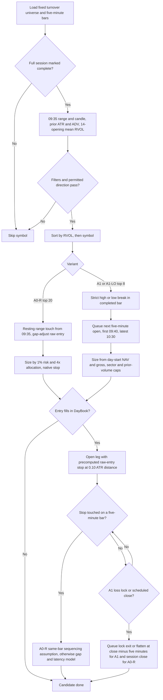
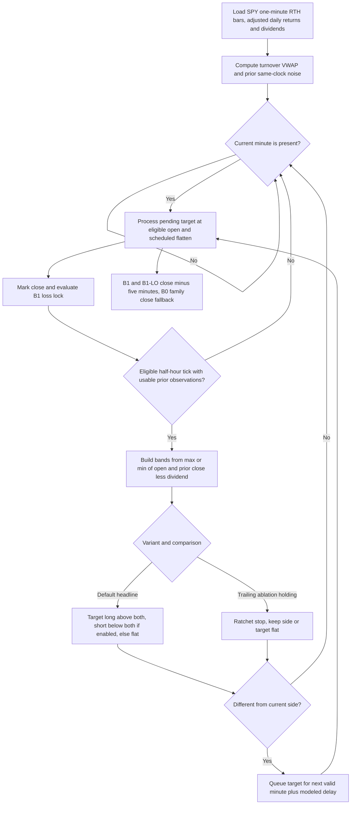
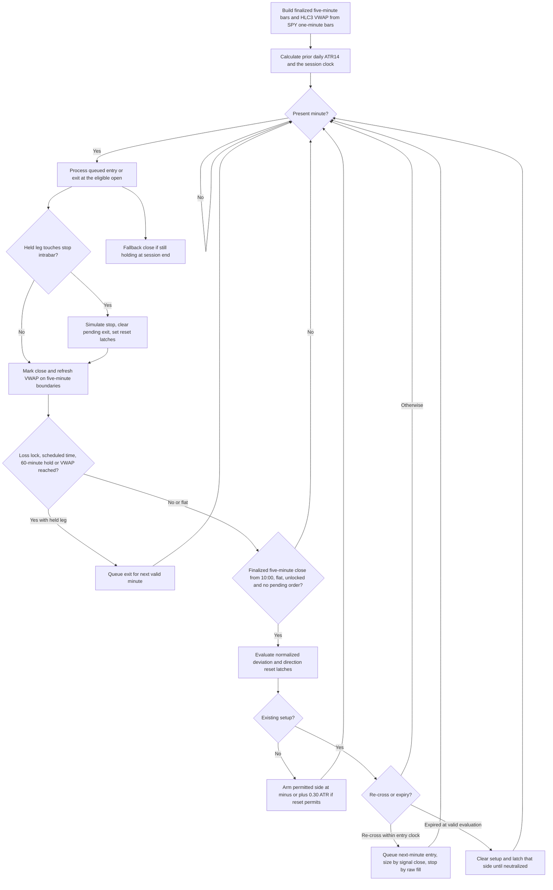
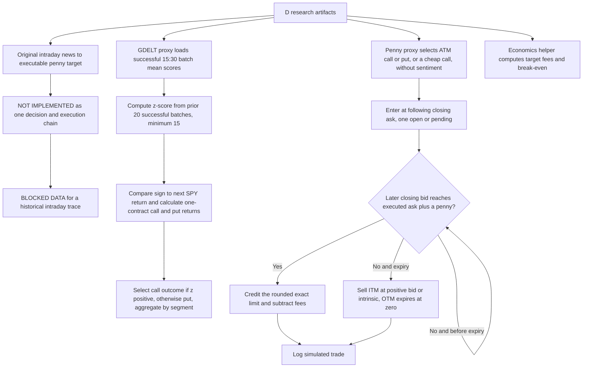
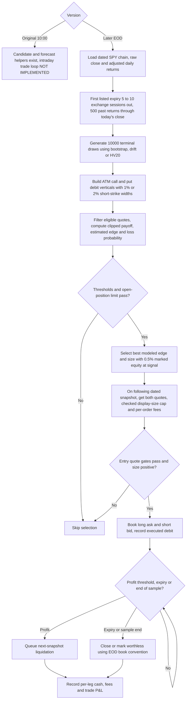
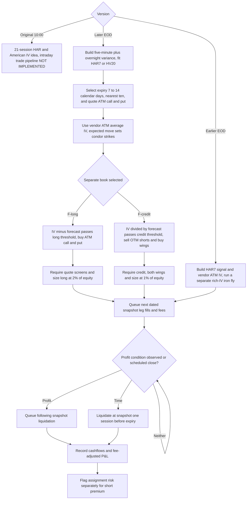

# Actual strategy flow audit and findings prompt

**The conceptual diagrams leave out the boundaries that determine what the backtests can establish.** A selects stocks retrospectively and screens them using their full session’s completeness. The A–C multi-year runner never executes the high-water drawdown ladder. D’s news and penny-target tests are separate proxies. E/F execute closing snapshots, and some fills exceed planned risk. F-long and F-credit are separate simulations using vendor IV and a volatility forecast.

## Six-strategy verdict

| Strategy | Intended purpose | What runs | Matching status | Main deviation | Reproducibility and validation |
|---|---|---|---|---|---|
| A | Break out of a stock’s first five-minute range in its opening direction | A0-R resting stop, A1 completed-bar trigger, and A1-LO | **PARTIAL** | Present-day 40-name universe, whole-session data screen, and variant-dependent fill timing | Historical simulation reproduced. A0 faithful published test **BLOCKED (DATA)**. A1 **−38.25%**, exploratory. |
| B | Follow SPY momentum relative to time-of-day noise and VWAP | B0, B0-100, B2, B1, B1-LO stateless targets. Separate trailing ablation. | **PARTIAL** | Actual history, holding rules and sizing differ across variants. Reversal and spill can share a bar. | Local B0 **+33.03%** and B0-100 **+9.36%** with paper costs. B1 **−3.17%**, B1-LO **−1.77%**. Academic replication and execution fidelity remain unverified. |
| C | Enter on a re-cross toward session VWAP | C0, C1 and C1-LO with a single armed setup, next-open entry and prioritized exits | **PARTIAL** | Diagram omits state reset, six-slot expiry behavior, cutoffs and pending exits. | Reproduced C1 **−9.33%**, C1-LO **−6.36%** and C0 **−6.07%**. Development gate failed. |
| D | Buy a news-directed option, then sell at +$0.01 with no stop | GDELT closing-snapshot direction study, separate no-news penny-target simulator and fee calculator | **NOT IMPLEMENTED** as one strategy | No wired intraday news-to-order-to-exit path | Original **BLOCKED (DATA)** and missing rules. EOD results establish proxy behavior and fee arithmetic. |
| E | Select a positive-expected-value SPY debit vertical from simulated terminal prices | EOD bootstrap, drift and HV strategies plus benchmarks. Intraday candidate helper only. | **PARTIAL** for EOD | One-session price lag, provisional cost and risk, no intraday order path | EOD bootstrap **−10.20%**. Original intraday **NOT IMPLEMENTED** end to end and **BLOCKED (DATA)** for validation. |
| F | Buy cheap volatility or sell rich volatility in a spread | Later EOD straddle and condor in separate books. Earlier EOD iron fly. | **PARTIAL** for EOD | Uses vendor IV and HAR7/HV20, with Black–Scholes only in the separate IV sensitivity. | F-long HAR **−0.37%** on 39 trades. Frozen HAR condor had zero trades, so its P&L performance is undetermined. Original intraday **NOT IMPLEMENTED** end to end. |

## Scope and entrypoints

This was an offline audit of the working-tree code and local caches. Dates and times below are Eastern. The audited A–C results are the multi-year research results through **2026-11-17**. The option results use daily quote rows through **2025-12-12**, with no observed quote clock time. The earlier options run and the later E/F run had overlapping, previously reviewed holdout data. Ledger line numbers are physical CSV lines, counting headers and comments. Report figures are secondary to source, cached inputs and trace calculations.

| Entry path | Actual boundary | Source |
|---|---|---|
| Multi-year A–C | Main constructs variants and C’s frozen parameters, runs separate development, validation, holdout and full books, then generates reports. | [research/run.py](../src/dual_strategy/research/run.py) Engine and freeze L65–127, variants L130–227, main L262–291. [research/portfolio.py](../src/dual_strategy/research/portfolio.py) simulate L26–48. |
| Six-strategy summary program | Runs headline A–C ledgers, B attribution, return resampling, D economics and E/F forecast or proxy studies. EOD E/F trade runs are separate entrypoints. | [research/six.py](../src/dual_strategy/research/six.py) run_headline L58–66, studies L147–240, main L286–348. |
| Options | Earlier E/D/F EOD engine, later E/F study and separate sentiment proxy. The timestamped chain helper is detached from these EOD paths. | [eod_backtest.py](../src/dual_strategy/research/options/eod_backtest.py) build_near L42–61, main L479–583. [ef_study.py](../src/dual_strategy/research/options/ef_study.py) main L341–494. [d_sentiment.py](../src/dual_strategy/research/options/d_sentiment.py) main L31–87. [chain.py](../src/dual_strategy/research/options/chain.py) load_chains and snapshot L47–66. |
| Older simulated A/B | Backtest entrypoint invokes a different runner, trade book and research risk state. Its controls and older short sample do not describe the multi-year results. | [backtest/__main__.py](../src/dual_strategy/backtest/__main__.py) main L5–16. [backtest/runner.py](../src/dual_strategy/backtest/runner.py) run_comparison L109–155. [backtest/simulation.py](../src/dual_strategy/backtest/simulation.py) simulate L69–323. |
| Shadow and supervised practice | The shadow CLI journals decisions. Separate supervised practice and broker adapters implement gates and reconciliation. Public configuration and code were inspected. Current private account selection and broker behavior are **UNVERIFIED**. | [forward.py](../src/dual_strategy/forward.py) verify_journal L62–93, run_tick L168–257. [run_supervised_b.py](../scripts/run_supervised_b.py) main L52–125. [moomoo_paper.py](../src/dual_strategy/execution/moomoo_paper.py) PracticeAccount.verify L32–42 and PaperExecutor.submit L71–132. |

**Arrow key.** A–K labels in the difference tables are the nodes in the supplied conceptual diagrams, within each strategy. MATCH confirms the stated transition. PARTIAL identifies a real transition with a missing condition. DIFFERENT changes a material transition. NOT IMPLEMENTED marks an absent path. UNVERIFIED marks an assumption unsupported by available data. CRITICAL prevents faithful validation of an intended strategy. HIGH can materially alter fills, exposure or risk. MEDIUM affects attribution, edge cases or reporting. LOW is chiefly descriptive.

## A · Stock opening-range breakout



The headline ORB uses five-minute range data, split-normalized prior daily features and raw fills. A1’s 0.25% risk and 15% per-name limits combine with four open positions, 30% per sector, 100% gross and 1% prior-bar volume. A1’s stop uses a five-basis-point software-latency proxy and three-basis-point price slippage per side. A0-R has its own sizing, native stop and $0.0035/share fee. The range-anchored stop and optimistic sequencing are explicit ablations. [strat_a.py](../src/dual_strategy/research/strat_a.py) AConfig L25–48, candidates L75–90, _stop_for and _size L93–114, run_day L117–251. [run.py](../src/dual_strategy/research/run.py) variants L130–160. [features.py](../src/dual_strategy/research/features.py) stock_daily_features and opening_rvol L30–58. [execution.py](../src/dual_strategy/research/execution.py) L42–50 and L75–105.

| Strategy | ChatGPT flow step | Actual behavior | Severity | Code file and lines | Correct flow or evidence needed |
|---|---|---|---|---|---|
| A | A→B screen to opening features | **DIFFERENT.** Engine uses the 2026-11-18 turnover list and future whole-session completeness at 09:35. Its opening filter is >$5, ADV ≥1m, ATR >$0.50, RVOL ≥1. It has no historical market-cap or short-borrow gate. | CRITICAL | [research_universe.json](../config/research_universe.json) L1–6. [run.py](../src/dual_strategy/research/run.py) Engine L65–81. [strat_a.py](../src/dual_strategy/research/strat_a.py) L64–88. [data.py](../src/dual_strategy/research/data.py) Intraday.complete L74–82. | Label A0-R and A1 exploratory. Faithful A requires historic constituents, delistings, eligibility, borrow and causal data screens. |
| A | B→C and C→D/E/F range to direction | **MATCH** for green, red and doji. **PARTIAL** for selection. RVOL uses a split-consistent mean over the 14 preceding openings. A1-LO removes shorts before ranking. Ties sort by ticker. | MEDIUM | [features.py](../src/dual_strategy/research/features.py) opening_rvol L51–58. [strat_a.py](../src/dual_strategy/research/strat_a.py) candidates L75–90. [run.py](../src/dual_strategy/research/run.py) L133–140. | Apply the direction filter in the variant before taking 20 or 8 names. A1-LO can admit replacement names. |
| A | D→G and E→H breakout to fill | **PARTIAL.** Resting A0-R accepts a touch from 09:35. A1 uses the completed high/low strictly through the range, even if the bar closes inside it. A1 stamps the next bar opening at the same clock boundary as the signal. It drops a pending attempt on a missing intended open or failed entry. | HIGH | [strat_a.py](../src/dual_strategy/research/strat_a.py) run_day L145–204, L232–244. [book.py](../src/dual_strategy/research/book.py) L54–58, L72–93. | Draw the model’s entry timing and failed-order branch per variant. A1’s regular-session first and last possible fills are 09:40 and 10:30. |
| A | G/H→I sizing and stop | **PARTIAL.** Caps and quantity are evaluated before entry. All headline stops anchor to the **raw** entry, then the fee/slippage-adjusted fill changes actual risk. Same-bar stop sequencing is an explicit assumption only for intrabar entries. | HIGH | [strat_a.py](../src/dual_strategy/research/strat_a.py) _stop_for/_size L93–114, run_day L145–161, L192–219. [book.py](../src/dual_strategy/research/book.py) L85–91. | Show sizing before execution and distinguish raw stop distance from realized loss. The −88.32%/ +176.61% A0-R sensitivity depends on that sequencing. |
| A | I→J exit at stop or close | **PARTIAL.** A1 day loss lock can cancel pending entries and queue a close. Native and software stops take the gap/open into account. Capacity spill can reach the final close. A0-R uses session close, A1 schedules five minutes earlier. | HIGH | [strat_a.py](../src/dual_strategy/research/strat_a.py) L117–143, L164–171, L205–250. [execution.py](../src/dual_strategy/research/execution.py) stop_price L89–99. | Include lock, half-day relative close and fallback paths. Exact intrabar stop timestamps are unverified. |

### A worked traces

Raw five-minute inputs are from [AMD 2024 bars](../data-cache/history/k6/US.AMD/2024.csv.gz) and [MSTR 2024 bars](../data-cache/history/k6/US.MSTR/2024.csv.gz). The archived [stock ledger](trade_level_ledger_A_to_F.csv) records these transitions as separate rows.

| Variant and record | Signal input and sizing on 2024-01-02 | Entry and exit | USD gross / fees / price slippage / net |
|---|---|---|---:|
| A0-R, ledger L3 | AMD rank 6. 09:35 open 144.28, close 142.5078, range 142.38–144.40, RVOL 1.0531 and ATR 4.4349. Raw-level allocation of $10,000 caps size at 70. | Short 70 at 142.38 during the bar beginning 09:35. That bar reaches 142.2237 low and 143.1709 high. The model resolves both touches as entry followed by stop at 142.8235. | −31.04 / 0.49 / 0.00 / **−31.53** |
| A1 and A1-LO, ledger L6853 and L10294 | MSTR rank 1 in both. The 09:35 candle closes green at 708.47, opening range high 708.62. The next completed bar’s high is 727.77. RVOL 3.837 and ATR 33.1568. The $7,500 name cap permits 10 shares at the next raw open. | Scheduled 09:40 signal enters the 09:40–09:45 bar at raw 723.19, simulated 723.4070. Its 715.11 low passes stop 719.8743. The report stamps 09:40 for the software-stop exit, simulated 719.2985. | −36.76 / 1.98 / 4.33 / **−43.07** each |

The A1 MSTR recorded stop risk is $35.33 between simulated entry and the raw stop. The loss was $43.07 including the modeled stop exit and fees. This trace shows why a planned 0.25% sizing limit is distinct from a stop-loss guarantee. [book.py](../src/dual_strategy/research/book.py) enter and exit L72–136.

## B · SPY Noise-Area momentum



Noise is the mean of the absolute same-clock close/open moves over 14 prior observations. Bands use max(open, previous close minus dividend) × (1 + noise) and min(open, previous close minus dividend) × (1 − noise). Default VWAP is cumulative turnover divided by cumulative volume. The optional HLC3 VWAP uses bar typical price. [features.py](../src/dual_strategy/research/features.py) session_vwap and noise_sigma L61–105. [etf.py](../src/dual_strategy/research/etf.py) decision slots and inputs L14–56. [strat_b.py](../src/dual_strategy/research/strat_b.py) run_day L42–123.

| Variant | Size rule | History, exit and costs |
|---|---|---|
| B0 | min(4, 2% ÷ prior 14-day volatility) × day-start equity | Last 14 available observations for the clock slot. Exchange close, no loss lock. $0.0035/share fees plus $0.001/share slippage per side. |
| B0-100 | 100% | Shares B0 history, time exit and costs. |
| B2 | 40% | Shares B0 history and time exit. Uses $0.99/order plus capped sell fee and 1 bp/side. |
| B1 | 40% | Requires the last 14 exchange sessions at that slot. Flattens five minutes before close with −1.25% daily lock. B2 costs. |
| B1-LO | 40% | B1 rules with shorts disabled. A downside signal can flatten an existing long. |

All quantities are truncated to whole shares with max(session open, fill-bar open) in the denominator. The 30-minute decisions are bar ends from 10:00 through 15:30. On a 13:00 close the last decision is 12:30, with B1’s scheduled flatten at 12:55. Earlier half-days can remove later ticks from a B1 session’s available history. [run.py](../src/dual_strategy/research/run.py) variants L162–186. [strat_b.py](../src/dual_strategy/research/strat_b.py) _fraction/run_day L35–54 and L70–122. [execution.py](../src/dual_strategy/research/execution.py) L46–50.

| Strategy | ChatGPT flow step | Actual behavior | Severity | Code file and lines | Correct flow or evidence needed |
|---|---|---|---|---|---|
| B | A→B, B→C, C→D history, bands, VWAP and decision | **PARTIAL.** Noise uses past same-clock data and a current ex-date-adjusted gap anchor. B0/B0-100/B2 skip absent slots. B1/B1-LO require the exact prior sessions. Missing current bar, invalid noise or unavailable VWAP skips that tick, leaving the existing position. | HIGH | [features.py](../src/dual_strategy/research/features.py) L61–105. [strat_b.py](../src/dual_strategy/research/strat_b.py) L43–54, L70–73, L100–106. | Draw history eligibility and data-skip branches. Distinguish market half-days and prior-slot coverage. |
| B | D→E/F/G target selection | **MATCH** for the default stateless crossing tests. **PARTIAL** across variants. Shorting is conditional, and the optional ratcheting strategy exits to flat when below/above the active stop. | MEDIUM | [strat_b.py](../src/dual_strategy/research/strat_b.py) L104–120. [run.py](../src/dual_strategy/research/run.py) L162–176. | Name the default as a target-position rule. Identify the trailing logic separately and keep the variant’s long-only setting explicit. |
| B | E/F/G→H reconcile position | **PARTIAL.** Changed target queues next-bar open. First Signal 10:00 can fill the open of the 10:00–10:01 bar. A reversal can exit then enter in one bar. Exit spill is applied immediately to the book and can use a later bar or closing fallback. Rejected target-change exits can retry. | HIGH | [strat_b.py](../src/dual_strategy/research/strat_b.py) L60–87 and L119–120. [book.py](../src/dual_strategy/research/book.py) L95–116. | Treat this as a simulated rebalancing rule. Executed order reports and broker reconciliation belong to the practice adapter. |
| B | H→I repeat and close | **PARTIAL.** B1 and B1-LO flatten five minutes before close and mark the daily lock each present minute at baseline. B0, B0-100 and B2 close at session end. All have a session-close fallback. No baseline B hard price stop. | HIGH | [strat_b.py](../src/dual_strategy/research/strat_b.py) L74–100, L119–123. [run.py](../src/dual_strategy/research/run.py) L162–183. [six.py](../src/dual_strategy/research/six.py) trade_match L105–134. | Separate cost/exposure changes from changed decisions. B1 shared 627 of B0’s 645 entries and 209 shared entries had different exits. |

### B worked traces

On **2024-01-08** the [SPY one-minute cache](../data-cache/history/k1/US.SPY/2024.csv.gz) gives an open of 468.43. The prior price anchor is 467.92. At 10:00 noise is 0.00107072 under both history rules, upper band 468.93156, lower band 467.41899, turnover VWAP 469.02149 and the completed close 469.735. The 10:00–10:01 bar opens at **469.73**, triggering the following records in the [stock ledger](trade_level_ledger_A_to_F.csv).

| Variant and ledger line | Size and executed entry | Exit | USD gross / fees / slip / net |
|---|---|---|---:|
| B0 L12867 | 14-day daily vol 0.00617563 gives 3.2385×. Long 346 at 469.7310. | Exchange close 16:00, fill 474.5990. | 1,685.02 / 2.42 / 0.69 / **1,681.91** |
| B0-100 L13512 | 100% planned. Long 106 at 469.7310. | Same closing fill. | 516.22 / 0.74 / 0.21 / **515.27** |
| B2 L14157 | 40% planned. Long 42 at 469.7770. | Exchange close 16:00, fill 474.5525. | 204.54 / 1.99 / 3.97 / **198.59** |
| B1 L14802 and B1-LO L15427 | 40% planned, different book equity. Both round to 42 at 469.7770. | Scheduled 15:55 open, fill 474.5425. | 204.12 / 1.99 / 3.97 / **198.17** each |

## C · SPY VWAP mean reversion



Deviation is (five-minute close − cumulative HLC3 VWAP) ÷ prior ATR14. C0 sizes at 100% of day-start equity divided by the signal close. C1 and C1-LO size by the smaller of 0.25%-of-equity risk at a 0.25 ATR distance, 40%-of-equity notional and full notional. C1/C1-LO use competition stock fees, 1 bp/side and 2 bp software-stop latency. C0 uses native stops, $0.0035/share plus $0.001/share adverse prices and no daily lock. C1-LO has no short setup. A valid trigger can occur through **14:30**, or **11:30** on a 13:00 close. Timed exit is the earlier of **15:50** and close minus ten minutes. [strat_c.py](../src/dual_strategy/research/strat_c.py) CConfig, _qty and run_day L20–152. [run.py](../src/dual_strategy/research/run.py) variants L187–205.

| Strategy | ChatGPT flow step | Actual behavior | Severity | Code file and lines | Correct flow or evidence needed |
|---|---|---|---|---|---|
| C | A→B VWAP and ATR to decision | **MATCH** for the deviation formula. **PARTIAL** for timing. Absent minute closes are skipped. A five-minute block with a missing close is invalid. Only finalized slots from 10:00 qualify for the entry state. | MEDIUM | [data.py](../src/dual_strategy/research/data.py) resample L116–133. [strat_c.py](../src/dual_strategy/research/strat_c.py) L44–57, L66–69 and L104–126. | Keep bar completion and latest finalized VWAP explicit. |
| C | B→C/D/E extremes to setup or wait | **PARTIAL.** One setup at a time, with short setups absent from C1-LO. Pending entry or a held leg clears the setup at evaluation. Exit sets reset latches, which clear on a move inside the corresponding threshold. | MEDIUM | [strat_c.py](../src/dual_strategy/research/strat_c.py) L58–64, L80–98 and L121–149. | Draw a state machine with reset and pending conditions. |
| C | C→F and D→G wait for re-cross | **PARTIAL.** Re-cross is checked before the six-slot timeout at an eligible evaluation, so slot six can trigger. If invalid slots skip the timeout, a later valid re-cross can take the first branch. The resulting holdout impact is **UNVERIFIED**. | MEDIUM | [strat_c.py](../src/dual_strategy/research/strat_c.py) L123–149. | Describe an evaluated timeout. A strict six-slot rule requires an elapsed-slot check before re-cross. |
| C | F→H and G→I next valid fill | **PARTIAL.** Inclusive trigger cutoff at 14:30 or close−90m. The code checks signal time, then executes at the next present one-minute bar plus optional delay. No second cutoff check at fill. Quantity uses trigger bar close, stop uses raw execution open. | HIGH | [strat_c.py](../src/dual_strategy/research/strat_c.py) _qty L37–41 and run_day L49–79, L134–140. [test_research_engine.py](../tests/test_research_engine.py) L257–279. | Report separate signal and fill boundaries under delay or missing bars. |
| C | H/I→J stop, target, hold | **PARTIAL.** A previously queued exit gets a chance at the open first. Then an intrabar stop touch takes priority over new bar-close conditions. A new queued exit prioritizes daily lock, scheduled time, hold limit, then VWAP. The session close is the fallback. | HIGH | [strat_c.py](../src/dual_strategy/research/strat_c.py) L80–120 and L150–152. [test_research_engine.py](../tests/test_research_engine.py) L234–256. | Separate open processing from intrabar stop and new bar-close triggers. |
| C | Threshold choice implicit in B | **PARTIAL.** Main reloads the checksum-verified frozen record. Its original selection evaluated 27 development cells, requiring ≥100 trades and positive Sharpe. The fallback is 0.30/0.25/60. Earlier 13:30 is archived. Walk-forward reselection is a separate report track. | MEDIUM | [run.py](../src/dual_strategy/research/run.py) L40–47, L90–127 and L230–250. [c_frozen.json](../config/c_frozen.json) L2–25. [Pre-fix record](../config/c_frozen_v1_pre_cutoff_fix.json) L2–25. | Use the corrected freeze. All 27 development cells reproduced, and best Sharpe was −0.9709. |

### C worked traces

On **2024-01-31**, [SPY one-minute inputs](../data-cache/history/k1/US.SPY/2024.csv.gz) yield prior ATR **3.7609**. At **14:20** five-minute close **485.925** and VWAP **487.20805** give **−0.34115**, arming long. At **14:25** deviation is **−0.32308**. At **14:30** close **486.14** and VWAP **487.15271** give **−0.26927**, crossing the last eligible full-session signal. The upcoming minute opens **486.15** and raw stop is **485.2098**. At **14:39**, the completed minute closes **487.24**, above the latest finalized five-minute VWAP **487.13271**. The next minute opens **487.26**. [Stock ledger](trade_level_ledger_A_to_F.csv)

| Variant and ledger line | Sizing and simulated entry | Simulated exit | USD gross / fees / price slip / net |
|---|---|---|---:|
| C0 L15776 | $50,043.20 equity gives 102 shares at 100% sizing, fill 486.1510. | 14:39 at 487.2590. | 113.22 / 0.71 / 0.20 / **112.30** |
| C1 L16322 and C1-LO L16860 | $49,904.06 and $49,975.15 NAVs each give 41 shares under the 40% cap, fill 486.1986. | 14:39 at 487.2113. | 45.51 / 1.99 / 3.99 / **39.53** each |

Ledger components are rounded independently to cents. Displayed gross minus displayed costs may differ from rounded net by one cent. [book.py](../src/dual_strategy/research/book.py) exit L112–135.

## D · News-sentiment options with penny target



The original intent preserves a $0.01 premium target and no per-trade stop. GDELT uses stock-market tags and deduplicates URLs and equal tone vectors within a batch. The direction study scores both call and put counterfactual returns from current closing ask to next closing bid, then aggregates by direction. The penny simulator separately selects contracts at a prior close and buys at the next close. [strat_d.py](../src/dual_strategy/research/options/strat_d.py) L7–41. [gdelt_tone.py](../src/dual_strategy/research/options/gdelt_tone.py) file_stamp and parse L34–65. [d_sentiment.py](../src/dual_strategy/research/options/d_sentiment.py) main L31–87. [eod_backtest.py](../src/dual_strategy/research/options/eod_backtest.py) run_d L385–448.

| Strategy | ChatGPT flow step | Actual behavior | Severity | Code file and lines | Correct flow or evidence needed |
|---|---|---|---|---|---|
| D | A→B timestamped news to score | **NOT IMPLEMENTED** for original D. **PARTIAL** for GDELT. A batch stamp is a processing timestamp. Main reads cached theme tone and never compares article receipt with market close. Nine 15:30 batches occur after 13:00 closes. | CRITICAL | [gdelt_tone.py](../src/dual_strategy/research/options/gdelt_tone.py) L34–65 and L68–78. [d_sentiment.py](../src/dual_strategy/research/options/d_sentiment.py) L31–51. [Timing evidence](codex_independent_audit/sentiment_signal_daily.csv). | Separate batch availability from article timing. Timing-clean holdout accuracy is 52.54% versus 58.47% for always-up. |
| D | B→C and C→D/E score to directed purchase | **PARTIAL** for GDELT. Prior 20 successful batches, minimum 15, form its shifted z-score. Positive picks call P&L, while zero falls to put in the option aggregation. It prices both directions before aggregation. Penny proxy instead has a fixed option side or cheap-call lane with fixed lots. The original rules are **NOT IMPLEMENTED** jointly. | CRITICAL | [d_sentiment.py](../src/dual_strategy/research/options/d_sentiment.py) L31–60 and L69–85. [eod_backtest.py](../src/dual_strategy/research/options/eod_backtest.py) L393–439. [strat_d.py](../src/dual_strategy/research/options/strat_d.py) L9–25. | Treat directions and selected instruments as proxy assumptions. Original contract, threshold and sizing rules remain open. |
| D | D/E→F and F→G monitor executable bid | **NOT IMPLEMENTED** intraday. **PARTIAL** for penny proxy. It starts monitoring on a later session, checks only closing bids, and assumes exact-target fill without checking size. GDELT has a fixed next-close liquidation. | CRITICAL | [eod_backtest.py](../src/dual_strategy/research/options/eod_backtest.py) L397–425. [d_sentiment.py](../src/dual_strategy/research/options/d_sentiment.py) L48–60. | Require timestamped quotes and size and distinguish a reachable bid from a matched limit order. |
| D | G→H/I and I→J take profit, hold, expiry | **PARTIAL** for penny proxy. Tests target before expiry, marks open positions at mid, and sells positive-intrinsic legs at a positive bid or intrinsic; OTM is zero. Cheap selection occurs before entry, so the next ask can cross a fee tier. Original expiry, physical exercise and forced liquidation rules are **NOT IMPLEMENTED**. | HIGH | [eod_backtest.py](../src/dual_strategy/research/options/eod_backtest.py) run_d L395–448. [pricing.py](../src/dual_strategy/research/options/pricing.py) option_order_fee L115–124. | Label expiry and size as proxy mechanics. Distinguish one standard contract’s $1 gross from its $4.61279 exact round-trip fee under sell-only activity. |

The target earns a positive net starting at **11 contracts** only when both legs stay at or under $0.10. An ask of $0.10 and exit at $0.11 cross tiers. The original target-hit rate and liquidity remain unverified. [pricing.py](../src/dual_strategy/research/options/pricing.py) L115–129. [Fee audit](codex_independent_audit/fee_audit.csv).

### D worked traces

- **Original D. NO VERIFIED TRACE.** The code and records contain no combined intraday news-to-penny-target execution.
- **GDELT one-day proxy, 2024-01-02 → 2024-01-03.** Cached batch **15:30 ET** and z-score **−0.484974** select outcomes for the 473 put, expiry **2024-01-04**. Entry quote bid/ask **1.48/1.49** and next bid/ask **4.10/4.53** give **+$261.00 gross, $4.61279 fees and +$256.38721 net** for a one-lot simulation. Adjusted SPY close-to-close return **−0.8167%**. This per-outcome record was reconstructed from the aggregate study’s inputs. [sentiment_proxy_trades.csv](codex_independent_audit/sentiment_proxy_trades.csv) L739 and [dated signal rows](codex_independent_audit/sentiment_signal_daily.csv).
- **Earlier no-news penny target, 2024-01-05 → 2024-01-08.** The prior session selects an ATM 467 call expiring **2024-01-08**. Next closing ask **1.94** gives target **1.95**. The expiry-day bid is **7.23** and the proxy credits the exact **1.95** limit. **+$1.00 gross, $4.61279 fees, −$3.61 net.** [eod_trades.csv](options_eod/eod_trades.csv) L1336 and [eod_backtest.py](../src/dual_strategy/research/options/eod_backtest.py) run_d L397–425.

## E · Monte Carlo SPY debit verticals



The original E config prescribes 10:00 decisions, minimum edge 0.10 and loss ceiling 0.60, with 15:30 expiry exit. The EOD run uses adjusted daily log returns through signal date and spot from the raw close. It samples 10,000 terminal prices, with seed **7**, circular five-session blocks from the last **500** returns and EWMA **0.94** scaling. Drift adds the trailing mean over the horizon. HV20 uses the standard deviation of the last 20 returns and lognormal terminal draws. Signed payoff is clipped to zero and the strike width. The simulated cost estimate is **$0.0386558 per share** for four leg orders, while actual executed orders use commission tiers, minimums, platform, regulatory and sell activity fees. [strat_e.py](../src/dual_strategy/research/options/strat_e.py) EConfig and select L4–24, L31–45, L47–104. [ef_study.py](../src/dual_strategy/research/options/ef_study.py) e_eval and run_e L66–157, main L341–350. [montecarlo.py](../src/dual_strategy/research/options/montecarlo.py) EWMA and bootstrap L11–36. [pricing.py](../src/dual_strategy/research/options/pricing.py) L10–12 and L115–124.

| Strategy | ChatGPT flow step | Actual behavior | Severity | Code file and lines | Correct flow or evidence needed |
|---|---|---|---|---|---|
| E | A→B input data to simulations | **MATCH** for the 10,000 simulated outcomes in the EOD path. **DIFFERENT** for timing. Old intraday config assumes prior-close features and a morning executable chain. The EOD study includes the current closing return and used dates, with no intraday quote time. | CRITICAL | [strat_e.py](../src/dual_strategy/research/options/strat_e.py) L4–24, L85–105. [ef_study.py](../src/dual_strategy/research/options/ef_study.py) L66–87, L341–350. [eod_backtest.py](../src/dual_strategy/research/options/eod_backtest.py) build_near L42–61. | Label EOD dates and the helper-only intraday architecture explicitly. |
| E | B→C and C→D build call/put spreads and calculate payoff | **MATCH** for signed vertical intrinsic clipping and modeled edge/loss. **PARTIAL** for costs and liquidity. ATM long and ±1%/2% short are nearest listed strikes. Require 0 < debit < width, positive quotes and OI ≥500. Two-leg quote spread can be ≤20% at candidate generation and must be ≤10% at baseline entry selection. Fees in the forecast omit order minima. | HIGH | [ef_study.py](../src/dual_strategy/research/options/ef_study.py) L28–64, L87–115, L118–144. [pricing.py](../src/dual_strategy/research/options/pricing.py) L115–124. | Separate candidate economics from the executable ledger and identify estimated fees. |
| E | D→E and E→F/G pass edges and enter | **PARTIAL.** Development grid selects the best positive Sharpe with ≥30 trades, otherwise uses fallback. Later frozen pairs are boot **0.00/0.65**, drift **0.30/0.55**, HV **0.10/0.60**. Each decision chooses one qualifying spread, with at most three open. It sizes at 0.5% of marked equity divided by decision debit ×100 + $9.20. | HIGH | [ef_study.py](../src/dual_strategy/research/options/ef_study.py) run_e L118–144, select L319–321 and main L382–423. [ef_freeze.json](options_ef/ef_freeze.json). | Show thresholds, minimum lots and planning at the signal date. No per-trade net-edge gate runs in A–D. |
| E | E→G position becomes a defined-risk spread | **PARTIAL.** Buy at next dated ask and sell at next dated bid. Quotes may be stale within a date and fill sizes may differ. The fill function does not recheck the 0.5% budget, candidate spread, debit bounds or edge. A displayed size of zero bypasses the quantity clip. | HIGH | [eod_backtest.py](../src/dual_strategy/research/options/eod_backtest.py) Book.enter L118–143 and run_book L188–204. [options ledger](codex_independent_audit/option_independent_trades.csv). | Show next-snapshot price risk and the original 11 over-budget E fills. Quote time and contemporaneous spread execution remain unverified. |
| E | G→H and H→I monitor and exit | **PARTIAL.** Target uses current liquidation bid minus ask against debit inclusive of entry costs plus half remaining wing gain. It queues a next-snapshot exit. At expiry the engine skips OTM legs and pays to close simulated ITM legs. Intrinsic fallback can also be used before expiry. Physical exercise, assignment and a hard loss stop are **NOT IMPLEMENTED** in the EOD book. | HIGH | [ef_study.py](../src/dual_strategy/research/options/ef_study.py) tp_check L146–157. [eod_backtest.py](../src/dual_strategy/research/options/eod_backtest.py) Book.leg_value/close L145–177 and run_book L188–222. | Show target observation date, liquidation date and settlement assumptions. |
| E | Predictive interpretation of C→D | **PARTIAL.** Adjacent-strike market-implied and realized expiry loss are held in calibration fields, separate from selection. The boot score 0.23488 is worse than market 0.22930 in the later EOD matched-candidate score. Seven settlement labels cross that sample endpoint. The risk-bootstrap module separately resamples portfolio returns. | MEDIUM | [ef_study.py](../src/dual_strategy/research/options/ef_study.py) L48–64, L79–115, L324–338 and L350–381. [model_calibration_E.md](codex_independent_audit/model_calibration_E.md). | Keep forecasting performance, trade P&L and resampled risk separate. The E/F holdout was inspected earlier. |

### E worked traces

Signals below were recomputed from the cached adjusted SPY closes and [dated chain](../data-cache/options_history/spy_near_2021_2025.parquet). The archived source is [ef_trades.csv](options_ef/ef_trades.csv), with separate [cash and budget evidence](codex_independent_audit/option_independent_trades.csv). The quotes supply trading dates only.

| Variant and ledger line | Dated signal and selected strikes | Simulated next-date premiums, exit and risk | USD gross / fees / net |
|---|---|---|---:|
| Bootstrap L110 | **2024-02-15** raw spot 502.01, 502/497 put, expiry **2024-02-23**, five sessions. Long ask 2.81, short bid 1.21 gives 1.60 decision debit. Edge **1.08%**, loss probability **64.22%**. One contract under the planned $246.94 budget. | **02-16** fill long ask **4.56**, short bid **2.08**. Actual at-risk debit **$252.61**. Expiry spot **507.85** leaves both legs worthless and no fee on expiry. | −248.00 / 4.61279 / **−252.61** |
| Drift L201 | **2024-03-12** spot 516.78, 517/525 call, expiry **03-19**. Decision debit **2.24**, edge **30.28%**, loss probability **53.62%**. | One lot on **03-13** at **1.97** ask and **0.17** bid. **03-19** expiry spot **515.71**, both worthless. | −180.00 / 4.61279 / **−184.61** |
| HV20 L413 | **2024-01-05** spot 467.92, 468/463 put, expiry **01-12**. Decision debit **1.54**, edge **15.28%**, loss probability **58.72%**. | One lot on **01-08** at **0.53** ask and **0.16** bid. **01-12** expiry spot **476.68**, both worthless. | −37.00 / 4.61279 / **−41.61** |

**Original intraday E. NO VERIFIED TRACE.** Earlier EOD E and its eligible-day baseline are separate experiments with recorded cash ledgers. The later E-bootstrap figure is not a continuation of the earlier run. [Earlier EOD results](options_eod/eod_results.csv) · [Later E/F study](options_ef_backtest_results.md).

## F · IV versus forecast volatility



F’s later simulation uses **HAR7 or HV20** against the mean of vendor ATM call and put IV. The 756-session rolling HAR fit uses fully observable next-seven-session targets, prior-day/weekly/monthly realized variance and chronological alignment at the EOD shift. Realized variance combines intraday five-minute log-return squares and adjusted overnight movement. Early assignment is an ex-post heuristic. Black–Scholes and CRR pricers are utilities and tests. A separate independent audit sensitivity inverted mids and substituted European IV signals. [strat_f.py](../src/dual_strategy/research/options/strat_f.py) L4–26, daily_realized_variance and har_forecasts L42–78. [ef_study.py](../src/dual_strategy/research/options/ef_study.py) f_eval/run_f L160–248 and main L396–429. [pricing.py](../src/dual_strategy/research/options/pricing.py) BS/CRR and implied_vol L21–102. [Independent IV sensitivity](codex_independent_audit/option_replay.py) f_candidates and variants L153–189, L410–428.

| Strategy | ChatGPT flow step | Actual behavior | Severity | Code file and lines | Correct flow or evidence needed |
|---|---|---|---|---|---|
| F | A→B underlying and chain to vol forecast | **PARTIAL.** EOD uses seven-session HAR or 20-session constant HV, original intraday spec says 21 sessions. The target slice stops before the forecast timestamp. Using current-day RV is allowed for the EOD decision, then entry is on the next dated snapshot. | HIGH | [strat_f.py](../src/dual_strategy/research/options/strat_f.py) L4–13 and L42–78. [ef_study.py](../src/dual_strategy/research/options/ef_study.py) L397–403. | State the horizon and as-of time for each implementation. |
| F | B→C and C→D compute and compare IV | **DIFFERENT** if the diagram implies Black–Scholes calculates the baseline’s IV. IV is the average of near-ATM vendor call and put IV at 7–14 days. Expected move = spot × IV × sqrt(calendar days/365). Use Black–Scholes/CRR only in the identified sensitivity or original proposal. | HIGH | [ef_study.py](../src/dual_strategy/research/options/ef_study.py) f_eval L160–187. [pricing.py](../src/dual_strategy/research/options/pricing.py) L27–103. | Label IV provenance and keep independent IV sensitivity distinct. |
| F | D→E/F/G select straddle, credit or skip | **PARTIAL.** Later long and credit are separate books with distinct filters. Long uses difference ≤0 points at the selected threshold. Credit uses a 1.2 ratio fallback after failing the development trade-count gate. Credit shorts at spot ± expected move and buys wings about max($5, half expected move) farther. Earlier iron fly sells both ATM legs and uses the +6 vol-point rule in its own book. | HIGH | [ef_study.py](../src/dual_strategy/research/options/ef_study.py) L160–233, L319–321, L405–429. [eod_backtest.py](../src/dual_strategy/research/options/eod_backtest.py) f_signals/run_f L314–382. [Earlier thresholds](options_eod/eod_freeze.json) L171–180. | Explicitly separate later straddle and condor, earlier fly, and removed-threshold benchmarks. |
| F | E/F→H sizing and tracking | **PARTIAL.** Long plans 2% with one open. Credit plans 1% with up to three open and no shared expiry. Threshold and sizing use signal-day quote and marked equity. Entry fees are included in later max loss. Stressed condor risk uses pre-stress bid/ask through its callback, and fill budgets are not rechecked. Earlier fly sizing uses 2%, and legacy max-loss handling has no condor callback. | HIGH | [ef_study.py](../src/dual_strategy/research/options/ef_study.py) L190–233. [eod_backtest.py](../src/dual_strategy/research/options/eod_backtest.py) Book.enter L118–143 and earlier run_f L342–380. | Identify whether the loss number is planned debit, fee-adjusted expiry width, or pre-expiry liquidation cost. Two naive condor losses exceeded their recorded bounds. |
| F | H→I profit, time and assignment | **PARTIAL.** Long targets liquidation bid ≥1.5× fee-inclusive debit. Credit targets closing cost ≤50% of post-fee credit. A signal schedules following snapshot liquidation. Scheduled exit is one session before expiry. Seven of 44 later credit benchmark/HV positions flagged early exercise risk; the flag is never used to close the leg as assigned. | HIGH | [ef_study.py](../src/dual_strategy/research/options/ef_study.py) f_eval L183–187, tp_check and early_assignment_audit L236–278. [eod_backtest.py](../src/dual_strategy/research/options/eod_backtest.py) run_book L188–222. | Show next-snapshot profit execution and unmodeled assignment risk. |

### F worked traces

The base [dated options cache](../data-cache/options_history/spy_near_2021_2025.parquet) and [later ledger](options_ef/ef_trades.csv) give the dates and prices below. This sample records bid or ask prices and per-order fees, with no measured intra-session order timestamp.

| Variant and ledger line | Signal and simulated entry | Exit | USD gross / fees / net |
|---|---|---|---:|
| F-long HAR L835 | **2024-01-02**, expiry **01-12**, ATM 473. Vendor IV **11.7315%**, HAR **12.0188%**. At 2% planned risk buy one call and put on **01-03** at **1.99 / 5.51** asks. | Scheduled **01-11**, bids **3.53 / 0.23**. | −374.00 / 9.22558 / **−383.23** |
| F-credit HV L974 | **2024-01-02** IV **11.7315%**, HV20 **9.5613%**, ratio **1.227**. One condor from 1% planned risk. On **01-03**, sell 482C and 463P at **0.23 / 1.37**, buy 487C and 458P at **0.06 / 0.66**. | **01-08** liquidation cost **0.38** is below half the 0.7877442 post-fee credit. Fill **01-09**, buys **0.13 / 0.13**, sells **0.01 / 0.06**. | +69.00 / 18.45116 / **+50.55** |
| F-credit eligible-day L1169 | **2025-02-19** IV **10.7555%**, HAR **13.9553%**, threshold bypassed. One contract on **02-20**, sell 623C and 603P at **0.20 / 1.84**, buy 628C and 598P at **0.05 / 1.12**. Net credit **$77.77442** on $5 wings. | Scheduled **02-27**, buy at **0.01 / 18.30**, sell at **0.00 / 12.08**. Net loss exceeds recorded **$422.23**. | −536.00 / 18.45116 / **−554.45** |
| Earlier EOD F-short iron fly, [older ledger](options_eod/eod_trades.csv) L668 | **2024-10-29**, 582 ATM with 602C/562P wings, expiry **11-08**. IV **20.5115%**, HAR **12.4156%**, spread **+8.0959** vol points. One lot after planned 2% sizing. On **10-30**, sell 582C/P at **6.71 / 8.50**, buy wings at **0.63 / 2.49**. | Scheduled **11-07**, buy shorts at **14.50 / 0.08**, sell wings at **0.08 / 0.03**. | −238.00 / 18.45116 / **−256.45** |

**Frozen F-credit HAR holdout and original intraday F. NO VERIFIED TRACE.** The former has no filled holdout trades. The latter is an implementation and data gap. The funded risk of a credit strategy cannot be inferred from an empty trade set. [Later E/F summary](options_ef/ef_results.csv).

## Shared execution, financial risk and account boundaries

### What controls run in each historical replay

| Path | Signal or entry checks active in loop | Controls active during the trade | Reported after the run or absent |
|---|---|---|---|
| A0-R | Current universe, full-day coverage, prior features, top 20, planned 1% risk and capped slot allocation | Native price stop, optional same-bar assumption, close fallback | Point-in-time universe gate is an audit blocker. No daily lock, high-water ladder, real borrow or broker reconciliation. |
| A1 and A1-LO | Same retrospective universe, top eight, window, prior-bar volume and name, sector, gross, open-count and 0.25% planned limits | Software stop, five-minute close rule and bar-level −1.25% loss lock | High-water ladder and release scorecard are post-run. Short verification and venue matching are outside the model. |
| B0, B0-100 and B2 | Slot data, turnover VWAP, select target and size from variant fraction | Target changes and session close | No daily loss lock or price stop or executed drawdown halt. |
| B1 and B1-LO | Exact 14-slot history, turnover VWAP and 40% of day-start NAV | Target changes, five-minute flatten and −1.25% lock. Baseline samples every present minute. | No price stop or executed high-water ladder. Quote and account freshness are outside the model. |
| C0 | C setup, window, single leg, 100% signal-close notional sizing | Native ATR stop, hold/VWAP/time and close fallback | No daily lock, drawdown ladder or live cash/borrow verification. |
| C1 and C1-LO | C setup, window, single leg, 0.25% planned risk and 40% notional | Software ATR stop, VWAP/time/hold and −1.25% lock | Development failure is reported after running this fallback. High-water ladder is post-run. |
| D original | **NOT IMPLEMENTED** as a joint flow | **NOT IMPLEMENTED** intraday | Fee scan alone provides no position or drawdown outcome. |
| D GDELT proxy | Cached scores, dated returns and positive ask when matching quotes | Calculates one-lot ask-to-next-bid outcomes | Aggregate directional and option statistics. No shared portfolio cash book. |
| D penny proxy | Fixed contract count and one open/pending. Same-date selection and following quote entry. | Later closing target first, then expiry, midpoint mark while held | No cap at fill, quote-size fill check, strategy daily lock or physical settlement. |
| E EOD | Quote screens, best candidate edge/loss and 0.5% planned risk with up to three open | Next-snapshot fills, take-profit signals, expiry and fallback | Calibration and risk bootstrap are diagnostics. No high-water halt, assignment or fill-time budget limit. |
| F EOD, including earlier fly | IV threshold or benchmark, quote screens and planned debit/credit risk | Dated leg execution, scheduled and target exits | Assignment flags are post-run. No trades in frozen later HAR credit holdout. That path provides no positive or negative performance estimate. |

The A–C rows follow [run.py](../src/dual_strategy/research/run.py) L65–82 and L130–205 and [portfolio.py](../src/dual_strategy/research/portfolio.py) L26–48. Options follow [d_sentiment.py](../src/dual_strategy/research/options/d_sentiment.py) L31–87, [eod_backtest.py](../src/dual_strategy/research/options/eod_backtest.py) L118–222 and L385–448, and [ef_study.py](../src/dual_strategy/research/options/ef_study.py) L118–157 and L190–278.

The E/F book handles queued profit exits first, then queued entries, then expiry and scheduled exits. It marks equity and risk, evaluates new profit triggers, and chooses new entries at that day’s closing snapshot. Scheduled exits occur after that day’s entry-cap check. A missing entry quote discards the queued attempt. The default variants queue new orders to the next available date in the chain-day sequence. This equals the next exchange session when chain dates are complete. [eod_backtest.py](../src/dual_strategy/research/options/eod_backtest.py) run_book L188–222.

### Shared diagram arrow check

| Strategy | ChatGPT flow step | Actual behavior | Severity | Code file and lines | Correct flow or evidence needed |
|---|---|---|---|---|---|
| Shared historical | A→B data complete to signal | **PARTIAL.** A sees full-day completeness in advance. B/C use any-day coverage and skip some missing slots. Option entries require dated quotes, and the timestamped validator is not called by the EOD path. Raw input consistency does not certify quote freshness or historical eligibility. | HIGH | [run.py](../src/dual_strategy/research/run.py) L65–82. [strat_a.py](../src/dual_strategy/research/strat_a.py) L64–82. [strat_b.py](../src/dual_strategy/research/strat_b.py) L70–73, L100–106. [chain.py](../src/dual_strategy/research/options/chain.py) L47–65. [eod_backtest.py](../src/dual_strategy/research/options/eod_backtest.py) L42–61 and L118–126. | Document each data screen and its decision-time inputs. Public code demonstrates available timestamp validation only for its own input path. |
| Shared historical | B→C/D and D→E no trade or estimate edge | **DIFFERENT.** A–C use rule-based entry tests, mark counts and trade output. They do not evaluate a prospective profitability hurdle on every order or emit a durable record for every skipped candidate. D has economics and proxy outcomes. E evaluates expected payoff. F evaluates IV-versus-forecast. | HIGH | [book.py](../src/dual_strategy/research/book.py) L60–93 and L150–154. [strat_d.py](../src/dual_strategy/research/options/strat_d.py) L28–41. [ef_study.py](../src/dual_strategy/research/options/ef_study.py) L92–144 and L190–224. | Distinguish signal, profitability estimate, and operational risk checks. |
| Shared historical | E→F/G reject or size and G→H place | **PARTIAL.** Volume caps and baseline/adverse fees exist. Loss and exposure checks vary by strategy. A market “open” fill can be capped by that bar’s realized volume, which is unavailable at the open. Raw reference sizing for stocks and prior-snapshot sizing for options can diverge from fill risk. A–C default to USD 50,000, and options also reset to USD 50,000. | HIGH | [execution.py](../src/dual_strategy/research/execution.py) L42–69 and L102–105. [book.py](../src/dual_strategy/research/book.py) L72–93. [portfolio.py](../src/dual_strategy/research/portfolio.py) L13–48. [eod_backtest.py](../src/dual_strategy/research/options/eod_backtest.py) L34–39 and L118–143. | Label model fills and planned risk. The organizer’s account begins at USD 100,000. [Challenge handbook](https://moomoo-qoder-challenge-rgkelnyuzbm.qoder.website/) |
| Shared historical | H→I reconcile order lifecycle | **PARTIAL** for synthetic rejects, partial fills and fallbacks. **NOT IMPLEMENTED** as broker reconciliation. A–C baseline reject and miss rates are zero, and selected stress runs enable them. DayBook capacity spill can close all residual shares at the final offered price inside the event, then permit a reversal in the same simulation step. E/F place quote-valued legs atomically in the model. | HIGH | [book.py](../src/dual_strategy/research/book.py) L72–136. [run.py](../src/dual_strategy/research/run.py) stress variants L206–226. [eod_backtest.py](../src/dual_strategy/research/options/eod_backtest.py) L118–177. | Verify venue order state, partial timing and spread executability separately. |
| Shared historical | I→J monitor risk | **DIFFERENT.** Multi-year A–C only run the configuration’s local stops and loss lock. Their research NAV carries across days, and the high-water ladder is calculated for reporting. E/F and D proxies have their own exits with no common loss/drawdown halt. For A–C the intraday unrealized component deducts estimated exit fees and leaves entry fees to realization. | CRITICAL for claims of executed competition risk controls | [portfolio.py](../src/dual_strategy/research/portfolio.py) L26–48. [book.py](../src/dual_strategy/research/book.py) unrealized L138–144. [report.py](../src/dual_strategy/research/report.py) write_all L300–321, breakdown L443–456. | Include a per-path risk control matrix. Post-run risk flags cannot show how a stopped portfolio would have evolved. |
| Shared historical | J→K accounting and research gates | **PARTIAL.** A–C record completed simulated trade rows and daily NAV. E/F book cash flows and curve rows, then force remaining positions closed after the last curve mark. Final cash can differ from final reported curve equity. Sufficient sample, validation, cost robustness, stress, Sharpe, matched SPY, walk-forward and drawdown reporting are evaluated after the simulation. | MEDIUM | [book.py](../src/dual_strategy/research/book.py) L112–154. [eod_backtest.py](../src/dual_strategy/research/options/eod_backtest.py) L169–222. [report.py](../src/dual_strategy/research/report.py) gates and verdict L226–279. | Preserve the versioned simulated ledger and separate cash from equity and release validation. |

### Practice controls and isolation

- **Practice account checks exist in code.** The generic risk gate requires the strategy’s explicit account ID, U.S. SIMULATE practice type, and a title/type free of competition markers. The adapter verifies recent broker identity data, an ordinary U.S. simulated account, allowlist and denylist, and user-confirmed practice selection. SentinelService fetches account metadata and invokes the core gate during reconciliation. CliTransport allows only sim tools and restricts account-bound calls to its scoped IDs. Actual private mapping and platform-side isolation are **UNVERIFIED** in this offline audit. [gate.py](../src/dual_strategy/risk/gate.py) account_allowed L62–71. [moomoo_paper.py](../src/dual_strategy/execution/moomoo_paper.py) PracticeAccount.verify L32–42. [moomoo_cli.py](../src/dual_strategy/execution/moomoo_cli.py) PAPER_TOOLS L21–27 and CliTransport L84–114. [sentinel_service.py](../src/dual_strategy/risk/sentinel_service.py) _account_identity and reconcile L76–110. [sentinel.py](../src/dual_strategy/risk/sentinel.py) _validated_snapshot L163–202.
- **Persistent high-water and account checks apply only to applicable paths.** Runtime reduction starts at 2% drawdown and halves the exposure factor, with recovery hysteresis at 1.5%. The state halts at 3.5% and terminates at 5%. A day loss of 1.25% can lock entries. The sentinel checks reconciliation, quote and feed age, own positions, drawdown and pre-close, then may cancel and request closes. The older research runner applies its own risk state except on designated author-sizing and benchmark ablations. [state_machine.py](../src/dual_strategy/risk/state_machine.py) L131–173. [sentinel.py](../src/dual_strategy/risk/sentinel.py) tick L248–341. [backtest/simulation.py](../src/dual_strategy/backtest/simulation.py) L69–80, L107–125 and L193–204.
- **The supervised B script’s default flag does not make it side-effect-free. HIGH.** Its direct entry/exit submits depend on the execute flag. Its unconditional sentinel tick still uses the authenticated transport, whose close-only and cancel callbacks can act on already-held positions or working orders when their conditions are met. Its release callback checks strategy and digest for the supervised exception. This is static reachability, and the audit did not invoke the script. [run_supervised_b.py](../scripts/run_supervised_b.py) L112–116, L135–143 and L158–190. [sentinel_service.py](../src/dual_strategy/risk/sentinel_service.py) close, cancel and tick L135–176.
- **The supervised B signal is a distinct implementation.** It passes five-minute SPY bars, turnover VWAP and shorts disabled, without passing an ex-date dividend adjustment into the configurable noise calculation. The quote adapter supplies locally timestamped last and last + $0.01 as bid/ask inputs to the sentinel. These values leave real NBBO and broker-side freshness unverified. Paper ORB also has a distinct previous-day security metadata check and $1 billion market-cap eligibility. [supervised_b_signal.py](../scripts/supervised_b_signal.py) L44–88. [noise_area.py](../src/dual_strategy/strategies/noise_area.py) L87–111. [run_supervised_b.py](../scripts/run_supervised_b.py) quote_feed L135–140. [orb.py](../src/dual_strategy/strategies/orb.py) prepare_candidate L103–145 and orb_signal L163–219.
- **Default cloud configuration is a local specification.** The checked-in flags disable cloud writes and paper execution. This establishes repository defaults; deployed configuration and broker account activity remain unverified. [cloud_workflows.yaml](../config/cloud_workflows.yaml) L1–10. [agents/specs.py](../src/dual_strategy/agents/specs.py) validate_spec L107–155. [risk.yaml](../config/risk.yaml) L1–17.

## Verification performed and final verdict

The current focused offline suite passed **477 tests and 45 subtests**, with four pandas deprecation warnings. It covered the research engine, E/F, the earlier EOD options engine, option helpers, the older simulator, signals, execution, CLI mocks, runtime risk, sentinel service and local cloud specs. The trade traces were checked against cached inputs and existing ledger lines. The test run confirms deterministic mechanics under its fixtures. It cannot establish a trading edge or match real orders. [Research timing and cost tests](../tests/test_research_engine.py) L69–145, L146–279 and L296–345. [EOD options tests](../tests/test_options_eod_engine.py) L24–75. [E/F tests](../tests/test_options_ef.py) L28–116. [Scope test](../tests/test_cloud_specs.py) L17–22.

**Corrections to retain in future explanations**

- Label A0-R and A1 as restricted-universe simulations. Withdraw any claim of a faithful published A0 replication. A0-R’s five-minute ordering sensitivity is unresolved by these inputs.
- Describe B0/B0-100/B2 and B1/B1-LO as separate research rules. Exposure and fee ablations explain much of the return gap. Exact academic or supervised-practice reproduction and historical executable spreads remain unverified.
- Keep C’s corrected 14:30 signal cutoff and actual state machine. The fallback was evaluated after the development grid failed, and the observed result gives no positive edge.
- Withdraw any original-D performance estimate derived from the **−53.68%** one-lot ATM call EOD proxy. Retain the fee arithmetic and timing-clean GDELT outcome as separate results.
- Preserve E/F closing-snapshot results as historical simulations. The previously inspected holdout, provisional entry risk, EOD settlement substitutions and unverified execution limit competition interpretation. Withdraw the claim that a zero-trade HAR condor holdout demonstrates failure or profitability. F-long’s $174.00 gross was reduced by $359.80 in fees to −$185.80.
- Withdraw claims that the multi-year backtests executed the practice high-water ladder or that the static account audit establishes a current broker configuration. No audited competition variant demonstrated a positive, supported edge. B1 long-only was the least negative A–C competition variant at **−1.77%**, with a 95% return interval of **−6.00% to +3.00%**. [Variant evidence](codex_independent_audit/six_strategy_verdict.csv).

## Open review questions for the original D

1. Which news feed and timestamp should govern eligibility, and what sentiment threshold or tie rule creates a directional trade?
2. Which underlyings, expiries and strikes are eligible, and how should spread, volume, lot size and concurrent positions be set?
3. Should the penny profit be a resting limit based on executed premium, or should a qualifying executable bid trigger a new order? How should partial fills reset that reference?
4. If the target remains unfilled, how long may the option be held, and what should happen before expiry, at exercise, or if the account lacks funds for delivery?

## Copy-ready prompt with findings and answers

```text
Review my Moomoo × Qoder strategy flow using reports/actual_strategy_flow_audit.md
as the code-and-ledger reference. Explain how each A–F strategy actually reaches
a simulated entry, exit, and P&L. Preserve the distinctions below. Keep any
further verification offline and read-only.

A. A0-R is a resting ORB simulation on a retrospectively chosen 40-stock list.
A1/A1-LO use a completed five-minute high or low break, then the next open.
All headline A results are exploratory, and faithful A0 is data-blocked.

B. The headline B variants use stateless targets. B0 targets 2% daily volatility
up to 4×, B0-100 uses 100%, and B2 uses 40% with B0 signals. B1/B1-LO use
40%, strict history, earlier flattening and the daily lock. B1 shared 627 of
B0's 645 entries and 209 matched trades had different exits.

C. The corrected time is an inclusive 14:30 trigger on full sessions. A single
setup uses a ±0.30 ATR band. The six-slot timeout is evaluated after re-cross.
The stop is 0.25 ATR and the hold cap is 60 minutes. Due open exits run before
current-bar stop checks. A new
bar-close target is evaluated after the intrabar stop. Development failed.

D. The original intraday news-to-penny-target strategy is unimplemented end
to end and data-blocked. GDELT next-close scoring and the earlier penny-target
simulation are separate proxies. A one-lot exact penny win earns $1 gross
against about $4.61 fees. Resolve only the open news, instrument, order, and
holding questions listed in the report.

E. The later EOD bootstrap vertical returned −10.20%. Both legs fill from the
following dated snapshot, and 11 of 55 fills exceeded the planned risk budget.
Describe candidate forecasts, calibration, fills, and risk as separate evidence.

F. Later F-long and F-credit are separate EOD books using HAR7 or HV20 and
vendor IV. F-long lost $185.80 net after $359.80 fees. The frozen HAR condor
had zero holdout trades, so it yields no profitability estimate. Keep the
earlier iron-fly proxy and the European IV sensitivity separate.

Shared. The multi-year A–C simulations did not execute the high-water ladder.
Paper guards and broker adapters are separate. The supervised B script's
sentinel can reach close/cancel actions even without its direct order flag.
The 477 offline tests verify mechanics. None of the six establishes a
positive competition edge.
```
